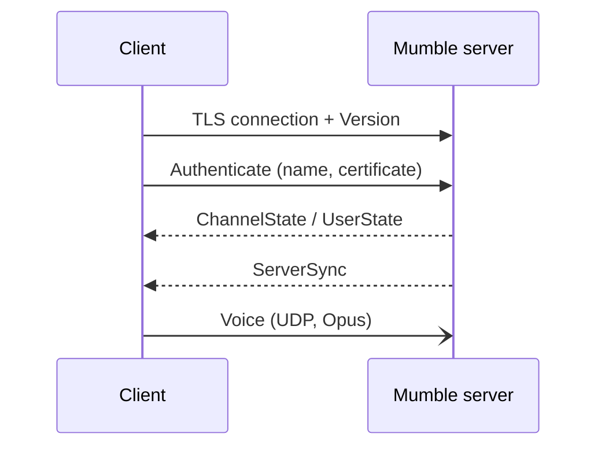
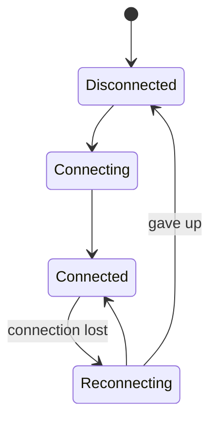

# Brainstorming file format

Once the first brainstorming is finished, use it (e.g. `specs/01-…-brainstorming.md`) as the reference example of this format.

## File header (written once, when the file is created)

```markdown
# Epic {N} – {Title} · Brainstorming

> Basis: `specs/roadmap.md` → Epic {N}   (or: "Standalone feature, not part of the roadmap")
> Process: We work in several rounds. Each round contains questions; you answer directly in this file.
> Once all questions are answered, `specs/{nr}-{name}-specification.md` is created from it.
> Already settled (not asked again): {short list referencing earlier specs, e.g. "Tech stack & platforms → Spec 01"}

## How to answer

- **Single choice** (`◉`): Exactly **one** box has an `[x]`. To change your choice, just move the `x`.
- **Multiple choice** (`☑`): Tick as many boxes as you like.
- ⭐ marks my **recommendation**. It is already preselected. If you agree, you don't need to change anything.
- Below each question there is `✍️ Note:`. Add anything there, e.g. questions back, edge cases or "not sure, explain this to me".
- I explain technical terms briefly. For purely technical questions (audio, network, protocol) it's perfectly fine to follow my recommendation.

## Planned rounds

1. Functionality & scope
2. UI & UX
3. Audio & network
4. Technology & platforms
5. Data/state model & open points

(The plan may change depending on the answers.)

---
```

Don't use a status column or checkboxes in the plan. The file is append-only, so status markers could never be updated.

## A round

```markdown
## Round {R} – {Topic}

{Optional: 1–3 sentences of context and/or a visualization (Mermaid / ASCII wireframe / table).}

### {Letter} · {Topic block}

#### Q{R}.{n} {Concrete question}? `◉`
{Optional: 1–2 sentences of context in plain language. Why does it matter, what does it mean for the user?}

- [x] ⭐ **{Recommended option}.** {Short reason.}
- [ ] {Alternative}. {Short trade-off.}
- [ ] {Alternative, e.g. "Later / not in MVP"}

✍️ Note:

#### Q{R}.{n} {Multiple-choice question}? `☑`

- [x] ⭐ {Recommended}
- [x] ⭐ {Recommended}
- [ ] {Optional / later}

✍️ Note:

---
```

Rules:
- Question IDs are `Q{round}.{running number within the round}`. They are never reused or renumbered.
- For `◉` questions exactly one option is `[x]`, the ⭐ one. For `☑` questions every ⭐ option is `[x]`.
- Bold the recommended option's label.
- End each round with `---`.

## Follow-ups section (start of a round, when needed)

```markdown
### Follow-ups & explanations for round {R-1}

**On Q{R-1}.{n}:** {Explanation in plain language, with an example or diagram if useful.}

#### Q{R}.{n} {Question asked again / refined}? `◉`
...
```

## Visualization snippets

ASCII wireframe (main window):

```text
┌──────────────────────────────────────────────────────────────┐
│ ● Connected: voice.example.org   🎙 PTT  🔇  🎧   ⚙          │
├──────────────────────────────┬───────────────────────────────┤
│ ▾ Root                       │  #Lobby                        │
│   ▾ Lobby               (3)  │  [12:01] Anna: hi all          │
│      🟢 Anna 🎙              │  [12:02] Ben: hey              │
│      ⚪ Ben                  │                                │
│      ⚪ Tobias (you)         │                                │
│   ▸ Gaming              (5)  │                                │
│   ▸ AFK                 (1)  ├───────────────────────────────┤
│                              │  Message #Lobby…         [➤]   │
└──────────────────────────────┴───────────────────────────────┘
```

Mermaid sequence diagram (connection flow):

````markdown

````

Mermaid state diagram (connection states):

````markdown

````

## Closing note (appended when done)

```markdown
## Closing

{Date}: All rounds answered. The specification has been created: `specs/{nr}-{name}-specification.md`.
```
