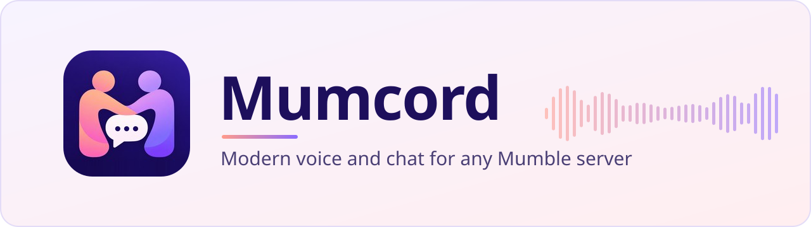

<p align="center">
  
</p>

<p align="center">
  <a href="https://github.com/Mumcord/mumcord/releases/latest"></a>
  <a href="https://github.com/Mumcord/mumcord/actions/workflows/ci.yml"></a>
  <a href="https://github.com/Mumcord/mumcord/releases"></a>
  <a href="LICENSE"></a>
  
  <a href="https://crates.io/crates/mumcord-protocol"></a>
</p>

<p align="center">
  <b>A modern desktop voice client for gaming groups and communities, on the Mumble servers you already run.</b><br />
  <a href="https://mumcord.app">Website</a> ·
  <a href="https://github.com/Mumcord/mumcord/releases/latest">Download</a> ·
  <a href="https://github.com/Mumcord/mumcord/wiki">Wiki</a> ·
  <a href="CHANGELOG.md">Changelog</a>
</p>

<picture>
  <source media="(prefers-color-scheme: light)" srcset="docs/images/screenshots/main-light.png" />
  
</picture>

## Why Mumcord

- **Works with any standard Mumble server.** A pure client: nothing to install or change on the server. Mumble 1.4 and newer are fully supported.
- **Chat that feels current.** Replies, quotes, images, link previews, mentions and history sync, next to low-latency Mumble voice.
- **Several servers at once, your colours.** Stay connected to up to 5 servers (configurable up to 15) and pick or build themes, per server if you like.
- **Privacy first.** No telemetry, TLS always on, your identity kept in the system's secure storage, and every network connection documented.

## Features

|                                           |                                                                                                                                                                                                                                                                                        |
| ----------------------------------------- | -------------------------------------------------------------------------------------------------------------------------------------------------------------------------------------------------------------------------------------------------------------------------------------- |
| **Voice**                                 | Push-to-talk (keys and mouse buttons, also on Wayland) or voice activation · AI noise suppression, echo cancellation and automatic gain · music quality · per-person volume · positional audio with the official game plugins **(Beta)**                                               |
| **Chat**                                  | Images, link previews and player cards · message cards for bot and status messages · replies and quotes · @mentions · code highlighting · history sync between Mumcord users · full-size images on demand **(Beta)** · follow text channels without joining · rich-text comment editor |
| **Multi-server and themes**               | Up to 5 servers connected (1–15), voice on one, chat and badges on all · auto-connect at start · preset and custom colour themes, each in dark and light · share a theme as a code, set one per server                                                                                 |
| **Watch party and screen sharing (Beta)** | Watch YouTube together with a shared playlist **(Beta)** · share a window or screen with up to 8 people at up to 720p30 over a direct connection **(Beta)**                                                                                                                            |
| **In-game overlay**                       | See who is talking in game: Vulkan layer on Linux (OpenGL launch option, Steam and Proton), click-through window over borderless games on Windows · "Now gaming" status · no overlay on macOS                                                                                          |
| **People**                                | Friends, full profiles with a private note, now playing, connection info (ping, loss, bandwidth) and a weak-connection icon · built for big servers (Ctrl+K search, tested with 1000 people)                                                                                           |
| **Privacy and security**                  | No telemetry · TLS with certificate checks and clear warnings · identity in the OS secure storage · link previews behind a privacy switch · logs without chat, names or audio                                                                                                          |
| **Everywhere**                            | Windows, macOS and Linux (X11 and Wayland) · all 24 official EU languages · keyboard operation, screen-reader labels, system theme                                                                                                                                                     |

More in the wiki: [Features](https://github.com/Mumcord/mumcord/wiki/Features). Mumcord is in early development; expect rough edges, especially in Beta features.

## Download

Get the latest build from the [Releases page](https://github.com/Mumcord/mumcord/releases/latest). Every release ships a `SHA256SUMS` file to check your download.

| System                     | Package                                     | Notes                                                                                                                                                      |
| -------------------------- | ------------------------------------------- | ---------------------------------------------------------------------------------------------------------------------------------------------------------- |
| **Windows** 10/11          | `*-setup.exe` installer or `*-portable.zip` | Not code-signed yet: SmartScreen warns, choose "More info" → "Run anyway". Portable: unpack and run, no installation ([details](docs/windows-portable.md)) |
| **macOS**                  | `.dmg`, Apple Silicon and Intel             | Signed and notarized since 0.4.1                                                                                                                           |
| **Linux** x86_64 and ARM64 | `.deb`, `.rpm`, `.AppImage`                 | The `.deb` and `.rpm` pull in everything they need                                                                                                         |
| **Arch Linux**             | AUR `mumcord-bin`                           | `paru -S mumcord-bin` or `yay -S mumcord-bin`                                                                                                              |

**Linux one-liner** (picks the right package for your distribution, falls back to the AppImage):

```sh
curl -fsSL https://github.com/Mumcord/mumcord/releases/latest/download/install.sh | sh
```

To remove Mumcord, add `-s -- --uninstall` after `sh`.

- **macOS Local Network:** macOS 15 and later ask whether Mumcord may find devices on your local network. Allow it, or servers in your home network fail with "No route to host" (change it later in System Settings → Privacy & Security → Local Network).
- **Linux installer:** the one-liner shows numbered steps and offers to install gst-libav (H.264) when it is missing.
- **Linux H.264 for watch parties:** the AppImage plays YouTube via VP9 but does not bundle H.264 (gst-libav). Install gst-libav if a video does not play; the player shows a hint when a codec is missing.

<details>
<summary><b>Linux: GStreamer plugins for watch parties</b></summary>

The `.deb`, `.rpm` and AUR packages install the GStreamer plugins WebKitGTK needs to play YouTube. The AppImage bundles its own plugins (without H.264) and also loads the ones installed on the system. On other distributions, or for H.264 with the AppImage:

- Debian, Ubuntu: `sudo apt install gstreamer1.0-plugins-good gstreamer1.0-plugins-bad gstreamer1.0-libav`
- Fedora: `sudo dnf install gstreamer1-plugins-good gstreamer1-plugins-bad-free gstreamer1-libav` (`gstreamer1-libav` may need [RPM Fusion](https://rpmfusion.org/))
- Arch, CachyOS, Manjaro: `sudo pacman -S gst-plugins-good gst-plugins-bad gst-libav`
- openSUSE: `sudo zypper install gstreamer-plugins-good gstreamer-plugins-bad gstreamer-plugins-libav`

</details>

<details>
<summary><b>Linux: flickering or slow rendering</b></summary>

Mumcord sets `WEBKIT_DISABLE_COMPOSITING_MODE=1` at startup because WebKitGTK 2.54 flickers with the watch-party video otherwise. To keep WebKit's default compositing, start Mumcord with `MUMCORD_WEBKIT_COMPOSITING=1`. A `WEBKIT_DISABLE_COMPOSITING_MODE` you set yourself is never overwritten.

</details>

<details>
<summary><b>Screen sharing (Beta): what each system supports</b></summary>

Screen sharing needs a direct connection between the person sharing and each viewer (allowed once in a dialog, changeable in _Settings → Privacy_). Mumcord uses no outside server to set it up, so it works when one side has IPv6 or a home router that allows port mapping (UPnP, NAT-PMP or PCP), or when both are on the same network. Behind carrier-grade NAT or two routers without port mapping, that pair cannot watch; Mumcord says so after a short wait.

|                    | Picture                                                                                                                                                                 | Sound                                                                                      |
| ------------------ | ----------------------------------------------------------------------------------------------------------------------------------------------------------------------- | ------------------------------------------------------------------------------------------ |
| **Windows**        | Windows 10 version 1903 or newer; the system picker offers windows and screens                                                                                          | Only the shared app's sound, Windows 10 version 2004 or newer; no sound for a whole screen |
| **macOS**          | macOS 14 or newer with the system picker (window, app or screen); macOS 12.3 and 13 share the whole main screen; needs the "Screen & System Audio Recording" permission | Only the shared content's sound, never Mumcord's own; macOS 13 or newer                    |
| **Linux, Wayland** | The desktop's picker (xdg-desktop-portal with PipeWire) chooses a window or screen                                                                                      | No sound                                                                                   |
| **Linux, X11**     | Whole screen only                                                                                                                                                       | No sound                                                                                   |

Up to 8 people can watch one share; the quality drops automatically to 480p at 15 frames per second when the upload is too slow.

</details>

## Compatibility

- **Unmodified servers.** Mumcord speaks the standard Mumble protocol and needs nothing on the server: no plugins, no companion service, no config changes. Mumble 1.4 and newer are fully supported; older servers work on a best-effort basis and features they lack are hidden.
- **Mumcord extras ride on plugin data.** Features like history sync, full-size images, watch parties and screen-share signalling travel over Mumble's standard plugin data channel ([Plugin data protocol](https://github.com/Mumcord/mumcord/wiki/Plugin-Data-Protocol)).
- **Mixed rooms just work.** People on the official Mumble client still see normal chat: replies arrive as readable quotes, and Mumcord-only features stay invisible to them.

Mumcord is compatible with Mumble but **not affiliated with or endorsed by the Mumble project**, and does not use the Mumble logo.

## Ecosystem

| Project                                                                                                          | What it is                                                                                            |
| ---------------------------------------------------------------------------------------------------------------- | ----------------------------------------------------------------------------------------------------- |
| [Mumcord/mumbot](https://github.com/Mumcord/mumbot)                                                              | Webhook bot for posting into Mumble channels, and the scripted test bot the E2E tests use             |
| [Mumcord/mumpeer](https://github.com/Mumcord/mumpeer)                                                            | Planned optional relay for direct connections when no direct path is possible                         |
| [`mumcord-protocol`](https://crates.io/crates/mumcord-protocol)                                                  | Rust library for the Mumble protocol                                                                  |
| [`mumcord-codec`](https://crates.io/crates/mumcord-codec)                                                        | Opus codec, jitter buffer, mixer and processing chain, without audio devices (good for headless bots) |
| [`mumcord-audio`](https://crates.io/crates/mumcord-audio)                                                        | Audio device input and output on top of `mumcord-codec`                                               |
| [`mumcord-store`](https://crates.io/crates/mumcord-store), [`mumcord-p2p`](https://crates.io/crates/mumcord-p2p) | Local storage and direct connections, on crates.io since 0.4.3                                        |

## Roadmap

| Stage                                                                       | Status                                                                              |
| --------------------------------------------------------------------------- | ----------------------------------------------------------------------------------- |
| Epic 1: Foundation (everyday client, chat, in-game, people)                 | Released, 0.1.0 to 0.3.1                                                            |
| Epic 2: Multi-server and themes, watch party and screen sharing             | Released, 0.4.0 to 0.4.3                                                            |
| Epic 3: Comfort and polish (hotkeys, tray, whisper, Do Not Disturb, …)      | Planned, see the [Epic 3 milestone](https://github.com/Mumcord/mumcord/milestone/2) |
| Epics 4 to 6: admin features, signed installers and auto-update, GIF search | Later                                                                               |

Details: [Roadmap](https://github.com/Mumcord/mumcord/wiki/Roadmap) in the wiki.

## Documentation

- [Wiki home](https://github.com/Mumcord/mumcord/wiki): features, installation, architecture, testing
- [Installation](https://github.com/Mumcord/mumcord/wiki/Installation) and [Troubleshooting](https://github.com/Mumcord/mumcord/wiki/Troubleshooting)
- [Plugin data protocol](https://github.com/Mumcord/mumcord/wiki/Plugin-Data-Protocol) for bots and integrations
- [Changelog](CHANGELOG.md) for what each release added

## Troubleshooting

For bug reports, use **Settings → Diagnostics → Save diagnostic file**: app version, OS, audio devices, connection statistics and recent log lines, with no chat, passwords or certificates. Mumcord also has a hidden [packet inspector](docs/packet-inspector.md) for debugging plugin data (click the version in About seven times). Then [open an issue](https://github.com/Mumcord/mumcord/issues/new/choose).

| System  | Log folder                                                                                      |
| ------- | ----------------------------------------------------------------------------------------------- |
| Windows | `%LOCALAPPDATA%\app.mumcord.client\logs\` (portable: `MumcordData\logs\` next to `Mumcord.exe`) |
| macOS   | `~/Library/Logs/app.mumcord.client/`                                                            |
| Linux   | `~/.local/share/app.mumcord.client/logs/`                                                       |

Logs contain no chat, names or audio. Known problems and fixes: [Troubleshooting](https://github.com/Mumcord/mumcord/wiki/Troubleshooting) and [docs/troubleshooting.md](docs/troubleshooting.md).

## Building from source

You need Rust 1.90+, Node.js 24 and the platform libraries listed on the wiki's [Building](https://github.com/Mumcord/mumcord/wiki/Building) page. Then:

```sh
git clone https://github.com/Mumcord/mumcord.git && cd mumcord
npm ci
npm run tauri dev
```

<details>
<summary><b>Checks, release packages and test setup</b></summary>

- Message cards: how bots and people write them is in [docs/message-cards.md](docs/message-cards.md).
- Version: a local build shows `dev~YYYYMMDD` in Settings → About and in the diagnostics file, plus `-dirty` when the tree has uncommitted changes; set `MUMCORD_VERSION` to override it. Release and CI versions: [RELEASING.md](RELEASING.md#versions).
- Release packages: `npm run tauri build`; bundles land in `target/release/bundle/`. Windows and macOS link a static libvpx, see [RELEASING.md](RELEASING.md#static-libvpx).
- Checks before a pull request:

  ```sh
  cargo fmt --all --check
  cargo clippy --workspace --all-targets --locked -- -D warnings
  cargo test --workspace --locked
  npm run lint && npm run typecheck && npm test
  ```

- Local Mumble servers for manual and automated tests: [`testenv/README.md`](testenv/README.md). Never test against public servers.
- UI end-to-end tests (`npm run e2e`, needs Docker): [`e2e/README.md`](e2e/README.md).
- Manual checklists: [release 0.4.0](docs/manual-checklist-0.4.0.md), [screen sharing on Windows](docs/screen-share-windows.md) and [on macOS](docs/screen-share-macos.md); measurements in [docs/screen-share-performance.md](docs/screen-share-performance.md).
- Third-party notices are generated by CI for every release (and a pull request updates them after dependency changes on `main`); to check them locally run `scripts/generate-notices.sh`.
- Maintainers: cutting a release is described in [RELEASING.md](RELEASING.md).

</details>

## Contributing

Bug reports and ideas are welcome via the [issue templates](https://github.com/Mumcord/mumcord/issues/new/choose). For code, read [CONTRIBUTING.md](CONTRIBUTING.md) first: contributions require agreeing to the CLA described there.

## Privacy

Mumcord sends no telemetry. Every network connection it makes is listed in the [privacy policy](PRIVACY.md).

## Code signing

macOS builds are signed and notarized. Windows releases will be signed with Azure Artifact Signing once the setup is active. What is signed, and who builds, reviews and publishes signed releases, is in the [code signing policy](CODE_SIGNING.md).

## Licence

Mumcord is licensed under the [GNU AGPL v3 only](LICENSE) from version 0.2.0. Versions up to and including 0.1.1 were released under the MIT License and stay MIT for those who have them.

Third-party licences, including Mumble's BSD licence for the protocol definitions in `proto/`, are listed in [`THIRD_PARTY_NOTICES`](THIRD_PARTY_NOTICES).
