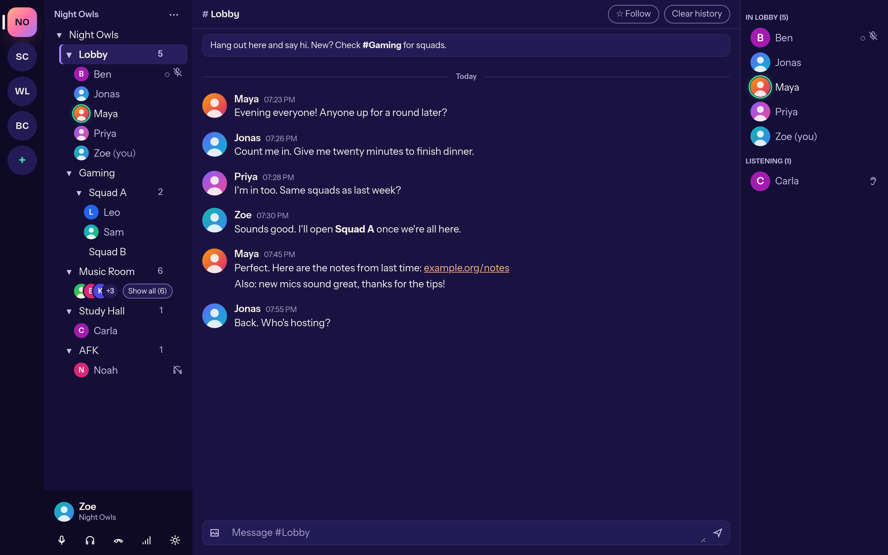

  

# Mumcord

Mumcord is a modern, Discord-style desktop voice chat client for gaming groups and online communities. It is built with Rust, Tauri 2 and React/TypeScript.

Website: **[mumcord.app](https://mumcord.app)** · Wiki: [github.com/ToBee94/mumcord/wiki](https://github.com/ToBee94/mumcord/wiki) · Website source: [mumcord-www](https://github.com/ToBee94/mumcord-www)

Mumcord is **compatible with Mumble**. It is **not affiliated with or endorsed by the Mumble project**. "Mumble" is the name of that project; Mumcord does not use the Mumble logo.

## What it is

- A pure client: it speaks the Mumble protocol and works with unmodified, standard Mumble servers. Nothing needs to be installed or changed on the server.
- Mumble servers 1.4 and newer are fully supported. Older servers are supported on a best-effort basis; features they lack are hidden.

## Status

Early development (Epic 1). Expect missing features and rough edges. See `specs/01-foundation-specification.md` for the scope.

Test builds for Windows and macOS are unsigned. The operating system will show a security warning when you start them.

## Download

Installers for Windows (`.exe`), macOS (`.dmg`, Apple Silicon and Intel) and Linux (`.AppImage`) are on the [Releases page](https://github.com/ToBee94/mumcord/releases), each with a `SHA256SUMS` file to check the download. Each release's notes say whether its Windows and macOS builds are signed; unsigned builds show a security warning on first start, and the notes explain how to open the app anyway.

## Code signing policy

Windows releases are signed through SignPath once the SignPath Foundation setup is active. Free code signing provided by [SignPath.io](https://about.signpath.io), certificate by [SignPath Foundation](https://signpath.org). Who builds, reviews and approves signed releases is described in the [code signing policy](CODE_SIGNING.md).

## Privacy

Mumcord sends no telemetry. Every network connection it makes is listed in the [privacy policy](PRIVACY.md).

Maintainers: how to cut a release is described in [RELEASING.md](RELEASING.md).

## Building from source

### Prerequisites

- Rust, stable toolchain, 1.90 or newer (`rustup`), with the `rustfmt` and `clippy` components.
- Node.js 24 (the version CI uses) and npm.
- No `protoc` is needed: the protobuf compiler is vendored (`protoc-bin-vendored`).
- Linux, Debian/Ubuntu (24.04 in CI):

      sudo apt-get install -y --no-install-recommends \
        libwebkit2gtk-4.1-dev libayatana-appindicator3-dev librsvg2-dev \
        libxdo-dev libasound2-dev cmake patchelf xdg-utils build-essential pkg-config libssl-dev

- Linux, Arch/CachyOS:

      sudo pacman -S --needed base-devel webkit2gtk-4.1 libayatana-appindicator librsvg \
        xdotool alsa-lib cmake openssl pkgconf patchelf xdg-utils

- Windows: Visual Studio Build Tools with the "Desktop development with C++" workload (MSVC), and the WebView2 runtime (preinstalled on Windows 11).
- macOS: Xcode command line tools (`xcode-select --install`).

### Get the code and run

    git clone <repository-url> mumcord && cd mumcord
    npm ci
    npm run tauri dev

### Build release packages

    npm run tauri build

Bundles land in `target/release/bundle/`: `appimage/*.AppImage` (Linux), `nsis/*-setup.exe` (Windows), `dmg/*.dmg` and `macos/*.app` (macOS). Each OS builds only its own formats. To build a single format, pass `-- --bundles appimage` (or `nsis`, `dmg`). The packages are unsigned; Windows and macOS show a security warning on first start.

### Checks

    cargo fmt --all --check
    cargo clippy --workspace --all-targets --locked -- -D warnings
    cargo test --workspace --locked
    npm run lint
    npm run typecheck
    npm test

`npm run build` type-checks and builds the frontend only.

### Optional

- Local Mumble servers for manual and automated tests: [`testenv/README.md`](testenv/README.md). Do not test against public servers.
- UI end-to-end tests (`npm run e2e`, needs Docker): [`e2e/README.md`](e2e/README.md).
- After dependency changes, regenerate the third-party notices with `scripts/generate-notices.sh`.

## Licenses

Mumcord is licensed under the [GNU AGPL v3 only](LICENSE) from version 0.2.0. Contributions require agreeing to the CLA described in [CONTRIBUTING.md](CONTRIBUTING.md). Versions up to and including 0.1.1 were released under the MIT License and stay MIT for those who have them.

Third-party licenses, including Mumble's BSD license for the protocol definitions in `proto/`, are listed in [`THIRD_PARTY_NOTICES`](THIRD_PARTY_NOTICES). Regenerate it with `scripts/generate-notices.sh` when dependencies change.
