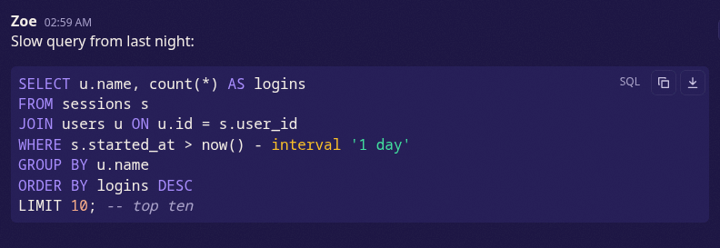

# Code blocks

A code block (three backticks, optionally followed by a language) shows as a highlighted block
with the language in its corner and Copy and Download buttons. Issues: #111, #112.



## Languages

| Write after the fence                                                                                        | Highlighted as |
| ------------------------------------------------------------------------------------------------------------ | -------------- |
| `bash`, `sh`, `shell`, `zsh`                                                                                 | Bash           |
| `cmd`, `bat`, `batch`                                                                                        | Windows batch  |
| `python`, `py`                                                                                               | Python         |
| `rust`, `rs`                                                                                                 | Rust           |
| `javascript`, `js`                                                                                           | JavaScript     |
| `typescript`, `ts`                                                                                           | TypeScript     |
| `cpp`, `c++`                                                                                                 | C++            |
| `yaml`, `yml`                                                                                                | YAML           |
| `c`, `csharp`, `css`, `diff`, `go`, `html`, `ini`, `java`, `json`, `sql`, `xml`                              | as named       |
| `php`, `ruby`, `kotlin`, `swift`, `lua`, `powershell`, `dockerfile`, `toml`, `markdown`, `makefile`, `nginx` | as named       |
| `plaintext`                                                                                                  | no colours     |
| `hex`                                                                                                        | hex dump       |

- Names are not case sensitive. An unknown name shows the block as plain text with that name as
  its label; Mumcord does not guess.
- Without a name, and for code from other Mumble clients, Mumcord detects the language from a
  common set (Bash, C, C++, C#, CSS, Diff, Go, INI, Java, JavaScript, JSON, Python, Rust, SQL,
  TypeScript, XML, YAML) and shows no label.
- `hex` understands `hexdump -C` and `xxd` output (offset, bytes, ASCII column) and free-form hex
  such as `48 65 6c`, `0x48, 0x65` or `\x48\x65`; zero bytes are dimmed.
- The less common grammars (PHP to nginx in the table) are loaded the first time a message uses
  them, so they do not slow down the start.

## Copy and Download

- The buttons appear when the pointer is over the block or a button has keyboard focus.
- Copy puts the plain code on the clipboard, without colours.
- Download saves the code as `snippet.<ext>` (for example `snippet.sql`, `.txt` when the language
  is unknown) through the system's save dialog. Blocks above 1 MiB are not saved.

## Wire format

Mumble strips the `class` attribute, so the language travels as a data attribute on the `<pre>`:

```html
<pre data-mumcord-lang="sql"><code>SELECT 1;
</code></pre>
```

- The value is the name as typed, lower-cased: a letter or digit followed by up to 31 of
  `a-z 0-9 + # . _ -`. Anything else is dropped by Mumcord's sanitizers (engine and UI), and
  the attribute is kept on `<pre>` only.
- A standard Mumble server (checked against mumble-server 1.5.735 from `testenv`) passes the
  attribute through unchanged; official clients ignore it and show a normal code block.
- Bots and scripts can send the same HTML to get the same highlighting.
