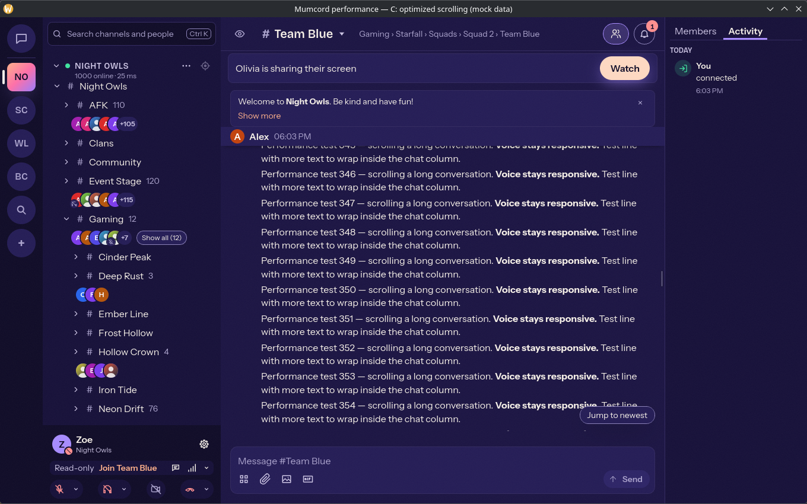
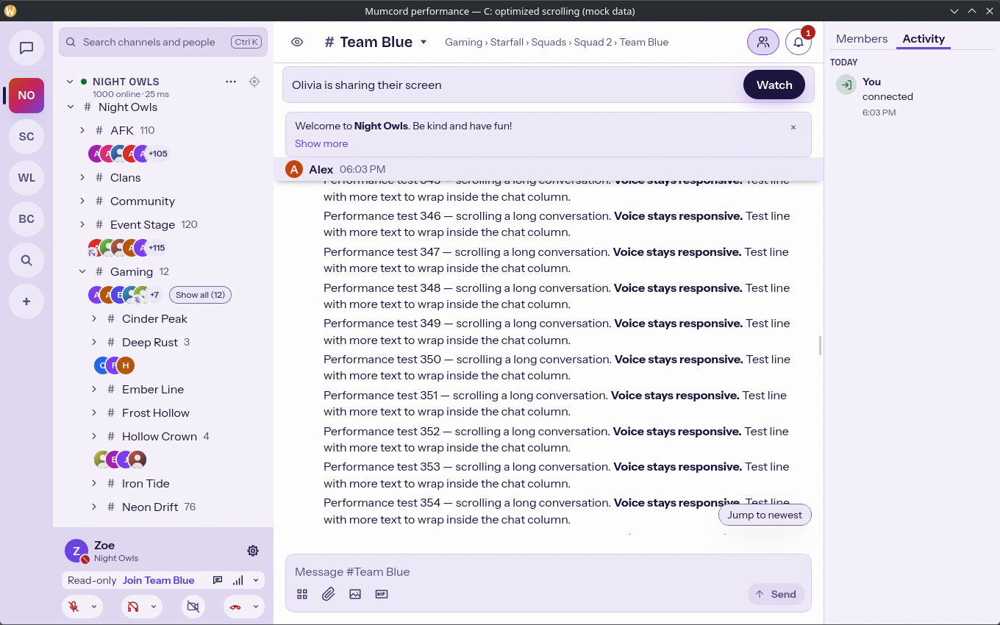
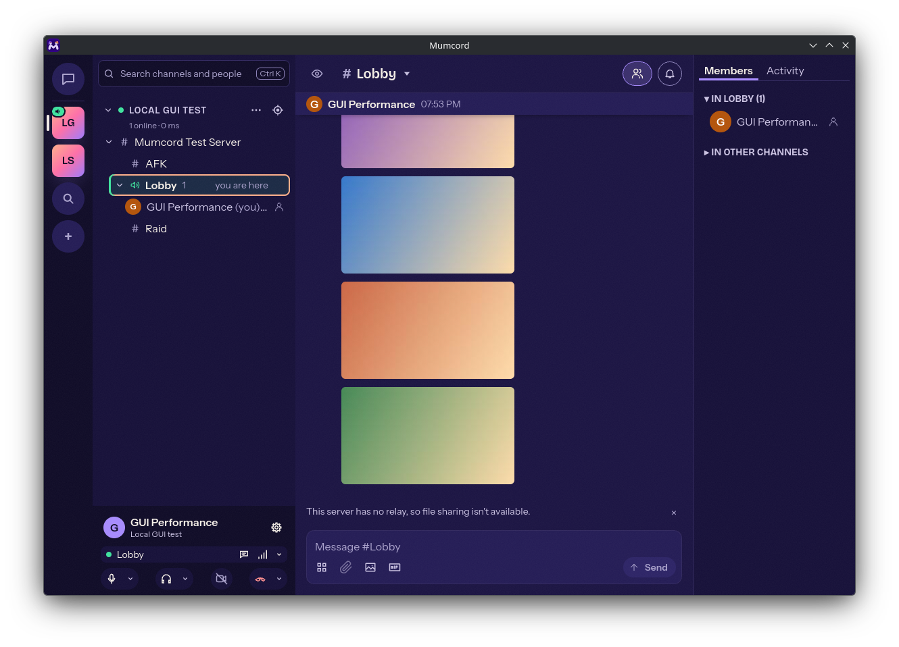
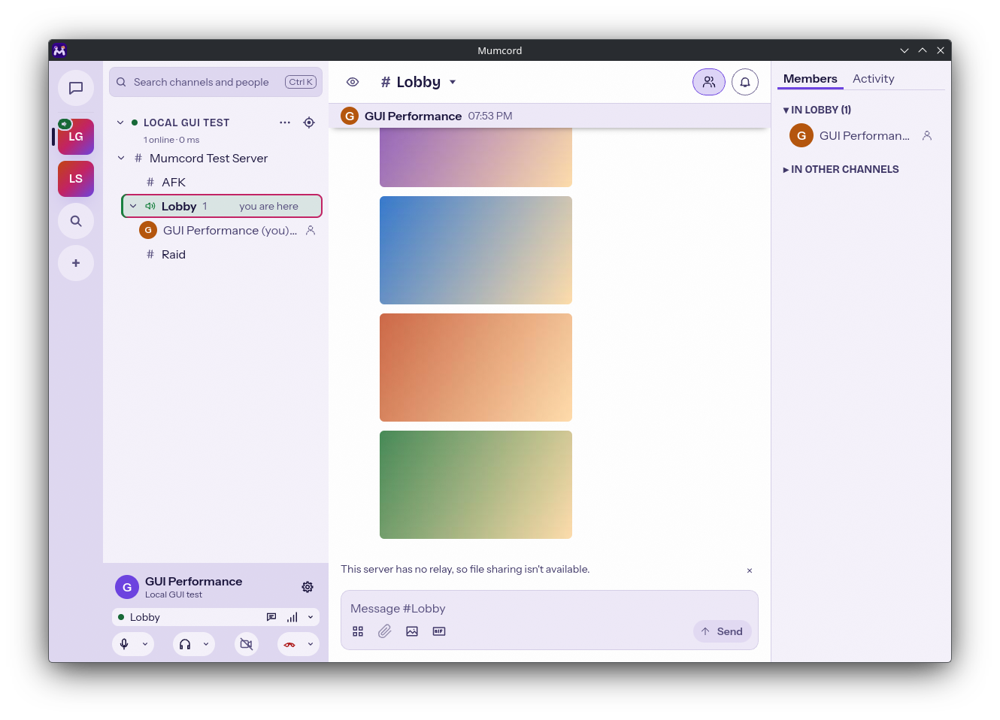

# GUI performance audit

The audit produced four bounded changes without changing the UI design: fewer chat geometry reads, cached member-list membership and name order, native base64 decoding where available, and faster fallback video colour conversion directly into the transport buffer. Operation-count reductions and conversion timings below are **not** claims of an equivalent improvement in overall CPU use or displayed frame rate.

The measurements were taken against baseline `3035d328` and the original improvement commits, before these changes were rebased onto `milestone/0.9.0`. They are historical results, not a fresh performance comparison of the milestone's newer media implementation. The checks listed under validation also describe that original audit.

## Chat scrolling

### Scope and environment

Measured on 2026-11-14 in the host's visible KDE Wayland session, using the production React build in a GTK 3 / WebKitGTK 4.1 window (WebKitGTK 2.54.2). The GPU was an AMD Radeon R9 M360, using Mesa 26.2.6 / radeonsi. EGL reported hardware acceleration, and the WebKit processes opened the AMD render node, `/dev/dri/renderD129`.

The UI used the existing `stress` mock: approximately 305 channels and 1,000 people. Six hundred synthetic messages were injected; the live chat store retained and rendered 500. The window's content area was 1360 × 820 pixels. No Mumble server was contacted. These measurements cover the UI and its actual Linux rendering engine, **not** Tauri IPC, networking, audio or video playback.

### Results

The comparable before/after runs both used `WEBKIT_DISABLE_COMPOSITING_MODE=1`, matching Mumcord's current Linux safeguard. Each run scrolled the same 500-row conversation for 360 animation frames, following a sinusoidal path between 200 pixels from the top and bottom. `Element.prototype.getBoundingClientRect` was temporarily instrumented to count geometry reads; its original implementation was restored afterwards.

| Metric                          |   Before |    After |
| ------------------------------- | -------: | -------: |
| Scroll events                   |      360 |      360 |
| Geometry reads                  |  285,553 |    8,262 |
| Geometry reads per scroll event |    793.2 |     22.9 |
| Frame interval, p95             |    17 ms |    18 ms |
| Frame intervals above 25 ms     |        0 |        0 |
| Elapsed time                    | 5,987 ms | 5,988 ms |

This is approximately **97% fewer geometry reads**, not a 97% improvement in overall frame rate or CPU use. Both versions already reached the display's approximately 60 Hz refresh rate in this workload. Instrumentation adds overhead; the counts are more meaningful than small differences in individual frame timings.

The old scroll handler measured every message for the pinned-author banner, then walked older rows again to find the reading-position anchor. The new code finds the first visible row with binary search. It locates the current author's group using header presence and measures only its header and final row. Header lookup still walks the group; this change does not claim that all scrolling work is logarithmic. Missing refs use a safe linear search.

A regression test first reproduced 86 geometry reads for one scroll through 30 messages. It now requires fewer than 20 reads while checking the pinned author's name. Additional tests cover group boundaries, missing refs, exact viewport edges and geometry-read budgets with 1,024 rows. The existing history-sync tests continue to check that inserting earlier messages preserves the reading position.

## Acceleration and CSS experiments

Enabling WebKit's default accelerated compositing with `WEBKIT_DISABLE_COMPOSITING_MODE=0` did not produce a clear scrolling improvement: the initial 500-row run had a 17 ms median and an 18 ms p95 frame interval, versus 17 ms for both with the current policy. Both modes accessed the AMD GPU; disabling accelerated compositing is not the same as forcing every rendering operation onto the CPU.

Temporary `contain: layout paint` and `content-visibility: auto` rules also showed no clear benefit at the display's refresh-rate limit. Those rules were removed. The latter can additionally affect scroll geometry, while paint containment can clip message controls.

**Recommendation:** keep the existing compositing safeguard. Do not change the global Linux rendering policy without a separate embedded-video/watch-party flicker regression test; that safeguard exists for a known WebKitGTK 2.54 issue. The later native screen-share comparison below does not establish that embedded video is flicker-free.

## Native-client audit

### Method and limits

The second phase used the real Tauri client with the production, non-mock React build, `custom-protocol` and `test-backend`. It ran visibly in the same desktop session, with a disposable profile, throwaway identity, private D-Bus/Secret Service and local Mumble servers. The user's actual profile and keyring were not used. The audio backend was `null`: real protocol/talking events were exercised, but physical microphone, speaker and device performance were not measured.

The frontend was production-built, but the full native executable used **unoptimized development Rust** with debug information disabled. Its absolute CPU and decoded-video throughput are not release-performance measurements. The isolated Rust conversion benchmark below was separately compiled with `rustc -O`.

Process-tree CPU is the change in `/proc` user/system CPU ticks over each measurement, expressed as a percentage of one core. Frame intervals come from `requestAnimationFrame`; callback counts are not a count of physically displayed frames. The display must stay awake. No compilation or test suite ran alongside the reported workloads.

### Member lists during voice activity

The local scale fixture contained 305 channels and 1,007 users, including six scripted speakers and the client. The populated Welcome Lobby was selected with the Members sidebar open, at 1200 × 800 content pixels. Each version received three 10-second talking trials after connection and rendering had settled.

| Metric, median of three trials                     | Before |  After |
| -------------------------------------------------- | -----: | -----: |
| Name comparisons per 10 seconds                    | 23,094 |    318 |
| Web renderer CPU, percent of one core              | 12.19% | 12.18% |
| Whole client process-tree CPU, percent of one core | 31.17% | 31.35% |
| Animation callback interval, p95                   |  17 ms |  17 ms |

The old Members panel filtered the server's users and sorted the selected channel's names again for talking-only updates. Membership and alphabetical sorting are now memoized by the users map and selected channel. Talking-first ordering is still applied separately, so the optional speaker prioritization, listener rules and keyboard order are preserved. Real membership/name changes still invalidate the cache.

The approximately **99% reduction in name comparisons did not produce a measurable overall CPU or frame-rate gain in these trials**. The native workload still includes other user updates that legitimately require sorting. The focused regression test requires exactly zero name comparisons for a talking-only change and checks the live indicator. Other tests cover talking-first ordering, renames, moves, listener changes, removal, bots and channel selection.

### Base64 media conversion

Images, audio cards and received files share a feature-detected `Uint8Array.fromBase64` decoder, with the existing `atob`/byte-loop fallback for older webviews. Callers retain their existing invalid-input handling. A native-WebKit microbenchmark ran each method five times per size:

| Decoded bytes | Previous loop, median | Native decoder, median |
| ------------- | --------------------: | ---------------------: |
| 128 KiB       |                  2 ms |                   1 ms |
| 1 MiB         |                  5 ms |                   2 ms |
| 8 MiB         |                 29 ms |                  11 ms |
| 16 MiB        |                 59 ms |                  25 ms |

These are isolated conversion timings, **not** end-to-end image-load or file-transfer timings. The largest inputs exceed the ordinary local server's inline-message limit. A separate native UI smoke test pasted and sent four small synthetic JPEGs through the real composer; all four rendered at 256 × 144 without JavaScript errors. That small-inline-image path did not call the shared decoder and is a rendering/behaviour check, not evidence of its speedup.

### Fallback video conversion

Webviews that cannot decode a received codec use Rust's I420-to-RGBA fallback. It now reuses chroma calculations for adjacent pixels and appends pixels directly to the framed IPC buffer instead of allocating a second full picture and copying it. `to_rgba` remains available for other callers.

An optimized standalone harness compiled the real `frame.rs` with `rustc -O`. Each result is the median of seven trials of 20 allocating conversions, with deterministic non-uniform planes. It includes allocation and conversion, but not codec decoding, Tauri IPC or painting:

| Picture     |    Before |     After |
| ----------- | --------: | --------: |
| 1280 × 720  |  3.392 ms |  2.131 ms |
| 1920 × 1080 |  7.777 ms |  4.997 ms |
| 3840 × 2160 | 30.552 ms | 20.660 ms |

That is approximately **32–37% less time in this conversion benchmark**, not a corresponding reduction in total video CPU use. Regression tests compare every pixel against the previous BT.601 calculation across 81 varied odd/even small sizes, including single-pixel dimensions, clipping and non-uniform chroma. They also check that appending preserves an existing header and two consecutive pictures.

### GPU and media checks

Two isolated native clients exchanged a direct VP9 screen share over the local server. The sender used the test capture pattern, without sound. At 1920 × 1080 and a 30 fps target, the viewer submitted and drew 437–442 decoded pictures per 15-second sample. The sampled WebCodecs decode queue was empty before each submission, the animation-callback p95 was 18 ms, and no interval exceeded 25 ms in the comparable encoded-path samples. This did **not** reproduce the scout's suspected growing decoder backlog, so no speculative frame-dropping policy was added.

With WebKit's default accelerated compositing restored via `MUMCORD_WEBKIT_COMPOSITING=1`, the baseline viewer used 75.08% of one core; the normal safeguard used 74.71%. Both had an 18 ms callback p95. These single samples show no useful gain from the override. Deduplicated AMD DRM client counters showed graphics-engine activity in both modes, approximately 1.6–1.8 seconds in the renderer over 15 seconds. The global `gpu_busy_percent` counter was unsupported, so no overall GPU-utilization percentage is claimed.

The GPU's VA-API capabilities did not include VP9 or AV1, and this native build did not include the optional hardware-encoder SDK. These tests do not prove hardware video encode/decode. GPU-assisted painting and accelerated compositing are separate from codec acceleration.

The forced Rust-decoded RGBA screen-share path also rendered correctly before and after the change. In the unoptimized native builds it produced 73 versus 88 canvas draws in 15 seconds; these low-throughput development-build results are **not** a release FPS claim. The optimized conversion benchmark above is the evidence for the Rust change.

A synthetic camera fixture produced 451 own-preview RGBA draws in 15 seconds on a 640 × 360 canvas, with a 17 ms callback p95 and no interval above 25 ms. No physical camera was opened. Received camera-room video could not be tested: the ordinary Mumble server has no optional camera relay and the client correctly reported that limitation. Embedded watch-party/video playback and its known flicker issue remain unverified.

### Other coverage and outstanding work

- Webview navigation entries showed DOM-ready at about 200 ms and first contentful paint at 81–93 ms in individual native launches. These are sparse webview samples, not whole-process startup timings or a demonstrated startup improvement.
- All 13 Settings sections were visited twice and Settings search was exercised without UI alerts or JavaScript errors during that scenario. The initial 33 ms settings-open sample reached only its loading placeholder; it is not a settings-ready measurement.
- Chat reading-position/history-anchor regression tests pass. Large native stored-history loading was not benchmarked.
- Desktop resize automation stalled during media testing. The disposable clients and load generator were stopped and the desktop responded again. The cause was not isolated, and there is no reliable resize before/after result. Resize-under-video remains follow-up work, not a passed acceptance check.
- Channel avatar-stack traversal and other broad subscriptions remain candidates from code inspection. They are not claimed bottlenecks or fixes without measurements.

## Repeating measurements

### Scroll workload

Build the mock UI and serve it on loopback:

```sh
npm ci
VITE_MUMCORD_MOCK=1 VITE_MUMCORD_MOCK_SEED=stress npm run build
python -m http.server 1431 --bind 127.0.0.1 --directory dist
```

From a terminal in the graphical desktop session, open the local page in the system's WebKitGTK MiniBrowser. Its installation path varies by distribution; on this host it was `/usr/lib/webkit2gtk-4.1/MiniBrowser`:

```sh
WEBKIT_DISABLE_COMPOSITING_MODE=1 /usr/lib/webkit2gtk-4.1/MiniBrowser http://127.0.0.1:1431/
```

Open the Web Inspector and run this in its console to create the conversation. This deliberately uses fictional mock data, not the user's saved profile:

```js
const api = window.__mumcordMock;
const pause = (ms) => new Promise((resolve) => setTimeout(resolve, ms));
await api.connect(1, null, null);
await pause(1500);
const snapshot = await api.sessionSnapshot(1);
const self = snapshot.users.find((user) => user.session === snapshot.selfSession);
const conversation = { kind: "channel", channelId: self.channelId };
for (let index = 0; index < 600; index++) {
  api.mock.receiveMessage(
    conversation,
    `<p>Performance test ${index + 1} — scrolling a long conversation. <strong>Sample bold text.</strong> Test line with more text to wrap inside the chat column.</p>`,
    2,
  );
  if (index % 30 === 0) await pause(25);
}
```

To repeat the geometry-read comparison, wait for the messages to finish rendering and run this in the same console:

```js
await pause(1500);
const list = document.querySelector(".chat-list");
const originalMeasure = Element.prototype.getBoundingClientRect;
let reads = 0;
let scrolls = 0;
const countScroll = () => scrolls++;
const intervals = [];
let previous;
const started = performance.now();
Element.prototype.getBoundingClientRect = function (...args) {
  reads++;
  return originalMeasure.apply(this, args);
};
list.addEventListener("scroll", countScroll);
try {
  await new Promise((resolve) => {
    function frame(now) {
      if (previous !== undefined) intervals.push(now - previous);
      previous = now;
      const range = list.scrollHeight - list.clientHeight - 400;
      list.scrollTop = 200 + range * (0.5 + 0.5 * Math.sin((now - started) / 700));
      if (intervals.length < 360) requestAnimationFrame(frame);
      else resolve();
    }
    requestAnimationFrame(frame);
  });
} finally {
  Element.prototype.getBoundingClientRect = originalMeasure;
  list.removeEventListener("scroll", countScroll);
}
const sorted = [...intervals].sort((a, b) => a - b);
console.table({
  scrolls,
  reads,
  readsPerScroll: reads / scrolls,
  p95FrameMs: sorted[Math.floor(sorted.length * 0.95)],
  framesOver25Ms: intervals.filter((ms) => ms > 25).length,
});
```

Also scroll manually, check the pinned author, select and copy text, use keyboard navigation, and insert earlier history. Compare the unchanged and optimized builds with the same window dimensions and rendering policy. Keep the display awake during frame measurements: display power saving can suspend animation frames and invalidate elapsed-time results. For the acceleration comparison, relaunch the renderer with `WEBKIT_DISABLE_COMPOSITING_MODE=0`; changing that variable after WebKit starts is ineffective.

### Native workloads and conversion benchmark

Follow [the local scale fixture instructions](../testenv/scale/README.md) for the large-server setup. Use a production non-mock UI, build the native client with `custom-protocol,test-backend`, and use an isolated profile **and private Secret Service**: changing only XDG directories does not isolate the OS keyring. For automated inspection, a development WebKitGTK build can expose `WEBKIT_INSPECTOR_HTTP_SERVER=127.0.0.1:9232`. Never expose it beyond loopback or point the tests at a real profile or third-party server.

For member-list comparisons, select the populated Lobby, open Members, join its voice channel, let connection/avatars settle and toggle the load generator's talk-file control. Temporarily count `String.prototype.localeCompare` calls for 10 seconds and restore the original method in `finally`. Repeat three times per version, with the same server population and window size. Collect process-tree CPU separately; fewer comparisons alone do not prove lower overall CPU use.

The allocating conversion workload is also provided as a reusable Cargo example:

```sh
CARGO_TARGET_DIR="$HOME/.cache/mumcord-build/gui-perf" \
  cargo run --release --locked -p mumcord-screenshare --example rgba_speed
```

The example uses the same seven-by-twenty workload; Cargo release-profile/link-time settings can affect the absolute timings relative to the standalone harness. Compare unchanged and optimized sources under the same compiler/profile. Remove this dedicated build cache after testing.

Validation for these changes: `npm test -- --run` (321 files, 3,494 tests), production frontend and native builds, TypeScript, ESLint/Prettier, Rust formatting and targeted Rust Clippy with `-D warnings`. Rust library tests for `mumcord` and `mumcord-screenshare` passed 429 tests, with four existing ignored tests. ESLint retains the existing `UpdateCheckPrompt.tsx` fast-refresh warning; there are no new lint errors.

## Screenshots

Actual host-session captures of the optimized mock window, with the reading position away from the bottom and the pinned author visible. The UI design is unchanged.

### Dark



### Light



### Native client, dark and light

The optimized native client connected to the ordinary local server, with the Members sidebar and four pasted synthetic images. These are behaviour/appearance captures, not the large-server benchmark. The light capture uses the same document theme switch as the standard Mumcord theme renderer.




