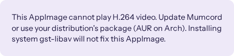

# Issue #567: AppImage H.264 playback hint

## Scope

The original 0.7.0 failure came from loading a newer distribution's gst-libav into the
AppImage's older GStreamer. The compatible, privately bundled FFmpeg/gst-libav decoders from
issue #678 already remove that dependency. Current AppImages deliberately do not load host
plugins, so upgrading the bundled GStreamer just to load a host plugin is no longer needed.

The remaining bug was the player suggesting `sudo pacman -S gst-libav` even in an AppImage,
where that command cannot help. The player now uses the existing AppImage flag from app info
to offer an update or the distribution's package instead. Native/source-build install hints
and FreeBSD decoder hints are unchanged. The new text is translated in all 24 UI languages.

## Checks

- Added an Arch/Fedora AppImage regression test before the fix. It failed with the old
  `Install gst-libav: sudo pacman -S gst-libav` text on Arch.
- The regression now passes. Additional checks keep the hint hidden when H.264 is supported
  or the reported error is unrelated to decoding.
- On `milestone/0.9.0`, `npm test`: 324 files, 3,567 tests passed.
- `npm run build` and `npm run typecheck`: passed.
- `npm run lint`: passed, with the existing Fast Refresh warning in `UpdateCheckPrompt.tsx`.
- Tested the existing official `Mumcord_0.8.0_amd64.AppImage` from this host, not a newly built
  AppImage. The host runs Arch with GStreamer 1.28.9. Extracted the AppImage into an isolated
  temporary build cache and ran `scripts/smoke/check-ffmpeg.py`: LGPL 2.1+, only H.264, AAC
  and AAC-LATM decoders, no encoders. No x264 or OpenH264 libraries/plugins were present.
- Ran `scripts/smoke/check-h264-playback.sh` on the local synthetic H.264/AAC fixture with
  the AppImage's own GStreamer 1.24.2 libraries, plugins, scanner and a fresh registry in an
  Ubuntu 24.04 container on this host. Both decoders came from the AppImage's gst-libav and
  playback passed. Using Arch's 1.28 command-line tools with the bundled 1.24 libraries is
  itself incompatible, so the tools were matched to the AppImage's build base. The minimal
  container reported unrelated missing display-library warnings during plugin scanning.
- No live Twitch stream or public Mumble server was used. Live embed/network behaviour and
  a rebuilt AppImage were not retested; packaging and the playback pipeline are unchanged.

The original issue's ban on all bundled libav predates issue #678. The current specification
and smoke test allow Mumcord's LGPL, decoders-only gst-libav and continue to exclude x264,
OpenH264 and the distribution's unrestricted FFmpeg build. This fix leaves that policy intact.

## Screenshots

Isolated previews of the actual `CodecHint` component and production styles in the browser,
with app info set to an Arch AppImage and the H.264 capability probes set to unavailable.
No third-party player was loaded.

### Dark

### Light

