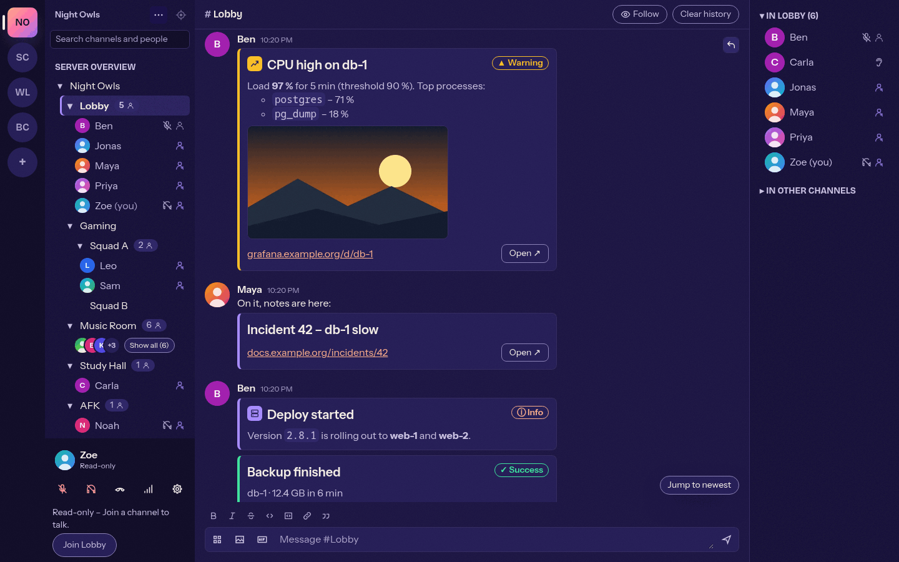
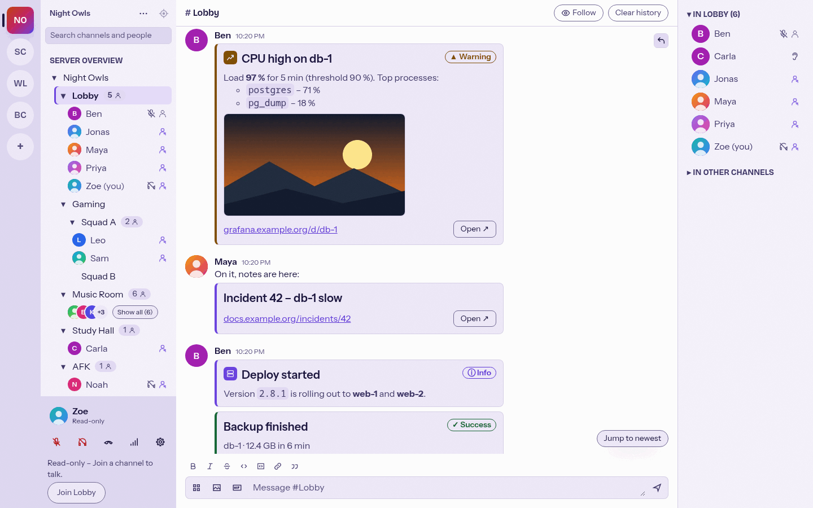
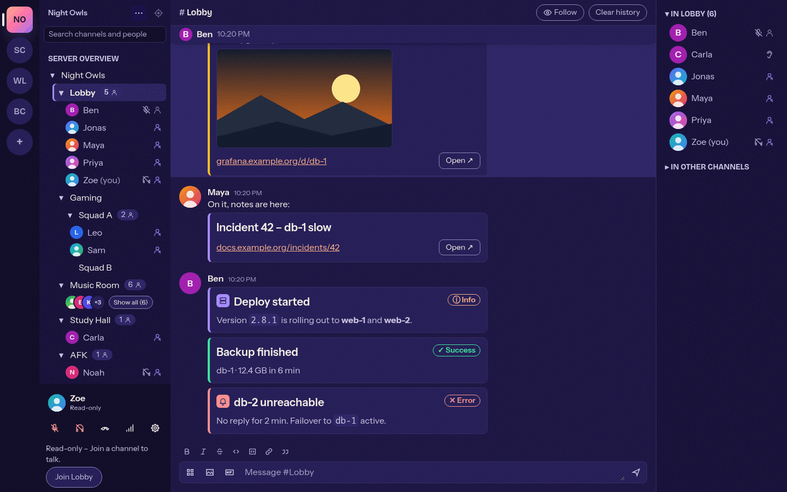
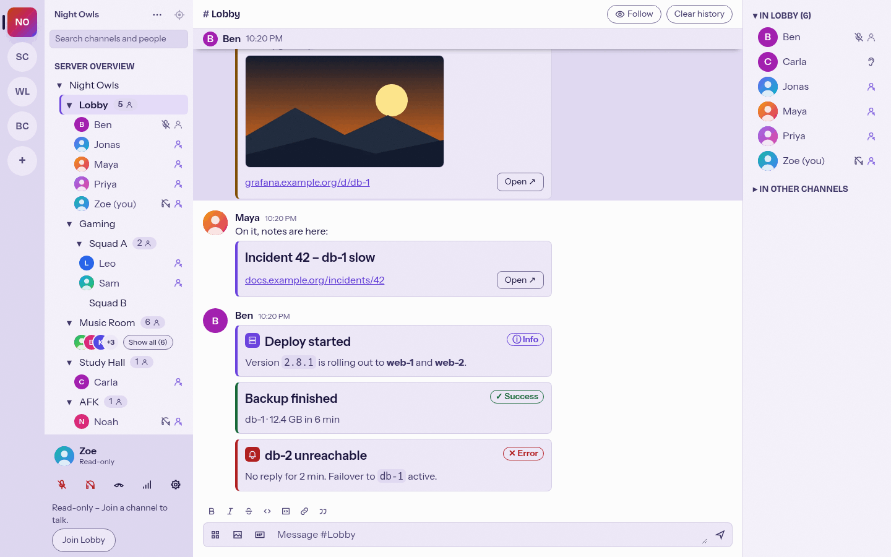

# Message cards

A message card turns a status message (alert, deploy, backup, incident) into a compact card: an
accent stripe in the status colour, an icon, a title, chat-formatted text, an optional image (for
example a graph) and an optional link (for example a dashboard). Bots are the main senders; people
can type the same BB code in the message input. Issue: #72.









## Syntax

```
[card title="CPU high on db-1" color=warning icon=chart image="https://grafana.example.com/render/db-1-cpu.png" url="https://grafana.example.com/d/db-1"]
Load **97 %** for 5 min (threshold 90 %).
[/card]
```

| Field                 | Meaning                                                                                                                                                                                               |
| --------------------- | ----------------------------------------------------------------------------------------------------------------------------------------------------------------------------------------------------- |
| `title`               | One line of plain text. Links to `url` when both are set.                                                                                                                                             |
| text between the tags | Same formatting as chat (Markdown in the Mumcord input: bold, italic, strike, code, code block, link, quote, lists).                                                                                  |
| `color`               | `info`, `success`, `warning` or `error`. Without it the stripe uses the theme accent and no status is shown. The status is always shown as text too (for example "▲ Warning"), never by colour alone. |
| `icon`                | One of the built-in icons: `info`, `check`, `warning`, `error`, `bell`, `chart`, `server`, `bot`. Arbitrary icon URLs are not supported (no extra request, no tracking pixel).                        |
| `image`               | `http(s)` URL of an image shown under the text.                                                                                                                                                       |
| `url`                 | `http(s)` URL shown as a link line plus an "Open" button.                                                                                                                                             |

- Every field is optional, but a card needs a title or a text. A card with neither, an unclosed
  `[card …]` or a broken attribute (for example a missing closing quote) stays normal chat text.
- Values with spaces need double quotes. Tag and attribute names, `color` and `icon` are not case
  sensitive. Unknown attributes are ignored, so later versions can add fields; invalid values (an
  unknown colour or icon, a `javascript:` or `data:` URL) are dropped.
- Several cards in one message are allowed. Text before, between and after cards shows as the
  normal message text above the cards.
- There is no separate limit on title or text length; the whole message must fit the server's
  text message length (`message_length`, 5000 characters by default). A message that is too long
  shows the usual "message too long" error and is not cut.

## Wire format

Mumble chat messages are HTML. The Mumcord input does not send the BB code itself; it sends HTML
that reads well in official Mumble clients and carries a marker Mumcord recognises:

```html
<div
  data-mumcord-card="v=1&amp;title=CPU+high+on+db-1&amp;color=warning&amp;icon=chart&amp;image=https%3A%2F%2F…&amp;url=https%3A%2F%2F…"
>
  <b>[Warning] CPU high on db-1</b>
  <div data-mumcord-card="body">Load <strong>97 %</strong> for 5 min (threshold 90 %).</div>
  Image:
  <a href="https://grafana.example.com/render/db-1-cpu.png"
    >grafana.example.com/render/db-1-cpu.png</a
  ><br />
  <a href="https://grafana.example.com/d/db-1">https://grafana.example.com/d/db-1</a>
</div>
```

(Sent without the line breaks and indentation shown here.)

- The outer `<div>` carries the fields as a URL-encoded query string (`application/x-www-form-urlencoded`,
  as produced by `URLSearchParams`) in `data-mumcord-card`, HTML-escaped as an attribute value.
  `v=1` is the format version.
- The text is the content of the inner `<div data-mumcord-card="body">`, ordinary chat HTML.
- Everything else inside the outer `<div>` (the bold title line with the status in English as
  `[Info]`, `[Success]`, `[Warning]` or `[Error]`, the `Image:` link and the URL link) is the
  fallback for official clients. Mumcord ignores it and renders the card from the attribute and
  the body.
- Any other sender (mumbot, scripts) builds exactly the same HTML, so all senders produce
  identical messages.

### Why a data attribute

Two options were considered: the original BB code hidden in an HTML comment, or a marker on the
HTML itself. The attribute was chosen because:

- A standard Mumble server (checked against mumble-server 1.5.735 from `testenv`, HTML allowed)
  passes the attribute through unchanged; it does not filter HTML of text messages.
- Official clients render the HTML with Qt, which ignores unknown attributes, so they show only
  the fallback.
- No duplication: a comment would roughly double the size against the server's message length,
  and some bridges strip comments.
- Mumcord's own sanitizers keep the attribute only on `<div>` in chat messages; its value is plain
  data parsed strictly, never markup.

On a server that does not allow HTML (`allowhtml=false`) the server turns the message into plain
text; Mumcord then sends the typed BB code as text, which other Mumcord clients still render as a
card.

### Typed BB code

BB code that arrives as text (typed in an official client, or sent raw by a bot) is rendered as a
card too. Its text is taken as the chat HTML between the tags (no Markdown conversion) and
sanitized like any message.

## Rendering

- Built from the same tokens as the link preview card (`--color-bg-elevated`, `--color-border`,
  `--radius-md`, 4 px left stripe), so it follows dark, light and custom themes. Status colours use
  `--color-success`, `--color-warning`, `--color-danger`; info and no colour use the accent.
- **Images** follow the link preview rules: only with "Show link previews and embeds" on, fetched
  by the engine and shown as a `data:` URL, so the webview never contacts the image host. A click
  opens the image viewer. With previews off, or when the image cannot be loaded, nothing is
  requested and the image stays a small `Image: …` link.
- **Links** (title, link line and links in the text) are ordinary chat links: a click opens the
  system browser through the usual safe path, and the context menu offers the link menu. Only
  `http`/`https` links are kept. A card does not get an extra link preview for its own URL.
- **Untrusted input:** the title is plain text, the text goes through the chat sanitizers (engine
  and UI), and attribute values are parsed strictly.

## Accessibility

- A card is a region named "Card: <title>, <status>" (for example "Card: CPU high on db-1,
  Warning"); the status is visible text next to its symbol; the icon is decorative.
- Title link, image, link line and "Open" button are part of the message's roving tab stop.
- The image button is named "View image <title>".

## Decisions for the open questions of #72

1. Marker: HTML data attribute (see above), verified against a standard server.
2. No "Card" button in the format toolbar for now; the BB code is typed (bots first).
3. `icon` is in scope as a fixed set of built-in icon names, not URLs.
4. Cards are normal messages: `color=error` does not count as a mention or play a sound.
5. A card's image cannot be dismissed separately; switching previews off hides all images.
6. No extra length limits beyond the server's message length.
7. Pinned messages, search and notifications use the message's text, which is the fallback
   (for example "[Warning] CPU high on db-1 Load 97 % …").
