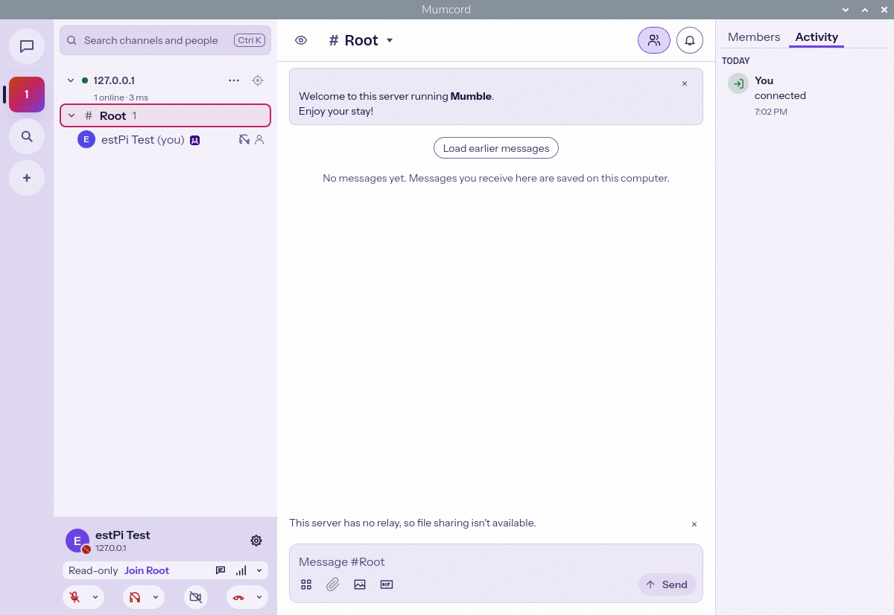
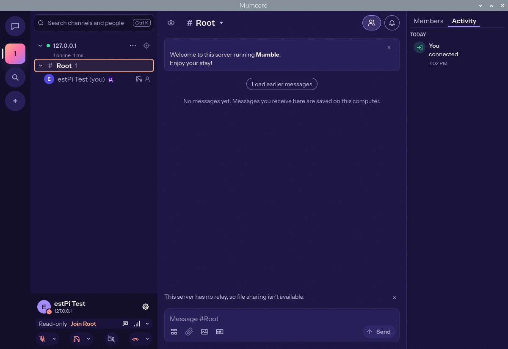

# Raspberry Pi development and testing

Use a 64-bit Raspberry Pi OS desktop installation (`uname -m` must say `aarch64`).
Mumcord uses the existing Linux/ARM64 client; it does not need a separate protocol, UI or
server configuration.

## Keep the Pi responsive

On an 8 GB Pi 4, start with **one build or test worker**, not one per CPU. Run builds and tests
sequentially. Reserve at least 2 GB of available RAM for the desktop, and monitor
`MemAvailable` in `/proc/meminfo`, not just the `free` column of `free`.

Do not rely on `systemd-run -p MemoryMax=… -p MemorySwapMax=0` without first checking
`/sys/fs/cgroup/cgroup.controllers`. Raspberry Pi OS can boot with `cgroup_disable=memory`:
the properties are accepted, but **cannot enforce a memory limit** without the `memory`
controller. Use an external watchdog to stop the whole build process group if available RAM
falls below the reserve. This is a safety check, not a hard allocation limit.

For a no-swap run, check `/proc/swaps` before starting and while testing. An unused zram swap
device is still swap. If temporarily disabling it, stop its systemd swap unit too; otherwise
systemd can reactivate it after `swapoff`. Record and restore the original state when finished.
Do not permanently change the Pi's boot configuration or swap policy just to build Mumcord.

The SD card needs room for the checkout, dependencies and Rust artifacts. Keep temporary
native builds on disk (`TMPDIR`), not the RAM-backed `/tmp`. Use a dedicated target directory
and remove it after the session:

```sh
umask 077
export CARGO_BUILD_JOBS=1
export CMAKE_BUILD_PARALLEL_LEVEL=1
export CARGO_INCREMENTAL=0
export CARGO_PROFILE_DEV_DEBUG=0
export CARGO_PROFILE_TEST_DEBUG=0
export CARGO_TARGET_DIR="$HOME/.cache/mumcord-build/rpi-session"
export TMPDIR="$HOME/.cache/mumcord-rpi-tmp"
mkdir -p "$CARGO_TARGET_DIR" "$TMPDIR"
```

`CARGO_BUILD_JOBS` also limits the libvpx and dav1d build scripts;
`CMAKE_BUILD_PARALLEL_LEVEL` limits the SVT-AV1 and hardware encoder SDK scripts. Without
these overrides the scripts retain their existing parallelism on all platforms.

## Dependencies and build

Use the Rust version required by `Cargo.toml` or newer and Node.js 24, as in CI. Debian 13's
packaged Node.js 20 is too old for the current frontend toolchain.

Install the Linux development dependencies listed in `.github/workflows/build-and-smoke.yml`
(`Install Linux system libraries`). Raspberry Pi OS/Debian 13 calls its SVT-AV1 development
package `libsvtav1enc-dev`, but that package does not provide the SVT-AV1 4 API Mumcord needs.
The Intel oneVPL development package is not available for ARM64 there either. Do not substitute
an old SVT-AV1 or drop codecs from the desktop app to make the build pass. Build the pinned
native libraries:

```sh
native="$HOME/.cache/mumcord-rpi-native"
scripts/build-libvpx.sh "$native/libvpx"
scripts/build-svt-av1.sh "$native/svt-av1"
scripts/build-dav1d.sh "$native/dav1d"
scripts/build-hwenc-sdk.sh "$native/hwenc"
export LIBVPX_STATIC_DIR="$native/libvpx"
export SVTAV1_STATIC_DIR="$native/svt-av1"
export DAV1D_STATIC_DIR="$native/dav1d"
export HWENC_SDK_DIR="$native/hwenc"

npm ci
npm run build
cargo build -p mumcord --features custom-protocol --locked
```

`custom-protocol` embeds the built frontend. Without it, a plain Cargo build waits for the
Vite development server instead of acting as a standalone client. This is a debug build for
functional checks, **not** a release-performance benchmark.

For repeated iterations, build the frontend on a faster machine and copy `dist/` to the Pi
before compiling the app. Rust cross-compilation needs an ARM64 C/C++ toolchain, the Pi's
headers and libraries as a sysroot, target-aware pkg-config/bindgen settings, and ARM64 builds
of the pinned native codec libraries. Merely setting `--target aarch64-unknown-linux-gnu`
is not enough. Run the resulting ARM64 executables on the Pi; a successful cross-build alone
does not verify its drivers, desktop integration or audio.

## Pi 4 rendering and desktop limitations

On the tested Pi 4 Model B, Raspberry Pi OS 13 with WebKitGTK 2.54 rendered the entire window
as horizontal stripes. Changing accelerated compositing alone did not fix it. Mumcord now sets
`WEBKIT_DISABLE_DMABUF_RENDERER=1` before GTK/WebKit starts on a board whose device tree contains
exactly `raspberrypi,4-model-b`. Other boards, architectures and operating systems keep their
existing defaults. An explicit `WEBKIT_DISABLE_DMABUF_RENDERER`, including `0`, is never
overwritten. The existing compositing workaround and its override are independent of this.

The stock labwc desktop did not offer the GlobalShortcuts portal. Mumcord reports that push-to-talk
is unavailable there; its existing XWayland compatibility mode is the alternative. A first-run
identity also needs an unlocked default Secret Service keyring. An auto-login desktop can have a
running keyring daemon but no default collection: create and unlock a password-protected keyring
with the desktop's keyring manager. Do not disable identity protection to bypass this.

The fixed ARM64 debug build was run in the real labwc session, completed setup, and connected to
an unmodified local Mumble server over TLS and UDP. Output audio opened, but the machine had no
input device, so microphone capture and a two-person voice call were not verified. These are
functional checks, not release-performance measurements.

Light and dark screenshots from that run (no renderer override supplied at launch):





## Checks

```sh
bash scripts/ci/test-native-build-jobs.sh
npm run typecheck
npm run lint
npm test -- --maxWorkers=1 --hookTimeout=60000
cargo test --workspace --locked -- --test-threads=1
```

Some Rust integration tests require the local test environment; follow their documented setup
in `testenv/`. Never connect to a public Mumble server for testing. Run the app in the Pi's
actual desktop session, not just over a headless SSH session. Check startup, the first-run
wizard, reconnect, voice, tray behavior and window resizing against a local test server.
Record which checks actually ran and distinguish failures from checks that were not performed.

On a Pi, allow extra time for test setup rather than adding more workers. The translation
suite's loading hook exceeded its normal 10-second limit on the first full run; it passed with
`--hookTimeout=60000`. Use a private `umask` for the Rust storage tests: Pi OS's inherited
`0002` creates group-writable temporary directories, which the secret-file tests correctly
refuse. Neither adjustment changes the app's security rules or other platforms' test defaults.

For performance comparisons use a release build, identical settings and the same workload.
Record the Pi model, OS and WebKitGTK versions, CPU/RAM usage, and `vcgencmd get_throttled`.
Do not globally disable GPU acceleration or change other operating systems' defaults to work
around a Pi-specific problem without reproducing it first.

## Validation record: 2026-11-15

Hardware: Raspberry Pi 4 Model B Rev 1.4, 8 GB RAM, ARM64 Raspberry Pi OS/Debian 13.7,
kernel 6.18.60, labwc, WebKitGTK 2.54.0. Frontend and ARM64 binaries were built on an x86_64
host; the executable tests and desktop checks below ran on the Pi.

- ARM64 standalone debug build and Clippy with `-D warnings`: passed on the build host.
- Frontend build, type check, ESLint/Prettier, Rust formatting, ShellCheck and native-build job
  regression checks: passed (ESLint retained an existing fast-refresh warning).
- UI: 3,442 tests passed in the full run; the translation suite's 126 tests passed on a separate
  rerun with the longer hook timeout. The original full run therefore reported one failed
  suite; it was not rerun in full with the adjusted timeout.
- Rust unit tests on the Pi: audio 57, codec 119, store 270, positional 14, plus all 5 rendering
  policy tests. Seven opt-in tests were ignored. The first store run had four failures under
  `umask 0002`; the complete store suite passed under `0077`. The whole Rust workspace and
  automated desktop E2E suite were not run.
- Desktop: setup, local TLS trust prompt, UDP connection, chat, maximizing, theme changes and
  automatic reconnection after restarting the local server: passed. No microphone was
  available; a real two-person voice call, camera and watch-party playback remain unverified.
- Swap was disabled during the checks; kernel `pswpin` and `pswpout` both stayed at zero.
  `vcgencmd get_throttled` reported `0x0`.

The codec's existing `per_frame_processing_time` benchmark was cross-built in **release**
mode and run on the Pi after the other tests, with the app stopped. It processes a full
noise-suppression, echo-cancellation and automatic-gain chain on synthetic speech and noise:

| Backend     | Mean per 10 ms frame | p99      | Share of one core |
| ----------- | -------------------- | -------- | ----------------- |
| Nnnoiseless | 0.740 ms             | 0.845 ms | 7.40%             |
| Sonora      | 0.835 ms             | 1.055 ms | 8.35%             |

Both met the benchmark's 5 ms mean limit. This is a baseline, not a claimed speedup from the
rendering fix, and does not include devices, transport, mixing or the UI.

The same release build was then run as two instances side by side (one sharer, one lean client)
against the unmodified local Mumble server, so screenshare cost could be measured without a
second machine. Screen capture went through the ScreenCast portal (`xdg-desktop-portal-wlr`
under labwc); CPU is the sum over all processes of one instance's systemd scope:

| Scenario                                   | Setting                | CPU (share of one core) |
| ------------------------------------------ | ---------------------- | ----------------------- |
| idle, connected, nothing shared            | –                      | 4.4–5.0% per instance   |
| sharing, own window visible on that screen | 720p, asked for 15 fps | 107% (4–5 fps encoded)  |
| sharing, both windows minimized            | 720p, 10 fps           | 17%                     |

Three things follow from this and from the encoder self-test:

- Software VP9 cannot carry 720p on four Cortex-A72 cores. The share starts at the picked
  setting, notices the encoder falling behind and lowers itself to 720p and 4–10 fps with a
  visible "encoder too slow" note. That is the honest result, not a defect to paper over: the
  Pi 4 has no hardware encoder for VP9 or AV1.
- AV1 is worse and already reports itself as failed on this board (about 187 ms per 1080p frame,
  i.e. roughly 5 fps), so the dialog correctly defaults to VP9.
- Sharing the whole screen while Mumcord itself is on that screen costs about six times as much
  as sharing the same screen with the windows minimized: the app repaints, the capture sees the
  change and encodes it, which repaints again. On a single-screen setup, sharing the window of
  another app instead of the whole screen avoids that loop.

Not measured on the Pi: the viewer side of a share and watch-party embeds. Two instances on the
same board never brought up the direct media path between them (the test server has no relay,
which a two-client call on one host would otherwise use), and the watch-party player needs
YouTube or Twitch. Both stay open questions for a two-machine setup.

One more desktop observation: minimizing a Mumcord window through an external tool (`wlrctl`)
and restoring it left the window blank until the app was restarted. It was seen twice and is
recorded here rather than worked around.
