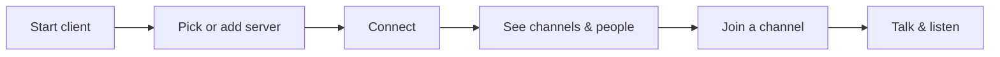
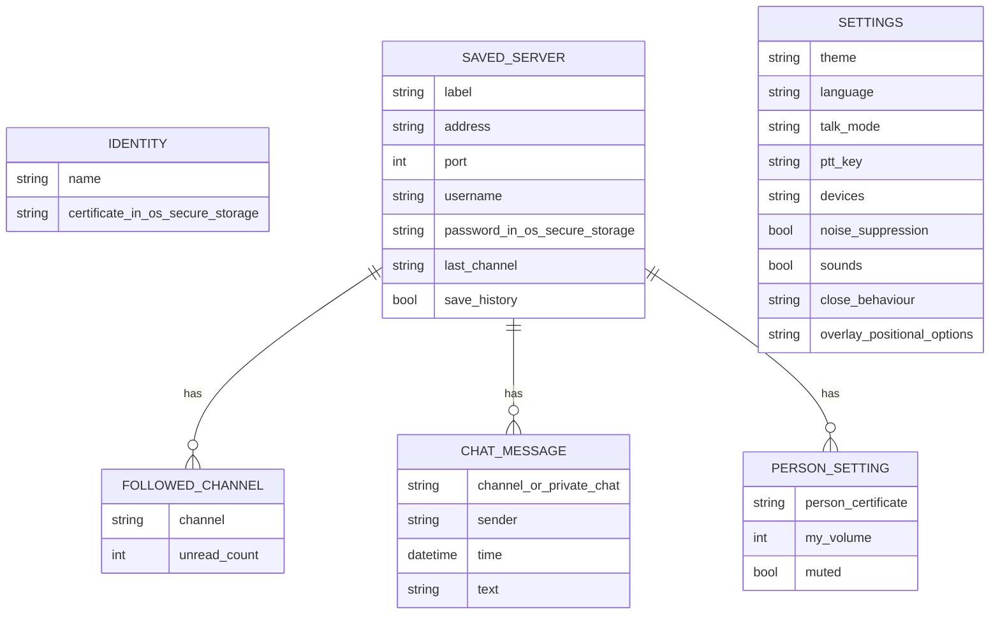
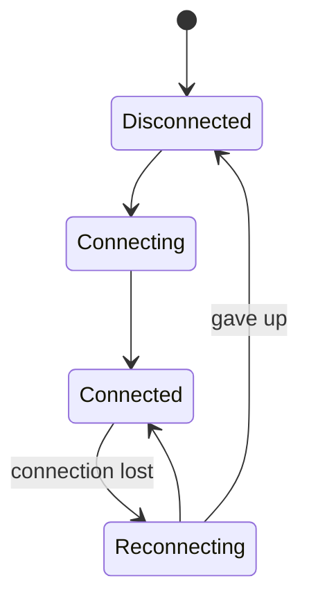

# Mumcord · Epic 1 – Foundation · Brainstorming

> Basis: Standalone feature, not part of a roadmap (no roadmap exists yet). This is the first spec, so it also sets the product vision, target platforms and overall tech stack.
> Process: We work in several rounds. Each round contains questions; you answer directly in this file.
> Once all questions are answered, `specs/01-foundation-specification.md` is created from it.
> Already settled (not asked again): The product is called **Mumcord**. The only fixed rule is that the client must work with standard Mumble servers (murmur / mumble-server).

## How to answer

- **Single choice** (`◉`): Exactly **one** box has an `[x]`. To change your choice, just move the `x`.
- **Multiple choice** (`☑`): Tick as many boxes as you like.
- ⭐ marks my **recommendation**. It is already preselected. If you agree, you don't need to change anything.
- Below each question there is `✍️ Note:`. Add anything there, e.g. questions back, edge cases or "not sure, explain this to me".
- I explain technical terms briefly. For purely technical questions (audio, network, protocol) it's perfectly fine to follow my recommendation.

## Planned rounds

1. Vision, platforms & scope of the foundation
2. UI & UX
3. Audio & network
4. Technology, distribution & security
5. Data/state model & open points

(The plan may change depending on the answers.)

---

## Round 1 – Vision, platforms & scope of the foundation

This round sets the big picture: who the client is for, where it runs, and what the very first usable version (the "foundation") can do. Everything after that builds on it.



*The flow above is the minimum a voice client must do. The questions below decide what else belongs in the first version.*

### A · Vision

#### Q1.1 Who is the main audience? `◉`
This shapes defaults (e.g. push-to-talk vs. open mic), wording and which features come first.

- [x] ⭐ **Gaming groups and online communities.** Mumble's core audience today; they value low latency, good audio and self-hosted servers.
- [ ] Teams and companies (internal voice rooms). Needs more admin/onboarding features early.
- [ ] Clubs and non-technical groups (families, associations). Needs the simplest possible setup, everything else secondary.
- [ ] Everyone equally. Risk: no clear priorities.

✍️ Note:

#### Q1.2 What should make it "modern" compared to the official Mumble client? `☑`
The official client works well but looks and feels dated and is hard to set up for newcomers.

- [x] ⭐ **Clean, current look** (light/dark theme, clear layout, good scaling on high-resolution screens).
- [x] ⭐ **Easy first start**: no certificate wizard, no audio wizard marathon – sensible defaults, connect within a minute.
- [x] ⭐ **Great audio out of the box**: modern noise suppression and auto volume, so people sound good without tweaking.
- [x] Connected to several servers at the same time. Later.
- [x] Rich chat (images, link previews, reactions) – parts need server support. Later.

✍️ Note: Design like Discord. I want to see text channels without having to join them.

#### Q1.3 How does it relate to the official client? `◉`

- [ ] ⭐ **A full alternative for everyday users.** People can use it instead of the official client for joining servers, talking and chatting. Admin tasks (e.g. editing permissions) can still be done with the official client at first.
- [x] A complete replacement including all admin features from day one. Much bigger first version.
- [ ] A lightweight companion (e.g. only quick-join and talk). Smaller, but people would keep needing the official client.

✍️ Note:

### B · Platforms

#### Q1.4 Which platforms does the first version support? `☑`
More platforms mean more testing effort. Mobile apps also need app-store accounts and review.

- [x] ⭐ **Linux** – your own system, easiest to develop and test on.
- [x] ⭐ **Windows** – where most gamers are.
- [x] ⭐ **macOS**
- [ ] Android. Later – the technology choice (Q1.7) keeps this door open.
- [ ] iOS. Later – same as Android, plus Apple's stricter rules for background audio.
- [ ] Web browser. Not recommended: browsers can't talk to Mumble servers directly, so it would need an extra relay server.

✍️ Note:

### C · Scope of the foundation

#### Q1.5 What must the foundation version be able to do? `☑`
The foundation should be small but genuinely usable: you can join a real Mumble server and talk with people.

- [x] ⭐ **Connect to a server** (address, port, username, optional server password).
- [x] ⭐ **Server list / favorites** to save servers and reconnect with one click.
- [x] ⭐ **Channel tree** showing channels and who is in them, including who is currently talking.
- [x] ⭐ **Join channels** by double-click or drag.
- [x] ⭐ **Talk and listen** with push-to-talk or voice activation.
- [x] ⭐ **Mute and deafen yourself**, adjust the volume of individual people.
- [x] ⭐ **Basic audio settings**: choose microphone and speakers, test your mic.
- [x] Text chat in channels and private messages. Recommended for Epic 2, together with richer channel features.
- [x] Register your account on the server. Later.
- [x] Positional audio (voices come from the direction of the player in-game). Later.
- [x] In-game overlay. Later.

✍️ Note:

#### Q1.6 How should the user's identity (certificate) be handled? `◉`
On Mumble, your identity is a small digital certificate stored on your computer – like a key. Whoever has it "is" you on servers where you registered. Losing it means losing your registered name.

- [ ] ⭐ **Created automatically on first start, with an easy "export / back up identity" button.** Zero setup; backup is there when people care.
- [x] Guided setup wizard on first start (like the official client). More control, but the first start gets longer.
- [ ] Import an existing certificate from the official Mumble client on first start, otherwise create one. Nice for people switching over – could also be added on top of the recommendation later.

✍️ Note:

### D · Big-picture direction

#### Q1.7 Which technical approach should the client be built on? `◉`
This is the most important technical decision; details follow in round 4. In short: the "engine" (audio and network) must be very fast and reliable, while the "face" (the user interface) should be easy to make modern and pretty.

| | Engine | User interface | Modern look | Path to mobile | Risk |
|---|---|---|---|---|---|
| A | Rust | Web technology in a lightweight app shell (Tauri) | Very easy | Yes | Low–medium |
| B | C++ | Qt (same as the official client) | Medium | Hard | Low, but dated feel |
| C | Rust | Native Rust UI toolkit | Medium | Partly | Medium (young toolkits) |
| D | Node/TypeScript | Electron (like Discord) | Very easy | No | High memory use, audio harder |

- [x] ⭐ **A – Rust engine + web-based UI in Tauri.** Rust is fast and safe (fewer crashes and security holes) for audio and networking; the UI uses the same technology as modern websites, so it's quick to build and easy to make beautiful. Much lighter than Electron, and Tauri can later target Android/iOS.
- [ ] B – C++ with Qt. Proven, close to the official client, but harder to make feel modern and slower to develop.
- [ ] C – Rust with a native Rust UI toolkit. Very lightweight, but UI toolkits are less mature and take longer for polished designs.
- [ ] D – Electron/TypeScript. Fast UI development, but heavy on memory and the real-time audio part becomes awkward.

✍️ Note:

#### Q1.8 Is the project open source? `◉`
Mumble itself is open source (BSD license). This affects whether others can see, use and contribute to the code.

- [ ] ⭐ **Private for now, decide before the first public release.** Keeps all options open; nothing to manage yet.
- [x] Open source from day one with a permissive license (MIT / Apache 2.0). Others can contribute and reuse it freely.
- [ ] Open source with a "copyleft" license (GPL). Others may reuse it only if their version is open source too.

✍️ Note: Open source. Keep in mind any rights from Mumble itself that may need to be respected. Otherwise MIT.

#### Q1.9 What should come after the foundation? (rough roadmap) `☑`
This only sketches the order of later epics; each one gets its own brainstorming. Ticked items become the first draft of `specs/roadmap.md`.

- [x] ⭐ **Epic 2 – Text chat & richer channel features** (channel/private messages, user comments and avatars, channel descriptions).
- [x] ⭐ **Epic 3 – Comfort & polish** (global hotkeys, system tray, notifications, import from official client).
- [x] ⭐ **Epic 4 – Release & distribution** (installers, auto-update, signed builds for Windows/macOS).
- [ ] Positional audio for games.
- [ ] In-game overlay.
- [x] Server admin features (permissions, bans, channel management).
- [ ] Mobile apps (Android/iOS).
- [ ] Recording.

✍️ Note:

---

> Round 1 was answered interactively in chat on 2026-10-24. The answers above reflect that conversation; the follow-ups below were asked and answered in the same session.

### E · Follow-ups asked during round 1

#### Q1.10 Q1.5 lists both a small core and all extras – what does the first version contain? `◉`

- [ ] ⭐ **Core only.** Chat, registration, positional audio and overlay in later epics.
- [ ] Core + text chat.
- [ ] Core + text chat + account registration.
- [x] Everything ticked in Q1.5, including positional audio and overlay.

✍️ Note:

#### Q1.11 When do the admin features needed for "full replacement" (Q1.3) come? `◉`

- [x] ⭐ **Full replacement is the goal across epics.** Admin features get their own epic.
- [ ] Already in the first version.

✍️ Note:

#### Q1.12 How are Discord-like text channels (readable without joining) handled? `◉`
Standard Mumble servers only deliver channel messages to people inside that channel and store no chat history. Reading without joining therefore needs a "Mumcord companion" service installed next to the Mumble server.

- [ ] ⭐ **Discord-like design now, companion later.** On plain servers: own channel and private messages only.
- [x] Companion service in the first version. Read-without-joining and history on servers that run it.
- [ ] Plain Mumble behaviour only, never a companion.

✍️ Note:

---

### Correction to round 1 (stated by the user in chat, 2026-10-24)

#### Q1.13 May Mumcord rely on anything installed or changed on the server side? `◉`
This overrides Q1.12.

- [x] **No. Mumcord is a pure client. The server is never touched** – no companion service, no server plugins, no server configuration changes. Everything must work against unmodified standard Mumble servers.
- [ ] Optional server-side companion (Q1.12).

✍️ Note: "The server must never be touched, this is supposed to be a client."

---

#### Q1.14 Without a companion, how do Discord-like text channels work? `◉`
Standard Mumble servers deliver channel messages only to users inside that channel and keep no chat history.

- [x] ⭐ **Best possible as a pure client.** Discord-like layout. Every received message is stored locally, so users can scroll back through what they have seen. If Mumble's "listen to channel" feature (hearing a channel without joining it) also delivers text messages, use it to read channels without joining; otherwise users join a channel to read it live. Whether listening delivers text is checked in round 3.
- [ ] Join to read, Discord look, local history.
- [ ] Plain Mumble text behaviour, no local history.

✍️ Note:

---

## Round 2 – UI & UX (and staging of Epic 1)

> Asked and answered interactively in chat on 2026-10-24.

### A · Staging & roadmap

#### Q2.1 How is the big first version (Q1.10) staged? `◉`
Positional audio and the overlay each need operating-system-specific code.

- [x] ⭐ **Two stages within Epic 1.** Stage 1a: voice, text channels, registration, setup wizard – usable day to day. Stage 1b: positional audio and overlay.
- [ ] Separate "Gaming" epic for positional audio and overlay, right after Epic 1.
- [ ] Everything in one release.

✍️ Note:

#### Q2.2 Chat moved into Epic 1 – what order for the later epics? `◉`

- [x] ⭐ **Comfort & polish → Admin features → Release & distribution.**
- [ ] Admin → Comfort → Release.
- [ ] Comfort → Release → Admin.

✍️ Note:

### B · Main window

#### Q2.3 Which main window layout? `◉`

```text
┌────┬────────────┬──────────────────┬──────────┐
│ ◉  │ Gaming Srv │ # Lobby          │ In Lobby │
│ ○  │────────────│──────────────────│──────────│
│ ○  │ ▾ Lobby  3 │ Anna: hi all     │ 🟢 Anna  │
│    │   Anna 🎙  │ Ben: hey         │ ⚪ Ben   │
│ +  │   Ben      │                  │ ⚪ You   │
│    │ ▸ Raid   5 │                  │          │
│    │ ▸ AFK    1 │                  │          │
│    │────────────│ Message #Lobby…  │          │
│    │ You 🎙 🎧 ⚙│                  │          │
└────┴────────────┴──────────────────┴──────────┘
```

- [x] ⭐ **Discord-style, 4 columns:** server bar with saved servers (one connected at a time), channel list, chat, member list.
- [ ] 3 columns, servers chosen from a start screen.
- [ ] Compact Mumble-like tree with chat on the right.

✍️ Note:

#### Q2.4 Mumble channels are voice and text at once – how are they shown? `◉`

- [x] ⭐ **One entry per channel.** Single-click shows the channel's chat (live via "listen" if possible, otherwise saved history); double-click or "Join" enters voice.
- [ ] Each channel shown twice (# text and 🔊 voice), Discord-style.
- [ ] Clicking always joins; chat shows the current channel only.

✍️ Note:

### C · Look, first start & behaviour

#### Q2.5 Light or dark? `◉`

- [x] ⭐ **Follow the system setting, dark first.** Manually switchable; dark is the polished default.
- [ ] Dark only.
- [ ] Light and dark equally designed and tested from day one.

✍️ Note:

#### Q2.6 What does the first-start wizard (Q1.6) cover? `◉`

- [x] ⭐ **Short, 3 steps:** create or import identity (with backup hint), pick and test the microphone, choose push-to-talk key or voice activation.
- [ ] Identity only.
- [ ] Full wizard like the official client, including detailed audio tuning.

✍️ Note:

#### Q2.7 Which interface languages? `◉`

- [ ] ⭐ **English, prepared for more.**
- [ ] English + German.
- [ ] English only, no preparation.

✍️ Note: English, Spanish and German.

#### Q2.8 What happens when the window is closed while connected? `◉`

- [x] ⭐ **Ask once ("minimize to tray or quit?") and remember the choice.**
- [ ] Always minimize to tray.
- [ ] Always quit.

✍️ Note:

---

## Round 3 – Audio & network

> Asked and answered interactively in chat on 2026-10-24.

**Check from round 1 (Q1.14):** The Mumble server source code (`src/murmur/Messages.cpp`, `Server::msgTextMessage`, versions 1.4.230, 1.5.735 and current master) sends channel text messages to users *in* the channel **and** to users only *listening* to it. Reading channels without joining therefore works as a pure client on servers 1.4 and newer. Limits: listening needs the server's "Listen" permission, servers cap the number of listeners per user/channel, and other users see an ear icon for listeners.

### A · Channels & servers

#### Q3.1 How does Mumcord use "listen" to read channels without joining? `◉`

- [x] ⭐ **Follow chosen channels.** The user clicks "Follow" on text channels; Mumcord listens with the audio muted locally and shows unread badges. Few ear icons, stays within server limits.
- [ ] Auto-listen while viewing a channel.
- [ ] Don't use listening; other channels show saved history only.

✍️ Note:

#### Q3.2 Which server versions are supported? `◉`

- [x] ⭐ **1.4 and newer fully, older servers best-effort.** Mumcord connects to older servers and hides features they lack.
- [ ] 1.4+ only.
- [ ] 1.5+ only.

✍️ Note:

### B · Voice

#### Q3.3 Which talk mode is preselected in the wizard? `◉`

- [x] ⭐ **Voice activation.** Push-to-talk one click away.
- [ ] Push-to-talk.

✍️ Note:

#### Q3.4 Noise suppression? `◉`

- [x] ⭐ **Modern AI-based noise suppression plus echo cancellation, on by default.**
- [ ] Basic noise filter only.
- [ ] Off by default.

✍️ Note:

#### Q3.5 Default audio quality? `◉`

- [x] ⭐ **Automatic:** best quality the server allows, lowered automatically on bad connections.
- [ ] Fixed high quality.
- [ ] Save bandwidth.

✍️ Note:

#### Q3.6 Connection drops? `◉`

- [x] ⭐ **Auto-reconnect in the background, rejoin last channel, restore followed channels**, with a small "reconnecting…" bar.
- [ ] Ask first.
- [ ] Just disconnect.

✍️ Note:

#### Q3.7 Latency vs. smoothness? `◉`

- [x] ⭐ **Adaptive buffer:** as low as possible, small buffer only when packets arrive unevenly.
- [ ] Lowest latency, fixed.
- [ ] Extra smooth, larger buffer.

✍️ Note:

#### Q3.8 Sounds and notifications? `◉`

- [x] ⭐ **Subtle sounds** (join/leave, mute/unmute, new message in followed channels), **no text-to-speech.**
- [ ] Sounds plus text-to-speech.
- [ ] Silent.

✍️ Note:

### C · Gaming features (stage 1b)

#### Q3.9 Where do positional audio positions come from? `◉`

- [ ] ⭐ **Mumble Link first**, per-game support later.
- [x] Mumble Link plus the official Mumble game plugins (more games, more work, occasional anti-cheat concerns).
- [ ] Postpone positional audio.

✍️ Note:

#### Q3.10 How does the overlay work? `◉`

- [x] ⭐ **Floating, transparent on-top window.** No game hooking, no anti-cheat risk; works in windowed/borderless fullscreen, not exclusive fullscreen; staying on top isn't guaranteed on some Linux desktops.
- [ ] In-game hook like the official client.
- [ ] Postpone the overlay.

✍️ Note:

---

## Round 4 – Technology, distribution & security

> Asked and answered interactively in chat on 2026-10-24.

### A · Technology & builds

#### Q4.1 UI framework inside Tauri? `◉`

- [x] ⭐ **React + TypeScript.**
- [ ] Svelte + TypeScript.
- [ ] Vue + TypeScript.

✍️ Note:

#### Q4.2 What builds does Epic 1 produce? `◉`

- [x] ⭐ **Simple unsigned test builds for Linux, Windows and macOS.** Installers, signing and auto-update stay in the release epic.
- [ ] Linux builds only.
- [ ] Signed installers and auto-update now.

✍️ Note:

#### Q4.10 Where does the code live and get built? `◉`

- [x] ⭐ **GitHub + GitHub Actions** (build machines for all three OS).
- [ ] GitLab + GitLab CI.
- [ ] Decide later.

✍️ Note:

#### Q4.8 How is Mumcord tested? `◉`

- [x] ⭐ **Automated tests against a local Mumble server (Docker) with scripted bot users, plus UI tests.** Only sound quality needs a human ear.
- [ ] Unit tests plus manual checks.

✍️ Note:

### B · Security & privacy

#### Q4.3 Where is the identity certificate stored? `◉`

- [x] ⭐ **OS secure storage** (Windows Credential Manager, macOS Keychain, Linux Secret Service). Export/backup from Q1.6 remains possible.
- [ ] File in the settings folder.
- [ ] Password-protected file.

✍️ Note:

#### Q4.4 Saved server passwords? `◉`

- [x] ⭐ **OS secure storage.**
- [ ] Never save.
- [ ] In the settings file.

✍️ Note:

#### Q4.5 Local chat history? `◉`

- [x] ⭐ **Kept until deleted**, with "clear history" per channel, per server or all, and saving switchable off per server.
- [ ] Auto-delete after 30 days.
- [ ] Don't store.

✍️ Note:

#### Q4.7 Crash reports and usage data? `◉`

- [ ] ⭐ **None.** Manual diagnostic file only.
- [x] Opt-in crash reports.
- [ ] Opt-out crash reports.

✍️ Note:

#### Q4.9 Where are opt-in crash reports received? `◉`

- [ ] ⭐ **Sentry, EU region.**
- [ ] Self-hosted (e.g. GlitchTip).
- [x] Later – Epic 1 only offers "save diagnostic file"; automatic opt-in reports come with the release epic.

✍️ Note:

#### Q4.6 Mumble rights for open source (note on Q1.8)? `◉`
Mumble's code and game plugins are BSD-licensed; reuse in MIT projects is allowed if Mumble's copyright notice is kept. "Mumble" is the project's name, so Mumcord must not look official. (Not legal advice.)

- [x] ⭐ **MIT license + third-party notices file** (Mumble and all other libraries) + "compatible with Mumble" wording, no Mumble logo, clear "not affiliated" note.
- [ ] Apache 2.0 instead of MIT.
- [ ] Get legal advice first.

✍️ Note:

### C · Platform details

#### Q4.11 Push-to-talk on Wayland Linux desktops? `◉`

- [x] ⭐ **Use the desktop's global-shortcuts interface** (current KDE and GNOME); where missing, explain it and suggest voice activation.
- [ ] Read the keyboard directly (extra system permissions).
- [ ] Voice activation only on Wayland.

✍️ Note:

#### Q4.12 Accessibility in Epic 1? `◉`

- [ ] ⭐ **Solid basics:** keyboard, screen-reader labels, contrast, system font size.
- [x] Full WCAG AA.
- [ ] Minimal.

✍️ Note:

---

## Round 5 – Data/state model & open points

> Asked and answered interactively in chat on 2026-10-24.

### A · Data & state model

#### Q5.1 Is the local data model right? `◉`
Everything not listed here comes live from the server.





- [x] ⭐ **Looks right.**
- [ ] Something is missing or wrong.

✍️ Note:

#### Q5.2 Is the volume/mute set for a person remembered? `◉`

- [x] ⭐ **Remembered per person**, recognized by their certificate (survives renames).
- [ ] Only for the current session.

✍️ Note:

### B · Remaining features

#### Q5.3 Public server browser in Epic 1? `◉`

- [x] ⭐ **Later.** Adding by address or link is enough at first.
- [ ] Yes, in Epic 1.

✍️ Note:

#### Q5.4 Should Mumcord open `mumble://` links? `◉`

- [x] ⭐ **Yes – offered on first start** to become the handler for `mumble://` links; clicking a link opens Mumcord and connects.
- [ ] Later.

✍️ Note:

#### Q5.5 Chat formatting? `◉`

- [x] ⭐ **Display formatting, links and small images safely (sanitized); write with Markdown shortcuts and pasted images**, converted so the official client displays them correctly.
- [ ] Plain text only.

✍️ Note:

#### Q5.6 How is server registration offered? `◉`

- [x] ⭐ **"Register on this server" in the user menu**, with a short explanation and a reminder to back up the identity.
- [ ] Prompt automatically after joining.

✍️ Note:

#### Q5.7 Avatars and profile comments? `◉`

- [x] ⭐ **Show them, and let users set their own avatar and comment.**
- [ ] Show only.
- [ ] Later.

✍️ Note:

#### Q5.8 Whisper/shout? `◉`

- [x] ⭐ **Later** (comfort or admin epic).
- [ ] Epic 1.

✍️ Note:

---

## Closing

2026-10-24: All rounds answered. The specification has been created: `specs/01-foundation-specification.md`.

---

## Addendum – decisions during implementation (2026-10-24)

Three decisions made by the product manager while building. Asked and answered in chat during /dev.

### A · Scope & connect behaviour

#### QA.1 Connecting to several servers at once to read along? `◉`

- [ ] In Epic 1.
- [x] **Own epic after Epic 1** ("Multi-server read-along"); Epic 1 stays single-server.
- [ ] Not planned.

✍️ Note: Asked and answered in chat during /dev.

#### QA.2 What happens on a fresh connect? `◉`
Fresh = user-initiated (app start, server switch, manual reconnect). Automatic reconnect after a dropped connection restores the previous channel and voice state (continuity).

- [ ] Rejoin the last channel with voice on (previous behaviour).
- [x] **Land in the server's default channel muted and deafened (read-only); talk/listen only after an explicit Join.** Others see the user as present but deafened. A `mumble://` link with a channel path counts as an explicit Join.
- [ ] Land in the default channel with voice on.

✍️ Note: Asked and answered in chat during /dev.

---

### B · Profile

#### QA.3 Default avatar: when is it sent to a server? `◉`

- [ ] Send on every connect.
- [x] **Set a default avatar in settings; send it once, the first time you connect to a server where you have no avatar yet.** Switchable off (default on); not re-sent after manual removal.
- [ ] Never automatic (manual only).

✍️ Note: Asked and answered in chat during /dev.

---

#### QA.4 Mouse buttons (e.g. side buttons) as push-to-talk? `◉`
Keyboard push-to-talk on Wayland stays on the desktop portal (Q4.11); the portal cannot capture mouse buttons.

- [x] **Native mouse-button support on Windows, macOS (Accessibility permission prompt) and X11, and on Linux Wayland by reading input devices directly (evdev).** The Wayland path is off by default, needs a settings toggle and membership in the `input` group (security warning shown); only mouse-type devices are opened, only the one configured button is used, input is never logged; without permission the exact fix command is shown and Mumcord falls back gracefully.
- [ ] Native support plus a hint how to remap the mouse button to a key in KDE (no evdev path).
- [ ] Later (keyboard only for now).

✍️ Note: Asked and answered in chat during /dev.

---

#### QA.5 Push-to-talk on KDE Wayland: compatibility mode like TeamSpeak? `◉`
TeamSpeak 3 runs through KDE's X11 compatibility layer (XWayland). KDE's "Legacy X11 App Support" setting (default: key combinations with Ctrl/Alt/Meta and modifier keys; mouse buttons off) lets such apps see global input without a dialog or the `input` group. Mumcord already has the X11 push-to-talk path for keys and mouse buttons.

- [ ] Compatibility mode by default on KDE Wayland; modern path as a setting.
- [ ] Only fix the modern path (portal dialog for keys, evdev + `input` group for mouse buttons).
- [x] **Both: Settings → Voice offers a "Compatibility mode (like TeamSpeak)" switch on Linux Wayland; the default stays the modern path.** In compatibility mode Mumcord runs through XWayland and uses its X11 push-to-talk for keys and mouse buttons, limited to what the desktop's legacy X11 setting allows; the switch explains that trade-off.

✍️ Note: Asked and answered in chat during /dev.

---

#### QA.6 Talking indicator in the channel list: avatar with a green ring? `◉`

- [x] **Each person row in the channel list shows the person's avatar (default avatar if none); while they talk, a green ring appears around it (Discord style).** Listener rows keep only the listener marker (no ring, no voice-state icons).
- [ ] Keep the current icon-only indicator.

✍️ Note: Requested in chat during /dev.

---

#### QA.7 Mute/deafen state when joining a channel after a read-only connect? `◉`
Until now an explicit Join always cleared mute and deafen (QA.2).

- [x] **Connect stays read-only; an explicit Join restores the user's last own mute/deafen setting instead of always clearing it.** The last setting is the self-mute/self-deafen state the user last chose while joined for voice; it is remembered across app restarts.
- [ ] No read-only mode: the last setting applies right on connect.
- [ ] Last setting on connect, but never automatically unmuted.

✍️ Note: Asked and answered in chat during /dev.

---

#### QA.8 Visible way to disconnect from the current server? `◉`
Disconnect exists only in the server icon's context menu.

- [x] **Add a "Disconnect" button (hang-up icon) to the user panel next to mute and deafen, shown while connected.**
- [ ] Keep it in the context menu only.

✍️ Note: Asked and answered in chat during /dev.

---

#### QA.9 Offer to rejoin the last channel after quitting the app? `◉`

- [x] **If the user quit Mumcord while joined to a channel for voice, the next fresh connect to that server (after app start) shows a non-blocking prompt "You were in ‹channel› last time – Rejoin?" with "Rejoin" and "Not now".** Rejoin is an explicit Join (QA.7 applies); "Not now" or ignoring it keeps the read-only state. No prompt if the channel no longer exists or the user was not joined for voice.
- [ ] Rejoin automatically without asking.
- [ ] No prompt (current behavior).

✍️ Note: Requested in chat during /dev.

---

#### QA.10 Avatars on servers where the user is not registered? `◉`
Mumble servers keep avatars only for registered users; for unregistered users the avatar is lost on disconnect, and the default avatar was sent only once per server (QA.3).

- [ ] Resend only the default avatar on every connect when unregistered.
- [x] **Remember the avatar per saved server (hand-set avatar, otherwise the default avatar) and send it again on every connect when the server does not have it (unregistered users).** Registered users keep the server's copy; nothing is re-sent when the server already shows an avatar.
- [ ] Leave as is, only hint to register.

✍️ Note: Asked and answered in chat during /dev.

---

#### QA.11 Listeners in the channel list? `◉`

- [x] **People who only listen to a channel (read-along / channel listener) are not shown in the channel list at all; they appear only in the member list on the right (with the listener marker).**
- [ ] Show them in both (current behavior).

✍️ Note: Requested in chat during /dev.

---

#### QA.12 Release builds from tags on main? `◉`
Signed builds and auto-update stay in Epic 5.

- [x] **Pushing a version tag (`v*`, e.g. `v0.1.0`) on `main` builds the Windows installer (.exe), the Linux AppImage and the macOS .dmg and attaches them, with SHA-256 checksums, to a draft GitHub Release that the maintainer reviews and publishes by hand.** Builds are unsigned until Epic 5; the release notes say so. The tag must match the app version, otherwise the workflow fails.
- [ ] Publish the release automatically.

✍️ Note: Requested in chat during /dev; draft release recommended so nothing goes public without a final look.

---

#### QA.13 Follow channels directly from the channel list, and follow all at once? `◉`
Until now a channel is followed with the "Follow" button in the chat header (FR-1.31).

- [x] **Each channel row in the channel list gets a star button: outlined on hover/focus to follow, filled while followed (click again to unfollow).** The chat-header button stays.
- [x] **The server's context menu in the channel list offers "Follow all channels" and "Unfollow all channels".** Follow all follows every channel the user may listen to (excluding the one they are in for voice), stops cleanly at the server's listener limit and says how many were followed and why the rest were skipped.
- [ ] Not now.

✍️ Note: Requested in chat during /dev.

---

#### QA.14 Crowded channels in the channel list: overlapping avatar stack? `◉`

- [x] **Collapsed channels always show a stack of up to 5 overlapping avatars plus "+N" for the remaining people instead of the names. Expanded channels list names, but above 10 people they show the stack with a "Show all" toggle.** People who are talking right now are moved to the front of the stack (with the green talking ring), so they stay visible.
- [ ] Only when collapsed.
- [ ] Always.

✍️ Note: Asked and answered in chat during /dev; "talking people in front" added by the user.

---

#### QA.15 Pinned channel description / server welcome message in the chat? `◉`

- [x] **The chat of each channel shows a pinned, collapsible box at the top with the channel's description. The server's welcome message (MOTD) is pinned in the root channel's chat (and in the default channel if it has no description of its own).** Long texts start collapsed to a few lines with "Show more"; content from the server is sanitized like chat HTML; nothing is shown if there is no text. The box updates when the description changes.
- [ ] Not now.

✍️ Note: Requested in chat during /dev.

---

#### QA.16 Notifications for new channel messages? `◉`
Desktop notifications were planned for Epic 3.

- [ ] In-app toast only.
- [x] **In-app toast plus a system desktop notification.** In-app: a small pop-up inside the window (bottom right) with channel, sender and a short preview. Desktop: a system notification when Mumcord is in the background or minimized. Clicking either opens that channel's chat (and brings the window to the front).
- [ ] For followed channels and private messages only.
- [x] **For all channels the user receives messages from (own channel, followed channels) and private messages, except the chat currently on screen.** Bursts are grouped per channel so busy channels don't flood the screen; both kinds can be switched off in settings.

✍️ Note: Asked and answered in chat during /dev; pulls desktop notifications forward from Epic 3.

---

#### QA.17 Start Mumcord with the operating system? `◉`

- [x] **Option "Start Mumcord when I log in", asked in the first-start wizard and changeable in settings; default off. When on, Mumcord starts minimized to the tray (switchable: "Start minimized").** Uses the OS's own mechanism (Linux autostart entry, Windows login item, macOS login item).
- [ ] Settings only, not in the wizard.

✍️ Note: Requested in chat during /dev.

---

#### QA.18 Highlight the channel the user is in? `◉`

- [x] **The channel the user is joined to for voice is highlighted in the channel list, distinct from the selected (viewed) channel: green accent bar on the left, a small speaker icon and bold name.** While read-only (not joined for voice) no channel gets this highlight. Screen readers hear "you are here (voice)".
- [ ] Not needed.

✍️ Note: Requested in chat during /dev.

---

#### QA.19 Sound when disconnecting? `◉`

- [x] **A short, subtle "hang up" sound plays when the user disconnects from a server (Disconnect button, context menu, switching server, quitting while connected is excluded), switchable like the other sounds.**
- [ ] No sound.

✍️ Note: Requested in chat during /dev.

---

#### QA.20 Avatars in the chat? `◉`

- [x] **Discord-style message layout: the sender's avatar on the left of each message group, name and time on the first line, message text indented to start after the avatar. Consecutive messages from the same sender within a few minutes are grouped without repeating avatar and name, and stay indented the same way.**
- [ ] Keep the current layout.

✍️ Note: Requested in chat during /dev.

---

#### QA.21 Profile on hover? `◉`

- [x] **Hovering a person (member list, channel list, chat avatar/name) for a moment (~0.4 s) shows their profile card next to them: avatar, name, comment, registered marker, voice state.** It stays while the pointer is on the person or the card and closes when it leaves. Keyboard focus shows it too (Escape closes). A click still opens the full card with the local controls (volume, local mute, private message).
- [ ] Click only (current behavior).

✍️ Note: Requested in chat during /dev.

---

#### QA.22 Make the read-only connect switchable? `◉`

- [x] **Setting "Connect muted until I join a channel" (Settings → Voice, default on). Off: a fresh connect lands in the default channel with the user's last own mute/deafen setting right away (as a normal join).**
- [ ] Always read-only.

✍️ Note: Asked and answered in chat during /dev.

---

#### QA.23 Sound when the user joins a channel? `◉`

- [x] **A short join sound plays when the user themselves joins a channel for voice (double-click, Join button, link, rejoin prompt), switchable like the other sounds.**
- [ ] No sound.

✍️ Note: Requested in chat during /dev.

---

#### QA.24 Design refresh after the website (mumcord.app)? `◉`
Prototype with before/after screenshots on branch `design-refresh-proto` (`specs/design-refresh.md` there).

- [x] **Adopt the website's look: deep indigo backgrounds, cream text, violet accent instead of teal, rounded pill buttons, violet selection bars.**
- [x] **Logo gradient (peach → pink → violet) only on highlights (connected server, unread badges); primary buttons in plain violet.**
- [x] **Website fonts bundled (Instrument Sans for text, Bricolage Grotesque for titles; OFL-1.1).**
- [x] **Peach links in the chat.**
- [x] **Keep the green talking ring with a soft glow.**

✍️ Note: Asked and answered in chat during /dev.

---

#### QA.25 Compact chat mode? `◉`

- [x] **Settings → Appearance → "Message display": Cozy (default: avatar, name line, indented text) or Compact (no avatars, time + name + text on one line, tighter spacing, text still slightly indented for continuation lines).**
- [ ] Cozy only.

✍️ Note: Requested in chat during /dev.

---

#### QA.26 Tidy up the user panel? `◉`
The panel at the bottom of the channel column looks cramped, the line above it looks odd, and the own name gets cut off.

- [x] **Two rows: top row avatar + full own name (wrapping to two lines or shrinking font slightly before ever cutting it off, full name in a tooltip) with the connection status/server underneath; bottom row the buttons (mute, deafen, disconnect, connection quality, settings) evenly spaced.** No separator line above the panel; it is set off by a slightly different background instead. The microphone button shows the live input level as a fill rising from the bottom while the user speaks (not while muted).
- [ ] Keep one row.

✍️ Note: Requested in chat during /dev.

---

#### QA.27 Usability on big servers (1000 users, 300 channels)? `◉`
Measured in `specs/01-foundation-scale-report.md`; performance fixes are done without a product decision.

- [x] **"Jump to my channel" button that scrolls to and highlights the user's voice channel.**
- [x] **Big servers (more than ~50 channels) start collapsed: only the top level and the path to the user's own channel are expanded.**
- [x] **Readable deep channel names: smaller indent per level on deep trees, full name as tooltip.**
- [x] **Search field above the channel list that filters channels and people by name.**

✍️ Note: Asked and answered in chat during /dev.

---

#### QA.28 Show locally muted people more clearly? `◉`

- [x] **When the user mutes someone locally (profile card → local mute), that person's name turns red in the channel list and the member list, in addition to the existing local-mute icon (not color alone).**
- [ ] Icon only.

✍️ Note: Requested in chat during /dev.

---

#### QA.29 Width of the channel list? `◉`

- [x] **The channel list can be resized by dragging its right border (keyboard: focus the handle, arrow keys); the width is remembered. Min = today's 15rem, max ~28rem. Wider lists show up to 5 stacked avatars and longer names; the member list can be resized the same way.**
- [ ] Fixed wider default.
- [ ] Keep as is.

✍️ Note: Asked and answered in chat during /dev.

---

#### QA.30 From how many people should an expanded channel show the avatar stack? `◉`

- [x] **More than 5 people (was more than 10).** Collapsed channels always show it.
- [ ] Always.
- [ ] Keep more than 10.

✍️ Note: Asked and answered in chat during /dev.

---

#### QA.31 Where does the avatar stack sit? `◉`

- [x] **On its own line under the channel name (indented like members), followed by "+N" and "Show all"; the channel row keeps arrow, name, badges and star.** Beside the name it looked cramped.

✍️ Note: Requested in chat during /dev.

---

#### QA.32 Right-click menu on a person? `◉`

- [x] **Right-clicking a person (member list, channel list, chat avatar/name) opens a context menu: "View profile", "Mute for me" / "Unmute for me" (local mute), a volume slider (0–200 %) inline in the menu, and "Send private message".** Also reachable by keyboard (context-menu key / Shift+F10). Not shown for the user themselves except "View profile".
- [ ] Profile card only.

✍️ Note: Requested in chat during /dev.

---

#### QA.33 Unread count for the user's own channel? `◉`
Until now only followed channels counted unread messages.

- [x] **Every channel the user receives messages from counts unread messages while its chat is not on screen – the own channel (voice or read-only landing) as well as followed channels.** Opening the chat marks them read.
- [ ] Followed channels only.

✍️ Note: Asked in chat during /dev; consistent with the notification rule (QA.16).

---

#### QA.34 Richer chat for stage 1b? `◉`
Added to stage 1b at the user's request.

- [x] **Link previews:** a card with title, description, image and an "Open in browser" button for links in messages. On by default; can be switched off in the first-start wizard and in settings (Mumcord itself loads the linked page, so that site sees the user's IP address).
- [x] **YouTube and Twitch:** links show an embedded player card with title and "Open in browser"; the player only loads after a click.
- [x] **Mentions with autocomplete:** typing `@` suggests people on the server; a mention of the user highlights the message and notifies them (other clients see plain text).
- [x] **GIFs via Tenor:** a GIF button with Tenor search; the API key is injected at build time from a CI secret (never in the repo); builds without a key hide the button.
- [x] **Code highlighting:** ``` fenced blocks (optional language) and `inline code` with syntax highlighting.
- [x] **Formatting shortcuts in the input:** a small toolbar and keyboard shortcuts (bold, italic, strikethrough, code, link).

✍️ Note: Requested in chat during /dev ("1 aber deaktivierbar im wizard"; Tenor instead of Giphy; ``` as code fence).

---

#### QA.35 Load external images in messages (stage 1b)? `◉`
Until now external images (img tags pointing to web addresses, image links) are never loaded (AC-1.13).

- [x] **Stage 1b: external images in messages and direct image links (png, jpg, gif, webp) are shown inline, scaled down, click to enlarge, with "Open in browser".** Same privacy switch as link previews (default on, switchable in the wizard and settings); fetched through Mumcord's backend with size/type limits, never executing anything; private/LAN addresses are not loaded. Stage 1a behavior (AC-1.13) applies while the switch is off.
- [ ] Keep blocking external images.

✍️ Note: Requested in chat during /dev.

---
