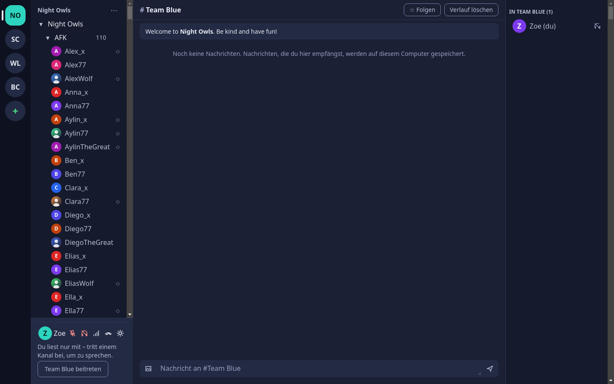
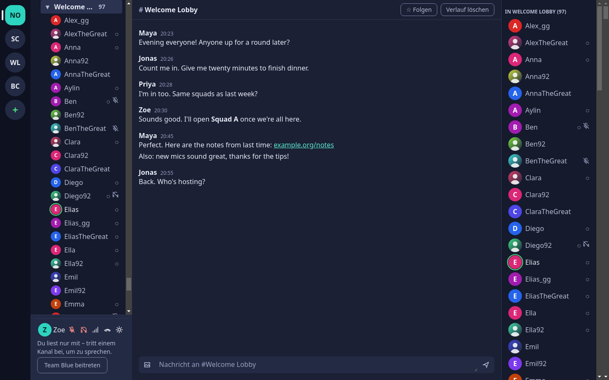
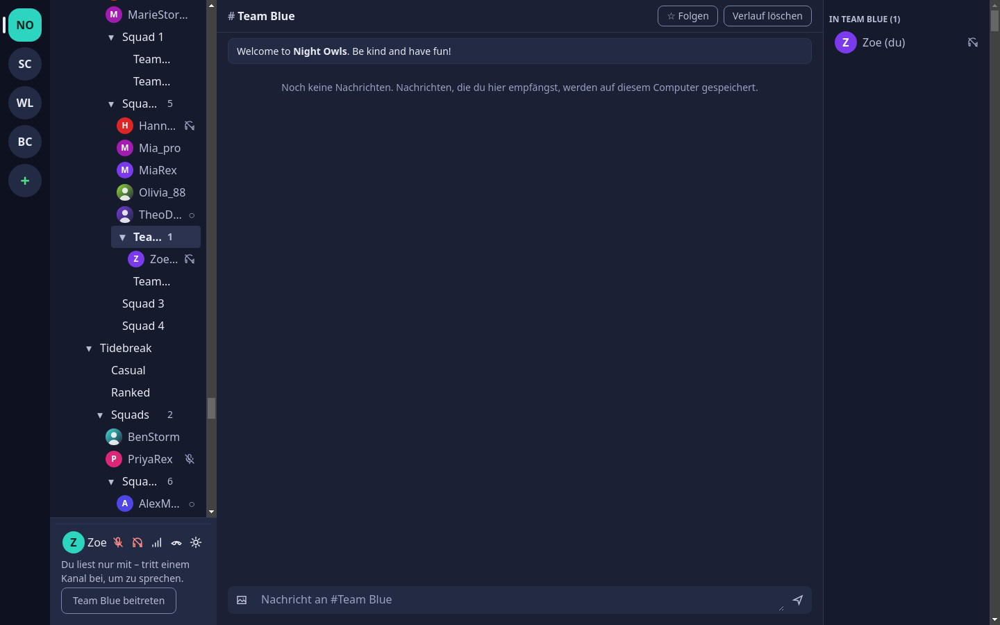
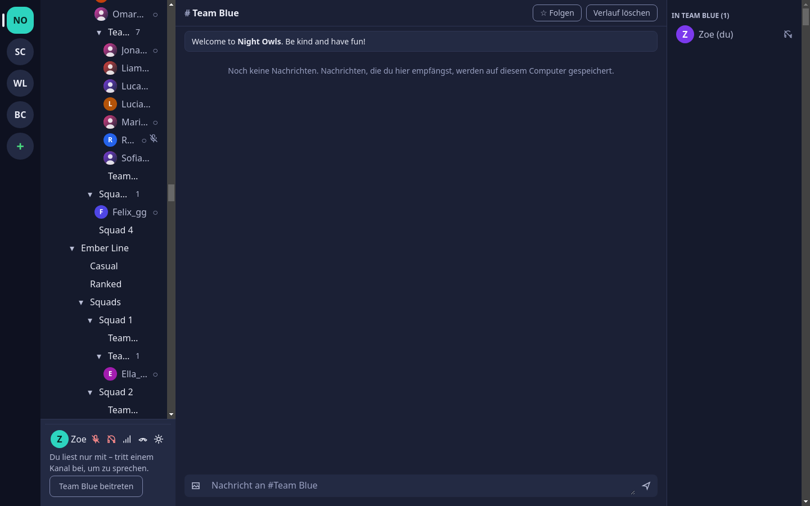

# Epic 1 – Scale report: 1000 users, 300 channels

**Question:** How does Mumcord behave on a big community server, with 1000 people connected, about 300 channels nested up to 5 levels deep, some rooms holding 100+ people, a few people talking at the same time, people constantly joining, leaving and moving, and chat messages coming in?

**Short answer:** The **engine (Rust) is fine**: it uses about 3 % of one CPU core and 18 MiB of memory. The **UI is the bottleneck**. Every single change, such as one person moving, redraws the whole channel tree with all 1305 rows. On a fast machine that takes about 60 ms per change, and under normal churn the window drops to about 15 frames per second. On a slower laptop (simulated with 4× CPU throttling) it drops to 3–5 frames per second. Right after connecting, a burst of 305 permission updates **freezes the UI for about 13 s** (about 48 s on the slow profile). The tree is also hard to use at this size: it is 56 screens long, deep channel names are cut down to 3–4 letters, and nothing helps you find yourself or a channel.

## 1. Setup

| Item | Value |
|---|---|
| Machine | 16 cores, 31 GiB RAM, Linux (CachyOS) |
| Server | Unmodified `mumblevoip/mumble-server:v1.5.735` as its own compose project `mumcord-scale`, port 64850, data in `testenv/data/scale/`, user limit raised to 1500 (test infrastructure only). Start: `testenv/scale/up.sh`, stop: `testenv/scale/down.sh`. |
| Channels | 304 + root, seeded by `testenv/scale/seed_channels.py`: Welcome Lobby, AFK, Event Stage, Gaming › 12 games › Casual/Ranked/Squads › Squad 1–4 › Team Red/Blue (level 5), Clans › 15 clans › Lounge/Ops › Alpha–Charlie, Community, Music, Study Hall, Support. |
| Load | `crates/bot/examples/loadtest.rs`: 1000 users without certificates (connected in about 41–59 s, 50 at a time), plus 6 talkers with certificates. Distribution: Welcome Lobby 140, AFK 110, Event Stage 120, one game room 60, the rest spread over about 110 channels with a long tail; about 190 channels empty. **Churn** (switched on by a file): 10 moves/s, 2 leaves + 2 joins/s, 1 chat message/s (half of them in the probe's channel). **Talking**: 6 speakers in the probe's channel, bursts of 1–4 s with 0.5–3 s pauses. |
| Engine probe | `crates/engine/examples/scale_probe.rs`: the real `Engine` (null audio backend, no Tauri/UI). It connects, joins Welcome Lobby, and every 5 s logs CPU, memory and events per second sent towards the UI, broken down by type. |
| UI | Production build of the UI with the mock engine and the new opt-in seed `stress` (`VITE_MUMCORD_MOCK=1 VITE_MUMCORD_MOCK_SEED=stress`). It shows the same tree as the load server and 1000 people, about a third with avatars. It exposes `window.__mumcordMock` so a script can inject events. Measured in headless Chromium 127 at 1440×900 with dark theme, driven over the DevTools protocol. Each run was done at 1× CPU and at 4× CPU throttling (≈ a modest laptop; WebKitGTK, the real app's web engine, is usually slower than Chromium too). |
| Not done | The real Tauri app (WebKitGTK) against the load server: it would need a full E2E Docker build plus scripting of the wizard and trust dialogs. The engine probe and the Chromium numbers cover both halves separately. The IPC hop between them (one JSON message per event) is not measured. |

## 2. Numbers

### 2.1 Engine and protocol (real server, 1007 users)

| Measure | Value |
|---|---|
| Connect → `serverSynced` (1007 users, 305 channels) | **91–182 ms** on a quiet server; **1.5–7.1 s** while the server is busy with churn or reconnects. That time is spent waiting on the server; the engine's own CPU for the sync is < 20 ms. |
| Snapshot size (Debug text, a stand-in for JSON) | ≈ 350 KiB (about 67 KiB with no users) |
| Engine memory (RSS) | 10 MiB before connect → 12 MiB synced → **17–18 MiB** steady and under churn |
| Engine CPU, idle | 2–4 % of one core (mostly the 20/s `micLevel` meter and the audio clock) |
| Engine CPU, talking | 3–5 % |
| Engine CPU, churn + talking | 3–5 % |
| Events to the UI, idle | 20/s (all `micLevel`) |
| Events to the UI, churn + talk | **≈ 38–40/s** in total: ≈ 13–14 `userUpserted`/s, ≈ 2 `userRemoved`/s, ≈ 3 `talkStateChanged`/s, ≈ 0.5 messages/s, 20 `micLevel`/s |
| Peak burst | **≈ 314 events within 100 ms** right after every sync: one `channelUpserted` per channel, caused by the permission query the engine sends for every channel (`crates/engine/src/session/mod.rs:929`) |
| Talking events | Only for people in your own channel (and followed channels): the server sends voice only there. Talking load therefore depends on your own channel, not on the server size. |
| Server (murmur) CPU | 5–10 % idle, **60–80 % of one core under churn**. In the first churn run the server's control thread stalled for about 30 s and then dropped about 430 clients with "Timeout". This is a limit of the server and of the test machine, not of Mumcord, but it means big servers can be laggy themselves. |

The engine has no scale problem. Nothing grows with users × users; memory and CPU stay flat.

### 2.2 UI (Chromium, stress mock, 305 channels, 1000 people)

| Measure | 1× CPU | 4× CPU (slow laptop) |
|---|---|---|
| First render after connect (1305 tree rows) | 237 ms (one 432 ms long task) | 821 ms (1.7 s of long tasks) |
| DOM nodes | 9 586 | 9 586 |
| Avatar requests on connect (`personProfile`) | **307** at once (every visible person with an avatar) | 307 |
| Post-sync burst: 305 `channelUpserted`, **one per task as IPC delivers them** | **12.9 s** of busy UI | **48 s** (44 s of long tasks) |
| Same burst delivered in one task (React batches it) | 85 ms | 423 ms |
| One person moves → screen updated | median **61 ms**, p95 93 ms | median **360 ms**, p95 1.6 s |
| One talking ring on/off → screen updated | median 4 ms, p95 55 ms | median 5 ms, p95 302 ms |
| Frame rate idle | 61 fps | 61 fps |
| Frame rate at measured churn (40 moves/s + 15 talk/s) | **17 fps** (90 of 133 frames > 50 ms) | **3 fps** (frames 333–567 ms) |
| Frame rate at 5× churn (200 moves/s + 30 talk/s) | 17 fps (React merges updates) | 5 fps |
| Scrolling the expanded tree top to bottom | smooth (p95 16.7 ms) | p95 50 ms, max 67 ms |
| Tree height when fully expanded | **41 883 px = 56 screens** | |
| Clicking a 140-person channel (member list) | 48–83 ms | n/a |
| JS heap | 15 MiB after connect → 34–52 MiB after the churn runs | 67 MiB |

Scrolling is fine because the browser only paints what is visible. What hurts is **re-rendering**: every store change rebuilds and redraws everything.

## 3. Usability at this scale (screenshots, dark theme)

| | |
|---|---|
|  |  |
| 1 – After connecting, the first thing you see is AFK with all 110 people expanded. Every channel starts expanded. | 4 – Member list of a crowded room (shown with 97 people after churn moved some out): one flat alphabetical list. |
|  |  |
| 3 – Own channel "Gaming › Starfall › Squads › Squad 2 › Team Blue" (level 5): it shows as "Tea…", your own name as "Zoe…", and "Team Red" next to it is just "Team…". | 2 – Somewhere in the middle of 56 screens: no breadcrumb, no search, and empty channels take as much space as busy ones. |

Findings:

1. **Finding yourself.** You land in a channel 5 levels deep that is about 40 screens down. The user panel says "Team Blue beitreten", but there is no "jump to my channel", no breadcrumb, and the own channel has no visible marker other than the selection highlight.
2. **Deep nesting truncates names.** The sidebar is about 220 px wide and each level indents about 16 px, so at levels 4–5 only 3–4 letters are left ("Squa…", "Tea…", "Hann…"). Siblings such as "Team Red" and "Team Blue" become identical.
3. **Everything expanded by default.** With 1000 people, the tree is 1305 rows long. Crowded rooms (AFK 110, Lobby 140) push everything else down.
4. **No search or filter**, for channels or for people.
5. **Empty channels** (about 190 of 304) are shown the same way as busy ones, without a count. That is fine for small servers but noisy here.
6. **Per-channel counts** are good and readable, but they only count direct members. A collapsed "Gaming" does not show that 200 people are inside it.
7. **Member list** is a flat A–Z list of the selected channel. With 140 people it works, but speakers are not pulled to the top, so you cannot see who is talking without scrolling.
8. **Sorting:** when channels have no position set, they sort by name, so "AFK" comes first and "Welcome Lobby" last. Real servers usually set positions, so this is mostly a test-data effect, but it shows that the most crowded room can easily be the first thing you see.

## 4. Bottlenecks, ranked by impact

| # | Bottleneck | Where | Impact |
|---|---|---|---|
| 1 | **Full tree rebuild and re-render on every event.** The store copies the whole users map for each event and notifies every subscriber. `ChannelTree` rebuilds the tree (`buildTree`, with a locale-aware sort of every channel's members) and re-renders all 1305 rows without memoised row components. One move costs ≈ 60 ms (≈ 360 ms on a slow laptop). | `ui/src/features/channels/serverStore.ts:113`, `ChannelTree.tsx:70`, `tree.ts:30` | Choppy UI under normal churn (17 fps, 3 fps slow) |
| 2 | **Post-sync burst of 305 `channelUpserted`** (one per permission answer), each a separate IPC message and therefore a separate full re-render. It happens on every connect and reconnect. | `crates/engine/src/session/mod.rs:929` + store | UI frozen for about 13 s (≈ 48 s slow) after connecting |
| 3 | **Avatar loading for every visible person at once.** 307 `personProfile` calls on connect, and each answer copies the image map and re-renders the whole tree again. In the real engine each call also asks the server for the avatar blob. | `ui/src/features/members/useAvatars.ts:63`, `ChannelTree.tsx:80` | Hundreds of extra full renders plus server requests right after connect |
| 4 | **No virtualisation.** All 1305 rows (≈ 9 600 DOM nodes) are rendered even though about 25 are visible. Scrolling itself is fine, but every re-render pays for all rows. | `ChannelTree.tsx` | Multiplies #1–#3 |
| 5 | **Member list filters and sorts all 1000 users on every store change**, even talking changes. | `ui/src/features/members/MembersPanel.tsx:38` | Small (a few ms), grows with #1 |
| 6 | Server-side limits: murmur at 60–80 % CPU under churn, slow sync while busy | server | Not ours to fix; the UI should show a "syncing…" state and tolerate a slow sync |

## 5. Proposals

Effort: **S** = hours to 1 day, **M** = 2–4 days, **L** = a week or more. **Type**: *Perf* = pure performance fix, the user sees no change except speed. *Product* = changes what the user sees or does, so the PM decides.

| # | Proposal | Fixes | Effort | Type |
|---|---|---|---|---|
| P1 | **Batch UI updates per frame.** The store collects incoming events and applies them at most once per animation frame (one new state, one render). This also turns the 305-event burst into a single render. | #1, #2, #3 | S | Perf |
| P2 | **Engine: send permission results as one event**, for example a single `channelsUpserted { channels }` after the answers arrive (or debounced at 50 ms), instead of 305 separate events. | #2 | S | Perf |
| P3 | **Incremental tree model.** Keep members per channel and the tree structure in the store and update only the affected channels. Make rows memoised components (`React.memo`) keyed by user and channel, so a move re-renders 2 rows, not 1305. Talking state is read per row, so a ring toggles only that row. | #1, #5 | M | Perf |
| P4 | **Virtualised tree and member list.** Render only the visible rows plus a margin, with a flat row list (it already exists: `visibleRows`). Keep the ARIA tree semantics (`aria-setsize`/`aria-posinset`, focus kept on the active row). | #4 | M | Perf (a11y needs care) |
| P5 | **Lazy avatars.** Request avatars only for rows on screen, queue them a few at a time, cache them by `avatarHash` (across reconnects too) and store results in one batched update. | #3 | S–M | Perf |
| P6 | **Collapse by default on big servers**: above about 50 channels or 200 people, start with top-level channels collapsed, except the path to your own channel. Remember expand/collapse per server. | usability 1, 3 | S | **Product** |
| P7 | **"Jump to my channel"** button (and shortcut), plus a clear "you are here" marker on the own channel row and its collapsed ancestors. | usability 1 | S | **Product** |
| P8 | **Search / filter field** above the tree: type to filter channels and people. Matches show with their path; Enter jumps to the match or joins it. | usability 4 | M | **Product** |
| P9 | **Handle deep nesting**: smaller indent from level 3 on, names wrap to two lines or show a full-name tooltip, and a breadcrumb ("Gaming › Starfall › Squads › Squad 2") in the chat header. Optionally let the user resize the sidebar. | usability 2 | S–M | **Product** |
| P10 | **Hide or dim empty channels** (setting "Show empty channels": on / dimmed / off; default dimmed on big servers). Channels you follow or have unread messages in always stay visible. | usability 5 | S | **Product** |
| P11 | **Total counts on collapsed channels** ("Gaming 213"), so collapsing does not hide where people are. | usability 6 | S | **Product** |
| P12 | **Member list: speakers on top** (a "Talking now" group), then A–Z. For very big rooms, a collapsible "Muted / AFK" group. Optional "everyone on the server" view grouped by channel with collapsible groups. | usability 7 | M | **Product** |
| P13 | **Throttle talking-ring updates** to about 10 per second per person, and suppress on→off→on flicker shorter than 150 ms. | rings flicker, cost | S | Perf (small visual change) |
| P14 | **"Syncing big server…" state** while the snapshot and the first render are in flight, so a slow server does not look like a hang. | #6 | S | **Product** (small) |

### Recommendation

1. **Do now (performance, about 1 week in total, no design decisions needed):** P1 + P2 first (S + S). They remove the 13 s freeze and most of the churn cost. Then P5 and P3, and measure again with this setup. Do P4 (virtualisation) only if the slow-laptop profile still shows fewer than 30 fps under churn after P1/P3/P5.
2. **Decide (product, for the PM):** I recommend **P7 "Jump to my channel"**, **P6 collapse-by-default on big servers**, **P9 deep-nesting fixes** and **P11 totals on collapsed channels** as a small package (all S, about 3–4 days). They make a 300-channel server usable without changing how the app works for small servers. **P8 search** is the next most valuable (M). **P10** (empty channels) and **P12** (member-list grouping) can wait for user feedback.
3. **Keep this setup as a regression check**: `testenv/scale/up.sh`, the `loadtest` and `scale_probe` examples, and the `stress` mock seed. Rerun it after the fixes; target at least 50 fps under the measured churn at 1× and at least 30 fps at 4×, and no long task above 200 ms after connect.

## 6. How to reproduce

```bash
testenv/scale/up.sh                                   # load server on :64850 (seeds 304 channels once)
export CARGO_TARGET_DIR=~/.cache/mumcord-build/scale
cargo run --release -p mumcord-bot --example loadtest -- --users 1000 \
  --churn-file /path/churn --talk-file /path/talk --cert-dir /path/botcerts
touch /path/talk; touch /path/churn                   # switch talking / churn on (rm to stop)
MUMCORD_AUDIO_BACKEND=null PROBE_DIR=/path/probe cargo run --release -p mumcord-engine \
  --features test-backend --example scale_probe -- 64850 170 1
VITE_MUMCORD_MOCK=1 VITE_MUMCORD_MOCK_SEED=stress npx vite build --outDir /path/dist
# serve /path/dist, open it, call window.__mumcordMock.connect(1, null), inject events via
# window.__mumcordMock.mock.emit(...)
testenv/scale/down.sh
```
