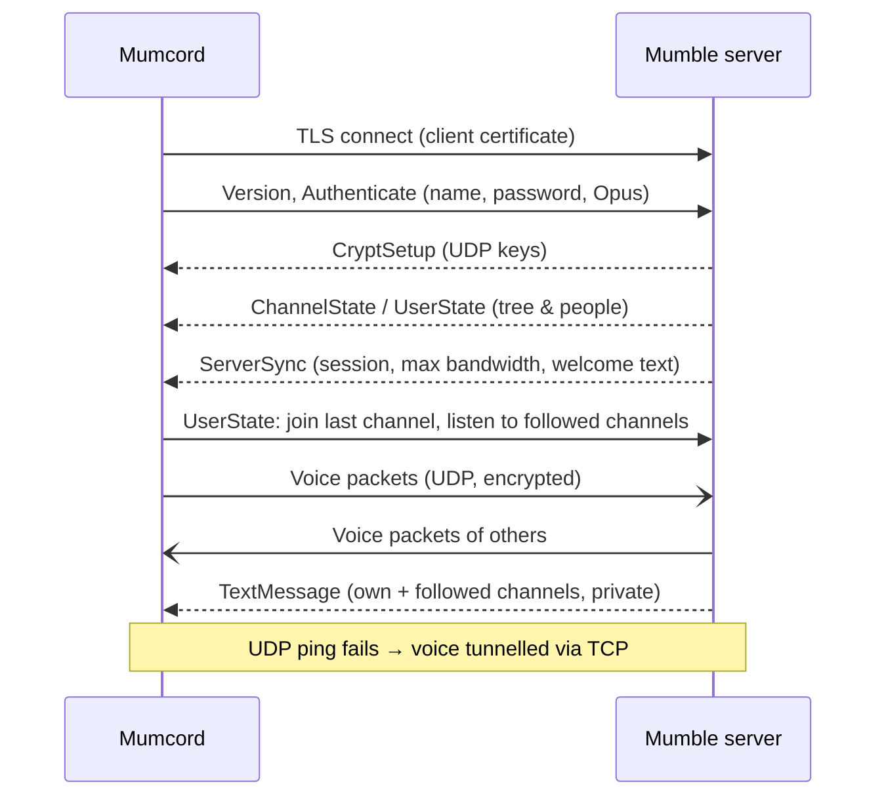
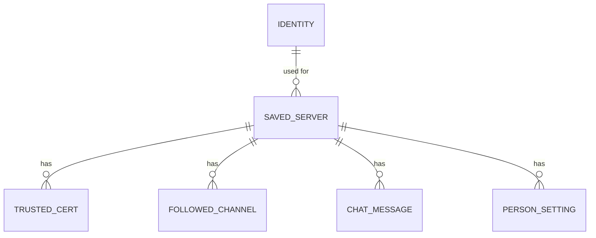
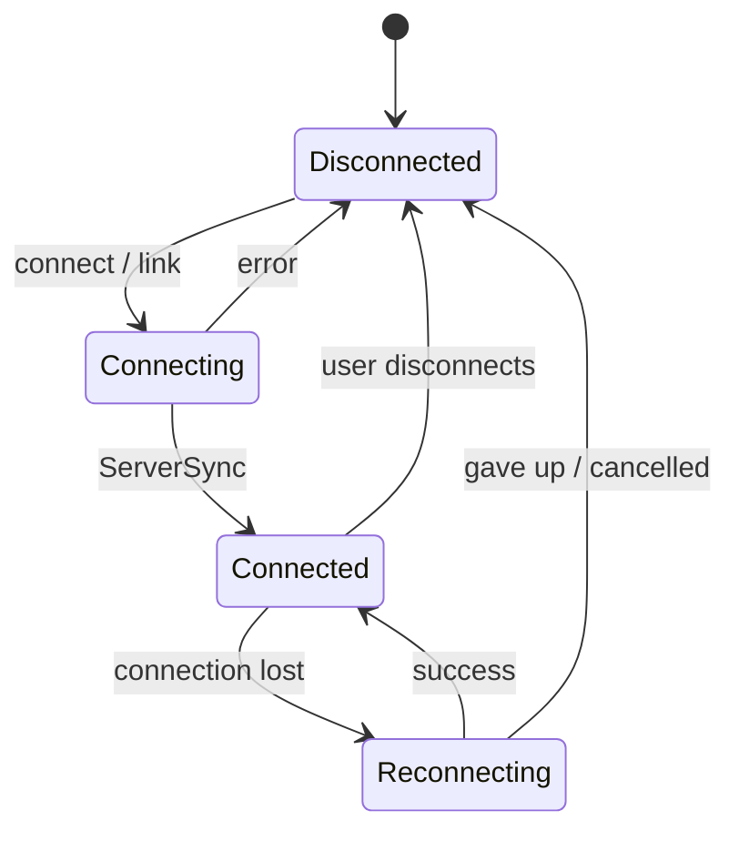

# Mumcord · Epic 1 – Foundation · Specification

> Status: Final (brainstorming completed) · As of: 2026-10-24
> Sources: `specs/01-foundation-brainstorming.md` (no roadmap existed yet; this spec proposes it, see section 14)
> Builds on: – (first specification; sets product vision, platforms and tech stack)

## 1. Goal & context

Mumcord is a modern, Discord-like desktop client for Mumble aimed at gaming groups and online communities (Q1.1). The official Mumble client is reliable but dated and hard to set up; Mumcord offers a clean look, a one-minute first start and great audio out of the box (Q1.2), while staying a **pure client** that works against unmodified standard Mumble servers (Q1.13). The long-term goal is a full replacement of the official client including admin features, reached over several epics (Q1.3, Q1.11). Epic 1 delivers a client that people can use day to day: connect, talk, chat in Discord-style text channels – including reading followed channels without joining – plus positional audio and an overlay for games.

## 2. Scope

### 2.1 In scope (MVP)

Epic 1 is delivered in two stages (Q2.1). Stage 1a must be complete and usable before 1b starts.

**Stage 1a – everyday client**
- First-start wizard: identity, microphone, talk mode (Q1.6, Q2.6).
- Saved servers, connect by address or `mumble://` link (Q1.5, Q5.4).
- Discord-style main window: server bar, channel list, chat, member list (Q2.3, Q2.4).
- Join channels; talk and listen with voice activation or push-to-talk (Q1.5, Q3.3).
- Mute/deafen self; per-person volume and local mute, remembered (Q1.5, Q5.2).
- Audio settings: device selection, mic test, noise suppression and echo cancellation (Q1.5, Q3.4).
- Text chat in channels and private messages, formatting, local history (Q1.10, Q4.5, Q5.5).
- Follow channels to read them without joining (Q1.14, Q3.1).
- Server registration (Q1.10, Q5.6).
- Avatars and profile comments: display and set own (Q5.7).
- Auto-reconnect, adaptive audio quality and buffering (Q3.5–Q3.7).
- Subtle notification sounds (Q3.8).
- Basic tray icon and close behaviour (Q2.8).
- Themes (system, dark first), languages English/Spanish/German (Q2.5, Q2.7).
- Diagnostic file export (Q4.7, Q4.9).
- Unsigned test builds for Linux, Windows, macOS via GitHub Actions (Q4.2, Q4.10).

**Stage 1b – gaming features**
- Positional audio via Mumble Link and the official Mumble game plugins (Q3.9).
- Overlay as a floating, transparent on-top window (Q3.10).

### 2.2 Out of scope / later
- Anything server-side: companion services, server plugins, server configuration (Q1.13) – **never**, not just later.
- Connecting to several servers at the same time; rich chat beyond what Mumble supports (reactions, link previews) (Q1.2).
- Admin features: ACL/permission editing, bans, channel management (Q1.11) → Epic 3.
- Global hotkeys beyond push-to-talk, full tray menu, notifications, import of official client settings → Epic 2.
- Signed installers, auto-update, automatic opt-in crash reports → Epic 4 (Q4.2, Q4.9).
- Public server browser (Q5.3), whisper/shout (Q5.8).
- Mobile apps and web version (Q1.4).
- Exclusive-fullscreen in-game overlay via game hooking (Q3.10).

## 3. Roles & permissions

Mumcord enforces nothing itself; the server's ACLs decide. The client reflects permissions: it hides or disables actions the server denies and shows the server's denial message if an action fails anyway.

| Action | Guest (unregistered) | Registered user | Channel/server admin | Enforced by |
|---|---|---|---|---|
| Connect, join permitted channels, talk, chat | ✅ | ✅ | ✅ | Server ACL |
| Follow (listen to) a channel | ✅ if "Listen" permitted | ✅ if permitted | ✅ | Server ACL + listener limits |
| Register own name | ✅ if "Register self" permitted | – | ✅ | Server ACL |
| Set own avatar/comment | ✅ if permitted | ✅ | ✅ | Server ACL + size limits |
| Move/kick/ban others, edit ACLs/channels | ❌ in Mumcord (Epic 3) | ❌ | ❌ in Mumcord (Epic 3) | – |
| Per-person volume, local mute, history deletion | ✅ | ✅ | ✅ | Local only |

## 4. Functional requirements

### 4.1 First start & identity
- **FR-1.1** On first start a 3-step wizard runs (Q2.6): (1) identity, (2) microphone, (3) talk mode. It can be finished in about a minute; every step has sensible defaults.
- **FR-1.2** Identity step: create a new identity (self-signed client certificate, name chosen by the user) or import an existing one (PKCS#12 file, e.g. exported from the official client). The step reminds the user to back up the identity (Q1.6).
- **FR-1.3** The identity certificate is stored in the OS secure storage (Q4.3). Settings offer "Export identity" (password-protected PKCS#12 file) and "Import identity" at any time.
- **FR-1.4** Microphone step: choose input and output device, live level meter and "test playback" of the own voice with noise suppression applied.
- **FR-1.5** Talk-mode step: voice activation preselected (Q3.3); push-to-talk selectable with key capture. On Wayland without a global-shortcuts interface, push-to-talk is shown as unavailable with an explanation and voice activation is suggested (Q4.11).
- **FR-1.6** At the end of the wizard Mumcord offers to become the handler for `mumble://` links (Q5.4).

### 4.2 Servers & connection
- **FR-1.7** Saved servers appear as icons in the server bar; "+" adds one by address, port (default 64738), username and optional password, or by pasting a `mumble://` link. Servers can be edited, reordered and removed.
- **FR-1.8** Server passwords are stored in the OS secure storage (Q4.4), never in plain files.
- **FR-1.9** Only one server is connected at a time. Clicking another saved server asks to disconnect from the current one first.
- **FR-1.10** On first connection to a server with an unknown or self-signed certificate, Mumcord shows the certificate fingerprint and asks whether to trust it; the decision is remembered. If a trusted server's certificate changes, a clear warning blocks the connection until the user decides.
- **FR-1.11** Opening a `mumble://` link (from a browser or another app) starts Mumcord if needed, offers to save the server and connects, joining the channel in the link if present.
- **FR-1.12** Servers 1.4 and newer are fully supported; older servers connect, and features they lack (notably following channels) are hidden with a short hint (Q3.2).
- **FR-1.13** On connection loss Mumcord shows a "reconnecting…" bar, retries with increasing intervals, and on success rejoins the last channel and restores followed channels (Q3.6). The user can cancel; after a defined number of failed attempts it gives up and shows "Disconnected – Reconnect".
- **FR-1.14** The last channel per server is remembered and rejoined on the next connection if permitted.

### 4.3 Channels & people
- **FR-1.15** The channel list shows the server's channel tree (collapsible), with people under their channel, talking indicators, mute/deafen icons and an ear icon for listeners. Each channel appears once (Q2.4).
- **FR-1.16** Single-click a channel → shows its chat. Double-click or the "Join" button → enters the channel's voice (if permitted).
- **FR-1.17** The member list shows the people in the selected channel, plus its listeners, with avatar, name, talking state and registered/unregistered marker.
- **FR-1.18** Clicking a person opens a profile card: avatar, name, comment, and local controls: volume slider (0–200 %), local mute, "send private message".
- **FR-1.19** Per-person volume and local mute are stored by the person's certificate hash per server and re-applied when they reappear, even after renaming (Q5.2). People without a certificate are only adjusted for the session.
- **FR-1.20** The user can set their own avatar (image, scaled to the server's limit) and profile comment (Q5.7).

### 4.4 Voice
- **FR-1.21** Talk modes: voice activation (default) and push-to-talk (global key, also while another app is focused).
- **FR-1.22** Self mute and self deafen via buttons in the user panel; deafen implies mute. States are sent to the server so others see them.
- **FR-1.23** AI-based noise suppression and echo cancellation are on by default; automatic input gain keeps the voice level even (Q3.4). All three can be switched off in settings.
- **FR-1.24** Audio quality is automatic: the highest bitrate the server allows, lowered automatically when packet loss rises, raised again when it recovers (Q3.5).
- **FR-1.25** Playback uses an adaptive jitter buffer: minimal delay on stable connections, small extra buffer only when packets arrive unevenly (Q3.7).
- **FR-1.26** Voice goes via UDP; if UDP is blocked, it falls back to tunnelling through the TCP connection automatically.
- **FR-1.27** Short, subtle sounds for: someone joins/leaves your channel, self mute/unmute, self deafen/undeafen, new message in a followed channel or private chat. No text-to-speech (Q3.8). Sounds can be toggled per event.

### 4.5 Text chat
- **FR-1.28** Each channel and each private conversation has a chat view with input field. Sending to a channel requires the server's "Text message" permission; denials are shown inline.
- **FR-1.29** Received messages are displayed with formatting, links and small inline images, sanitized so no scripts, external loads or unsafe markup run (Q5.5). Links open in the system browser after a click.
- **FR-1.30** The user writes with Markdown shortcuts (bold, italic, code, links) and can paste or drop images; Mumcord converts to Mumble-compatible HTML, scales/compresses images to the server's message size limit and refuses too-large content with a clear message.
- **FR-1.31** **Follow channels** (Q3.1): any channel can be followed via a "Follow" button. Mumcord starts listening to it with its audio muted locally, so its messages arrive without joining. Followed channels show unread badges. Unfollowing stops listening. If the server denies listening or the listener limit is reached, the user gets a clear message.
- **FR-1.32** All received and sent messages (channels, followed channels, private chats) are stored locally and shown when the chat is reopened, including after restart (Q4.5). History only contains what Mumcord actually received.
- **FR-1.33** History controls: "Clear history" per channel/private chat, per server and all; "Save history" switch per server (default on).

### 4.6 Registration
- **FR-1.34** The user menu offers "Register on this server" when not registered and permitted. A dialog explains in plain language what registration means and that the identity must be backed up, with a direct "Export identity" button (Q5.6).

### 4.7 Window, tray & app behaviour
- **FR-1.35** Theme follows the OS setting; dark is the default design and light is fully supported; manual override in settings (Q2.5).
- **FR-1.36** UI languages: English, Spanish, German; defaults to the OS language if supported, else English; switchable in settings without restart (Q2.7).
- **FR-1.37** A tray icon shows the connection and talk state and offers "Show", "Mute", "Deafen", "Quit".
- **FR-1.38** Closing the window while connected asks once "Minimize to tray or quit?" with "Remember my choice"; changeable in settings (Q2.8).
- **FR-1.39** Settings screen (Discord-style, sections in a side list): Identity, Audio, Voice, Chat & history, Appearance, Language, Sounds, Overlay & positional audio, Diagnostics, About (incl. licenses).
- **FR-1.40** "Save diagnostic file" in Diagnostics writes a file with app version, OS, audio devices, connection statistics and recent log lines – without chat contents, passwords, certificates or personal data (Q4.7).

### 4.8 Stage 1b – positional audio
- **FR-1.41** Positional audio can be enabled in settings (default off). When enabled, voices of people who send positional data in the same game context are placed in 3D around the listener (headphone-optimized panning and distance attenuation, configurable min/max distance).
- **FR-1.42** Position sources (Q3.9): (a) the **Mumble Link** shared-memory interface used by games and mods; (b) the **official Mumble game plugins**, loaded as plugin libraries via Mumble's plugin interface. Plugins can be enabled individually; a notice explains that some anti-cheat systems may flag memory-reading plugins.
- **FR-1.43** The settings show which game/plugin is currently delivering positions, so users can tell whether it works.

### 4.9 Stage 1b – overlay
- **FR-1.44** The overlay is a separate, transparent, click-through, always-on-top window showing who is talking (avatar + name), and optionally the whole current channel (Q3.10). It does not hook into games.
- **FR-1.45** Position, size, opacity and content are configurable; the overlay can be toggled from the tray and settings.
- **FR-1.46** Where the OS or desktop doesn't allow staying on top (some Linux desktops) or a game runs in exclusive fullscreen, settings explain the limitation.

## 5. UI & UX

### 5.1 Navigation


### 5.2 Main window (Q2.3)

```text
┌────┬──────────────┬──────────────────────────────┬──────────────┐
│ ◉  │ Gaming Srv ▾ │ # Lobby            ☆ Follow  │ In Lobby (3) │
│ ○  │──────────────│──────────────────────────────│──────────────│
│ ○  │ ▾ Lobby    3 │ Anna            12:01        │ 🟢 Anna  🎙  │
│    │   🟢 Anna 🎙 │ hi all                       │ ⚪ Ben       │
│ +  │   ⚪ Ben     │ Ben             12:02        │ ⚪ You       │
│    │   ⚪ You     │ hey **there**                │──────────────│
│    │ ▸ Raid  5 •2 │                              │ Listening    │
│    │ ▸ AFK      1 │                              │ 👂 Carla     │
│    │──────────────│──────────────────────────────│              │
│    │ 🧑 You       │ Message #Lobby…        🖼  ➤ │              │
│    │ 🎙 🎧 ⚙      │                              │              │
└────┴──────────────┴──────────────────────────────┴──────────────┘
```

- **Server bar** (left): saved servers as round icons, connected one highlighted, "+" to add.
- **Channel list**: tree, unread badge (•2) on followed channels, "Join" button on hover.
- **Chat**: header with channel name and Follow toggle; message list; input with image button.
- **Member list**: people in the channel, then listeners.
- **User panel** (bottom of channel list): own avatar/name, mute, deafen, settings.
- A thin bar above the chat shows "Reconnecting…" or "Connected via TCP (UDP blocked)" when relevant.

### 5.3 First-start wizard (Q2.6)

```text
┌──────────────────────────────────────────┐
│  Welcome to Mumcord           Step 1 / 3 │
│                                          │
│  Your identity                           │
│  ( ) Create new   Name: [ Tobias      ]  │
│  ( ) Import file  [ Choose… ]            │
│                                          │
│  ⓘ Your identity is like a key. Back it  │
│    up later in Settings → Identity.      │
│                                 [ Next ] │
└──────────────────────────────────────────┘
```
Step 2: device dropdowns, level meter, "Test" button. Step 3: voice activation (preselected) / push-to-talk with "Press a key…", then the `mumble://` handler offer.

### 5.4 Empty states, errors, confirmations
- No saved servers: centered "Add your first server" with address field and "Paste a mumble:// link".
- Empty chat: "No messages yet. Messages you receive here are saved on this computer."
- Errors in plain language with a next step: server unreachable, wrong password, name already in use/registered, certificate rejected, server too old for following, permission denied, listener limit reached.
- Confirmations: switching server while connected, clear history, certificate change warning, quitting while connected (Q2.8).

### 5.5 Design notes
- Discord-inspired, not a copy: own colour palette and Mumcord branding, no Mumble logo (Q4.6).
- Dark theme designed first, light theme fully supported; scales correctly on high-DPI screens.
- Accessibility to **WCAG 2.2 AA** (Q4.12): full keyboard operation with visible focus, screen-reader labels and live regions for talking/join events, contrast ≥ 4.5:1 for text, respects OS font size and reduced-motion settings.

## 6. Audio & network

- **Input/output:** OS default devices preselected; switching devices takes effect without reconnecting; device hot-plug handled.
- **Processing chain (send):** capture → echo cancellation → AI noise suppression → automatic gain → voice-activity detection (or PTT gate) → Opus encoding.
- **Codec:** Opus only for sending (all supported servers use it); bitrate automatic within the server's maximum (Q3.5).
- **Latency target:** mouth-to-ear ≤ 150 ms on a stable LAN/broadband connection, excluding network transit; adaptive jitter buffer (Q3.7).
- **Voice transport:** encrypted UDP as defined by the Mumble protocol; automatic fallback to TCP tunnelling; both the legacy and the newer (1.5) UDP packet formats are supported.
- **Following:** listening to followed channels uses the protocol's channel-listener feature (servers ≥ 1.4); their audio is muted locally via a listener volume of 0. Verified on 2026-10-24 in the Mumble server source (`Server::msgTextMessage`, 1.4.230 / 1.5.735 / master) that channel text messages are delivered to listeners.



- **Protocol compatibility:** client protocol version 1.5; minimum server 1.4 for full functionality; older servers best-effort (Q3.2). No protocol extensions, nothing server-side (Q1.13).

## 7. Data & state model

All data is local to the user's computer; nothing is stored on any server other than what the Mumble protocol itself transmits.



| Entity | Field | Type | Required | Rules / notes |
|---|---|---|---|---|
| Identity | name | text | yes | Default username |
| | certificate | PKCS#12 | yes | In OS secure storage only (Q4.3) |
| SavedServer | label | text | yes | Shown as tooltip/icon initials |
| | address, port | text, int | yes | Port default 64738 |
| | username | text | yes | Defaults to identity name |
| | password | secret | no | OS secure storage (Q4.4) |
| | last_channel | channel path | no | For rejoin (FR-1.14) |
| | save_history | bool | yes | Default true (FR-1.33) |
| | sort_order | int | yes | Server bar order |
| TrustedCert | fingerprint | text | yes | Server certificate trust decision (FR-1.10) |
| FollowedChannel | channel_path | text | yes | Path, so it survives channel ID changes where possible |
| | last_read_at | datetime | yes | For unread badges |
| ChatMessage | conversation | channel path or person cert hash | yes | Channel or private chat |
| | sender_name, sender_cert_hash | text | yes / no | Hash missing for certificate-less users |
| | sent_at | datetime | yes | Local receive time |
| | body | sanitized HTML | yes | Stored sanitized |
| PersonSetting | person_cert_hash | text | yes | Key (Q5.2) |
| | volume | int 0–200 | yes | Percent |
| | local_mute | bool | yes | |
| Settings | theme, language, talk_mode, ptt_key, input/output device, noise_suppression, echo_cancellation, auto_gain, sounds per event, close_behaviour, overlay options, positional options, enabled plugins | various | – | Single settings record |



Talk state (per own user): `Silent → Talking` (VAD/PTT), overridden by `Muted` and `Deafened`.

## 8. Technology & architecture

- **App shell: Tauri 2** – small, native windows on all three OS, web-based UI, path to mobile later (Q1.7).
- **Engine: Rust** – memory-safe and fast for real-time audio and networking (Q1.7). Modules: `protocol` (TLS control channel, protobuf messages, UDP crypto), `audio` (capture, processing, Opus, jitter buffer, mixing, 3D panning), `store` (local database, secure storage), `positional` (Mumble Link, plugin host), `app` (state, commands/events to the UI).
- **UI: React + TypeScript (strict)** inside Tauri (Q4.1); state and data access separated from presentation; HTML sanitization of all server content; i18n with translation files for en/es/de.
- **Key libraries (to be confirmed during build):** `tokio` (async networking), `rustls` (TLS with client certificates), `prost` (protobuf, using Mumble's BSD-licensed `Mumble.proto`), `opus` bindings, `cpal` (audio I/O), an RNNoise-class AI noise suppressor and WebRTC audio processing (echo cancellation, gain), `keyring` (OS secure storage), SQLite (local data), Tauri plugins for tray, deep links (`mumble://`) and global shortcuts, XDG desktop portal (Wayland global shortcuts, Q4.11).
- **Threads:** dedicated real-time audio threads that never block (no allocation, locks or I/O in the audio callback); networking on the async runtime; UI communicates only with the engine, never with the network.
- **Plugins (stage 1b):** a plugin host loading the official Mumble game plugins (C plugin interface) in a contained way; Mumble Link via shared memory.
- **Configuration & secrets:** settings and history in the OS-standard app data folder; certificate and passwords only in OS secure storage; no secrets in the repository or builds.

## 9. Non-functional requirements

- **Latency:** ≤ 150 ms mouth-to-ear excluding network transit; audio processing adds ≤ 30 ms.
- **Resources:** idle while connected ≤ 2 % CPU and ≤ 250 MB RAM on a mid-range PC; talking with noise suppression ≤ 5 % CPU.
- **Security:** TLS always; server certificate pinning on first use with change warning (FR-1.10); all server-provided content (names, comments, messages, images) treated as untrusted and sanitized; links never auto-open. The Mumble protocol's UDP encryption (OCB2-AES128) is used as specified for compatibility – a known weakness of the protocol, not changeable client-side.
- **Privacy (GDPR):** no telemetry or automatic reports in Epic 1 (Q4.7, Q4.9); chat history only local and deletable (Q4.5); no personal data, chat contents or audio in logs or diagnostic files.
- **Accessibility:** WCAG 2.2 AA (Q4.12).
- **Platforms:** Linux (X11 and Wayland; KDE and GNOME tested), Windows 10/11, macOS (current and previous major version) (Q1.4).
- **Logging/diagnostics:** rotating local log files with configurable level; diagnostic file export (FR-1.40).

## 10. Build, packaging & release

- **Code hosting & CI:** GitHub, GitHub Actions (Q4.10). Every push builds and tests on Linux, Windows and macOS; tests include the automated integration tests against a containerized Mumble server.
- **Artifacts (Epic 1):** unsigned test builds – Linux AppImage, Windows installer (unsigned), macOS app bundle/DMG (unsigned) (Q4.2). Windows and macOS show security warnings on first launch; documented in the README.
- **No auto-update, signing or crash-report service** in Epic 1 (→ Epic 4).
- **License:** MIT; `THIRD_PARTY_NOTICES` file with the copyright and license texts of Mumble (BSD, for `Mumble.proto` and the loaded game plugins) and all bundled libraries; shown in Settings → About (Q4.6). README describes Mumcord as "compatible with Mumble" and "not affiliated with the Mumble project"; no Mumble logo.
- **Test server setup:** a reproducible local Mumble server (Docker, official `mumble-server` image, versions 1.4 and 1.5) plus scripted bot clients for multi-user tests; documented one-command start.

## 11. Acceptance criteria (verifiable in the running client)

Unless stated otherwise: a fresh Mumcord install, a local test server (1.5) running, and where needed a bot or second client ("Bot") connected.

**Stage 1a**
- **AC-1.1** First start → wizard appears → create identity "Tester", keep defaults, finish → main window appears within 60 s of starting; the certificate is present in the OS secure storage and not as a plain file.
- **AC-1.2** Wizard with an exported PKCS#12 file → import → connecting to the test server shows the same registered name as the original identity.
- **AC-1.3** Wizard step 2 → speak → level meter moves; "Test" plays back the own voice.
- **AC-1.4** Add server via "+" (address, port, username, password) → it appears in the server bar → restart Mumcord → server still there, password not visible in any settings file.
- **AC-1.5** Connect to a test server with a self-signed certificate → trust dialog with fingerprint → accept → connected; replace the server certificate → reconnect → warning blocks the connection.
- **AC-1.6** Click a `mumble://localhost/Raid` link in a browser → Mumcord opens, connects and joins "Raid".
- **AC-1.7** Connected → channel list shows the full tree and all bot users in the correct channels; Bot talks → talking indicator lights up for Bot within 200 ms.
- **AC-1.8** Single-click "Raid" → its chat shows, user stays in current channel; double-click → user appears in "Raid" (also seen by Bot).
- **AC-1.9** Voice activation: speak → Bot receives audio; silence → no audio sent. Switch to push-to-talk → audio is only sent while the key is held, also while another app is focused (Linux: KDE/GNOME Wayland via portal; X11; Windows; macOS).
- **AC-1.10** Self mute → Bot sees muted state and receives no audio; self deafen → no audio heard, deafen icon shown to Bot.
- **AC-1.11** Bot plays a reference recording with keyboard and fan noise to Mumcord's input → transmitted audio has the noise strongly reduced (automated level check; 🎧 manual listening check).
- **AC-1.12** Set Bot's volume to 50 % and local mute → Bot renames itself and reconnects → volume and mute are still applied.
- **AC-1.13** Bot sends a channel message with bold text, a link and a small image → shown formatted; a message containing a `<script>` tag or external image is shown without executing/loading it; clicking the link opens the system browser.
- **AC-1.14** Send `**bold**` and a pasted image → Bot (official-client-compatible HTML) receives bold text and the image; an image above the server's limit is compressed or refused with a message.
- **AC-1.15** Follow "Raid" while staying in "Lobby" → Bot writes in "Raid" → message appears in Raid's chat with an unread badge; Bot sees an ear icon for the user in "Raid"; user hears no audio from "Raid".
- **AC-1.16** Server with listening denied or listener limit reached → Follow → clear error message. Server 1.3 (or simulated older version) → Follow is hidden with a hint.
- **AC-1.17** Receive messages, restart Mumcord, reconnect → previous messages are shown; "Clear history" for the channel removes them; with "Save history" off, new messages are not kept after restart.
- **AC-1.18** Private message from Bot → private chat opens with notification sound; reply reaches Bot.
- **AC-1.19** Unregistered user → "Register on this server" → dialog with backup hint → confirm → user shows as registered (also for Bot); option no longer offered.
- **AC-1.20** Set own avatar and comment → Bot sees them; Bot's avatar and comment are visible in member list and profile card.
- **AC-1.21** Kill the server connection (stop/restart server container) → "Reconnecting…" bar → server back → user is in the last channel again and followed channels are restored.
- **AC-1.22** Block UDP to the server → voice still works; bar shows "Connected via TCP".
- **AC-1.23** Add 10 % simulated packet loss → audio continues without dropouts longer than brief glitches; bitrate shown in connection info decreases; removing loss restores it.
- **AC-1.24** Bot joins/leaves the channel → subtle sound plays; no text-to-speech at any time.
- **AC-1.25** Close window while connected → "Minimize to tray or quit?" → choose tray + remember → window hides, tray shows state and stays connected; next close does the same without asking.
- **AC-1.26** OS in light mode → Mumcord light; OS dark → dark; manual override works. Switch language to Spanish and German → all UI texts translated without restart.
- **AC-1.27** Complete the main flows (wizard, connect, join, chat, follow, settings) using only the keyboard; screen reader (NVDA/VoiceOver/Orca) announces controls and talking events; automated accessibility scan reports no WCAG 2.2 AA violations.
- **AC-1.28** "Save diagnostic file" → file contains version, OS, devices, connection stats; contains no chat text, passwords or certificate data.
- **AC-1.29** Settings → About lists MIT license and third-party notices including Mumble's BSD notice.
- **AC-1.30** CI on GitHub Actions produces Linux, Windows and macOS builds; each starts and connects to the test server.

**Stage 1b**
- **AC-1.31** Enable positional audio; two Bots feed Mumble Link positions (left and right of the listener) → voices are heard from the matching side and get quieter with distance (automated channel-level check; 🎧 manual check).
- **AC-1.32** Enable an official Mumble game plugin with a test harness simulating the game → settings show the plugin as active and positions are applied.
- **AC-1.33** Enable the overlay → floating window shows the talking Bot's avatar and name while it talks; it stays on top of a borderless-fullscreen app, lets clicks pass through, and position/opacity changes are kept after restart.
- **AC-1.34** On a desktop where on-top isn't guaranteed, settings show the explanation text.

## 12. Decision log

| Question | Decision | Note |
|---|---|---|
| Q1.1 | Gaming groups & online communities | |
| Q1.2 | Clean look, easy first start, great audio; multi-server & rich chat as later goals | Note: Discord-like design, text channels visible without joining |
| Q1.3 | Full replacement incl. admin | Timing per Q1.11 |
| Q1.4 | Linux, Windows, macOS | Mobile later, no web |
| Q1.5 | Core + text chat + registration + positional audio + overlay | Clarified in Q1.10 |
| Q1.6 | Setup wizard for identity | |
| Q1.7 | Rust engine + Tauri web UI | |
| Q1.8 | Open source, MIT | Note: respect Mumble's rights → Q4.6 |
| Q1.9 | Roadmap: chat, comfort, release, admin | Reordered in Q2.2 (chat moved into Epic 1) |
| Q1.10 | Everything in Epic 1 | Staged in Q2.1 |
| Q1.11 | Full replacement as goal across epics | Admin = own epic |
| Q1.12 | Companion service in Epic 1 | **Overridden by Q1.13** |
| Q1.13 | Pure client, server never touched | Hard rule |
| Q1.14 | Best possible pure-client text channels | Listening confirmed in round 3 |
| Q2.1 | Two stages: 1a everyday, 1b gaming | |
| Q2.2 | Comfort → Admin → Release | |
| Q2.3 | Discord-style 4 columns | |
| Q2.4 | One entry per channel, click = view, double-click = join | |
| Q2.5 | Follow system, dark first | |
| Q2.6 | Short wizard: identity, mic, talk mode | |
| Q2.7 | English, Spanish, German | Note answer |
| Q2.8 | Ask once on close, remember | Brings basic tray into Epic 1 |
| Q3.1 | Follow chosen channels via listening | |
| Q3.2 | 1.4+ full, older best-effort | |
| Q3.3 | Voice activation default | |
| Q3.4 | AI noise suppression + echo cancellation on | |
| Q3.5 | Automatic quality | |
| Q3.6 | Auto-reconnect, rejoin, restore follows | |
| Q3.7 | Adaptive buffer | |
| Q3.8 | Subtle sounds, no TTS | |
| Q3.9 | Mumble Link + official game plugins | Anti-cheat notice |
| Q3.10 | Floating on-top overlay window | |
| Q4.1 | React + TypeScript | |
| Q4.2 | Unsigned test builds, all 3 OS | |
| Q4.3 | Identity in OS secure storage | |
| Q4.4 | Passwords in OS secure storage | |
| Q4.5 | History kept, deletable, per-server switch | |
| Q4.6 | MIT + third-party notices + "compatible with Mumble" wording | Not legal advice |
| Q4.7 | Opt-in crash reports | Timing per Q4.9 |
| Q4.8 | Automated tests vs. local Docker server + bots + UI tests | |
| Q4.9 | Diagnostic file now, opt-in reports in release epic | |
| Q4.10 | GitHub + GitHub Actions | |
| Q4.11 | Wayland PTT via desktop global-shortcuts portal | |
| Q4.12 | WCAG AA | WCAG 2.2 AA |
| Q5.1 | Data model confirmed | |
| Q5.2 | Per-person settings by certificate | |
| Q5.3 | Server browser later | |
| Q5.4 | `mumble://` handler, offered on first start | |
| Q5.5 | Sanitized display, Markdown input | |
| Q5.6 | Register button in user menu | |
| Q5.7 | Show and set avatars/comments | |
| Q5.8 | Whisper/shout later | |

## 13. Open points & risks

- **Epic size:** Epic 1 is large (full chat, registration, WCAG AA, stage 1b gaming features). Mitigation: strict 1a/1b staging; 1a is usable on its own.
- **Official game plugins (Q3.9):** compatibility with Mumble's plugin interface across versions, per-platform plugin builds, and anti-cheat flags for memory-reading plugins. Fallback: Mumble Link only.
- **Wayland:** global push-to-talk depends on the desktop's global-shortcuts portal; overlay on-top behaviour not guaranteed on every compositor.
- **Listening limits:** servers may deny "Listen" or set low listener limits; following then degrades to history only.
- **Noise suppression quality vs. CPU:** library choice to be validated against the CPU budget (section 9).
- **UI automation on macOS:** Tauri's WebDriver-based testing doesn't cover macOS; macOS UI checks may need a different tool or manual verification.
- **Legal:** MIT/BSD handling and "Mumble" naming are based on the licenses' plain terms, not legal advice (Q4.6).
- **Protocol crypto:** Mumble's UDP encryption has known weaknesses; it can't be changed without server changes, which are out of scope forever.

## 14. Impact on the roadmap

No `specs/roadmap.md` exists yet. This brainstorming proposes it:

| Epic | Title | Content |
|---|---|---|
| 1 | Foundation | This spec (stages 1a + 1b) |
| 2 | Comfort & polish | Global hotkeys beyond PTT, full tray menu, desktop notifications, import from the official client, whisper/shout (Q5.8), public server browser (Q5.3) |
| 3 | Admin features | ACL/permission editing, bans, channel management – completes "full replacement" (Q1.3) |
| 4 | Release & distribution | Signed installers, auto-update, opt-in crash reports (Q4.9), store/package listings |

Later candidates: multi-server connections, mobile apps (Android/iOS), recording. Creating `specs/roadmap.md` from this table needs the user's go-ahead.
