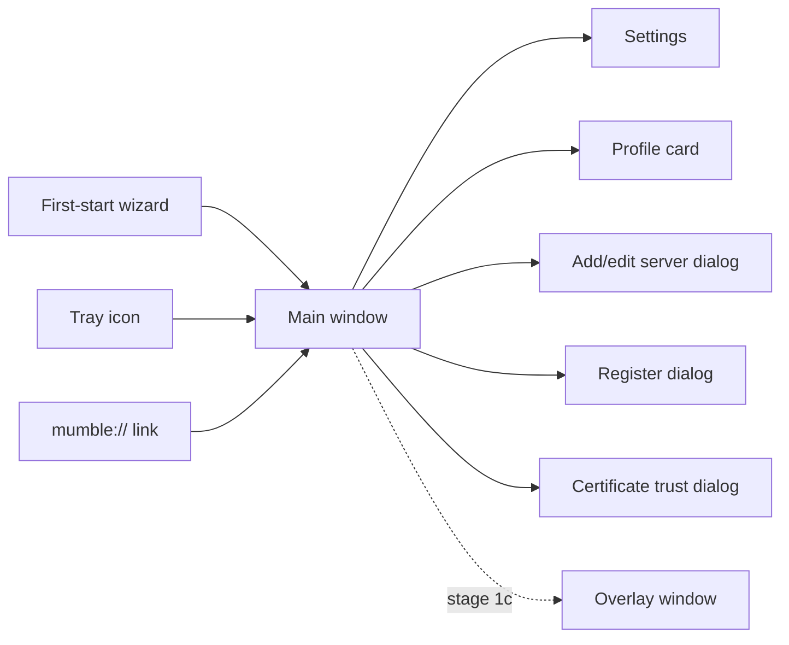
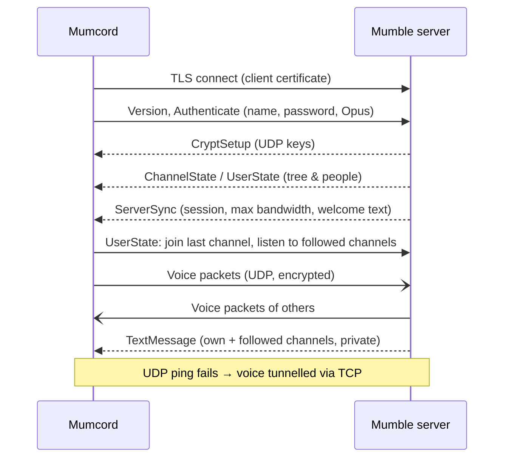
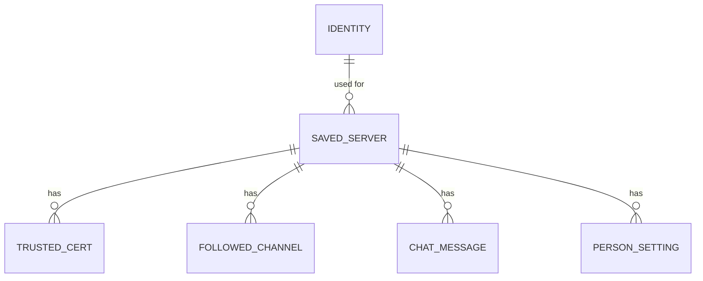
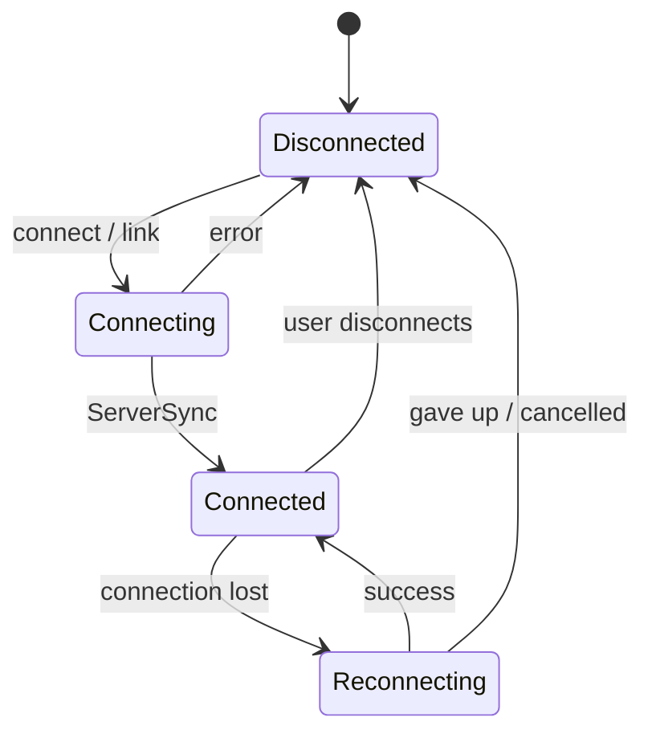

# Mumcord · Epic 1 – Foundation · Specification

> Status: Final (brainstorming completed) · As of: 2026-10-24 · Revised 2026-10-24 (Addendum)
> Sources: `specs/01-foundation-brainstorming.md` (no roadmap existed yet; this spec proposes it, see section 14)
> Builds on: – (first specification; sets product vision, platforms and tech stack)

## 1. Goal & context

Mumcord is a modern, Discord-like desktop client for Mumble aimed at gaming groups and online communities (Q1.1). The official Mumble client is reliable but dated and hard to set up; Mumcord offers a clean look, a one-minute first start and great audio out of the box (Q1.2), while staying a **pure client** that works against unmodified standard Mumble servers (Q1.13). The long-term goal is a full replacement of the official client including admin features, reached over several epics (Q1.3, Q1.11). Epic 1 delivers a client that people can use day to day: connect, talk, chat in Discord-style text channels – including reading followed channels without joining – plus positional audio and an overlay for games.

## 2. Scope

### 2.1 In scope (MVP)

Epic 1 is delivered in two stages (Q2.1). Stage 1a must be complete and usable before 1b starts.

**Stage 1a – everyday client**
- First-start wizard: identity, microphone, talk mode (Q1.6, Q2.6).
- Saved servers, connect by address or `mumble://` link (Q1.5, Q5.4).
- Discord-style main window: server bar, channel list, chat, member list (Q2.3, Q2.4).
- Join channels; talk and listen with voice activation or push-to-talk (Q1.5, Q3.3).
- Mute/deafen self; per-person volume and local mute, remembered (Q1.5, Q5.2).
- Audio settings: device selection, mic test, noise suppression and echo cancellation (Q1.5, Q3.4).
- Text chat in channels and private messages, formatting, local history (Q1.10, Q4.5, Q5.5).
- Follow channels to read them without joining (Q1.14, Q3.1).
- Server registration (Q1.10, Q5.6).
- Avatars and profile comments: display and set own (Q5.7).
- Auto-reconnect, adaptive audio quality and buffering (Q3.5–Q3.7).
- Subtle notification sounds (Q3.8).
- Basic tray icon and close behaviour (Q2.8).
- Themes (system, dark first), languages English/Spanish/German (Q2.5, Q2.7).
- Diagnostic file export (Q4.7, Q4.9).
- Unsigned test builds for Linux, Windows, macOS via GitHub Actions (Q4.2, Q4.10).

**Stage 1b – chat features** (QA.34, QA.35, QA.36)
- Link previews, YouTube/Twitch/Spotify cards, external images and image viewer, @mentions with autocomplete, GIF links and favorites (no keyed GIF search, QA.43), code highlighting, formatting toolbar and shortcuts, music quality, manual voice activation threshold, now playing. Released as v0.2.0.

**Stage 1c – in-game features** (moved from stage 1b, QA.36; released together with stage 1d as v0.3.0)
- Positional audio via Mumble Link and the official Mumble game plugins (Q3.9).
- Overlay as a floating, transparent on-top window (Q3.10), plus an in-game overlay drawn inside games (Linux Vulkan layer, Windows graphics hook; per game, anti-cheat blocklist, QA.54–QA.56). No overlay on macOS (QA.58).
- Now gaming status with best-effort Join game (QA.44), quick settings (QA.47, QA.59).

**Stage 1d – Mumcord-to-Mumcord and people** (QA.45, QA.46)
- Chat history sync between Mumcord clients (up to 7 days / 500 messages per request, channel messages only, marked as unverified).
- Badge for people who use Mumcord.
- Double-click for private chat, pinned person card, redesigned full profile, friends with online state, kept private history with friends.

### 2.2 Out of scope / later
- Anything server-side: companion services, server plugins, server configuration (Q1.13) – **never**, not just later.
- Connecting to several servers at the same time (read-along on all of them) → own epic after Epic 1, Epic 2 "Multi-server read-along" (QA.1); rich chat beyond what Mumble supports (reactions, link previews) (Q1.2).
- Admin features: ACL/permission editing, bans, channel management (Q1.11) → Epic 4.
- Global hotkeys beyond push-to-talk, full tray menu, import of official client settings → Epic 3 (message notifications moved into Epic 1, QA.16).
- Signed installers, auto-update, automatic opt-in crash reports → Epic 5 (Q4.2, Q4.9).
- Public server browser (Q5.3), whisper/shout (Q5.8).
- Mobile apps and web version (Q1.4).
- ~~Exclusive-fullscreen in-game overlay via game hooking (Q3.10)~~ – moved into stage 1c by QA.54 (opt-in per game, anti-cheat blocklist); still out of scope on macOS (QA.58).

## 3. Roles & permissions

Mumcord enforces nothing itself; the server's ACLs decide. The client reflects permissions: it hides or disables actions the server denies and shows the server's denial message if an action fails anyway.

| Action | Guest (unregistered) | Registered user | Channel/server admin | Enforced by |
|---|---|---|---|---|
| Connect, join permitted channels, talk, chat | ✅ | ✅ | ✅ | Server ACL |
| Follow (listen to) a channel | ✅ if "Listen" permitted | ✅ if permitted | ✅ | Server ACL + listener limits |
| Register own name | ✅ if "Register self" permitted | – | ✅ | Server ACL |
| Set own avatar/comment | ✅ if permitted | ✅ | ✅ | Server ACL + size limits |
| Move/kick/ban others, edit ACLs/channels | ❌ in Mumcord (Epic 4) | ❌ | ❌ in Mumcord (Epic 4) | – |
| Per-person volume, local mute, history deletion | ✅ | ✅ | ✅ | Local only |

## 4. Functional requirements

### 4.1 First start & identity
- **FR-1.1** On first start a 3-step wizard runs (Q2.6): (1) identity, (2) microphone, (3) talk mode. It can be finished in about a minute; every step has sensible defaults.
- **FR-1.2** Identity step: create a new identity (self-signed client certificate, name chosen by the user) or import an existing one (PKCS#12 file, e.g. exported from the official client). The step reminds the user to back up the identity (Q1.6).
- **FR-1.3** The identity certificate is stored in the OS secure storage (Q4.3). Settings offer "Export identity" (password-protected PKCS#12 file) and "Import identity" at any time.
- **FR-1.4** Microphone step: choose input and output device, live level meter and "test playback" of the own voice with noise suppression applied.
- **FR-1.5** Talk-mode step: voice activation preselected (Q3.3); push-to-talk selectable with key or mouse-button capture (mouse buttons such as side buttons, QA.4; see FR-1.21). On Wayland without a global-shortcuts interface, keyboard push-to-talk is shown as unavailable with an explanation and voice activation is suggested (Q4.11); a mouse button can still be used if the Wayland mouse option (FR-1.21, FR-1.39) is enabled.
- **FR-1.6** At the end of the wizard Mumcord offers to become the handler for `mumble://` links (Q5.4).

### 4.2 Servers & connection
- **FR-1.7** Saved servers appear as icons in the server bar; "+" adds one by address, port (default 64738), username and optional password, or by pasting a `mumble://` link. Servers can be edited, reordered and removed.
- **FR-1.8** Server passwords are stored in the OS secure storage (Q4.4), never in plain files.
- **FR-1.9** Only one server is connected at a time in Epic 1. Clicking another saved server asks to disconnect from the current one first. Connecting to several servers at once to read along is planned as its own epic after Epic 1 (Epic 2, QA.1).
- **FR-1.10** On first connection to a server with an unknown or self-signed certificate, Mumcord shows the certificate fingerprint and asks whether to trust it; the decision is remembered. If a trusted server's certificate changes, a clear warning blocks the connection until the user decides.
- **FR-1.11** Opening a `mumble://` link (from a browser or another app) starts Mumcord if needed, offers to save the server and connects, joining the channel in the link if present; the link counts as an explicit Join (FR-1.14).
- **FR-1.12** Servers 1.4 and newer are fully supported; older servers connect, and features they lack (notably following channels) are hidden with a short hint (Q3.2).
- **FR-1.13** On connection loss Mumcord shows a "reconnecting…" bar, retries with increasing intervals, and on success restores the previous channel, the voice state (mute/deafen as before the drop) and followed channels (Q3.6, QA.2) – this continuity applies to automatic reconnects only. The user can cancel; after a defined number of failed attempts it gives up and shows "Disconnected – Reconnect".
- **FR-1.14** Fresh connect = read-only (QA.2): on every fresh, user-initiated connect (including app start and server switch) the user lands in the server's default channel, self-muted and self-deafened; chat (including followed channels) works, voice does not. Other users see the user as present but deafened. Only an explicit Join of a channel (double-click, "Join" button, or a `mumble://` link with a channel path) enables voice: it leaves the read-only state and restores the user's last own mute/deafen setting (QA.7) – the self-mute/self-deafen state the user last chose while joined for voice, persisted across app restarts (default: neither muted nor deafened). If the user quit Mumcord while joined to a channel for voice, the next fresh connect to that server after app start shows a non-blocking prompt "You were in ‹channel› last time – Rejoin?" ("Rejoin" = explicit Join; "Not now"/ignore = stay read-only); no prompt if the channel is gone or the user was not joined for voice (QA.9). The last channel is no longer rejoined automatically on a fresh connect; it is remembered only for automatic reconnect after a dropped connection (FR-1.13). The read-only connect can be switched off with "Connect muted until I join a channel" (Settings → Voice, default on); when off, a fresh connect lands in the default channel with the last own mute/deafen setting applied right away (QA.22).

### 4.3 Channels & people
- **FR-1.15** The channel list shows the server's channel tree (collapsible), with people under their channel, talking indicators and mute/deafen icons. People who only listen to a channel (channel listeners) are not shown in the channel list; they appear only in the member list with the listener marker (QA.11). Each channel appears once (Q2.4). Each person row shows the person's avatar (or a default avatar); while they talk, a green ring surrounds it (QA.6). Listener rows in the member list show only the listener marker, never voice state (talking, mute, deafen). Collapsed channels show a stack of up to 5 overlapping avatars plus "+N" instead of names; expanded channels with more than 5 people show the stack with a "Show all" toggle (threshold lowered from 10, QA.30). The stack sits on its own line under the channel name, with "+N" and "Show all" after the avatars (QA.31). People talking right now are moved to the front of the stack, with the green ring (QA.14). The channel list and the member list can be resized by dragging their border or with the keyboard (15rem–28rem, remembered); the number of stacked avatars adapts to the width (up to 5) (QA.29). The channel the user is joined to for voice is highlighted (green accent bar, speaker icon, bold name), distinct from the selected channel; no highlight while read-only (QA.18). For big servers: a "Jump to my channel" button, collapsed start above ~50 channels (top level and the path to the own channel expanded), reduced indent on deep trees with full names as tooltips, and a search field above the channel list filtering channels and people (QA.27).
- **FR-1.16** Single-click a channel → shows its chat. Double-click or the "Join" button → enters the channel's voice (if permitted).
- **FR-1.17** The member list shows the people in the selected channel, plus its listeners, with avatar, name, talking state and registered/unregistered marker.
- **FR-1.18** Clicking a person opens a profile card: avatar, name, comment, and local controls: volume slider (0–200 %), local mute, "send private message". Hovering a person (member list, channel list, chat avatar/name) for ~0.4 s, or focusing them with the keyboard, shows a read-only profile preview next to them (avatar, name, comment, registered marker, voice state); it stays while the pointer is on the person or the preview and Escape closes it; a click still opens the full card (QA.21). Right-clicking a person (or Shift+F10 / context-menu key) opens a menu with "View profile", "Mute for me"/"Unmute for me", an inline volume slider (0–200 %) and "Send private message"; for the user themselves only "View profile" (QA.32).
- **FR-1.19** Per-person volume and local mute are stored by the person's certificate hash per server and re-applied when they reappear, even after renaming (Q5.2). People without a certificate are only adjusted for the session. A locally muted person's name is shown in red in the channel list and member list, together with the local-mute icon (QA.28).
- **FR-1.20** The user can set their own avatar (image, scaled to the server's limit) and profile comment (Q5.7). Mumcord remembers the avatar per saved server (the hand-set one, otherwise the default avatar from FR-1.47) and sends it again on every connect when the server shows no avatar for the user – servers keep avatars only for registered users (QA.10). Registered users keep the server's copy; nothing is re-sent when the server already has an avatar.

### 4.4 Voice
- **FR-1.21** Talk modes: voice activation (default) and push-to-talk (global key or mouse button, also while another app is focused). Mouse buttons (QA.4): Windows, macOS (system Accessibility permission prompt) and X11 are supported natively. On Linux Wayland the desktop portal cannot capture mouse buttons, so Mumcord reads input devices directly (evdev); this path is OFF by default, is enabled by a setting (FR-1.39) and requires the user to be in the `input` group. It opens only mouse-type devices (BTN_LEFT capability, no keyboards), reacts only to the one configured button code and never logs input. If permission is missing, Mumcord shows the exact command (`sudo usermod -aG input $USER`, then log out and in again) and falls back gracefully (mouse button unavailable, nothing else affected). Keyboard push-to-talk on Wayland stays on the portal (Q4.11).
- **FR-1.22** Self mute and self deafen via buttons in the user panel; deafen implies mute. States are sent to the server so others see them.
- **FR-1.23** AI-based noise suppression and echo cancellation are on by default; automatic input gain keeps the voice level even (Q3.4). All three can be switched off in settings.
- **FR-1.24** Audio quality is automatic: the highest bitrate the server allows, lowered automatically when packet loss rises, raised again when it recovers (Q3.5). The automatic bitrate is capped at 96 kbit/s for speech; the switch "Music quality" (Settings → Audio, default off) raises the cap to the server limit, at most 510 kbit/s, with the encoder tuned for music, still adapting to packet loss (QA.37).
- **FR-1.25** Playback uses an adaptive jitter buffer: minimal delay on stable connections, small extra buffer only when packets arrive unevenly (Q3.7).
- **FR-1.26** Voice goes via UDP; if UDP is blocked, it falls back to tunnelling through the TCP connection automatically.
- **FR-1.27** Short, subtle sounds for: someone joins/leaves your channel, self mute/unmute, self deafen/undeafen, new message in a followed channel or private chat, a short "hang up" sound when the user disconnects (QA.19), and a short join sound when the user joins a channel for voice (QA.23). No text-to-speech (Q3.8). Sounds can be toggled per event.

### 4.5 Text chat
- **FR-1.28** Each channel and each private conversation has a chat view with input field. Sending to a channel requires the server's "Text message" permission; denials are shown inline.
- **FR-1.29** Received messages are displayed with formatting, links and small inline images, sanitized so no scripts, external loads or unsafe markup run (Q5.5). Links open in the system browser after a click.
- **FR-1.30** The user writes with Markdown shortcuts (bold, italic, code, links) and can paste or drop images; Mumcord converts to Mumble-compatible HTML, scales/compresses images to the server's message size limit and refuses too-large content with a clear message. Images are sent as large as the server limit allows (largest edge that fits, up to 1920 px; PNG or JPEG, whichever yields the bigger image) (QA.59).
- **FR-1.31** **Follow channels** (Q3.1): any channel can be followed via a "Follow" button. Mumcord starts listening to it with its audio muted locally, so its messages arrive without joining. Followed channels show unread badges. Unfollowing stops listening. If the server denies listening or the listener limit is reached, the user gets a clear message. A star button on each channel row in the channel list follows/unfollows it directly (outlined on hover/focus, filled while followed); the server's context menu in the channel list offers "Follow all channels" and "Unfollow all channels" – follow all skips channels the user may not listen to, stops at the server's listener limit and reports how many were followed (QA.13). Unread counts apply to every channel the user receives messages from while its chat is not on screen, including the own channel; opening the chat marks them read (QA.33).
- **FR-1.32** All received and sent messages (channels, followed channels, private chats) are stored locally and shown when the chat is reopened, including after restart (Q4.5). History only contains what Mumcord actually received. Optionally, history older than a configurable number of days is deleted automatically (default off, Settings → Chat & history) (QA.42).
- **FR-1.48a** Chat layout (QA.20): each message group shows the sender's avatar on the left, name and time on the first line, and the text indented after the avatar; consecutive messages from the same sender within a few minutes are grouped without repeating avatar and name, with the same indent. Settings → Appearance → "Message display" offers Cozy (this layout, default) or Compact (no avatars, time + name + text on one line, tighter spacing, continuation lines slightly indented) (QA.25).
- **FR-1.48b** Pinned info in the chat (QA.15): the top of each channel's chat shows a pinned, collapsible box with the channel description (fetched on demand if the server only sends a hash); the server welcome message (MOTD) is pinned in the root channel's chat and in the default channel's chat when that channel has no description. Long texts start collapsed ("Show more"); content is sanitized like chat HTML; no box when there is no text; the box updates when the description changes.
- **FR-1.48c** Message notifications (QA.16): for new messages in any channel the user receives (own channel, followed channels) and in private chats, except the chat currently on screen, Mumcord shows an in-app toast (bottom right: channel, sender, short sanitized preview) and, when the window is in the background or minimized, a system desktop notification. Clicking either opens that chat and brings the window to the front. Bursts are grouped per channel. Both can be switched off in Settings (Sounds & notifications). No message content in logs.
- **FR-1.48d** Autostart (QA.17): the first-start wizard asks "Start Mumcord when I log in" (default off) and Settings offers the same switch plus "Start minimized" (default on). It uses the OS mechanism (Linux XDG autostart entry, Windows login item, macOS login item); when started this way with "Start minimized", Mumcord goes straight to the tray. Turning it off removes the entry.
- **FR-1.33** History controls: "Clear history" per channel/private chat, per server and all; "Save history" switch per server (default on).

### 4.6 Registration
- **FR-1.34** The user menu offers "Register on this server" when not registered and permitted. A dialog explains in plain language what registration means and that the identity must be backed up, with a direct "Export identity" button (Q5.6).

### 4.7 Window, tray & app behaviour
- **FR-1.35** Theme follows the OS setting; dark is the default design and light is fully supported; manual override in settings (Q2.5).
- **FR-1.36** UI languages: English, Spanish, German; defaults to the OS language if supported, else English; switchable in settings without restart (Q2.7).
- **FR-1.37** A tray icon shows the connection and talk state and offers "Show", "Mute", "Deafen", "Quit".
- **FR-1.38** Closing the window while connected asks once "Minimize to tray or quit?" with "Remember my choice"; changeable in settings (Q2.8).
- **FR-1.39** Settings screen (Discord-style, sections in a side list): Identity (name, certificate, profile with "Default avatar" and "Send to new servers automatically", FR-1.47), Audio, Voice (incl. the toggle "Allow mouse buttons (requires input group)", Linux Wayland only, default OFF, with a plain-language warning that input-group membership lets any program of the user read all input devices including the keyboard; FR-1.21, QA.4), Chat & history, Appearance, Language, Sounds, Overlay & positional audio, Diagnostics, About (incl. licenses).
- **FR-1.40** "Save diagnostic file" in Diagnostics writes a file with app version, OS, audio devices, connection statistics and recent log lines – without chat contents, passwords, certificates or personal data (Q4.7).

### 4.8 Stage 1c – positional audio
- **FR-1.41** Positional audio can be enabled in settings (default off). When enabled, voices of people who send positional data in the same game context are placed in 3D around the listener (headphone-optimized panning and distance attenuation, configurable min/max distance).
- **FR-1.42** Position sources (Q3.9): (a) the **Mumble Link** shared-memory interface used by games and mods; (b) the **official Mumble game plugins**, loaded as plugin libraries via Mumble's plugin interface. Plugins can be enabled individually; a notice explains that some anti-cheat systems may flag memory-reading plugins.
- **FR-1.43** The settings show which game/plugin is currently delivering positions, so users can tell whether it works.

### 4.9 Stage 1c – overlay
- **FR-1.44** The overlay is a separate, transparent, click-through, always-on-top window showing who is talking in the user's current channel (avatar + name; people talking in other channels never appear, QA.60), and optionally the whole current channel (Q3.10). It does not hook into games.
- **FR-1.45** Position, size, opacity and content are configurable; the overlay can be toggled from the tray and settings.
- **FR-1.46** Where the OS or desktop doesn't allow staying on top (some Linux desktops) or a game runs in exclusive fullscreen, settings explain the limitation.
- **FR-1.46b** In-game overlay (QA.54): drawn inside the game – Linux via a Vulkan layer (MangoHud-style) with an OpenGL preload fallback, Windows via a hook into the game's graphics API (Discord-style). Shown only in games, configurable per game (on/off, position, size, opacity, content; default off for unknown games), with an anti-cheat warning before enabling it for a game. Where it is off or unsupported (unsupported graphics APIs), the window overlay (FR-1.44) is the fallback on Linux and Windows. It starts automatically when a game starts; a global setting "Off" (never active, no layer or hook loaded) / "On" (active in every game unless switched off for that game) controls it, also offered in the first-start wizard (default off) with an example screenshot and the anti-cheat note (QA.55). A bundled, sourced list of games known to ban or block overlays/injection keeps the in-game overlay off for those games by default even when the global setting is "On"; their per-game entry shows the reason, and enabling it needs an explicit confirmation with a stronger warning (QA.56). On macOS there is no overlay at all (neither in-game nor window overlay); overlay settings, tray item and wizard choice are hidden there (QA.58).
- **FR-1.59** "Now gaming" (QA.44, stage 1c): opt-in status (default off). Detects the game via Mumble Link (name/context) or running programs matched against a bundled list of known games and the running Steam game (app id). Shared like "Now playing" (plugin data to Mumcord users; "🎮 Game" comment line for official clients): game-controller icon next to the person, game name, game icon (Steam app icon through the backend image proxy, else generic) and play time in the profile/preview and in the own user panel status line. "Join game" appears only when the same game exposes a join target (Steam server address from the Mumble Link context via steam://connect/…, or a Steam lobby link); otherwise no button.
- **FR-1.66** Quick settings (QA.47, stage 1c): right-clicking the settings button in the user panel opens a small menu with switches for link previews, theme (system/dark/light), now-playing sharing and now-gaming sharing, applied immediately and saved like the full settings. A normal click on the gear opens the quick settings too; they also hold the overlay switch, "Edit profile" and "Register on this server" (when permitted; "Registered ✓" afterwards); the full settings open via "All settings…"; the own name in the user panel is not clickable (QA.59).
- **FR-1.67** Mentions of people on the server render as interactive chips (hover preview, click → profile card, right-click → person menu) (QA.59).
- **FR-1.68** On KDE Wayland the overlay settings offer a one-click KWin window rule "Mumcord overlay" (keep above, corner position, size; kept in sync, removable), a button to open KDE window rules, and a shortcut to the compatibility mode (QA.59).
- **FR-1.69** Settings: a search across sections and individual settings that jumps to and highlights the control; a sidebar that stays in place while the content scrolls; an "Accessibility" section with switches for visible keyboard hints, screen-reader announcements and skip links (default on) (QA.59).
- **FR-1.70** In the person menu (right-click on a person), every on/off action (e.g. local mute) is shown as a switch row like in quick settings, showing the current state and toggling in place (QA.62). Every menu entry has a leading icon; order: "View profile", "Private message", a separator, then the settings (local mute, volume); the volume row shows "Volume" with the value right-aligned and a full-width slider below (QA.64).
- **FR-1.71** Settings → About links to the changelog on mumcord.app ("What's new", German page for German, English page otherwise, anchored to the running version) and to support: "Report a bug" and "Request a feature" open the matching GitHub issue templates in the browser. There is no commercial license (QA.65, QA.66).
- **FR-1.72** Positional audio can be switched on/off in quick settings as well as in settings (same setting as FR-1.41). People who currently send positional data – detected from the position in their voice packets, so it works for official Mumble clients too – show a small "3D" status icon in the channel tree, member list and profile card (tooltip: "Positional audio active"); the own entry shows it while Mumcord itself sends positions (QA.70).

### 4.10 Stage 1d – Mumcord-to-Mumcord (QA.45)
- **FR-1.60** History sync: on joining a channel or via "Load earlier messages", Mumcord asks other Mumcord users who may read the channel (via plugin data) for its messages in a time range (max 7 days back, max 500 messages per request, chunked under the server's plugin-data limits, rate-limited). Answering clients send stored channel messages only, never private chats. Sharing the own history is on by default and switchable in the first-start wizard and in settings. Received messages are sanitized, deduplicated, merged by time and marked "from ‹name›'s history". Clients that share history send per-channel availability summaries (time range and message count, no content) only on request, to keep plugin-data traffic low (QA.69); a joining client asks only holders that cover the missing range. Each message carries a content hash (channel, sender certificate hash or name, server timestamp to the second, normalized body); requests list the hashes already held so only missing messages are sent, and received messages with a known hash are discarded (QA.48). Only messages older than the moment the requesting client started receiving the channel live are synced: the join time for the own channel, the follow time for a followed channel (so following a new channel fetches its earlier history up to that moment); holders reject requests reaching past that cutoff (QA.49).
- **FR-1.60b** Synced messages are inserted by server timestamp (tie-break by hash), day separators and grouping are recomputed, and the reading position is kept when older messages are inserted above. A "Jump to newest" button (bottom right, with the count of unseen new messages; End / Ctrl+End) appears whenever the user is scrolled away from the latest message (QA.50).
- **FR-1.60c** Full-size images (QA.57): Mumcord sends a thumbnail that fits the server's image limit (what official clients see) and keeps the full image; a Mumcord recipient's image viewer fetches the full image on demand from the sender via plugin data (chunked, size-capped, rate-limited, verified against a hash sent with the message), showing the thumbnail with a progress hint meanwhile and keeping it if the sender is offline or the transfer fails.
- **FR-1.61** Mumcord users are recognised through a plugin-data hello and get a small Mumcord badge with tooltip next to their name.
- **FR-1.62** Double-clicking a person opens the private chat with them; a single click opens the hover card pinned, with "Private message" (top right) and a button for the full profile (QA.46).
- **FR-1.63** Redesigned full profile: header with avatar and avatar-derived banner colour, name, registered/guest, Mumcord badge, now playing / now gaming, comment; sections with all local settings (volume, local mute, friend, private note). Settings apply instantly with a short "Saved" confirmation – there is no save step; actions such as "Private message" sit in the header as clearly labelled actions so they can't be mistaken for saving (QA.63).
- **FR-1.64** Friends: added from the card, menu or profile; stored locally by certificate hash (across servers and renames); a "Friends" list shows each friend's online state (online on any connected server).
- **FR-1.65** Private chat history with friends is kept, linked by certificate hash across servers and renames, and excluded from automatic history deletion (manual deletion still possible); private chat header and list show whether the other person is online.
- **FR-1.49** Link previews (QA.34, stage 1b): links in messages get a preview card (title, description, image, "Open in browser"). Mumcord fetches the page metadata itself; on by default, switchable in the first-start wizard and in settings; fetched data is sanitized and cached; no preview for private/LAN addresses. Each preview/embed card can be dismissed (×), remembered per message; previews, thumbnails and external images are cached in memory and on disk and deleted after a configurable number of days (default 7, Settings → Chat & history, with "Clear now") (QA.42).
- **FR-1.50** YouTube and Twitch links show an embedded player card with title and "Open in browser"; the player loads only after a click (QA.34). Spotify links get the same kind of card (cover, title, artist, "Open in browser", player after a click) (QA.40).
- **FR-1.51** Mentions (QA.34): typing `@` in the input autocompletes names of people on the server; a message mentioning the user is highlighted and notifies them even in otherwise quiet channels; the text stays plain `@Name` for other clients. Being mentioned also plays a distinct short "ping" sound; both the mention sound and mention notifications have their own switches under Settings → Sounds & notifications (default on) (QA.41).
- **FR-1.52** GIFs (QA.34, revised by QA.43): no GIF search (it would need an API key shipped in the app). Pasted GIF links play inline (FR-1.55); any GIF in the chat can be saved as a favorite (right-click → "Save as favorite"); the GIF button in the input opens the favorites (stored locally, removable) and sends the chosen one as a link. GIFs from Giphy or Tenor carry a small "via GIPHY" / "via Tenor" label linking to the original page, also in the favorites picker (QA.52).
- **FR-1.53** Code (QA.34): ``` fenced code blocks (optional language) and `inline code` render with syntax highlighting; other clients see the text.
- **FR-1.54** Formatting in the input (QA.34): a small toolbar plus shortcuts (Ctrl+B bold, Ctrl+I italic, Ctrl+Shift+X strikethrough, Ctrl+E code, Ctrl+K link inside the input) that insert Markdown.
- **FR-1.55** External images (QA.35, stage 1b): external images in messages and direct image links (png, jpg, gif, webp) are shown inline, scaled, click to enlarge, with "Open in browser"; loaded via the backend with size and type limits, never from private/LAN addresses; controlled by the same switch as link previews (FR-1.49). With the switch off, AC-1.13 behavior applies.
- **FR-1.56** Image viewer (QA.38, stage 1b): clicking an image in the chat opens a viewer over the app with fit-to-window, zoom (wheel, pinch, +/−), pan by dragging, double-click for 100 %, arrow keys through the conversation's images, Escape to close, "Save image" and, for external images, "Open in browser".
- **FR-1.57** Voice activation threshold (QA.39, stage 1b): Settings → Voice offers "Automatic" (default) or "Manual threshold": a slider drawn over a live input level meter; input above the threshold opens the mic, with a short hold time (~300 ms) so word endings aren't cut.
- **FR-1.58** "Now playing" (QA.40, stage 1b): opt-in setting (default off). Mumcord reads the current track from the system media information (Linux MPRIS, Windows media session, macOS where possible; no Spotify login) and shares title, artist, cover reference, position and duration with other Mumcord users through Mumble plugin data (no server changes); they see a music icon next to the user and, in the profile/preview, cover (if available), title, artist and a live progress bar. Official clients see a short "🎵 Artist – Title" line in the user's comment, which Mumcord removes again when playback stops or the setting is turned off. Covers are loaded through the backend under the link-preview privacy switch.
- **FR-1.47** Default avatar (QA.3): in Settings → Identity/Profile the user can set (and clear) a default avatar. It is stored locally in the app data directory, scaled to a sensible size (e.g. 128×128 PNG). The first time the user connects to a saved server and has no avatar there yet, and "Send to new servers automatically" is on (default ON), Mumcord sends it once, scaled/compressed to the server's image limits like FR-1.20; if that is impossible it is skipped with a notice. Each saved server remembers `default_avatar_sent`, so it is sent only once per server – never again, even if the user later removes or replaces the avatar on that server manually. Switching the setting off stops automatic sending; the default avatar can still be applied manually as the own avatar (FR-1.20). Exception (QA.10): when the server keeps no avatar for the user (unregistered), the remembered per-server avatar (FR-1.20) is sent again on every connect.
- **FR-1.48** Compatibility mode for push-to-talk on Linux Wayland (QA.5): Settings → Voice has a switch "Compatibility mode (like TeamSpeak)", shown only on Linux Wayland, default OFF. When on, Mumcord starts through XWayland (takes effect after an app restart, which the switch offers) and uses its X11 push-to-talk path for keyboard keys and mouse buttons, with no portal dialog and no `input` group. The switch explains in plain language that the desktop decides which input X11 apps may see (on KDE: System Settings → Legacy X11 App Support; by default only key combinations and modifier keys, mouse buttons only if enabled there) and that this is less isolated than the modern path. On KDE the switch asks for permission and, once the user confirms, allows mouse buttons in that KDE setting itself (undoable); a button to open the KDE setting stays as fallback (QA.67). When off, the modern path applies (portal for keys, FR-1.21 evdev option for mouse buttons).

## 5. UI & UX

### 5.1 Navigation



### 5.2 Main window (Q2.3)

```text
┌────┬──────────────┬──────────────────────────────┬──────────────┐
│ ◉  │ Gaming Srv ▾ │ # Lobby            ☆ Follow  │ In Lobby (3) │
│ ○  │──────────────│──────────────────────────────│──────────────│
│ ○  │ ▾ Lobby    3 │ Anna            12:01        │ 🟢 Anna  🎙  │
│    │   🟢 Anna 🎙 │ hi all                       │ ⚪ Ben       │
│ +  │   ⚪ Ben     │ Ben             12:02        │ ⚪ You       │
│    │   ⚪ You     │ hey **there**                │──────────────│
│    │ ▸ Raid  5 •2 │                              │ Listening    │
│    │ ▸ AFK      1 │                              │ 👂 Carla     │
│    │──────────────│──────────────────────────────│              │
│    │ 🧑 You       │ Message #Lobby…        🖼  ➤ │              │
│    │ 🎙 🎧 ⚙      │                              │              │
└────┴──────────────┴──────────────────────────────┴──────────────┘
```

- **Server bar** (left): saved servers as round icons, connected one highlighted, "+" to add.
- **Channel list**: tree, unread badge (•2) on followed channels, "Join" button on hover. After a fresh connect the default channel is highlighted as current but not "joined for voice" (read-only state, QA.2); the user panel shows mute and deafen active and a hint "Read-only – Join a channel to talk". Join restores the last own mute/deafen setting (QA.7). While connected, the user panel also shows a "Disconnect" button (hang-up icon) next to mute and deafen (QA.8). The settings button uses a gear icon (QA.47). The user panel uses two rows – avatar, full own name (never truncated to a few letters; wraps or shrinks slightly, tooltip with the full name) and connection status on top, evenly spaced buttons below – with no separator line, set off by its background; the microphone button shows the live input level as a rising fill while speaking (QA.26).
- **Chat**: header with channel name and Follow toggle; message list; input with image button.
- **Member list**: people in the channel, then listeners.
- **User panel** (bottom of channel list): own avatar/name, mute, deafen, settings.
- **Settings → Identity → Profile**: "Default avatar" (preview, Choose…, Clear) and toggle "Send to new servers automatically" (QA.3, FR-1.47); a notice appears if the server's limits prevent sending.
- A thin bar above the chat shows "Reconnecting…" or "Connected via TCP (UDP blocked)" when relevant.

### 5.3 First-start wizard (Q2.6)

```text
┌──────────────────────────────────────────┐
│  Welcome to Mumcord           Step 1 / 3 │
│                                          │
│  Your identity                           │
│  ( ) Create new   Name: [ Tobias      ]  │
│  ( ) Import file  [ Choose… ]            │
│                                          │
│  ⓘ Your identity is like a key. Back it  │
│    up later in Settings → Identity.      │
│                                 [ Next ] │
└──────────────────────────────────────────┘
```
Step 2: device dropdowns, level meter, "Test" button. Step 3: voice activation (preselected) / push-to-talk with "Press a key…", then the `mumble://` handler offer.

### 5.4 Empty states, errors, confirmations
- No saved servers: centered "Add your first server" with address field and "Paste a mumble:// link".
- Empty chat: "No messages yet. Messages you receive here are saved on this computer."
- Errors in plain language with a next step: server unreachable, wrong password, name already in use/registered, certificate rejected, server too old for following, permission denied, listener limit reached.
- Confirmations: switching server while connected, clear history, certificate change warning, quitting while connected (Q2.8).

### 5.5 Design notes
- Discord-inspired, not a copy: own colour palette and Mumcord branding, no Mumble logo (Q4.6).
- Dark theme designed first, light theme fully supported; scales correctly on high-DPI screens.
- Accessibility to **WCAG 2.2 AA** (Q4.12): full keyboard operation with visible focus, screen-reader labels and live regions for talking/join events, contrast ≥ 4.5:1 for text, respects OS font size and reduced-motion settings.

## 6. Audio & network

- **Input/output:** OS default devices preselected; switching devices takes effect without reconnecting; device hot-plug handled.
- **Processing chain (send):** capture → echo cancellation → AI noise suppression → automatic gain → voice-activity detection (or PTT gate) → Opus encoding.
- **Codec:** Opus only for sending (all supported servers use it); bitrate automatic within the server's maximum (Q3.5).
- **Latency target:** mouth-to-ear ≤ 150 ms on a stable LAN/broadband connection, excluding network transit; adaptive jitter buffer (Q3.7).
- **Voice transport:** encrypted UDP as defined by the Mumble protocol; automatic fallback to TCP tunnelling; both the legacy and the newer (1.5) UDP packet formats are supported.
- **Following:** listening to followed channels uses the protocol's channel-listener feature (servers ≥ 1.4); their audio is muted locally via a listener volume of 0. Verified on 2026-10-24 in the Mumble server source (`Server::msgTextMessage`, 1.4.230 / 1.5.735 / master) that channel text messages are delivered to listeners.



- **Protocol compatibility:** client protocol version 1.5; minimum server 1.4 for full functionality; older servers best-effort (Q3.2). No protocol extensions, nothing server-side (Q1.13).

## 7. Data & state model

All data is local to the user's computer; nothing is stored on any server other than what the Mumble protocol itself transmits.



| Entity | Field | Type | Required | Rules / notes |
|---|---|---|---|---|
| Identity | name | text | yes | Default username |
| | certificate | PKCS#12 | yes | In OS secure storage only (Q4.3) |
| SavedServer | label | text | yes | Shown as tooltip/icon initials |
| | address, port | text, int | yes | Port default 64738 |
| | username | text | yes | Defaults to identity name |
| | password | secret | no | OS secure storage (Q4.4) |
| | last_channel | channel path | no | Used for automatic reconnect only (FR-1.13), not on fresh connect (FR-1.14, QA.2) |
| | save_history | bool | yes | Default true (FR-1.33) |
| | sort_order | int | yes | Server bar order |
| | default_avatar_sent | bool | yes | Default false; set true once the default avatar was sent (or skipped as not needed) – never reset by manual avatar changes (FR-1.47) |
| | avatar | blob | no | Avatar remembered for this server (hand-set or the sent default avatar, PNG up to 128×128); empty = none or removed by hand. Re-sent on connect when the server shows no avatar for the user (FR-1.20, QA.10) |
| TrustedCert | fingerprint | text | yes | Server certificate trust decision (FR-1.10) |
| FollowedChannel | channel_path | text | yes | Path, so it survives channel ID changes where possible |
| | last_read_at | datetime | yes | For unread badges |
| ChatMessage | conversation | channel path or person cert hash | yes | Channel or private chat |
| | sender_name, sender_cert_hash | text | yes / no | Hash missing for certificate-less users |
| | sent_at | datetime | yes | Local receive time |
| | body | sanitized HTML | yes | Stored sanitized |
| PersonSetting | person_cert_hash | text | yes | Key (Q5.2) |
| | volume | int 0–200 | yes | Percent |
| | local_mute | bool | yes | |
| Settings | theme, language, talk_mode, ptt_key, input/output device, noise_suppression, echo_cancellation, auto_gain, sounds per event, close_behaviour, overlay options, positional options, enabled plugins, default_avatar_path (file in app data dir, optional), send_default_avatar (bool, default true) | various | – | Single settings record |



Talk state (per own user): `Silent → Talking` (VAD/PTT), overridden by `Muted` and `Deafened`.

## 8. Technology & architecture

- **App shell: Tauri 2** – small, native windows on all three OS, web-based UI, path to mobile later (Q1.7).
- **Engine: Rust** – memory-safe and fast for real-time audio and networking (Q1.7). Modules: `protocol` (TLS control channel, protobuf messages, UDP crypto), `audio` (capture, processing, Opus, jitter buffer, mixing, 3D panning), `store` (local database, secure storage), `positional` (Mumble Link, plugin host), `app` (state, commands/events to the UI).
- **UI: React + TypeScript (strict)** inside Tauri (Q4.1); state and data access separated from presentation; HTML sanitization of all server content; i18n with translation files for en/es/de.
- **Key libraries (to be confirmed during build):** `tokio` (async networking), `rustls` (TLS with client certificates), `prost` (protobuf, using Mumble's BSD-licensed `Mumble.proto`), `opus` bindings, `cpal` (audio I/O), an RNNoise-class AI noise suppressor and WebRTC audio processing (echo cancellation, gain), `keyring` (OS secure storage), SQLite (local data), Tauri plugins for tray, deep links (`mumble://`) and global shortcuts, XDG desktop portal (Wayland global shortcuts, Q4.11).
- **Threads:** dedicated real-time audio threads that never block (no allocation, locks or I/O in the audio callback); networking on the async runtime; UI communicates only with the engine, never with the network.
- **Plugins (stage 1c):** a plugin host loading the official Mumble game plugins (C plugin interface) in a contained way; Mumble Link via shared memory.
- **Configuration & secrets:** settings and history in the OS-standard app data folder; certificate and passwords only in OS secure storage; no secrets in the repository or builds.

## 9. Non-functional requirements

- **Latency:** ≤ 150 ms mouth-to-ear excluding network transit; audio processing adds ≤ 30 ms.
- **Resources:** idle while connected ≤ 2 % CPU and ≤ 250 MB RAM on a mid-range PC; talking with noise suppression ≤ 5 % CPU.
- **Security:** TLS always; server certificate pinning on first use with change warning (FR-1.10); all server-provided content (names, comments, messages, images) treated as untrusted and sanitized; links never auto-open. The Mumble protocol's UDP encryption (OCB2-AES128) is used as specified for compatibility – a known weakness of the protocol, not changeable client-side.
- **Security – mouse buttons on Wayland (QA.4):** the evdev path needs `input` group membership, which lets any program running as the user read all input devices, including the keyboard. Therefore it is opt-in (default OFF) with a warning in the toggle; Mumcord opens only mouse-type devices, evaluates only the one configured button code, keeps no input history and never writes input to logs or diagnostic files.
- **Privacy (GDPR):** no telemetry or automatic reports in Epic 1 (Q4.7, Q4.9); chat history only local and deletable (Q4.5); no personal data, chat contents or audio in logs or diagnostic files.
- **Accessibility:** WCAG 2.2 AA (Q4.12).
- **Platforms:** Linux (X11 and Wayland; KDE and GNOME tested), Windows 10/11, macOS (current and previous major version) (Q1.4).
- **Logging/diagnostics:** rotating local log files with configurable level; diagnostic file export (FR-1.40).

## 10. Build, packaging & release

- **Code hosting & CI:** GitHub, GitHub Actions (Q4.10). Every push builds and tests on Linux, Windows and macOS; tests include the automated integration tests against a containerized Mumble server.
- **Artifacts (Epic 1):** unsigned test builds – Linux AppImage, Windows installer (unsigned), macOS app bundle/DMG (unsigned) (Q4.2). Windows and macOS show security warnings on first launch; documented in the README.
- **No auto-update, signing or crash-report service** in Epic 1 (→ Epic 5).
- **License:** AGPL-3.0-only, no commercial license (QA.51, QA.66; up to v0.1.1: MIT); `THIRD_PARTY_NOTICES` file with the copyright and license texts of Mumble (BSD, for `Mumble.proto` and the loaded game plugins) and all bundled libraries; shown in Settings → About (Q4.6). README describes Mumcord as "compatible with Mumble" and "not affiliated with the Mumble project"; no Mumble logo.
- **Test server setup:** a reproducible local Mumble server (Docker, official `mumble-server` image, versions 1.4 and 1.5) plus scripted bot clients for multi-user tests; documented one-command start.

## 11. Acceptance criteria (verifiable in the running client)

Unless stated otherwise: a fresh Mumcord install, a local test server (1.5) running, and where needed a bot or second client ("Bot") connected.

**Stage 1a**
- **AC-1.1** First start → wizard appears → create identity "Tester", keep defaults, finish → main window appears within 60 s of starting; the certificate is present in the OS secure storage and not as a plain file.
- **AC-1.2** Wizard with an exported PKCS#12 file → import → connecting to the test server shows the same registered name as the original identity.
- **AC-1.3** Wizard step 2 → speak → level meter moves; "Test" plays back the own voice.
- **AC-1.4** Add server via "+" (address, port, username, password) → it appears in the server bar → restart Mumcord → server still there, password not visible in any settings file.
- **AC-1.5** Connect to a test server with a self-signed certificate → trust dialog with fingerprint → accept → connected; replace the server certificate → reconnect → warning blocks the connection.
- **AC-1.6** Click a `mumble://localhost/Raid` link in a browser → Mumcord opens, connects and joins "Raid" (the link counts as an explicit Join: voice is enabled there, Bot sees the user in "Raid" not deafened).
- **AC-1.7** Connected → channel list shows the full tree and all bot users in the correct channels; Bot talks → talking indicator lights up for Bot within 200 ms.
- **AC-1.8** Single-click "Raid" → its chat shows, user stays in current channel; double-click → user appears in "Raid" (also seen by Bot).
- **AC-1.9** Voice activation: speak → Bot receives audio; silence → no audio sent. Switch to push-to-talk → audio is only sent while the key is held, also while another app is focused (Linux: KDE/GNOME Wayland via portal; X11; Windows; macOS).
- **AC-1.10** Self mute → Bot sees muted state and receives no audio; self deafen → no audio heard, deafen icon shown to Bot.
- **AC-1.11** After an explicit Join (also via a `mumble://` link with channel path), Bot plays a reference recording with keyboard and fan noise to Mumcord's input → transmitted audio has the noise strongly reduced (automated level check; 🎧 manual listening check).
- **AC-1.12** Set Bot's volume to 50 % and local mute → Bot renames itself and reconnects → volume and mute are still applied.
- **AC-1.13** Bot sends a channel message with bold text, a link and a small image → shown formatted; a message containing a `<script>` tag or external image is shown without executing/loading it; clicking the link opens the system browser.
- **AC-1.14** Send `**bold**` and a pasted image → Bot (official-client-compatible HTML) receives bold text and the image; an image above the server's limit is compressed or refused with a message.
- **AC-1.15** Follow "Raid" while staying in "Lobby" → Bot writes in "Raid" → message appears in Raid's chat with an unread badge; Bot sees an ear icon for the user in "Raid"; user hears no audio from "Raid".
- **AC-1.16** Server with listening denied or listener limit reached → Follow → clear error message. Server 1.3 (or simulated older version) → Follow is hidden with a hint.
- **AC-1.17** Receive messages, restart Mumcord, reconnect → previous messages are shown; "Clear history" for the channel removes them; with "Save history" off, new messages are not kept after restart.
- **AC-1.18** Private message from Bot → private chat opens with notification sound; reply reaches Bot.
- **AC-1.19** Unregistered user → "Register on this server" → dialog with backup hint → confirm → user shows as registered (also for Bot); option no longer offered.
- **AC-1.20** Set own avatar and comment → Bot sees them; Bot's avatar and comment are visible in member list and profile card.
- **AC-1.21** Kill the server connection (stop/restart server container) → "Reconnecting…" bar → server back → user is in the last channel again, with the same mute/deafen state as before, and followed channels are restored.
- **AC-1.22** Block UDP to the server → voice still works; bar shows "Connected via TCP".
- **AC-1.23** Add 10 % simulated packet loss → audio continues without dropouts longer than brief glitches; bitrate shown in connection info decreases; removing loss restores it.
- **AC-1.24** Bot joins/leaves the channel → subtle sound plays; no text-to-speech at any time.
- **AC-1.25** Close window while connected → "Minimize to tray or quit?" → choose tray + remember → window hides, tray shows state and stays connected; next close does the same without asking.
- **AC-1.26** OS in light mode → Mumcord light; OS dark → dark; manual override works. Switch language to Spanish and German → all UI texts translated without restart.
- **AC-1.27** Complete the main flows (wizard, connect, join, chat, follow, settings) using only the keyboard; screen reader (NVDA/VoiceOver/Orca) announces controls and talking events; automated accessibility scan reports no WCAG 2.2 AA violations.
- **AC-1.28** "Save diagnostic file" → file contains version, OS, devices, connection stats; contains no chat text, passwords or certificate data.
- **AC-1.29** Settings → About lists the AGPL-3.0 license (no commercial license, QA.66), third-party notices including Mumble's BSD notice, a "What's new" link (FR-1.71) to the changelog and support links "Report a bug" and "Request a feature" (QA.65).
- **AC-1.30** CI on GitHub Actions produces Linux, Windows and macOS builds; each starts and connects to the test server.
- **AC-1.35** Fresh connect (first connect, app restart, or reconnect via "Disconnected – Reconnect" button) to a server where the user was last in "Raid" → user lands in the default channel, self-muted and self-deafened; Bot sees the user present with a deafen icon and hears nothing from the user; chat works. Double-click "Raid" → the last own mute/deafen setting is restored: if the user was last unmuted, Bot sees the user in "Raid" not deafened and hears them (voice activation); if the user had muted themselves before (also before an app restart), they stay muted but not deafened-by-read-only, and Bot hears nothing until they unmute (QA.7). (added 2026-10-24, Addendum QA.2)
- **AC-1.36** Settings → Identity: choose a default avatar, "Send to new servers automatically" is on. Connect to a fresh server where the user has no avatar → Bot sees the user's avatar. Remove the avatar manually on that server, disconnect and reconnect → the default avatar is not sent again. Switch the toggle off, then connect to another fresh server → Bot sees no avatar. (added 2026-10-24, Addendum QA.3)
- **AC-1.37** In the talk-mode step or Settings → Voice, capture a mouse side button as push-to-talk. On X11, Windows and macOS the Bot hears the user only while the button is held. On Linux Wayland with "Allow mouse buttons (requires input group)" switched on and the user in the `input` group, the same works. Without the permission (toggle on, user not in the group) the settings show the command `sudo usermod -aG input $USER` plus the log-out/in hint, the app does not crash and other talk modes keep working. (added 2026-10-24, Addendum QA.4)
- **AC-1.38** On Linux Wayland (KDE), switch on Settings → Voice → "Compatibility mode (like TeamSpeak)" and restart as offered. Capture a key combination (e.g. Ctrl+Alt+P) as push-to-talk without any KDE dialog; with another app focused, the Bot hears the user only while it is held. With KDE's legacy X11 setting allowing mouse buttons, the same works for a mouse side button without `input` group membership. Switching it off and restarting returns to the modern path. (added 2026-10-24, Addendum QA.5)

**Stage 1b – chat**
- **AC-1.39** Bot posts a web link → a preview card with title and "Open in browser" appears; with previews switched off (wizard or settings) only the plain link shows and no request is made.
- **AC-1.40** Bot posts a YouTube and a Twitch link → player cards with title appear; nothing loads until the user clicks play; "Open in browser" opens the system browser.
- **AC-1.41** Typing `@Bo` suggests "Bot"; sending puts `@Bot` in the message; when Bot mentions the user, the message is highlighted and a notification appears.
- **AC-1.42** Bot posts a GIF link → it plays inline; right-click → "Save as favorite"; the GIF button lists it and sending it delivers the link to Bot; removing the favorite works and survives restart.
- **AC-1.43** A message with a ```js code block renders highlighted; Bot receives the plain text.
- **AC-1.44** Ctrl+B / Ctrl+I / toolbar buttons insert bold/italic Markdown around the selection; the sent message renders formatted.
- **AC-1.45** Bot sends a message with an external image and a direct .png link → both appear inline and enlarge on click; with previews switched off neither is loaded (no request made).
- **AC-1.46** Bot sends two images → clicking the first opens the viewer; zoom with the wheel and +/−, pan by dragging, → shows the second image, "Save image" writes the file, Escape closes and focus returns to the message.
- **AC-1.47** Set a manual threshold above the level of a quiet test tone and below a loud one (file audio backend) → the Bot hears only the loud tone; switching back to Automatic restores the previous behaviour.
- **AC-1.48** Bot posts a Spotify track link → a card with cover, title and artist appears; the player loads only after a click.
- **AC-1.49** With "Now playing" on and a test media player publishing a track (MPRIS test player on Linux), a second Mumcord instance/bot sees the music icon and, in the profile, title, artist and an advancing progress bar; the official client sees the comment line; turning the setting off removes icon and comment line.

**Stage 1c – in-game**
- **AC-1.31** Enable positional audio; two Bots feed Mumble Link positions (left and right of the listener) → voices are heard from the matching side and get quieter with distance (automated channel-level check; 🎧 manual check).
- **AC-1.32** Enable an official Mumble game plugin with a test harness simulating the game → settings show the plugin as active and positions are applied.
- **AC-1.33** Enable the overlay → floating window shows the talking Bot's avatar and name while it talks, while a second Bot talking in another channel never appears (QA.60); it stays on top of a borderless-fullscreen app, lets clicks pass through (also on X11: the mouse keeps working in every other window, QA.61), and position/opacity changes are kept after restart.
- **AC-1.34** On a desktop where on-top isn't guaranteed, settings show the explanation text.
- **AC-1.34b** With the in-game overlay enabled for a test Vulkan program (Linux) / Direct3D 11 test program (Windows), the talking Bot appears inside the program's frames, also in exclusive fullscreen; with the global setting "On" a program without a per-game entry shows the overlay, a program switched off per game shows nothing, and with "Off" nothing is drawn anywhere; enabling shows the anti-cheat warning; per-game position/opacity are kept after restart.
- **AC-1.50** With "Now gaming" on and a test program from the bundled list running (or a fake Mumble Link game), a second Mumcord instance sees the game icon next to the user and name/icon/play time in the profile; the own user panel shows the game; turning it off removes everything incl. the comment line. With a fake Link context containing a server address for a Steam game, "Join game" appears and opens steam://connect/<address>.

**Stage 1d – Mumcord-to-Mumcord**
- **AC-1.51** Client A stays in Lobby while messages are sent; client B joins later → B receives the missed Lobby messages (≤7 days, ≤500), marked "from A's history", in correct order without duplicates; private messages are not transferred; with sharing off on A, B gets nothing.
- **AC-1.51b** Clients A and C both hold overlapping Lobby history; B joins → B sees both availability summaries, receives each missing message exactly once (no duplicates by hash), and messages B already had are not transferred again.
- **AC-1.51c** B joins Lobby at time T → only messages before T are synced; messages after T arrive live only once. B then follows Raid at time F → Raid messages before F are synced, none after F.
- **AC-1.51d** Synced older messages appear in correct time order between existing ones without moving the visible message; scrolled up with 3 new messages arriving, the "Jump to newest" button shows 3 and jumps to the latest message.
- **AC-1.52** Two Mumcord clients and one official client on the server → the Mumcord clients show each other with the Mumcord badge; the official client has none.
- **AC-1.53** Double-click on Bot opens the private chat; single click shows the pinned card with "Private message" and "Full profile"; the full profile shows the redesigned header and local settings; changing the volume or private note shows "Saved" without any save button (QA.63).
- **AC-1.54** Add Bot as a friend → Bot appears in Friends as online; Bot disconnects → offline in the list and in the private chat header; Bot reconnects with another name → still the same friend and the earlier private chat history is shown; automatic history deletion leaves it untouched.
- **AC-1.55** Toggle positional audio in quick settings → the switch in settings follows and vice versa; with a fake Mumble Link game delivering positions, the own entry shows the "3D" icon; a Bot sending positional voice packets shows it too, and it disappears a few seconds after positional data stops (QA.70).

## 12. Decision log

| Question | Decision | Note |
|---|---|---|
| Q1.1 | Gaming groups & online communities | |
| Q1.2 | Clean look, easy first start, great audio; multi-server & rich chat as later goals | Note: Discord-like design, text channels visible without joining |
| Q1.3 | Full replacement incl. admin | Timing per Q1.11 |
| Q1.4 | Linux, Windows, macOS | Mobile later, no web |
| Q1.5 | Core + text chat + registration + positional audio + overlay | Clarified in Q1.10 |
| Q1.6 | Setup wizard for identity | |
| Q1.7 | Rust engine + Tauri web UI | |
| Q1.8 | Open source, MIT | Note: respect Mumble's rights → Q4.6 |
| Q1.9 | Roadmap: chat, comfort, release, admin | Reordered in Q2.2 (chat moved into Epic 1) |
| Q1.10 | Everything in Epic 1 | Staged in Q2.1 |
| Q1.11 | Full replacement as goal across epics | Admin = own epic |
| Q1.12 | Companion service in Epic 1 | **Overridden by Q1.13** |
| Q1.13 | Pure client, server never touched | Hard rule |
| Q1.14 | Best possible pure-client text channels | Listening confirmed in round 3 |
| Q2.1 | Two stages: 1a everyday, 1b gaming | |
| Q2.2 | Comfort → Admin → Release | |
| Q2.3 | Discord-style 4 columns | |
| Q2.4 | One entry per channel, click = view, double-click = join | |
| Q2.5 | Follow system, dark first | |
| Q2.6 | Short wizard: identity, mic, talk mode | |
| Q2.7 | English, Spanish, German | Note answer |
| Q2.8 | Ask once on close, remember | Brings basic tray into Epic 1 |
| Q3.1 | Follow chosen channels via listening | |
| Q3.2 | 1.4+ full, older best-effort | |
| Q3.3 | Voice activation default | |
| Q3.4 | AI noise suppression + echo cancellation on | |
| Q3.5 | Automatic quality | |
| Q3.6 | Auto-reconnect, rejoin, restore follows | |
| Q3.7 | Adaptive buffer | |
| Q3.8 | Subtle sounds, no TTS | |
| Q3.9 | Mumble Link + official game plugins | Anti-cheat notice |
| Q3.10 | Floating on-top overlay window | |
| Q4.1 | React + TypeScript | |
| Q4.2 | Unsigned test builds, all 3 OS | |
| Q4.3 | Identity in OS secure storage | |
| Q4.4 | Passwords in OS secure storage | |
| Q4.5 | History kept, deletable, per-server switch | |
| Q4.6 | MIT + third-party notices + "compatible with Mumble" wording | Not legal advice |
| Q4.7 | Opt-in crash reports | Timing per Q4.9 |
| Q4.8 | Automated tests vs. local Docker server + bots + UI tests | |
| Q4.9 | Diagnostic file now, opt-in reports in release epic | |
| Q4.10 | GitHub + GitHub Actions | |
| Q4.11 | Wayland PTT via desktop global-shortcuts portal | |
| Q4.12 | WCAG AA | WCAG 2.2 AA |
| Q5.1 | Data model confirmed | |
| Q5.2 | Per-person settings by certificate | |
| Q5.3 | Server browser later | |
| Q5.4 | `mumble://` handler, offered on first start | |
| Q5.5 | Sanitized display, Markdown input | |
| Q5.6 | Register button in user menu | |
| Q5.7 | Show and set avatars/comments | |
| Q5.8 | Whisper/shout later | |
| QA.1 | Multi-server read-along = own epic after Epic 1 | Addendum 2026-10-24; FR-1.9, section 14 |
| QA.2 | Fresh connect read-only (default channel, muted + deafened); voice only after explicit Join; reconnect restores channel + voice state | Addendum 2026-10-24; FR-1.13/1.14, AC-1.35 |
| QA.3 | Default avatar set in settings, sent once per server on first connect (if no avatar there); automatic sending switchable (default ON) | Addendum 2026-10-24; FR-1.47, AC-1.36 |
| QA.4 | Mouse buttons as push-to-talk: native on Windows/macOS/X11; on Wayland via evdev, opt-in (default OFF), needs `input` group, security warning, graceful fallback | Addendum 2026-10-24; FR-1.5/1.21/1.39, section 9, AC-1.37 |
| QA.5 | Push-to-talk compatibility mode on Linux Wayland (XWayland + X11 path, like TeamSpeak), opt-in switch, default stays the modern path | Addendum 2026-10-24; FR-1.48, AC-1.38 |
| QA.6 | Channel list person rows: avatar with a green ring while talking; listener rows without voice state | Addendum 2026-10-24; FR-1.15 |
| QA.7 | Join after a read-only connect restores the last own mute/deafen setting (persisted) instead of always clearing it | Addendum 2026-10-24; FR-1.14, section 6, AC-1.35 |
| QA.8 | Visible "Disconnect" button in the user panel next to mute/deafen | Addendum 2026-10-24; section 6 |
| QA.9 | After quitting while joined, the next connect after app start offers to rejoin the last channel (non-blocking prompt) | Addendum 2026-10-24; FR-1.14 |
| QA.10 | Avatar remembered per saved server and re-sent on connect when the server has none (unregistered users) | Addendum 2026-10-24; FR-1.20, FR-1.47 |
| QA.11 | Channel listeners hidden from the channel list, shown only in the member list | Addendum 2026-10-24; FR-1.15 |
| QA.13 | Star button per channel row to follow/unfollow; "Follow all / Unfollow all channels" in the server context menu, respecting the listener limit | Addendum 2026-10-24; FR-1.31 |
| QA.14 | Avatar stack (5 + "+N") for collapsed or crowded (>10) channels, talking people in front | Addendum 2026-10-24; FR-1.15 |
| QA.15 | Pinned channel description / server welcome message at the top of the chat | Addendum 2026-10-24; FR-1.48b |
| QA.16 | In-app toast + desktop notification for new messages in all received channels and private chats (not the open chat), click opens the chat; grouped; switchable | Addendum 2026-10-24; FR-1.48c, out of scope list |
| QA.17 | Autostart at login (wizard + settings, default off), start minimized to tray | Addendum 2026-10-24; FR-1.48d |
| QA.18 | Voice channel highlighted in the channel list, distinct from the selected channel | Addendum 2026-10-24; FR-1.15 |
| QA.19 | "Hang up" sound on user-initiated disconnect, switchable | Addendum 2026-10-24; FR-1.27 |
| QA.20 | Discord-style chat: avatar per message group, indented text, grouping of consecutive messages | Addendum 2026-10-24; FR-1.48a |
| QA.21 | Profile preview on hover/focus next to the person; click opens the full card | Addendum 2026-10-24; FR-1.18 |
| QA.22 | Read-only connect switchable ("Connect muted until I join a channel", default on) | Addendum 2026-10-24; FR-1.14 |
| QA.23 | Join sound when the user joins a channel for voice, switchable | Addendum 2026-10-24; FR-1.27 |
| QA.24 | Design refresh after the website: indigo/cream/violet, gradient only on highlights, website fonts, peach links, green ring with glow | Addendum 2026-10-24; section 5 (design) |
| QA.25 | Chat message display Cozy (default) / Compact in Appearance settings | Addendum 2026-10-24; FR-1.48a |
| QA.26 | User panel in two rows, name never cut off, no separator line, live input level fill in the mic button | Addendum 2026-10-24; section 6 |
| QA.27 | Big servers: jump to my channel, collapsed start above ~50 channels, readable deep names, search field | Addendum 2026-10-24; FR-1.15 |
| QA.28 | Locally muted people: red name plus local-mute icon in channel and member list | Addendum 2026-10-24; FR-1.19 |
| QA.29 | Resizable channel list and member list (15–28rem, remembered), avatar stack adapts to width | Addendum 2026-10-24; FR-1.15 |
| QA.30 | Avatar stack on expanded channels from 6 people (was more than 10) | Addendum 2026-10-24; FR-1.15 |
| QA.31 | Avatar stack on its own line under the channel name | Addendum 2026-10-24; FR-1.15 |
| QA.32 | Context menu on people: view profile, local mute, volume slider, private message | Addendum 2026-10-24; FR-1.18 |
| QA.33 | Unread count also for the own channel while its chat is not on screen | Addendum 2026-10-24; FR-1.31 |
| QA.34 | Stage 1b chat extras: link previews (default on, switchable in wizard/settings), YouTube/Twitch player cards, @mentions with autocomplete, Tenor GIFs (key via CI secret), ``` code highlighting, formatting toolbar/shortcuts | Addendum 2026-10-24; FR-1.49–1.54, AC-1.39–1.44 |
| QA.35 | Stage 1b: external images and image links shown inline, same privacy switch as link previews | Addendum 2026-10-24; FR-1.55, AC-1.45 |
| QA.36 | Stage split: chat features are stage 1b; positional audio and overlay move to stage 1c | Addendum 2026-10-25; section 2.1, 4.8, 4.9, 11 |
| QA.37 | (stage 1b) "Music quality" switch: bitrate cap 96 kbit/s by default, up to the server limit (max 510) when on | Addendum 2026-10-25; FR-1.24 |
| QA.38 | Image viewer with zoom/pan/navigation/save for chat images | Addendum 2026-10-25; FR-1.56, AC-1.46 |
| QA.39 | Manual voice activation threshold with live meter (stage 1b) | Addendum 2026-10-25; FR-1.57, AC-1.47 |
| QA.40 | Spotify link cards; opt-in "Now playing" status shared via plugin data (music icon, cover, progress) and comment line for official clients | Addendum 2026-10-25; FR-1.50, FR-1.58, AC-1.48, AC-1.49 |
| QA.41 | Mention ping sound + separate switches for mention sound and mention notifications | Addendum 2026-10-25; FR-1.51 |
| QA.42 | Dismiss preview cards; preview cache clean-up after X days (default 7) + Clear now; optional chat history auto-delete | Addendum 2026-10-25; FR-1.49, FR-1.32 |
| QA.43 | No GIF search (key would be extractable); GIF links inline + favorites instead of Tenor | Addendum 2026-10-25; FR-1.52, AC-1.42 |
| QA.44 | Stage 1c: opt-in "Now gaming" status (Mumble Link + known programs + Steam), shared like Now playing; best-effort Join game via Steam connect/lobby | Addendum 2026-10-25; FR-1.59, AC-1.50 |
| QA.45 | Stage 1d: history sync between Mumcord clients (7 days / 500 msgs, sharing on by default, wizard + settings) and Mumcord badge | Addendum 2026-10-25; scope 2.1, FR-1.60, FR-1.61, AC-1.51, AC-1.52 |
| QA.46 | Stage 1d: double-click DM, pinned card with DM + full profile, profile redesign, friends by cert hash with online state, kept friend DM history | Addendum 2026-10-25; FR-1.62–1.65, AC-1.53, AC-1.54 |
| QA.47 | Gear icon for the settings button; stage 1c quick settings on right-click (previews, theme, now playing/gaming) | Addendum 2026-10-25; section 6, FR-1.66 |
| QA.48 | History sync: availability summaries per channel/range, content hashes for dedup and delta requests | Addendum 2026-10-25; FR-1.60, AC-1.51b |
| QA.49 | Sync cutoff: only messages older than join time (own channel) or follow time (followed channel) | Addendum 2026-10-25; FR-1.60, AC-1.51c |
| QA.50 | Correct ordering of synced messages with stable scroll; Jump to newest button | Addendum 2026-10-25; FR-1.60b, AC-1.51d |
| QA.51 | License: AGPL-3.0-only plus commercial license on request (contact tobias@vorwachs.com) from v0.2.0; earlier versions stay MIT; CLA for contributions | Addendum 2026-10-25; supersedes the MIT decision |
| QA.52 | "via GIPHY" / "via Tenor" attribution label on such GIFs and favorites | Addendum 2026-10-25; FR-1.52 |
| QA.53 | Roadmap: custom themes (colour settings, presets, share as config string with chat preview + import) added to Epic 2 | Addendum 2026-10-25; section 14 |
| QA.54 | Stage 1c: in-game overlay inside games (Linux Vulkan layer, Windows graphics hook), per game, anti-cheat warning; window overlay as fallback | Addendum 2026-10-25; FR-1.46b, AC-1.34b |
| QA.55 | In-game overlay starts automatically; global Off/On with per-game exceptions; wizard choice (default off) with example screenshot | Addendum 2026-10-25; FR-1.46b, AC-1.34b |
| QA.56 | Sourced blocklist of overlay-hostile games: in-game overlay off by default there even when globally on | Addendum 2026-10-25; FR-1.46b |
| QA.57 | Stage 1d: thumbnail through the chat, full image fetched on demand from the sender via plugin data for the viewer | Addendum 2026-10-25; FR-1.60c |
| QA.58 | No overlay on macOS (neither in-game nor window); overlay UI hidden there | Addendum 2026-10-25; FR-1.46b |
| QA.59 | Polish during 1c: mention chips, gear opens quick settings (+ overlay, edit profile, register), icon buttons on the pinned card, less rounded design, KWin rule helper, sharper sent images, own Mumcord badge, settings search + sticky sidebar + accessibility switches | Addendum 2026-10-25; FR-1.30, FR-1.66–FR-1.69 |
| QA.60 | Bug: the overlay (window and in-game) shows only people talking in the user's current channel, never talkers from other channels | Addendum 2026-10-25; FR-1.44, AC-1.33 |
| QA.61 | Bug: on X11 (and compatibility mode) the overlay must never capture the mouse; clicks reach every other window | Addendum 2026-10-25; FR-1.44, AC-1.33 |
| QA.62 | Person menu (right-click on a person): every on/off action is a switch row in the quick-settings style instead of a Mute/Unmute label | Addendum 2026-10-25; FR-1.70 |
| QA.63 | Full profile redesign pulled into stage 1c: settings apply instantly with "Saved" feedback; "Private message" no longer looks like a save button | Addendum 2026-10-25; FR-1.63, AC-1.53 |
| QA.64 | Person menu entries get leading icons; order View profile, Private message, separator, settings | Addendum 2026-10-25; FR-1.70 |
| QA.65 | About: changelog link and support links (bug report, feature request); commercial-license note removed from the app (licensing unchanged) | Addendum 2026-10-25; FR-1.71, AC-1.29 |
| QA.66 | No commercial license: Mumcord is AGPL-3.0-only; COMMERCIAL.md and every commercial-license mention removed (repo, app; website maintained by the user); CLA stays | Addendum 2026-10-25; supersedes the commercial part of QA.51 |
| QA.67 | Compatibility mode on KDE: button that opens "Legacy X11 App Support" so mouse-button push-to-talk works in the background | Addendum 2026-10-25; FR-1.48 |
| QA.68 | Windows in-game overlay waits until it can be tested on a real Windows PC; v0.3.0 can ship with the window overlay only on Windows | Addendum 2026-10-25; FR-1.46b, AC-1.34b |
| QA.69 | History sync: availability summaries only on request (not published on connect/change) to keep plugin-data traffic low | Addendum 2026-10-25; FR-1.60 |
| QA.70 | Positional audio switch also in quick settings; "3D" status icon for everyone (incl. self) currently sending positional data | Addendum 2026-10-25; FR-1.72, AC-1.55 |

## 13. Open points & risks

- **Epic size:** Epic 1 is large (full chat, registration, WCAG AA, stage 1b chat features, stage 1c in-game features). Mitigation: strict 1a/1b/1c staging; 1a is usable on its own.
- **Official game plugins (Q3.9):** compatibility with Mumble's plugin interface across versions, per-platform plugin builds, and anti-cheat flags for memory-reading plugins. Fallback: Mumble Link only.
- **Wayland:** global push-to-talk depends on the desktop's global-shortcuts portal; overlay on-top behaviour not guaranteed on every compositor. Mouse-button push-to-talk on Wayland needs the evdev path and `input` group membership (QA.4): a security trade-off, mitigated by opt-in, device filtering and no logging; users who decline can use a keyboard key.
- **Listening limits:** servers may deny "Listen" or set low listener limits; following then degrades to history only.
- **Noise suppression quality vs. CPU:** library choice to be validated against the CPU budget (section 9).
- **UI automation on macOS:** Tauri's WebDriver-based testing doesn't cover macOS; macOS UI checks may need a different tool or manual verification.
- **Legal:** AGPL/BSD handling and "Mumble" naming are based on the licenses' plain terms, not legal advice (Q4.6).
- **Protocol crypto:** Mumble's UDP encryption has known weaknesses; it can't be changed without server changes, which are out of scope forever.

## 14. Impact on the roadmap

No `specs/roadmap.md` exists yet. This brainstorming proposes it:

| Epic | Title | Content |
|---|---|---|
| 1 | Foundation | This spec (stages 1a, 1b, 1c, 1d; releases 0.1.x, 0.2.0, 0.3.0) |
| 2 | Multi-server read-along + themes | Connect to several servers at once and read along on all of them (QA.1); custom themes: colour settings with presets, shareable as a config string that renders as a theme preview card in the chat and can be imported with one click (QA.53) |
| 3 | Comfort & polish | Global hotkeys beyond PTT, full tray menu, desktop notifications, import from the official client, whisper/shout (Q5.8), public server browser (Q5.3) |
| 4 | Admin features | ACL/permission editing, bans, channel management – completes "full replacement" (Q1.3) |
| 5 | Release & distribution | Signed installers, auto-update, opt-in crash reports (Q4.9), store/package listings |
| 6 | GIF search | GIF search (Tenor/Giphy or similar) without shipping an extractable API key – e.g. a small proxy or user-provided keys; decided later (QA.43) |

Renumbering (QA.1): Epic 2 is now Multi-server read-along; Comfort & polish, Admin and Release move to Epics 3, 4 and 5. Later candidates: mobile apps (Android/iOS), recording. Creating `specs/roadmap.md` from this table needs the user's go-ahead.
