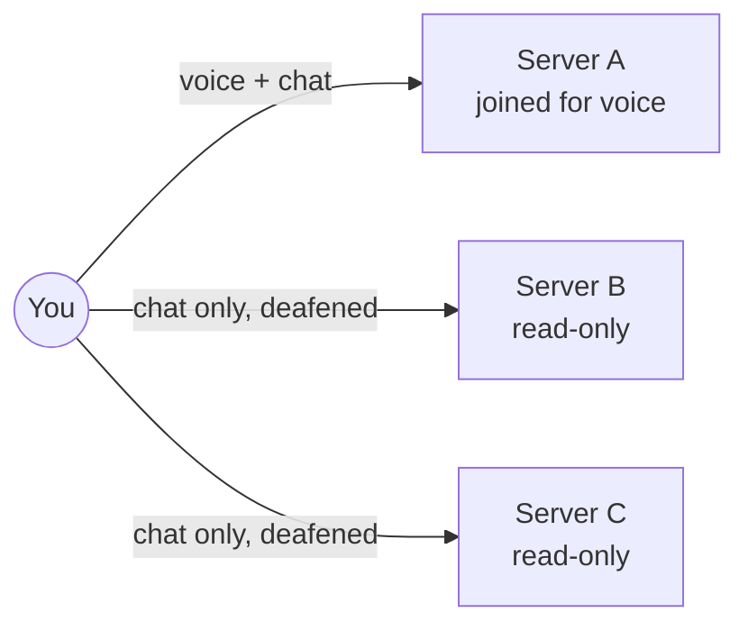

# Epic 2 – Multi-server read-along, themes & polish · Brainstorming

> Basis: Spec 01 section 14 (proposed roadmap, `specs/roadmap.md` doesn't exist yet) → Epic 2, plus the Epic 1 notes (tasks, implementation report, scale report), the GitHub wiki (Roadmap, Features, Troubleshooting) and the user's addition from 2026-10-25: Linux distribution packages, a curl-based installer and desktop shortcuts.
> Process: We work in several rounds. Each round contains questions; you answer directly in this file.
> Once all questions are answered, `specs/02-multi-server-themes-specification.md` is created from it.
> Already settled (not asked again):
> - Tech stack, target platforms, architecture, accessibility (WCAG 2.2 AA), privacy rules → Spec 01.
> - Fresh connect = read-only (deafened in the default channel) → Spec 01 FR-1.14 / QA.2.
> - Friends across servers and "Join channel" for a friend on another server (switches server first) → Spec 01 FR-1.64, FR-1.75 / QA.80.
> - Themes are shareable as a config string that shows a preview card in the chat with "Import theme" → QA.53.
> - Connection quality via Mumble UserStats (ping, loss, bandwidth, UDP/TCP), polled only while visible → QA.83.
> - Styled dropdowns (QA.84), right-aligned settings inputs with an audit (QA.85), progress bar under chat images (QA.87).
> - YouTube watch party and screen sharing at the end of Epic 2, both Beta (QA.88).
> - Peer-to-peer layer: signalling over plugin data, IPv6 / router port mapping / LAN only, no STUN/TURN, encrypted and verified with Mumble certificate hashes, plugin data stays the fallback, switch "Allow direct connections" (QA.89, QA.90).
> - Window overlay is removed completely; only the in-game overlay remains (QA.91).
> - Fix for the game crash when Mumcord closes: layer copied to a fixed per-version folder, layer survives Mumcord exiting (QA.92).
> - Carried-over items: Windows in-game overlay, HDR10 overlay colours, borderless-fullscreen on-top check (KDE/GNOME), Flatpak Steam, "Now gaming" join target from Mumble Link, cancelling a full-size image transfer, leaving Beta after testing the game plugins with real games (QA.74).

## How to answer

- **Single choice** (`◉`): Exactly **one** box has an `[x]`. To change your choice, just move the `x`.
- **Multiple choice** (`☑`): Tick as many boxes as you like.
- ⭐ marks my **recommendation**. It is already preselected. If you agree, you don't need to change anything.
- Below each question there is `✍️ Note:`. Add anything there, e.g. questions back, edge cases or "not sure, explain this to me".
- I explain technical terms briefly. For purely technical questions (audio, network, protocol) it's perfectly fine to follow my recommendation.

## Planned rounds

1. Scope, staging & functionality (multi-server, Linux packages, Epic 1 leftovers)
2. UI & UX: several servers in the window, theme editor, settings polish (with wireframes)
3. Network & peer-to-peer: direct connections, full-size images, watch party, screen sharing, connection quality
4. Overlay, packaging, platforms & testing
5. Data/state model review & acceptance criteria

(The plan may change depending on the answers.)

---

## Round 1 – Scope, staging & functionality

> Answered in chat on 2026-10-25 at the user's request; the marks below record those answers.

Epic 2 is big: it mixes a large new feature (several servers at once), a design feature (themes), a lot of polish and leftovers from Epic 1, new Linux packages, and two experimental features at the end (watch party, screen sharing). This round decides the order and what exactly each part does.

### A · Staging & releases

#### Q1.1 In which order should Epic 2 be built? `◉`
Like Epic 1, small stages that each end in a usable release keep risk low.

- [ ] ⭐ **2a polish & packaging → 2b multi-server → 2c themes → 2d peer-to-peer (full-size images, watch party, screen sharing, Beta).** The crash fix, overlay clean-up and Linux packages help every user right away; multi-server builds on a clean base; peer-to-peer is the riskiest and comes last.
- [ ] 2a multi-server first → 2b polish & packaging → 2c themes → 2d peer-to-peer. The headline feature arrives sooner, but the crash bug (QA.92) and packaging wait longer.
- [x] Everything in one stage, one release at the end. Simplest plan, but nothing ships for a long time.

✍️ Note:

#### Q1.2 How often do we release during Epic 2? `◉`

- [ ] ⭐ **One release per stage (e.g. 0.4.0, 0.5.0, 0.6.0, 0.7.0).** Users get improvements early; same rhythm as Epic 1.
- [x] Only one release (0.4.0) when Epic 2 is complete.

✍️ Note:

#### Q1.3 The Windows in-game overlay needs a Windows PC for testing (QA.68). How do we handle it? `◉`

- [ ] ⭐ **Stays in Epic 2, but doesn't block any release.** It is built and shipped as soon as a Windows test PC is available; until then Windows has no overlay (QA.91).
- [x] Must ship in Epic 2; Epic 2 isn't done without it.
- [ ] Move it to Epic 3.

✍️ Note:

### B · Several servers at once (multi-server read-along)

Today Mumcord is connected to one server at a time (FR-1.9). In Epic 2 you stay connected to several servers, read and write chat on all of them, and get notifications from all of them.

#### Q1.4 On how many servers can you talk (voice) at the same time? `◉`

- [x] ⭐ **Voice on one server at a time; all others stay connected read-only (chat, followed channels, notifications).** Joining a channel on server B moves your voice there; server A stays connected and you sit there deafened again. Clear for you and for others – nobody hears you twice.
- [ ] Voice on several servers at once (your microphone goes to all of them, you hear all of them mixed). Confusing and rarely wanted.
- [ ] Joining voice on another server disconnects all other servers. Simpler, but loses the read-along idea.

✍️ Note:

#### Q1.5 How many servers can be connected at the same time? `◉`
Each connection costs a little memory, CPU and network. The scale test showed big servers already take ~0.6–0.8 s to draw the first time.

- [x] ⭐ **Up to 5.** Covers typical use (a few communities), keeps the app fast. A clear message appears when the limit is reached.
- [ ] Up to 10.
- [ ] No limit.

✍️ Note: (answered in chat) default 5 configurable up to 15. force it with right click on server otherwise last connected servers

#### Q1.6 Which servers connect automatically when Mumcord starts? `◉`

- [x] ⭐ **The servers that were connected when you last quit, plus a per-server switch "Connect when Mumcord starts".** You come back to where you were. Every connect is read-only until you join a channel (FR-1.14).
- [ ] Every saved server, always.
- [ ] None – you click each server yourself.

✍️ Note:

#### Q1.7 What works on servers where you are connected but not joined for voice? `☑`

- [x] ⭐ Chat in the channel you're in and in followed channels (read and write)
- [x] ⭐ Private messages
- [x] ⭐ Mentions and message notifications (with the server name in the notification)
- [x] ⭐ Unread badge on the server icon in the server bar
- [x] ⭐ Friends' online state and where they are (FR-1.64)
- [x] ⭐ History sync with other Mumcord users (FR-1.60)
- [x] "Now playing" / "Now gaming" sharing on every connected server (privacy: everyone on every server sees it; otherwise only on the voice server)
- [ ] Listening to voice of a second server at the same time (later, not in Epic 2)

✍️ Note:

#### Q1.8 What happens when one of several servers loses its connection? `◉`

- [x] ⭐ **Only that server reconnects on its own (as in FR-1.13); the others are not affected.** Its server icon shows a "reconnecting" state; if it gives up, the icon shows "disconnected" with a reconnect option.
- [ ] A dropped server stays disconnected until you click it.

✍️ Note:

### C · Linux packages, installer & desktop shortcut

Today Linux users get an AppImage: one file they download and start. Many people expect a "real" package for their distribution, which installs the app into the system menu and can be removed cleanly. Windows and macOS packaging stay as they are (signing and auto-update are Epic 5).

#### Q1.9 Which Linux packages do we offer? `☑`

- [x] ⭐ **.deb** – Debian, Ubuntu, Linux Mint, Pop!_OS, Zorin
- [x] ⭐ **.rpm** – Fedora, openSUSE, Nobara
- [x] ⭐ **Arch Linux (AUR package `mumcord-bin`)** – Arch, Manjaro, EndeavourOS, CachyOS
- [x] ⭐ **AppImage stays** – works on any distribution without installing
- [ ] Flatpak (Flathub) – later: its sandbox clashes with the in-game overlay, game detection and mouse-button push-to-talk, so it needs its own work
- [ ] Snap – not planned (same sandbox problems, small gaming audience)

✍️ Note:

#### Q1.10 What should the curl installer do? `◉`
A curl installer is a one-line command you paste into a terminal, e.g. `curl -fsSL <address>/install.sh | sh`. The script lives in this repository and is published with each release on GitHub (the website isn't changed by me; a short `mumcord.app/install` link can be added by you later).

- [x] ⭐ **Detects your distribution and installs the matching package through its own package manager (asks for your password once); on unknown distributions it installs the AppImage for your user only, with a menu entry.** One command for everyone, clean uninstall through the system.
- [ ] Always installs the AppImage for your user only (no password, no system package). Simpler, but doesn't use the real packages.
- [ ] No curl installer – download links only.

✍️ Note:

#### Q1.11 How do Linux users get updates in Epic 2? `◉`
Real automatic updates for .deb/.rpm need our own package repository with a signing key; that belongs to Epic 5 (signing & auto-update).

- [x] ⭐ **Run the installer command again (or download the new package); AUR users update through their usual AUR tool. Mumcord shows a small "new version available" hint with a link.** No signing key needed yet.
- [ ] Same, but without the in-app "new version" hint.
- [ ] Own apt/dnf repository with automatic updates already in Epic 2 (needs a signing key kept in CI secrets – pulls Epic 5 work forward).

✍️ Note:

#### Q1.12 Which desktop integration do we add? `☑`

- [x] ⭐ App menu entry with the Mumcord icon (installed by every package and the installer)
- [x] ⭐ `mumble://` links open Mumcord right after installing (no extra step)
- [x] ⭐ AppImage users: one-time offer "Add Mumcord to the app menu" on first start (also fixes the Epic 1 issue that the push-to-talk shortcut is listed under the app that launched Mumcord)
- [x] Icon on the desktop (optional checkbox in the installer, off by default)
- [x] "Start Mumcord when I log in" (later – Epic 3 comfort features)

✍️ Note:

### D · Leftovers from Epic 1

#### Q1.13 Which open items from Epic 1 do we take into Epic 2? `☑`

- [x] ⭐ Open manual checks: Windows/macOS/KDE stage-1a gate (G1), Wayland compatibility mode check (AC-1.38), overlay test in Tyr (Proton/DXVK)
- [x] ⭐ Flaky/fragile tests: game-detection test that fails while a real game runs (H5), quick-settings focus test on Windows CI (H6)
- [x] ⭐ First drawing of very big servers freezes the window for up to ~0.8 s – matters more with several servers
- [x] ⭐ Chat: sent messages aren't confirmed by the server; a refused "follow" error can show twice; server messages show an empty sender
- [x] ⭐ Comment/avatar changes count as saved after 3 s without an answer instead of a real confirmation
- [x] Rich-text profile comment editor (today plain text; formatting from other clients is lost when saving) – later
- [x] Linux tray tooltips (depends on the desktop, low value) – later

✍️ Note: (answered in chat) issue 8

#### Q1.14 Which big-server improvements from the Epic 1 scale report do we add? `☑`

- [x] ⭐ Talking rings update at a calmer rate on very busy servers (invisible to you, keeps the app smooth)
- [x] ⭐ "Syncing big server…" state while a big server loads, instead of a frozen tree
- [x] Hide or dim empty channels (switch)
- [x] People who are talking move to the top of their channel

✍️ Note:

### E · Themes

#### Q1.15 How far can a theme change the look? `◉`

- [x] ⭐ **Colours only: a few key colours (background, surface, text, accent, talking/online/warning) with presets (Dark, Light and a few curated ones).** Mumcord derives all other shades and checks contrast (WCAG AA) so a theme can't make text unreadable. Safe to share.
- [ ] Colours plus font and density (compact/comfortable).
- [ ] Full custom styles (CSS). Not recommended: a shared theme could hide or fake parts of the UI – a security risk.

✍️ Note:

---

## Round 2 – Follow-ups, UI & UX

> Asked and answered in chat on 2026-10-25 at the user's request; the marks below record those answers. Added input from the user: the website (mumcord.app) got a design update on 2026-10-25 and the client should adopt it somewhat. Comparison: the client already shares the website's colours, fonts, gradient stops and glow; differences are the primary button, gradient use, corner radius, glass/film-grain effects and translucent borders.

### Follow-ups & explanations for round 1

#### Q2.1 (on Q1.5) What does "force it with right click on server" mean? `◉`

- [x] Right-click a server → "Always connect at start". Those always connect; remaining slots up to the limit go to the last connected servers.
- [ ] Right-click → "Connect anyway" to go beyond the limit.
- [ ] Both.

✍️ Note:

#### Q2.2 (on Q1.1–Q1.3) One release at the end and the Windows overlay must ship – so nothing ships until a Windows test PC is available. OK? `◉`

- [ ] ⭐ **One big Epic 2 release, but urgent bug fixes (e.g. the game crash QA.92) may ship earlier as 0.3.x.**
- [x] Nothing before the end; a Windows test PC is a hard prerequisite.

✍️ Note:

### A · Several servers in the window

#### Q2.3 How does the server bar show the state of each connected server? `◉`

- [x] ⭐ **Badges on icons:** green speaker mark = your voice server; dot = unread, number = mentions; ring = connected; grey = disconnected; spinner = reconnecting.
- [ ] Bar split into sections "Voice", "Connected", "Saved".

✍️ Note:

#### Q2.4 Clicking another connected server icon … `◉`

- [x] ⭐ **Only shows it** (its channels and chat); your voice stays. The user panel always shows where you talk ("Voice: Lobby · Server A").
- [ ] Also moves your voice there.
- [ ] One combined channel tree of all servers.

✍️ Note:

#### Q2.5 How are notifications from several servers shown? `◉`

- [x] ⭐ **Server name in each** toast/desktop notification ("Server · #channel"); click opens that server and chat; per-server mute switch in the server's right-click menu.
- [ ] Notifications only from the voice server; others only show badges.

✍️ Note:

### B · Look & themes

#### Q2.6 Which differences to the new website look should the client adopt? `☑`

- [x] ⭐ Glowing primary button: cream/peach pill with pink glow and hover lift (dark pill in the light theme)
- [x] ⭐ Gradient accents (peach → pink → violet) on the wizard heading, empty states and icon tiles
- [ ] Rounder dialogs (~16px corners on dialogs and the wizard)
- [x] Glass popovers and film-grain background (costs GPU; not recommended for an app)

✍️ Note: (answered in chat) 4 should be also deactivateable in settings

#### Q2.7 Where do you edit a theme? `◉`

- [x] ⭐ **Settings → Appearance:** preset picker and colour pickers with live preview of the whole app, contrast warning, "Share" copies the theme string.
- [ ] A separate theme editor window.

✍️ Note:

#### Q2.8 Can a theme be different per server? `◉`

- [ ] ⭐ **One theme for the whole app.**
- [x] Optional theme per server (helps tell servers apart).

✍️ Note:

### C · Overlay clean-up

#### Q2.9 Removing the window overlay (QA.91): what do current users see? `◉`

- [x] ⭐ **A one-time notice** after the update for users who had the window overlay on, pointing to the in-game overlay.
- [ ] Silent removal; only the release notes mention it.

✍️ Note:

---

## Round 3 – Network & peer-to-peer

> Asked and answered in chat on 2026-10-25 at the user's request; the marks below record those answers.

#### Q3.1 "Allow direct connections" reveals your IP address to other Mumcord users. Default? `◉`

- [x] ⭐ **Ask once when first needed** (big image, screen share): short explanation with Yes/No, answer remembered, changeable in settings.
- [ ] On by default.
- [ ] Off by default.

✍️ Note:

#### Q3.2 Screen sharing: what can be shared? `☑`

- [x] ⭐ A whole screen or one window, chosen via the system picker
- [x] With sound (app/system audio; harder, especially on Linux/macOS)
- [x] Several people sharing in the same channel at the same time

✍️ Note:

#### Q3.3 Each viewer gets the stream directly from the sharer's upload. Max viewers? `◉`

- [ ] ⭐ **Up to 4** (fits normal home upload speeds with good quality).
- [x] Up to 8 (lower quality per viewer on slow uploads).
- [ ] No limit.

✍️ Note:

#### Q3.4 Who can watch a screen share or join a watch party? `◉`

- [x] ⭐ **Mumcord users in the same voice channel.**
- [ ] Any Mumcord user on the server.

✍️ Note:

#### Q3.5 Watch party: who controls play/pause/seek? `◉`

- [x] ⭐ **Everyone in the party;** a line shows who did it ("Anna paused").
- [ ] Only the host (can hand over).

✍️ Note:

#### Q3.6 Watch party: what do official Mumble clients in the channel see? `◉`

- [ ] ⭐ **A normal chat message with the YouTube link,** no sync.
- [x] Nothing; the party is invisible to them.

✍️ Note:

#### Q3.7 Watch party video sources? `☑`

- [x] ⭐ YouTube (QA.88)
- [ ] Twitch
- [ ] Local video file

✍️ Note:

#### Q3.8 Connection quality signal icon next to people (UserStats, issue #8): default? `◉`

- [ ] ⭐ **Off; ping/loss/bandwidth always in the profile and menu, list icon switchable.**
- [ ] On by default next to everyone.

✍️ Note: (answered in chat) on by default if connection is weak

---

## Round 4 – Testing, packaging & platforms

> Asked and answered in chat on 2026-10-25 at the user's request; the marks below record those answers. With Q4.1 the Windows test PC is available, so the Windows in-game overlay (Q1.3) no longer depends on missing hardware. Added input from the user: manual tests must never block the work – they are collected and done by the user later.

#### Q4.1 Which test hardware is available? `☑`

- [x] Windows PC with GPU and games
- [x] HDR10 monitor
- [x] Mac
- [x] KDE and GNOME machines

✍️ Note:

#### Q4.2 Which distributions are tested automatically (install package + start the app in CI)? `☑`

- [x] ⭐ Ubuntu LTS and Debian (.deb)
- [x] ⭐ Fedora (.rpm)
- [x] ⭐ Arch (AUR package build)
- [x] openSUSE (.rpm)

✍️ Note:

#### Q4.3 Who publishes the AUR package on each release? `◉`

- [x] ⭐ **CI automatically** (AUR account key stored as a CI secret; the user creates the account).
- [ ] The user by hand.

✍️ Note:

#### Q4.4 Positional audio, game plugins and full-size images leave Beta after a real-game test. Who tests? `◉`

- [ ] ⭐ **The user and friends, with a short checklist per game.**
- [x] They stay Beta through Epic 2.

✍️ Note:

#### Q4.5 The "new version available" hint asks GitHub for the latest release (GitHub sees the IP address). How? `◉`

- [ ] ⭐ **Once a day, on by default, switch in Settings → About, mentioned in PRIVACY.md.**
- [x] The first-start wizard asks whether to check for updates.
- [ ] Only a manual "Check for updates" button.

✍️ Note:

#### Q4.6 Which processor types do the Linux packages support? `◉`

- [ ] ⭐ **x86_64 only.**
- [x] x86_64 and ARM64.

✍️ Note:

#### Q4.7 Glass and film-grain effects: default? `◉`

- [x] ⭐ **On by default,** switch in Settings → Appearance, turned off automatically when the OS asks for reduced transparency or motion.
- [ ] Off by default.

✍️ Note:

#### Q4.8 Where do you set a server's own theme? `◉`

- [x] ⭐ **Right-click server → "Theme…" and in the edit-server dialog;** default "Use app theme".
- [ ] Only in a per-server list in Settings → Appearance.

✍️ Note:

---

## Round 5 – Open points

> Asked and answered in chat on 2026-10-25 at the user's request; the marks below record those answers. The data/state model is reviewed in the specification (section 7) instead of a separate round, at the user's request to finish tonight.

#### Q5.1 Manual tests never block: how are they handled? `◉`

- [x] ⭐ **One checklist in the tasks file;** work continues on automated tests; the user works through the list before the Epic 2 release; failures become bug tasks.
- [ ] Same list, but the release may ship with open checks marked "unverified".

✍️ Note:

#### Q5.2 Existing users don't see the wizard after updating. How do they get the update-check question (Q4.5)? `◉`

- [x] ⭐ **A one-time prompt after the update:** "Check for new versions?"
- [ ] Off for them; they can switch it on in settings.

✍️ Note:

#### Q5.3 Screen sharing default quality? `◉`

- [ ] ⭐ **1080p, 30 fps,** lowered automatically with many viewers.
- [x] 720p, 30 fps.
- [ ] Up to 1440p, 60 fps.

✍️ Note:

#### Q5.4 Version number of the Epic 2 release? `◉`

- [x] ⭐ **0.4.0** (1.0 after the release & signing epic).
- [ ] 1.0.0.

✍️ Note:

---

## Closing

2026-10-25: All rounds answered (rounds 1–5 in chat at the user's request). The specification has been created: `specs/02-multi-server-themes-specification.md`.

## Addendum – Theme share message (2026-10-25)

> Discussed in chat after the specification was written.

#### QB.1 What does a shared theme look like in the chat? `◉`

- [x] Plain text for official clients: `🎨 Mumcord theme "‹name›" – mct1.‹code›`; Mumcord users see a preview card (mini app mock-up, key colours, "Import theme", "Imported ✓" if already imported). The code also contains the Mumcord version that created the theme, so later changes to the theme format can be handled: newer versions read older themes, older versions import what they know and show "Made with Mumcord ‹version› – update to see it fully".

✍️ Note: (from chat) es sollte auch die mumcord version geteilt werden falls sich was ändert

#### QB.2 Which actions does the theme card offer? `◉`

- [x] Main button "Apply theme" (import + set as app theme, default); an arrow menu with "Apply to ‹server›" for every saved server (sets it as that server's theme, FR-2.17).

✍️ Note: (from chat) Import theme apply default und Apply to server x apply to server y and so on
