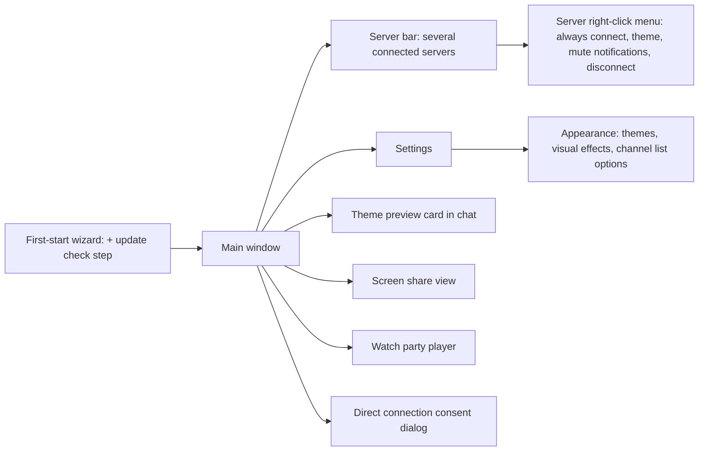
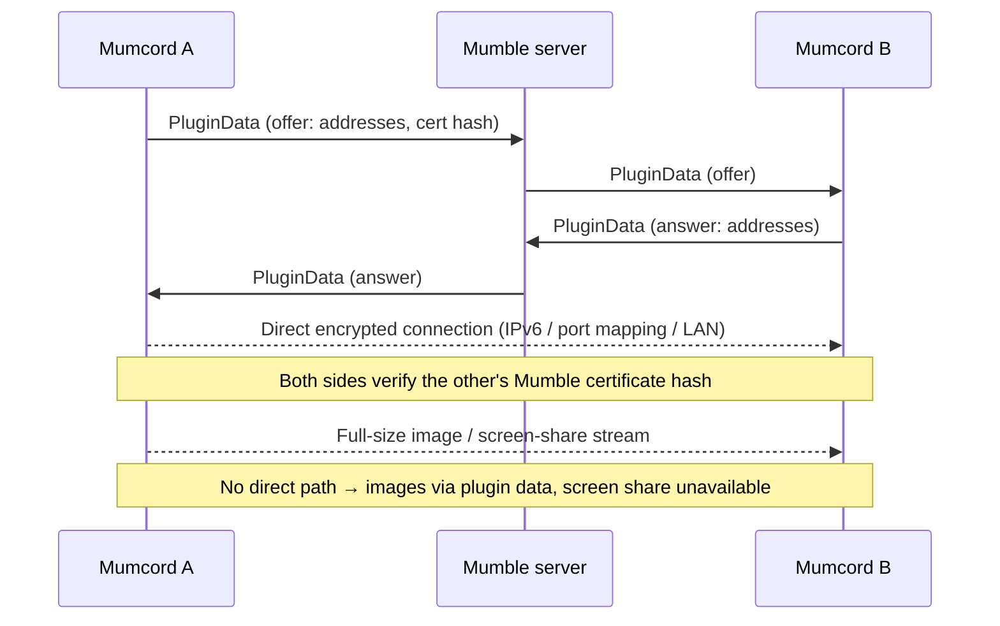
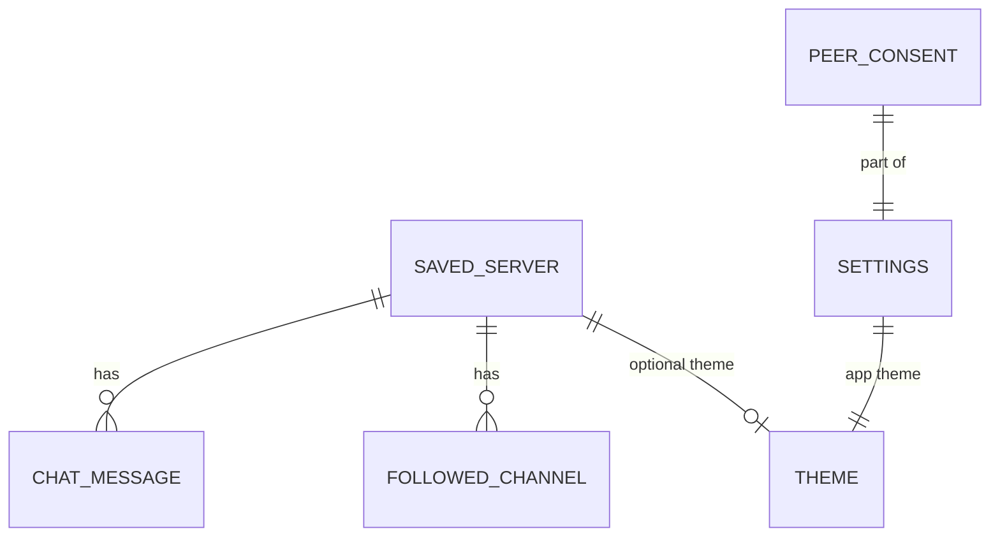
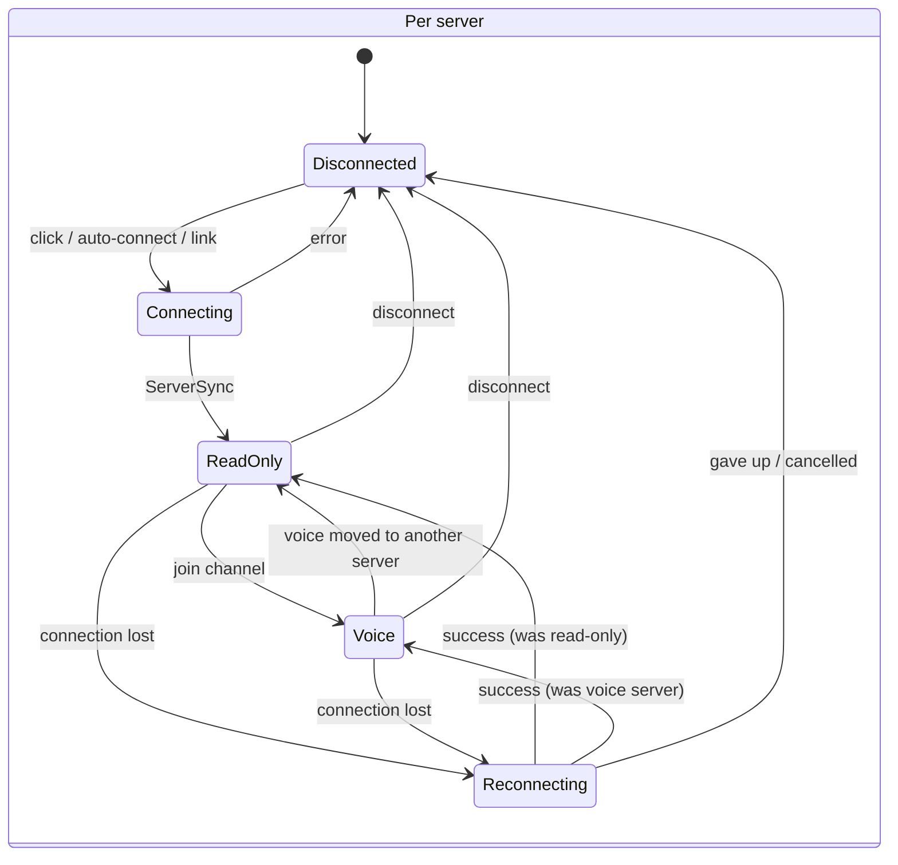

# Mumcord · Epic 2 – Multi-server read-along, themes & polish · Specification

> Status: Final (brainstorming completed) · As of: 2026-10-25
> Sources: `specs/01-foundation-specification.md` section 14 (proposed roadmap, Epic 2; `specs/roadmap.md` doesn't exist yet), `specs/02-multi-server-themes-brainstorming.md`, Epic 1 notes (`specs/01-foundation-tasks.md`, `-implementation.md`, `-scale-report.md`), GitHub wiki (Roadmap, Features, Troubleshooting)
> Builds on: `specs/01-foundation-specification.md` (all decisions there stay valid unless this spec changes them)

## 1. Goal & context

Epic 1 made Mumcord a usable daily client for one server at a time. Many people are members of several communities, so Epic 2 keeps several servers connected at once: you talk on one, and read, write and get notified on all of them (QA.1). Epic 2 also gives Mumcord custom and per-server themes and the refreshed website look, finishes what Epic 1 left open (Windows in-game overlay, HDR, the overlay crash, known bugs, big-server speed), makes Mumcord easy to install on Linux with real distribution packages and a one-line installer, and adds the first Mumcord-to-Mumcord peer-to-peer features: fast full-size images, a YouTube watch party and screen sharing (both Beta). Everything stays a pure client against unmodified Mumble servers.

## 2. Scope

Epic 2 is built as **one stage and shipped as one release, 0.4.0**, when everything in it is done, including the Windows in-game overlay (Q1.1, Q1.2, Q1.3, Q2.2, Q5.4). No feature or patch release goes out before. Manual tests never block development (Q5.1, section 10).

### 2.1 In scope

- **Multi-server read-along:** up to 5 connected servers (configurable 1–15), voice on one of them, read-only on the others; auto-connect at start; per-server reconnect, badges, notifications (Q1.4–Q1.8, Q2.1, Q2.3–Q2.5).
- **Friends on other servers:** "Join channel" for a friend on another connected server switches voice there (completes FR-1.75).
- **Themes:** colour themes with presets, editor in Settings → Appearance, share/import string with a chat preview card (QA.53), optional theme per server (Q1.15, Q2.7, Q2.8, Q4.8).
- **Website look:** glowing primary button, gradient accents, glass popovers and film grain with a switch (Q2.6, Q4.7).
- **UI polish:** styled dropdowns (QA.84), consistent settings layout with audit (QA.85), progress bar under chat images while the full image loads (QA.87).
- **Connection quality (issue #8, QA.83):** ping, packet loss, bandwidth, UDP/TCP in profile and person menu; a signal icon next to people whose connection is weak (Q3.8).
- **Overlay:** Windows in-game overlay; HDR10 colours; borderless-fullscreen check on KDE/GNOME; Flatpak Steam; fix for the game crash on Mumcord exit (QA.92); window overlay removed with a one-time notice (QA.91, Q2.9).
- **Carried over from Epic 1 (QA.74):** "Now gaming" join target from the Mumble Link context; cancelling a running full-size image transfer when the viewer closes.
- **Epic 1 leftovers (Q1.13):** open manual checks, flaky tests, known bugs, big-server first-draw freeze, rich-text comment editor, Linux tray tooltips.
- **Big servers (Q1.14):** calmer talking-ring updates, "Syncing big server…" state, "Hide empty channels" and "Talking people first" switches.
- **Peer-to-peer layer (QA.89, QA.90):** direct encrypted connections between Mumcord users, asked once before first use (Q3.1); used for full-size images (fallback: plugin data).
- **YouTube watch party (Beta)** and **screen sharing (Beta)** (QA.88, Q3.2–Q3.7, Q5.3).
- **Linux distribution:** .deb, .rpm, AUR `mumcord-bin`, AppImage, each for x86_64 and ARM64; curl installer; menu entry, `mumble://` handler, optional desktop icon, "Start Mumcord when I log in" (Q1.9–Q1.12, Q4.2, Q4.3, Q4.6).
- **Update hint:** "new version available" with a link, opt-in through the wizard or a one-time prompt (Q1.11, Q4.5, Q5.2).

### 2.2 Out of scope / later

- Voice on several servers at once; listening to a second server's voice (Q1.4, Q1.7).
- Flatpak/Flathub and Snap packages (Q1.9).
- Own apt/dnf repositories and automatic updates; signed installers (→ Epic 5, Q1.11).
- Watch party with Twitch or local video files (Q3.7); watch party visible to official clients (Q3.6).
- Full custom styles (CSS) and fonts/density in themes (Q1.15).
- Rounder dialogs from the website look (Q2.6).
- Leaving Beta for positional audio, game plugins and full-size images: they stay Beta through Epic 2 (Q4.4).
- STUN/TURN or any other relay server for peer-to-peer (QA.90) – forever without a Mumcord-run service.
- Everything else listed for Epics 3–6 in spec 01 section 14.

## 3. Roles & permissions

Nothing changes on the server side. The server keeps enforcing ACLs on every connected server separately.

| Action | Guest | Registered user | Channel admin | Server admin | Enforced by |
|---|---|---|---|---|---|
| Connect to several servers at once | ✅ | ✅ | ✅ | ✅ | Client (each server sees one normal connection) |
| Enter a channel for voice on a server | per ACL | per ACL | ✅ | ✅ | Server |
| Write in a channel on a read-only server | per ACL | per ACL | ✅ | ✅ | Server |
| Start screen sharing / watch party in own voice channel | ✅ | ✅ | ✅ | ✅ | Client (Mumcord users only; server just carries plugin data) |
| Watch a screen share / join a watch party | Mumcord users in the same voice channel | same | same | same | Client |
| See other people's connection quality | per server's UserStats permission | same | same | same | Server (fields it doesn't return are hidden) |
| Themes, packaging, update hint | local only | local only | local only | local only | Client |

## 4. Functional requirements

### 4.1 Several servers at once

- **FR-2.1** Mumcord can be connected to several saved servers at the same time. The limit is 5 by default and can be set from 1 to 15 in Settings → Servers (Q1.5). Connecting beyond the limit is refused with a clear message naming the limit and the setting. FR-1.9 (one server at a time, disconnect prompt) is replaced by this requirement.
- **FR-2.2** Voice runs on exactly one server at a time, the **voice server** (Q1.4). Joining a channel for voice on another connected server moves voice there: on the previous voice server the user stays connected in their channel and becomes self-deafened and self-muted again (read-only, FR-1.14 semantics); on the new server the last own mute/deafen setting is restored (QA.7). Push-to-talk, voice activation, positional audio and the in-game overlay always refer to the voice server.
- **FR-2.3** Every fresh connect stays read-only as in FR-1.14, on every server. The "Rejoin ‹channel›?" prompt (QA.9) is shown only for the server that was the voice server when Mumcord quit.
- **FR-2.4** On read-only servers the following work (Q1.7): chat in the user's channel and in followed channels (read and write), private messages, mentions and message notifications, unread badge on the server icon, friends' online state and location, history sync with other Mumcord users (FR-1.60), and "Now playing" / "Now gaming" sharing (shared on every connected server).
- **FR-2.5** Clicking a connected server's icon shows that server's channel tree, chat and member list; voice stays where it is (Q2.4). The user panel always shows the voice location ("Voice: ‹channel› · ‹server›"), or "Read-only – Join a channel to talk" when no server has voice.
- **FR-2.6** Clicking a saved, not connected server connects it (read-only) and shows it, as long as the limit allows; no disconnect prompt.
- **FR-2.7** Auto-connect at start (Q1.6, Q2.1): servers marked "Always connect at start" (right-click a server, also in the edit-server dialog) connect first; the remaining slots up to the limit are filled with the servers that were connected when Mumcord last quit. Marking more servers "Always connect at start" than the limit allows is refused with a message.
- **FR-2.8** Each server reconnects on its own after a dropped connection, as in FR-1.13; other servers are not affected (Q1.8). If the voice server drops and reconnects, voice is restored there; it does not move to another server.
- **FR-2.9** Disconnecting: the user panel's "Disconnect" button disconnects the shown server; right-click a server → "Disconnect"; quitting Mumcord disconnects all servers. The quit confirmation (Q2.8 of Epic 1) counts all connected servers.
- **FR-2.10** Notifications (Q2.5): in-app toasts and desktop notifications show the server name ("‹server› · #‹channel›" or "‹server› · ‹person›"); clicking one shows that server and opens the chat. Right-click a server → "Mute notifications" switch per server (mentions included); muted servers still show badges.
- **FR-2.11** Private messages from all servers appear in the direct-messages list, labelled with the server name; friends' private chats stay linked by certificate hash across servers (FR-1.65).
- **FR-2.12** "Join channel" for a friend on another connected server (FR-1.75) moves voice to that server and channel per FR-2.2.
- **FR-2.13** `mumble://` links: if the server is already connected, the link shows it and, with a channel path, joins that channel for voice (FR-2.2); otherwise it connects per FR-2.6 and FR-1.11.

### 4.2 Themes & look

- **FR-2.14** Settings → Appearance holds the app theme (Q2.7): presets (Dark, Light and a few curated ones) and a custom theme built from key colours – background, surface, text, accent, talking/online, warning/error. Mumcord derives all other shades. Changes preview live across the whole app.
- **FR-2.15** Contrast is guaranteed: when a colour choice would break WCAG AA contrast (4.5:1 for text, 3:1 for UI elements), the editor shows a warning at the affected colour and Mumcord adjusts derived shades; a theme whose text can't reach AA cannot be saved or imported.
- **FR-2.16** Theme sharing (QA.53): "Share" copies a theme string. A message containing a theme string renders for Mumcord users as a preview card (mini mock-up of the app in those colours, name, "Import theme"); official clients see the plain string. Imported themes are validated (only colour values, size-capped, contrast check per FR-2.15) and appear in the theme list. Message format (QB.1): `🎨 Mumcord theme "‹name›" – mct1.‹code›`, where the code carries the theme name, the key colours and the Mumcord version that created the theme. A newer Mumcord reads themes from older versions (missing colours get defaults). An older Mumcord that receives a theme from a newer version imports the colours it knows, ignores the rest and shows "Made with Mumcord ‹version› – update to see it fully". The card shows "Imported ✓" when the theme is already in the list.
- **FR-2.17** Per-server theme (Q2.8, Q4.8): right-click a server → "Theme…" and the edit-server dialog let the user pick a theme for that server; default "Use app theme". The per-server theme applies while that server is shown.
- **FR-2.18** Website look (Q2.6): the primary button becomes a cream/peach pill with the pink glow and a hover lift (a dark pill in the light theme, via its own tokens); the peach → pink → violet gradient is used on the wizard heading, empty states and icon tiles.
- **FR-2.19** Visual effects (Q2.6, Q4.7): popovers and menus use a frosted-glass look and the app background gets a subtle film grain like the website. Settings → Appearance → "Visual effects" (default on) switches both off; they are off automatically when the OS asks for reduced transparency or reduced motion.

### 4.3 UI polish & big servers

- **FR-2.20** Styled dropdowns (QA.84): every select/dropdown in the app uses one themed component (light and dark, per-server themes), fully keyboard operable and screen-reader labelled.
- **FR-2.21** Settings layout (QA.85): number and text inputs are right-aligned like switches and dropdowns in every settings section; all sections are audited.
- **FR-2.22** Image progress (QA.87): while the full-size version of a chat image loads, a slim progress bar shows under the image in the chat (not only in the viewer).
- **FR-2.23** Big servers (Q1.14): talking rings update at a calmer rate on busy servers; while a big server's tree is still loading, the channel list shows "Syncing big server…" instead of a frozen tree; Settings → Appearance has "Hide empty channels" (default off) and "Show talking people first" (default off).
- **FR-2.24** First drawing of a big server (Q1.13) no longer freezes the window: no UI freeze longer than 200 ms at the 4× scale of the Epic 1 scale test.

### 4.4 Connection quality (issue #8, QA.83)

- **FR-2.25** The profile card, hover preview and person menu show the person's ping, packet loss, bandwidth and UDP/TCP from Mumble UserStats, also for the user themselves; fields the server doesn't return are hidden.
- **FR-2.26** A small signal icon appears next to a person in the channel tree and member list automatically when their connection is weak (ping above 250 ms or packet loss above 5 %), with a tooltip (Q3.8). The switch "Show weak connection icon" (Settings → Appearance, default on) turns it off.
- **FR-2.27** UserStats are requested only for people visible on the shown server, at a slow, paced rate that never interferes with chat or voice (section 6).

### 4.5 Overlay

- **FR-2.28** Windows in-game overlay (QA.68): drawn inside games through a hook into DirectX 11/12 (DXGI), as designed in `docs/engine-api.md`, with the same per-game settings, global on/off, anti-cheat blocklist and warnings as the Linux in-game overlay (FR-1.46b).
- **FR-2.29** HDR10 games: overlay colours look correct (not too bright) on HDR10/PQ swapchains, on Linux and Windows.
- **FR-2.30** The in-game overlay works for games started from Flatpak Steam.
- **FR-2.31** Borderless-fullscreen games: verified on KDE and GNOME that the in-game overlay shows; fixed where it doesn't.
- **FR-2.32** Crash fix (QA.92): closing or updating Mumcord never crashes a running game. The layer library is copied to a fixed per-version folder in the app data directory and the Vulkan manifest points there; when the connection to Mumcord is lost, the layer draws nothing and the game keeps running.
- **FR-2.33** Window overlay removed (QA.91): the floating overlay window, the KDE window-rule helper, its settings and tray item are removed. Users who had the window overlay switched on see a one-time notice after updating that explains the change and opens the in-game overlay settings (Q2.9).
- **FR-2.34** "Now gaming" join target (QA.74): when the Mumble Link context of the running game contains a joinable server address, "Join game" opens it (FR-1.59).

### 4.6 Peer-to-peer layer & full-size images

- **FR-2.35** Mumcord users can connect directly to each other (QA.89, QA.90): introduced over Mumble plugin data, tried over IPv6, the home router's port mapping (UPnP / NAT-PMP / PCP) and the local network; encrypted and verified against both sides' Mumble certificate hashes. No STUN, TURN or other external server.
- **FR-2.36** Consent (Q3.1): the first time a direct connection would be used, Mumcord asks once with a short explanation ("Direct connections are faster, but the other person can see your IP address") – Yes/No, remembered, changeable in Settings → Privacy ("Allow direct connections to other Mumcord users"). With No, only plugin data is used and screen sharing is unavailable with a hint why.
- **FR-2.37** Full-size images (FR-1.60c) are fetched over a direct connection first and fall back to the plugin-data transfer when no direct path works or direct connections are off. Size cap, hash check and the switches from FR-1.74 stay.
- **FR-2.38** Closing the image viewer cancels a running full-size transfer (QA.74).

### 4.7 YouTube watch party (Beta)

- **FR-2.39** A YouTube card in the chat of the user's voice channel offers "Watch together"; starting it invites the Mumcord users in the same voice channel (Q3.4). Each participant plays the video in their own embedded YouTube player; only playback commands travel over plugin data.
- **FR-2.40** Everyone in the party can play, pause and seek (Q3.5); a short line shows who did it ("Anna paused"). Latecomers jump to the current position. Leaving the voice channel leaves the party.
- **FR-2.41** Official Mumble clients see nothing of the party (Q3.6). Only YouTube is supported (Q3.7). Marked Beta.

### 4.8 Screen sharing (Beta)

- **FR-2.42** A user can share a whole screen or one window, chosen through the system picker, optionally with sound (Q3.2). Several people in a channel can share at the same time.
- **FR-2.43** Viewers: Mumcord users in the same voice channel (Q3.4), up to 8 per sharer (Q3.3). The 9th viewer gets a clear "This share is full" message. The sharer sees who is watching.
- **FR-2.44** Default quality 720p at 30 fps, lowered automatically when the upload can't keep up (Q5.3).
- **FR-2.45** A sharing person shows a "Live" marker in the channel tree and member list; "Watch" opens the stream in the main area, with full-screen and "Stop watching". Sharer controls: pause, stop, sound on/off.
- **FR-2.46** Screen sharing needs a direct connection (FR-2.35); without one, "Watch" is disabled with the reason. Marked Beta.

### 4.9 Epic 1 leftovers (Q1.13)

- **FR-2.47** Chat sends wait for the server's confirmation; refused messages are marked with the reason and can be retried.
- **FR-2.48** A refused "Follow" shows its error once.
- **FR-2.49** Server messages show the server as sender (e.g. "‹server name›" with a server icon) instead of an empty name.
- **FR-2.50** Comment and avatar changes count as saved only after the server confirms them; failures are shown.
- **FR-2.51** Rich-text profile comment editor: bold, italic, links and lists; keeps formatting that other clients wrote; output is sanitized HTML that official clients display.
- **FR-2.52** Linux tray tooltips are shown where the desktop supports them.

### 4.10 Linux installation & updates

- **FR-2.53** Packages (Q1.9, Q4.6): .deb (Debian, Ubuntu and derivatives), .rpm (Fedora, openSUSE and derivatives), the AUR package `mumcord-bin` (Arch and derivatives) and the AppImage – each for x86_64 and ARM64, attached to every GitHub release.
- **FR-2.54** Curl installer (Q1.10): `curl -fsSL https://github.com/ToBee94/mumcord/releases/latest/download/install.sh | sh` detects the distribution and CPU, installs the matching package through the system package manager (asks for the password once) and, on unknown distributions, installs the AppImage for the current user with a menu entry. It asks "Add a desktop icon?" (default no) and supports `--uninstall`. It verifies the downloaded file's checksum from the release before installing.
- **FR-2.55** Desktop integration (Q1.12): every package and the installer add an app-menu entry with the Mumcord icon and register the `mumble://` handler. AppImage users get a one-time offer "Add Mumcord to the app menu" on first start (this also fixes the push-to-talk shortcut being listed under the launching app). Settings → General has "Start Mumcord when I log in" (default off) on all platforms.
- **FR-2.56** Update hint (Q1.11, Q4.5, Q5.2): the first-start wizard asks "Check for new versions?"; existing users get the same question once after updating to 0.4.0. When on, Mumcord asks GitHub for the latest release at most once a day and shows "Mumcord ‹version› is available" with a link to the release and update instructions (re-run the installer; AUR users update with their AUR tool). Switch in Settings → About; no other data is sent.

## 5. UI & UX

### 5.1 Navigation



### 5.2 Server bar & user panel

```text
┌────┬───────────────┬──────────────────────────────┬──────────────┐
│ 🔊◉│ Gaming Srv  ▾ │ # Lobby              ☆ Follow │ In Lobby (3) │
│  ◉•│───────────────│──────────────────────────────│──────────────│
│  ◉3│ ▾ Lobby     3 │ Anna            12:01        │ 🟢 Anna  🎙  │
│  ○ │   🟢 Anna 🎙  │ hi all                       │ ⚪ Ben  📶!  │
│  ⟳ │   ⚪ Ben  📶! │                              │ 🔴 Carla LIVE│
│  + │   🔴 Carla    │                              │              │
│    │───────────────│──────────────────────────────│              │
│    │ 🧑 You        │ Message #Lobby…        🖼  ➤ │              │
│    │ Voice: Lobby · Gaming Srv                    │              │
│    │ 🎙 🎧 📞 ⚙    │                              │              │
└────┴───────────────┴──────────────────────────────┴──────────────┘
```

- Server icons (Q2.3): 🔊 speaker mark = voice server; ring = connected; • = unread; number = mentions; grey = saved, not connected; ⟳ = reconnecting; a "disconnected" state offers "Reconnect". Every state also has a text label for screen readers and tooltips.
- 📶! = weak connection icon (FR-2.26); LIVE = screen share (FR-2.45).
- The user panel's voice line (FR-2.5) is clickable and shows the voice server.

### 5.3 Settings → Appearance

```text
┌ Appearance ─────────────────────────────────────────────┐
│ Theme              [ Mumcord Dark            ▾ ]        │
│   Background  ■  Surface  ■  Text  ■  Accent  ■         │
│   Talking     ■  Warning  ■        ⚠ Text contrast low  │
│   [ Share ]  [ Import… ]  [ Reset ]                     │
│ Visual effects (glass, grain)                  [ ● ]    │
│ Hide empty channels                            [   ]    │
│ Show talking people first                      [   ]    │
│ Show weak connection icon                      [ ● ]    │
└─────────────────────────────────────────────────────────┘
```

### 5.4 Screen share & watch party

- Screen share view replaces the chat area while watching; the chat can be reopened beside it on wide windows. Keyboard: F toggles full screen, Escape leaves full screen, "Stop watching" button.
- Watch party: the YouTube player sits above the chat of the voice channel with participant avatars and the "Anna paused" line; "Leave party" button.

### 5.5 Dialogs, empty states, errors

- Direct connection consent (FR-2.36), server limit reached (FR-2.1), share full (FR-2.43), "Screen sharing needs a direct connection" (FR-2.46), one-time window-overlay notice (FR-2.33), update-check question (FR-2.56), AppImage "Add to app menu" offer (FR-2.55).
- Theme import errors in plain language: "This theme isn't readable enough" / "This isn't a valid Mumcord theme".

### 5.6 Design notes

- Website look adopted per FR-2.18/FR-2.19; app cards keep their current radius.
- All new tokens get dark and light values and are covered by the contrast test; per-server themes go through the same checks.
- WCAG 2.2 AA stays the bar (Q4.12 of Epic 1), including all new dialogs, the theme editor, the screen-share view and the watch party.

## 6. Audio & network

- **Voice:** unchanged from Epic 1, but only for the voice server. Read-only servers are self-deafened, so they send no audio to Mumcord; Mumcord sends audio only to the voice server.
- **Multi-server connections:** each server has its own TLS control connection, UDP voice channel (only used on the voice server), reconnect timer and state. Connections are independent: one server's failure, slowness or limits never affect another.
- **Plugin data:** per server; history sync, now playing/gaming, peer-to-peer signalling, watch party commands and full-size image fallback use the plugin-data channel of the server where the other person is.
- **UserStats pacing:** requests are spread out (at most one every 2 seconds per server, people in the user's channel first, each person refreshed at most every 30 s while visible) so the server's message rate limit is never hit by them.
- **Peer-to-peer:** signalling over plugin data; connection attempts over IPv6, UPnP / NAT-PMP / PCP port mapping and LAN; encrypted transport authenticated with the peers' Mumble client certificates and checked against the certificate hash the server reports. One direct connection per pair of users carries images, video and sound.
- **Screen sharing:** captured through the OS (Linux: desktop portal + PipeWire, Windows: Windows Graphics Capture, macOS: ScreenCaptureKit), encoded as video at 720p30 by default with adaptive bitrate, sound captured with the share when chosen; the sharer sends one stream per viewer (up to 8).



- **Protocol compatibility:** unchanged (client protocol 1.5, full functionality from server 1.4). No protocol extensions; Mumcord-only features use plugin data only.

## 7. Data & state model



| Entity | Field | Type | Required | Rules / notes |
|---|---|---|---|---|
| SavedServer (new fields) | always_connect_at_start | bool | yes | Default false; count ≤ max_connected_servers (FR-2.7) |
| | connected_at_quit | bool | yes | Set on quit, used for auto-connect (FR-2.7) |
| | was_voice_server_at_quit | bool | yes | For the rejoin prompt (FR-2.3) |
| | notifications_muted | bool | yes | Default false (FR-2.10) |
| | theme_id | ref Theme | no | Empty = use app theme (FR-2.17) |
| Theme (new) | id, name | text | yes | Presets are built in and read-only |
| | colours | map of key colour → hex | yes | Only colour values; validated for AA (FR-2.15) |
| | source | preset / custom / imported | yes | |
| Settings (new fields) | max_connected_servers | int 1–15 | yes | Default 5 |
| | app_theme_id | ref Theme | yes | Default Mumcord Dark (or system light/dark preset per existing theme setting) |
| | visual_effects | bool | yes | Default true; ignored when the OS asks for reduced transparency/motion |
| | hide_empty_channels, talking_first | bool | yes | Default false |
| | show_weak_connection_icon | bool | yes | Default true |
| | allow_direct_connections | unset / yes / no | yes | Unset = ask on first use (FR-2.36) |
| | update_check | unset / yes / no | yes | Unset = ask (wizard or one-time prompt, FR-2.56) |
| | last_update_check | datetime | no | At most daily |
| | start_at_login | bool | yes | Default false |
| | window_overlay_notice_shown | bool | yes | One-time notice (FR-2.33) |
| Settings (removed) | window overlay options | – | – | Removed with the window overlay (QA.91) |

Runtime state (not stored): per connected server its connection state, session and tree; one global voice server (or none); active direct connections, screen shares and watch parties.



At most one server is in state `Voice` at any time.

## 8. Technology & architecture

- **Stack unchanged** (Tauri 2, Rust engine, React + TypeScript strict) – see spec 01.
- **Engine:** holds a set of independent server sessions keyed by saved-server id (today one session) plus one "voice server" pointer; the audio pipeline is connected only to the voice server's session. Every UI command and event carries the server id.
- **Peer-to-peer module (new, `p2p`):** one encrypted transport between two Mumcord users, using the existing Mumble client certificates for mutual authentication; port mapping through UPnP/NAT-PMP/PCP. Recommended: QUIC over `rustls` (encrypted, works over UDP through mapped ports, one connection carries images and video streams); libraries confirmed during build.
- **Screen capture & video (new, `screenshare`):** OS capture APIs per platform (portal/PipeWire, Windows Graphics Capture, ScreenCaptureKit), a widely supported video codec with hardware acceleration where available and a software fallback, decoding and display in the UI; libraries confirmed during build with licence check (AGPL-compatible).
- **Watch party:** uses the existing YouTube embed (FR-1.50) with the player's control API; only commands go over plugin data.
- **Themes:** CSS custom properties generated from the theme's key colours; the contrast check runs on the generated values, the same way as the existing contrast test.
- **Windows overlay:** hook DLL for DXGI (D3D11/D3D12) and injection as designed in `docs/engine-api.md`, sharing the overlay content protocol with the Linux layer.
- **Packaging:** Tauri's bundler for .deb, .rpm and AppImage; a PKGBUILD for `mumcord-bin` built from the release files; a POSIX `install.sh` in the repository.
- **Architecture rules:** protocol, audio, p2p/screen-share and UI stay separate; the UI never talks to the network or to peers directly.

## 9. Non-functional requirements

- **Performance:** idle with 5 connected servers (one voice) ≤ 3 % CPU and ≤ 400 MB RAM on a mid-range PC; no UI freeze > 200 ms when a big server connects (FR-2.24); visual effects keep 60 fps scrolling on a mid-range PC or are reduced.
- **Screen sharing:** 720p30 to 8 viewers with sound needs about 8–15 Mbit/s upload; the sharer's CPU use while sharing ≤ 25 % with hardware encoding.
- **Voice latency:** unchanged (≤ 150 ms mouth-to-ear excluding network transit), also while screen sharing.
- **Security:** direct connections always encrypted and authenticated against the certificate hash reported by the server; a mismatch drops the connection. Theme strings accept colour values only. Installer checks release checksums. AUR key stored only as a CI secret.
- **Privacy (GDPR):** direct connections reveal the IP address only after consent (FR-2.36); the update check contacts GitHub only after consent (FR-2.56) and sends nothing but the request; screen shares and watch parties aren't recorded or stored; PRIVACY.md is updated for direct connections and the update check.
- **Accessibility:** WCAG 2.2 AA for all new UI; reduced motion/transparency respected.
- **Platforms:** Linux (X11, Wayland; KDE, GNOME; x86_64 and ARM64), Windows 10/11, macOS (current and previous major).

## 10. Build, packaging & release

- **One release: 0.4.0** when all of Epic 2 is done (Q2.2, Q5.4). Release notes and wiki call watch party and screen sharing Beta and explain the window-overlay removal.
- **CI:** builds and tests on Linux (x86_64 and ARM64), Windows and macOS. Package checks in containers: install the .deb on Ubuntu LTS and Debian, the .rpm on Fedora and openSUSE, build and install the AUR package on Arch, then start the app headless and check it runs (Q4.2). The curl installer is tested in the same containers.
- **AUR publishing:** the release workflow updates `mumcord-bin` automatically (Q4.3). One-time setup by the user: create the AUR account and add the CI key as a repository secret.
- **Multi-user tests:** integration tests use two or more local test servers (Docker, 1.4 and 1.5) and several Mumcord instances/bots for multi-server, direct connection, watch-party and screen-share signalling flows.
- **Manual tests never block (Q5.1):** every check that needs real hardware or a human (Windows/HDR/Flatpak overlay, borderless fullscreen on KDE/GNOME, screen-share picker and sound on each OS, Epic 1's open manual checks G1, AC-1.38 and the Tyr test) goes onto one manual checklist in the Epic 2 tasks file. Development continues on automated tests; the user works through the list before the release; failures become bug tasks.
- **Unchanged:** builds stay unsigned; no auto-update (→ Epic 5).
- **Docs:** README, wiki (Installation, Features, Troubleshooting, Roadmap) and CHANGELOG updated; the website is not touched (a `mumcord.app/install` short link can be added by the user).

## 11. Acceptance criteria (verifiable in the running client)

Multi-server (two or three local test servers, second client as needed):
- **AC-2.1** Connect to servers A and B → both icons show "connected"; join a channel on A → A shows the speaker mark, B stays read-only; a second client on B sees the user deafened.
- **AC-2.2** While voice is on A, join a channel on B → voice moves to B (second client on B hears the user), on A the user shows as deafened in their channel; the user panel shows "Voice: ‹channel› · B".
- **AC-2.3** With voice on A, a second client writes in a followed channel on B → unread dot on B's icon and a notification "B · #channel"; clicking the notification shows B with that chat; the user can reply.
- **AC-2.4** Mention the user on B → mention count on B's icon. Mute notifications for B → no further toasts from B, badges still update.
- **AC-2.5** Set limit to 2, connect A and B, click C → message about the limit; raise the limit to 3 → C connects.
- **AC-2.6** Mark C "Always connect at start", connect A and B, quit, start → A, B and C connect read-only; with limit 2 → C plus the most recent of A/B. Marking more servers than the limit → refused with message.
- **AC-2.7** Stop server B's container while connected to A and B → only B shows reconnecting; A keeps working; restart B → B reconnects read-only.
- **AC-2.8** A friend (second client) is on B, user on A → Friends list shows "In ‹channel› · B"; "Join channel" moves voice to B in that channel.
- **AC-2.9** Private message from a client on B arrives while viewing A → appears in direct messages with "B".
- **AC-2.10** Quit while joined on A and connected to B → next start: both reconnect read-only, the rejoin prompt names A's channel only.
- **AC-2.11** Now playing on → a second Mumcord client on B (read-only server) sees the music icon.

Themes & look:
- **AC-2.12** Settings → Appearance: pick each preset → whole app changes immediately; choose a text colour with low contrast → warning shows and the theme can't be saved until fixed.
- **AC-2.13** Share a theme into a channel → a second Mumcord client sees the preview card and imports it with one click; an official client sees the string.
- **AC-2.14** Set a theme for server B → shown while B is displayed; switching to A shows the app theme.
- **AC-2.15** Primary buttons show the glow pill; turn off "Visual effects" → glass and grain disappear; with OS reduced transparency/motion on, they are off automatically.
- **AC-2.16** Every dropdown in settings, dialogs and the wizard uses the themed component, works with the keyboard alone and is announced by a screen reader; settings inputs are right-aligned in every section.

Big servers & quality:
- **AC-2.17** Connect to the 4× scale test server → "Syncing big server…" shows, no freeze over 200 ms (measured as in the Epic 1 scale report).
- **AC-2.18** Turn on "Hide empty channels" and "Show talking people first" → empty channels disappear, a talking bot moves to the top of its channel.
- **AC-2.19** Open a person's profile → ping, loss, bandwidth and UDP/TCP show; simulate a bad connection for a bot (network emulation in the test setup) → signal icon appears next to it; switch off → icon gone.

Overlay:
- **AC-2.20** Windows: start a D3D11 and a D3D12 game with the in-game overlay on → overlay shows the talking people; a game on the blocklist stays off by default.
- **AC-2.21** HDR10 game (Linux and Windows) → overlay colours match SDR appearance (not too bright).
- **AC-2.22** Game started from Flatpak Steam → in-game overlay shows.
- **AC-2.23** Linux: a Vulkan test program with the overlay running, quit Mumcord → the program keeps running, overlay disappears; start Mumcord again → overlay comes back.
- **AC-2.24** Update from 0.3.x with the window overlay on → one-time notice; no window overlay settings or tray item exist anymore.

Peer-to-peer, watch party, screen sharing (two Mumcord clients on a local test server):
- **AC-2.25** First full-size image request → consent dialog; Yes → image loads over the direct connection (visibly faster than plugin data); No → loads over plugin data; the choice is remembered and changeable.
- **AC-2.26** Block direct paths in the test setup → full-size images still arrive via plugin data; "Watch" shows "needs a direct connection".
- **AC-2.27** Close the image viewer during a full transfer → the transfer stops (sender log/status shows it cancelled); progress bar under the chat image while loading.
- **AC-2.28** Start "Watch together" on a YouTube card → the second Mumcord client in the same voice channel joins; pause/seek on either side syncs within 1 s and shows "‹name› paused"; a latecomer starts at the current position; an official client sees nothing.
- **AC-2.29** Share a window with sound → the viewer sees and hears it at 720p30; a second sharer in the channel can be watched at the same time; a 9th viewer gets "This share is full" (bot viewers).

Leftovers:
- **AC-2.30** Send a message into a channel without write permission → marked as refused with reason, retry possible; a refused follow shows its error once; a server message shows the server as sender.
- **AC-2.31** Change comment/avatar with the server refusing (too large) → shown as failed, not saved.
- **AC-2.32** Write a comment with bold, link and list → an official client shows the formatting; a comment written by an official client keeps its formatting after editing in Mumcord.
- **AC-2.33** Linux tray: hovering the tray icon shows the tooltip on KDE.

Linux packages:
- **AC-2.34** On Ubuntu, Debian, Fedora, openSUSE and Arch (x86_64, plus one ARM64 machine or VM) run the curl installer → Mumcord installed through the system package manager, appears in the app menu with icon, a `mumble://` link opens it; `--uninstall` removes it.
- **AC-2.35** On an unknown distribution the installer installs the AppImage for the user with a menu entry; starting a plain downloaded AppImage offers "Add Mumcord to the app menu".
- **AC-2.36** "Start Mumcord when I log in" on → Mumcord starts after logging in (Linux, Windows, macOS).
- **AC-2.37** New install: wizard asks about update checks; update from 0.3.x: one-time prompt. With a newer test release available → "Mumcord ‹version› is available" with link; with the check off, no request to GitHub is made.

## 12. Decision log

| Question | Decision | Note |
|---|---|---|
| Q1.1 | One stage for all of Epic 2 | Not the recommended split |
| Q1.2 | One release at the end | 0.4.0 (Q5.4) |
| Q1.3 | Windows in-game overlay must ship in Epic 2 | Windows test PC available (Q4.1) |
| Q1.4 | Voice on one server, others read-only | FR-2.2 |
| Q1.5 | Default 5, configurable up to 15 | FR-2.1 |
| Q1.6 | Last connected servers + per-server switch | FR-2.7 |
| Q1.7 | Read-only servers get chat, PMs, notifications, badges, friends, history sync and now playing/gaming | FR-2.4 |
| Q1.8 | Only the dropped server reconnects | FR-2.8 |
| Q1.9 | .deb, .rpm, AUR, AppImage | No Flatpak/Snap |
| Q1.10 | Curl installer detects distro, AppImage fallback | FR-2.54 |
| Q1.11 | Re-run installer + in-app hint | FR-2.56 |
| Q1.12 | Menu entry, links, AppImage offer, desktop icon, start at login | FR-2.55 |
| Q1.13 | All Epic 1 leftovers incl. rich-text editor, tray tooltips, issue #8 | Section 4.9, 4.4 |
| Q1.14 | All four big-server improvements | FR-2.23 |
| Q1.15 | Colours only | FR-2.14 |
| Q2.1 | Right-click → "Always connect at start" | FR-2.7 |
| Q2.2 | Nothing ships before the end | Not the recommendation (patch releases) |
| Q2.3 | Badges on server icons | Section 5.2 |
| Q2.4 | Clicking a server only shows it | FR-2.5 |
| Q2.5 | Server name in notifications, per-server mute | FR-2.10 |
| Q2.6 | Glow button, gradient accents, glass + grain (switchable) | FR-2.18, FR-2.19 |
| Q2.7 | Theme editor in Settings → Appearance | FR-2.14 |
| Q2.8 | Optional theme per server | FR-2.17 |
| Q2.9 | One-time notice on window-overlay removal | FR-2.33 |
| Q3.1 | Ask once before the first direct connection | FR-2.36 |
| Q3.2 | Screen or window, with sound, several sharers | FR-2.42 |
| Q3.3 | Up to 8 viewers | FR-2.43 |
| Q3.4 | Same voice channel | FR-2.39, FR-2.43 |
| Q3.5 | Everyone controls the watch party | FR-2.40 |
| Q3.6 | Official clients see nothing | FR-2.41 |
| Q3.7 | YouTube only | FR-2.41 |
| Q3.8 | Signal icon shown automatically when the connection is weak | FR-2.26; thresholds set in this spec |
| Q4.1 | Windows PC, HDR monitor, Mac, KDE/GNOME available | Manual checklist |
| Q4.2 | CI package tests on Ubuntu, Debian, Fedora, Arch, openSUSE | Section 10 |
| Q4.3 | CI publishes the AUR package | User creates the AUR account |
| Q4.4 | Positional audio, plugins, full-size images stay Beta | Out of scope |
| Q4.5 | Update check asked in the wizard | FR-2.56 |
| Q4.6 | x86_64 and ARM64 | FR-2.53 |
| Q4.7 | Visual effects on, auto-off on OS request | FR-2.19 |
| Q4.8 | Server theme via right-click and edit dialog | FR-2.17 |
| Q5.1 | Manual checklist, done at the end, never blocks | Section 10 |
| Q5.2 | One-time update-check prompt for existing users | FR-2.56 |
| Q5.3 | Screen share 720p30 | FR-2.44 |
| Q5.4 | Version 0.4.0 | |
| User input 2026-10-25 | Linux packages, curl installer, desktop shortcut; website redesign adopted in the client; manual tests never block | Round 1, Round 2, Round 4 headers |

## 13. Open points & risks

- **Epic size and single release:** Epic 2 is very large and ships nothing until all of it is done, including two Beta features with new technology (Q1.1, Q2.2). Risk: a long time without a release; the 0.3.x game-crash bug (QA.92) stays in users' hands until 0.4.0 (workaround: close the game first or turn the in-game overlay off).
- **Screen sharing technology:** capture, video encoding and decoding inside a Tauri app on three OSes (with sound on Linux and macOS) is the riskiest part; libraries and licences to be confirmed during build.
- **Direct connections without STUN:** many home networks have no IPv6 and no working port mapping; then screen sharing is unavailable for that pair (by design, QA.90).
- **Upload limits:** 8 viewers per sharer, and several sharers at once, can exceed home upload speeds; quality drops automatically.
- **UserStats rate limits:** the exact server message limit for UserStats requests must be verified in the Mumble server source during build; pacing (section 6) is adjusted to it.
- **ARM64:** official Mumble game plugins and some games are x86_64-only; positional audio on ARM64 may be limited. GitHub ARM64 runners are needed in CI.
- **AUR:** needs an AUR account and key from the user before the first release.
- **Anti-cheat on Windows:** the DXGI hook can trigger anti-cheat; the blocklist and warnings from Epic 1 apply.

## 14. Impact on the roadmap

- **Epic 5 (Release & distribution)** loses the Linux distribution packages, the curl installer and the update hint, which move into Epic 2. Epic 5 keeps signed installers, automatic updates, own package repositories and store listings.
- **Epic 3 (Comfort & polish):** "Start Mumcord when I log in" moves into Epic 2.
- **Beta:** positional audio, game plugins and full-size images stay Beta through Epic 2 (Q4.4); leaving Beta moves to a later epic.
- **Docs:** wiki Roadmap/Features/Troubleshooting and CHANGELOG still describe the window overlay as the Windows fallback; they are updated with Epic 2.
- `specs/roadmap.md` still doesn't exist; creating it from spec 01 section 14 plus these changes needs the user's go-ahead.
