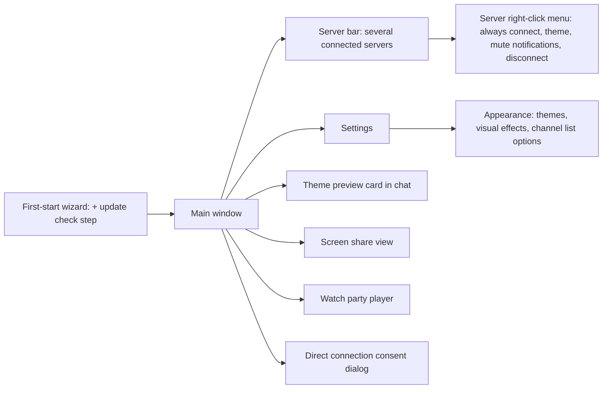
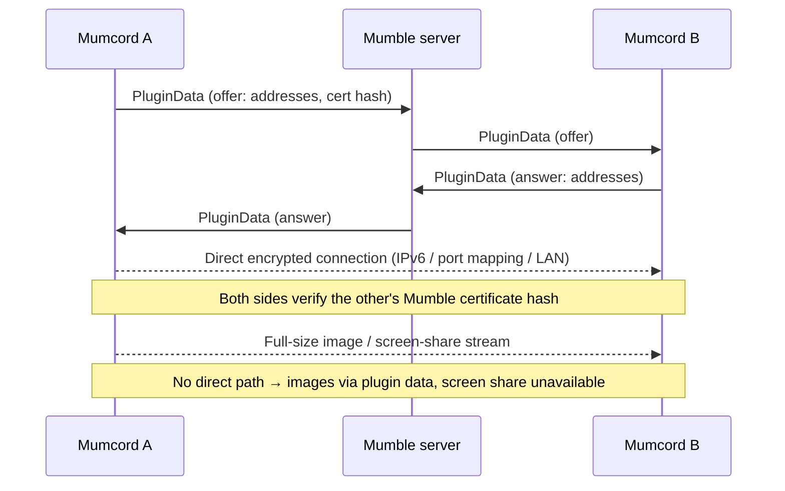
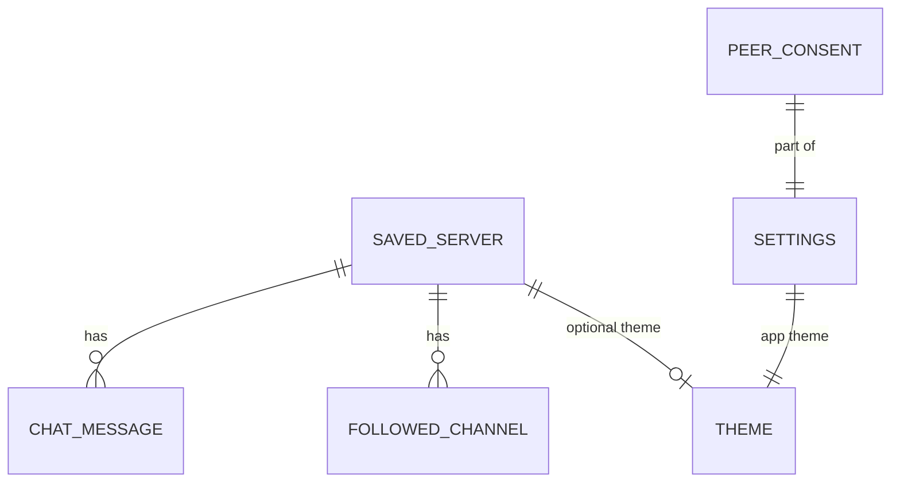
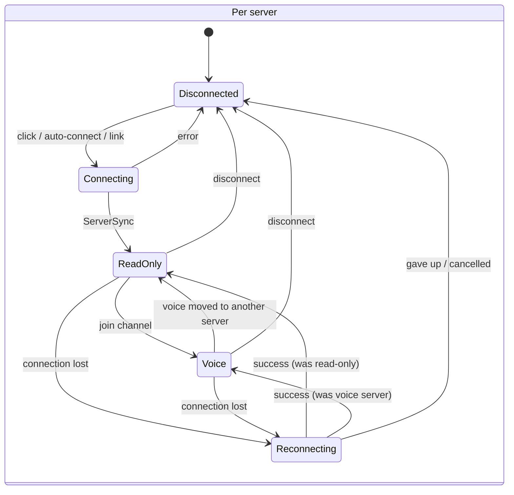

# Mumcord · Epic 2 – Multi-server read-along, themes & polish · Specification

> Status: Final (brainstorming completed) · As of: 2026-10-25
> Sources: `specs/01-foundation-specification.md` section 14 (proposed roadmap, Epic 2; `specs/roadmap.md` doesn't exist yet), `specs/02-multi-server-themes-brainstorming.md`, Epic 1 notes (`specs/01-foundation-tasks.md`, `-implementation.md`, `-scale-report.md`), GitHub wiki (Roadmap, Features, Troubleshooting)
> Builds on: `specs/01-foundation-specification.md` (all decisions there stay valid unless this spec changes them)

## 1. Goal & context

Epic 1 made Mumcord a usable daily client for one server at a time. Many people are members of several communities, so Epic 2 keeps several servers connected at once: you talk on one, and read, write and get notified on all of them (QA.1). Epic 2 also gives Mumcord custom and per-server themes and the refreshed website look, finishes what Epic 1 left open (Windows in-game overlay, HDR, the overlay crash, known bugs, big-server speed), makes Mumcord easy to install on Linux with real distribution packages and a one-line installer, and adds the first Mumcord-to-Mumcord peer-to-peer features: fast full-size images, a YouTube watch party and screen sharing (both Beta). Everything stays a pure client against unmodified Mumble servers.

## 2. Scope

Epic 2 is built as **one stage and shipped as one release, 0.4.0**, when everything in it is done, including the Windows in-game overlay (Q1.1, Q1.2, Q1.3, Q2.2, Q5.4). No feature or patch release goes out before. Manual tests never block development (Q5.1, section 10).

### 2.1 In scope

- **Multi-server read-along:** up to 5 connected servers (configurable 1–15), voice on one of them, read-only on the others; auto-connect at start; per-server reconnect, badges, notifications (Q1.4–Q1.8, Q2.1, Q2.3–Q2.5).
- **Friends on other servers:** "Join channel" for a friend on another connected server switches voice there (completes FR-1.75).
- **Themes:** colour themes with presets, editor in Settings → Appearance, share/import string with a chat preview card (QA.53), optional theme per server (Q1.15, Q2.7, Q2.8, Q4.8).
- **Website look:** glowing primary button, gradient accents, glass popovers and film grain with a switch (Q2.6, Q4.7).
- **UI polish:** styled dropdowns (QA.84), consistent settings layout with audit (QA.85), progress bar under chat images while the full image loads (QA.87).
- **Connection quality (issue #8, QA.83):** ping, packet loss, bandwidth, UDP/TCP in profile and person menu; a signal icon next to people whose connection is weak (Q3.8).
- **Overlay:** Windows in-game overlay as a separate click-through window over the detected game (no DLL, no injection); HDR10 colours; borderless-fullscreen check on KDE/GNOME; Flatpak Steam; fix for the game crash on Mumcord exit (QA.92); window overlay removed with a one-time notice (QA.91, Q2.9); Steam launch option for native OpenGL games on Linux (issue #11, FR-2.57).
- **Carried over from Epic 1 (QA.74):** "Now gaming" join target from the Mumble Link context; full-size image transfers that keep running in the background when the viewer closes (user decision 2026-10-25, replaces the QA.74 cancel-on-close).
- **Epic 1 leftovers (Q1.13):** open manual checks, flaky tests, known bugs, big-server first-draw freeze, rich-text comment editor, Linux tray tooltips.
- **Big servers (Q1.14):** calmer talking-ring updates, "Syncing big server…" state, "Hide empty channels" and "Talking people first" switches.
- **Peer-to-peer layer (QA.89, QA.90):** direct encrypted connections between Mumcord users, asked once before first use (Q3.1); used for full-size images (fallback: plugin data).
- **YouTube watch party (Beta)** and **screen sharing (Beta)** (QA.88, Q3.2–Q3.7, Q5.3).
- **Linux distribution:** .deb, .rpm, AUR `mumcord-bin`, AppImage, each for x86_64 and ARM64; curl installer; menu entry, `mumble://` handler, optional desktop icon, "Start Mumcord when I log in" (Q1.9–Q1.12, Q4.2, Q4.3, Q4.6).
- **Update hint:** "new version available" with a link, opt-in through the wizard or a one-time prompt (Q1.11, Q4.5, Q5.2).

### 2.2 Out of scope / later

- Voice on several servers at once; listening to a second server's voice (Q1.4, Q1.7).
- Flatpak/Flathub and Snap packages (Q1.9).
- Own apt/dnf repositories and automatic updates; signed installers (→ Epic 5, Q1.11).
- Watch party with Twitch or local video files (Q3.7); watch party visible to official clients (Q3.6).
- Full custom styles (CSS) and fonts/density in themes (Q1.15).
- Rounder dialogs from the website look (Q2.6).
- Leaving Beta for positional audio, game plugins and full-size images: they stay Beta through Epic 2 (Q4.4).
- STUN/TURN or any other relay server for peer-to-peer (QA.90) – forever without a Mumcord-run service.
- Do Not Disturb mode (→ Epic 3, user input 2026-10-26): one switch that silences notification sounds and toasts (including mentions, replies and activity sounds of FR-2.67/FR-2.77) without muting voice; until then, mentions of Do Not Disturb in this spec do not apply.
- @all and @channel mentions (→ Epic 3, user input 2026-10-26).
- Everything else listed for Epics 3–6 in spec 01 section 14.

## 3. Roles & permissions

Nothing changes on the server side. The server keeps enforcing ACLs on every connected server separately.

| Action | Guest | Registered user | Channel admin | Server admin | Enforced by |
|---|---|---|---|---|---|
| Connect to several servers at once | ✅ | ✅ | ✅ | ✅ | Client (each server sees one normal connection) |
| Enter a channel for voice on a server | per ACL | per ACL | ✅ | ✅ | Server |
| Write in a channel on a read-only server | per ACL | per ACL | ✅ | ✅ | Server |
| Start screen sharing / watch party in own voice channel | ✅ | ✅ | ✅ | ✅ | Client (Mumcord users only; server just carries plugin data) |
| Watch a screen share / join a watch party | Mumcord users in the same voice channel | same | same | same | Client |
| See other people's connection quality | per server's UserStats permission | same | same | same | Server (fields it doesn't return are hidden) |
| Themes, packaging, update hint | local only | local only | local only | local only | Client |

## 4. Functional requirements

### 4.1 Several servers at once

- **FR-2.1** Mumcord can be connected to several saved servers at the same time. The limit is 5 by default and can be set from 1 to 15 in Settings → Servers (Q1.5). Connecting beyond the limit is refused with a clear message naming the limit and the setting. FR-1.9 (one server at a time, disconnect prompt) is replaced by this requirement.
- **FR-2.2** Voice runs on exactly one server at a time, the **voice server** (Q1.4). Joining a channel for voice on another connected server moves voice there: on the previous voice server the user stays connected in their channel and becomes self-deafened and self-muted again (read-only, FR-1.14 semantics); on the new server the last own mute/deafen setting is restored (QA.7). Push-to-talk, voice activation, positional audio and the in-game overlay always refer to the voice server.
- **FR-2.3** Every fresh connect stays read-only as in FR-1.14, on every server. The "Rejoin ‹channel›?" prompt (QA.9) is shown only for the server that was the voice server when Mumcord quit.
- **FR-2.4** On read-only servers the following work (Q1.7): chat in the user's channel and in followed channels (read and write), private messages, mentions and message notifications, unread badge on the server icon, friends' online state and location, history sync with other Mumcord users (FR-1.60), and "Now playing" / "Now gaming" sharing (shared on every connected server).
- **FR-2.5** Clicking a connected server's icon shows that server's channel tree, chat and member list; voice stays where it is (Q2.4). The user panel always shows the voice location ("Voice: ‹channel› · ‹server›"), or "Read-only – Join a channel to talk" when no server has voice.
- **FR-2.6** Clicking a saved, not connected server connects it (read-only) and shows it, as long as the limit allows; no disconnect prompt.
- **FR-2.7** Auto-connect at start (Q1.6, Q2.1): servers marked "Always connect at start" (right-click a server, also in the edit-server dialog) connect first; the remaining slots up to the limit are filled with the servers that were connected when Mumcord last quit. Marking more servers "Always connect at start" than the limit allows is refused with a message.
- **FR-2.8** Each server reconnects on its own after a dropped connection, as in FR-1.13; other servers are not affected (Q1.8). If the voice server drops and reconnects, voice is restored there; it does not move to another server.
- **FR-2.9** Disconnecting: the user panel's "Disconnect" button disconnects the shown server; right-click a server → "Disconnect"; quitting Mumcord disconnects all servers. The quit confirmation (Q2.8 of Epic 1) counts all connected servers.
- **FR-2.10** Notifications (Q2.5): in-app toasts and desktop notifications show the server name ("‹server› · #‹channel›" or "‹server› · ‹person›"); clicking one shows that server and opens the chat. Right-click a server → "Mute notifications" switch per server (mentions included); muted servers still show badges.
- **FR-2.11** Private messages from all servers appear in the direct-messages list, labelled with the server name; friends' private chats stay linked by certificate hash across servers (FR-1.65).
- **FR-2.12** "Join channel" for a friend on another connected server (FR-1.75) moves voice to that server and channel per FR-2.2.
- **FR-2.13** `mumble://` links: if the server is already connected, the link shows it and, with a channel path, joins that channel for voice (FR-2.2); otherwise it connects per FR-2.6 and FR-1.11.

- **FR-2.59** Wrong-password retry: when a connect is rejected with a wrong password (server password or the password of a registered name; Epic 1 shows both as the same "wrong password" error with the hint to edit the server), a modal opens on that server instead of only showing the error. It is titled with the server name and has a password field (focused, masked, with a show/hide toggle), a "Save password" checkbox (pre-checked if the server already had a saved password) and the buttons Connect and Cancel. Connect retries at once with the new password; the saved server is updated only after the connect succeeds, and only if "Save password" is checked. A second wrong password keeps the modal open with an inline error. Cancel closes it and leaves the server disconnected with the normal error. It works per server (several modals do not block each other: each belongs to its server), is keyboard operable (Enter connects, Esc cancels, focus stays in the modal and returns afterwards) and screen-reader labelled (the error is announced). The password is never logged. Applies to manual connects, auto-connect at start and mumble:// links; automatic reconnects (FR-2.8) never open it.

### 4.2 Themes & look

- **FR-2.14** Settings → Appearance holds the app theme (Q2.7): presets (Mumcord and a few curated ones) and a custom theme built from key colours – background, surface, text, accent, talking/online, warning/error. Mumcord derives all other shades. Changes preview live across the whole app. **Every theme has a dark and a light version** (7 key colours each). The existing Dark / Light / System switch (quick settings and Settings → Appearance) picks which version of the active theme is shown; System follows the OS. Built-in presets ship both versions. When the user creates a theme, Mumcord automatically generates the other version from the one just made (e.g. light from dark: lightness inverted, hue and accent character kept) and runs it through the same contrast rules (FR-2.15). In the editor the user switches between "Dark" and "Light" and can fine-tune both colour sets; a version that was never edited by hand is re-generated when the other one changes, a hand-edited one is kept.
- **FR-2.15** Contrast is guaranteed: when a colour choice would break WCAG AA contrast (4.5:1 for text, 3:1 for UI elements), the editor shows a warning at the affected colour and Mumcord adjusts derived shades; a theme whose text can't reach AA cannot be saved or imported. The check runs on both versions; an auto-generated version is adjusted until it passes.
- **FR-2.16** Theme sharing (QA.53): "Share" copies a theme string. A message containing a theme string renders for Mumcord users as a preview card (mini mock-up of the app in those colours, name, "Import theme"); official clients see the plain string. Imported themes are validated (only colour values, size-capped, contrast check per FR-2.15) and appear in the theme list. Message format (QB.1): `🎨 Mumcord theme "‹name›" – mct1.‹code›`, where the code carries the theme name, the key colours of both versions and the Mumcord version that created the theme. Code format (stays `mct1.`, backward-compatible): base64url of JSON `{"v":‹mumcord version›,"n":‹name›,"dark":{7 colours},"light":{7 colours}}`; the code is capped at 2 KB (raised from the single-set cap; two sets of 7 hex colours plus a 40-character name take well under 1 KB). A code from older builds (0.3.x and earlier Epic 2 builds) holds one set of colours directly (`{"v","n","colors":{7 colours}}`, no `dark`/`light`): Mumcord reads it as the version matching the set's own brightness and auto-generates the missing version (FR-2.14). A newer Mumcord reads themes from older versions (missing colours get defaults). An older Mumcord that receives a theme from a newer version imports the colours it knows, ignores the rest and shows "Made with Mumcord ‹version› – update to see it fully". Card actions (QB.2): the main button "Apply theme" imports the theme and makes it the app theme; an arrow next to it opens a menu with "Apply to ‹server›" for every saved server (the shown server first), which imports it and sets it as that server's theme (FR-2.17). A code with only one of `dark`/`light` is treated like an old single-set code. Importing always adds the theme to the list once; applying an already imported theme doesn't create a copy. The card shows "Imported ✓" when the theme is already in the list.
- **FR-2.17** Per-server theme (Q2.8, Q4.8): right-click a server → "Theme…" and the edit-server dialog let the user pick a theme for that server; default "Use app theme". The per-server theme applies while that server is shown and follows the same Dark / Light / System switch (its dark or light version is shown).
- **FR-2.18** Website look (Q2.6): the primary button becomes a cream/peach pill with the pink glow and a hover lift (a dark pill in the light theme, via its own tokens); the peach → pink → violet gradient is used on the wizard heading, empty states and icon tiles.
- **FR-2.19** Visual effects (Q2.6, Q4.7): popovers and menus use a frosted-glass look and the app background gets a subtle film grain like the website. Settings → Appearance → "Visual effects" (default on) switches both off; they are off automatically when the OS asks for reduced transparency or reduced motion.

### 4.3 UI polish & big servers

- **FR-2.20** Styled dropdowns (QA.84): every select/dropdown in the app uses one themed component (light and dark, per-server themes), fully keyboard operable and screen-reader labelled.
- **FR-2.21** Settings layout (QA.85): number and text inputs are right-aligned like switches and dropdowns in every settings section; all sections are audited.
- **FR-2.22** Image progress (QA.87): while the full-size version of a chat image loads, a slim progress bar shows under the image in the chat (not only in the viewer).
- **FR-2.23** Big servers (Q1.14): talking rings update at a calmer rate on busy servers; while a big server's tree is still loading, the channel list shows "Syncing big server…" instead of a frozen tree; Settings → Appearance has "Hide empty channels" (default off) and "Show talking people first" (default off).
- **FR-2.24** First drawing of a big server (Q1.13) no longer freezes the window: no UI freeze longer than 200 ms at the 4× scale of the Epic 1 scale test.
- **FR-2.58** Listeners inline in the member list (user feedback, refines FR-1.15 / QA.11): channel listeners (Mumble "listen to channel") no longer get their own category ("Listening (N)") at the bottom of the member list. They appear in the normal list of the channel's people, marked with a small ear icon (as in the official Mumble client) that carries the accessible label and tooltip "Listening only" (translated in all UI languages; the group header wording is removed). Sorting: listeners are sorted together with the other people by the member list's existing order (by name); there is no separate block. Listener rows keep showing no voice state (no talking ring, no mute/deafen icons) as in FR-1.15; the people count of the heading includes the listeners.

### 4.4 Connection quality (issue #8, QA.83)

- **FR-2.25** The profile card and hover preview show the person's ping, packet loss, bandwidth and UDP/TCP from Mumble UserStats, also for the user themselves. Packet loss and late values are only shown for people in your own channel (or when you are an admin); ping is shown for people whose channel you may enter; otherwise these fields are hidden. They also show the person's client (client release string and version, e.g. "Mumcord 1.2.0" or "Mumble 1.5.0") and operating system with its version, taken from the UserStats `version`, `os` and `os_version` fields (and the Mumble Version message data). Standard Mumble servers only return this for yourself or when you have Register permission on the root channel (admins); no other mechanism is used, so for normal users the client and OS lines are hidden. Client and OS text comes from the other client and is untrusted: shown as plain text, length-capped. Fields the server doesn't return are hidden.
- **FR-2.25a** Person menu (right-click): no block of connection figures. The menu header shows one compact, muted line next to the name: signal icon in the quality colour plus ping and transport (e.g. "42 ms · UDP"), only where ping may be shown (FR-2.25). The menu offers "Connection info…", which opens the profile card scrolled to its connection section, expanded (FR-2.25b). (User input 2026-10-25: the figures in the menu looked bad.)
- **FR-2.25b** Connection section in the profile card, hover preview and the profile page in Settings: collapsed by default to one row "Connection: ‹Good / Fair / Weak›" with the signal icon in the quality colour (Weak per the FR-2.26 thresholds, Fair at half of them, otherwise Good; "Unknown" while no stats arrived). The row ends with a chevron icon that points right when collapsed and down when expanded. Clicking the row (or Enter/Space; it is a disclosure button with aria-expanded) expands a framed detail box: one row per detail, the name left-aligned and the value right-aligned in a monospace font (ping, packet loss, late packets, bandwidth, UDP/TCP, client, operating system; hidden fields stay hidden per FR-2.25). Every time a card, preview or the profile page opens, the section starts collapsed (no remembered state). "Connection info…" in the person menu (FR-2.25a) opens the card with the section expanded.
- **FR-2.25c** Per-person settings in the profile card (local volume, local mute, note, and the other per-person options the card offers for someone else) sit in their own collapsible section "Settings for ‹name›", built like the connection section of FR-2.25b: one disclosure row with a chevron, collapsed every time the card opens, expanded on click or Enter/Space. While the person is locally muted or their volume is not 100 %, the collapsed row shows a small hint (e.g. "Muted" or "Volume 60 %") so the state stays visible. Not shown on the user's own card. (User input 2026-10-26.)
- **FR-2.26** A small signal icon appears next to a person in the channel tree and member list automatically when their connection is weak (ping above 250 ms or packet loss above 5 %), with a tooltip (Q3.8). The switch "Show weak connection icon" (Settings → Appearance, default on) turns it off.
- **FR-2.27** UserStats are requested only for people visible on the shown server, at a slow, paced rate that never interferes with chat or voice (section 6).

### 4.5 Overlay

- **FR-2.28** Windows in-game overlay (QA.68), shown as a separate overlay window over the running game. **This window approach is Windows-only:** Linux keeps the Vulkan layer and the OpenGL `LD_PRELOAD` path unchanged (FR-2.29 Linux, FR-2.30 to FR-2.32, FR-2.57) and gets no overlay window; macOS stays as described elsewhere in this spec. Same per-game settings, global on/off, game detection and corner setting as the Linux in-game overlay (FR-1.46b); the anti-cheat blocklist does not apply on Windows, because the overlay window never touches the game process, so anti-cheat games show the overlay too. Plus:
  - **Separate window, nothing touches the game:** when Mumcord detects a running game window (existing game detection logic; no blocklist check on Windows), it creates a transparent, borderless, click-through, always-on-top layered window that never takes focus and is excluded from the taskbar and alt-tab. No DLL, no injection, no hooking and no files in game folders, so it also works with anti-cheat games.
  - **Follows the game:** the overlay window stays positioned over the game window and follows move, resize, minimize and focus changes. It is hidden whenever the game is not the foreground window and shown again when it is.
  - **Drawing:** the window draws Mumcord's existing overlay scene (who is talking, placed in the configured corner).
  - **Relation to FR-2.33:** FR-2.33 removes the generic, always-visible window overlay. The Windows in-game overlay window is different: it exists only while a detected game is in the foreground and is configured in the in-game overlay settings.
  - **Known limit:** games in true exclusive fullscreen hide the overlay. Settings shows a short hint: "Use borderless or windowed fullscreen in the game."
- **FR-2.29** HDR10 games: overlay colours look correct (not too bright) on HDR10 desktops, on Linux and Windows. On Windows the overlay window is composited by Windows (DWM), so Mumcord does no colour conversion of its own.
- **FR-2.30** The in-game overlay works for games started from Flatpak Steam.
- **FR-2.31** Borderless-fullscreen games: verified on KDE and GNOME that the in-game overlay shows; fixed where it doesn't.
- **FR-2.32** Crash fix (QA.92): closing or updating Mumcord never crashes a running game. The layer library is copied to a fixed per-version folder in the app data directory and the Vulkan manifest points there; when the connection to Mumcord is lost, the layer draws nothing and the game keeps running.
- **FR-2.33** Window overlay removed (QA.91): the floating overlay window, the KDE window-rule helper, its settings and tray item are removed. The removal applies on all platforms; Linux gets no overlay window, and the only overlay window left is the Windows in-game one (FR-2.28). Users who had the window overlay switched on see a one-time notice after updating that explains the change and opens the in-game overlay settings (Q2.9).
- **FR-2.34** "Now gaming" join target (QA.74): when the Mumble Link context of the running game contains a joinable server address, "Join game" opens it (FR-1.59).
- **FR-2.57** OpenGL games on Linux (issue [#11](https://github.com/Mumcord/mumcord/issues/11)): native OpenGL games (e.g. Unity games that force OpenGL) are not hooked by the Vulkan layer, so they need the preload path of the same library. Mumcord makes that usable with a fixed path: (a) the layer library lives in the per-version folder from FR-2.32 (not duplicated) and Mumcord also keeps a stable `current` path in the app data directory that always points to the library of the installed version, so a Steam launch option survives updates and AppImage restarts (the AppImage mount path is never used); (b) Settings → Overlay shows, on Linux while the in-game overlay is on, the exact Steam launch option `LD_PRELOAD=<current path> %command%` with a **Copy** button and a one-line explanation ("Only needed for OpenGL games: paste into the game's Steam launch options."); (c) a troubleshooting entry "OpenGL games need a launch option" in the repo docs and wiki texts (not the website). Out of scope: any automatic or global `LD_PRELOAD` (system-wide preload is risky and would affect every process on the system).

### 4.6 Peer-to-peer layer & full-size images

- **FR-2.35** Mumcord users can connect directly to each other (QA.89, QA.90): introduced over Mumble plugin data, tried over IPv6, the home router's port mapping (UPnP / NAT-PMP / PCP) and the local network; encrypted and verified against both sides' Mumble certificate hashes. No STUN, TURN or other external server.
- **FR-2.36** Consent (Q3.1): the first time a direct connection would be used, Mumcord asks once with a short explanation ("Direct connections are faster, but the other person can see your IP address") – Yes/No, remembered, changeable in Settings → Privacy ("Allow direct connections to other Mumcord users"). With No, only plugin data is used and screen sharing is unavailable with a hint why.
- **FR-2.37** Full-size images (FR-1.60c) are fetched over a direct connection first and fall back to the plugin-data transfer when no direct path works or direct connections are off. Size cap, hash check and the switches from FR-1.74 stay.
- **FR-2.38** Closing the image viewer does not stop a running full-size transfer: it continues in the background and the progress bar under the chat image (FR-2.22) keeps showing it; when it finishes, the full image is cached and opens instantly next time. Reopening the viewer during the transfer shows the current progress and continues the same transfer (no restart). A small × on the progress bar under the chat image cancels the transfer on purpose. This replaces the QA.74 cancel-on-close (user decision 2026-10-25).

### 4.7 YouTube watch party (Beta)

- **FR-2.39** A YouTube card in the chat of the user's voice channel offers "Watch together"; starting it invites the Mumcord users in the same voice channel (Q3.4). Each participant plays the video in their own embedded YouTube player; only playback commands travel over plugin data.
- **FR-2.40** The running party (player, controls and playlist) opens in a floating widget inside the app window (FR-2.70), not inside the chat, only for participants: it opens when the user starts or joins the party and closes when they leave; a party the user has not joined shows only the activity banner (FR-2.73); it can be collapsed to a slim bar (title + play/pause). A new party starts paused at 0:00 (also after "Skip"/auto-next only the very first video waits): the video loads but does not play until someone presses Play, so others can join first. Everyone in the party can play, pause and seek (Q3.5); a short line shows who did it ("Anna paused") for about 4 seconds, then fades; the user's own actions are not announced this way. Latecomers jump to the current position. Leaving the voice channel leaves the party.
- **FR-2.41** Official Mumble clients see nothing of the party (Q3.6). Only YouTube is supported (Q3.7). Marked Beta.
- **FR-2.41a** YouTube player origin: YouTube's embedded player rejects the app's internal origin used by release builds on Linux and macOS (`tauri://localhost`, error 153). Mumcord therefore serves a tiny static player page from a loopback-only HTTP server inside the app (`http://127.0.0.1:<random free port>/<random token>/player.html`), started on first use and stopped when no party and no chat embed plays. The same loopback page is used whenever a YouTube video or a Twitch stream is played inline from a chat card (not only for watch parties), so those embeds also work in release builds; Twitch's required `parent` parameter is set to the loopback host. The page only hosts the YouTube or Twitch iframe player and talks to the app via postMessage (checked origins, play/pause/seek/state messages only); it serves nothing else, rejects requests without the token, binds to 127.0.0.1 only and is never reachable from the network. The same mechanism is used on every platform so behaviour is identical. Linux packages declare the GStreamer plugins WebKitGTK needs for video playback (good, bad, libav). The AppImage bundles GStreamer without H.264/AAC decoders (no gst-libav, x264 and other patent-encumbered or GPL-only codecs); at start it additionally loads the system's GStreamer plugins as a fallback, so an installed gst-libav enables H.264 (Twitch, .mp4). When a video cannot play because the codec is missing, the player shows "This video needs H.264 support. Install gst-libav: ‹distro command›" instead of a generic error. The curl installer (FR-2.54), when it falls back to the AppImage on an unknown distribution, prints the same hint at the end.
- **FR-2.69** Watch-party playlist: a running party has a shared playlist. Every participant can add YouTube links (via a "+" button in the party widget's title bar, labelled "Add video", which opens the add dialog; the same title bar shows the avatars of the joined participants right after the "Watch party" title (overflow as "+N", names in tooltips) and a "Leave party" button next to the collapse button, also when collapsed; via the "Watch together" dialog of FR-2.65, or "Add to playlist" on a YouTube card in the voice channel's chat while a party runs). In the party widget only the next video is shown, as one line "Up next: ‹title›"; the full playlist appears as a popover when hovering or focusing that line (Enter opens it from the keyboard). The playlist shows title, thumbnail and who added each entry; everyone can remove entries and drag to reorder (the last change wins). When the current video ends, the next entry starts for everyone; if the playlist is empty at that moment the party stays on the ended video (paused at its end, no replay), and the next video added then starts at once for everyone; "Skip" jumps to it at once (shown as "Anna skipped"). The playlist travels over the same plugin data as playback commands (mumcord.watch), within the plugin-message rate limit (bundle changes, at most 1 message per second for playlist edits), capped at 50 entries. Latecomers receive the current playlist with the current position. Links added to the playlist are not posted to the chat; official clients see nothing of the party (FR-2.41). The playlist ends with the party.
- **FR-2.70** Floating media widgets: a watched screen share and a running watch party each open in their own floating widget inside the app window (not a separate OS window). A widget can be moved by dragging its title bar and resized from its edges and corners (keeping the video aspect ratio, minimum about 320×180), collapsed to a slim bar, and closed ("Stop watching" / "Leave party"). It stays inside the window when the window is resized and never covers the chat input completely. Position and size are remembered per widget type for the session. Two widgets can be open at once; the last one clicked is on top. Keyboard: the title bar is focusable; arrow keys move, Shift+arrow keys resize, Escape leaves full screen. Full screen (FR-2.45) still works from the widget.
- **FR-2.71** Sharing warning: while the user shares their screen, a red bar "You are sharing your screen" with an "End" button is shown directly above the user panel (the user's own card at the bottom of the channel column), plus the viewer count. "End" stops the share at once. The bar cannot be dismissed while sharing and is announced to screen readers when it appears.
- **FR-2.72** Link context menu: right-clicking a link in a chat message (or pressing the menu key on a focused link) opens a context menu with "Copy link" (copies the full URL to the clipboard, confirmed by a short "Link copied" toast) and "Open link" (opens it in the default browser, same safety rules as clicking). The webview's own context menu is not shown for links.
- **FR-2.73** Activity banners: while a screen share or a watch party runs in the user's voice channel and the user is not watching or in it, a slim banner at the top of that channel's chat shows it ("Anna is sharing their screen" with "Watch"; "Watch party: ‹video title›" with "Join"), one banner per activity, up to three, newest first. Joining opens the floating widget (FR-2.70) and the banner disappears; leaving brings it back while the activity still runs. No chat message is posted for starting, joining or adding videos, and party videos are not inserted into the chat; the invite exists only as this banner (and the Live marker for shares). Banners are keyboard reachable and announced politely to screen readers.
- **FR-2.74** Instant send feedback: when the user sends a chat message (channel or direct), the input is cleared at once and the message appears immediately at the end of the chat in a slightly greyed-out "sending" style. When the send is confirmed it switches to the normal style in place (no jump, no duplicate). If sending fails, the message stays greyed with a small error mark and "Retry" / "Delete" actions, and the text is not lost. Screen readers hear nothing extra on success and a polite notice on failure.
- **FR-2.75** Party announce on channel join: when a Mumcord user enters a voice channel where a watch party runs, the party's host (the user who started it; if the host has left, the longest-present participant) sends them the party announcement over plugin data within about 2 seconds, so the newcomer sees the activity banner (FR-2.73) with "Join" at once. Running screen shares are announced the same way by the sharer. Only one participant answers per newcomer (no flood), within the plugin-message rate limit.
- **FR-2.76** Auto-ducking: while anyone in the user's voice channel is talking (including the user, not counting muted or locally muted people), the watch-party video and screen-share sound are lowered to 30 % of their volume, fading down in about 150 ms and back up about 800 ms after the last speech. A toggle "Lower video sound while people talk" (Settings → Audio, default on) and a slider for the lowered level (10–80 %) control it. Ducking only changes Mumcord's own playback volume, never the system volume.
- **FR-2.77** Activity sounds: short notification sounds play when, in the user's voice channel, someone starts a watch party, joins it or leaves it, and when someone starts or stops a screen share, or starts or stops watching the user's own share. The user's own actions make no sound. Each event has its own toggle in Settings → Notifications (default on) and follows the existing sound volume, mute/deafen and Do Not Disturb rules. Sounds use the existing notification sound system (bundled sounds, replaceable like the others); join and leave sounds are rate-limited so a burst of people produces at most one sound per second.
- **FR-2.78** Channel passwords (Mumble access tokens): when joining a channel is refused for missing permission, Mumcord shows a dialog "This channel needs a password" with a password field. Confirming adds the password as an access token for that server (re-sending the Mumble Authenticate message with the token list, exactly as official clients do with their access tokens) and retries the join; a wrong password shows "Wrong password" in the dialog. Tokens are stored per server like the server password (never logged, never sent elsewhere) and are sent again on every reconnect. The edit-server dialog lists the stored channel passwords (masked) with remove buttons. Channels the user may not enter (from the server's permission answer) show a small lock icon in the channel tree. Works against unmodified standard Mumble servers.
- **FR-2.79** Themed tooltips: every tooltip in the app uses one themed tooltip component instead of the system's grey native tooltip: theme colours (surface, text, border) in dark and light, a short delay (about 400 ms), shown on hover and on keyboard focus, linked via aria-describedby, kept inside the window, never covering the hovered control's click target. The floating widgets' title-bar buttons (screen share and watch party) are icon-only buttons with these tooltips.

### 4.8 Screen sharing (Beta)

- **FR-2.42** A user can share a whole screen or one window, optionally with sound (Q3.2). Windows, macOS and Linux Wayland use the system picker (window or screen). Linux X11 shares the whole screen only (no window picker). Several people in a channel can share at the same time. Video is VP9 (software encoding, libvpx) and audio is Opus; hardware encoding is a later item, not part of this epic. Sound: viewers hear only the shared window's or app's sound (per-app capture: Windows process loopback, macOS ScreenCaptureKit app filter). Linux (Wayland and X11) shares no sound: the portal and X11 don't reveal which app owns the shared window, so its sound can't be isolated reliably; the sharer sees a clear hint. The same applies wherever the OS is too old: sound needs Windows 10 version 2004+ and macOS 13+ (the system picker needs macOS 14+); on older systems no sound is sent and the sharer sees the hint. Mumcord's own voice output is never part of the shared sound.
- **FR-2.43** Viewers: Mumcord users in the same voice channel (Q3.4), up to 8 per sharer (Q3.3). The 9th viewer gets a clear "This share is full" message. The sharer sees who is watching.
- **FR-2.44** Default quality 720p at 30 fps (Q5.3). When the upload can't keep up, quality drops automatically in steps (temporal layers) down to 480p at 15 fps, and rises again when the upload recovers. There is one encoder (encoded once), so the drop applies to all viewers; a single slow viewer first loses frame rate via the temporal layers. Viewers decode in the webview with WebCodecs, with a Rust libvpx fallback where the webview lacks it.
- **FR-2.45** A sharing person shows a "Live" marker in the channel tree and member list: a red ring around their avatar plus a small "LIVE" label (the label keeps it understandable without colour and for screen readers); "Watch" opens the stream in a floating widget inside the app window (FR-2.70), with full-screen, "Stop watching" and a collapse to a slim bar (sharer name + "Live"). Sharer controls: pause, stop, sound on/off.
- **FR-2.46** Screen sharing needs a direct connection (FR-2.35); without one, "Watch" is disabled with the reason. Known limit: there is no STUN/TURN relay (client-only rule), so users behind CGNAT may not get a direct connection; the UI says so clearly. Marked Beta.

### 4.9 Epic 1 leftovers (Q1.13)

- **FR-2.47** Chat sends wait for the server's confirmation; refused messages are marked with the reason and can be retried.
- **FR-2.48** A refused "Follow" shows its error once.
- **FR-2.49** Server messages show the server as sender (e.g. "‹server name›" with a server icon) instead of an empty name.
- **FR-2.50** Comment and avatar changes count as saved only after the server confirms them; failures are shown.
- **FR-2.51** Rich-text profile comment editor: bold, italic, links and lists; keeps formatting that other clients wrote; output is sanitized HTML that official clients display.
- **FR-2.52** Linux tray tooltips are shown where the desktop supports them.

### 4.10 Linux installation & updates

- **FR-2.53** Packages (Q1.9, Q4.6): .deb (Debian, Ubuntu and derivatives), .rpm (Fedora, openSUSE and derivatives), the AUR package `mumcord-bin` (Arch and derivatives) and the AppImage – each for x86_64 and ARM64, attached to every GitHub release.
- **FR-2.54** Curl installer (Q1.10): `curl -fsSL https://github.com/Mumcord/mumcord/releases/latest/download/install.sh | sh` detects the distribution and CPU, installs the matching package through the system package manager (asks for the password once) and, on unknown distributions, installs the AppImage for the current user with a menu entry. It asks "Add a desktop icon?" (default no) and supports `--uninstall`. It verifies the downloaded file's checksum from the release before installing.
- **FR-2.55** Desktop integration (Q1.12): every package and the installer add an app-menu entry with the Mumcord icon and register the `mumble://` handler. AppImage users get a one-time offer "Add Mumcord to the app menu" on first start (this also fixes the push-to-talk shortcut being listed under the launching app). Settings → General has "Start Mumcord when I log in" (default off) on all platforms.
- **FR-2.56** Update hint (Q1.11, Q4.5, Q5.2): the first-start wizard asks "Check for new versions?"; existing users get the same question once after updating to 0.4.0. When on, Mumcord asks GitHub for the latest release at most once a day and shows "Mumcord ‹version› is available" with a link to the release and update instructions (re-run the installer; AUR users update with their AUR tool). Switch in Settings → About; no other data is sent.

### 4.11 Chat replies

- **FR-2.60** Every message (channel chat and direct messages) has a "Reply" action (hover button, right-click menu, keyboard shortcut). The composer then shows a small preview "Replying to ‹name›: ‹snippet›" with a cancel ×. The sent message is a normal Mumble text message whose HTML starts with a short quote block (author name and the first ~100 characters of the original, sanitized to plain text), followed by the reply text, so official clients show a readable quote. No protocol extension and no server change. Mumcord recognises this quote format and renders a compact reply header above the message; clicking it scrolls to and highlights the original if it is still in the loaded history (otherwise the header stays without the jump). Quoted text comes from other users and is untrusted: shown as plain text, length-capped, never rendered as HTML. Replies work in channel chat on every connected server and in direct messages (FR-2.11).
- **FR-2.61** Chat avatar alignment: on tall messages (many lines, images) the sender's avatar is aligned to the top of the message (level with the name line), not vertically centred, like other chat apps.
- **FR-2.62** Sticky author name: when the top of a tall chat message (avatar and sender name) has scrolled out of view while the rest of the message is still visible, the sender's avatar and name stay pinned (sticky) at the top of the message list until the message scrolls out. The pinned part is shown as a slim full-width banner across the top of the message list (avatar, name and time on one line, surface colour, soft bottom shadow), not as a floating copy of the message header. Works in channel chat and direct messages. It never covers content permanently. It is purely visual: screen readers are unaffected.
- **FR-2.63** Theme picker with saved themes: Settings → Appearance shows every theme as a round swatch: a circle filled with a smooth gradient of the theme's main colours (background → surface → accent) of the version currently in use (dark or light), with the name below it and a ring around the active one. The presets form the first row; the user's own themes (created or imported) follow below under the heading "Your themes", ending with a "+" circle that opens the editor on a copy of the current theme. Clicking a circle applies the theme immediately. In the editor, "Save as theme" stores the current colours (dark and light version) under a name the user types; saved themes can be renamed, edited and deleted via the circle's context menu (right-click or the menu key); presets cannot be changed or deleted, editing a preset saves a new own theme. Own themes are stored locally and survive restarts. The same circles are used where a per-server theme is picked (FR-2.17). When a theme is created or edited, the editor shows the key colours as a table: one row per key colour (name, contrast warning if any) and two columns "Light" and "Dark", each cell a colour button with its hex value, so both versions are edited side by side without switching; an auto-generated version is marked "auto" until the user changes one of its colours. The theme editor opens in a modal dialog (for "+", "Edit" and "New theme from this"), not inline in the settings page; the dialog has "Save as theme" (or "Save" for an own theme), "Cancel" and "Preview". "Preview" temporarily hides the dialog and shows the whole app in the edited colours (light or dark version as currently shown), with a small floating bar "Previewing ‹name› · Back to editor"; "Back to editor" or Escape returns to the dialog with all edits kept. "Cancel" discards the edits and the app keeps its current theme. The context menu of every circle (presets and own themes) offers "New theme from this" (opens the editor dialog on a copy) and "Share" (copies the theme string, FR-2.16); own themes additionally offer Edit, Rename and Delete. Circles are keyboard-operable (arrow keys move, Enter applies) and announce "‹name›, theme, selected".
- **FR-2.64** Bitrate slider (extends FR-1.24): Settings → Audio shows a "Bitrate" slider below "Music quality". Its range runs from 16 kbit/s to the highest bitrate currently possible: the server's limit, the per-packet size limit of the Mumble protocol (QA.82) and 510 kbit/s, whichever is lowest; the maximum is shown next to the slider and updates when the shown voice server changes. The slider value is the cap, independent of "Music quality": at the far right ("Max") the encoder may use the full maximum even without music quality; "Music quality" only tunes the encoder for music (and its leveler, F14). The default is 96 kbit/s (today's speech cap), or the maximum if that is lower; existing users with music quality on start at "Max". Any setting is the cap; automatic lowering on packet loss still works below it. The current value is shown in kbit/s while dragging and is applied live. Not connected: the slider stays usable and the maximum reads "depends on server".
- **FR-2.65** Start actions in the chat input: in the chat of the channel the user is currently in by voice, the message input gets an "Apps" icon button directly left of the image picker. It opens a small menu with "Share screen" (FR-2.42, Beta) and "Watch together" (FR-2.39). "Watch together" opens a themed modal dialog with a YouTube link field (styled with the app's input component and theme tokens, like every other input) and, while a party runs, its playlist (FR-2.69); confirming starts the watch party for it (invites go over plugin data exactly as from a YouTube card) or adds it to the playlist when a party already runs; no chat message is posted. Each menu entry is disabled with its reason shown next to it when the feature is not available (no direct connection, share full, unsupported platform, and so on). While the user is sharing, the Apps icon shows a small red "live" dot and the menu shows "Pause sharing"/"Resume sharing", "Stop sharing" and who is watching instead of "Share screen". In other channels and in direct messages the Apps button is not shown. The button is keyboard reachable (Tab order: Apps, image picker, input), opens with Enter/Space, and the menu is navigable with the arrow keys and labelled for screen readers.
- **FR-2.66** Dismissible welcome message and channel description (extends FR-1.48b): the pinned server welcome message (MOTD) box gets a close button (×, labelled "Hide welcome message"). Closing it hides the box in every chat of that server and is remembered per server across restarts. It comes back automatically when the server's welcome text changes. The server's right-click menu offers "Show welcome message" to bring it back. The pinned channel description box works the same way per channel: × hides it for that channel, remembered across restarts, back automatically when the description changes, and the channel's right-click menu offers "Show channel description".
- **FR-2.67** A reply to one of the user's own messages counts as a mention: same sound, notification, unread mention badge and highlight as an @mention, and the same rules (muted server or channel, Do Not Disturb, notification settings). It counts when the reply quote's author name equals the user's current name on that server and, if the quoted original is in the loaded history, the quoted snippet matches one of the user's own messages there; if the original is not loaded, the name match alone counts. The user's own replies never notify themselves.
- **FR-2.68** Quote shortcut (extends the formatting shortcuts of FR-1.30): a line that starts with ">" followed by a space ("> text") is sent as a quote block (HTML blockquote, readable in official clients); consecutive such lines form one block. A ">" not followed by a space stays plain text, so emoticons like ">_>", ">.<" or ">:(" are shown exactly as typed. The composer shows the quote styling in its preview. The composer's formatting toolbar gets a "Quote" button (quote icon, tooltip "Quote", keyboard shortcut Ctrl+Shift+9 / ⌘⇧9) that adds "> " in front of the current line or every selected line, or removes it again if all of them already start with "> ".

## 5. UI & UX

### 5.1 Navigation



### 5.2 Server bar & user panel

```text
┌────┬───────────────┬──────────────────────────────┬──────────────┐
│ 🔊◉│ Gaming Srv  ▾ │ # Lobby              ☆ Follow │ In Lobby (3) │
│  ◉•│───────────────│──────────────────────────────│──────────────│
│  ◉3│ ▾ Lobby     3 │ Anna            12:01        │ 🟢 Anna  🎙  │
│  ○ │   🟢 Anna 🎙  │ hi all                       │ ⚪ Ben  📶!  │
│  ⟳ │   ⚪ Ben  📶! │                              │ 🔴 Carla LIVE│
│  + │   🔴 Carla    │                              │              │
│    │───────────────│──────────────────────────────│              │
│    │ 🧑 You        │ Message #Lobby…        🖼  ➤ │              │
│    │ Voice: Lobby · Gaming Srv                    │              │
│    │ 🎙 🎧 📞 ⚙    │                              │              │
└────┴───────────────┴──────────────────────────────┴──────────────┘
```

- Server icons (Q2.3): 🔊 speaker mark = voice server; ring = connected; • = unread; number = mentions; grey = saved, not connected; ⟳ = reconnecting; a "disconnected" state offers "Reconnect". Every state also has a text label for screen readers and tooltips.
- 📶! = weak connection icon (FR-2.26); LIVE = screen share (FR-2.45).
- The user panel's voice line (FR-2.5) is clickable and shows the voice server.

### 5.3 Settings → Appearance

```text
┌ Appearance ─────────────────────────────────────────────┐
│ Theme              [ Mumcord Dark            ▾ ]        │
│   Background  ■  Surface  ■  Text  ■  Accent  ■         │
│   Talking     ■  Warning  ■        ⚠ Text contrast low  │
│   [ Share ]  [ Import… ]  [ Reset ]                     │
│ Visual effects (glass, grain)                  [ ● ]    │
│ Hide empty channels                            [   ]    │
│ Show talking people first                      [   ]    │
│ Show weak connection icon                      [ ● ]    │
└─────────────────────────────────────────────────────────┘
```

### 5.4 Screen share & watch party

- Screen share view replaces the chat area while watching; the chat can be reopened beside it on wide windows. Keyboard: F toggles full screen, Escape leaves full screen, "Stop watching" button.
- Watch party: the YouTube player sits above the chat of the voice channel with participant avatars and the "Anna paused" line; "Leave party" button.

### 5.5 Dialogs, empty states, errors

- Direct connection consent (FR-2.36), server limit reached (FR-2.1), share full (FR-2.43), "Screen sharing needs a direct connection" (FR-2.46), one-time window-overlay notice (FR-2.33), update-check question (FR-2.56), AppImage "Add to app menu" offer (FR-2.55).
- Theme import errors in plain language: "This theme isn't readable enough" / "This isn't a valid Mumcord theme".

### 5.6 Design notes

- Website look adopted per FR-2.18/FR-2.19; app cards keep their current radius.
- All new tokens get dark and light values and are covered by the contrast test; per-server themes go through the same checks.
- WCAG 2.2 AA stays the bar (Q4.12 of Epic 1), including all new dialogs, the theme editor, the screen-share view and the watch party.

## 6. Audio & network

- **Voice:** unchanged from Epic 1, but only for the voice server. Read-only servers are self-deafened, so they send no audio to Mumcord; Mumcord sends audio only to the voice server.
- **Multi-server connections:** each server has its own TLS control connection, UDP voice channel (only used on the voice server), reconnect timer and state. Connections are independent: one server's failure, slowness or limits never affect another.
- **Plugin data:** per server; history sync, now playing/gaming, peer-to-peer signalling, watch party commands and full-size image fallback use the plugin-data channel of the server where the other person is.
- **UserStats pacing:** requests are spread out (at most one every 2 seconds per server, people in the user's channel first, each person refreshed at most every 30 s while visible) so the server's message rate limit is never hit by them.
- **Peer-to-peer:** signalling over plugin data; connection attempts over IPv6, UPnP / NAT-PMP / PCP port mapping and LAN; encrypted transport authenticated with the peers' Mumble client certificates and checked against the certificate hash the server reports. One direct connection per pair of users carries images, video and sound.
- **Screen sharing:** captured through the OS (Linux: desktop portal + PipeWire, Windows: Windows Graphics Capture, macOS: ScreenCaptureKit), encoded as VP9 video (software, libvpx) at 720p30 by default with adaptive bitrate down to 480p15 and Opus audio, decoded in the webview via WebCodecs with a Rust libvpx fallback, per-app sound captured with the share when chosen (Windows 10 2004+ and macOS 13+ only; none on Linux); the sharer sends one stream per viewer (up to 8).



- **Protocol compatibility:** unchanged (client protocol 1.5, full functionality from server 1.4). No protocol extensions; Mumcord-only features use plugin data only.

## 7. Data & state model



| Entity | Field | Type | Required | Rules / notes |
|---|---|---|---|---|
| SavedServer (new fields) | always_connect_at_start | bool | yes | Default false; count ≤ max_connected_servers (FR-2.7) |
| | connected_at_quit | bool | yes | Set on quit, used for auto-connect (FR-2.7) |
| | was_voice_server_at_quit | bool | yes | For the rejoin prompt (FR-2.3) |
| | notifications_muted | bool | yes | Default false (FR-2.10) |
| | theme_id | ref Theme | no | Empty = use app theme (FR-2.17) |
| Theme (new) | id, name | text | yes | Presets are built in and read-only |
| | colours_dark | map of key colour → hex | yes | 7 key colours of the dark version; only colour values; validated for AA (FR-2.15) |
| | colours_light | map of key colour → hex | yes | 7 key colours of the light version; auto-generated when missing, validated for AA (FR-2.14, FR-2.15) |
| | light_generated | bool | yes | True while the light version was auto-generated and not hand-edited (same flag semantics for dark when a theme was imported light-only: `dark_generated`) |
| | source | preset / custom / imported | yes | |
| Settings (new fields) | max_connected_servers | int 1–15 | yes | Default 5 |
| | app_theme_id | ref Theme | yes | Default Mumcord theme; Dark / Light / System setting picks the version |
| | visual_effects | bool | yes | Default true; ignored when the OS asks for reduced transparency/motion |
| | hide_empty_channels, talking_first | bool | yes | Default false |
| | show_weak_connection_icon | bool | yes | Default true |
| | allow_direct_connections | unset / yes / no | yes | Unset = ask on first use (FR-2.36) |
| | update_check | unset / yes / no | yes | Unset = ask (wizard or one-time prompt, FR-2.56) |
| | last_update_check | datetime | no | At most daily |
| | start_at_login | bool | yes | Default false |
| | window_overlay_notice_shown | bool | yes | One-time notice (FR-2.33) |
| Settings (removed) | window overlay options | – | – | Removed with the window overlay (QA.91) |

Runtime state (not stored): per connected server its connection state, session and tree; one global voice server (or none); active direct connections, screen shares and watch parties.



At most one server is in state `Voice` at any time.

## 8. Technology & architecture

- **Stack unchanged** (Tauri 2, Rust engine, React + TypeScript strict) – see spec 01.
- **Engine:** holds a set of independent server sessions keyed by saved-server id (today one session) plus one "voice server" pointer; the audio pipeline is connected only to the voice server's session. Every UI command and event carries the server id.
- **Peer-to-peer module (new, `p2p`):** one encrypted transport between two Mumcord users, using the existing Mumble client certificates for mutual authentication; port mapping through UPnP/NAT-PMP/PCP. Recommended: QUIC over `rustls` (encrypted, works over UDP through mapped ports, one connection carries images and video streams); libraries confirmed during build.
- **Screen capture & video (new, `screenshare`):** OS capture APIs per platform (portal/PipeWire, Windows Graphics Capture, ScreenCaptureKit), VP9 software encoding (libvpx; hardware encoding later), Opus audio, decoding via WebCodecs in the UI with a Rust libvpx fallback; libraries confirmed during build with licence check (AGPL-compatible).
- **Watch party:** uses the existing YouTube embed (FR-1.50) with the player's control API; only commands go over plugin data.
- **Themes:** CSS custom properties generated from the theme's key colours; the contrast check runs on the generated values, the same way as the existing contrast test.
- **Windows overlay:** a separate top-level layered window (transparent, click-through, no activation, tool window so it is not in taskbar or alt-tab) positioned over the detected game window; position and visibility follow the game window through window events (move, resize, minimize, foreground change). It draws Mumcord's existing overlay scene. No DLL, injection, hooks or files in game folders. HDR and colour handling are left to Windows DWM composition. Built and cross-linted on the Windows CI runner.
- **Packaging:** Tauri's bundler for .deb, .rpm and AppImage; a PKGBUILD for `mumcord-bin` built from the release files; a POSIX `install.sh` in the repository.
- **Architecture rules:** protocol, audio, p2p/screen-share and UI stay separate; the UI never talks to the network or to peers directly.

## 9. Non-functional requirements

- **Performance:** idle with 5 connected servers (one voice) ≤ 3 % CPU and ≤ 400 MB RAM on a mid-range PC; no UI freeze > 200 ms when a big server connects (FR-2.24); visual effects keep 60 fps scrolling on a mid-range PC or are reduced.
- **Screen sharing:** 720p30 to 8 viewers with sound needs about 8–15 Mbit/s upload; the sharer's CPU use while sharing is measured and reported (software VP9; hardware encoding is a later item).
- **Voice latency:** unchanged (≤ 150 ms mouth-to-ear excluding network transit), also while screen sharing.
- **Security:** direct connections always encrypted and authenticated against the certificate hash reported by the server; a mismatch drops the connection. Theme strings accept colour values only. Installer checks release checksums. AUR key stored only as a CI secret.
- **Privacy (GDPR):** direct connections reveal the IP address only after consent (FR-2.36); the update check contacts GitHub only after consent (FR-2.56) and sends nothing but the request; screen shares and watch parties aren't recorded or stored; PRIVACY.md is updated for direct connections and the update check.
- **Accessibility:** WCAG 2.2 AA for all new UI; reduced motion/transparency respected.
- **Platforms:** Linux (X11, Wayland; KDE, GNOME; x86_64 and ARM64), Windows 10/11, macOS (current and previous major).

## 10. Build, packaging & release

- **One release: 0.4.0** when all of Epic 2 is done (Q2.2, Q5.4). Release notes and wiki call watch party and screen sharing Beta and explain the window-overlay removal.
- **CI:** builds and tests on Linux (x86_64 and ARM64), Windows and macOS. Package checks in containers: install the .deb on Ubuntu LTS and Debian, the .rpm on Fedora and openSUSE, build and install the AUR package on Arch, then start the app headless and check it runs (Q4.2). The curl installer is tested in the same containers.
- **AUR publishing:** the release workflow updates `mumcord-bin` automatically (Q4.3). One-time setup by the user: create the AUR account and add the CI key as a repository secret.
- **Multi-user tests:** integration tests use two or more local test servers (Docker, 1.4 and 1.5) and several Mumcord instances/bots for multi-server, direct connection, watch-party and screen-share signalling flows.
- **Manual tests never block (Q5.1):** every check that needs real hardware or a human (Windows/HDR/Flatpak overlay, borderless fullscreen on KDE/GNOME, screen-share picker and sound on each OS, Epic 1's open manual checks G1, AC-1.38 and the Tyr test) goes onto one manual checklist in the Epic 2 tasks file. Development continues on automated tests; the user works through the list before the release; failures become bug tasks.
- **Unchanged:** builds stay unsigned; no auto-update (→ Epic 5).
- **Docs:** README, wiki (Installation, Features, Troubleshooting, Roadmap) and CHANGELOG updated; the website is not touched (a `mumcord.app/install` short link can be added by the user).

## 11. Acceptance criteria (verifiable in the running client)

Multi-server (two or three local test servers, second client as needed):
- **AC-2.1** Connect to servers A and B → both icons show "connected"; join a channel on A → A shows the speaker mark, B stays read-only; a second client on B sees the user deafened.
- **AC-2.2** While voice is on A, join a channel on B → voice moves to B (second client on B hears the user), on A the user shows as deafened in their channel; the user panel shows "Voice: ‹channel› · B".
- **AC-2.3** With voice on A, a second client writes in a followed channel on B → unread dot on B's icon and a notification "B · #channel"; clicking the notification shows B with that chat; the user can reply.
- **AC-2.4** Mention the user on B → mention count on B's icon. Mute notifications for B → no further toasts from B, badges still update.
- **AC-2.5** Set limit to 2, connect A and B, click C → message about the limit; raise the limit to 3 → C connects.
- **AC-2.6** Mark C "Always connect at start", connect A and B, quit, start → A, B and C connect read-only; with limit 2 → C plus the most recent of A/B. Marking more servers than the limit → refused with message.
- **AC-2.7** Stop server B's container while connected to A and B → only B shows reconnecting; A keeps working; restart B → B reconnects read-only.
- **AC-2.8** A friend (second client) is on B, user on A → Friends list shows "In ‹channel› · B"; "Join channel" moves voice to B in that channel.
- **AC-2.9** Private message from a client on B arrives while viewing A → appears in direct messages with "B".
- **AC-2.10** Quit while joined on A and connected to B → next start: both reconnect read-only, the rejoin prompt names A's channel only.
- **AC-2.11** Now playing on → a second Mumcord client on B (read-only server) sees the music icon.
- **AC-2.40** Local test server with a server password set; server saved in Mumcord with a wrong password, then connect → the modal opens with the server name, focused masked field and "Save password" pre-checked; enter a wrong password → inline error, modal stays; enter the right one with Connect (or Enter) → connected, modal gone, and the saved server now holds the new password; repeat with "Save password" unchecked → connected but the saved password is unchanged; Cancel (or Esc) → server stays disconnected with the normal error; with two servers failing at once each has its own modal; keyboard-only and screen-reader names work; the password does not appear in the log files.

Themes & look:
- **AC-2.12** Settings → Appearance: pick each preset → whole app changes immediately; choose a text colour with low contrast → warning shows and the theme can't be saved until fixed. Switching Dark / Light / System flips the whole app (and a per-server theme) to the other version of the same theme; System follows the OS. Create a custom theme in dark → the light version exists automatically, passes the contrast rules, and both can be fine-tuned in the editor.
- **AC-2.13** Share a theme into a channel → a second Mumcord client sees the preview card; "Apply theme" imports it and switches the app theme; "Apply to ‹server B›" from the arrow menu sets it as B's theme only; an official client sees the plain string. The shared code carries both versions: after import on the second client both Dark and Light show the same colours as on the sender. Importing a single-set `mct1.` code from 0.3.x → the missing version is generated and passes contrast.
- **AC-2.14** Set a theme for server B → shown while B is displayed; switching to A shows the app theme.
- **AC-2.15** Primary buttons show the glow pill; turn off "Visual effects" → glass and grain disappear; with OS reduced transparency/motion on, they are off automatically.
- **AC-2.16** Every dropdown in settings, dialogs and the wizard uses the themed component, works with the keyboard alone and is announced by a screen reader; settings inputs are right-aligned in every section.

Big servers & quality:
- **AC-2.17** Connect to the 4× scale test server → "Syncing big server…" shows, no freeze over 200 ms (measured as in the Epic 1 scale report).
- **AC-2.18** Turn on "Hide empty channels" and "Show talking people first" → empty channels disappear, a talking bot moves to the top of its channel.
- **AC-2.19** Open a person's profile → ping, loss, bandwidth, UDP/TCP show; as a SuperUser/admin viewer, a Mumcord bot shows "Mumcord <version>" and its OS, and an official Mumble client shows its Mumble version (manual check); as a normal user the client and OS lines are hidden; a client that reports none shows no client line; simulate a bad connection for a bot (network emulation in the test setup) → signal icon appears next to it; switch off → icon gone.

Overlay:
- **AC-2.20** Windows: CI/cross-lint builds the Windows target. Manual on the Windows PC: one DX11 and one DX12 game in borderless mode show the overlay with the talking people and it follows window moves and resizes; clicks go through to the game; the overlay hides on alt-tab and returns when the game is focused again; a game in exclusive fullscreen shows no overlay and Settings shows the borderless/windowed-fullscreen hint; an anti-cheat game shows the overlay with no file changes in its folder.
- **AC-2.21** HDR10 game (Linux, and Windows on an HDR desktop) → overlay colours match SDR appearance (not too bright).
- **AC-2.22** Game started from Flatpak Steam → in-game overlay shows.
- **AC-2.23** Linux: a Vulkan test program with the overlay running, quit Mumcord → the program keeps running, overlay disappears; start Mumcord again → overlay comes back.
- **AC-2.24** Update from 0.3.x with the window overlay on → one-time notice; no window overlay settings or tray item exist anymore.
- **AC-2.38** Linux, OpenGL (issue #11): Settings → Overlay with the in-game overlay on shows the Steam launch option and a Copy button; the copied text points to the stable `current` path, which exists and stays the same after restarting Mumcord (also from the AppImage). Start a headless/windowed GL test program (e.g. `glxgears`) with the copied `LD_PRELOAD=… ` prefix → Mumcord's log shows `a game connected api=OpenGL` and the overlay draws the talking people in it. Start it without the prefix → no connection. The troubleshooting entry "OpenGL games need a launch option" exists in the repo docs.
- **AC-2.39** Listeners inline (FR-2.58): a test bot listens to a channel (without joining it) while a second bot is in it → the member list of that channel shows both in one list, sorted by name; the listener row has the ear icon with the label "Listening only" (tooltip and screen-reader name present); no "Listening" heading and no separate category exists anywhere in the member list; the listener row shows no talking ring or mute/deafen icons; when the bot stops listening, its row disappears.
- **AC-2.41** Chat replies (FR-2.60): reply to a message in a channel on server A → the composer shows the preview, the sent message shows a compact reply header with the author and quoted text, and clicking the header scrolls to and highlights the original. Reply to a message from server B and reply in a direct message → same header and jump. An official Mumble client (or a test bot) receives the message and sees the quote as readable text before the reply. A quoted original containing HTML or a script shows as plain text in Mumcord.
- **AC-2.42** Chat avatar alignment (FR-2.61): post a 10-line message and an image message in a channel → the sender's avatar sits level with the name line at the top of the message, not vertically centred; a one-line message looks unchanged.
- **AC-2.43** Sticky author name (FR-2.62): scroll halfway through a 40-line message in a channel → the sender's avatar and name are shown in a full-width banner at the top of the message list; scroll past the end of the message → they disappear. Same in a direct message.
- **AC-2.44** Theme picker (FR-2.63): Settings → Appearance shows the presets as circles and, below, "Your themes"; click a preset circle → the app changes and the ring moves; "+" → change the accent → "Save as theme" named "Night" → a "Night" circle appears under "Your themes" and is active; restart → "Night" is still there; rename it, then delete it → it disappears and the app falls back to the Mumcord preset; a preset's context menu offers no rename/delete but does offer "New theme from this" and "Share"; "+" opens the editor in a dialog, "Preview" shows the whole app in the edited colours and "Back to editor" returns with the edits kept, "Cancel" leaves the app theme unchanged, and "Share" from a circle's menu copies a code that imports the same theme on a second client; in the editor both Light and Dark columns are visible at once and changing a Light colour leaves the Dark column unchanged; with the keyboard alone, arrows move between circles and Enter applies.
- **AC-2.45** Bitrate slider (FR-2.64): connected to the local test server → the slider maximum equals the lower of the server limit and the packet limit; drag it to 32 kbit/s → connection info shows about 32 kbit/s within 2 s; drag it to the far right with music quality off → the bitrate rises to the maximum shown (above 96 kbit/s when the server allows it); 10 % simulated packet loss still lowers the bitrate below the slider value.
- **AC-2.46** Start actions (FR-2.65): join a voice channel and open its chat → an Apps icon shows left of the image picker; its menu offers "Share screen" and "Watch together"; "Share screen" starts a share (system picker on Wayland), the icon gets a red dot and the menu now offers pause, stop and the viewer list; "Watch together" → dialog → paste a YouTube link → no chat message appears, and a second Mumcord client in the channel gets the watch-party invite; open another channel's chat or a direct message → no Apps icon; without a direct connection "Share screen" is disabled in the menu with its reason.
- **AC-2.47** Welcome message (FR-2.66): connect to a local test server with a welcome text → the box shows; click × → it disappears from the root and default channel chat; restart and reconnect → still hidden; change the server welcome text and reconnect → it shows again; hide it, then right-click the server → "Show welcome message" → it is back; hide the description box of channel C → only C's box disappears; change C's description → it shows again; right-click C → "Show channel description" restores it after hiding.
- **AC-2.48** Reply mention (FR-2.67): a bot replies (Mumble quote format) to a message of the user in a channel the user is not viewing → mention sound and notification, mention badge on the channel; same with the channel muted → no sound or notification; the bot replies to someone else's message → no mention; the user replies to their own message → no mention.
- **AC-2.49** Quote shortcut (FR-2.68): send "> hello" → shown as a quote block in Mumcord and as a quote in an official client; send ">_>" and ">hello" → shown exactly as typed; two lines "> a" and "> b" → one quote block; select two lines and click the Quote button → both get "> ", click again → removed.
- **AC-2.50** Watch-party playlist (FR-2.69) and dialog (FR-2.65): click "Watch together" → a themed dialog opens (input matches the theme in dark and light); paste a link → the party starts; open the dialog again and add two more links → a second Mumcord client in the channel sees both in the same order; let the first video end → the second starts on both clients; reorder and remove on client B → client A shows the same; "Skip" → both jump to the next entry and see "‹name› skipped"; a third client joining late gets the playlist and the current position.
- **AC-2.51** Floating widgets and sharing warning (FR-2.70, FR-2.71, FR-2.45): watch a share → it opens as a floating widget; drag it, resize it from a corner (aspect kept), collapse and expand it; start a watch party as well → a second widget, both movable, the clicked one on top; shrink the app window → widgets stay inside; start sharing your own screen → a red "You are sharing your screen" bar with "End" appears above your user panel and your avatar shows a red ring with "LIVE" in the channel tree and member list on a second client; click "End" → the share stops, the bar and ring disappear.
- **AC-2.52** Link menu (FR-2.72): right-click a link in a chat message → "Copy link" and "Open link"; "Copy link" → the clipboard holds the full URL and "Link copied" shows; with the keyboard, focus the link and press the menu key → same menu.
- **AC-2.53** Activity banners (FR-2.73): client B starts a share and a watch party in the voice channel → client A sees two banners at the top of the channel chat and no new chat messages; A clicks "Join" on the party → the party widget opens and that banner disappears; A leaves the party → the banner returns; B ends both → the banners disappear; adding videos to the playlist adds nothing to the chat.
- **AC-2.55** Send feedback (FR-2.74): type a message and press Enter → the input empties at once and the message shows greyed at the end of the chat; within the round trip it turns normal and appears exactly once; stop the local test server and send → the message stays greyed with an error mark; "Retry" after restarting the server sends it; "Delete" removes it.
- **AC-2.56** Party announce (FR-2.75): client A runs a watch party in a channel; client C (Mumcord) joins that channel afterwards → within 2 s C shows the "Watch party" banner with Join; A leaves the party while B stays in it, then D joins the channel → D still gets the banner (announced by B); only one announcement message per newcomer is sent.
- **AC-2.57** Auto-ducking (FR-2.76): during a watch party a bot talks in the channel → the video volume drops to about 30 % and returns about 1 s after it stops; switch the setting off → the volume stays; set the slider to 60 % → the drop goes to 60 %; same for a watched screen share with sound.
- **AC-2.58** Activity sounds (FR-2.77): a bot starts a watch party in the user's channel → start sound; a second bot joins and leaves it → join and leave sounds; a bot starts and stops a screen share → sounds; a bot starts watching the user's share → sound; the user's own start/join → no sound; switch a toggle off → that sound stays silent; Do Not Disturb → no sounds.
- **AC-2.59** Channel passwords (FR-2.78): on the local test server create a channel whose ACL allows entering only for the group `#secret` → the channel shows a lock; join → the password dialog appears; enter "wrong" → "Wrong password", still outside; enter "secret" → the user is moved into the channel; disconnect and reconnect → joining works without asking; remove the token in the edit-server dialog → asked again; an official Mumble client with the same access token can also join.
- **AC-2.60** Tooltips (FR-2.79): hover any icon button (server bar, user panel, widget title bars, chat toolbar) → a themed tooltip appears after a short delay, in dark and light theme, fully inside the window; Tab to the button → the same tooltip; the screen-share widget title bar shows icons only (stop watching, full screen, collapse).
- **AC-2.54** YouTube in release builds (FR-2.41a): in a release AppImage (and deb) on Linux, press play on a YouTube card and on a Twitch card in the chat → both play inline; start a watch party → the video plays in the widget, play/pause/seek sync with a second client; the player server answers only on 127.0.0.1 (a request from another machine or without the token fails); after the party ends the port is closed.

Peer-to-peer, watch party, screen sharing (two Mumcord clients on a local test server):
- **AC-2.25** First full-size image request → consent dialog; Yes → image loads over the direct connection (visibly faster than plugin data); No → loads over plugin data; the choice is remembered and changeable.
- **AC-2.26** Block direct paths in the test setup → full-size images still arrive via plugin data; "Watch" fails within about 15 s with "Couldn't reach ‹name› directly. Their network may block direct connections." plus "Try again" (FR-2.46, F39).
- **AC-2.27** Close the image viewer during a full transfer → the transfer continues (progress bar under the chat image keeps moving); reopen the viewer → same progress, no restart; when done, reopening shows the full image at once; click × on the progress bar during a transfer → the transfer stops (sender status shows it cancelled).
- **AC-2.28** Start "Watch together" on a YouTube card → the second Mumcord client in the same voice channel joins; pause/seek on either side syncs within 1 s and shows "‹name› paused"; a latecomer starts at the current position; an official client sees nothing.
- **AC-2.29** Share a window with sound → the viewer sees at 720p30 and, on Windows and macOS, hears only that window's sound (not Mumcord's voice output); throttling the sharer's upload (in-process rate limiter in the test setup, since network-level throttling needs root) lowers quality automatically down to 480p15; on X11 only whole-screen sharing is offered; on Linux and on too-old Windows/macOS versions no sound is sent and the sharer sees a hint; a second sharer in the channel can be watched at the same time; a 9th viewer gets "This share is full" (bot viewers).

Leftovers:
- **AC-2.30** Send a message into a channel without write permission → marked as refused with reason, retry possible; a refused follow shows its error once; a server message shows the server as sender.
- **AC-2.31** Change comment/avatar with the server refusing (too large) → shown as failed, not saved.
- **AC-2.32** Write a comment with bold, link and list → an official client shows the formatting; a comment written by an official client keeps its formatting after editing in Mumcord.
- **AC-2.33** Linux tray: hovering the tray icon shows the tooltip on KDE.

Linux packages:
- **AC-2.34** On Ubuntu, Debian, Fedora, openSUSE and Arch (x86_64, plus one ARM64 machine or VM) run the curl installer → Mumcord installed through the system package manager, appears in the app menu with icon, a `mumble://` link opens it; `--uninstall` removes it.
- **AC-2.35** On an unknown distribution the installer installs the AppImage for the user with a menu entry; starting a plain downloaded AppImage offers "Add Mumcord to the app menu".
- **AC-2.36** "Start Mumcord when I log in" on → Mumcord starts after logging in (Linux, Windows, macOS).
- **AC-2.37** New install: wizard asks about update checks; update from 0.3.x: one-time prompt. With a newer test release available → "Mumcord ‹version› is available" with link; with the check off, no request to GitHub is made.

## 12. Decision log

| Question | Decision | Note |
|---|---|---|
| Q1.1 | One stage for all of Epic 2 | Not the recommended split |
| Q1.2 | One release at the end | 0.4.0 (Q5.4) |
| Q1.3 | Windows in-game overlay must ship in Epic 2 | Windows test PC available (Q4.1). After the spike: separate click-through overlay window over the detected game, no DLL or injection (FR-2.28) |
| Q1.4 | Voice on one server, others read-only | FR-2.2 |
| Q1.5 | Default 5, configurable up to 15 | FR-2.1 |
| Q1.6 | Last connected servers + per-server switch | FR-2.7 |
| Q1.7 | Read-only servers get chat, PMs, notifications, badges, friends, history sync and now playing/gaming | FR-2.4 |
| Q1.8 | Only the dropped server reconnects | FR-2.8 |
| Q1.9 | .deb, .rpm, AUR, AppImage | No Flatpak/Snap |
| Q1.10 | Curl installer detects distro, AppImage fallback | FR-2.54 |
| Q1.11 | Re-run installer + in-app hint | FR-2.56 |
| Q1.12 | Menu entry, links, AppImage offer, desktop icon, start at login | FR-2.55 |
| Q1.13 | All Epic 1 leftovers incl. rich-text editor, tray tooltips, issue #8 | Section 4.9, 4.4 |
| Q1.14 | All four big-server improvements | FR-2.23 |
| Q1.15 | Colours only | FR-2.14 |
| Q2.1 | Right-click → "Always connect at start" | FR-2.7 |
| Q2.2 | Nothing ships before the end | Not the recommendation (patch releases) |
| Q2.3 | Badges on server icons | Section 5.2 |
| Q2.4 | Clicking a server only shows it | FR-2.5 |
| Q2.5 | Server name in notifications, per-server mute | FR-2.10 |
| Q2.6 | Glow button, gradient accents, glass + grain (switchable) | FR-2.18, FR-2.19 |
| Q2.7 | Theme editor in Settings → Appearance | FR-2.14 |
| Q2.8 | Optional theme per server | FR-2.17 |
| Q2.9 | One-time notice on window-overlay removal | FR-2.33 |
| Q3.1 | Ask once before the first direct connection | FR-2.36 |
| Q3.2 | Screen or window, with sound, several sharers; VP9 software + Opus, per-app sound, X11 whole screen only | FR-2.42 |
| Q3.3 | Up to 8 viewers | FR-2.43 |
| Q3.4 | Same voice channel | FR-2.39, FR-2.43 |
| Q3.5 | Everyone controls the watch party | FR-2.40 |
| Q3.6 | Official clients see nothing | FR-2.41 |
| Q3.7 | YouTube only | FR-2.41 |
| Q3.8 | Signal icon shown automatically when the connection is weak | FR-2.26; thresholds set in this spec |
| Q4.1 | Windows PC, HDR monitor, Mac, KDE/GNOME available | Manual checklist |
| Q4.2 | CI package tests on Ubuntu, Debian, Fedora, Arch, openSUSE | Section 10 |
| Q4.3 | CI publishes the AUR package | User creates the AUR account |
| Q4.4 | Positional audio, plugins, full-size images stay Beta | Out of scope |
| Q4.5 | Update check asked in the wizard | FR-2.56 |
| Q4.6 | x86_64 and ARM64 | FR-2.53 |
| Q4.7 | Visual effects on, auto-off on OS request | FR-2.19 |
| Q4.8 | Server theme via right-click and edit dialog | FR-2.17 |
| User input 2026-10-25 (themes) | Every theme has a dark and a light version; the Dark / Light / System switch picks the version; the other version is auto-generated and editable; share code `mct1.` carries both (2 KB cap), old single-set codes still import | FR-2.14, FR-2.15, FR-2.16, FR-2.17, AC-2.12, AC-2.13 |
| Q5.1 | Manual checklist, done at the end, never blocks | Section 10 |
| Q5.2 | One-time update-check prompt for existing users | FR-2.56 |
| Q5.3 | Screen share 720p30, adaptive down to 480p15 | FR-2.44 |
| Q5.4 | Version 0.4.0 | |
| User input 2026-10-25 | Linux packages, curl installer, desktop shortcut; website redesign adopted in the client; manual tests never block | Round 1, Round 2, Round 4 headers |
| User input 2026-10-25 (after Windows overlay spike) | Windows overlay is a separate transparent click-through window over the detected game, not a proxy `version.dll`: the proxy-DLL option was considered and dropped because of ban risk and per-game setup. Works with anti-cheat games; exclusive fullscreen is a known limit; HDR handled by Windows composition | FR-2.28, FR-2.29, AC-2.20, Q1.3 |
| User input 2026-10-25 (screen-share build planning) | Only the shared app's sound; where the OS can't isolate it: no sound plus a clear hint. Linux shares no sound; Windows 10 2004+ / macOS 13+ for app sound, macOS 14+ for the picker; quality drop applies to all viewers | FR-2.42, FR-2.44, AC-2.29 |
| User input 2026-10-25 (theme picker) | Themes are picked as circles showing the main colours as a gradient; own themes listed below the presets and can be saved, renamed and deleted; editor shows Light | Dark colours side by side as a table; editor in a dialog; circle menu with "New theme from this" and "Share" | FR-2.63 |
| User input 2026-10-25 (audio) | Own bitrate slider up to the highest possible bitrate; "Max" means the real maximum, not the 96 kbit/s speech cap | FR-2.64 |
| User input 2026-10-25 (chat layout) | Sticky author shown as a full-width banner; screen share and watch party start from an Apps menu left of the image picker in the chat input | FR-2.62, FR-2.65 |
| User input 2026-10-25 (welcome message) | Server welcome message and channel description can be closed | FR-2.66 |
| User input 2026-10-25 (images) | Closing the image viewer must not stop the full-size download; explicit × on the progress bar cancels | FR-2.38, AC-2.27 |
| User input 2026-10-25 (reply mention) | A reply to your own message counts as a mention | FR-2.67, AC-2.48 |
| User input 2026-10-25 (quote shortcut) | "> text" (with a space) becomes a quote block; ">_>" stays plain | FR-2.68, AC-2.49 |
| User input 2026-10-25 (watch party) | "Watch together" opens a themed dialog; running party and watched screen share docked below the chat input; watch parties get a shared playlist; starting or adding from the dialog posts no chat message | FR-2.65, FR-2.69, AC-2.50 |
| User input 2026-10-26 (media widgets) | Screen share and watch party as floating, movable, resizable widgets; sharing warning with End above the own user panel; Live marker as a red ring around the avatar | FR-2.40, FR-2.45, FR-2.70, FR-2.71, AC-2.51 |
| User input 2026-10-26 (links) | Right-click a chat link to copy it | FR-2.72, AC-2.52 |
| User input 2026-10-26 (activity banners) | Running share and watch party shown as a banner at the top of the chat with Join; no chat messages and no videos in the chat for them | FR-2.73, AC-2.53 |
| User input 2026-10-26 (YouTube origin) | Option 1: local loopback player page so watch parties work in release builds on all platforms | FR-2.41a, AC-2.54 |
| User input 2026-10-26 (send feedback) | Clear the input at once and show the sent message greyed until confirmed | FR-2.74, AC-2.55 |
| User input 2026-10-26 (party announce) | When someone joins the channel, the watch-party host announces the party to them | FR-2.75, AC-2.56 |
| User input 2026-10-26 (ducking) | Lower watch-party sound automatically while someone talks | FR-2.76, AC-2.57 |
| User input 2026-10-26 (activity sounds) | Sounds when someone starts, joins or leaves a watch party, and for screen shares | FR-2.77, AC-2.58 |
| User input 2026-10-26 (channel passwords) | Channel passwords must work in Epic 2 | FR-2.78, AC-2.59 |
| User input 2026-10-26 (tooltips) | Tooltips themed instead of grey; screen-share widget title-bar buttons as icons | FR-2.79, AC-2.60 |

## 13. Open points & risks

- **Epic size and single release:** Epic 2 is very large and ships nothing until all of it is done, including two Beta features with new technology (Q1.1, Q2.2). Risk: a long time without a release; the 0.3.x game-crash bug (QA.92) stays in users' hands until 0.4.0 (workaround: close the game first or turn the in-game overlay off).
- **Screen sharing technology:** capture, video encoding and decoding inside a Tauri app on three OSes (with sound on Linux and macOS) is the riskiest part; the technology spike settled VP9/Opus and WebCodecs with a libvpx fallback, licences still to be confirmed during build.
- **Direct connections without STUN:** many home networks have no IPv6 and no working port mapping; then screen sharing is unavailable for that pair (by design, QA.90); this includes users behind CGNAT, and the UI says so.
- **Upload limits:** 8 viewers per sharer, and several sharers at once, can exceed home upload speeds; quality drops automatically.
- **UserStats rate limits:** the exact server message limit for UserStats requests must be verified in the Mumble server source during build; pacing (section 6) is adjusted to it.
- **ARM64:** official Mumble game plugins and some games are x86_64-only; positional audio on ARM64 may be limited. GitHub ARM64 runners are needed in CI.
- **AUR:** needs an AUR account and key from the user before the first release.
- **Windows overlay:** games in true exclusive fullscreen hide the overlay window (hint in Settings: use borderless/windowed fullscreen). Keeping the window aligned with the game depends on Windows window events; edge cases (multi-monitor, DPI changes, borderless games that resize late) are covered by manual checks. Nothing is loaded into or written next to the game, so there is no anti-cheat or ban risk from the overlay.

## 14. Impact on the roadmap

- **Epic 5 (Release & distribution)** loses the Linux distribution packages, the curl installer and the update hint, which move into Epic 2. Epic 5 keeps signed installers, automatic updates, own package repositories and store listings.
- **Epic 3 (Comfort & polish):** "Start Mumcord when I log in" moves into Epic 2.
- **Beta:** positional audio, game plugins and full-size images stay Beta through Epic 2 (Q4.4); leaving Beta moves to a later epic.
- **Docs:** wiki Roadmap/Features/Troubleshooting and CHANGELOG still describe the window overlay as the Windows fallback; they are updated with Epic 2.
- `specs/roadmap.md` still doesn't exist; creating it from spec 01 section 14 plus these changes needs the user's go-ahead.
