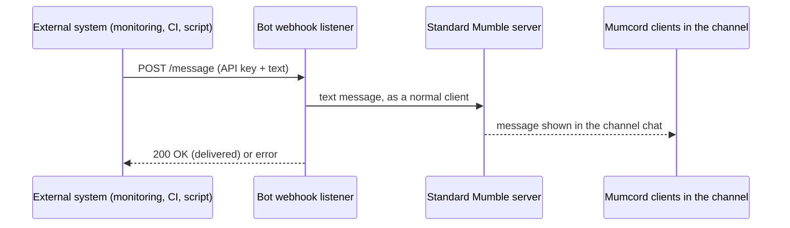
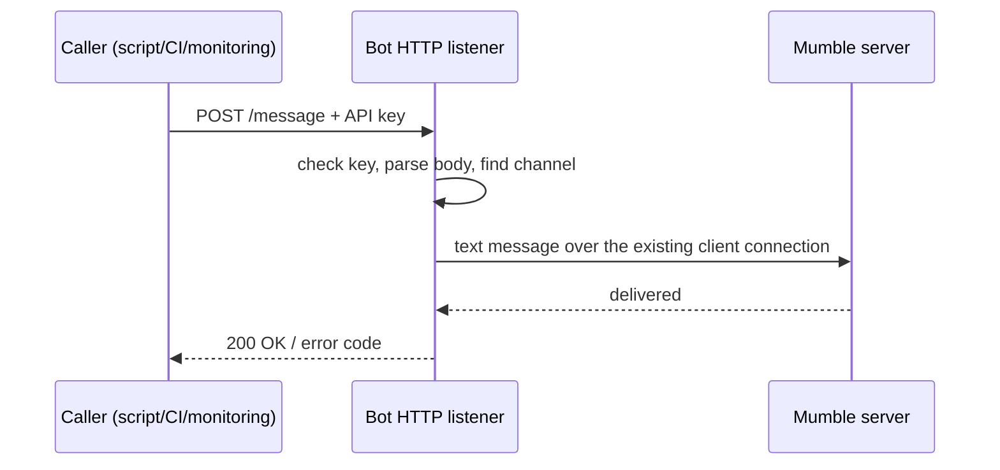
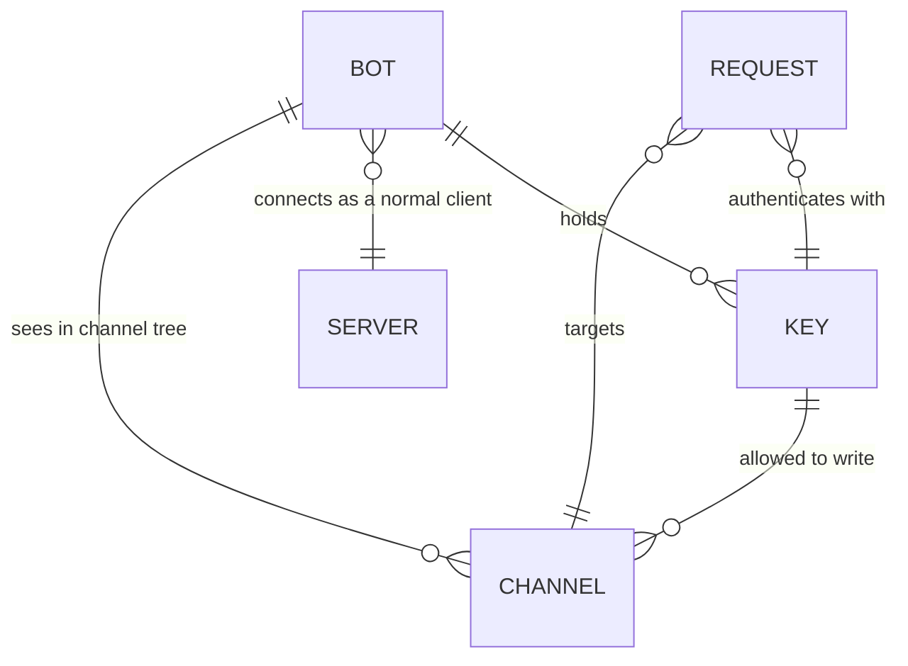

# Epic 3 – Bot: webhook messages into a channel · Brainstorming

> Basis: Standalone feature, not part of the roadmap (no `specs/roadmap.md` yet)
> Process: We work in several rounds. Each round contains questions; you answer directly in this file.
> Once all questions are answered, `specs/03-bot-webhook-specification.md` is created from it.
> Already settled (not asked again): Tech stack, platforms, TLS/cert handling, text chat sanitizer → Spec 01. Multi-server behaviour → Spec 02. The existing `crates/bot` is a scripted test bot (connects as a normal Mumble client, sends text chat, plays voice) — this feature builds on that shape.

## How to answer

- **Single choice** (`◉`): Exactly **one** box has an `[x]`. To change your choice, just move the `x`.
- **Multiple choice** (`☑`): Tick as many boxes as you like.
- ⭐ marks my **recommendation**. It is already preselected. If you agree, you don't need to change anything.
- Below each question there is `✍️ Note:`. Add anything there, e.g. questions back, edge cases or "not sure, explain this to me".
- I explain technical terms briefly. For purely technical questions (audio, network, protocol) it is perfectly fine to follow my recommendation.

## Planned rounds

1. Functionality & scope
2. API & security (key handling, request format, rate limits)
3. Runtime & operations (how the bot runs, logging, privacy, testing)
4. Data/state model & acceptance criteria

(The plan may change depending on the answers.)

---

## Round 1 – Functionality & scope

First a plain-language note on the scope rule: Mumcord is **client only**. The good news is that this feature can stay inside that rule — the bot is just a normal Mumble client (like any user), and the webhook listener runs on our side, on the bot. Nothing has to be installed, configured or changed on the Mumble server: the server only sees a client that sends text messages, exactly like the existing test bot does.



### A · What the bot is

#### Q1.1 What is this bot for, really? `◉`

It decides everything else: size, complexity and whether it is a product feature or an internal tool.

- [x] ⭐ **Integration/notification bot.** An outside system (monitoring alert, CI result, a script, another app) posts into a Mumble channel so people see it in the chat.
- [ ] Interactive bot that also answers messages in the channel (reads chat, reacts). Much bigger, needs rules for what it does.
- [ ] Internal/development tool only, for automated tests. Not shipped to users.

✍️ Note:

#### Q1.2 Is it part of the Mumcord client, or a separate small program? `◉`

- [x] ⭐ **Separate headless program** (`mumcord-bot --webhook`). Runs on a server or on the user's machine, no window, no GUI. Reuses the existing bot code.
- [ ] Built into the desktop client: the client itself listens for webhooks while it is connected. Easier for one user, but a laptop is not a reliable place for an always-on listener.
- [ ] Later / not in MVP.

✍️ Note:

#### Q1.3 Where does the message go? `☑`

- [ ] ⭐ **Into one fixed channel** that the bot is configured to use. Simple and predictable.
- [x] Channel chosen per request, by name in the webhook payload. Useful if one bot serves several channels.
- [ ] To a specific user (whisper/private message).
- [ ] To the whole channel tree (channel + sub-channels).
- [ ] Later / not in MVP.

✍️ Note:

#### Q1.4 Text only, or also voice? `◉`

- [x] ⭐ **Text chat only.** The Mumble chat is where "a message in a channel" lands; text is cheap, reliable, and shows in every Mumble client.
- [ ] Also speak the message aloud (text-to-speech) so people with headphones hear it. Needs a voice pipeline in the bot and sounds robotic.
- [ ] Play a fixed alert sound instead of reading the text.
- [ ] Later / not in MVP.

✍️ Note:

#### Q1.5 Who is the sender in the channel? `◉`

- [x] ⭐ **The bot as its own user** with a stable name, e.g. `Mumcord Bot`, and a persistent certificate so it keeps the same identity across restarts.
- [ ] Use the user's own Mumcord identity/certificate. Then the message looks like it came from the person, not from a bot.
- [ ] Use the server's system message sender (`None` = "server message") if the server allows it — usually not available to normal clients, so I do not recommend it.

✍️ Note:

#### Q1.6 How many bots/servers at once? `◉`

- [x] ⭐ **One connection to one server**, in MVP. The bot stays connected and keeps reconnecting when the link drops.
- [ ] One bot serving several servers/channels at the same time (Spec 02 style multi-server).
- [ ] Later / not in MVP.

✍️ Note:

---

## Round 2 – API & security (webhook + API key)

**On round 1:** no boxes were marked, so I keep your confirmation as follows — Q1.1, Q1.2, Q1.4, Q1.5, Q1.6 stand as recommended. Only the channel choice needs a decision, so it comes back below as Q2.1. If you disagree anywhere, move the `x` in round 1 and I will pick it up.

The flow we are specifying:



### A · Shape of the API

#### Q2.1 Which channel does a message go to? `◉`

Round 1 said "channel chosen per request". That needs a way to name the channel.

- [ ] ⭐ **Channel name in the request body** (e.g. `"channel": "Lobby"`), matched against the channel tree the bot sees. Names are what people use, so this is the practical choice.
- [x] Channel number (ID) in the request. Reliable but unreadable for humans and unstable across servers.
- [ ] Full path like `Root/Lobby`. Unambiguous, but breaks when a channel is renamed or moved.
- [ ] Fixed channel in the config, name in the request optional as an override.

✍️ Note: what happens if the name does not exist —error and list of available channels / ids

#### Q2.2 How does the caller prove it is allowed? `◉`

- [x] ⭐ **API key in an HTTP header** (`X-API-Key`). Standard, keeps the key out of URLs, and URLs are logged by proxies and shells.
- [ ] API key in the URL (`?key=...`). Easier to copy-paste, but the key lands in logs, browser history and shell history.
- [ ] `Authorization: Bearer <key>`. Same idea as the header, more OAuth-like; fine if you expect real API tooling.
- [ ] No key, only "whoever can reach the port" is allowed. Not acceptable.

✍️ Note:

#### Q2.3 How many API keys? `◉`

- [ ] ⭐ **One key for the whole bot** in MVP. Simple, and one key can already send to any channel the bot is in.
- [x] Several keys, each limited to specific channels. Needed when different systems must not write into the same channel.
- [ ] Several keys, each limited to one source system, so you can revoke one without touching the others.
- [ ] Later / not in MVP.

✍️ Note:

#### Q2.4 Where does the key live, and how is it created? `◉`

- [ ] ⭐ **Random key generated by a command** (`mumcord-bot key generate`), stored in a local git-ignored env file, read at startup. Never in the repo, never in docs, never in an example.
- [x] The user sets their own key in a config file. Risk: weak or reused secrets.
- [ ] Key stored in the Mumcord client database/keyring (uses the existing store crate). Nicer, but only helps if the bot shares that store.
- [ ] Later / not in MVP.

✍️ Not: 

#### Q2.5 Change or revoke the key? `◉`

- [x] ⭐ **Change it in the env file and restart the bot.** Enough for MVP, honest and small.
- [ ] Runtime revoke without restart (admin endpoint). Adds a second API surface and more auth rules.
- [ ] No rotation support in MVP, only "generate a new key".

✍️ Note:

#### Q2.6 What does a request look like? `◉`

- [x] ⭐ **JSON body**: `{"channel": "Lobby", "message": "build failed", "sender": "CI"}`. Machine friendly, easy to extend later.
- [ ] Discord-style webhook JSON (`content` + optional username). Familiar for people copying existing webhook examples.
- [ ] Plain text body, channel in the URL path (`/message/Lobby`). Shortest for `curl`, but less structured.
- [ ] HTML form fields.

✍️ Note: is the optional per-request `sender` label wanted? Mumble shows the bot's own name; a label would have to be written into the text itself (e.g. `[CI] build failed`), which is the honest way. Say if you want it.- Yes.

#### Q2.7 Message content rules? `☑`

- [x] ⭐ **Plain text only**, HTML escaped before sending. The server sends HTML to chat receivers, so raw HTML from a webhook must never reach the chat as markup.
- [x] ⭐ **Length limit**: reject above a fixed maximum (e.g. 5000 characters), and respect the server's own message limit from the login response.
- [x] Accept a small Markdown subset and convert to the HTML Mumble understands.
- [x] Reject empty messages and messages that are only whitespace.
- [ ] Later / not in MVP.

✍️ Note:

### B · Operations & safety

#### Q2.8 HTTP or HTTPS? `◉`

- [x] ⭐ **Plain HTTP in MVP, intended for localhost or a trusted LAN**, plus a clear warning if the key is used over an untrusted network. HTTPS is normally handled by the reverse proxy in front of the bot.
- [ ] Built-in TLS with a certificate the user has to provide. More correct, more setup pain.
- [ ] HTTP only, no warning.

✍️ Note:

#### Q2.9 Rate limit and abuse protection? `☑`

- [x] ⭐ **Simple limit**, e.g. 20 messages per minute per key, reject above with `429`. Protects the channel from a broken script that fires in a loop.
- [x] ⭐ **Reject unknown keys with `401`** and log only that a request was refused, not the key itself.
- [ ] Allowlist of source IPs/networks.
- [ ] Nothing in MVP.

✍️ Note:

#### Q2.10 Does the caller get a real delivery answer? `◉`

- [x] ⭐ **Yes: the bot waits a short time (e.g. 3 s) for the server to accept the message**, then answers `200` only if it was delivered. Codes: `401` bad key, `400` bad body, `404` channel not found, `429` limit, `503` not connected.
- [ ] Answer `202` immediately and deliver in the background. Faster for the caller, but the caller never knows if the message arrived.
- [ ] Answer `200` always, log failures only.

✍️ Note:

#### Q2.11 Health/status endpoint for the caller? `◉`

- [x] ⭐ **`GET /health`** reports connected state and uptime. Cheap, useful for monitoring.
- [ ] No extra endpoint in MVP.
- [ ] Later / not in MVP.

✍️ Note:

---

## Round 3 – Follow-ups, config & running the bot

### Follow-ups & explanations for round 2

**On Q2.1 + Q2.3:** you chose *channel ID in the request* and *several keys, each limited to specific channels*. Those two fit together only in one way: the key defines which channels it may write to, the request picks one of them. If the request names a channel the key is not allowed to use, the answer is `403`. Your note asks for an error that lists the available channels — with IDs only, a human cannot read those numbers, so the answer must include names too. That is why I ask again as Q3.1.

**On Q2.7:** "plain text, HTML escaped" and "accept a Markdown subset and convert to HTML" pull in opposite directions. Escaping means: everything the caller sends is treated as literal text, so `<b>x</b>` shows as the characters `<b>x</b>`. Converting Markdown means: we do build markup, but only from our own tiny, safe subset. The workable version is *convert a fixed small subset, escape everything else* — that is Q3.2.

### A · API details to fix

#### Q3.1 How does the caller address a channel? `◉`

- [ ] ⭐ **Accept both: an ID number or a name.** The bot resolves names against the live channel tree. Unknown channel → `404` with a JSON body listing `id` + `name` of the channels that key may write to. Best of both, still `curl` friendly.
- [x] ID only, plus `GET /channels` returning id + name for the key. Clean API, caller must look up IDs first.
- [ ] Name only.

✍️ Note: what should the 404 body look like (plain list, or JSON array)? - 404 not found, no list, no array

#### Q3.2 Which Markdown subset is converted, everything else escaped? `☑`

- [x] ⭐ `**bold**`, `*italic*`, `` `code` ``
- [x] ⭐ Plain links (`https://...`) as clickable links
- [x] ⭐ Line breaks preserved
- [x] Lists (`- item`) and headings (`# title`)
- [x] Code block "``` ```"
- [ ] Nothing: pure text, no markup at all

✍️ Note

#### Q3.3 The optional `sender` label (you said yes) — where does it appear? `◉`

- [ ] ⭐ **Inside the message text as a prefix**, e.g. `[CI] build failed`. In Mumble the user name is fixed by the login, so a per-request name cannot be shown as the real sender. Prefix is honest and works in every client.
- [ ] Prefix + the bot name itself is configurable per key, so each source system gets its own bot user. Multiple bot names means multiple connections (one per key), which is heavier.
- [x] Later / not in MVP.

✍️ Note:Remove sender

### B · Config and running

#### Q3.4 Config file: format and what is inside? `◉`

- [x] ⭐ **TOML file** (matches the existing Rust tooling), git-ignored: server host/port, user name, certificate path, HTTP port and bind address, per-key section (`key`, allowed channels, optional label).
- [ ] JSON config file.
- [ ] YAML config file.
- [ ] Environment variables and CLI flags only, no file.

✍️ Note:

#### Q3.5 Behaviour when the bot is not connected to the server? `◉`

- [x] ⭐ **Answer `503` immediately**, no queue. The caller (monitoring, CI) can retry; a bot that silently keeps messages is surprising and can double-post after a reconnect.
- [ ] Small in-memory queue (max N messages), delivered after reconnect, caller gets `202`.
- [ ] Queue on disk so nothing is lost across restarts.

✍️ Note:

#### Q3.6 Several requests at the same time? `◉`

- [ ] ⭐ **Accept the connection, handle messages one at a time in arrival order.** Simple, keeps chat order readable, and the delivery answer in Q2.10 stays honest.
- [x] Handle requests in parallel (faster, but chat order becomes random).

✍️ Note:

#### Q3.7 Logging and privacy? `☑`

- [x] ⭐ Log per request: time, key name, channel, status code. **Never the key, never the message text** (project rule: no chat content in logs).
- [x] ⭐ Log refused requests (`401`, `403`, `429`) without the key value.
- [ ] A `--verbose` mode that logs full request bodies for debugging, off by default.
- [ ] Write logs to a file, not only to the console.

✍️ Note:

#### Q3.8 How is it shipped and run? `◉`

- [x] ⭐ **Subcommand of the existing `mumcord-bot` binary** (`mumcord-bot webhook --config bot.toml`). No new package, reuses the bot crate.
- [ ] Separate binary `mumcord-webhook`.
- [ ] Plus a systemd unit / Docker image for always-on operation.
- [ ] Later / not in MVP.

✍️ Note

---

## Round 4 – Data model, edge cases & acceptance criteria

Where we stand after round 3:



Three open points that follow from your answers, then the acceptance criteria.

### A · Edge cases to fix

#### Q4.1 What does the final request look like? `◉`

Sender is removed per Q3.3, so only channel and message remain.

- [x] ⭐ `POST /message` with JSON `{"channel": 42, "message": "build failed"}`, key in the `X-API-Key` header. Response `200` with `{"delivered": true}`; errors as plain JSON `{"error": "unknown channel"}`.
- [ ] Same, but `"channel": "42"` as a string.
- [ ] No response body at all, only the status code.

✍️ Note:

#### Q4.2 In the config, how are the allowed channels written? `◉`

The request uses IDs, but a config file with only numbers is hard to maintain.

- [ ] ⭐ **Names in the config file**, resolved to IDs at login from the live channel tree. Human readable, and the mapping refreshes when the tree changes.
- [ ] IDs in the config file. Exact, but a recreated channel gets a new ID and silently breaks the key.
- [x] Both allowed: name or ID per entry.

✍️ Note:

#### Q4.3 Which answer for which case? `◉`

- [x] ⭐ `401` unknown key · `403` channel not allowed for that key · `404` channel does not exist · `400` bad body/empty/too long · `429` rate limit · `503` not connected. No channel list in any error body (per your note on Q3.1).
- [ ] `403` and `404` merged into one `404` (does not reveal which channels a key may write to).
- [ ] `405` for wrong HTTP method.

✍️ Note: is `GET /channels` limited to the channels the key may write t.

#### Q4.4 Maximum request size? `◉`

- [ ] ⭐ **8 KB body limit** (reject above with `413`), plus the message cap from Q2.7 at 5000 characters, and the server's own `maxMessageLength` when the server reports one.
- [x] Only the message length cap, no body size limit.

✍️ Note:

#### Q4.5 Markdown, escaped output — how careful is the conversion? `◉`

- [x] ⭐ **Escape first, then apply the chosen subset** (bold, italic, inline code, code blocks, lists, headings, links, line breaks). Links only `http`/`https`, no `data:` or javascript links. No images, no HTML from the caller.
- [ ] Full conversion later, MVP = plain text only.

✍️ Note:

#### Q4.6 Key comparison and small security details? `☑`

- [x] ⭐ Constant-time key comparison (no timing side channel).
- [x] ⭐ Bind to `127.0.0.1` by default, must be changed explicitly to listen on the LAN.
- [x] ⭐ Startup warning when a key is used while listening on a non-loopback address over plain HTTP.
- [x] Reject requests without a key before parsing the body.

✍️ Note:

### B · Acceptance criteria (verifiable in the running bot, against the local test server in `testenv/`)

#### Q4.7 Which criteria must the integration test cover? `☑`

- [x] ⭐ Bot connects as a normal client with a persistent identity and stays connected (reconnect after a dropped link).
- [x] ⭐ `curl` with the key posts a message that shows in the channel chat of a connected Mumcord client.
- [x] ⭐ Wrong key → `401`, channel not allowed for the key → `403`, unknown channel → `404`, empty/too long message → `400`, over limit → `429`, offline → `503`.
- [x] ⭐ `GET /channels` returns id + name for the channels the key may write to; `GET /health` reports the connection state.
- [x] ⭐ Markdown subset renders as markup in the client, everything else shows as literal text (no raw HTML from the caller reaches the chat).
- [x] Parallel requests are handled without losing or duplicating messages.
- [x] The bot works against an unmodified standard murmur, no server-side changes.
- [ ] Later / not in MVP.

✍️ Note:

#### Q4.8 Documentation for the bot? `☑`

- [x] ⭐ `docs/bot-webhook.md`: how to run it, config example with a placeholder key, one `curl` example.
- [x] ⭐ Example config file committed **without** a real key (placeholder only).
- [x] Quick-start section in `README.md`.

✍️ Note:

---

## Round 5 – Answer to your note on Q4.3

**On Q4.3 (scope of `GET /channels`):** my answer, in plain language: `GET /channels` returns **only the channels that the key in the header may write to**. Reason: an API key is a per-system permission, so the endpoint should not show more than what that key is allowed to use. A monitoring script gets its own channel list, not the whole server. A `403` for a channel outside that list stays consistent, and nothing about other teams' channels leaks.

The alternative would be the whole channel tree, which is friendlier for a human holding one key for many channels, but it reveals structure the key is not allowed to act on — so my recommendation stands as the decision. Say so if you disagree and I change it.

✍️ Note:

---

## Closing

2026-10-27: All rounds answered. The specification has been created: `specs/03-bot-webhook-specification.md`.


## Addendum – confirmations (2026-10-27)

**Q4.3 (`GET /channels` scope):** confirmed as recommended — the endpoint returns only the channels the presented key may write to.

**Q4.4 (body size):** confirmed with a cap. The cap is the message cap itself (5000 characters), so a body larger than that is refused with `413`. Because 5000 characters can encode to more than 5000 bytes, the practical byte limit is 20 KB.

---


## Round 6 – Addendum, 2026-10-27: channel passwords

Question: what happens when a channel is password protected?

- The MVP config only had the server connect password, so a protected channel stayed closed for the bot.
- Decision (product owner): passwords belong to the channel, not to a key → separate `[[token]]` list with `channel` + `password`.
- Behaviour: the bot presents the passwords at login like any normal client (FR-2.78 mechanism, already implemented in the engine). With the password the channel becomes usable; without it the bot stays outside and nothing is written there.
- Passwords are secrets: git-ignored config, never logged, hidden in `Debug`.
- No server-side change: this is the standard Mumble access-token mechanism.

Recorded as FR-3.22 and AC-3.9.
