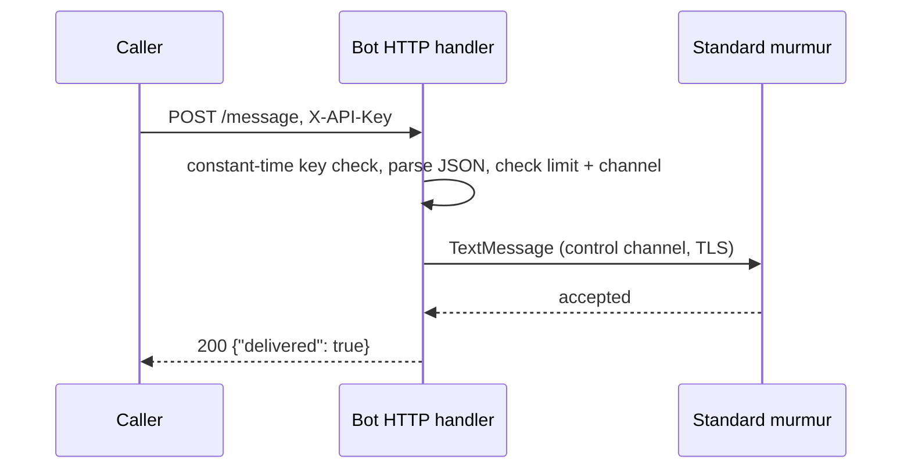
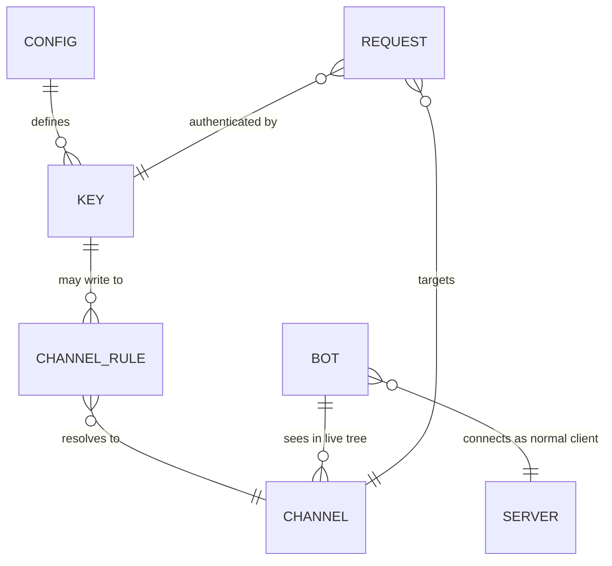
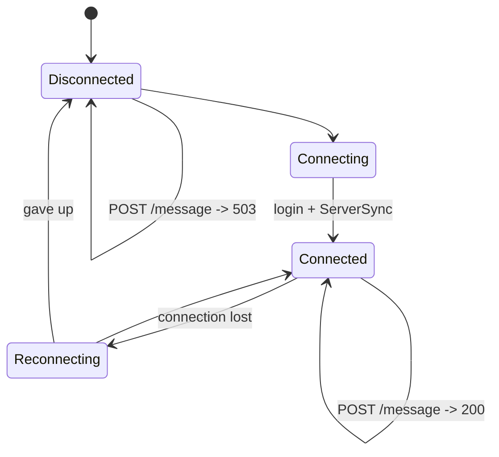

# Epic 3 – Bot: webhook messages into a channel · Specification

> Status: Final (brainstorming completed) · As of: 2026-10-27
> Sources: `specs/03-bot-webhook-brainstorming.md` (no `specs/roadmap.md` yet – standalone feature)
> Builds on: `specs/01-foundation-specification.md` (Rust engine, TLS + client certificates, chat HTML sanitizer, local test server), `specs/02-multi-server-themes-specification.md` (multi-server model stays out of scope here), existing `crates/bot`

## 1. Goal & context

Outside systems (monitoring, CI, alerting scripts) need a way to put a message into a Mumble channel so the people in the channel see it in the chat. Mumble servers have no such entry point, and nothing may be added on the server side. So Mumcord provides a small headless bot that behaves exactly like a normal Mumble client: it connects to a standard server, keeps the connection alive, and turns one HTTP request with an API key into one chat message in a channel. This makes machine events visible inside the voice channel people already use, without plugins, without server configuration, and without a separate chat product.

## 2. Scope

### 2.1 In scope (MVP)

- Headless program: `mumcord-bot webhook --config bot.toml` (subcommand of the existing `mumcord-bot` binary, `crates/bot`).
- One connection to one Mumble server, as a normal client, over TLS with a persistent certificate (stable bot identity).
- HTTP endpoints: `POST /message`, `GET /channels`, `GET /health`.
- Authentication by API key in the `X-API-Key` header; several keys, each restricted to the channels it may write to.
- Target channel selected per request by channel ID; the key decides which IDs are allowed.
- Text chat only. Message content: escaped text plus a fixed Markdown subset.
- Synchronous delivery answer: `200` only when the server accepted the message.
- Reconnect with backoff; requests while disconnected are answered `503`.
- Rate limit per key, structured request logging without secrets or message text.
- Docs: `docs/bot-webhook.md`, a key-free example config, quick-start in `README.md`.

### 2.2 Out of scope / later

- Interactive bot that reads chat and answers (Q1.1).
- Text-to-speech or alert sounds (Q1.4).
- Per-request sender name as a real Mumble user (dropped in Q3.3).
- Whisper/private messages, message to a whole channel tree (Q1.3).
- Several servers at the same time, or several bot identities (Q1.6).
- Runtime key rotation without restart (Q2.5), key generation command (Q2.4 was answered "user sets the key", so generation stays optional tooling).
- Built-in TLS for the HTTP side (Q2.8), IP allowlists (Q2.9), request queueing (Q3.5), file logging and verbose mode (Q3.7).
- Systemd unit / Docker image (Q3.8), packaging as a separate artifact.
- Config formats other than TOML (Q3.4).

## 3. Roles & permissions

The bot has no special rights on the Mumble server. It is one client, so the server enforces everything the server normally enforces.

| Role | Action | Client-side rule | Enforced by |
|---|---|---|---|
| API caller (external system) | `POST /message` | Must present a known key in `X-API-Key`; may only write to the channels listed for that key | Bot (own key table) |
| API caller | `GET /channels` | Only the channels the presented key may write to (decision in Round 5) | Bot |
| API caller | `GET /health` | No key required (status only, no channel data) | Bot |
| Bot as Mumble user | Send text chat, receive channel tree | Normal client permissions; if the server denies chat for guests, the bot cannot send and answers `503`/logs it | Standard murmur (ACLs, `maxMessageLength`, chat permission) |
| Mumcord users in the channel | Receive the message | Show it as a message from the bot user, sanitized like any server HTML | Existing sanitizer (Spec 01) |

## 4. Functional requirements

### 4.1 Runtime & identity

- **FR-3.1** The bot connects to one server (`host`, `port`, optional channel to join at login, `name`) as a standard Mumble client over TLS and stays connected. Login timeout and reconnect use the foundation rules (Spec 01).
- **FR-3.2** The bot keeps a persistent certificate, so it is recognized as the same user across restarts (Spec 01 identity rules).
- **FR-3.3** After login the bot stores the live channel tree (id + name) and refreshes it on `ChannelState` changes; the key → channel mapping is resolved against that tree.
- **FR-3.4** Config entries may name a channel by name or by ID (Q4.2). Name entries are resolved at login and re-resolved when the tree changes; ID entries are used as written.

### 4.2 HTTP API

- **FR-3.5** `POST /message` accepts JSON `{"channel": <id>, "message": "<text>"}`. Missing key → `401` before the body is parsed (Q4.6). Invalid JSON or missing fields → `400`.
- **FR-3.6** Empty or whitespace-only message → `400`. Message longer than 5000 characters, or longer than the server's `maxMessageLength` when the server reports one, → `400`. Body size is capped by that same message cap: a request body larger than 20 KB (5000 characters can encode to more bytes) is rejected with `413` (Q2.7, Q4.4, Addendum).
- **FR-3.7** Channel unknown → `404`. Channel known but not allowed for this key → `403`. Error bodies are `{"error": "<short reason>"}`, no channel list (Q3.1 note, Q4.3).
- **FR-3.8** Rate limit: 20 messages per minute per key; above that → `429` (Q2.9).
- **FR-3.9** Delivery is synchronous: the bot waits up to 3 s for the server to accept the message and answers `200` with `{"delivered": true}` only then; failure to deliver → `503` (Q2.10, Q4.1).
- **FR-3.10** While the bot is not connected, requests are answered `503` immediately; nothing is queued (Q3.5).
- **FR-3.11** Requests are handled concurrently (Q3.6); chat order follows the order in which messages were sent to the server.
- **FR-3.12** `GET /channels` returns `{"channels": [{"id": 42, "name": "Lobby"}, …]}` limited to the channels of the presented key (Round 5, confirmed in the Addendum).
- **FR-3.13** `GET /health` returns `{"connected": true, "uptime_seconds": 1234, "server": "<host>"}` and `{"connected": false, …}` when the link is down. No key required.
- **FR-3.14** Wrong HTTP method on a known path → `405` (open point in Q4.3; kept as a small, explicit rule).

### 4.3 Message content

- **FR-3.15** Convert the fixed Markdown subset **on already escaped text** (Q4.5): `**bold**` → `<b>`, `*italic*` → `<i>`, `` `code` `` → `<code>`, fenced code blocks → `<pre>`, `- item` → `<ul><li>`, `# title`–`###### title` → `<h1>`–`<h6>`, plain `http`/`https` URLs → `<a href>`, line breaks preserved. Links with other schemes (`data:`, `javascript:`) are left as plain text.
- **FR-3.16** No HTML from the caller is ever passed through as markup, no images (Q2.7, Q4.5). The chat sanitizer in the client remains the last line of defence, but the bot must not create unsafe markup itself.

### 4.4 Security & logging

- **FR-3.17** Keys are compared in constant time (Q4.6).
- **FR-3.18** The listener binds to `127.0.0.1` by default; listening on a LAN address must be set explicitly in the config (Q4.6).
- **FR-3.19** On startup the bot warns when it listens on a non-loopback address over plain HTTP (Q2.8, Q4.6).
- **FR-3.20** Log per request: timestamp, key name, channel id, status code. Never the key value, never the message text (Q3.7, project rule).
- **FR-3.21** The config file with keys is git-ignored; the repository only contains an example with a placeholder (Q2.4, Q4.8).

## 5. UI & UX

No window: the bot is headless (Q1.2). UX = console output and HTTP responses.

Console output shape:

```text
[mumcord-bot] webhook on http://127.0.0.1:8080 (key "ci")
[mumcord-bot] connected: voice.example.org as "Mumcord Bot", channel #Lobby (id 42)
[mumcord-bot] 12:01:03 key=ci channel=42 -> 200
[mumcord-bot] 12:01:09 key=unknown -> 401
[mumcord-bot] warning: listening on 0.0.0.0 over plain HTTP, put a TLS proxy in front
```

Error messages callers see are the JSON `{"error": …}` strings of FR-3.7 to FR-3.10. Empty state for `GET /channels`: `{"channels": []}` when the key has no allowed channels. Accessibility is not applicable (no interface); the human-readable parts are the docs and the log lines, which use plain text so screen readers and terminals handle them.

## 6. Audio & network

- **Audio:** none. Text chat only (Q1.4), so the bot does not open an audio pipeline, does not encode Opus and does not transmit voice.
- **Network:** TLS control channel to the standard Mumble server (rustls, client certificate, verification as in Spec 01). Text messages are sent on the control channel, which is TCP; no UDP voice path is used. Protocol messages used: `Version`, `Authenticate`, `ChannelState`, `UserState`, `ServerSync`, `TextMessage` — no private extensions (Q4.7).
- **Reconnect:** standard client reconnect with backoff; during a reconnect the HTTP side answers `503` (FR-3.10). Connection state is exposed in `GET /health`.
- **Latency target:** end to end under 1 s for a healthy connection (request handling plus one control-channel round trip); the delivery wait cap is 3 s (FR-3.9).



## 7. Data & state model



| Entity | Field | Type | Required | Rules |
|---|---|---|---|---|
| CONFIG | `host`, `port` | string / number | yes | Standard server, default 64738 |
| CONFIG | `name` | string | yes | Bot user name, e.g. `Mumcord Bot` |
| CONFIG | `cert` | path | yes | Persistent client certificate (identity) |
| CONFIG | `channel` | name or ID | no | Channel to join at login |
| CONFIG | `listen` | host:port | yes | Default `127.0.0.1:8080` |
| KEY | `key` | string | yes | Secret, in the git-ignored config only |
| KEY | `label` | string | yes | Name used in logs (never the key value) |
| KEY | `channels` | list of name or ID | yes | Allowed targets, resolved against the live tree |
| CHANNEL | `id` | number | yes | Server-assigned ID, changes if the channel is recreated |
| CHANNEL | `name` | string | yes | From `ChannelState` |
| REQUEST | `time`, `key`, `channel`, `status` | — | yes | Log fields only; message text is not stored (FR-3.20) |



No persistent state besides the config file and the certificate; no local database, no chat history is written by the bot.

## 8. Technology & architecture

- **Language:** Rust, same workspace as the rest of the project (`crates/bot`), because the existing bot crate already owns the Mumble client, certificate and login code (Q3.8).
- **Async runtime:** `tokio` (already used), one task for the HTTP listener, one for the protocol connection; sending goes through the existing protocol client, no direct socket access from the HTTP handler.
- **HTTP server:** a minimal HTTP/1.1 implementation on `tokio` (or `hyper`, whichever the build picks), no web framework — the API is three routes, so a framework would be more weight than value.
- **Markdown subset:** a small hand-written converter that escapes first and then emits the fixed tags of FR-3.15. No general Markdown library, because the subset is defined and escaping order matters for safety.
- **Config:** TOML via the existing Rust tooling, git-ignored, example committed with a placeholder key.
- **Threads:** no real-time path is involved; the handler never blocks the protocol task and must not do I/O inside the connection loop except logging.
- **Module layout:** `crates/bot/src/webhook/` (`config.rs`, `keys.rs`, `http.rs`, `markdown.rs`, `bot_state.rs`), reusing `Bot`, `BotConfig`, `cert.rs`, `acl.rs` from `crates/bot`.
- **Secrets:** keys only in the local config file; never in the repo, docs or examples; never logged.

## 9. Non-functional requirements

- **Security:** TLS to the Mumble server always on, certificate verification as in Spec 01 (warning on changed server certificate). Constant-time key comparison, loopback bind by default, plain-HTTP warning, key never in URL or logs.
- **Privacy (DSGVO):** the bot stores nothing personal; message text is not logged and not persisted. Only request metadata (time, key label, channel id, status) is logged.
- **Load:** single connection, 20 messages/min per key; memory for one connection plus the channel tree. No latency impact on voice.
- **Compatibility:** unmodified standard murmur, protocol v1.3+ path as in Spec 01, no server-side plugin, no server config change, no private protocol extensions.
- **Target platforms:** Linux (server/VPS and desktop), plus the developer machines already covered by Spec 01. The bot is a console program, no UI dependencies.
- **Robustness:** no queue means no double-post after a reconnect (FR-3.10); concurrent requests must not lose or duplicate messages (AC-3.7).

## 10. Build, packaging & release

Nothing new is packaged: `mumcord-bot` is built from the existing workspace and `publish = false` stays. No installer, no signing, no Docker image in MVP (Q3.8). CI adds one integration test job against the local test server (`testenv/`). Setup steps for a user: create `bot.toml` from the example, put a key in it, run `mumcord-bot webhook --config bot.toml`.

## 11. Acceptance criteria (verifiable in the running bot)

Test setup for all criteria: local test server (`testenv/`, unmodified murmur), `bot.toml` with key `ci` allowed for `#Lobby` only, a Mumcord client in `#Lobby` for the chat checks.

- **AC-3.1** Start the bot → it connects as its own user with the persistent certificate and shows in the channel tree; kill the network for 5 s → the bot reconnects and `GET /health` reports `connected: true` again.
- **AC-3.2** `curl -H 'X-API-Key: <key>' -d '{"channel":42,"message":"build failed"}' http://127.0.0.1:8080/message` → `200 {"delivered": true}`, and the message appears in the Mumcord chat of `#Lobby` from the bot user.
- **AC-3.3** Wrong key → `401`; unknown key before body parsing → `401`; channel id not in the key's list → `403`; channel id that does not exist → `404`; empty or whitespace message → `400`; message over 5000 characters → `400`; body over 20 KB → `413`; 21st request in one minute → `429`; bot disconnected → `503`. All error bodies contain only a short reason, no channel list.
- **AC-3.4** `GET /channels` with the key → only the channels that key may write to (id + name). `GET /health` → connection state and uptime.
- **AC-3.5** A message with `**bold**`, `*italic*`, `` `code` ``, a fenced block, a `- list`, a `# heading` and an `https://` link renders as markup in the client; a message containing `<b>text</b>` shows the literal characters, proving nothing from the caller passes through as HTML.
- **AC-3.6** Startup with `listen = 0.0.0.0:8080` prints the plain-HTTP warning; default startup is bound to `127.0.0.1` only.
- **AC-3.7** Ten parallel requests → all answered with the correct code, no message lost, no message sent twice, log shows ten entries with key label, channel and status only (no key value, no message text).
- **AC-3.8** Integration test covers AC-3.1 to AC-3.7 against the local test server, no server-side change and no protocol extension.

## 12. Decision log

| Question | Decision | Note |
|---|---|---|
| Q1.1 | Notification/integration bot, not interactive | |
| Q1.2 | Separate headless program, reuses `crates/bot` | Client-only rule respected: the listener is on the bot, not on the Mumble server |
| Q1.3 | Channel chosen per request | Implemented as channel ID (Q2.1) |
| Q1.4 | Text chat only | No TTS |
| Q1.5 | Bot as its own user, persistent certificate | |
| Q1.6 | One connection, one server | |
| Q2.1 | Channel ID in the request | Error = `404`, no list in the body (note) |
| Q2.2 | API key in `X-API-Key` header | |
| Q2.3 | Several keys, each limited to specific channels | Defines `403` |
| Q2.4 | User sets the key in a config file | Must be git-ignored, no secrets in repo |
| Q2.5 | Rotate by editing the config + restart | |
| Q2.6 | JSON body | `sender` label dropped in Q3.3 |
| Q2.7 | 5000 character cap + server limit, reject empty, Markdown subset | Refined by Q4.5 |
| Q2.8 | Plain HTTP, localhost/LAN, warning, TLS by reverse proxy | |
| Q2.9 | 20 messages/min per key, `429`; `401` without key value in logs | |
| Q2.10 | Synchronous delivery answer, `200` only when delivered | |
| Q2.11 | `GET /health` | |
| Q3.1 | `GET /channels` for ID lookup; ID only in the request | 404 body without list |
| Q3.2 | Convert bold/italic/inline code/code block/list/heading/links/line breaks | Escape first |
| Q3.3 | Sender label removed → not in MVP | |
| Q3.4 | TOML config, git-ignored | |
| Q3.5 | `503` immediately, no queue | |
| Q3.6 | Handle requests in parallel | Chat order follows send order |
| Q3.7 | Metadata-only logging, no key, no message text | No verbose mode, no log file |
| Q3.8 | Subcommand of `mumcord-bot` | No new package |
| Q4.1 | JSON request/response as specified | |
| Q4.2 | Config accepts name or ID per entry | |
| Q4.3 | Error codes as listed; `GET /channels` limited to the key's channels | Confirmed (Addendum) |
| Q4.4 | Body-size cap = message cap, `413` above 20 KB | Confirmed (Addendum) |
| Q4.5 | Escape first, then fixed subset, http/https links only | |
| Q4.6 | Constant-time compare, loopback default, startup warning, key check before body | |
| Q4.7 | Integration test covers the listed criteria, incl. parallel + standard murmur | |
| Q4.8 | `docs/bot-webhook.md`, key-free example config, README quick-start | |

## 13. Open points & risks

- **Body cap follows the message cap** (Addendum), so a caller cannot push a huge body for a small message; `413` is the only extra status code.
- **Channel IDs are unstable:** a recreated channel gets a new ID; name entries in the config survive, ID entries break silently.
- **User-supplied keys can be weak** (Q2.4 was answered against generation); the docs should state "long random key", and generation remains optional tooling.
- **Plain HTTP** puts the key on the wire when listening outside localhost; the warning covers it but cannot prevent it.
- **Markdown subset edge cases** (nested markup, unbalanced `**`) need a decision during implementation: safest is "escape first, convert only simple spans".
- **Delivery answer** depends on whether the server sends an acknowledgement for chat; if it does not, `200` means "sent to the server", not "seen by users". Verify against the local test server before the wording is put in the docs.

## 14. Impact on the roadmap

- A roadmap does not exist yet. This feature adds a new part: **bot/headless clients**, separate from the desktop client. If a roadmap is written, Epic 3 should be listed as "Bot & integrations".
- The HTTP listener is a service on our side, not on the Mumble server. The client-only rule stays intact; the roadmap wording should say that explicitly so nobody reads it as a server component.
- Later epics that build on this: interactive bot (Q1.1), TTS in channel (Q1.4), multi-server bot (Q1.6), packaging as a service unit (Q3.8).
