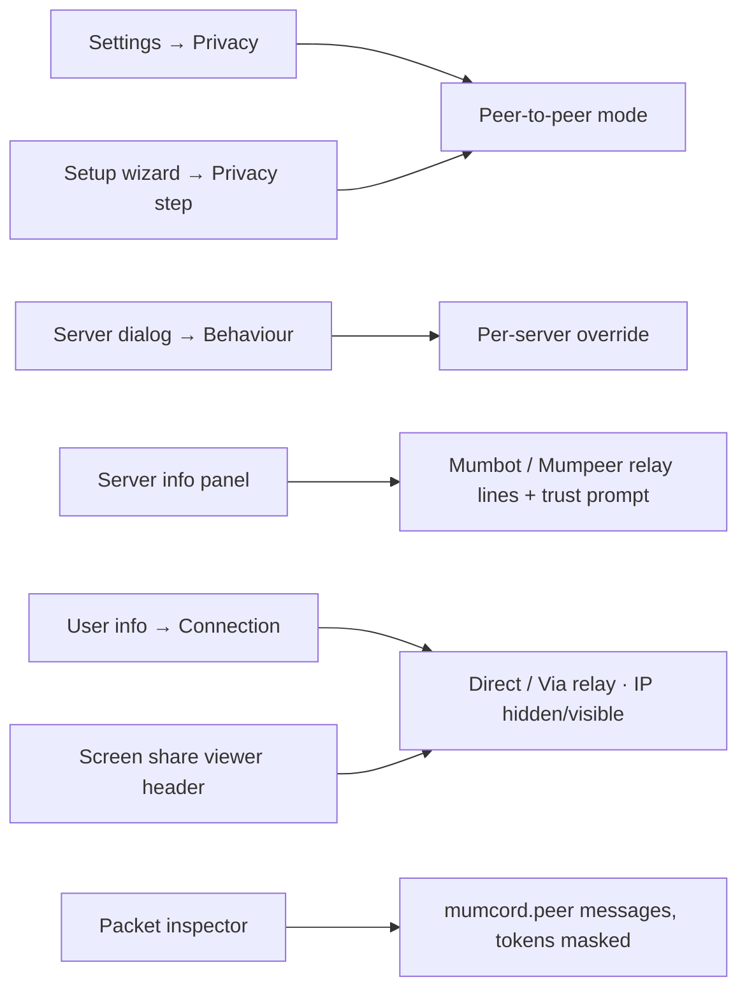
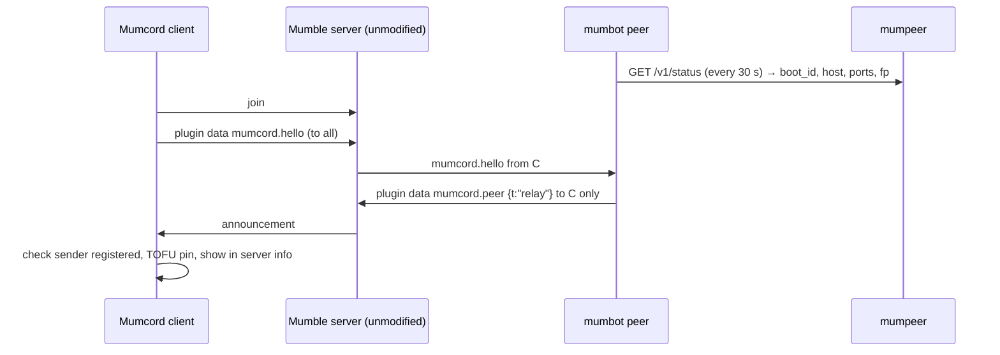
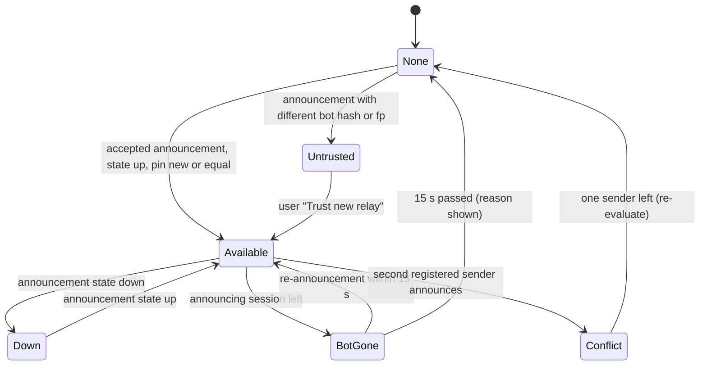
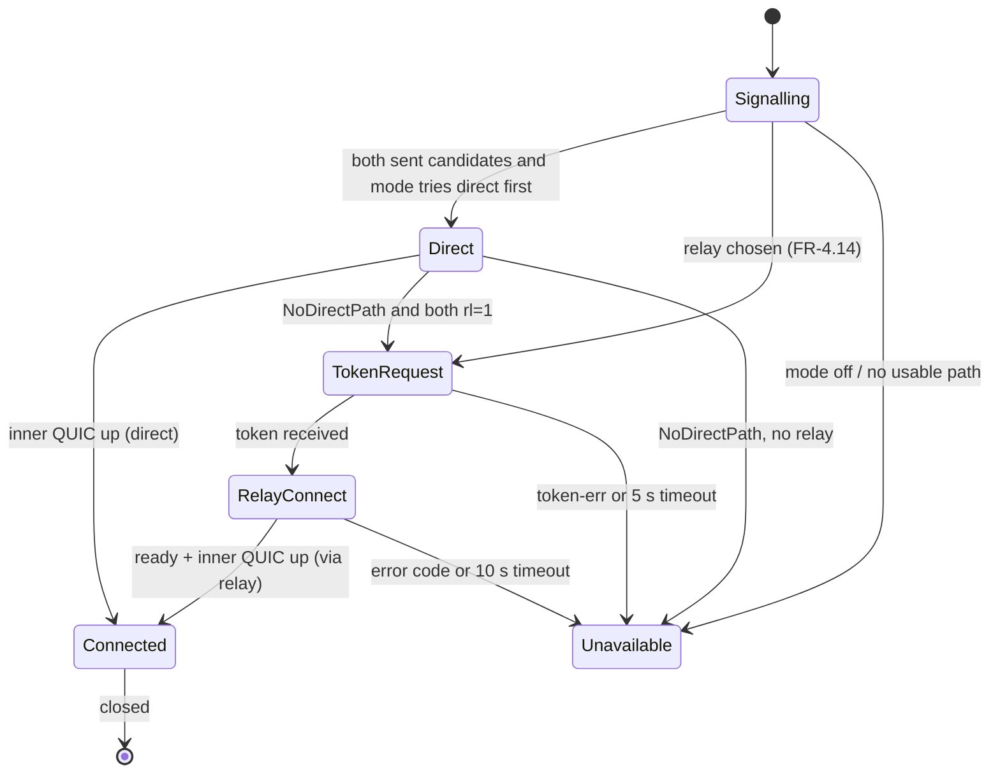
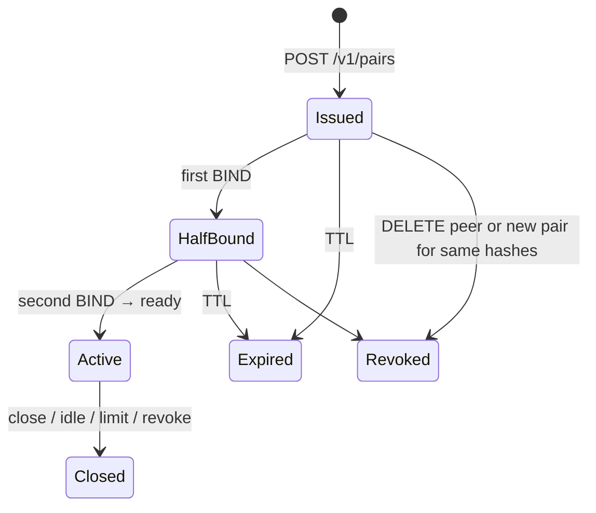

# Epic 4 – mumpeer relay · Specification

> Status: Final (brainstorming completed; open points in section 13 carry a recommended default) · As of: 2026-10-31
> Sources: issue #62 (mumpeer relay), issue #190 (server info panel: relay announced), mumbot issue Mumcord/mumbot#8 (peer module), `specs/04-mumpeer-relay-brainstorming.md` (chat brainstorm of 2026-10-31)
> Builds on: `specs/01-foundation-specification.md`, `specs/02-multi-server-themes-specification.md` (FR-2.35, FR-2.36, FR-2.46 and the amendment to FR-2.35), `specs/03-comfort-polish-specification.md` (FR-3.140 … FR-3.143, Q1.1, Q1.14). This spec replaces FR-3.140 … FR-3.143 in detail; where they differ, this spec wins (setting model per Q1.14, not the three-option "Use relay" of #62).
> Repositories: `Mumcord/mumcord` (client), `Mumcord/mumpeer` (relay, new), `Mumcord/mumbot` (peer module).

## 1. Goal & context

Mumcord's peer-to-peer features (screen sharing, full-size images, everything on `mumcord-p2p`) need a direct connection between two users. That fails behind carrier-grade NAT and strict firewalls, and a direct connection shows each user's IP address to the other. This epic adds an optional relay: **mumpeer**, a small Rust server run by a server community, forwards the already end-to-end encrypted QUIC packets between two Mumcord clients, like a TURN server. A **mumbot module "peer"** sitting on the Mumble server tells Mumcord clients that a relay exists and hands out short-lived tokens for each pair of users. Afterwards, P2P features work behind CGNAT and in UDP-blocked networks (over TCP 443), and users can hide their IP address from the other person. The Mumble server stays unmodified and Mumcord keeps working fully without relay and bot (Q1.1).

## 2. Scope

### 2.1 In scope (MVP)

- **mumpeer** (new repo `Mumcord/mumpeer`): relay server as one Rust binary and a Docker image; QUIC over one UDP port plus TLS over TCP 443 for UDP-blocked networks; mutual TLS with the user's Mumble client certificate; pair-bound short-lived tokens; an allowlist API for the bot, authenticated with a secret; limits (bandwidth per session and total, max sessions, rate limits); minimal logging; a small TOML config.
- **mumbot module `peer`** (repo `Mumcord/mumbot`): sees Mumcord users through their hello, announces the relay to each of them via plugin data, issues pair tokens on request through the relay's allowlist API, revokes them when users leave, re-announces when the bot or relay restarts or the address changes.
- **Mumcord client**: the P2P setting model of Q1.14 with all five options and a per-server override; reading the announcement; requesting tokens; carrying `mumcord-p2p` over the relay (UDP, then TCP 443); connection info "direct" / "via relay" and "IP hidden" / "IP visible"; server info panel lines "Mumbot" and "Mumpeer relay" (#190); packet inspector shows the announcements (tokens masked); clear reasons when the relay is unavailable.
- A local test setup (mumble-server, mumbot, mumpeer, two Mumcord clients, network namespaces that block direct paths and UDP) used by the acceptance criteria.

### 2.2 Out of scope / later

- Voice over the relay. The relay carries P2P features only; voice stays on the Mumble server.
- A Mumcord-hosted public relay. Only communities run relays.
- A manually entered relay address without the bot, in any form, ever.
- Use by non-Mumcord clients (official Mumble clients) for anything.
- Several bots or Mumble servers sharing one relay with separate secrets (one secret per relay in the MVP).
- Web dashboards, metrics exporters (Prometheus), ACME certificate automation for the relay.
- Relaying plugin-data signalling itself; signalling stays on the Mumble server.

## 3. Roles & permissions

| Role | Action | Enforced by |
|---|---|---|
| Mumcord user (has a client certificate) | Receive the announcement, request a token for a pair it is part of, use the relay with that token | Bot (request check), relay (mTLS + allowlist + token) |
| User without a certificate (no cert hash) | Nothing relay-related; P2P was already impossible for them (FR-2.35) | Bot refuses token requests |
| Official Mumble client | Ignores the unknown plugin data id; never receives an announcement (it sends no Mumcord hello) | — |
| Relay bot (mumbot `peer`, registered user on the Mumble server) | Announce the relay; create and revoke pair tokens through the API | Relay API secret |
| Relay operator (community) | Run mumpeer, set limits, hold the API secret, read the minimal logs | Host access |
| Mumble server admin | Register the bot user (once). No server config change, no plugin | Mumble server ACLs |

The client only displays relay state; every access decision is made by the bot (who may get a token) and the relay (who may connect). The inner QUIC session keeps its own certificate pinning, so neither bot nor relay can impersonate a user.

## 4. Functional requirements

### 4.1 Client: setting model (Q1.14)

- **FR-4.1** One setting key `p2p_mode` with five values, shown in Settings → Privacy, the setup wizard (privacy step, #159) and the per-server override (server dialog → Behaviour tab). Labels:
  - `direct_relay` – "Direct + relay (direct first)" – default, Recommended badge.
  - `relay_first` – "Direct + relay (always relay, hides my IP)".
  - `direct_only` – "Direct only".
  - `relay_only` – "Relay only".
  - `off` – "Off".
  Explanation text: "Direct shows your IP address to the other person. The relay hides it from them; the relay's operator (this server's community) can see it. Both are end-to-end encrypted."
- **FR-4.2** The per-server override uses the same key and values plus "Use global setting" (default). The effective mode is the override if set, else the global value.
- **FR-4.3** Behaviour per mode, when the server announces a usable relay:

  | Mode | First try | Fallback | Own IP in signalling |
  |---|---|---|---|
  | `direct_relay` | direct | relay | sent |
  | `relay_first` | relay | none on servers with a relay (see FR-4.4) | not sent |
  | `direct_only` | direct | none | sent |
  | `relay_only` | relay | none | not sent |
  | `off` | — (P2P features unavailable, reason "Peer-to-peer is off") | — | — |
- **FR-4.4** On a server without an announced relay: `direct_relay` and `direct_only` behave as today; `relay_only` makes P2P features unavailable with the reason "This server has no relay"; `relay_first` falls back to direct and the connection info shows "IP visible" (open point Q1.1 in the brainstorming).
- **FR-4.5** The consent question of FR-2.36 stays and is asked before the first *direct* connection only. Text gains one sentence: "If this server offers a relay, Mumcord can use it instead; then the other person doesn't see your IP address." Answer No stores `allow_direct_connections = no`: direct is never tried, the relay is still used when announced. Choosing `relay_first` or `relay_only` never shows the question (open point Q1.2).
- **FR-4.6** Migration: existing `allow_direct_connections = no` maps to `p2p_mode = relay_only`; `yes` and unset map to `direct_relay` (unset keeps asking per FR-4.5).

### 4.2 Client: discovery and trust

- **FR-4.7** The client listens for plugin data with id `mumcord.peer` (section 6.4). Messages from any other sender type than a Mumble user session are ignored. Every message is untrusted input: size checked before parsing (≤ 1000 bytes, `PLUGIN_DATA_MAX`), unknown fields ignored, unknown `t` ignored, fields validated as in section 6.4.
- **FR-4.8** An announcement is accepted only from a sender that is a registered user on that Mumble server (has a user id) and has a certificate hash. Announcements from unregistered users are dropped and counted in the packet inspector as "ignored: sender not registered" (open point Q1.3).
- **FR-4.9** Trust on first use per server and per identity: the first accepted announcement pins the pair (bot certificate hash, relay certificate fingerprint). A later announcement with a different bot hash or relay fingerprint is not used; the server info panel shows "The relay of this server changed" with "Trust new relay" and "Keep blocked". Address and port changes with the same fingerprint are accepted silently. "Forget relay" in the server info panel removes the pin.
- **FR-4.10** Two different registered senders announcing at the same time: none is used, the panel shows "Two relays are announced on this server; none is used."
- **FR-4.11** Availability: the relay is "available" while the pinned announcement has `state = "up"` and its sender is on the server. When the sender leaves, the relay becomes unavailable after 15 s (time for a bot reconnect and re-announcement). `state = "down"` makes it unavailable at once. Reasons shown (connection info, screen share "Watch" tooltip, server info panel):
  - "The relay bot left the server."
  - "The relay is not reachable right now (reported by the relay bot)."
  - "The relay bot did not answer." (token request timed out, FR-4.14)
  - "The relay refused the connection: {reason}" (handshake error code, section 6.5)
  - "The relay could not be reached over UDP or TCP 443."
- **FR-4.12** Without any announcement Mumcord behaves exactly as before this epic, except that `relay_only` reports "This server has no relay".

### 4.3 Client: connecting

- **FR-4.13** The `mumcord.p2p` signalling (spec 02) gains one optional field `rl` (`1` = "I can use the relay announced on this server") in offer and answer. It is not called `r` because `mumcord.p2p` already uses `r` as the decline-reason string, and released clients would reject a number there. A side that hides its IP (`relay_first`/`relay_only` with relay available, or consent No) sends an empty candidate list together with `rl = 1`. An empty list without `rl` (older clients with no usable address) still means "no direct path", as today. Old clients ignore `rl`.
- **FR-4.14** Decision after offer and answer:
  1. Both sides sent candidates and the effective mode of the offering side tries direct first → direct attempt as today.
  2. Direct failed (`NoDirectPath`) or either side sent no candidates, and both sent `rl = 1` → relay.
  3. Relay needed but the peer did not send `rl = 1` → unavailable, reason "The other person can't use the relay (older Mumcord or relay turned off)."
  The offering side requests the token (`token-req`, section 6.4); the bot sends the token to both sides. No answer from the bot within 5 s → unavailable with "The relay bot did not answer."
- **FR-4.15** Relay transport: the client opens the outer connection to the relay over QUIC on the announced UDP port. If that hasn't completed after 2 s, it starts TLS over TCP on the announced TCP port in parallel and keeps whichever completes first. Total relay setup timeout 10 s. Then it sends `BIND` (section 6.5) and waits for `READY`.
- **FR-4.16** The inner `mumcord-p2p` QUIC connection runs unchanged over the relay link: same mutual TLS, same pinning against the Mumble server's certificate hashes, same streams. The relay is a virtual socket for it. A relay that forwards to the wrong person cannot complete the inner handshake.
- **FR-4.17** The relay is used only for P2P features (today screen sharing and full-size images). Voice never uses it.
- **FR-4.18** One relay session per pair of users per server, shared by all P2P features, like the direct connection today. It closes when the last feature stops using it (after the existing idle time), when either user leaves the server, or when the relay ends it.

### 4.4 Client: display

- **FR-4.19** Connection info for a P2P connection (user info → Connection, and the screen share viewer header): "Direct" or "Via relay (UDP)" / "Via relay (TCP 443)", plus "IP hidden" or "IP visible". "IP hidden" means this client sent no candidates and is connected via relay.
- **FR-4.20** Server info panel (#190): "Mumbot: Yes/No" (an accepted `mumcord.peer` announcement exists; shows the bot's user name) and "Mumpeer relay: Yes/No" with state "available" / "unavailable: {reason}" / "changed, not trusted" (FR-4.9). Absent announcement means No. Nothing is sent to read these values.
- **FR-4.21** Packet inspector (#60): decodes `mumcord.peer` messages in both directions with their fields; `tok` values are always shown as `•••` (tokens are credentials).

### 4.5 mumbot module `peer`

- **FR-4.22** Runs as `mumbot peer --config bot.toml` (TOML section `[peer]`); when the modular bot (mumbot#5) exists, it becomes the module `peer` with the same config section.
- **FR-4.23** The bot never sends a Mumcord hello. On a received `mumcord.hello` that lists the feature `p2p`, it remembers the sender session as a Mumcord P2P user and sends the announcement to that session only.
- **FR-4.24** Re-announcement to all remembered sessions when: the relay's `boot_id` changed (relay restart), the relay's public address, ports or fingerprint changed, the relay became reachable or unreachable for the bot (`state` up/down). After a bot reconnect it has no remembered sessions; Mumcord clients send their hello to the rejoining bot (FR-1.61 behaviour) and get the announcement then.
- **FR-4.25** The bot polls `GET /v1/status` every 30 s. Two failed polls in a row → `state = "down"` announced. Next successful poll → `state = "up"` announced.
- **FR-4.26** Token request handling: accept a `token-req` only if the sender and the named peer are both on the server, both have a certificate hash, both sent a hello with `p2p`, and they are different users. Then `POST /v1/pairs` with both hashes and send the `token` message to both sessions. Errors go back to the requester only as `token-err`. Rate limit: 6 requests per requesting session per minute, 1 valid token per pair (a new request revokes the old pair token).
- **FR-4.27** When a user leaves the server (UserRemove) or changes certificate, the bot calls `DELETE /v1/peers/{hash}`; the relay drops that hash from all pairs and closes its sessions.
- **FR-4.28** The bot must pin the Mumble server certificate (config `server_cert_sha256`); with the peer module it refuses to start without the pin (open point Q1.5).

### 4.6 mumpeer relay

- **FR-4.29** Listeners: client relay on one UDP port (QUIC) and one TCP port (TLS), defaults both 443; API on a separate TCP listener, default `127.0.0.1:7480`. A non-loopback API bind requires TLS (the relay's own certificate) and logs a warning at start.
- **FR-4.30** Relay identity: on first start mumpeer generates an ECDSA P-256 key and a self-signed certificate in its data directory (file mode 0600) and prints its SHA-256 fingerprint. Clients pin this fingerprint from the announcement; there is no WebPKI check. An operator may configure their own key and certificate instead.
- **FR-4.31** Client authentication: the TLS handshake requires a client certificate (any self-signed certificate; proof of key possession by the TLS handshake). The relay computes the Mumble certificate hash (SHA-1 of the DER, lowercase hex) and accepts `BIND` only if that hash belongs to the token's pair and that side of the pair is not bound yet.
- **FR-4.32** Allowlist = the set of hashes in currently valid pairs. Hashes enter only through `POST /v1/pairs` and leave when the pair expires, is revoked, or `DELETE /v1/peers/{hash}` is called. A connection whose hash is in no pair is closed right after the handshake with `not_allowed`. The relay never forwards to anything except the partner in the same pair: it is not a proxy to arbitrary addresses.
- **FR-4.33** Pairing: a token must be bound by both sides within its TTL (default 120 s). After both `BIND`s the relay sends `READY` to both and forwards every inner packet unchanged to the partner. A side may be on UDP and the other on TCP.
- **FR-4.34** Session end: either outer connection closes, idle timeout (default 60 s without packets), pair revoked, max duration reached (default 0 = unlimited), or the bot was not seen for 90 s and the session had no traffic for 60 s. New `BIND`s are refused with `bot_gone` when no API call arrived for 90 s.
- **FR-4.35** Limits (config, defaults): per-session bandwidth 10 Mbit/s each direction; total 200 Mbit/s; max sessions 50; max sessions per certificate hash 4; max new connections per source IP 20 per minute; max failed handshakes per source IP 10 per minute (then a 10 min block); max pairs created per minute 120. Over a bandwidth limit the relay drops packets (the inner QUIC slows down by itself); over a count limit it refuses with the error code from section 6.5.
- **FR-4.36** All state (pairs, sessions, rate-limit counters) is in memory only. Nothing about users is written to disk.

## 5. UI & UX



**Settings → Privacy → Peer-to-peer**

```
Peer-to-peer (screen sharing, full-size images)
( ) Direct + relay (direct first)            [Recommended]
( ) Direct + relay (always relay, hides my IP)
( ) Direct only
( ) Relay only
( ) Off
Direct shows your IP address to the other person. The relay hides it
from them; the relay's operator (this server's community) can see it.
Both are end-to-end encrypted.
```

**Server info panel (#190 lines)**

```
Mumbot          Yes (RelayBot)
Mumpeer relay   Available · relay.example.org
                [Forget relay]
-- or, after a change --
Mumpeer relay   Changed, not trusted
                The relay of this server changed.
                [Trust new relay] [Keep blocked]
```

**Connection info**: `Via relay (TCP 443) · IP hidden`, with a tooltip "The other person sees the relay's address, not yours."

- Error and reason texts: FR-4.11, FR-4.14, FR-4.4. They appear where the feature is (disabled "Watch" button tooltip, image fallback note) and in the server info panel.
- No new hotkeys, tray or overlay behaviour.
- All new texts in all 24 locales; radio group and buttons keyboard operable with screen-reader labels ("Peer-to-peer mode, Direct plus relay, direct first, recommended"); both themes; system scaling respected.

## 6. Audio & network

### 6.1 Audio

Not applicable, because voice never uses the relay (FR-4.17).

### 6.2 Discovery sequence



### 6.3 Relay session sequence

```mermaid
sequenceDiagram
    participant A as Client A (offering)
    participant M as Mumble server
    participant B as mumbot peer
    participant R as mumpeer
    participant Z as Client B
    A->>M: mumcord.p2p offer {c:[…] or [], rl:1}
    M->>Z: offer
    Z->>M: mumcord.p2p answer {c:[…] or [], rl:1}
    M->>A: answer
    Note over A,Z: direct attempt if FR-4.14 says so; fails or skipped
    A->>M: mumcord.peer token-req {rid, peer:Z}
    M->>B: token-req
    B->>R: POST /v1/pairs {a:hashA, b:hashZ}
    R-->>B: {token, expires_in}
    B->>M: mumcord.peer token to A and to Z
    A->>R: QUIC/UDP (or TLS/TCP 443), mTLS, BIND token
    Z->>R: QUIC/UDP (or TLS/TCP 443), mTLS, BIND token
    R-->>A: READY
    R-->>Z: READY
    A->>R: inner QUIC packets (mumcord-p2p, E2E encrypted)
    R->>Z: same bytes, unchanged
```

### 6.4 Plugin data `mumcord.peer` (bot ↔ client)

Versioned compact JSON like `mumcord.p2p`. Each message ≤ 1000 bytes (standard servers drop bigger plugin data); senders never produce more, receivers reject more before parsing. Any `v ≥ 1` is accepted; unknown fields are ignored; a breaking change gets a new data id.

| `t` | Direction | Fields | Rules |
|---|---|---|---|
| `relay` | bot → one client, or all on re-announce | `v`=1, `host` (string), `udp` (u16), `tcp` (u16), `fp` (64 lowercase hex, SHA-256 of the relay certificate DER), `state` (`"up"`/`"down"`), `seq` (u32, increases per change) | `host`: DNS name (≤ 253 chars, LDH labels) or IP literal; unspecified, multicast and broadcast addresses rejected; private and loopback allowed (local test setups). Ports 1–65535. Older `seq` than the last seen from the same sender is ignored. |
| `token-req` | client → bot | `v`=1, `rid` (16 lowercase hex, random), `peer` (u32 session) | Sent only to the session of the pinned announcing bot. |
| `token` | bot → both clients of the pair | `v`=1, `rid`, `a` (u32 session, requester), `b` (u32 session, peer), `tok` (43 chars base64url, 32 random bytes), `ttl` (u16 seconds) | A client accepts it only from the pinned bot and only if its own session is `a` or `b`. The peer side matches it to the running signalling by the other session. |
| `token-err` | bot → requester | `v`=1, `rid`, `r` one of `denied`, `peer-gone`, `peer-not-mumcord`, `rate-limited`, `relay-down`, `relay-full` | Mapped to the reason texts of FR-4.11 / FR-4.14. |

Example: `{"v":1,"t":"relay","host":"relay.example.org","udp":443,"tcp":443,"fp":"3f…a9","state":"up","seq":4}` (about 150 bytes).

### 6.5 Relay handshake (client ↔ mumpeer)

- **Outer transport, UDP:** QUIC v1 with ALPN `mumpeer/1`, TLS 1.3, client certificate required, server certificate checked against the pinned `fp`. Datagram extension (RFC 9221) on. Outer initial MTU 1300 bytes UDP payload so that one inner 1200-byte QUIC packet fits in one outer datagram; if the path cannot carry that, the UDP attempt fails and TCP takes over.
- **Outer transport, TCP:** TLS 1.3 over TCP with ALPN `mumpeer/1`, same certificates. Frames: 1 byte type + 2 bytes big-endian length + payload. Type `0x00` = control JSON, `0x01` = inner packet. Max frame payload 1500 bytes.
- **Control messages** (UDP: one bidirectional stream, newline-delimited JSON, ≤ 512 bytes per message; TCP: type `0x00` frames):
  - client → relay: `{"v":1,"t":"bind","tok":"<43 base64url>"}` (first and only client control message).
  - relay → client: `{"v":1,"t":"waiting"}` after the first side bound; `{"v":1,"t":"ready"}` when both are bound; `{"v":1,"t":"error","code":"…"}` then close.
  - Error codes: `unknown_token`, `expired`, `not_allowed` (hash not in this pair or side already bound), `bot_gone`, `relay_full` (max sessions), `peer_limit` (max sessions per hash), `rate_limited`, `version` (unsupported `v`), `bad_request`.
  - The relay closes a connection that sends no valid `bind` within 5 s.
- **Data:** after `ready`, inner packets travel as QUIC datagrams (UDP) or `0x01` frames (TCP). The relay copies the payload bytes unchanged to the partner and never parses them. The inner `mumcord-p2p` endpoint uses a fixed 1200-byte MTU over the relay (path MTU discovery off) and its existing keep-alive, which also keeps the outer link alive.

### 6.6 Allowlist API (bot ↔ mumpeer)

HTTP/1.1, JSON, `Authorization: Bearer <secret>` on every request, compared in constant time; wrong or missing secret → `401` and counts against the failed-handshake rate limit of the source IP. Request bodies ≤ 4 KiB.

| Method & path | Body | Response |
|---|---|---|
| `GET /v1/status` | — | `200 {"v":1,"boot_id":"<16 hex>","host":"…","udp":443,"tcp":443,"fp":"<64 hex>","sessions":n,"max_sessions":n}` |
| `POST /v1/pairs` | `{"a":"<40 hex>","b":"<40 hex>"}` (two different Mumble cert hashes) | `201 {"tok":"<43 base64url>","expires_in":120}`; `503 {"code":"relay_full"}`; `429 {"code":"rate_limited"}`; `400` on malformed hashes |
| `DELETE /v1/peers/{hash}` | — | `204`; drops the hash from all pairs, closes its sessions |

The relay stores only the SHA-256 of each token. `host`, ports and `fp` come from the relay config and certificate, so the operator sets the public address in one place.

### 6.7 Protocol compatibility

- Mumble server ≥ 1.4 (plugin data forwarding), unmodified. On older servers plugin data doesn't arrive, so there is no announcement and Mumcord behaves as today.
- Only standard messages: PluginDataTransmission, UserState (user id, certificate hash), UserRemove. No protocol extensions.

## 7. Data & state model

### 7.1 Client, stored

| Entity | Field | Type | Req. | Rules |
|---|---|---|---|---|
| Settings | `p2p_mode` | enum (FR-4.1) | yes | default `direct_relay`; migration FR-4.6 |
| Server entry | `p2p_mode_override` | enum or unset | no | unset = global |
| Relay pin (per server entry and identity) | `bot_cert_hash` | 40 hex | yes | TOFU, FR-4.9 |
| | `relay_fp` | 64 hex | yes | |
| | `first_seen` | timestamp | yes | shown in the panel |

Not stored: tokens, announcements, relay addresses (memory only, per connection).

### 7.2 Client, relay availability per server (memory)



### 7.3 Client, one P2P connection attempt



### 7.4 mumpeer, in memory

| Entity | Fields | Rules |
|---|---|---|
| Pair | `token_sha256`, `hash_a`, `hash_b`, `expires_at`, `bound_a`, `bound_b` | Expires after TTL unless both bound; one pair per unordered hash pair |
| Session | random `id` (8 hex, logs only), two outer connections, byte counters, started, last packet | Ends per FR-4.34 |
| Bot liveness | `last_api_call` | 90 s rule, FR-4.34 |



### 7.5 Config files (no secrets in repos)

mumpeer `mumpeer.toml`:

```toml
public_host = "relay.example.org"   # announced to clients
udp_listen = "[::]:443"
tcp_listen = "[::]:443"
api_listen = "127.0.0.1:7480"
data_dir = "/var/lib/mumpeer"       # key + certificate
# api_secret comes from MUMPEER_API_SECRET or api_secret_file, never from this file in a repo
api_secret_file = "/run/secrets/mumpeer_api_secret"
[limits]
session_mbit = 10
total_mbit = 200
max_sessions = 50
max_sessions_per_peer = 4
token_ttl_s = 120
idle_timeout_s = 60
max_session_s = 0
conn_per_ip_per_min = 20
failed_per_ip_per_min = 10
pairs_per_min = 120
```

mumbot `[peer]` section: `api_url`, `api_secret_file` or env `MUMBOT_PEER_API_SECRET`, `api_fp` (required when `api_url` is HTTPS), plus the existing server, certificate and new `server_cert_sha256` keys. Secrets are at least 32 random bytes; start fails on shorter ones.

## 8. Technology & architecture

- **mumpeer: Rust, tokio, quinn (QUIC with datagrams), rustls with ring, tokio-rustls (TCP 443), rcgen (self-signed certificate), toml + serde, clap, tracing.** Same stack as Mumcord's P2P crate and mumbot, so the team knows it and the crypto library is the one already reviewed.
- **mumpeer API: small HTTP/1.1 handler on `tokio::net`, no web framework,** like mumbot's webhook: three endpoints don't justify a framework.
- **mumpeer modules:** `config`, `tls` (identity, client-hash extraction), `relay` (pairs, sessions, forwarding), `udp` (QUIC listener), `tcp` (TLS listener and framing), `api`, `limits`. Forwarding is one task per session copying bytes between two links.
- **mumbot:** new module `src/peer/` (config, announcement state, API client, request handling) next to `src/webhook/`. The bot logic talks to the API client through a narrow trait so tests use a fake relay. Needs plugin data send/receive from `mumcord-protocol` (`send_plugin_data` exists).
- **Mumcord:** `mumcord-p2p` gains `relay.rs` (outer link over quinn or tokio-rustls, and a virtual socket implementing quinn's `AsyncUdpSocket` so the inner endpoint runs unchanged); `signal.rs` gains the `rl` field and the empty-candidate rule. `mumcord-engine` gains `peer.rs` (announcement decode, pin, availability state, token requests) and wires the decision of FR-4.14 into `p2p.rs`. `mumcord-store` gets `p2p_mode`, override and relay pin. UI shows state only; it never talks to bot or relay.
- **Shared format:** the `mumcord.peer` message types live in `mumcord-p2p` (published on crates.io like `mumcord-protocol`) so mumbot uses the same encoder/decoder; mumpeer does not depend on Mumcord crates.

## 9. Non-functional requirements

- **Security:** TLS 1.3 only on both relay transports; client certificates mandatory; relay certificate pinned by fingerprint; inner session E2E encrypted and pinned to Mumble certificate hashes (relay sees only encrypted bytes, sizes, timing and which two certificate hashes talk). API secret ≥ 32 bytes, constant-time compare, never logged. Tokens 256-bit random, stored hashed, masked in the inspector. Untrusted input everywhere: all decoders bound sizes before parsing.
- **No open proxy:** the relay forwards only between the two bound sides of one pair; it never dials out.
- **Privacy:** the other person never sees your IP when "IP hidden". The relay operator sees IP addresses (needed to forward), certificate hashes of pairs, traffic volume and timing. Nothing is stored on disk. PRIVACY.md (Mumcord) gets a relay section; mumpeer's README states what the operator can see.
- **Logging (mumpeer):**
  - Allowed at `info`: start, config summary (without secret), listener addresses, relay fingerprint, periodic totals (sessions, bytes), per session: session id, transports (udp/tcp), duration, bytes each way, end reason.
  - Allowed at `warn`: rate-limit blocks with the source network truncated to /24 (IPv4) or /48 (IPv6) – operators need this to spot abuse; API `401`s with the same truncation.
  - Allowed at `debug` only: the first 8 hex characters of a certificate hash.
  - Never: full IP addresses, full certificate hashes, tokens, the API secret, inner packet contents.
- **Logging (mumbot peer):** counts of announcements, tokens issued and errors; no user names, sessions-to-hash mappings, hashes or tokens.
- **Logging (Mumcord):** no tokens, no relay IPs at default level; existing rules apply.
- **Performance:** relay adds one hop; forwarding allocation-free per packet in the hot path where possible; target 50 concurrent screen-share sessions at 10 Mbit/s each on a 2-vCPU VPS. Client: relay setup ≤ 3 s on UDP, ≤ 5 s with TCP fallback on a normal link.
- **Accessibility:** section 5.
- **Platforms:** mumpeer Linux x86_64 and aarch64 (static musl) plus Docker multi-arch. Client: all Mumcord platforms.

## 10. Build, packaging & release

- **mumpeer repo:** Cargo project (edition 2024), CI (fmt, clippy `-D warnings`, tests, `docker build` + `/v1/status` check), `v*` tag builds static musl binaries and the multi-arch image `ghcr.io/mumcord/mumpeer` (Alpine, non-root user, ports 443/udp, 443/tcp, API 7480 loopback in the container's network). README with a one-page operator guide (Docker run, config, secret, firewall, what is logged). CLAUDE.md for the repo following mumbot's (client-only rule replaced by "relay only forwards; never touches Mumble servers").
- **mumbot:** `peer` subcommand and config docs, CHANGELOG line, example compose in `examples/` with mumbot + mumpeer (secret from `.env`, git-ignored).
- **Mumcord:** no new packaging; `mumcord-p2p` version bump published to crates.io so mumbot can use the shared message types.
- **Local test setup** (mumpeer repo `testenv/`, reused by mumcord E2E): docker compose with mumble-server, mumbot peer (registered via the existing admin helper), mumpeer; secret generated into a git-ignored `.env` by `up.sh`; a script `netns.sh` that creates two Linux network namespaces for the two Mumcord clients with nftables rules: profile `nodirect` (drops traffic between the two client namespaces, so direct P2P fails), profile `noudp` (additionally drops all UDP leaving the client namespaces, including Mumble voice, so Mumble tunnels voice over TCP and the relay must use TCP 443).

## 11. Acceptance criteria (verifiable in the running client)

Setup for all: local mumble-server ≥ 1.4, local mumpeer, local mumbot `peer` registered on the server, Mumcord clients A and B with different identities, unless stated otherwise.

1. **AC-4.1** No bot, no relay → A and B connect, A shares screen, B watches directly; server info panel shows "Mumbot: No", "Mumpeer relay: No"; nothing about `mumcord.peer` in the packet inspector. (Q1.1)
2. **AC-4.2** Bot and relay running → A joins; within 2 s A's packet inspector shows one incoming `mumcord.peer` `relay` message from the bot, sent to A only (B's inspector shows none for A's join); server info panel shows "Mumbot: Yes (name)", "Mumpeer relay: Available · host".
3. **AC-4.3** Official Mumble client C on the same server → C receives no `mumcord.peer` data (bot debug counters show no announcement for C).
4. **AC-4.4** A and B in `direct_relay`, no network restriction → screen share connects direct; connection info "Direct · IP visible"; mumpeer logs no session.
5. **AC-4.5** `netns.sh nodirect`, both `direct_relay` → B watches A's screen; connection info on both "Via relay (UDP) · IP visible"; mumpeer log shows one session with transport udp/udp.
6. **AC-4.6** `netns.sh noudp`, both `direct_relay` → B watches A's screen; connection info "Via relay (TCP 443)"; mumpeer log shows transport tcp/tcp.
7. **AC-4.7** A in `relay_first`, B in `direct_relay`, no restriction → relay used; A's outgoing offer in the inspector has no candidates; `tcpdump` in B's namespace during the share shows no packet with A's address; A shows "IP hidden", B shows "Via relay · IP visible".
8. **AC-4.8** A in `relay_only`, server without bot → "Watch" offered to B is unavailable on A's side with "This server has no relay".
9. **AC-4.9** A in `off` → no P2P offer is sent (inspector), share unavailable with "Peer-to-peer is off".
10. **AC-4.10** Per-server override: global `direct_only`, override on the test server `relay_only` → relay used there; on a second local server without override, direct.
11. **AC-4.11** Stop mumbot during an idle state → after 15 s the server info panel shows "unavailable: The relay bot left the server"; starting a share in `nodirect` fails with that reason. Start mumbot again → panel back to Available without A rejoining.
12. **AC-4.12** Stop mumpeer → within 70 s the bot announces `state:"down"` to A and B (inspector); reason shown. Start mumpeer again (new `boot_id`) → bot re-announces `up` to all; a new share via relay works.
13. **AC-4.13** Restart mumpeer with a new key (delete data dir) → bot re-announces a new `fp`; A shows "Changed, not trusted" and doesn't use the relay; "Trust new relay" → relay works.
14. **AC-4.14** A second registered user runs another `mumbot peer` → A shows "Two relays are announced on this server; none is used." An unregistered user sending a hand-made `relay` message (mumbot test CLI) → ignored, inspector notes "sender not registered".
15. **AC-4.15** Open proxy: a TLS/QUIC client with a certificate not in any pair → `not_allowed`, closed. A third certificate using A–B's token → `not_allowed`. A token after 120 s unbound → `expired`. Connection without client certificate → TLS handshake fails. (Scripted in mumpeer's live tests.)
16. **AC-4.16** API: request without or with wrong secret → `401`; `POST /v1/pairs` with identical hashes or malformed hex → `400`.
17. **AC-4.17** Limits: `max_sessions = 1`, `nodirect`; A–B share via relay works; a second pair C–D gets "The relay refused the connection: relay full". `session_mbit = 2` → B's viewer still works at reduced quality; mumpeer reports drops in the session end line.
18. **AC-4.18** B leaves the server during a relayed share → session closes on the relay within 5 s (bot `DELETE`); A's share ends with the normal "viewer left" behaviour.
19. **AC-4.19** Token rate limit: 7 token requests from A within a minute (test hook) → the 7th gets `token-err rate-limited`.
20. **AC-4.20** Logs: after AC-4.5 … AC-4.18, `grep` over mumpeer and mumbot logs at `info` finds no full IP address of A or B, no 40-hex certificate hash, no token, no API secret.
21. **AC-4.21** Packet inspector shows `token` messages with `tok: •••`.
22. **AC-4.22** Voice: during a relayed share, A and B talk; mumpeer byte counters don't change when screen sharing stops but voice continues.
23. **AC-4.23** Settings, wizard and server dialog show the five options with explanation; keyboard-only selection and screen reader labels work; both themes; one non-English locale shows translated texts.
24. **AC-4.24** Migration: a settings file with `allow_direct_connections = no` opens as `relay_only`.
25. **AC-4.25** Docker: `docker run` of `ghcr.io/mumcord/mumpeer` with a mounted config and secret file starts as non-root, prints its fingerprint, `/v1/status` answers with the secret.

## 12. Decision log

| Question | Decision | Note |
|---|---|---|
| Architecture (chat 2026-10-31) | Three parts: mumpeer relay (own repo), mumbot module `peer`, Mumcord client. Mumble server unmodified; Mumcord works fully without bot and relay | Q1.1 of spec 03 |
| Transport (chat 2026-10-31) | Relay forwards the inner E2E-encrypted, certificate-pinned `mumcord-p2p` QUIC packets unchanged, like TURN; never terminates the inner session | Relay sees encrypted bytes, volume, who talks to whom |
| TCP fallback (chat 2026-10-31) | TLS over TCP 443 for UDP-blocked networks is in scope now | FR-4.15 |
| Relay access (chat 2026-10-31) | Mutual TLS with the Mumble client certificate plus a short-lived pair-bound token; only allowlisted hashes registered by the bot; never an open proxy | FR-4.31 … FR-4.33 |
| Discovery (chat 2026-10-31) | Stage 1: after the Mumcord hello the bot announces address + relay fingerprint to that client only via plugin data; re-announce to all on bot/relay restart or address change. Stage 2: when direct fails or "hide my IP" is on, the client asks the bot for a pair token valid a few minutes | FR-4.23 … FR-4.26 |
| Bot gone (chat 2026-10-31) | Relay counts as unavailable after a short timeout (15 s) with a clear reason | FR-4.11 |
| Hosting (chat 2026-10-31) | No Mumcord-hosted public relay; communities only | §2.2 |
| Manual address (chat 2026-10-31) | No manual relay address without the bot, ever | §2.2 |
| Voice (chat 2026-10-31) | No voice over the relay; P2P features only | FR-4.17 |
| Setting model (chat 2026-10-31, Q1.14) | Direct + relay (direct first) / Direct + relay (always relay, hides my IP) / Direct only / Relay only / Off; same key for the per-server override | FR-4.1 … FR-4.4 |
| Display (chat 2026-10-31, #190) | Connection info "direct"/"via relay" + IP hidden; server info panel shows an announced relay; packet inspector shows announcements | FR-4.19 … FR-4.21 |
| Operations (chat 2026-10-31) | One Rust binary + Docker image; one UDP port + TCP 443; small config; limits per session and total, max sessions, rate limits; minimal logging; API authenticated with a secret from local config, never committed | FR-4.29 … FR-4.36, §9 |
| Outer transport | QUIC datagrams on UDP, length-prefixed frames on TLS/TCP, ALPN `mumpeer/1` | Reuses the quinn/rustls stack |
| Relay identity | Self-signed key generated on first start, pinned by SHA-256 fingerprint from the announcement | No WebPKI needed; local tests work |
| Allowlist scope | Hashes enter the allowlist only per pair token (on demand), not for every user the bot sees | Relay learns only users who actually use it; open point Q1.4 |
| Who requests the token | The offering side; the bot sends it to both | Keeps the answering side passive |
| Shared message types | `mumcord.peer` encoder/decoder in `mumcord-p2p` (crates.io), used by mumbot | One format, no drift |
| Announcer trust | Registered sender + TOFU pin of bot hash and relay fingerprint per server | Open point Q1.3 |
| Relay flag name (2026-10-31) | The `mumcord.p2p` relay flag is `rl`, not `r` | `r` is already the decline-reason string; released clients would fail to parse `"r":1` and drop the offer. FR-4.13 |

## 13. Open points & risks

Open points (recommended answers are already written into this spec; see `specs/04-mumpeer-relay-brainstorming.md` for the questions):

- **Q1.1** Meaning of "Direct + relay (always relay, hides my IP)" vs. "Relay only" on servers without a relay (FR-4.4).
- **Q1.2** Does relay use need its own consent question (the relay operator sees the IP)? (FR-4.5)
- **Q1.3** Which announcer does the client trust? (FR-4.8 … FR-4.10)
- **Q1.4** Allowlist per pair on demand vs. every Mumcord user the bot sees (#62 text). (FR-4.32)
- **Q1.5** mumbot's rules: its CLAUDE.md "client only, no companion services" line and its accept-any-server-certificate behaviour conflict with the peer module. (FR-4.28)
- **Q1.6** `mumbot peer` as its own subcommand before the modular bot (mumbot#5) exists. (FR-4.22)

Risks:
- **Outer MTU:** inner QUIC needs 1200-byte packets; outer UDP must carry about 1300 bytes. Paths with a smaller MTU (some VPNs, PPPoE plus tunnels) fail over to TCP, which works but adds head-of-line delay for screen sharing.
- **Inner QUIC over TCP:** congestion control on top of TCP can make screen sharing choppy on lossy links; acceptable for a fallback.
- **Rogue announcer on servers allowing self-registration:** pinning limits harm to metadata (IP, volume) because the inner session stays pinned; a first-seen rogue announcement is still trusted (TOFU). Documented for users.
- **Operator abuse of metadata:** the relay operator sees IPs and who talks to whom; stated in the UI text and PRIVACY.md.
- **Bot availability is a single point of failure for new relay sessions;** running sessions continue (FR-4.34).

## 14. Impact on the roadmap

- Spec 03 FR-3.140 … FR-3.143 are detailed and partly replaced by this spec (setting model per Q1.14 instead of "Use relay").
- Spec 02 FR-2.46 ("no relay, CGNAT users may not get a connection") becomes: with a community relay, CGNAT users can share screens.
- `mumcord-p2p` crate docs and README must drop "no STUN, TURN or relay server by design" in favour of "optional community relay".
- mumbot roadmap gains Epic "peer module" (mumbot#8); mumbot CLAUDE.md needs the amendment of Q1.5.
- New product repo `Mumcord/mumpeer` with its own CLAUDE.md, CI and release flow.
- A future "voice over P2P" (FR-3.61) must not assume the relay; voice over the relay is excluded.

## 15. Implementation split

Three build tracks. They meet at two contracts written in this spec: the `mumcord.peer` messages (§6.4) and the relay handshake + API (§6.5, §6.6).

| Order | mumpeer repo | mumbot repo | mumcord repo |
|---|---|---|---|
| Step 0 (first, small) | — | — | `mumcord-p2p`: `peer` message types (encode/decode, limits, tests) + `rl` field and empty-candidate rule in `signal.rs`; publish to crates.io |
| Step 1 (parallel) | Skeleton, config, identity/fingerprint, API (`status`, `pairs`, `peers`) with tests, limits module | `peer` module against a fake relay API: hello tracking, announcement, token-req handling, revocation, status polling; server cert pin | Store (`p2p_mode`, override, migration, relay pin), engine `peer.rs` (decode, trust, availability state machine), Settings/wizard/server dialog UI, server info panel lines, inspector decoding |
| Step 2 (parallel) | UDP QUIC listener + TCP 443 listener, `bind`/`ready`, forwarding, session end rules, live tests for AC-4.15 … AC-4.17 | Wire the real API client; live tests against a local mumpeer | `relay.rs` in `mumcord-p2p` (outer link UDP/TCP, virtual socket) tested against a local mumpeer; FR-4.14 decision in `p2p.rs`; connection info |
| Step 3 | Docker image, release workflow, operator README, `testenv/` (compose + `netns.sh`) | Docker/compose example, docs, CHANGELOG | E2E along AC-4.1 … AC-4.25 using mumpeer's `testenv/`; PRIVACY.md, p2p README update; 24 locales |

Dependencies: mumbot needs Step 0 (crates.io release) before Step 1 can use the shared types; until then it may vendor the format from §6.4 behind the same names. mumcord Step 2 needs a running mumpeer from Step 2 for its live tests; unit tests use an in-process fake relay. Step 3 E2E needs all three.
