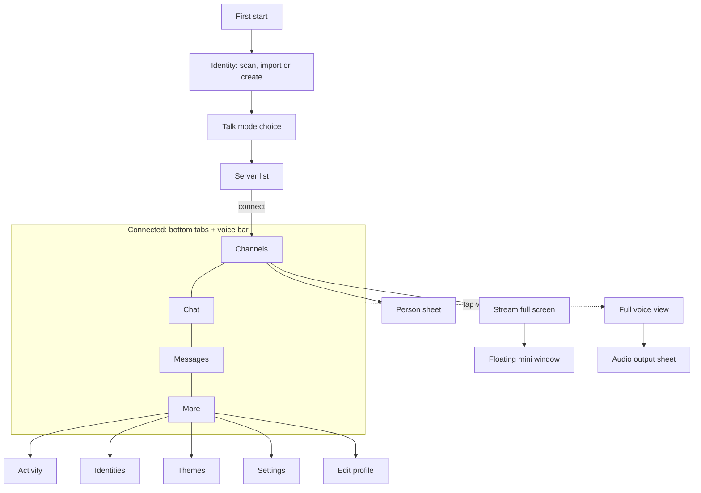
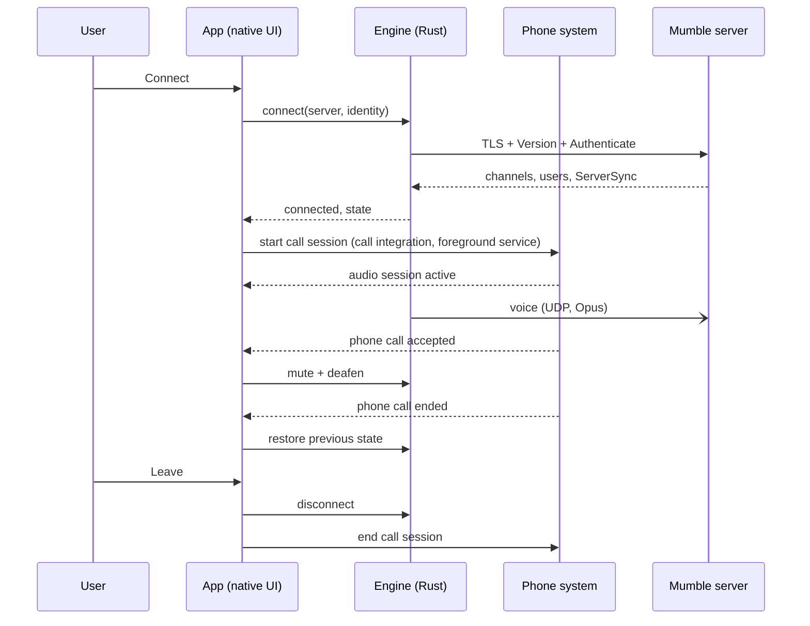
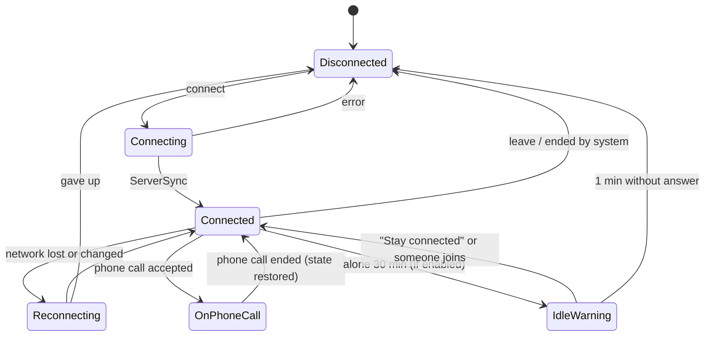

# Epic 5 – Android and iOS app · Specification

> Status: Final (brainstorming completed) · As of: 2026-11-14
> Sources: `specs/roadmap.md` (Epic 5), `specs/05-mobile-app-brainstorming.md`, overview issue #228
> Builds on: `specs/01-foundation-specification.md` (engine, voice, chat), `specs/02-multi-server-themes-specification.md` (themes), `specs/03-identity-manager-specification.md` (identities), `specs/03-comfort-polish-specification.md` (whisper, Do Not Disturb, blocking), `specs/04-mumpeer-relay-specification.md` (relay), `specs/07-file-sharing-screenshare-specification.md` and its 0.9.0 addendum (streams), `specs/08-camera-sharing-specification.md` (camera), `specs/10-admin-moderation-specification.md` (moderation), `specs/11-activity-log-specification.md` (activity log)

## 1. Goal & context

Mumcord comes to phones and tablets: an Android app and an iOS app that speak the Mumble protocol and work against unmodified standard Mumble servers, like the desktop client. People can join their server on the go, talk with the phone in the pocket, chat, watch what friends share and share their own camera. The apps have native interfaces in one shared Mumcord design and use the same Rust engine as the desktop client, so protocol behaviour, voice quality and security are identical. For now the apps are distributed as a signed APK on GitHub releases and through TestFlight; app stores are Epic 6.

## 2. Scope

### 2.1 In scope (first mobile version)

- Android app (Android 12 and newer) and iOS app (iOS 17 and newer), phones and tablets, with a real two-column tablet layout.
- Server list with favourites and a searchable browser of public Mumble servers (FR-5.9); connecting with user name, server password and the certificate warnings; one server at a time.
- Channel tree with people; joining and switching channels; channel passwords.
- Voice: voice activity and on-screen push-to-talk, mute, deafen, per-person volume and local mute, whisper and shout.
- Voice in the background and with a locked screen, shown to the system as a call; behaviour on incoming phone calls; audio output choice; headset button.
- Channel chat with links, inline images and inline GIFs, GIF favourites, mentions, replies; private messages; local chat history; notifications while connected.
- Watching screen shares and cameras of others; sharing the own camera.
- Identities: create, import a `.p12` file, transfer from desktop by QR codes; one-time transfer of the server list by QR codes.
- Own comment and avatar; themes including custom themes and theme codes; dark and light; all 24 languages.
- Moderation basics: kick, ban, move people, server mute. Activity log.
- Opening `mumble://` links.
- Settings for the above, including mobile data and battery behaviour.
- Desktop work in the Mumcord repository: the "Send to your phone" dialog, and making the engine usable on phones.
- A new repository for the mobile apps with its own CI, signing, APK release and TestFlight upload.

### 2.2 Out of scope / later

- Later candidates: sharing the phone screen; file sharing; watch together; several servers at once; camera background blur and effects; GIF search (not on desktop either, Spec 01 FR-1.52); hardware push-to-talk keys; push-to-talk on the lock screen.
- Desktop only: full admin tools (permissions editor, ban list, registered users, channel management), plugins, packet inspector.
- Never on mobile: in-game overlay, positional audio for games, global hotkeys, tray icon, pop-out windows.
- App store releases (Google Play, App Store, F-Droid): Epic 6.
- Any server-side component, any push service, any online account or ongoing sync.
- Notifications while the app is not connected.

## 3. Roles & permissions

The server's ACLs decide; the app enforces nothing itself and only reflects what the server allows (Spec 01, Spec 10).

| Role | Join, talk, chat | Whisper / shout | Move people | Server mute | Kick | Ban |
|---|---|---|---|---|---|---|
| Guest / registered user | as the server allows | as the server allows | hidden | hidden | hidden | hidden |
| Channel admin | yes | yes | shown in channels where the Move permission is granted | shown where Mute/Deafen is granted | hidden unless granted | hidden unless granted |
| Server admin | yes | yes | shown | shown | shown | shown |

- Moderation entries are shown only when the server's permission answer allows the action (Spec 10 permission-aware UI). If the server later refuses, the app shows the server's "permission denied" message.
- Everything local (volume for me, mute for me, blocking, private message rules) needs no permission and never leaves the phone.

## 4. Functional requirements

### 4.1 Start, servers and connecting

- **FR-5.1** First start runs a short setup: create or bring an identity (FR-5.60 … FR-5.66), choose the talk mode (FR-5.20), then the server list. Permissions (microphone, notifications, local network, see FR-5.8) are requested at the moment they are first needed, with a one-sentence reason.
- **FR-5.2** The server list shows favourites with name, address and, where the server answers a ping, people online and latency. Actions: add, edit, remove, connect.
- **FR-5.3** A server entry holds name, address, port, user name, optional server password and the identity to use. The password is kept in the secure storage of the phone, never in the database.
- **FR-5.4** Connecting follows the desktop flow (Spec 01): TLS always on, server certificate checked against the system store, a clear prompt for an unknown certificate and a strong warning for a changed one.
- **FR-5.5** Exactly one server is connected at a time. Connecting to another server asks for confirmation and disconnects the current one.
- **FR-5.6** A `mumble://` link opened from another app adds nothing silently: the app shows the target (server, channel, user name) and connects after confirmation. If already connected elsewhere, FR-5.5 applies.
- **FR-5.7** Connection errors (unreachable, wrong password, name in use, rejected certificate, banned) are shown in plain words with a retry action. Note on "banned": a standard Mumble server tells a banned client nothing at connect time (an address ban drops the connection during the TLS handshake; a certificate ban lets the login succeed and then closes the connection silently). The app can therefore name a ban only when it happens while connected. At connect time it reports that the server closed the connection and gives up after ten short-lived logins (see section 13).
- **FR-5.8** Local network permission. The app declares the permission to reach the local network (Android `ACCESS_LOCAL_NETWORK`, required from Android 17 / API 37, the target; iOS: local network usage description). Without it the system drops connections to addresses on the directly connected local network (for example a Mumble server at home) silently; servers on the internet are unaffected. When the user connects to a server whose address is on the local network and the permission is missing, the app first explains in one sentence why it is needed and then triggers the system prompt. If the user denies it, the connection error says so and offers the way to the system settings. Applies to Android and iOS. Note on iOS: there is no API to ask for or read the local-network permission. The app explains before the first connect to a server on the own network; the system prompt comes from the connect itself; after a failed connect the app says that access "may be missing" unless the system reports a refusal.

- **FR-5.9** Public servers. The server list has a "Find more" section with "Browse public servers" (mockup `01-server-list`). It opens a searchable list of the public Mumble servers with name, address and country; the list can be filtered by name and country. For the visible entries a ping shows people online and latency. Adding an entry saves it to the server list; connecting then follows the normal flow (FR-5.3 … FR-5.5). The list comes from the official public Mumble server list that the desktop client and the engine already use. Nothing is contacted until the user opens the browser. If a refresh fails, the last list is kept and the failure is shown calmly. See section 9 for the privacy note.

### 4.2 Channels and people

- **FR-5.10** The Channels tab shows the channel tree with collapsible channels, member counts, lock icon for restricted channels, and the people in each channel with talking ring and state icons (muted, deafened, streaming, camera). The server's root channel is always shown as the first row of the tree. Streaming and camera flags of other people are only known for people in the own channel, by design of how the server sends them (see section 13).
- **FR-5.11** Tapping a channel joins it; a channel that needs a password asks for it (access tokens as on desktop, Spec 02 FR-2.78). The own channel is marked.
- **FR-5.12** Tapping a person opens the person sheet: volume for me, mute for me, send private message, whisper, and the moderation section (FR-5.90 … FR-5.93) when permitted. Long-press on a channel offers join, shout to this channel, and collapse.
- **FR-5.13** A search field filters channels and people by name.
- **FR-5.14** Things the app cannot show (file transfers, watch together, plugin content) appear as a short, calm hint, for example "Jonas shared a file · available in the desktop app". The hint is informative only.

### 4.3 Voice

- **FR-5.20** Talk modes are voice activity and push-to-talk. On first start a choice screen explains both; nothing is preselected silently and the choice can be changed in the voice view and in the settings.
- **FR-5.21** Push-to-talk is a large on-screen hold button in the expanded voice view. It works only while the app is open on screen. With a locked screen or in the background the microphone stays closed in push-to-talk mode; listening continues.
- **FR-5.22** A slim voice bar is visible on every screen while connected: current channel, talk indicator, mute, deafen, leave. "Leave" in the voice bar and in the voice view disconnects at once, without a confirmation. Tapping it or swiping it up opens the full voice view with the people in the channel, who is talking, the audio output choice (once FR-5.34 is built, see the rule in section 5), large mute, deafen and leave buttons, the talk mode switch and the hold-to-talk button.
- **FR-5.23** Mute and deafen behave as on desktop; deafen implies mute.
- **FR-5.24** Whisper and shout use the standard VoiceTarget messages (Spec 03 FR-3.70). Choosing "Whisper to …" or "Shout to channel" shows a whisper bar naming the target with a hold-to-whisper button; closing the bar ends it. While holding, normal talking is paused.
- **FR-5.25** Processing follows Spec 01: noise suppression on by default and switchable, automatic gain on. Echo cancellation uses the voice processing of the phone system, because it is tuned to the device's microphone and speaker. Note: how well this works, real sound, Bluetooth routing and the microphone indicator are unverified until tested on real devices; nothing has run on a real phone yet (see section 13).
- **FR-5.26** Codec and bitrate rules follow Spec 01 (Opus, automatic bitrate). The mobile data switch "Reduced voice quality" caps the bitrate at 24 kbit/s while on mobile data.

### 4.4 Background, calls and audio routing

- **FR-5.30** A voice session keeps running when the app is in the background or the screen is locked.
- **FR-5.31** A session is presented to the phone system as an ongoing call: on iOS through the system call integration, on Android as a self-managed call with a permanent call-style notification. The session is not written to the recent calls list.
- **FR-5.32** System controls: Android notification with Mute, Deafen and Leave; the iOS call screen with mute and end (iOS offers no deafen there). Tapping opens the app. Note on Android: the hang-up button of the call-style notification carries the system's label ("Hang up"), not "Leave"; the call's name in the phone system is fixed at session start while the notification follows the channel; the notification is shown even when notifications are refused.
- **FR-5.33** When a normal phone call is accepted, Mumcord mutes and deafens for its duration and restores the previous state when it ends. The user stays in the channel.
- **FR-5.34** Audio output: a connected wired or Bluetooth headset is used automatically. Without a headset, the first connection asks "Loudspeaker or earpiece?" and remembers the answer. The voice view offers switching between all available outputs at any time.
- **FR-5.35** A headset button press toggles the microphone, with a short sound as feedback.
- **FR-5.36** Other audio interruptions (alarm, navigation prompt, another audio app) follow the system rules; Mumcord resumes playback afterwards without user action.
- **FR-5.37** If the system ends the app in the background, the next start says so and offers to reconnect.

### 4.5 Network and battery

- **FR-5.40** Switching between Wi-Fi and mobile data reconnects automatically and returns to the previous channel with the previous mute state (reconnect rules of Spec 01).
- **FR-5.41** Mobile data settings, three switches: "Start streams automatically" (default off: streams show a tap-to-watch tile on mobile data), "Load images and GIFs" (default on), "Reduced voice quality" (default off).
- **FR-5.42** Optional setting, off by default: "Disconnect when I'm alone in a channel for 30 minutes". When the time is reached a notification says "Disconnecting in 1 minute" with a "Stay connected" action; without a tap the app disconnects and leaves a notification saying so.
- **FR-5.43** While connected without anyone talking and no stream, the app does no periodic work beyond the protocol keep-alive.

### 4.6 Chat, private messages and notifications

- **FR-5.50** The Chat tab shows the chat of the current channel: messages with avatar, name and time, links, inline images, inline GIFs, replies, mention highlighting and `@` autocomplete as on desktop (Spec 01, Spec 02). All server-supplied content is sanitised before display.
- **FR-5.51** Sending: text, images from the photo library or camera (same size rules as desktop), GIFs from the favourites sheet. Typed Markdown is converted when sending, by the same rules as the desktop client: the bridge ports the desktop rules. Known differences: no tables or task lists, and only bare `http(s)://` addresses become links. GIF favourites are local to the phone; there is no GIF search.
- **FR-5.52** The Messages tab lists private conversations with last message, time and unread count, and message requests (Spec 03 private message rules). Blocking a person works as on desktop.
- **FR-5.53** Chat history is stored on the phone only, with the same retention settings as desktop.
- **FR-5.54** Notifications exist only while connected: private messages and mentions raise a system notification when the chat in question is not open on screen; tapping opens that chat. After disconnecting there are none, and the settings say so.
- **FR-5.55** Notification text: sender and message are handed to the system, whose lock-screen privacy setting decides what is visible. An app switch "Show sender only" removes the text.
- **FR-5.56** Do Not Disturb: the app follows the phone's own Do Not Disturb and focus modes; there is no separate Mumcord switch on mobile. Badges still count.

### 4.7 Identities and transfer from desktop

- **FR-5.60** Identities are certificates stored only in the secure storage of the phone (Android Keystore-protected storage, iOS Keychain, this device only, never in backups). The database holds label, common name, fingerprint, date and default flag, as in Spec 03.
- **FR-5.61** Create a new identity on the phone (same certificate parameters as desktop).
- **FR-5.62** Import a `.p12` / `.pfx` file through the system file picker, with password entry; duplicates by fingerprint are refused (Spec 03 FR-3.6).
- **FR-5.63** Export a password-protected `.p12` file through the system share sheet (Spec 03 FR-3.8). Delete rules as in Spec 03 (the last identity cannot be deleted).
- **FR-5.64** QR transfer, desktop side ("Send to your phone", in identity settings): choose which identities and whether the server list is included; the desktop shows a repeating sequence of QR codes and an 8-digit code (shown as two groups of four). The data is compressed and encrypted with a key derived from the 8-digit code through a slow key derivation; the codes are valid while the dialog is open and at most 2 minutes, then a new set with a new code is needed.
- **FR-5.65** QR transfer, phone side: the scanner collects the codes in any order and shows progress ("Code 3 of 7"); after the last one the user types the 8-digit code. Wrong code: clear error, three attempts, then the scan must be repeated. On success the app lists what arrives and imports after confirmation.
- **FR-5.66** The server list in a transfer contains name, address, port and user name per server. Saved server passwords and channel access tokens are not transferred. Existing entries on the phone are kept; exact duplicates are skipped. This is a one-time import, not a sync.
- **FR-5.67** Nothing of a transfer touches a network; the desktop dialog warns to show the codes only to the own phone.

### 4.8 Streams and camera

- **FR-5.70** A screen share or camera of someone in the current channel appears as a live tile in the channel. On Wi-Fi it starts by itself; on mobile data per FR-5.41.
- **FR-5.71** Tapping a tile opens the stream full screen with stream volume, viewer count and close; rotating the phone gives landscape. Going back shrinks it to a floating mini window that stays above chat and channels and can be closed or expanded. On tablets the stream fills the right column.
- **FR-5.72** Stream sound (where the sharer sends it) plays mixed with voice and has its own volume.
- **FR-5.73** Streams use the same paths as desktop: directly between clients where possible, otherwise through the optional relay. Where neither path works, the tile says "Stream not reachable from this network".
- **FR-5.74** Sharing the own camera: a preview sheet first (never skipped), front and back camera switch, then "Start sharing". Limits as Spec 08, with a mobile cap of 540p30. No background blur or effects.
- **FR-5.75** The camera pauses while the app is in the background and resumes on return; viewers see a paused state. Voice is unaffected.
- **FR-5.76** In the system picture-in-picture mode (leaving the app while watching) the stream continues in the system's small window where the platform allows it.

### 4.9 Profile and themes

- **FR-5.80** Edit the own comment and avatar (same size limits and sanitising as desktop).
- **FR-5.81** Appearance: System, Dark, Light. Theme gallery with the built-in themes, custom themes by pasting a theme code, sharing a theme code, and "Use server theme when offered" (Spec 02 FR-2.14 … FR-2.17). Contrast rules of Spec 02 apply.
- **FR-5.82** All texts exist in the 24 desktop languages; the app follows the phone language with a manual override. Texts are taken from the desktop translation files; mobile-only texts are added there.

### 4.10 Moderation basics and activity log

- **FR-5.90** Move a person to another channel (channel picker).
- **FR-5.91** Server mute and unmute a person.
- **FR-5.92** Kick with optional reason, after confirmation.
- **FR-5.93** Ban with optional reason and duration, after confirmation, with the fields of Spec 10.
- **FR-5.94** The activity log (More tab) shows the feed of Spec 11 with filters; entries are kept by the retention rules of Spec 11.

### 4.11 Settings, updates and diagnostics

- **FR-5.100** Settings cover: voice (talk mode, noise suppression, input level meter, default output), mobile data (FR-5.41), battery (FR-5.42), notifications (FR-5.54, FR-5.55), chat (link previews, history retention), appearance, language, identities, about (version, contained engine version, licences).
- **FR-5.101** Android: at most once a day the app checks the GitHub releases of the mobile repository for a newer version and shows "Version X is available"; the action opens the download of the signed APK in the browser. The check can be switched off. Android itself refuses an APK that is not signed with the same key.
- **FR-5.102** iOS updates are handled by TestFlight.
- **FR-5.103** Crash reports are opt-in, as on desktop, with the same privacy rules.

## 5. UI & UX

Mockups (dark and light, one design for both platforms): attached to issue #228. Screens: server list, public server browser, channels, voice view, audio output, talk mode choice, person sheet, channel chat, GIF favourites, messages, activity log, stream full screen, stream mini window, camera share, lock screen, more, settings, identities, QR scan, themes, edit profile, tablet channels and chat, tablet stream, desktop "Send to your phone".



**Phone, connected**

```text
┌──────────────────────┐
│ Nordlicht        🔍 ⋯│
├──────────────────────┤
│ ▾ Lobby   3  you're here
│    Anna              │
│    Ben  (talking)    │
│ ▾ Gaming  2          │
│    Mira          🖥  │
│   ┌────────────────┐ │
│   │ LIVE  Mira's   │ │
│   │       screen   │ │
│   └────────────────┘ │
├──────────────────────┤
│ 🎙 Lobby   mic 🎧  ✕ │  voice bar (tap: full voice view)
├──────────────────────┤
│ Channels Chat Msgs More
└──────────────────────┘
```

**Full voice view**: collapse handle, channel name, people as tiles with talking ring, output chip ("Speaker ▾"), round buttons mute / deafen / leave, talk mode switch, large "Hold to talk" button in thumb reach.

**Tablet**: from a width of 600 dp / regular width, two columns. Left: navigation rail (Channels, Messages, More), channel tree with people, voice bar. Right: chat, or the stream with a chat strip below. Works in portrait and landscape.

```text
┌──┬──────────────┬───────────────────────────┐
│≡ │ Nordlicht    │ # Lobby                   │
│✉ ├──────────────┤ Anna: hi all              │
│⋯ │ ▾ Lobby   (3)│ Ben: hey                  │
│  │   Anna       │                           │
│  │   Ben        │                           │
│  │ ▸ Gaming  (2)│                           │
│  ├──────────────┤                           │
│  │🎙 Lobby 🎧 ✕ │ Message Lobby…         ➤  │
└──┴──────────────┴───────────────────────────┘
```

- **Touch rules**: every target at least 44 pt / 48 dp; no action only reachable by long-press or swipe (each has a visible alternative); destructive actions confirm, except "Leave", which disconnects at once (FR-5.22).
- **Mockups and missing functions**: an element of a mockup that has no function yet is left out until it works; there are no inactive controls. Examples: the search and settings icons on the server list, the audio output chip, stream tiles. They return with their features. The screens built without a mockup on Android were reviewed and approved as built on 2026-11-14; the iOS versions keep that look.
- **Platform-native pieces**: back gesture and back button, share sheet, file and photo pickers, permission dialogs, keyboards, system call screen, system picture-in-picture.
- **Empty states**: no servers yet (with "Add server" and "Scan from desktop app"), empty channel, no messages, no activity.
- **Errors**: connection errors (FR-5.7), local network permission denied (FR-5.8: says so and offers the way to system settings), microphone permission denied (explains how to allow it in system settings; listening still works), camera permission denied, stream not reachable (FR-5.73), transfer code wrong (FR-5.65).
- **Design**: the theme tokens and fonts of the desktop app (Instrument Sans, Bricolage Grotesque), dark and light, contrast AA. Safe areas respected. Text scales with the system font size up to 200 % without clipping.
- **Accessibility**: every control has a screen-reader label (TalkBack, VoiceOver); talking state is announced politely, not on every change; focus order follows the visual order; reduced-motion setting respected.

## 6. Audio & network

- **Send chain**: capture → system echo cancellation → noise suppression → automatic gain → voice activity or push-to-talk gate → Opus (Spec 01, with FR-5.25). **Receive chain**: unchanged from desktop (jitter buffer, mixing, per-person volume).
- **Audio session**: voice-chat mode on both platforms, so that system echo cancellation, Bluetooth hands-free profiles and call routing work. Output selection uses the system's communication device selection.
- **Latency target**: as desktop on Wi-Fi; Bluetooth headsets add their own delay, which the app cannot remove.
- **Connection flow**: unchanged from Spec 01 (TLS control channel, UDP voice with TCP fallback). Network change handling per FR-5.40.



- **Streams**: receive AV1 and VP9 as defined in Spec 07 and Spec 08. Decoding uses the phone's hardware decoder where it supports the codec, otherwise the software decoders of the engine. Camera sending uses VP9, hardware-encoded where the phone offers it, otherwise software at a reduced resolution; the codec negotiation of Spec 07 is unchanged.
- **Protocol compatibility**: same minimum server version and same protocol messages as desktop. No new messages. Streams, as on desktop, need a direct path or the optional relay; everything else works without any companion service.

## 7. Data & state model

Stored on the phone, in the engine's SQLite database and the secure storage, with the same schemas as desktop where the data is the same.

| Data | Where | Notes |
|---|---|---|
| Servers (name, address, port, user name, identity, favourite) | Database | As Spec 02 |
| Server passwords, channel access tokens | Secure storage | Never in the database, never transferred |
| Identities (certificate and key) | Secure storage | This device only, excluded from backups |
| Identity metadata | Database | As Spec 03 |
| Chat history, private messages, message requests, blocks | Database | As Spec 01, Spec 03 |
| Activity log | Database | As Spec 11 |
| GIF favourites | Database | Local to the phone |
| Public server list | Database | Last successful list, kept when a refresh fails (FR-5.9) |
| Themes, custom themes | Database | As Spec 02 |
| Settings | Database | New mobile keys below |

New mobile settings:

| Field | Type | Default | Notes |
|---|---|---|---|
| `talk_mode` | voice_activity / push_to_talk | none | Set by the first-start choice |
| `default_output` | ask / speaker / earpiece | ask | Becomes speaker or earpiece after the first answer |
| `mobile_data_autoplay_streams` | bool | false | FR-5.41 |
| `mobile_data_load_media` | bool | true | FR-5.41 |
| `mobile_data_reduced_voice` | bool | false | FR-5.41 |
| `idle_disconnect` | bool | false | FR-5.42 |
| `notify_sender_only` | bool | false | FR-5.55 |
| `update_check` | bool | true | Android only, FR-5.101 |



## 8. Technology & architecture

- **Two repositories.** The mobile apps live in their own repository; the engine stays in the Mumcord repository and is pulled in as a library pinned to a release tag. Reason: clean separation, own CI and issues, and the desktop repository stays lean.
- **Native interfaces.** Android in Kotlin with Jetpack Compose, iOS in Swift with SwiftUI. Reason: decision of the product manager for the best native feel; accepted cost is that interface work is done once per platform. The React interface of desktop is not reused.
- **Shared Rust engine.** `protocol`, `engine`, `audio`, `codec`, `store`, `p2p` and the stream receive and send parts are the same code as on desktop. Reason: identical protocol behaviour, voice quality and security, and fixes land everywhere.
- **Bridge.** A small Rust crate in the mobile repository wraps the engine in a mobile-friendly interface (commands in, state and events out) and generates Kotlin and Swift bindings with UniFFI. Reason: one hand-written interface instead of two.
- **Engine preparation (Mumcord repository).** Desktop-only parts of the engine (screen capture, camera capture and effects, positional audio, desktop audio backends such as PipeWire) become optional Cargo features that desktop switches on, so desktop behaviour is unchanged. Secure storage and camera frames get interfaces the mobile bridge implements with the platform's own means.
- **Platform code.** Android: self-managed call and foreground service (phone call, microphone, camera types), audio routing, CameraX capture, MediaCodec, Keystore, notifications. iOS: call integration, audio session, AVFoundation capture, VideoToolbox, Keychain, notifications. Kept in thin, separately testable modules.
- **Audio thread rules** of the project apply unchanged: no allocation, locks, I/O or logging in the real-time path, also not in bridge callbacks.
- **Secrets.** Android keystore file and passwords, Apple distribution certificate, provisioning profile and App Store Connect API key exist only as CI secrets of the mobile repository. Nothing of that in the repository, in docs or in examples.

## 9. Non-functional requirements

- **Platforms**: Android 12+ (arm64; x86_64 for emulators only), iOS 17+ (arm64). Phones and tablets.
- **Battery**: one hour of voice in the background on Wi-Fi with the screen off uses at most 6 % of a typical 4,500 mAh battery (measured on the reference devices of the checklist). Idle rule FR-5.43.
- **Data**: voice at default quality stays below 40 MB per hour.
- **Start**: from tap to usable server list under 2 seconds on the reference devices.
- **Security**: TLS always on with certificate verification and change warnings; identities never leave secure storage unencrypted; transfer codes are encrypted and short-lived; all server content is sanitised before display.
- **Privacy**: no personal data, chat content or audio in logs; no tracking; the only outbound contact besides the user's server and stream paths is the optional Android update check to GitHub and the public server browser (FR-5.9): opening the browser contacts the public list service, and pings contact the listed servers. Nothing of this happens before the user opens the browser. Crash reports opt-in.
- **Accessibility**: section 5 rules; verified with TalkBack and VoiceOver.
- **Robustness**: the app survives being ended by the system (FR-5.37) without data loss.

## 10. Build, packaging & release

- **Repository**: new mobile repository in the Mumcord organisation, AGPL-3.0 like the client, with its own README, CHANGELOG, issue tracker and branch rules.
- **Versions**: own version numbers starting at 0.1.0, released whenever ready. Each release names the contained engine version in the release notes and on the About screen.
- **Android**: one signed universal APK (arm64) attached to the GitHub release of the mobile repository, with SHA-256 checksum, SBOM and third-party notices. Signing key only as CI secret; an offline backup is kept by the product manager, because losing the key forces every user to reinstall.
- **iOS**: build on a macOS CI runner, upload to TestFlight. Internal testers first; the public TestFlight link follows as its own step once the app is stable.
- **CI on every pull request**: Rust tests of the bridge, Android unit and Compose tests, iOS unit and XCUITest tests, lint and format checks, and the emulator end-to-end run below.
- **Automated end-to-end tests**: the app runs in an Android emulator and an iOS simulator against the local Docker Mumble test server (Spec 01), with a second scripted client: connect, channels, chat, private messages, voice round trip with injected audio, moderation, transfer import with generated codes. Never against public servers; the public server browser is tested against a local fixture list, never the real list service.
- **Manual device checklist per release** (real phones, at least one current and one minimum-version device per platform): background and locked-screen voice, incoming phone call, Bluetooth and wired headset, headset button, output switching, network change, battery measurement, camera sharing, stream viewing on mobile data, notifications, TalkBack and VoiceOver.
- **One-time setup by the product manager**: App Store Connect app record and API key, TestFlight tester group, Android signing key backup, CI secrets.
- **Mumcord repository**: engine features and the "Send to your phone" dialog ship with normal desktop releases; the mobile repository pins the first release that contains them.

## 11. Acceptance criteria (verifiable in the running app)

Unless stated otherwise: local Docker Mumble test server, a desktop Mumcord as second client, checked on Android and iOS.

1. **AC-5.1** Fresh install → setup shows identity step, then talk mode choice with nothing preselected, then the empty server list.
2. **AC-5.2** Add the test server → connect → unknown certificate prompt appears → accept → channel tree with the desktop user is shown.
3. **AC-5.3** Change the test server's certificate → reconnect → the strong "certificate changed" warning appears and nothing connects without consent.
4. **AC-5.4** Tap another channel → both clients show the phone user there. A password-protected channel asks for the password and joins with the right one.
5. **AC-5.5** Voice activity: speak into the phone → desktop hears it and shows the talking ring; desktop speaks → phone plays it and shows the ring.
6. **AC-5.6** Push-to-talk: nothing is sent until "Hold to talk" is held; releasing stops within 200 ms.
7. **AC-5.7** Mute, deafen and leave work from the voice bar on every tab and from the full voice view.
8. **AC-5.8** Lock the screen during voice activity → both directions keep working for at least 30 minutes. In push-to-talk mode the phone stays silent while locked and still plays others.
9. **AC-5.9** While connected, the system shows the session as a call (Android call-style notification with Mute, Deafen, Leave; iOS call indicator); each control works; no entry appears in recent calls.
10. **AC-5.10** Accept a real phone call during a session → desktop sees the phone user muted and deafened; end the call → previous state is back and the user is still in the channel.
11. **AC-5.11** First connect without headset asks for loudspeaker or earpiece and remembers it. Connecting a Bluetooth headset moves audio there; the output sheet switches between all outputs.
12. **AC-5.12** Pressing the headset button toggles the microphone with a feedback sound; desktop shows the mute state.
13. **AC-5.13** Switch the phone from Wi-Fi to mobile data → the app reconnects by itself into the same channel with the same mute state.
14. **AC-5.14** Person sheet: lowering the volume and "Mute for me" affect only the phone.
15. **AC-5.15** "Whisper to" a desktop user → only that user hears the phone while the whisper button is held; a third client in the channel hears nothing.
16. **AC-5.16** Channel chat: text, a link, an image and a GIF link sent from desktop appear correctly on the phone and the other way round; `@` mention of the phone user is highlighted.
17. **AC-5.17** A message containing script or markup from the server is shown harmlessly as sanitised content.
18. **AC-5.18** Private message from desktop while the phone shows another tab or is locked → system notification; tap opens the conversation. With "Show sender only" the text is absent. After disconnecting, a private message produces nothing.
19. **AC-5.19** Chat history is still there after restarting the app.
20. **AC-5.20** Desktop exports an identity as `.p12` → phone imports it with the password → the test server recognises the phone as the same registered user.
21. **AC-5.21** Desktop "Send to your phone" with one identity and the server list → phone scans all codes, enters the 8-digit code → identity and servers are present; server passwords are not. A wrong code is refused three times, then a rescan is required. After 2 minutes the codes are no longer accepted.
22. **AC-5.22** Desktop starts a screen share → a live tile appears on the phone; tap → full screen; rotate → landscape; back → floating mini window above the chat; chat still usable.
23. **AC-5.23** On mobile data with default settings the tile shows tap-to-watch and loads nothing before the tap; with "Start streams automatically" on, it starts.
24. **AC-5.24** Phone shares its camera after the preview sheet → desktop sees it; switching front and back works; sending the app to the background shows "paused" on desktop while voice continues.
25. **AC-5.25** Edit comment and avatar on the phone → desktop shows both.
26. **AC-5.26** Paste a theme code created on desktop → the phone shows the same colours in dark and light; appearance System follows the phone setting.
27. **AC-5.27** As server admin on the phone: move, server mute, kick and ban a desktop user → each takes effect. As a normal user the moderation section is absent.
28. **AC-5.28** The activity log lists join, leave, move and kick events of the session with working filters.
29. **AC-5.29** Opening a `mumble://` link to the test server shows the target and connects after confirmation.
30. **AC-5.30** With "Disconnect when alone" on (test duration shortened by a debug setting): alone in a channel → warning notification → "Stay connected" keeps the session; without a tap the app disconnects and says so.
31. **AC-5.31** Tablet: two columns in portrait and landscape; a stream fills the right column with the chat strip below.
32. **AC-5.32** A file transfer started on desktop appears on the phone as a hint line only.
33. **AC-5.33** With system font size at 200 % and with TalkBack / VoiceOver, connect, join, mute and send a message are possible without clipped or unlabelled controls.
34. **AC-5.34** Android: installing a newer signed APK over the app keeps all data; with an older version installed and a newer release published, the update notice appears and opens the download.
35. **AC-5.35** A tagged release of the mobile repository produces the signed APK with checksum on the GitHub release and a build in TestFlight, without any secret in the repository.
36. **AC-5.36** Desktop regression: with the engine features in place, the desktop build and its end-to-end tests pass unchanged.
37. **AC-5.37** Local network permission: on a fresh install, connecting to the local test server by its local address first shows the one-sentence explanation, then the system prompt; allowing it connects. Denying it shows a clear error that names the missing permission and offers the way to the system settings.
38. **AC-5.38** Public servers: with a local fixture list instead of the real list service, "Browse public servers" shows the fixture entries with name, address and country; filtering by name and by country narrows the list; visible entries show people online and latency where the local test server is listed; adding an entry puts it in the server list and connecting works as in AC-5.2. Before the browser is opened nothing is requested; with the fixture made unreachable, a refresh keeps the last list.

## 12. Decision log

| Question | Decision | Note |
|---|---|---|
| Q1.1, Q1.4, Q1.7 | Feature set as section 2.1 | Assessment in chat; product manager added streams, camera, profile, themes, GIFs |
| Q1.2 | Android and iOS in this epic, Android leads | |
| Q1.3 | Phones and a real tablet layout | Differs from recommendation |
| Q1.5 | One server at a time | |
| Q1.6 | Talk mode asked on first start | Differs from recommendation |
| Q1.8 | Obsolete | Streams are in the first version |
| Q1.9 | Short hint for unsupported things | |
| Q1.10 | Background and lock-screen voice is a must | |
| Q1.11 | Notifications only while connected | No push server possible |
| Q1.12 | `.p12` import, create new, QR transfer | QR needs desktop work |
| Q1.13 | One-time server list import by QR | No sync |
| Q1.14 | Android in-app update notice opening the APK download | |
| Q1.15 | TestFlight internal first, public later | |
| Q1.16 | Apple Developer Program membership exists | |
| Q1.17 | Replaced by Q5.5 | |
| Q1.18 | Old child issues and mockups closed as superseded | |
| Q2.1 | Bottom tabs: Channels, Chat, Messages, More | |
| Q2.2 | Voice bar that expands to a full voice view | |
| Q2.3 | Tablet: two columns | |
| Q2.4 | Stream tile in channel, full screen, floating mini window | |
| Q3.1 | Phone call: mute and deafen, then restore | |
| Q3.2 | Session shown to the system as a call | Differs from recommendation |
| Q3.3 | Push-to-talk needs the unlocked app | |
| Q3.4 | Output without headset: ask the first time | Differs from recommendation |
| Q3.5 | Headset button toggles the microphone | |
| Q3.6, Q5.2 | Three mobile data switches, careful defaults | |
| Q3.7, Q5.3 | Optional idle disconnect with warning notification | |
| Q3.8 | Notification text follows phone setting, plus "sender only" | |
| Q4.1 | Native interfaces (Kotlin, Swift) on the shared Rust engine | Differs from recommendation (Tauri 2 mobile) |
| Q4.2 | Android 12+, iOS 17+ | |
| Q4.3 | QR transfer entirely inside QR codes plus typed code | Differs from recommendation |
| Q4.4 | Emulators in CI plus manual device checklist | |
| Q5.1 | One Mumcord design on both platforms | |
| Q5.4 | Own repository; engine as a pinned library | |
| Q5.5 | Own mobile version numbers from 0.1.0 | |
| Q5.6 | Spec in the Mumcord repository; all issues of the epic in the mobile repository | Issue location changed by a later instruction in chat: engine and desktop tasks are issues there too, labelled accordingly |
| Transfer code length | 8 digits, shown as 4 + 4 (FR-5.64, FR-5.65) | Decided 2026-11-14 after the security estimate: 6 digits could be tried out in 5–10 hours on one desktop PC by someone who photographed the QR codes; the format accepts 6–10 digits |
| — | GIFs mean inline playback and favourites | No GIF search exists (Spec 01 FR-1.52) |
| — | System echo cancellation on phones | Technical decision by recommendation |
| — | Camera cap 540p30, no blur | Technical decision by recommendation |
| — | Server passwords are not part of a transfer | Safer default; see section 13 |
| — | Public server browsing is in the first mobile version (FR-5.9) | Decided 2026-11-14 by the product manager while reviewing the Android screens; "Find more" with "Browse public servers" on the server list (mockup `01-server-list`) |
| — | Typed Markdown in chat is converted when sending, by the desktop rules (FR-5.51) | Decided 2026-11-14; no tables or task lists, only bare `http(s)://` addresses become links |
| — | The server's root channel is always the first row of the channel tree (FR-5.10) | Confirmed as built, 2026-11-14 |
| — | "Leave" in the voice bar and voice view disconnects at once, without confirmation (FR-5.22) | Confirmed as built, 2026-11-14 |
| — | Mockup elements without a function yet are left out, no inactive controls (section 5) | Confirmed as built, 2026-11-14; e.g. search and settings icons on the server list, the audio output chip, stream tiles |
| — | Screens built without a mockup on Android are approved as built; iOS keeps that look | Reviewed by the product manager, 2026-11-14 |
| — | Local network permission is declared and requested with a one-sentence explanation before the system prompt (FR-5.8) | Found during implementation, 2026-11-14 |

## 13. Open points & risks

- **Size of the epic (high).** Native interfaces on two platforms, a tablet layout, call integration, stream viewing and camera sharing make this by far the largest epic so far. The work is cut so that a usable app exists early: voice and chat first, then streams and camera, then transfer and polish.
- **Video on phones (high).** Software decoding of AV1 may be too heavy on older phones, and few phones can hardware-encode VP9 or AV1. To verify early on the reference devices; fallback is lower resolution, and for sending a software VP9 encoder at 360p.
- **Streams and the relay.** On mobile networks a direct path between clients is rare, so streams will mostly need the optional relay. Voice, chat and everything else are unaffected.
- **Call integration.** A channel session is not a classic call. To verify early: no entry in recent calls, correct behaviour with real calls, and Bluetooth car systems. Apple restricts call integration in mainland China, relevant for Epic 6 only.
- **Engine audio on phones.** The audio library used by the engine supports both platforms, but routing, Bluetooth and interruptions are controlled by the system session. If this proves unreliable, capture and playback move into the platform code behind the same engine interface.
- **QR transfer security.** With everything inside the codes, protection rests on nobody else seeing the screen during the two minutes; an 8-digit code is short: someone who photographs all codes but not the number can try every number in roughly three to four weeks on one desktop PC, or within a day on rented machines. The slow key derivation, the short lifetime and the warning text reduce the risk but do not remove it.
- **Server passwords in a transfer.** Left out by default (FR-5.66). Owner: product manager, if a different rule is wanted.
- **Licence on iOS.** AGPL-3.0 and Apple's distribution terms can conflict. Before the public TestFlight link: confirm that the copyright holders agree to distribution through Apple and check the licences of all dependencies. Owner: product manager.
- **CI cost.** macOS runners cost about ten times Linux minutes; iOS jobs run on pull requests that touch iOS or the bridge and on releases.
- **Local network ranges.** The exact address ranges that trigger the Android local network rule for networks behind a router are not verified yet; to check on a real phone and router before relying on the address test in FR-5.8.
- **Mockup row "Scan an invite code" (open, product manager).** The server list mockup `01-server-list` shows a second "Find more" row "Scan an invite code". No requirement in this specification matches it (FR-5.6 covers `mumble://` links only). Not built; the product manager decides whether it becomes a feature and what an invite code is.
- **Banned at connect time (found in implementation).** A standard Mumble server tells a banned client nothing when it connects (FR-5.7). The app cannot tell a ban from other failures there; it reports that the server closed the connection and stops retrying after ten short-lived logins.
- **Android call notification (found in implementation).** The hang-up button carries the system's label "Hang up", not "Leave"; the call's name in the phone system is fixed at session start while the notification follows the channel; the notification is shown even when notifications are refused (FR-5.32).
- **Local network permission on iOS (found in implementation).** No API exists to ask for or read it; the explanation comes before the first connect to a server on the own network and the system prompt from the connect itself. After a failed connect the app says access "may be missing" unless the system reports a refusal (FR-5.8).
- **Nothing tested on real phones yet (found in implementation).** Echo cancellation by the phone system, real sound, Bluetooth routing and the microphone indicator are unverified until tested on real devices (FR-5.25); they belong on the device checklist.
- **Streams and camera flags of others.** The server only sends them for people in the own channel, so state icons for streams and cameras show only there (FR-5.10, FR-5.70).
- **Android emulator.** The simulated modem occasionally loses an answered call; the end-to-end test repeats the call once.
- **Two-step changes.** An engine change needed by mobile lands in the Mumcord repository first and reaches the apps with the next pin update.

## 14. Impact on the roadmap

- Epic 5 becomes its own repository with its own versions; the roadmap table should link the spec and mark it as in progress.
- The mobile path named in Spec 01 (Tauri 2 mobile, Q1.7) is not taken; the engine is shared instead.
- The Mumcord repository gains engine features for phones and the desktop "Send to your phone" dialog, to be placed in a desktop milestone.
- Epic 6 (store releases) inherits: call integration restrictions per region, the licence question, and store review of background voice.
