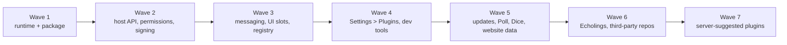
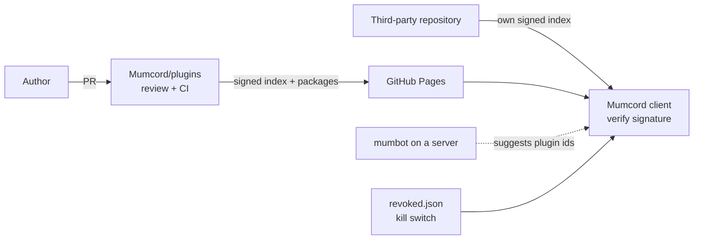
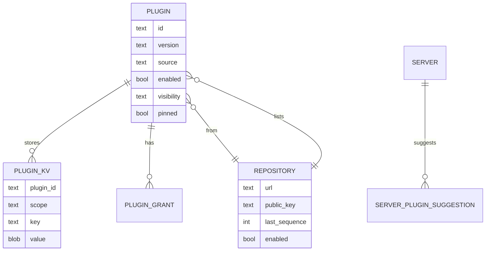

# Epic 3.1 – Plugin system · Brainstorming

> Basis: GitHub milestone **0.6.0** – overview issue #267 and the plugin issues #268–#285, plus #264 (Echolings) and #310 (mumbot music). There is no `specs/roadmap.md`; the issues are the roadmap for this epic.
> Process: We work in several rounds. Each round contains questions; you answer directly in this file.
> Once all questions are answered, `specs/06-plugin-system-specification.md` is created from it.
> Already settled (not asked again):
> - Tech stack (Rust + Tauri 2 + React/TS), platforms, store/migrations → Spec 01/02
> - Client only, works with unmodified Mumble servers; plugins talk to other Mumcord users only via Mumble "plugin data" messages → #267
> - Plugins are WebAssembly components in a sandbox (wasmtime), without file, network or mic access by default; Mumcord draws their UI from a declarative tree; safe mode limits (memory, time per call, auto-off after 3 crashes) → #267/#268
> - Package format `.mcplugin` (zip + `manifest.json`), size limits, id rules → #269 (a first version already exists on the paused branch of PR #297)
> - Signing with minisign keys, official registry as the GitHub repo `Mumcord/plugins`, kill switch `revoked.json` → #272/#276/#278
> - mumbot bot-side pattern for announcements (registered bot, pinned like the relay bot) → Spec 04, mumbot#20
> - Echolings game design (species, meters, actions) → #264

## How to answer

- **Single choice** (`◉`): Exactly **one** box has an `[x]`. To change your choice, just move the `x`.
- **Multiple choice** (`☑`): Tick as many boxes as you like.
- ⭐ marks my **recommendation**. It is already preselected. If you agree, you don't need to change anything.
- Below each question there is `✍️ Note:`. Add anything there, e.g. questions back, edge cases or "not sure, explain this to me".
- I explain technical terms briefly. For purely technical questions it's perfectly fine to follow my recommendation.

## Planned rounds

1. Scope of 0.6.0 & trust model (what ships, what plugins may do)
2. UI & UX (Settings > Plugins, install and permission prompts, where plugins appear)
3. Plugin messaging & limits (how plugins talk to each other, how fast, old servers)
4. Distribution, updates & security (registry, third-party repositories, server-suggested plugins, revocation)
5. Data model, acceptance criteria & remaining open points

(The plan may change depending on the answers.)

---

## Round 1 – Scope of 0.6.0 & trust model

The issues already describe a very large system (18 issues in 7 waves). This round decides **how much of it ships in 0.6.0** and settles the few rules the issues contradict each other on.



### A · What ships in 0.6.0

#### Q1.1 Which parts belong in 0.6.0? `☑`
Everything ticked becomes part of the 0.6.0 spec with acceptance criteria. Unticked items move to a later version.

- [x] ⭐ Runtime, package format, host API, permissions, signing (#268, #269, #270, #275, #276): the foundation, nothing works without it.
- [x] ⭐ Plugin messaging and UI slots (#271, #274): needed by every useful plugin.
- [x] ⭐ Official registry, Settings > Plugins (browse, install, remove), updates and kill switch (#272, #277, #278).
- [x] ⭐ Developer CLI, SDK and template (#273): we need it ourselves to build the first plugins.
- [x] ⭐ First plugins: Poll and Dice roller (#284, #285): small, prove the API.
- [x] ⭐ Echolings pets as the first big official plugin (#279/#264).
- [x] mumbot music control plugin (#310). Needs extra powers (network, secrets); see Q1.5.
- [x] Third-party repositories (#280). Later: one official source is enough to start.
- [x] Server-suggested plugins via mumbot (#283 + mumbot#20). Later: needs plugins to exist first.
- [x] Website data for a plugin list (#281). Later: only data, the site is built separately.

✍️ Note:

#### Q1.2 How should 0.6.0 be delivered? `◉`

- [ ] ⭐ **In waves, each wave merged and usable on its own** (as in the #267 plan). Smaller PRs, early testing in your daily build, and less risk.
- [x] Everything on one long branch and merged at the end. Fewer half-finished states on main, but huge PRs and late feedback.

✍️ Note:

#### Q1.3 Can plugins be authored only in Rust in 0.6.0? `◉`
WebAssembly plugins can be written in several languages. The paused PR #297 decided "Rust only for now".

- [ ] ⭐ **Rust only in 0.6.0.** One SDK, one template and one set of docs to maintain. JavaScript/TypeScript can come later.
- [x] Rust and JavaScript/TypeScript from the start. More authors, but twice the SDK and docs work.

✍️ Note:

### B · What plugins may do (trust model)

The overview promises that plugins **never** get network, files, microphone, certificates or passwords. Three plugins the issues want break that promise a little. Each needs a decision.

#### Q1.4 May a plugin post a normal chat message (`chat.send`)? `◉`
Poll and Dice post a plain text line into the channel, so users of the official Mumble client (who can't see plugin cards) still see the poll or roll.

- [x] ⭐ **Yes, but only directly after a click or command by the user, into the user's current channel, with a visible "via Poll" label.** A plugin can never post on its own.
- [ ] No. Plugins never write chat; Poll/Dice are only visible to Mumcord users.
- [ ] Yes, freely (within rate limits). Simplest, but a bad plugin could spam.

✍️ Note:

#### Q1.5 May a plugin talk to one server on the internet (`net.http`)? `◉`
The mumbot music plugin (#310) talks to the bot's web API at an address the user types in. Mumcord itself would make the request on the plugin's behalf, only to that one address.

- [ ] ⭐ **Not in 0.6.0.** Keep the promise "plugins never get network" for the first release. The mumbot music plugin moves to a later version (or becomes a built-in Mumcord feature instead of a plugin, decided later).
- [ ] Yes, as a high-risk permission: only to one address the user typed in, no redirects, size and speed caps, shown in red in the install prompt.
- [x] Yes, but only for official plugins (from `Mumcord/plugins`), never for third-party ones.

✍️ Note:

#### Q1.6 May a plugin keep a secret (e.g. an API key) in the system keychain (`secrets`)? `◉`
Only needed for the mumbot music plugin. The plugin can't read the secret back; Mumcord only inserts it into its web request.

- [ ] ⭐ **Decide together with Q1.5.** If `net.http` is not in 0.6.0, `secrets` isn't either.
- [x] Yes, in 0.6.0 regardless (useful later for other plugins).

✍️ Note:

#### Q1.7 Which extra powers are fine for 0.6.0? `☑`
Small additions the first plugins need. All low risk and shown in the install prompt.

- [x] ⭐ `random.bytes`: secure random numbers from Mumcord (Dice needs fair rolls).
- [x] ⭐ Slash commands in the chat box (e.g. `/roll 2d6`), declared in the manifest.
- [x] ⭐ Hide a plugin's own fallback chat line for Mumcord users who see the plugin card instead (no double display).
- [x] Right-click menu entry on users (`ui.user-menu`) and plugin dialogs (`ui.dialog`). Only #310 needs them, so: later.

✍️ Note:

### C · Small contradictions between issues

#### Q1.8 Which licence for official example plugins (Poll, Dice, Echolings) and the plugin SDK? `◉`
#273 says Apache-2.0; #279 and #310 say MIT. Both are permissive "do what you want" licences.

- [ ] ⭐ **Apache-2.0 for all of them.** Same as the SDK, and it includes a patent grant. One licence for everything official.
- [ ] MIT for all of them. Shorter text, equally permissive.
- [ ] Mixed as written in the issues.

✍️ Note: AGPL (answered in chat: AGPL instead of the offered options).

#### Q1.9 Should Echolings be preinstalled? `◉`

- [x] ⭐ **No, but it gets a highlighted card at the top of Settings > Plugins > Browse.** No plugin runs unless the user chose it.
- [ ] Yes, preinstalled but turned off.
- [ ] Yes, preinstalled and on.

✍️ Note:

#### Q1.10 What happens to the paused runtime work from PR #297? `◉`

- [x] ⭐ **Reuse it as the start of wave 1**, adjusted to this spec (e.g. the permission list changes).
- [ ] Start fresh from the spec.

✍️ Note:

---

> Round 1 was answered in chat (2026-11-01) and the choices were transferred into the boxes above.

---

## Round 2 – Follow-ups & UI/UX

### Follow-ups & explanations for round 1

**On Q1.8 (AGPL):** AGPL is a "share-alike" licence: anyone who builds on AGPL code must publish their own code under AGPL too. For the official plugins that is fine. For the **SDK and template** it matters a lot: every third-party plugin is built with them, so every third-party plugin would be forced to be AGPL as well.

#### Q2.1 Where exactly does AGPL apply? `◉`

- [x] ⭐ **Official plugins (Poll, Dice, Echolings, mumbot music) under AGPL; SDK, template and CLI under Apache-2.0.** Our plugins stay share-alike, third-party authors may pick their own licence.
- [ ] Everything under AGPL, including SDK and template. Every plugin ever made must be open source under AGPL.

✍️ Note:

**On Q1.2 (all at once):** Our rule "no stacked PRs" exists because work on side branches got lost twice. A single long branch that is merged at the end has the same risk, plus huge conflicts with everything else merged meanwhile.

#### Q2.2 How do we get "all at once" for users without a giant branch? `◉`

- [ ] ⭐ **Small PRs straight into main, but the plugin system stays hidden behind an internal switch until everything is done.** Users see it all at once in 0.6.0; development stays small and safe.
- [x] A long `epic/plugins` branch, merged at the end.

✍️ Note:

**On Q1.3 (JavaScript/TypeScript):** JS plugins run by packing a small JavaScript engine into each plugin. That works, but each JS plugin is about 5–8 MB bigger and starts slower than a Rust one.

#### Q2.3 Is that trade-off fine? `◉`

- [ ] ⭐ **Yes: JS/TS plugins with the official Bytecode Alliance tooling, larger package limit for them, TypeScript types generated from the same API.**
- [ ] Rather keep JS/TS for a later version after all.

✍️ Note: Answered in chat after clarifying that plugins don't need JS/TS for their UI (Mumcord renders it): plugin logic is Rust only in 0.6.0, and official plugins may additionally use a sandboxed web view (own HTML/CSS/JS in an isolated frame, no app or network access, talks only through the plugin API) for special cases such as Snack Race. This overrides Q1.3.

**On Q1.5 (net.http only for official plugins):** Then the mumbot music plugin must be published by us in `Mumcord/plugins`, and the "official" check happens through its signature.

#### Q2.4 Is the mumbot music plugin then an official plugin maintained by us? `◉`

- [x] ⭐ **Yes, official, in `Mumcord/plugins`, built and signed like Poll and Dice.**
- [ ] No, it should be a third-party plugin (then it could not use net.http).

✍️ Note:

### UI & UX

#### Q2.5 Where do plugin panels appear in the main window? `◉`

```text
┌───────────────────────┬───────────────────────────────┐
│ ▾ Lobby               │  #Lobby chat                  │
│   🟢 Anna  🐣          │                               │
│   ⚪ Ben               │                               │
│                       │                               │
├───────────────────────┤                               │
│ 🧩 Plugins  [🐣][🎲][📊]│                               │
│ ┌ Echolings ────────┐ │                               │
│ │ Fizzle  ♥♥♥  [Pat]│ │                               │
│ └───────────────────┘ │                               │
└───────────────────────┴───────────────────────────────┘
```

- [x] ⭐ **A "Plugins" strip under the channel tree: one icon per plugin, the active plugin's small panel below it, "expand" opens the large popover.**
- [ ] A separate "Plugins" tab next to the chat.
- [ ] Only a puzzle button in the top bar that opens a popover.

✍️ Note:

#### Q2.6 How does the install prompt show permissions? `◉`

- [x] ⭐ **A list of plain-language permissions with risk colours (green / yellow / red), required ones fixed, optional ones as toggles; red for "talks to a server" and "keeps a secret".**
- [ ] One short sentence ("This plugin can show a panel and send messages"), details behind "More".

✍️ Note:

#### Q2.7 How many plugin badges may appear next to a user name? `◉`

- [ ] ⭐ **At most 2 (the rest behind a "+N"),** so the channel tree stays readable.
- [x] Only 1.
- [ ] As many as plugins installed.

✍️ Note:

#### Q2.8 How are unofficial plugins marked? `◉`

- [x] ⭐ **"Unofficial · <repository name>" label on every card, prompt and settings row, plus a one-time warning when installing.**
- [ ] Only a small icon.

✍️ Note:

---

> Round 2 was answered in chat (2026-11-01) and the choices were transferred into the boxes above.

---

## Round 3 – Follow-ups, plugin messaging & limits

### Follow-ups for round 2

**On Q2.2 (long branch):** We'll do it, with guard rails so nothing gets lost like #204/#224.

#### Q3.1 How is the long `epic/plugins` branch kept safe? `◉`

- [ ] ⭐ **Work PRs target `epic/plugins`; main is merged into it at least weekly; CI runs on it; the final merge into main is checked with an "is everything in main" test.**
- [x] Commits go straight onto the branch without PRs.

✍️ Note:

**On Q2.3 (sandbox web view for official plugins):** That answers the Snack Race question.

#### Q3.2 How is the Echolings real-time mini-game (Snack Race) built? `◉`

- [x] ⭐ **In the sandbox web view (official plugins only).** No extra canvas component in Mumcord.
- [ ] As a new native "canvas" building block that every plugin can use.
- [ ] Snack Race later; only "Echo Echo" in 0.6.0.

✍️ Note:

### Plugin messaging

Plugins talk to the same plugin of other Mumcord users through Mumble "plugin data" messages. The server limits how many such messages a user may send per second; Mumcord's own features (watch party, screen share, …) must keep priority.

#### Q3.3 How fast may plugins send? `◉`

- [x] ⭐ **Normally 1 message per 2 s per plugin; a short "game burst" (up to 4 per second for 10 s, at most once a minute) for games and verified dice rolls.**
- [ ] Strictly 1 message per 2 s, no bursts. Dice rolls and games feel slower.

✍️ Note:

#### Q3.4 What happens on servers that don't support plugin data (very old servers)? `◉`

- [x] ⭐ **Plugins still run locally; anything shared with others is greyed out with a short hint "This server doesn't support shared plugin features".**
- [ ] Plugins are turned off on such servers.

✍️ Note:

#### Q3.5 Who can a plugin reach? `◉`

- [x] ⭐ **Only users in your current channel on the current server** (plus a direct message to one user there).
- [ ] Everyone on the current server.

✍️ Note:

#### Q3.6 How often may a plugin show a notification? `◉`

- [x] ⭐ **At most 1 per 10 minutes and 3 per day per plugin, never during Do Not Disturb; each plugin's notifications can be switched off.**
- [ ] No limit, only the per-plugin switch.

✍️ Note:

---

> Round 3 was answered in chat (2026-11-01) and the choices were transferred into the boxes above.

---

## Round 4 – Distribution, updates & security



#### Q4.1 How many approvals does a new official plugin (or a new permission) need? `◉`

- [x] ⭐ **One approval by a Mumcord maintainer, plus green CI** (schema, reproducible build, signature, permission diff). Realistic for a small team.
- [ ] Two approvals, as #272 proposes. Safer, but slow with few maintainers.

✍️ Note:

#### Q4.2 How are plugin updates installed? `◉`

- [ ] ⭐ **Same mode as the app updater (automatic / notify / off), with a per-plugin "Pin version".** An update that asks for more permissions or comes from a different author key is never installed silently; it asks first.
- [x] Separate update setting just for plugins.

✍️ Note:

#### Q4.3 May users install a plugin from a file? `◉`

- [ ] ⭐ **Yes, with a clear warning; unsigned plugins only in Developer mode.** A file that matches an official plugin counts as official.
- [x] Only plugins from repositories, never from files.

✍️ Note:

#### Q4.4 Third-party repositories: how many and how trusted? `◉`

- [x] ⭐ **Up to 10, added by HTTPS address; the repository key is pinned on first use (a key change pauses the repository and asks).** Official plugin ids can never be taken over.
- [ ] Unlimited.

✍️ Note:

#### Q4.5 Server-suggested plugins (via mumbot): which levels? `◉`
A pure client can't force anything, so "required" can only mean a stronger wording.

- [x] ⭐ **Only "recommended"**, shown in the notification centre with Install / Details / Not now / Don't ask again for this server.
- [ ] "Recommended" and "required" (required = more prominent hint, still never forced).

✍️ Note:

#### Q4.6 Should the kill switch (revoked plugins) be checked even when updates are turned off? `◉`
It only downloads one public file without any user data.

- [x] ⭐ **Yes, once a day.** A dangerous plugin gets switched off even for users with updates off.
- [ ] No, only when updates are on (only the copy bundled with each Mumcord version applies).

✍️ Note:

#### Q4.7 Where is the official plugin index hosted? `◉`

- [x] ⭐ **GitHub Pages of `Mumcord/plugins`** (no own server, free, no tracking).
- [ ] An own domain (e.g. plugins.mumcord.app) pointing to the same files. Nicer address, extra setup.

✍️ Note:

---

> Round 4 was answered in chat (2026-11-01) and the choices were transferred into the boxes above.

---

## Round 5 – Follow-ups, data model & acceptance

### Follow-ups for round 4

**On Q4.3 (no install from file):** Plugin authors still need to try their plugin before publishing it. The developer CLI (#273) does that by loading an unpacked plugin folder.

#### Q5.1 May plugin authors load a local plugin folder? `◉`

- [x] ⭐ **Yes, only with Developer mode switched on in Settings, with a permanent "Developer plugin" label.** Normal users never see it.
- [ ] No; authors test only with the CLI's mock host, never in the real app.

✍️ Note:

**On Q4.2 (separate plugin update setting):**

#### Q5.2 What is the default of the plugin update setting? `◉`

- [x] ⭐ **Install automatically** (still asks first when a plugin wants more permissions or changes author key), with per-plugin "Pin version".
- [ ] Only notify.
- [ ] Off.

✍️ Note:

### Data



#### Q5.3 What happens to a plugin's data when it is removed? `◉`

- [x] ⭐ **The remove dialog has "Also delete its data" (off by default); kept data is deleted after 30 days.** Reinstalling within 30 days brings pets and settings back.
- [ ] Always deleted immediately.
- [ ] Always kept forever.

✍️ Note:

#### Q5.4 How much may a plugin store? `◉`

- [x] ⭐ **256 KiB by default, up to 1 MiB if the manifest asks for it** (enough for pets, polls and settings; secrets live in the keychain, not here).
- [ ] No limit.

✍️ Note:

### Acceptance

#### Q5.5 How is the plugin system accepted? `☑`

- [x] ⭐ E2E tests against the local test server with two Mumcord clients running Poll, Dice and Echolings together.
- [x] ⭐ Safety tests: endless loop, too much memory, forbidden imports, crash back-off, "Turn off all plugins", `--no-plugins`.
- [x] ⭐ Voice stays smooth with 5 plugins active and 20 bots in the channel.
- [x] ⭐ Registry tests with a local fixture registry (signing, revocation, key change of a third-party repository).
- [x] ⭐ mumbot music plugin against a local mumbot instance.

✍️ Note:

---

> Round 5 was answered in chat (2026-11-01); all recommended options were confirmed.

## Closing

2026-11-01: All rounds answered. The specification has been created: `specs/06-plugin-system-specification.md`.
