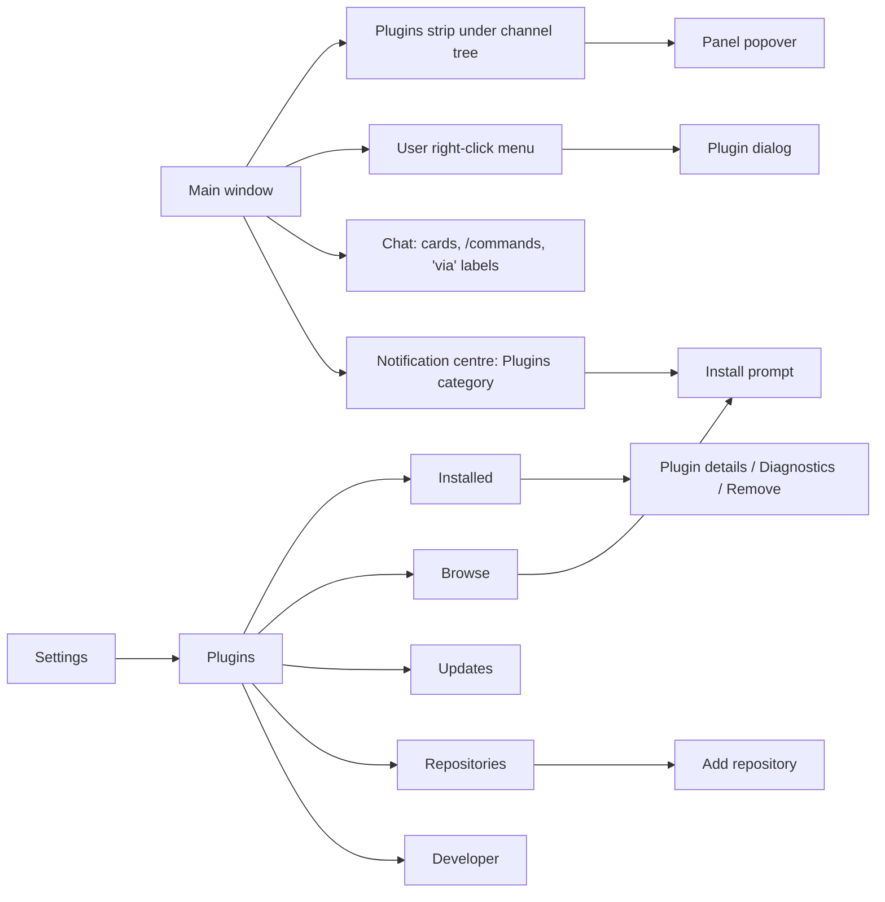
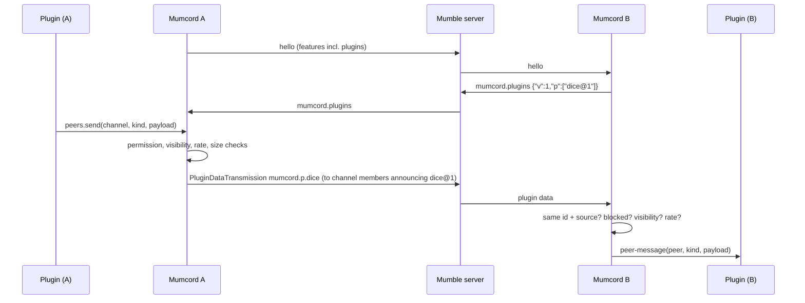
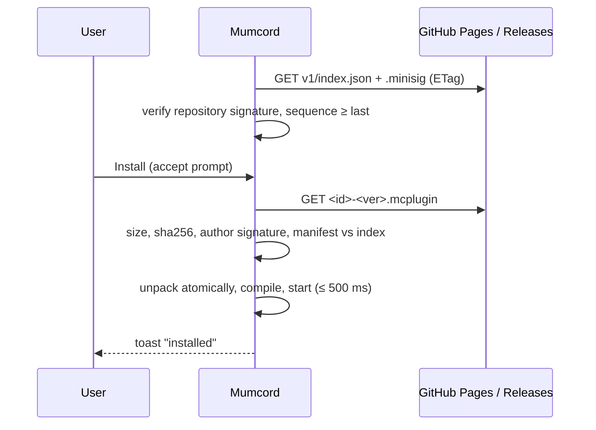
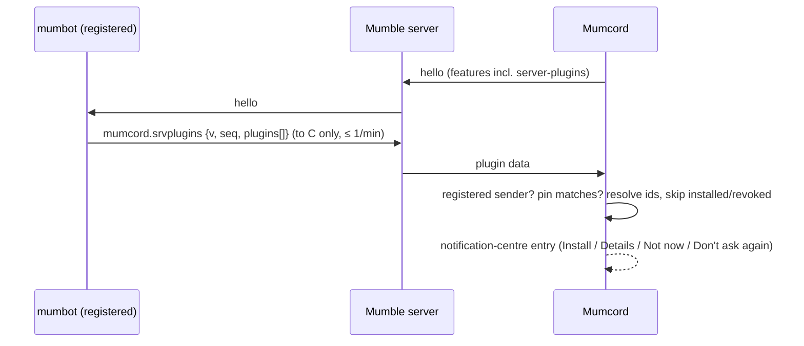
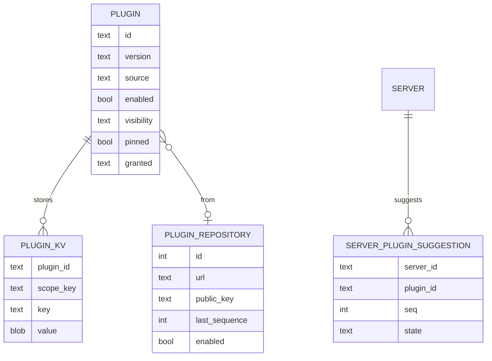
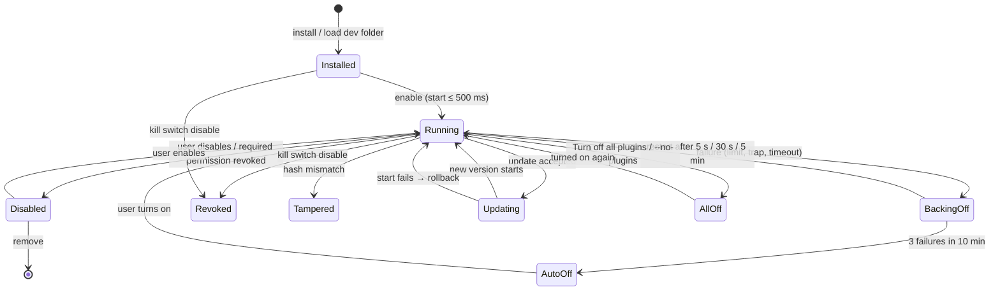

# Epic 3.1 – Plugin system · Specification

> Status: Final (brainstorming completed; open points in section 13 carry a recommended default) · As of: 2026-11-01
> Sources: milestone 0.6.0 – overview issue #267, issues #264, #268 … #281, #283 … #285, #310, Mumcord/mumbot#20, closed PR #297 (branch `feat/plugins-runtime-manifest`), `specs/06-plugin-system-brainstorming.md` (rounds 1–5, answered 2026-11-01). There is no `specs/roadmap.md`; the issues are the roadmap for this epic.
> Builds on: `specs/01-foundation-specification.md`, `specs/02-multi-server-themes-specification.md`, `specs/03-comfort-polish-specification.md` (notification centre, blocking, Do Not Disturb, identity manager, Settings window, packet inspector, updater FR-3.146), `specs/04-mumpeer-relay-specification.md` (registered-bot announcement pattern FR-4.8 … FR-4.10, FR-4.24 … FR-4.28).
> Numbering: requirements and criteria use the spec file number (`FR-6.n`, `AC-6.n`) so they never clash with Epic 3's `FR-3.n`. Where this spec and an issue differ, this spec wins.
> Repositories: `Mumcord/mumcord` (client, runtime, SDK, CLI), `Mumcord/plugins` (new: registry, official plugins, docs, template), `Mumcord/mumbot` (module `plugins`).

## 1. Goal & context

Mumcord users want small extras on top of voice chat – polls, dice rolls, virtual pets, controlling a music bot – without each one being built into the client and without anything on the Mumble server. This epic adds a plugin system: plugins are small WebAssembly programs that run in a strict sandbox inside Mumcord, draw their interface through building blocks Mumcord renders, and talk to the same plugin of other Mumcord users only through standard Mumble "plugin data" messages. Plugins are installed from a signed official registry (`Mumcord/plugins`) or from up to ten pinned third-party repositories, update automatically, and can be switched off remotely by a kill switch. Version 0.6.0 ships the whole system plus four official plugins (Poll, Dice roller, Echolings, Mumbot Music) and the tools authors need. The Mumble server stays unmodified; users of the official Mumble client see a plain text line where it matters and nothing else.

## 2. Scope

### 2.1 In scope (MVP)

All parts ticked in Q1.1 ship in 0.6.0:

- **Runtime and safe mode** (#268): wasmtime component model, no WASI, one thread per plugin, memory and time limits, crash back-off, "Turn off all plugins", `--no-plugins`, Diagnostics.
- **Package format** `.mcplugin` and `manifest.json` (#269).
- **Host API** (#270): events, storage, timers, clock, notifications, theme, log, secure random bytes, secrets, host-mediated HTTP (official only).
- **Permissions** (#275): the catalogue of section 4.4 with install prompt and runtime toggles.
- **Signing** (#276): minisign repository and author keys, verification, re-hash per app version.
- **Plugin messaging** (#271) with the rate rules of Q3.3 and reach of Q3.5.
- **UI slots and components** (#274) incl. `user-menu`, `dialog` and the sandboxed web view for official plugins (Q2.3).
- **Chat integration**: slash commands, `chat.send` after a user gesture, hiding superseded fallback lines.
- **Official registry** (#272) on GitHub Pages of `Mumcord/plugins` (Q4.7), review with one approval (Q4.1).
- **Settings → Plugins** (#277): Installed, Browse, Updates, Repositories, Developer.
- **Updates and kill switch** (#278) with a separate plugin update setting (Q4.2, Q5.2).
- **Developer tools** (#273): `mumcord-plugin` CLI, `mumcord-plugin-sdk` crate, template, docs; Developer mode folder loading (Q5.1).
- **Third-party repositories** (#280), up to 10 (Q4.4).
- **Server-suggested plugins** via mumbot (#283, mumbot#20), level "recommended" only (Q4.5).
- **Website data contract** (#281): data and signatures only, no website change.
- **Official plugins**: Poll (#284), Dice roller (#285), Echolings (#279/#264, incl. Echo Echo and Snack Race), Mumbot Music (#310).

### 2.2 Out of scope / later

- Plugin logic in any language other than Rust (Q2.3 overrides Q1.3); JavaScript/TypeScript plugins later.
- Installing a plugin from a file (Q4.3); `plugin_install_file` and "Install from file" are not built. Only Developer mode folder loading exists (Q5.1).
- Web views, `net.http` and `secrets` for third-party plugins (Q1.5, Q2.3).
- Server-suggestion level "required" (Q4.5).
- Plugin audio (playing or capturing sound), access to chat text, files, microphone, certificates, passwords, clipboard, Mumcord settings or other plugins' data.
- Server-side plugins, Mumble server changes, a Mumcord backend, paid plugins, ratings, download counts, popularity sorting.
- Mobile platforms.
- Plugin messages across servers or to other channels.
- A native "canvas" building block (Q3.2: Snack Race uses the web view).
- Deep link that adds a third-party repository; only `mumcord://plugins/<id>` for official plugins.
- Building or changing the Mumcord website (`mumble-www`, `mumcord-www-deploy`); only the data contract of #281.
- Mumbot Music features the bot does not support yet: pause, remove queue item, reorder, seek, file list (hidden until the bot supports them; bot work tracked in `Mumcord/mumbot`).
- Echolings sounds (dropped in the plugin version, #279).

## 3. Roles & permissions

| Role | Action | Enforced by |
|---|---|---|
| Mumcord user | Browse, install, enable, disable, remove plugins; grant optional permissions; choose visibility; add third-party repositories; turn off all plugins | Client |
| Mumcord user with Developer mode on | Additionally load an unpacked plugin folder (unsigned allowed), see plugin logs | Client |
| Plugin (running code) | Only what its granted permissions allow, inside the limits of section 4.1; never network, files, audio, certificates or settings unless listed as official-only in 4.4 | Client host (every call checked) |
| Official plugin (signed via the `Mumcord/plugins` index) | Additionally `net.http`, `secrets`, `ui.webview` if granted | Client host (official status from signature, FR-6.51) |
| Plugin author (third party) | Build, sign with own author key, publish in a third-party repository or propose to `Mumcord/plugins` | Registry review + signatures |
| Mumcord maintainer | Review and approve official plugins and permission changes (one approval + green CI); sign index and `revoked.json` | GitHub branch protection, protected environment |
| Third-party repository operator | Publish a signed index for up to their own plugins; can never use official ids | Client (pinned key, id rules) |
| Mumble server admin | Register the mumbot account once (for suggestions). No server config change, no server plugin | Mumble server ACLs |
| mumbot operator | Configure up to 8 suggested plugins in the bot's TOML | mumbot |
| Official Mumble client user | Sees `chat.send` fallback lines as normal text; ignores plugin data | — |
| Blocked user (FR-3 blocking) | Nothing from them is delivered to any plugin | Client host |

The Mumble server only relays plugin data and text messages under its normal ACLs and rate limits; everything plugin-specific is enforced in the client.

## 4. Functional requirements

### 4.1 Runtime & safe mode (#268, Q1.10)

- **FR-6.1** Plugins are WebAssembly components run by wasmtime with the component model and **no WASI**. A plugin may import only the host interfaces of the WIT package `mumcord:plugin@1.x`; any other import (incl. WASI) fails the load with "This plugin uses features Mumcord does not provide".
- **FR-6.2** Each running plugin has its own wasmtime store and its own OS thread `mumcord-plugin-<id>`, an event queue of 256 entries (oldest non-UI events dropped first and counted as drops) and coalesced talking events (≤ 10 per second).
- **FR-6.3** Limits per plugin: linear memory 32 MiB (the manifest may lower it), table 10 000 elements, 16 instances, 8 tables, 1 memory; epoch tick 10 ms; start call ≤ 500 ms; every other call ≤ 50 ms. Exceeding any limit is a failure.
  - *Addendum 2026-11-01:* the 50 ms budget counts the plugin's own code; time waiting in host storage doesn't count, with a 500 ms hard cap per call.
  - *Addendum 2026-11-02 (F54):* waiting for the OS keychain (`secrets`) can mean waiting for the user (a wallet unlock or keychain permission prompt), so it doesn't count against the budget or the 500 ms hard cap; it has its own cap of 2 minutes per call. At that cap the call returns `not-permitted`; the plugin is never stopped for it. Other storage waits keep the 500 ms cap. The user's own secret writes (password fields) run outside the plugin-service lock.
  - *Addendum 2026-11-01 (F38):* official plugins may bundle a whole web app with its data and images (eve-fit: eveship.fit, about 36 MB in about 6,300 files). For packages from the official index the limits are raised to ≤ 64 MiB packed, ≤ 96 MiB unpacked and ≤ 10,000 files (this replaces the 400-file addendum above), and a single file under `web/` may be up to 16 MiB. `assets/` stays at 512 KiB per file. Third-party, repository and developer plugins keep 5 MiB / 8 MiB / 200 files. `web/` may additionally contain `.json`, `.wasm` and `.woff2` files; to use them the frame's policy now lets the page fetch data, load fonts and compile WebAssembly from its own plugin folder only (still no network access). The official index may list packages up to 64 MiB; a repository index still only 5 MiB. Downloads get a time budget that grows with the size (at least 120 s, 256 KiB/s minimum speed).
- **FR-6.4** Failure handling: the plugin is stopped and restarted after 5 s, then 30 s, then 5 min; after 3 failures within 10 min it is switched off with "Turned off after repeated crashes" in Settings → Plugins and a notification-centre entry. Turning it on again resets the counter. A failure never affects voice, other plugins or the UI.
- **FR-6.5** Plugins run while disconnected; server-dependent events and messaging are simply absent.
- **FR-6.6** "Turn off all plugins" (Settings → Plugins header and command palette) stops all plugins immediately and keeps them off across restarts until turned on again. The command-line flag `--no-plugins` starts Mumcord with no plugin loaded for that run, shown as a banner in Settings → Plugins.
- **FR-6.7** Compiled modules are cached at `<cache>/plugins/<sha256>.cwasm` and invalidated when the package hash or the Mumcord version changes.
- **FR-6.8** Each plugin has a log ring buffer (200 lines × 200 characters). Settings → Plugins → plugin → Diagnostics shows CPU time, memory, dropped events, dropped messages, restarts and (Developer mode only) the log.
- **FR-6.9** The paused work of PR #297 (crate `crates/plugins`, manifest parser, package reader, runtime, WIT `types` + `log`) is the starting point; its permission list is replaced by section 4.4 (Q1.10).

### 4.2 Package & manifest (#269)

- **FR-6.10** A package is a `.mcplugin` zip: ≤ 5 MiB packed, ≤ 200 files (official plugins ≤ 400, see addendum below), ≤ 8 MiB unpacked; no symlinks, no `..`, no absolute paths, no case-only name clashes. Required: `manifest.json`, `plugin.wasm`, `i18n/en.json`. Optional: `assets/` (SVG, PNG, WebP, each ≤ 512 KiB), other `i18n/<lang>.json`, `web/` (only with `ui.webview`, FR-6.48). Official plugins must contain `README.md` and `LICENSE`.
  - *Addendum 2026-11-01:* the file limit for official plugins is raised from 200 to 400 (large icon sets); third-party, repository and developer plugins stay at 200. The 5 MiB packed and 8 MiB unpacked limits are unchanged (120 extra ~4.5 KB SVGs add about 540 KB).
- **FR-6.11** `manifest.json` (≤ 16 KiB, JSON only): `manifest` (format version 1), `id` (`^[a-z][a-z0-9-]{2,31}$`, prefixes `mumcord-` and `core-` reserved), `name` (≤ 32 chars), `description` (≤ 140 chars), `version` (semver), `api` (caret range, major ≥ 1), optional `mumcord` (version range), `authors`, `license` (SPDX), `categories` (from fun, games, chat, voice, accessibility, looks, tools), `permissions.required[]`, `permissions.optional[]` (string or `{id, suggested}`), optional `limits.memory_mib`, `storage.quota_kib` (≤ 1024), `messaging.max_payload`, `messaging.default_visibility`, `commands[]` (FR-6.43), `net` (FR-6.37), `icon`.
- **FR-6.12** Unknown manifest fields are ignored; unknown permission ids fail the load with the id named. An official-only permission (section 4.4) in a non-official package fails the install with "This permission is only available to official plugins".
- **FR-6.13** API compatibility: a package whose `api` range the running Mumcord does not provide shows "Needs a newer Mumcord" (or "Made for an older Mumcord") and is not loaded. A WIT minor version is a new package version (e.g. `@1.1.0`) linked alongside the older 1.x versions, so plugins built against those keep loading; a new major is breaking and the previous major stays supported for two Mumcord releases.
  - *Addendum 2026-11-01 (H4):* WIT `mumcord:plugin@1.0.0` is frozen at the 0.6.0 release. Adding enum or variant cases or record fields breaks old binaries (wasmtime checks exact case counts). Later changes need a new package version (`@1.1.0`) linked alongside 1.0.0, with host-side tree conversion. Before 0.6.0, changes to 1.0.0 are allowed with the lead's approval and require rebuilding every plugin built against it; `crates/plugins/tests/wit.rs` pins the shape.
- **FR-6.14** On start, a plugin learns its previous installed version (or none) so it can migrate its own data.
- **FR-6.15** Installed packages live in `<data>/plugins/<id>/<version>/`; install and update are atomic (unpack to a temp folder, verify, rename).

### 4.3 Host API (#270)

- **FR-6.16** Events delivered (each only with the permission in section 4.4): talking, joined/left channel, screen share started, chat activity (sender and channel, never text), mention of me (no text), self changed, theme changed, language changed, settings changed, ui-action, timer, peer-message, profile-card-opened, panel-visibility-changed, user-menu-requested, dialog-closed.
  - *Addendum 2026-11-01 (H3):* chat-side events (chat activity, mention of me, chat patterns, chat triggers, chat history replay) come from the user's current channel on **every** connected server, not only the voice server. Replies (`chat.send`), new chat cards, `chat.supersede` and `chat.replace`/`chat.hide` act in the chat of the server the handled event came from; outside such an event (timers, panel clicks, older plugins) they go to the voice server as before, never to another server. Blocked users and the per-sender rate limits apply per server. Voice-side events and calls (joined/left, talking, screen share, self changed, presence, `peers.*` messages, FR-6.33) stay on the voice server. No WIT change.
- **FR-6.17** A plugin can ask once for a snapshot of "who is in my channel" (requires `events.presence`).
- **FR-6.18** Users appear to plugins as `peer`: session id, display name, and `peer.key` = HMAC(per-install secret, plugin id, certificate hash). The key is stable across sessions and restarts, different per plugin, and **absent** for users without a certificate; plugins must handle the absent case. Plugins never see certificate hashes, IPs or user ids.
- **FR-6.19** Nothing from or about a blocked user is delivered to any plugin (events, messages, snapshots).
- **FR-6.20** Storage: key–value per plugin with scope `identity` (per Mumcord identity) or `global`. No `server` scope; plugins that need per-server data prefix their keys (e.g. `bots/<server>/…`). Key ≤ 128 bytes, value ≤ 64 KiB, quota 256 KiB by default, up to 1 MiB if the manifest asks (Q5.4). Writes beyond the quota fail with `quota-exceeded`.
- **FR-6.21** Timers: ≥ 250 ms interval, ≤ 32 active per plugin. Clock resolution 1 s.
- **FR-6.22** Notifications (`notify`): an entry in the notification centre, category Plugins, with the plugin's name and icon. At most 1 per 10 min and 3 per day per plugin; never shown during Do Not Disturb or quiet time (dropped, not queued); each plugin's notifications can be switched off in its settings (Q3.6). No OS notification.
- **FR-6.23** Theme: the plugin can read the current theme tokens' names and light/dark mode, never raw CSS.
- **FR-6.24** `random.bytes`: up to 256 cryptographically secure random bytes per call from the OS generator (Q1.7).
- **FR-6.25** `secrets` (official only, Q1.6): named secrets in the OS keychain. A secret can be written only by the user through a `password` field in a plugin form or dialog; the plugin can never read it back; it can only reference it by name in a `net.http` header (FR-6.37). Secrets are deleted on "Reset data" and on remove with "Also delete its data". Without an available keychain the permission is unavailable and the plugin shows "Secure storage is not available on this system"; there is no plaintext fallback.
- **FR-6.26** `log`: plugin log lines go only to the plugin's ring buffer (FR-6.8), never to Mumcord's log files.

### 4.4 Permissions (#275, Q1.4 … Q1.7)

- **FR-6.27** The permission catalogue is closed: only the ids below exist. Risk colours: green (low), yellow (medium), red (high).

| Permission | Plain-language text in the prompt | Risk | Availability | Notes |
|---|---|---|---|---|
| `ui.panel` | Show a panel in the Plugins strip | green | all | slot `panel` |
| `ui.member-badge` | Show a small badge next to user names | green | all | max 1 badge per user overall (FR-6.52) |
| `ui.profile-card` | Add a section to profile cards | green | all | |
| `ui.chat-card` | Show cards in the chat | green | all | also `chat-decoration` |
| `ui.user-menu` | Add an entry to a user's right-click menu | green | all | own-channel users only |
| `ui.dialog` | Open its own window | green | all | |
| `events.self` | Know your own status (mute, deafen, channel) | green | all | |
| `events.voice` | Know who is talking | yellow | all | |
| `events.presence` | Know who joins and leaves your channel | yellow | all | incl. snapshot FR-6.17 |
| `events.chat-activity` | Know when someone writes (not what) | yellow | all | never text |
| `peers.messages` | Exchange data with this plugin for other people in your channel | yellow | all | visibility choice, FR-6.33 |
| `notify` | Show notifications | green | all | limits FR-6.22 |
| `random.bytes` | Get secure random numbers | green | all | FR-6.24 |
| `commands` | Add chat commands such as `/roll` | green | all | FR-6.43 |
| `chat.send` | Post a chat message for you after you click or type a command | yellow | all | FR-6.44 |
| `chat.supersedes` | Hide its own text line for people who see its card | green | all | FR-6.45 |
| `net.http` | Talk to a server you choose | red | official only | FR-6.37 |
| `secrets` | Keep a secret (e.g. an API key) in your system keychain | red | official only | FR-6.25 |
| `ui.webview` | Show its own web content in a sealed frame (no internet) | yellow | official only | FR-6.48 |

- **FR-6.28** Never grantable to any plugin: raw network, files, microphone or audio, certificates, passwords, clipboard, other plugins' data, opening links without a click, Mumcord settings, chat text.
- **FR-6.29** Required permissions are fixed in the prompt; optional ones are toggles, off by default unless marked `suggested`. Refusing a required permission means not installing.
- **FR-6.30** Changes at runtime apply immediately: a revoked optional permission makes the related calls return `not-permitted` and stops the related events. Revoking a required permission disables the plugin.
- **FR-6.31** Grants are stored per plugin (`plugins.granted`) and checked in the host on every call, never in the UI.
- **FR-6.32** Permission texts exist in all Mumcord locales (24), with English as source.

### 4.5 Plugin messaging (#271, Q3.3 … Q3.5)

- **FR-6.33** A plugin with `peers.messages` reaches only users in the user's current channel on the current server, plus a direct message to one user in that channel (Q3.5). Visibility per plugin: Everyone / Friends / Nobody (default from manifest, chosen in the install prompt, changeable later). With Nobody nothing is sent or received; with Friends only friends' messages are delivered and only friends are sent to.
- **FR-6.34** Wire format: plugin data id `mumcord.p.<plugin-id>`; payload byte 0 envelope version (1), byte 1 plugin API major (low 7 bits; bit 7 = "sent directly to the receiver"), byte 2 kind, bytes 3… payload ≤ 997 bytes and ≤ `messaging.max_payload`. The sender is the Mumble session that sent it; payload fields never claim identity. Messages are delivered only between the same plugin id and the same source (FR-6.35).
- **FR-6.35** Announce: Mumcord adds hello feature `plugins` and sends `mumcord.plugins` (compact JSON `{"v":1,"p":["echolings@1","foo@1~a1b2c3d4"]}`, ≤ 32 entries) to peers with that feature, at most once per 10 s. Entry format: `<id>@<major>` for official plugins, `<id>@<major>~<first 8 hex of the repository key fingerprint>` for third-party plugins. Developer plugins are announced as `<id>@<major>~dev`. Plugins with visibility Nobody are not announced.
  - *Addendum 2026-11-01 (F45):* when the announced set gains a plugin (installed, enabled or made visible), the next announce goes out at once, skipping the 10 s interval once; removals and other changes stay throttled. When a peer in the user's channel newly announces a plugin with the same id and source (and visibility lets messages reach them), that plugin gets the new event `peer-ready(peer)` (permission `peers.messages`), so it can resend state a late joiner would get (Poll resends its open polls). This adds a case to the WIT `event` variant before 0.6.0 (lead-approved); every plugin built against the earlier 1.0.0 must be rebuilt.
- **FR-6.36** Rate rules: per plugin 1 message per 2 s sustained (burst 3). A plugin may start a **game burst**: up to 4 messages per second for 10 s, at most once per minute per plugin, only one plugin in burst at a time (Q3.3). All plugins together: 1 message per second sustained (burst 5), raised to 4 per second while a game burst runs. Mumcord's own features (watch party, screen share, relay, history sync, …) always have priority within the server's budget; plugin messages wait and are dropped (counted) after 10 s. Incoming: more than 5 per second per sender per plugin are dropped. Send errors: `not-permitted`, `too-large`, `rate-limited`, `no-recipients`, `hidden`.
- **FR-6.37** `net.http` (official only, Q1.5): Mumcord performs HTTP requests on the plugin's behalf only to hosts the user typed into a form of that plugin (manifest `net.hosts: "user-configured"`). Rules: exactly that host and port; no redirects; `https` required for public hosts, plain `http` allowed only for loopback and private network addresses; certificate verification with a clear error; request body ≤ 64 KiB, except one user-picked file per request via a file-picker handle ≤ 50 MiB; response ≤ 1 MiB; timeout 10 s (uploads 120 s); ≤ 5 requests per second per plugin. Headers may reference a secret by name (`X-API-Key: {secret:bot/…}`), inserted by the host. Requests and responses are never logged with content.
- **FR-6.38** Servers without plugin data support (< 1.4) or that reject it: plugins still run locally; everything shared is greyed out with "This server doesn't support shared plugin features" (Q3.4).
- **FR-6.39** The packet inspector shows `mumcord.p.*` messages as hex only, and `mumcord.plugins` / `mumcord.srvplugins` decoded.

### 4.6 UI slots & components (#274, Q2.5, Q2.7)

- **FR-6.40** Plugins describe their UI as a declarative tree; Mumcord renders it with its own components. Slots: `panel` (260×160 inline in the Plugins strip, 420×560 popover when expanded), `member-badge` (24 px / 16 px), `profile-card` (300×220, plugin answers within 500 ms or the section is skipped), `chat-card` (440×160, a local item, not a Mumble message), `chat-decoration` (16 px), `settings` (form), `user-menu` (one entry per plugin, own-channel users only, via `user-menu-requested(peer)`), `dialog` (open/close, focus trapped, `dialog-closed` event).
- **FR-6.41** Components: stack, text, image, sprite (≤ 12 fps, still frame with reduced motion), meter, button, icon-button, chip, divider, progress, list (≤ 50 rows, row actions, drag-to-reorder emitting `{from,to}`), toggle, select (refreshable), slider, text-input (≤ 64 bytes, character counter), password (writes to `secrets` only), file-picker (returns an opaque handle usable only with `net.http`), countdown. Colours are theme tokens only; animation presets bob, hop, wave, nap, sparkle, shake, fade (all stop with reduced motion).
- **FR-6.42** Limits per slot: 500 nodes, 16 KiB tree, 20 updates per second, text 200 chars. SVG assets are sanitised at install and shown via `` blob URLs. Every interactive component needs an accessible label (load-time check; missing labels fail the tree with a Diagnostics entry).

### 4.7 Chat integration (Q1.4, Q1.7)

- **FR-6.43** `commands`: slash commands declared in the manifest (`name` 2–16 chars `[a-z0-9-]`, description, usage). The chat box autocompletes them with the plugin name. Built-in Mumcord commands win on name clashes; between plugins the first installed wins and the other shows "Command taken by <plugin>" in its settings. The typed command text is never sent as chat; it goes to the plugin as a `ui-action`.
- **FR-6.44** `chat.send`: a plugin can post one plain-text Mumble message into the user's current channel only within 8 s after a user gesture for that plugin (button click or slash command), one message per gesture, ≤ 500 chars. The text is prefixed with the plugin name (e.g. "[Poll] …") so official Mumble clients also see where it came from; Mumcord shows it with a "via Poll" label. A plugin can never post without a gesture.
- **FR-6.45** `chat.supersedes`: a plugin card or message may carry a 4-byte hash of a fallback line. A receiving Mumcord with that plugin enabled hides a text message from the same session within 10 s whose text hash matches, and shows the card instead with "Show text" to reveal the line. Without the plugin the line shows normally.

### 4.8 Web view (official only, Q2.3, Q3.2)

- **FR-6.46** An official plugin with `ui.webview` may ship HTML, CSS, JS and images in `web/` and show them in the large panel popover or in a dialog.
- **FR-6.47** The web view is a sandboxed frame with an opaque origin: no network (CSP `default-src 'none'` plus inline/package-local script, style and image only), no Tauri IPC, no storage, no navigation, no popups, no access to the Mumcord window. It talks only to its own plugin through a message bridge (≤ 16 KiB per message, ≤ 60 per second); the plugin decides what to share via the normal API.
  - *Addendum 2026-11-01 (EV3):* successful responses for a plugin's `web/` files carry `Access-Control-Allow-Origin: *` (never `Allow-Credentials`), because the frame's opaque origin makes CSS masks, `fetch` and fonts CORS requests. Not-found answers get no such header. The per-frame CSP stays the guard: a frame may only reach its own plugin's folder.
- **FR-6.48** `web/` counts toward the package limits of FR-6.10; it is loaded only if `ui.webview` is granted; keyboard focus enters and leaves the frame with Tab/Escape.

### 4.9 Signing & trust (#276)

- **FR-6.49** The official repository key (minisign, ed25519) is compiled into Mumcord: one active key plus one offline backup key. It signs `index.json` and `revoked.json`.
- **FR-6.50** The index pins one or more author keys per plugin id. Install checks in order: size, SHA-256 against the index, author signature, manifest vs. index entry (id, version, permissions). Any mismatch aborts with a clear reason.
- **FR-6.51** A plugin is **official** only if it came from the official index with a valid signature, matching hash and valid author signature. Official ids can never be used by third-party repositories or developer plugins.
- **FR-6.52** Each Mumcord version re-hashes installed packages at first start; a mismatch disables the plugin with "Files of this plugin were changed".
- **FR-6.53** Development builds accept a test repository key from `MUMCORD_PLUGIN_REGISTRY_KEY`; release builds ignore it.

### 4.10 Official registry (#272, Q4.1, Q4.7)

- **FR-6.54** `Mumcord/plugins` holds the registry source (`plugins/<id>/plugin.toml`, `versions/<ver>.toml`, media), the official plugins' source code (one folder per plugin), `policy/REVIEW.md`, `revoked.toml`, docs, schemas and the template.
- **FR-6.55** Published on GitHub Pages: `https://mumcord.github.io/plugins/v1/index.json` (+ `.minisig`), `v1/revoked.json` (+ `.minisig`), `v1/permissions.json`, media. Packages are release assets `<id>-v<ver>/<id>-<ver>.mcplugin`. The index has a monotonic `sequence`; the client rejects a lower sequence than the last seen (rollback protection).
- **FR-6.56** Review: a new plugin, a new author key or a new permission needs one maintainer approval and green CI (schema, reproducible rebuild, author signature, permission-diff comment, mock-host load test, licence scan) (Q4.1). Policy: OSI licence, reproducible build, no ads, tracking, payments or loot boxes.
- **FR-6.57** Client fetching: ETag cache, works offline with the cached index, sends no identifiers and no list of installed plugins, `User-Agent: Mumcord`. An optional repository mirror can be set under Settings → Plugins → Repositories → Advanced.

### 4.11 Settings → Plugins (#277, Q1.9, Q2.6, Q2.8)

- **FR-6.58** New Settings section "Plugins" after Privacy with tabs Installed, Browse, Updates, Repositories and (Developer mode only) Developer. Command palette entry "Plugins".
- **FR-6.59** Browse lists the official index (and enabled third-party repositories) by category with search; Echolings has a highlighted card at the top (Q1.9). No plugin is preinstalled and there is no first-run promotion.
- **FR-6.60** Install flow: permission prompt → download → verify (FR-6.50) → unpack → start → toast "<name> installed". The prompt lists plain-language permissions with risk colours, required fixed, optional as toggles, the visibility choice when `peers.messages` is present, and red rows for `net.http` and `secrets` (Q2.6).
- **FR-6.61** Unofficial plugins carry "Unofficial · <repository name>" on every card, prompt and settings row, and the first install from each third-party repository shows a one-time warning (Q2.8). Developer plugins carry "Developer plugin".
- **FR-6.62** Installed: per plugin enable toggle, permissions, visibility, notifications switch, plugin settings form, Pin version, Diagnostics, Export data (JSON file chosen by the user), Reset data, Remove. Remove asks with "Also delete its data" (off by default); kept data is deleted after 30 days; reinstalling within 30 days restores it (Q5.3).
- **FR-6.63** Member badge: at most one plugin badge next to a user name (Q2.7). Setting "Badge shown next to names": one installed plugin with `ui.member-badge` or None; default is the first plugin installed that has the permission.
- **FR-6.64** Plugins strip (Q2.5): under the channel tree, one icon per enabled plugin with a panel, the active plugin's panel below, "Expand" opens the 420×560 popover. Collapsed by the user, it stays collapsed. Hidden entirely when no plugin with a panel is enabled.
- **FR-6.65** Deep link `mumcord://plugins/<id>` opens the details of an official plugin in Browse; it never installs.

### 4.12 Updates & kill switch (#278, Q4.2, Q4.6, Q5.2)

- **FR-6.66** Separate setting "Plugin updates": Install automatically (default) / Notify only / Off, independent of the app updater. Checked at app start and every 6 hours while running (not when Off).
- **FR-6.67** Automatic install happens only if the update needs the same or fewer permissions and is signed by the same author key; otherwise it waits in the Updates tab and asks. Per-plugin "Pin version" excludes it from updates.
- **FR-6.68** If an updated plugin fails to start, Mumcord rolls back to the previous version and shows the reason in the Updates tab.
- **FR-6.69** Update availability shows in the Updates tab and as a notification-centre entry (no OS notification).
- **FR-6.70** Kill switch: `revoked.json` entries `{id, versions | sha256, author_key?, severity: disable | warn, reason (en/de/es), since}`. It is fetched once a day even when plugin updates are Off (Q4.6), and a copy is bundled with each Mumcord release. `disable` stops and disables matching plugins with the reason; `warn` shows the reason on the plugin row. Official revocations apply to all sources. Data is never removed by revocation.

### 4.13 Developer tools & Developer mode (#273, Q2.1, Q5.1)

- **FR-6.71** CLI `mumcord-plugin` (in `Mumcord/mumcord`, `tools/mumcord-plugin`): `new`, `build [--reproducible]`, `check`, `keygen`, `sign`, `test` (mock host with YAML scenarios, same runtime as the client), `preview` (renders UI trees), `serve-registry` (local fixture registry signed with a test key), `publish-pr`, `site-data`.
- **FR-6.72** SDK crate `mumcord-plugin-sdk` with a `#[plugin]` macro, target `wasm32-wasip2` with no WASI imports. Template and docs live in `Mumcord/plugins`. SDK, CLI and template are Apache-2.0; official plugins are AGPL-3.0-or-later (Q2.1). The canonical WIT and JSON schemas live in `Mumcord/mumcord` and are published per API release as `plugin-api-<ver>.tar.gz`.
- **FR-6.73** Developer mode (Settings → Advanced, off by default): adds the Developer tab where an unpacked plugin folder can be loaded (unsigned allowed), reloaded and unloaded, and shows plugin logs. Such plugins carry "Developer plugin" everywhere, are never official, can never get official-only permissions and are unloaded when Developer mode is turned off. Normal users never see it (Q5.1).

### 4.14 Third-party repositories (#280, Q4.4)

- **FR-6.74** Users add up to 10 repositories by HTTPS address (plain `http` only for localhost in Developer mode), with an optional "Expected key". The add dialog shows the repository name, homepage, contact and key fingerprint; the key is pinned on first use.
- **FR-6.75** A key change pauses the repository and asks the user, unless the new index carries a `key_rotation` entry signed by the old key. Each repository has an on/off toggle; turning it off disables its plugins.
- **FR-6.76** Repository index ≤ 2 MiB and ≤ 500 plugins; it cannot list official ids or reserved prefixes (those entries are ignored with a note). Official revocations apply to third-party plugins too.

### 4.15 Server-suggested plugins (#283, mumbot#20, Q4.5)

- **FR-6.77** Mumcord adds hello feature `server-plugins`. It accepts `mumcord.srvplugins` (JSON `{v, seq, plugins:[{id, min, src, key?, for}]}`, ≤ 8 entries, `for` ≤ 40 chars) only from a registered sender, pinned per server and identity on first use (same rules as FR-4.8 … FR-4.10; shared pin if the same bot also announces the relay). Others are ignored with "sender not registered" in the inspector.
- **FR-6.78** Every suggestion is "recommended" (Q4.5); an unknown `level` field is ignored. Official ids are resolved against the official index; revoked plugins are never suggested; already installed plugins are skipped; third-party entries open the Add repository dialog with the announced key as Expected key.
- **FR-6.79** Suggestions appear in the notification centre (category Plugins, badge only, no OS notification, silent in Do Not Disturb) with Install, Details, Not now (until `seq` changes or 30 days) and Don't ask again for this server. Nothing is sent back to the bot.

### 4.16 Website data (#281)

- **FR-6.80** The official index carries per plugin: summary, `description_md_url`, i18n names, icon, screenshots with alt text, latest version, updated date, reviewed flag; plus `v1/permissions.json` with the shared permission texts. The publish workflow ends with a `repository_dispatch` event `plugins-published` (owner-provided token); `mumcord-plugin site-data` produces the same data locally. No website repository is changed by this epic.

### 4.17 Official plugins (Q1.1, Q2.1, Q2.4)

All four are AGPL-3.0-or-later, live in `Mumcord/plugins`, and are built, reviewed and signed like any official plugin.

- **FR-6.81 Poll** (`poll`, #284): create a poll (question ≤ 200 bytes, 2–10 options ≤ 40 bytes each) from the panel; kinds 1 create, 2 vote (voter → creator only), 3 tally (creator → all, ≤ 1 per 2 s), 4 voter list (named, ≤ 100). The creator's client is the authority; late joiners get a resend; "Creator left, poll is frozen" when the creator is gone. Votes are counted per `peer.key`, or per session for users without a key. A text fallback line via `chat.send` at creation and close, superseded for Mumcord users. Permissions: required `ui.panel`, `ui.chat-card`, `peers.messages` (default Everyone), `chat.send`, `chat.supersedes`; optional `events.presence` (suggested), `notify`.
- **FR-6.82 Dice roller** (`dice`, #285): `/roll` with d20, 2d6+3, advantage/disadvantage, drop lowest/highest; ≤ 20 dice, 2–1000 sides. Commit–witness–reveal (kinds 1 commit, 2 witness, 3 reveal; SHA-256 with tag "mcdice1", HMAC stream, rejection sampling, ≤ 2 witnesses, 0–1.5 s random delay, 5 s reveal timeout) using a game burst (FR-6.36); results show "Verified", "Unverified (rolled alone)" or "Not revealed" (void). Plain-text fallback line via `chat.send`, superseded for Mumcord users. Permissions: required `ui.chat-card`, `peers.messages` (Everyone), `chat.send`, `chat.supersedes`, `random.bytes`, `commands`; optional `ui.panel` (history).
- **FR-6.83 Echolings** (`echolings`, #279/#264): the pet design of #264 (5 species, 4 stages, 3 colours, Cheer/Energy/Bond, Notes with daily caps, Pat/Treat/Play/Nap, streaks with one rest day per week, pets never die, DND = pet sleeps, no paid items, animation Full/Subtle/Still, no sounds). Social: member badge, profile card section, reactions, visits (1 pat per friend per day), mini-games Echo Echo (native components) and Snack Race (web view). Pet card ≤ 100 bytes, sent at most once per minute; storage scope `identity`; default visibility Friends; memory limit 16 MiB; package ≤ 2 MiB. Disabling the plugin hides all pets and stops traffic. Permissions: required `ui.panel`, `ui.member-badge`, `ui.profile-card`, `events.voice`, `events.presence`, `events.self`; optional `peers.messages`, `ui.chat-card`, `notify`, `events.chat-activity`, `ui.webview` (suggested; without it Snack Race is hidden).
- **FR-6.84 Mumbot Music** (`mumbot-music`, #310): right-click a user in the current channel → "Configure bot" opens a dialog asking for the bot's address and API key with "Test connection" (Save disabled until it passes); once configured, the dialog shows now playing, skip, stop, volume, queue, add track (file / URL / upload), "play next, interrupt", Edit address/key, Remove this bot. Config per bot keyed `bots/<server>/<peer-key>`; API key in secret `bot/<server>/<peer-key>`; polling every 2 s only while the dialog is open. When the bot leaves the channel the menu entry disappears and the dialog shows "Mumbot is not in your channel". Settings → Plugins → Mumbot Music lists saved bots with Edit and Remove. Permissions: required `ui.user-menu`, `ui.dialog`, `events.presence`, `events.self`, `net.http`, `secrets`; optional `notify`. Pause, remove, reorder, seek and file list stay hidden until mumbot supports them.

## 5. UI & UX

### 5.1 Navigation



### 5.2 Plugins strip and panel

```text
┌───────────────────────┬───────────────────────────────┐
│ ▾ Lobby               │  #Lobby chat                  │
│   🟢 Anna  🐣          │  [Poll] Pizza or pasta?  via Poll
│   ⚪ Ben               │  ┌ Poll card ─────────────┐    │
│                       │  │ Pizza ▓▓▓▓░  3  [Vote] │    │
├───────────────────────┤  └────────────────────────┘    │
│ 🧩 Plugins  [🐣][🎲][📊]│                               │
│ ┌ Echolings ── [⤢] ─┐ │                               │
│ │ Fizzle  ♥♥♥  [Pat]│ │                               │
│ └───────────────────┘ │  > /roll 2d6+3                 │
└───────────────────────┴───────────────────────────────┘
```

Icons are buttons with the plugin name as label; arrow keys move between them; Enter activates; "⤢" opens the popover (Escape closes).

### 5.3 Install prompt

```text
┌ Install Dice roller? ────────────────────────────────┐
│ Dice roller 1.0.0 · by Mumcord · Official            │
│ Required                                             │
│  🟢 Show cards in the chat                            │
│  🟡 Exchange data with this plugin for people in      │
│     your channel        Who: (•) Everyone ( ) Friends│
│  🟡 Post a chat message for you after you click       │
│  🟢 Get secure random numbers                         │
│  🟢 Add chat commands such as /roll                   │
│ Optional                                             │
│  [ ] 🟢 Show a panel in the Plugins strip             │
│                              [Cancel]  [Install]     │
└──────────────────────────────────────────────────────┘
```

Unofficial plugins show "Unofficial · <repository>" under the title; the first install per repository adds a warning box with "I understand" before Install becomes active. Red rows use both colour and a "High risk" text (not colour alone).

### 5.4 Settings → Plugins → Installed

```text
┌ Plugins ─────────── [Turn off all plugins] ───────────┐
│ Installed | Browse | Updates (1) | Repositories        │
│ 🐣 Echolings 1.2.0  Official        [on ]  [⋯]        │
│ 🎲 Dice roller 1.0.0 Official       [on ]  [⋯]        │
│ 🧪 my-plugin 0.1.0  Developer plugin [on ]  [⋯]        │
│ 🔧 foo 2.0.0  Unofficial · Foo Repo  [off]  Turned off │
│                     after repeated crashes            │
│ Badge shown next to names: [Echolings ▾]              │
└───────────────────────────────────────────────────────┘
```

### 5.5 Remove dialog

"Remove Echolings?" · checkbox "Also delete its data" (off) · hint "Kept data is deleted after 30 days. Reinstall before then to get it back." · [Cancel] [Remove].

### 5.6 Mumbot Music dialog

Right-click on a user in the own channel → "Configure bot" → dialog (setup form: Address, API key [password], Test connection, Save) or player (now playing, controls, volume slider, queue list, Add track, Edit address/key, Remove this bot). Errors: "Can't reach the bot at <address>", "The API key was rejected", "Plain http is only allowed for local addresses", "The bot's certificate is not valid".

### 5.7 Messages, empty states, errors

- Strip on a server without plugin data: shared parts greyed, tooltip "This server doesn't support shared plugin features".
- Browse offline: "Showing the last known plugin list (offline)"; never fetched: "Can't load the plugin list. Check your connection."
- Verification failures: "Download didn't match the official list", "Signature check failed", "This plugin asks for permissions not listed in the repository".
- Repository key change: "The key of <name> changed. Its plugins are paused until you decide." [Trust new key] [Keep paused] [Remove repository].
- Revoked: "Turned off by Mumcord: <reason>".
- `--no-plugins` banner: "Plugins are off for this session (started with --no-plugins)".
- Empty Installed: "No plugins yet. Browse plugins" (button).

### 5.8 Design notes

Light and dark themes via tokens; plugin UI uses tokens only so it follows the theme automatically. Scaling follows system settings. Reduced motion stops sprites and animations and switches Echolings to Still. All plugin components keyboard operable with screen-reader labels; dialogs and web views trap and return focus. Notification-centre and prompt texts in all 24 locales.

## 6. Audio & network

### 6.1 Audio

Plugins have no audio access at all. The audio thread is never touched by plugin code: talking state reaches plugins through the engine's existing event path, coalesced to ≤ 10 per second, on the plugin's own thread. Voice must stay smooth with 5 plugins active and 20 bots in the channel (AC-6.24).

### 6.2 Plugin messaging sequence



### 6.3 Install and verify sequence



### 6.4 Server suggestion sequence



### 6.5 Protocol compatibility

- Uses only standard Mumble messages: `PluginDataTransmission` (server ≥ 1.4, 1000-byte limit, default server limit 4 per second, burst 15) and normal text messages for `chat.send`. Official Mumble clients ignore the unknown data ids.
- New plugin data ids: `mumcord.p.<id>`, `mumcord.plugins`, `mumcord.srvplugins`. New hello features: `plugins`, `server-plugins` (within the hello limit of 16 features).
- Servers < 1.4 or with plugin data blocked: FR-6.38.
- Registry and downloads: plain HTTPS GETs to GitHub Pages / release assets and to third-party repository hosts; no Mumcord backend.

## 7. Data & state model

### 7.1 Stored data



**plugins**

| Field | Type | Required | Rules / notes |
|---|---|---|---|
| id | text | yes | primary key, FR-6.11 rules |
| version | text | yes | semver of the active version |
| previous_version | text | no | for rollback (FR-6.68) |
| source | text | yes | `official`, `repo:<repository id>` or `dev:<folder path>` |
| sha256 | text | yes (not dev) | package hash, re-checked per app version |
| author_key | text | yes (not dev) | pinned author key |
| enabled | bool | yes | |
| disabled_reason | text | no | `crashes`, `revoked`, `tampered`, `user`, `permission` |
| visibility | text | yes | `everyone` / `friends` / `nobody` |
| granted | text (JSON) | yes | granted permission ids |
| pinned | bool | yes | default false |
| notifications | bool | yes | default true |
| removed_at | datetime | no | set when removed with data kept; data purged 30 days later |
| installed_at | datetime | yes | order for badge default and command clashes |

**plugin_kv**: plugin_id · text · yes; scope_key · text · yes (`global` or the identity id); key · text · yes (≤ 128 bytes); value · blob · yes (≤ 64 KiB); updated_at · datetime · yes. Quota per plugin across scopes (FR-6.20).

**plugin_repositories**: id · int · yes; url · text · yes (HTTPS); name · text · yes; public_key · text · yes (pinned); pinned_at · datetime · yes; enabled · bool · yes; paused_reason · text · no (`key-changed`); last_sequence · int · yes; last_checked · datetime · no. Max 10 rows.

**server_plugin_suggestions**: server_id · text · yes; identity_id · text · yes; plugin_id · text · yes; seq · int · yes; state · text · yes (`new`, `not-now`, `dismissed`, `installed`); until · datetime · no (Not now, 30 days); sender_pin · text · yes (shared pin table of spec 04 where applicable).

**Settings keys**: `plugins.updates` (`auto` / `notify` / `off`, default `auto`), `plugins.all_off` (bool), `plugins.badge_plugin` (plugin id or none), `plugins.mirror_url` (optional), `developer_mode` (bool), `plugins.last_official_sequence` (int), `plugins.revoked_checked_at` (datetime). Secrets live only in the OS keychain (service `Mumcord plugins`, account `<plugin-id>/<name>`).

Migrations take the next free store version at merge time.

### 7.2 Plugin lifecycle



## 8. Technology & architecture

- **wasmtime 50 with the component model, Cranelift, no WASI** (as in PR #297): mature, sandboxed by design, and lets us limit memory and time per call. Adds about 13.7 MB to the binary (4.5 MB compressed); accepted.
- **New crate `crates/plugins`** (runtime, host API, permissions, manifest, package, verify, registry client, rate limiter) – reused from PR #297. The engine hands it events and plugin data; the UI only renders trees and sends `ui-action`s through Tauri commands (`plugins_list`, `plugins_index`, `plugin_install`, `plugin_set_enabled`, `plugin_set_permissions`, `plugin_set_visibility`, `plugin_remove`, `plugin_export_data`, `plugin_reset_data`, `plugin_dev_load`) and events `plugins://changed`, `plugins://install-progress`, `plugin://ui`. The UI never talks to plugins or the network directly.
- **WIT package `mumcord:plugin@1.x`** split per interface (types, log, storage, timers, clock, notify, theme, random, peers, ui, chat, secrets, http, on-event) so additions stay small.
- **Signatures: `minisign-verify` + `sha2`**: small, audited-in-practice, no OpenSSL.
- **HTTP: existing `reqwest` with rustls** for registry, repositories and `net.http`, with redirects disabled for `net.http`.
- **Keychain: existing `keyring` crate** for `secrets`.
- **SVG and HTML sanitising: existing `ammonia`** plus an SVG allow-list for assets.
- **Web view: sandboxed iframe** with opaque origin and strict CSP inside the existing Tauri web view, fed from package files via blob URLs; no new runtime.
- **Store: existing SQLite `crates/store`** with new migrations.
- **SDK and CLI in `Mumcord/mumcord`** (`crates/plugin-sdk`, `tools/mumcord-plugin`, Apache-2.0), so the CLI's mock host is the same runtime the client uses; template, docs and official plugins in `Mumcord/plugins`.
- **Rust toolchain**: the plugins crate needs Rust ≥ 1.97 (PR #297).

## 9. Non-functional requirements

- **Performance:** voice unaffected with 5 plugins and 20 bots (no added jitter or dropouts, AC-6.24); idle plugin CPU < 1 % per plugin (Echolings target); 100 member badges render without visible lag; plugin start ≤ 500 ms; compiled cache makes the second start faster.
- **Security:** sandbox without WASI; every host call permission-checked; all inputs from plugins, repositories, bots and peers size-bounded before parsing; repository and author signatures; rollback protection; re-hash per version; kill switch; official-only powers bound to signature; secrets never readable by plugins; `net.http` only to user-typed hosts.
- **Privacy:** registry requests carry no identifiers and no installed list; plugins never see chat text, certificate hashes or IPs; `peer.key` differs per plugin; nothing from blocked users; PRIVACY.md gets a plugins section (what plugins and repository hosts can see).
- **Logging:** Mumcord logs plugin ids, versions, lifecycle and errors only; never plugin data payloads, storage values, secrets, `net.http` contents or chat text. Plugin log lines stay in the in-memory ring buffer.
- **Accessibility:** keyboard operation, labels (enforced at render), reduced motion, contrast via tokens, colour never the only risk signal; axe checks for strip, prompt, settings and dialogs.
- **Platforms:** all Mumcord desktop platforms (Linux, Windows, macOS).
- **Limits:** see FR-6.3, FR-6.10, FR-6.20, FR-6.36, FR-6.37, FR-6.42.

## 10. Build, packaging & release

- **Branch:** all work is committed directly to the long-lived branch `epic/plugins` (no work PRs) and merged into `main` once at the end of the epic (Q1.2, Q2.2, Q3.1).
- **Client:** no new package formats; binary grows by the wasmtime runtime. Release builds ignore `MUMCORD_PLUGIN_REGISTRY_KEY`. The bundled `revoked.json` is refreshed per release.
- **CI (Mumcord):** existing checks plus plugin runtime tests, fixture plugins (WAT and SDK-built), E2E with two clients and a local fixture registry (`mumcord-plugin serve-registry`, test key).
- **`Mumcord/plugins` (new repo, prerequisite):** skeleton, GitHub Pages, protected publish environment holding the repository signing key (one active, one offline backup with the owner), check-pr workflow (schema, reproducible build, author signature, permission diff, mock-host load test, licence scan), publish workflow, `repository_dispatch` token from the owner. Official plugins AGPL-3.0-or-later; template and docs Apache-2.0.
- **mumbot:** module `plugins` (mumbot#20) with the message format of FR-6.77 (no `level`), CHANGELOG, example config.
- **Test setup:** local mumble-server ≥ 1.4, local fixture registry, a local third-party fixture repository, a registered mumbot with modules `plugins` and music; never public servers.

## 11. Acceptance criteria (verifiable in the running client)

Setup for all unless stated otherwise: local mumble-server ≥ 1.4; Mumcord clients A and B (different identities, same channel), development build with `MUMCORD_PLUGIN_REGISTRY_KEY` set to the test key of a local fixture registry (`mumcord-plugin serve-registry`) containing Poll, Dice, Echolings, Mumbot Music and safety fixture plugins.

**Plugins together (Q5.5)**

1. **AC-6.1** A opens Settings → Plugins → Browse → Echolings is highlighted at the top; nothing is installed by default. A installs Poll → prompt shows required permissions with colours and the visibility choice; after Install a toast appears and the Poll icon is in the Plugins strip.
2. **AC-6.2** A and B have Poll. A creates "Pizza or pasta?" → B sees a poll card (no duplicate text line, "Show text" reveals it); B votes → A's and B's tallies update within 3 s. An official Mumble client C in the channel sees "[Poll] Pizza or pasta? …" as normal text.
3. **AC-6.3** B leaves and rejoins during the poll → B gets the current poll. A disconnects → B sees "Creator left, poll is frozen".
4. **AC-6.4** A and B have Dice. A types `/roll 2d6+3` → both see the same result marked "Verified" within 5 s; C sees the fallback line. A rolls alone (B without Dice) → "Unverified (rolled alone)".
5. **AC-6.5** A and B have Echolings (visibility Friends, A and B friends). A pats its pet → A's badge animates; B sees A's pet badge (one badge only) and profile-card section; B visits and pats A's pet once, a second pat the same day is refused. A and B play Echo Echo and Snack Race (web view) together.
6. **AC-6.6** With all three plugins plus a badge plugin installed, only one badge per user shows; switching "Badge shown next to names" changes it immediately.
7. **AC-6.7** A types "/roll" → autocomplete shows "Dice roller"; the command text never appears in chat. A Dice-like fixture tries `chat.send` without a gesture → `not-permitted`, nothing posted.

**Safety (Q5.5)**

8. **AC-6.8** Fixture with an endless loop → stopped within 50 ms per call, restarted after 5 s, 30 s; after the 3rd failure within 10 min: "Turned off after repeated crashes" and a notification-centre entry; voice and other plugins continue.
9. **AC-6.9** Fixture allocating > 32 MiB → failure handled as AC-6.8. Fixture importing WASI → not loaded, "This plugin uses features Mumcord does not provide".
10. **AC-6.10** "Turn off all plugins" → all stop immediately and stay off after restart. Start with `--no-plugins` → no plugin loaded, banner shown.
11. **AC-6.11** Revoke optional `peers.messages` of Poll at runtime → sending fails with "not-permitted" and no `mumcord.p.poll` appears in the inspector; revoke a required permission → Poll is disabled.
12. **AC-6.12** Fixture spamming messages → inspector shows at most 1 per 2 s from it; a game burst allows 4/s for 10 s then falls back; a second burst within a minute is refused. Watch party started at the same time stays responsive.
13. **AC-6.13** B blocks A → none of A's plugin messages reach B's plugins (B's Poll shows no vote from A, Diagnostics counts drops).
14. **AC-6.14** Visibility Nobody on A's Echolings → no `mumcord.p.echolings` sent or received; A not listed in B's announce view.
15. **AC-6.15** Fixture calling `notify` 5 times → 1 entry, the rest dropped; in Do Not Disturb none.
16. **AC-6.16** Fixture with web view tries `fetch()` and `window.parent` access → blocked (console CSP error, no request in a local proxy log); messages through the bridge work. A third-party fixture declaring `ui.webview`, `net.http` or `secrets` → install refused with "This permission is only available to official plugins".
17. **AC-6.17** Connect A to a mumble-server < 1.4 (or with plugin data blocked) → plugins run, shared parts greyed with "This server doesn't support shared plugin features".

**Registry, signing, updates (Q5.5)**

18. **AC-6.18** Fixture registry serves a package whose hash differs from the index → install aborted "Download didn't match the official list". Index with a lower `sequence` than last seen → rejected, cached list kept. Index signed with a wrong key → "Signature check failed".
19. **AC-6.19** Publish Poll 1.1 (same permissions) → installed automatically (default setting). Publish 1.2 with an extra permission → waits in Updates and asks. Pin version on Dice → its update is not offered for install. A version that fails to start → rolled back with reason.
20. **AC-6.20** Plugin updates Off; add Echolings to `revoked.json` with `disable` → within one daily check (forced via test hook) Echolings stops with "Turned off by Mumcord: <reason>"; its data remains.
21. **AC-6.21** Modify a byte of an installed package and start a newer Mumcord build → plugin disabled "Files of this plugin were changed".
22. **AC-6.22** Add the local third-party fixture repository → fingerprint shown; its plugin installs with "Unofficial · <name>" and a one-time warning. Change the repository key → repository paused with the key-change dialog. A repository entry using id `poll` → ignored. An 11th repository → refused.
23. **AC-6.23** Remove Echolings without "Also delete its data", reinstall → pet back. Remove with the box ticked → data and secrets gone; Export data writes a JSON file first.

**Performance (Q5.5)**

24. **AC-6.24** 5 plugins active, 20 bots (test helper) in the channel, A talking for 2 minutes → no audible dropouts on B, Mumcord's audio jitter statistic unchanged within normal variance versus no plugins.

**Mumbot Music (Q5.5)**

25. **AC-6.25** Local mumbot with music module and HTTP API on 127.0.0.1 in A's channel. Install Mumbot Music → prompt shows red rows for "Talk to a server you choose" and "Keep a secret". Right-click the bot → "Configure bot" → wrong key → "The API key was rejected"; correct key → Save → player; skip, stop, volume, queue add by URL and upload work. A public `http://` address → "Plain http is only allowed for local addresses". The API key is not in the plugin's exported data. The bot leaves the channel → menu entry gone, dialog shows "Mumbot is not in your channel".

**Server suggestions & developer mode**

26. **AC-6.26** Registered mumbot with module `plugins` announcing `dice` → A gets a notification-centre entry (no OS notification); Install works; Not now hides it until `seq` changes; Don't ask again → no more for this server. A hand-made `mumcord.srvplugins` from an unregistered user → ignored, inspector "sender not registered".
27. **AC-6.27** Developer mode on → Developer tab; load an unpacked fixture folder → "Developer plugin" label, logs visible; it cannot be granted `net.http`. Developer mode off → plugin unloaded, tab hidden.
28. **AC-6.28** `mumcord-plugin new`, `build --reproducible` twice (identical hash), `check`, `test` with a YAML scenario, `serve-registry` → the built plugin installs in the client from that registry.
29. **AC-6.29** Accessibility: Plugins strip, install prompt, Settings → Plugins, Poll card and Mumbot dialog fully keyboard operable with screen-reader labels; axe shows no violations; both themes; reduced motion freezes Echolings; one non-English locale shows translated permission texts.
30. **AC-6.30** Deep link `mumcord://plugins/dice` opens Dice in Browse without installing; `mumcord://plugins/<third-party id>` does nothing.

## 12. Decision log

| Question | Decision | Note |
|---|---|---|
| Q1.1 | All parts ship in 0.6.0, incl. Mumbot Music, third-party repositories, server suggestions and website data | §2.1 |
| Q1.2 | One long branch, merged at the end | Refined by Q2.2, Q3.1; §10 |
| Q1.3 | Overridden by Q2.3 | — |
| Q1.4 | `chat.send` only right after a click or command, current channel, labelled "via <plugin>" | FR-6.44 |
| Q1.5 | `net.http` for official plugins only | FR-6.37 |
| Q1.6 | `secrets` in 0.6.0 regardless; like `net.http` granted to official plugins only | FR-6.25 |
| Q1.7 | `random.bytes`, `commands`, `chat.supersedes`, `ui.user-menu`, `ui.dialog` in 0.6.0 | §4.4 |
| Q1.8 | AGPL (refined by Q2.1) | — |
| Q1.9 | Not preinstalled; highlighted card in Browse | FR-6.59 |
| Q1.10 | Reuse PR #297 as start of the runtime work | FR-6.9 |
| Q2.1 | Official plugins AGPL-3.0-or-later; SDK, template, CLI Apache-2.0 | FR-6.72; overrides #273/#279/#310 licence statements |
| Q2.2 | Long `epic/plugins` branch, merged at the end | §10 |
| Q2.3 | Plugin logic Rust only; sandboxed web view for official plugins only | FR-6.46 … FR-6.48; overrides Q1.3 |
| Q2.4 | Mumbot Music is official, in `Mumcord/plugins` | FR-6.84 |
| Q2.5 | Plugins strip under the channel tree with panel and popover | FR-6.64 |
| Q2.6 | Permission list with risk colours, optional toggles, red for network and secrets | FR-6.60 |
| Q2.7 | Only 1 badge per user | FR-6.63; user picks the badge plugin |
| Q2.8 | "Unofficial · <repo>" everywhere + one-time warning | FR-6.61 |
| Q3.1 | Commits straight onto `epic/plugins`, no work PRs | §10, risk §13 |
| Q3.2 | Snack Race in the web view; no canvas component | FR-6.83 |
| Q3.3 | 1 message per 2 s per plugin; game burst 4/s for 10 s, once per minute | FR-6.36 |
| Q3.4 | Old servers: plugins run locally, shared parts greyed with hint | FR-6.38 |
| Q3.5 | Reach: own channel on current server + direct message to one user there | FR-6.33 |
| Q3.6 | Notifications ≤ 1/10 min, ≤ 3/day, never in DND, per-plugin switch | FR-6.22 |
| Q4.1 | One maintainer approval + green CI | FR-6.56; overrides #272 (two approvals) |
| Q4.2 | Separate plugin update setting | FR-6.66; overrides #278 (follow app updater) |
| Q4.3 | No install from file | §2.2; drops `plugin_install_file` of #277/#276 |
| Q4.4 | ≤ 10 third-party repositories, HTTPS, TOFU key pin, key change pauses | FR-6.74 … FR-6.76 |
| Q4.5 | Server suggestions only "recommended" | FR-6.78; `level` dropped from the message and mumbot#20 |
| Q4.6 | Kill switch checked daily even with updates off | FR-6.70 |
| Q4.7 | Index on GitHub Pages of `Mumcord/plugins` | FR-6.55 |
| Q5.1 | Developer mode folder loading with "Developer plugin" label | FR-6.73 |
| Q5.2 | Plugin updates default: install automatically | FR-6.66 |
| Q5.3 | "Also delete its data" off by default; kept data purged after 30 days | FR-6.62 |
| Q5.4 | Storage 256 KiB default, ≤ 1 MiB on request | FR-6.20 |
| Q5.5 | Acceptance: two-client E2E, safety, voice with 5 plugins/20 bots, fixture registry, mumbot music | §11 |
| Permission count (#267 vs #284/#285/#310) | Catalogue is 19 ids; "never network" now means "never raw network"; host-mediated `net.http` exists for official plugins only | §4.4 |
| Rate rules (#271 vs Q3.3) | Per-plugin and total plugin budgets of #271 kept; total raised to 4/s only during a game burst; core features keep priority | FR-6.36 |
| Storage scope `server` (#284) | Not added; plugins prefix keys | FR-6.20 |
| Announce source tag (#271 vs #280) | `<id>@<major>` official, `~<8 hex>` third-party, `~dev` developer | FR-6.35 |
| Two hello features (#271, #283) | Both `plugins` and `server-plugins` kept | §6.5 |
| Echolings memory (#279 vs #268) | Global limit 32 MiB; Echolings sets 16 MiB in its manifest | FR-6.83 |
| Official plugin repos (#279 `Mumcord/echolings`) | All official plugin sources in `Mumcord/plugins` | FR-6.54 |
| Missing `peer.key` (#270) | Absent for users without certificate; Poll counts them per session | FR-6.18, FR-6.81 |
| `chat.supersedes` mechanism | Card carries a hash of the fallback line; matching line from the same session within 10 s is hidden | FR-6.45 |
| Plugin notifications channel | Notification centre only, no OS notification | FR-6.22 |
| `net.http` caps (#275 named no numbers) | 64 KiB body, 50 MiB upload, 1 MiB response, 10 s / 120 s, 5 req/s | FR-6.37; see §13 |
| Third-party deep link `add-repository` (#280/#281) | Not built | §2.2 |

## 13. Open points & risks

Open points (recommended defaults are already written into this spec):

- **`net.http` limits** (FR-6.37): upload cap 50 MiB and timeouts are chosen without a number in #275/#310; confirm against mumbot's upload limit.
- **Developer plugins and official-only permissions** (FR-6.73): developer folder plugins never get `net.http`, `secrets` or `ui.webview`; authors of official plugins test them through the local fixture registry with the test key (development builds). Confirm this is acceptable for the Mumbot Music workflow.
- **"Configure bot" on every certificate user** (FR-6.84): the client cannot know which user is a bot; the entry appears for every user with a certificate in the channel (#310 open question).
- **Echolings repository**: #279 proposed a separate `Mumcord/echolings`; this spec puts all official plugin sources in `Mumcord/plugins`.
- **Hello feature budget:** two new features (`plugins`, `server-plugins`) of max 16; about 8 used today.

Risks:
- **Long branch without PRs** (Q3.1): same loss/conflict risk that caused the "no stacked PRs" rule (#204/#224); merge conflicts with main grow over the epic. Mitigation is up to the team (e.g. regular merges of main into `epic/plugins`).
- **Plugin traffic and server limits:** servers with a stricter `pluginmessagelimit` than the default lose plugin messages first; game bursts compete with core features (core wins, so games may lag).
- **Binary size:** +13.7 MB from wasmtime; Winch/Pulley backends could reduce it if needed.
- **Web view isolation** relies on the system web view's iframe sandbox and CSP on all three platforms; must be verified per platform (AC-6.16).
- **TOFU for third-party repositories and suggestion bots:** a first-seen malicious key is trusted; mitigated by "Expected key", labels and official revocation.
- **AGPL for official plugins:** forks of official plugins must stay AGPL; third-party authors are unaffected (SDK Apache-2.0).
- **Prerequisites outside the code:** `Mumcord/plugins` repo, Pages, signing key custody, website dispatch token, registered bot account on the test server.

## 14. Impact on the roadmap

- Version 0.6.0 is the plugin release; all 18 plugin issues plus #264 and #310 land together at the end of `epic/plugins` instead of in seven waves.
- Issue texts that this spec overrides must be updated: #272 (one approval), #273/#279/#310 (licences), #276/#277 (no install from file), #278 (separate update setting), #283 and mumbot#20 (no `level`, no "required"), #279 (repository location, memory 16 MiB), #275 (catalogue of 19, official-only powers).
- mumbot gains module `plugins` (mumbot#20) and later the bot-side music API gaps (pause, remove, reorder, seek, file list, push events) as separate mumbot issues.
- New repository `Mumcord/plugins` with its own CI, Pages and signing environment.
- JavaScript/TypeScript plugin authoring, third-party web views and third-party `net.http` are candidates for a later plugin epic; WIT 1.x grows through new minor package versions linked alongside 1.0.0, so they need no breaking change.
- Spec 03 notification centre gains the category "Plugins"; Settings gains the section "Plugins" and Developer mode under Advanced.
- PRIVACY.md and the website's plugin list (built separately by the owner from the #281 data) follow this epic.

## 15. Issue-to-requirement mapping

| Issue | Topic | Requirements | Acceptance |
|---|---|---|---|
| #267 | Overview, principles | §1–§3, FR-6.27, FR-6.28 | all |
| #268 | Runtime & safe mode | FR-6.1 … FR-6.9 | AC-6.8 … AC-6.10, AC-6.24 |
| #269 | Package & manifest | FR-6.10 … FR-6.15 | AC-6.9, AC-6.16, AC-6.28 |
| #270 | Events, storage, timers, notify, theme, secrets | FR-6.16 … FR-6.26 | AC-6.13, AC-6.15, AC-6.23 |
| #271 | Plugin messaging | FR-6.33 … FR-6.36, FR-6.38, FR-6.39 | AC-6.2, AC-6.12 … AC-6.14, AC-6.17 |
| #272 | Official registry | FR-6.54 … FR-6.57 | AC-6.18 |
| #273 | CLI, SDK, template | FR-6.71, FR-6.72 | AC-6.28 |
| #274 | UI slots & components | FR-6.40 … FR-6.42, FR-6.46 … FR-6.48 | AC-6.5, AC-6.6, AC-6.16, AC-6.29 |
| #275 | Permissions | FR-6.27 … FR-6.32, FR-6.37 | AC-6.1, AC-6.11, AC-6.16 |
| #276 | Signing | FR-6.49 … FR-6.53 | AC-6.18, AC-6.21 |
| #277 | Settings → Plugins | FR-6.58 … FR-6.65 | AC-6.1, AC-6.6, AC-6.23, AC-6.30 |
| #278 | Updates & kill switch | FR-6.66 … FR-6.70 | AC-6.19, AC-6.20 |
| #279 | Echolings plugin | FR-6.83 | AC-6.5, AC-6.6, AC-6.23 |
| #264 | Echolings design | FR-6.83 | AC-6.5 |
| #280 | Third-party repositories | FR-6.74 … FR-6.76, FR-6.61 | AC-6.22 |
| #281 | Website data | FR-6.80, FR-6.65 | AC-6.30 |
| #283 | Server-suggested plugins | FR-6.77 … FR-6.79 | AC-6.26 |
| #284 | Poll plugin | FR-6.81, FR-6.44, FR-6.45 | AC-6.2, AC-6.3 |
| #285 | Dice roller | FR-6.82, FR-6.24, FR-6.43 | AC-6.4, AC-6.7 |
| #310 | Mumbot Music | FR-6.84, FR-6.25, FR-6.37, FR-6.40 | AC-6.25 |
| Mumcord/mumbot#20 | mumbot module `plugins` | FR-6.77, §10 | AC-6.26 |
| PR #297 | Paused runtime work | FR-6.9 | — |
