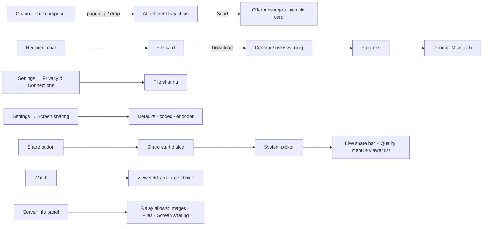
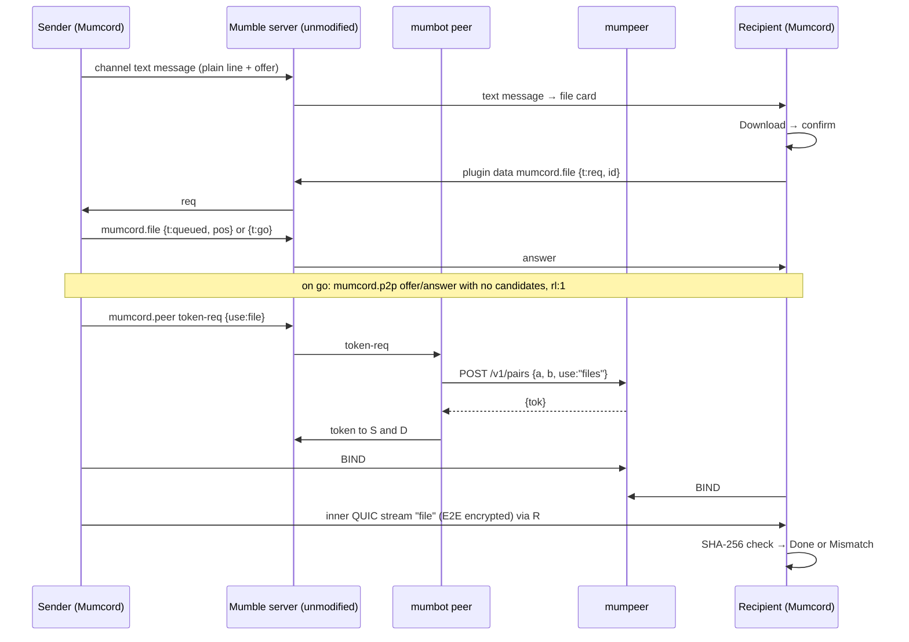
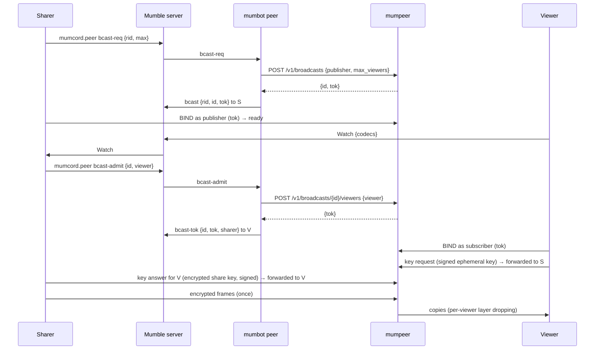
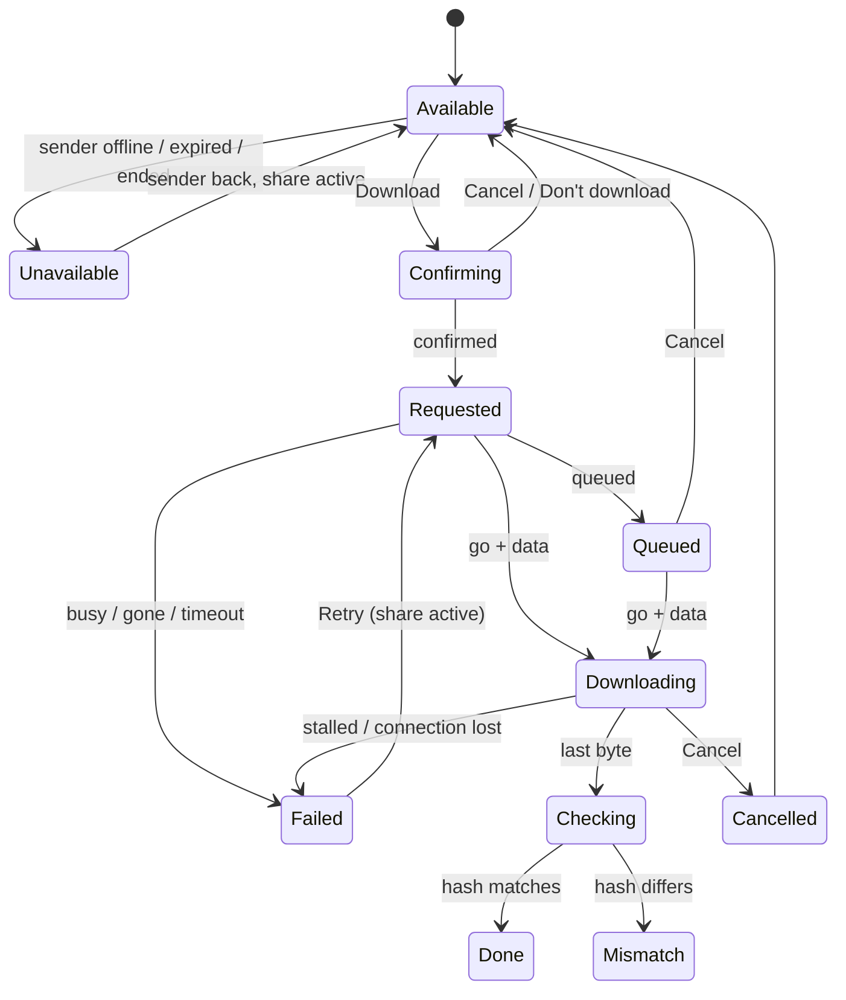
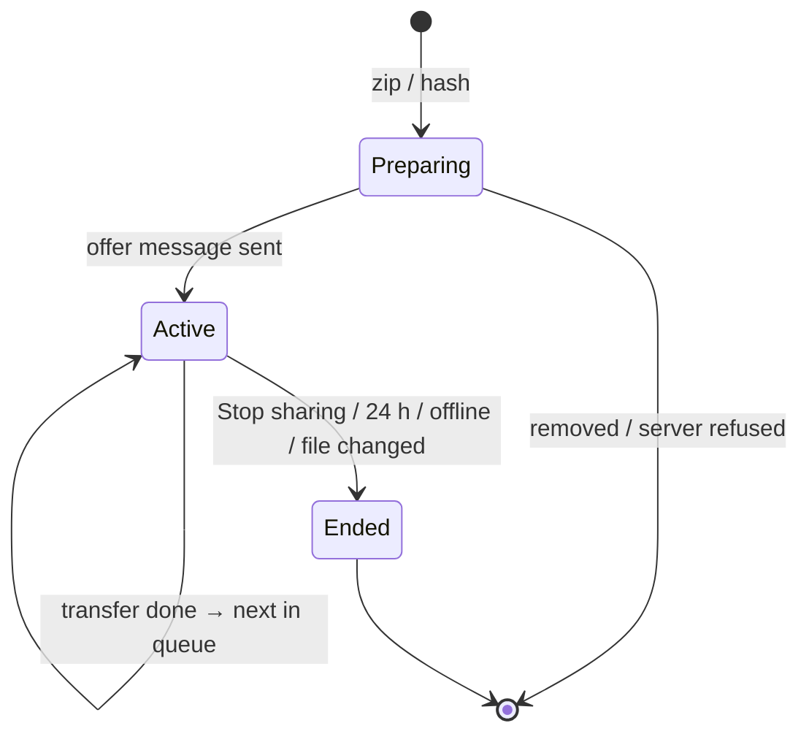
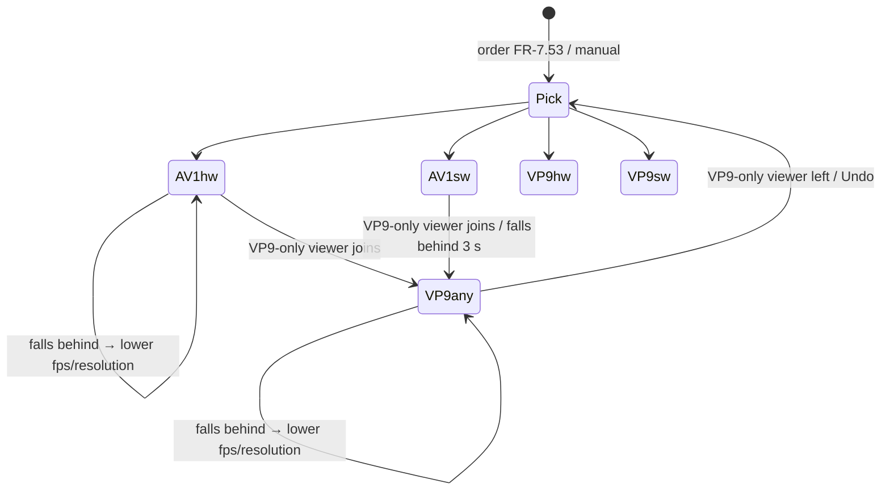

# Epic 4.1 – File sharing and screen-sharing upgrade · Specification

> Status: Final (written directly from the agreed issues, no brainstorming file; open points in section 13 carry a recommended default; addendum for application and desktop audio in `specs/07-file-sharing-screenshare-brainstorming.md`) · As of: 2026-11-04
> Sources: issue #348 (file sharing: concept and mockups, branch `mockups/file-sharing`), issue #355 with its comments (screen-sharing upgrade, AV1 per OS, Intel Quick Sync and hardware VP9; mockups on branch `mockups/screenshare-41`), issue #331 (origin of file sharing), issue #372 (malware check, not part of this epic), user decisions of 2026-11-02 (section 12), issue #435 with the user decisions of 2026-11-04 (application and desktop audio, brainstorming addendum QA.1 … QA.4). There is no `specs/roadmap.md`; the issues are the roadmap.
> Builds on: `specs/01-foundation-specification.md`, `specs/02-multi-server-themes-specification.md` (P2P signalling `mumcord.p2p`, FR-2.35 … FR-2.37), `specs/03-comfort-polish-specification.md` (blocking, notification centre, Settings window, packet inspector), `specs/04-mumpeer-relay-specification.md` (relay, mumbot `peer`, `mumcord.peer`, relay handshake and API), `specs/06-plugin-system-specification.md` (plugin data budget FR-6.36, hello feature limit).
> Repositories: `Mumcord/mumcord` (client), `Mumcord/mumpeer` (relay: broadcast sessions, allowed uses), `Mumcord/mumbot` (module `peer`: broadcast admission, allowed uses in the announcement).
> Numbering: requirements and criteria use the spec file number (`FR-7.n`, `AC-7.n`) so they never clash with Epic 4's `FR-4.n`. Where this spec and an issue differ, this spec wins.

## 1. Goal & context

Two things people ask for most after the relay arrived: sending files to the channel, and screen sharing that looks better and reaches more people. **File sharing** lets a Mumcord user offer a file (up to 2 GB) in a channel; others download it with one click, always through the server community's mumpeer relay, end-to-end encrypted, checked against a SHA-256 checksum, and without the file ever touching the Mumble server. The **screen-sharing upgrade** lets the sharer pick resolution and frame rate, adds the AV1 codec (hardware first, software if the PC is fast enough, VP9 as fallback, with live load monitoring), and adds **relay fan-out**: the sharer uploads one stream, mumpeer copies it to up to 25 viewers instead of 8. Finally the relay operator can decide what their relay may be used for (images, files, screen sharing), and Mumcord honours that. The Mumble server stays unmodified; mumpeer and mumbot are the community's own optional services (spec 04).

## 2. Scope

### 2.1 In scope (MVP)

**File sharing (#348)**
- Offer files and folders (zipped) in **channels**: paperclip button, drag and drop onto the chat, chips in the existing attachment tray.
- Offer = one channel text message: a plain line for official Mumble clients plus a machine-readable offer (name, size, type, SHA-256, expiry) that Mumcord renders as a file card.
- Transfer always through the relay (never direct), end-to-end encrypted on the existing `mumcord-p2p` inner connection.
- Recipient: file card, Download with confirmation, risky-type warning, progress, Cancel, hash check, done card with Open / Open folder, mismatch handling, mark-of-the-web.
- Sender: own card with downloads done and running, queue, Stop sharing; share ends after 24 h, on Stop sharing or when the sender goes offline.
- Concurrency: **one download at a time per recipient**, **one transfer at a time per sender**; further requests wait in a queue, the card shows "Queued".
- Settings → Privacy & Connections → File sharing: Receive files, Maximum size (100 MB, 500 MB, 1 GB default, 2 GB), Save folder, info line.
- Checksum shown short with Copy; full value on hover/focus and for screen readers.
- Blocked users can't send you offers; plain Mumble users see a text line.

**Screen-sharing upgrade (#355)**
- Share start dialog: Resolution (Auto, 720p, 1080p, 1440p), Frame rate (15, 30, 60), Optimize for (Balanced, Sharp text, Smooth motion), Codec (Automatic, AV1, VP9), Upload limit (Auto, 2, 5, 10, 20 Mbit/s), Sound, "Use these settings next time", live "Viewers get" line.
- Share sound chosen automatically from the system picker on all three systems (#435): a whole screen shares the desktop sound, a window shares only that app's sound; Mumcord's own sound is always excluded. Linux needs PipeWire.
- Quick "Quality" menu in the live share bar, applied without restarting the share.
- AV1 encode and decode; encoder order AV1 hardware → AV1 software (SVT-AV1, self-test) → VP9 hardware (Intel Quick Sync) → VP9 software (libvpx); hardware probe with smoke test, cached; live load monitoring with automatic fallback; manual Automatic / AV1 / VP9 choice; active encoder shown in Settings and the share bar.
- Codec negotiation with viewers (codec list in `Watch`, codec field in media frames, wire version 2); old viewers keep working on VP9.
- **Relay fan-out (broadcast)**: one upload to mumpeer, copied to up to 25 viewers (operator can lower it), media encrypted end to end with a per-share key, slow viewers lose temporal layers at the relay; fallback to one copy per viewer (max 8) without it.
- Viewer list "x of 25" with codec, path (relay/direct) and "slow connection" badge; viewer frame-rate choice (Auto, up to 30, up to 15).
- Settings → Screen sharing tab: quality defaults, codec, "Use graphics card when available", active encoder, "Check again".

**Relay allowed uses (user decision 2026-11-02)**
- mumpeer config: images, files, screen sharing each enabled or disabled (default all enabled); reported in `/v1/status`; carried in the bot's announcement; enforced by the relay when a session is created; honoured by the client with a clear reason.

**Resizable media area (#386, user decision 2026-11-03)**
- A horizontal handle between the media area (screen-share viewer, watch party, later the camera room) and the chat; drag or keyboard changes the picture height, the chat takes the rest.
- Default "Auto" (today's look); height stored as a share of the chat column and remembered globally; soft snaps at 1/3, 1/2, 2/3 (Alt bypasses); hard minimum and maximum; dragging below the minimum collapses to the existing mini bar, "Open" restores the last height.
- Letterboxed picture (never stretched), small-window rules, fullscreen and pop-out behaviour, reduce-motion handling, screen-reader values. Client only; no change to mumpeer, mumbot, the protocol or the engine.

**mumpeer and mumbot parts** of the above (broadcast sessions, allowed uses, new `mumcord.peer` messages).

### 2.2 Out of scope / later

- **Malware check** of downloaded files: separate official plugin, tracked in #372.
- Files in **private messages** (later epic).
- Files on servers without a relay, or through a direct connection, ever.
- Resuming an interrupted download; several downloads in parallel; several files in one card (each file gets its own card).
- Sharing a file into several channels at once; re-sharing someone else's file.
- Screen share resolution above 1440p ("Source up to 4K") – later (open point Q-SS3).
- Viewer resolution choice (simulcast or spatial layers) – later; viewers see "Quality set by sharer".
- A second VP9 encode for old viewers inside an AV1 share – later.
- A separate sound picker on every share (desktop, one app or no sound) – not planned; the picker choice decides (#435, QA.1). The "Which app's sound?" list appears only on Linux when the app can't be matched (FR-7.82).
- Including Mumcord's own sound in the share – never (QA.2).
- Share sound on Linux without PipeWire (PulseAudio only, ALSA only) – not planned.
- H.264 and VP8.
- Per-channel media heights, custom snap presets, a separate default height for the camera room (revisit with the camera spec) – later.
- Any change to the Mumble server.

## 3. Roles & permissions

| Role | Action | Enforced by |
|---|---|---|
| Mumcord user in a channel (has a client certificate, may write text in the channel) | Offer files in the channel; download offers from others; share screen; watch | Mumble server (TextMessage ACL for the offer message); bot and relay (relay access, spec 04); client (limits, confirmations, blocking) |
| Mumcord user without a certificate | No file sharing, no relay (no certificate hash, FR-2.35); sees file cards with Download disabled: "File sharing needs a client certificate" | Bot refuses token requests |
| Blocked user (from the recipient's view) | Their offers are not shown to the recipient; their download requests to the recipient are refused | Recipient's client |
| Official Mumble client | Sees the plain text line of an offer; can't download; can't watch a share | — |
| Relay bot (mumbot `peer`) | Announces the relay with allowed uses and broadcast limit; issues pair tokens with a use; creates broadcasts and admits viewers | Relay API secret |
| Relay operator | Enables or disables images, files, screen sharing; sets broadcast limits | Host access, mumpeer config |
| Mumble server admin | Nothing new | — |

The client only displays; access decisions on the relay are made by the bot (who may get a token or join a broadcast) and the relay (allowed uses, limits). Download confirmation, size limit, risky-type warning and blocking are enforced in the recipient's client.

## 4. Functional requirements

### 4.1 Relay allowed uses (mumpeer, mumbot, client)

- **FR-7.1** mumpeer config gains a section `[uses]` with three booleans `images`, `files`, `screen_share`, each default `true`. A missing section means all enabled.
- **FR-7.2** `GET /v1/status` gains `"uses": [...]` listing the enabled uses by name (`"images"`, `"files"`, `"screen_share"`) and, when broadcasts are available (FR-7.40), `"broadcast": {"max_viewers": n}`.
- **FR-7.3** The bot copies both into the `relay` announcement (`mumcord.peer`, section 6.4) as `u` and `bc`. A changed value counts as a relay change and triggers a re-announcement to all (like FR-4.24).
- **FR-7.4** Enforcement at the relay: `POST /v1/pairs` gains a required-for-new-bots field `use` (`"images"`, `"files"`, `"screen_share"`). A pair for a disabled use is refused with `403 {"code":"use_not_allowed"}`. A pair request without `use` (older bot) is accepted only if all three uses are enabled. `POST /v1/broadcasts` is refused with `403 use_not_allowed` when `screen_share` is disabled.
- **FR-7.5** `token-req` gains the field `use` (`img`, `file`, `scr`); the bot passes it on as `use`; a relay refusal comes back as `token-err` `r = "use-not-allowed"`.
- **FR-7.6** The client treats an announcement without `u` (older bot or relay) as "all uses allowed". A relay session opened for one use is shared with other features (FR-4.18) only if their use is allowed too; otherwise that feature does not use the relay.
- **FR-7.7** Client behaviour per disabled use (reason texts appear where the feature is and in the server info panel, which gains a line "Relay allows: Images · Files · Screen sharing"):
  - **Files disabled:** file sharing is unavailable on that server, exactly like a server without a relay: the attach button is disabled and drag and drop shows no overlay, with the hint "This server's relay doesn't allow file sharing"; received offer cards have Download disabled with the same reason.
  - **Screen sharing disabled:** screen sharing never uses the relay (no pair sessions for it, no broadcast). Shares still work over direct connections where the user's P2P mode allows direct (spec 04, FR-4.3). Where only the relay would work (mode `relay_first` / `relay_only`, or direct failed), the Share / Watch action is unavailable with "This server's relay doesn't allow screen sharing". In mode `relay_only` the Share button is disabled with that reason.
  - **Images disabled:** sending images is unchanged (the thumbnail travels in the chat message through the Mumble server). Fetching a full-size image never uses the relay; it uses a direct connection or the plugin-data transfer that exists today (FR-1.60c). If neither works the viewer keeps the thumbnail with the note "Full size not available: this server's relay doesn't allow images".
- **FR-7.8** The interpretation in FR-7.7 must be confirmed with the user before implementation starts (open point Q-RU1).

### 4.2 File sharing: sending

- **FR-7.9** Availability: file sharing on a server needs (a) an available relay (FR-4.11) that allows files, (b) a client certificate, (c) P2P mode not `off` and not `direct_only` (the user's own setting forbids the relay). Otherwise the paperclip button is disabled with one reason, in this order: "This server has no relay, so file sharing isn't available" · "This server's relay doesn't allow file sharing" · "File sharing needs a client certificate" · "File sharing needs the relay; your peer-to-peer setting is {Off / Direct only}". The mode `direct_relay` sends files through the relay too: files never use a direct connection.
- **FR-7.10** Channels only. In a private chat the paperclip button is not shown and dropping a file shows "Files can only be shared in channels for now".
- **FR-7.11** Adding files: paperclip button (system file picker, several files allowed) or dropping files or folders anywhere on the channel chat (overlay, mockup 1a). Each file becomes a chip in the attachment tray (mockup 1b) with name, size and a remove button. At most 10 chips per message; more are refused with "You can share up to 10 files at once".
- **FR-7.12** Size: a single file or zipped folder may be at most **2 GB** (2 × 1024³ bytes). Bigger ones are refused at once with "{name} is larger than 2 GB and can't be shared". Empty files (0 bytes) are allowed.
- **FR-7.13** Folders are zipped (store-level zip with deflate, no encryption, folder name + `.zip`) into Mumcord's cache folder before sending; the chip shows the zip progress and can be removed, which stops zipping. Symbolic links are not followed; unreadable entries stop the zip with "Couldn't read {path}". A zip over 2 GB is refused like FR-7.12. The zip is deleted when its share ends.
- **FR-7.14** On send, Mumcord computes the SHA-256 of each file (the chip shows "Checking…" with progress), creates a random share id (128 bit), and posts **one channel text message per file** (section 6.4) with the plain line for official clients and the machine-readable offer. If the server refuses the message (permission denied, too long), the share is not created and the chip shows the server's reason.
- **FR-7.15** A share is active from the moment the offer is sent until the first of: 24 hours passed; the sender pressed **Stop sharing**; the sender left the server or quit Mumcord; the shared file changed or disappeared on disk (checked by size and modification time before each transfer; the share stops with the note "The file changed on disk, so sharing stopped"). Nothing about shares is stored across a restart.
- **FR-7.16** Sender's own card (mockup 5): file name, size, short checksum with Copy, "Shared · expires in {time}", "{n} downloaded" with the list of names on hover/focus, "Sending to {name} · {percent}" while a transfer runs, "{n} waiting" while requests queue, and **Stop sharing**. After the end the card shows "Sharing ended" with the reason and stays in the chat.
- **FR-7.17** One transfer at a time per sender, across all of the sender's active shares on all servers. Requests arriving while a transfer runs enter a FIFO queue (max 50 waiting requests per sender; more get "busy" and the recipient sees "{sender} is busy, try again later"). Each waiting recipient is told its position; the queue advances when a transfer finishes, fails or is cancelled. A queued request is dropped when the recipient cancels, leaves the server, or the share ends.
- **FR-7.18** Requests from users the sender has blocked are refused silently (answered with "gone"). Requests for the same share from the same user while one is queued or running are ignored.

### 4.3 File sharing: receiving

- **FR-7.19** A Mumcord client that announces the hello feature `files` renders a received offer as a file card (mockup 2): file-type icon, sanitized name, size, type, short checksum with Copy, "Available while {sender} is online" and **Download**. Offers from blocked users are not shown. An offer that fails validation (section 6.4) is shown as the plain text line only.
- **FR-7.20** Card states and texts: Available · Queued (position {n}) · Downloading · Checking · Done ("✓ Downloaded and checked", mockup 4) · Mismatch (mockup 12) · Failed ("Download failed: {reason}", with Retry while the share is active) · Cancelled · Unavailable ("{sender} is offline", "Sharing ended", "Expired", mockup 7). A card whose sender is not on the server shows "{sender} is offline"; it becomes Available again if the sender comes back while the share is still active (the sender answers requests; an ended share answers "gone").
- **FR-7.21** Download disabled cases, each with its reason as tooltip and accessible description: no relay / relay doesn't allow files / no certificate / P2P mode (same texts as FR-7.9, mockup 13); "You turned off receiving files" (link to the setting); "Larger than your limit of {limit}" (link to the setting); "Another download is running" (one download at a time per recipient, across all servers); own offer (no Download on own cards).
- **FR-7.22** Every download needs a click on Download and a confirmation; this can never be switched off. The confirmation dialog shows name, size, sender, the full checksum and the save folder, with **Download** and **Cancel**. For risky types (FR-7.24) the risky-type warning (mockup 6) replaces it: "{name} is a program or script. Only open it if you trust {sender}." with **Don't download** (default, focused) and **Download anyway**.
- **FR-7.23** File names are sanitized before display and saving: path parts removed (both `/` and `\`), control characters and characters invalid on any of Windows, macOS, Linux replaced with `_`, Windows reserved names (`CON`, `NUL`, `COM1` …) prefixed with `_`, leading dots and trailing dots/spaces removed, length cut to 200 characters keeping the extension, empty result becomes `file`. Right-to-left override and other bidi control characters are removed.
- **FR-7.24** Risky types (by the extension after sanitizing, case-insensitive, also for a double extension such as `report.pdf.exe`): `exe, msi, msix, msp, appx, bat, cmd, com, scr, pif, cpl, hta, jar, js, jse, vbs, vbe, wsf, ps1, psm1, reg, lnk, url, app, dmg, pkg, command, sh, run, bin, appimage, deb, rpm, apk, py, pl`.
- **FR-7.25** Saving: into the save folder (default: `<system Downloads>/Mumcord`, created on the first download if missing; a folder the user chose is used as-is). Data is written to a hidden partial file in that folder and only renamed to the final name after the hash matched. An existing name gets " (1)", " (2)" … before the extension. Not enough free space (checked before start against the announced size) → "Not enough disk space in {folder}" and no transfer starts.
- **FR-7.26** Integrity: after the last byte Mumcord computes the SHA-256 of the received file. Equal to the offer → card Done with "✓ Matches the offer" and the full hash. Different (or more or fewer bytes than announced) → the partial file is deleted, nothing is opened, and the card shows "The file changed in transit or doesn't match the offer – deleted" (mockup 12).
- **FR-7.27** Mark-of-the-web on the final file: Windows: `Zone.Identifier` stream with `ZoneId=3`; macOS: `com.apple.quarantine` attribute; Linux: extended attribute `user.xdg.origin.url` set to `mumble://{server host}` where the file system supports it (Linux has no blocking mark; this only records the origin). Failing to set it is logged (without the file name) and does not fail the download.
- **FR-7.28** Progress (mockup 3): bar, percent, "{received} of {size}", speed, time left, **Cancel**. Cancel stops the transfer, deletes the partial file and frees the sender's slot. If the connection drops, the card shows Failed with Retry (a retry starts from zero).
- **FR-7.29** Done card actions: **Open** (opens with the system's default app; for risky types it asks once more with the same warning) and **Open folder** (reveals the file). If the file was moved or deleted later, Open shows "The file is no longer in {folder}".
- **FR-7.30** Older Mumcord versions without the `files` feature and official clients see the plain text line only (mockup 9).

### 4.4 File sharing: transfer

- **FR-7.31** Request flow (section 6.3): the recipient sends `req` (plugin data `mumcord.file`) to the sender; the sender answers `queued` (with position), `go`, `busy` or `gone`. On `go` both sides open the `mumcord-p2p` connection **through the relay only** (no candidates sent, `rl = 1`, token with use `file`), reusing an existing relay session between the two if one is open and allowed for files.
- **FR-7.32** The file travels on one new unidirectional QUIC stream of type `file` on the inner connection: a small header (share id, offset 0, length) and then the raw bytes. The receiver rejects a stream whose share id it did not request or whose length differs from the offer.
- **FR-7.33** Speed: no extra limit in the client beyond the relay's per-session bandwidth (10 Mbit/s by default, FR-4.35). Screen sharing on the same connection keeps priority over file data.
- **FR-7.34** Timeouts: no `go`/`queued` answer within 10 s → Failed "{sender} did not answer". `go` but no data within 30 s → Failed "Couldn't connect through the relay: {reason}" with the relay reasons of FR-4.11. No data for 30 s during a transfer → Failed "The transfer stalled".

- **FR-7.75** **Offer format: Bovnar** (#400, user decision 2026-11-03). The file offer (`data-mumcord-file` payload) and the `mumcord.file` plugin-data messages are Bovnar documents, written and read with a thin Rust wrapper around the upstream Bovnar C library (fork `Mumcord/bovnar`, branch `rust-binding`), used as a git dependency pinned to a commit (spec 09 FR-9.96 and FR-9.99 for the consequences). Bovnar is used here because `mumcord.file` and the offer attribute are new in 0.7.0 and 0.6.2 ignores them. The decoder checks the size before decoding and rejects malformed, truncated or oversized documents without a crash or hang and without logging payload content (FR-7.23 validation then applies to the decoded fields). Every other channel stays as it is: screen-share signalling (`Watch`), `mumcord.peer`, `mumcord.image`, history sync and hello keep their JSON/binary formats; a channel never mixes formats. 0.6.2 and official Mumble clients still show the plain text line of the offer.

### 4.5 Screen sharing: start dialog and live quality

- **FR-7.35** Pressing Share opens the **share start dialog** (mockup 01) before the system's window/screen picker, every time. Fields and defaults: Resolution **Auto** (720p, 1080p, 1440p), Frame rate **30** (15, 30, 60), Optimize for **Balanced** (Sharp text, Smooth motion), Codec **Automatic** (AV1, VP9), Upload limit **Auto** (2, 5, 10, 20 Mbit/s), Sound **on** (shown on all systems; what it shares and when it is unavailable: FR-7.76 … FR-7.84), "Use these settings next time" (stores them as the defaults of Settings → Screen sharing). Buttons **Start sharing** (default) and **Cancel**. The codec line names the encoder that would be used, e.g. "AV1 (graphics card)", "AV1 (software · higher CPU load)", "VP9 (graphics card)", "VP9".
- **FR-7.36** The **"Viewers get"** line updates live: "{resolution} · {fps} fps · {codec} · about {x} Mbit/s · {path}", where path is "sent once via relay, up to {n} viewers" (fan-out available, FR-7.40) or "one copy per viewer, up to 8".
- **FR-7.37** Quality steps (target bitrates AV1 / VP9): 1440p60 ≈ 9 / 12 Mbit/s, 1440p30 ≈ 6 / 8, 1080p60 ≈ 6 / 8, 1080p30 ≈ 4 / 4, 720p30 ≈ 2 / 2, 720p15 ≈ 1.2 / 1.2, 480p15 ≈ 0.7 / 0.7. 60 fps adds a fourth temporal layer (60 → 30 → 15 → 7.5). Software AV1 is capped at 1080p30; a higher pick with software AV1 makes the dialog show "AV1 in software is limited to 1080p30 on this PC" and Automatic picks VP9 instead.
- **FR-7.38** A manual resolution / frame rate is a **ceiling**: when the upload or the encoder can't keep up, the share steps down below it (as today) and the bar shows "Lowered to {step}: {reason}" (reasons: upload too slow, encoder too slow, many viewers). Auto = today's automatic behaviour with the new steps. Optimize for: **Sharp text** keeps resolution and drops fps first and turns on AV1 screen-content tools (palette, intra block copy); **Smooth motion** keeps fps and drops resolution first; **Balanced** alternates. Upload limit caps the total upload of the share.
- **FR-7.39** The live share bar (mockup 02) shows quality badge ("1080p30"), codec badge ("AV1 · GPU", "AV1 · CPU", "VP9 · GPU", "VP9"), path badge ("Relay" when fan-out is used) and a **Quality** menu with Resolution, Frame rate and Optimize for. A change applies within 1 s without restarting the share (new keyframe if the resolution changes).

### 4.6 Screen sharing: relay fan-out (broadcast)

- **FR-7.40** Fan-out is available on a server when the relay is available, allows screen sharing, its announcement has `bc` (FR-7.3), the user's P2P mode is not `off` or `direct_only`, and the sharer has a client certificate. Then every new share asks the bot for a broadcast (`bcast-req`, section 6.4) with `max = bc`.
- **FR-7.41** The sharer uploads **one** stream to mumpeer over its own outer relay connection (QUIC on UDP, TLS on TCP 443, same transports and mTLS as spec 04). mumpeer copies each frame to every admitted viewer.
- **FR-7.42** Admission: a viewer presses Watch as today (`Watch` signal, now with its codec list). If the sharer accepts (not full, viewer not blocked), the sharer sends `bcast-admit` to the bot; the bot checks that sharer and viewer are on the server, both sent a hello with `p2p` and `screen-share`, both have a certificate hash and are in the same channel, then registers the viewer with the relay and sends the viewer a short-lived token (`bcast-tok`). The viewer connects to the relay, binds as subscriber and receives the stream. Errors come back as `bcast-err` and are shown with the FR-4.11 texts plus "The share is in another channel" and "This share is full".
- **FR-7.43** End-to-end encryption: every media frame (video and share sound) is encrypted by the sharer with a per-share key (AES-128-GCM, SFrame-style per RFC 9605: key id, counter, encrypted payload). The relay sees only a small clear header (version, kind video/audio/control, key id, keyframe flag, temporal layer, codec, size, sequence) it needs to drop layers. The key reaches each viewer by an **authenticated key exchange through the relay** (section 6.6): the viewer sends an ephemeral public key signed with its Mumble client certificate key; the sharer checks the certificate's hash against the viewer's Mumble certificate hash (from the Mumble server) and answers with the share key encrypted to that public key, signed with its own certificate key; the viewer checks the sharer's hash the same way. Neither relay nor bot can read media or impersonate either side.
- **FR-7.44** Rekeying: when a viewer leaves or is removed, the sharer creates a new key, delivers it to the remaining viewers, and switches at the next keyframe (new key id). A former viewer can't decrypt frames after the switch.
- **FR-7.45** Per-viewer pacing at the relay, as `fanout.rs` does locally today: a lagging subscriber loses the highest temporal layer first; an overflowing subscriber queue is cleared and that subscriber gets nothing until the next keyframe; subscribers' keyframe requests are forwarded to the sharer, at most one per 2 s per subscriber and one per 500 ms per broadcast in total. The viewer's own frame-rate choice (FR-7.51) is sent to the relay as its maximum temporal layer.
- **FR-7.46** Limits: viewers per broadcast = the relay's `max_viewers_per_broadcast` (default 25); broadcasts per relay `max_broadcasts` (default 4); bandwidth per broadcast in and out counted against the relay's total. Broadcast connections do not count against "max sessions per certificate hash".
- **FR-7.47** Fallback without fan-out (no relay, older relay without `bc`, relay doesn't allow screen sharing, `bcast-req` refused, relay full): the share runs as today, one copy per viewer, max 8 (`MAX_VIEWERS`), and Auto lowers quality as viewers join. The sharer sees a one-time notice per share (mockup 06): "Relay fan-out isn't available ({reason}). Each viewer gets their own copy, so up to 8 can watch and quality may drop."
- **FR-7.48** Mixed viewers: a viewer whose Mumcord doesn't support broadcast (no hello feature `screen-broadcast`) gets a direct copy as today, next to the broadcast; at most 8 such copies per share. The viewer total is limited to the broadcast limit.
- **FR-7.49** Relay lost during a share: the sharer switches viewers to direct copies (up to 8, in order of joining) without stopping the share; the others see "This share is full" and can press Watch again later; the sharer sees the FR-7.47 notice. If the relay comes back, new shares use it again; the running share stays on direct copies.
- **FR-7.50** Broadcast end: sharer stops, sharer leaves, bot deletes the broadcast, relay idle timeout (60 s without frames), relay restart. Subscribers get a close code; viewers show the normal "share ended" state (or switch to a direct copy per FR-7.49 if the share still runs).

### 4.7 Screen sharing: viewers and viewer list

- **FR-7.51** Viewer side (mockup 04): the viewer's quality menu shows "Quality set by sharer" and the viewer's frame-rate choice Auto / up to 30 / up to 15 (uses temporal layers, no extra encode). The viewer header shows codec and path ("AV1 · via relay").
- **FR-7.52** Viewer list (sharer bar popover and viewer panel, mockup 03): "Viewers {x} of {limit}", "Sent once via relay" or "One copy per viewer", per viewer: name, quality received, codec, path (relay broadcast / relay / direct), "slow connection" badge when the viewer lost layers in the last 10 s.

### 4.8 Screen sharing: AV1 and encoder selection

- **FR-7.53** Encoder order for **Automatic**:
  1. AV1 hardware (NVENC, AMD AMF, Intel Quick Sync on Windows; VA-API on Linux for Intel and AMD, NVENC on Linux with the proprietary driver), only if "Use graphics card when available" is on.
  2. AV1 software (SVT-AV1), only if the self-test (FR-7.56) passed for the chosen resolution and frame rate, and not on battery power.
  3. VP9 hardware (Intel Quick Sync: QSV on Windows, VA-API `VAProfileVP9Profile0` with an encode entry point on Linux), only if "Use graphics card when available" is on.
  4. VP9 software (libvpx), today's path; always available.
  AV1 (steps 1–2) is used only when every current viewer can play AV1 (FR-7.58).
- **FR-7.54** Manual choice: **AV1** uses step 1, else step 2 (even without a passed self-test, with the warning "AV1 in software may be too heavy for this PC"); **VP9** uses step 3, else step 4. A manual pick still falls back when load monitoring (FR-7.57) says it can't keep up, and when a viewer can't play AV1 (FR-7.58).
- **FR-7.55** Hardware probe at startup in the background (never blocking start or the UI), per platform as in #355: Windows Media Foundation enumeration plus NVENC/AMF/QSV; Linux DRM render nodes with `vaQueryConfigEntrypoints` for `VAProfileAV1Profile0` and `VAProfileVP9Profile0` (`EncSlice`/`EncSliceLP` = encode); NVENC by loading the driver library and checking the AV1 GUID; macOS skipped (no AV1 or VP9 hardware encoder). A positive probe counts only after a **smoke test** that encodes a few real frames. Results are cached per machine and re-tested after a driver change (driver version string) or a Mumcord update, and on "Check again".
- **FR-7.56** Software AV1 self-test: about 1 s of test frames with SVT-AV1 at the chosen resolution and frame rate in the background; passed if the average frame takes clearly less than half its time budget (< 50 %). Cached per machine, resolution and fps; re-run after a Mumcord update or "Check again".
- **FR-7.57** Live load monitoring while sharing: encode time per frame and dropped frames are measured. If the encoder falls behind for 3 s in a row:
  1. On software AV1: switch to the next encoder in the order (VP9 hardware, else VP9 software) at the same resolution, with a new keyframe; viewers keep watching (short refresh). The bar shows "Switched to VP9 to reduce load" with **Undo** (back to the previous encoder; a second fallback in the same share ends Undo for that share) and **Details** (encode times, mockup 07).
  2. On any other encoder: step down frame rate or resolution per Optimize for (FR-7.38).
- **FR-7.58** Codec negotiation: `Watch` carries the viewer's playable codecs (`av1`, `vp9`); old clients send none, which means VP9 only. A viewer can play AV1 if its webview's WebCodecs supports `av01` or the engine's dav1d fallback is present (always, from this epic on). The sharer runs one encoder: AV1 only while every current viewer can play it; when a VP9-only viewer joins, the share switches to VP9 (new keyframe) and the bar notes "Switched to VP9 for {name}". When that viewer leaves, the share returns to the Automatic choice.
- **FR-7.59** Decoding: WebCodecs `av01` / `vp09` in the webview where supported, otherwise dav1d (AV1) or libvpx (VP9) in the engine.
- **FR-7.60** Settings → Screen sharing (own tab, mockup 05): default Resolution, Frame rate, Optimize for, Upload limit, Sound; Codec Automatic / AV1 / VP9 with the info line "Automatic uses AV1 when your graphics card or CPU can handle it, otherwise VP9."; "Use graphics card when available" (default on); "Active encoder: {e.g. AV1 (NVIDIA graphics card) · VP9 (AV1 too heavy for this PC)}" with **Check again**.

### 4.9 Resizable media area (#386)

The media area is the shared media frame above the chat that shows a screen-share viewer, a watch party and, when it ships, the camera room. All requirements below apply to all three in the same way. Client only: no change to mumpeer, mumbot, the protocol or the engine.

- **FR-7.61** Handle (mockups 01, 06): a horizontal separator sits between the media area and the chat, full chat width with a 12 px hit area. A small grip is faint at rest and turns accent on hover, while dragging and on keyboard focus; the cursor is `row-resize`. It is the horizontal variant of the existing column resize handle. It is shown only while the big view is open, not in fullscreen and not in the pop-out window. Tab order: after the media controls, before the chat.
- **FR-7.62** Default: "Auto" is exactly today's look (16:9 picture, at most 58 % of the window height). Nothing changes until the user drags or uses the keyboard.
- **FR-7.63** Unit and limits: the chosen height is a share of the chat column's height (not pixels) and is shown as a percent. Minimum: 20 % of the chat column height, at least 9 rem. Maximum: 70 %, and the chat always keeps at least 13 rem (composer plus about two messages), whichever is smaller. Minimum and maximum are hard stops.
- **FR-7.64** Dragging (mockups 02, 03): the picture height follows the pointer live, one layout per animation frame, with no animation, no text selection and no video stall. Soft snaps at 1/3, 1/2 and 2/3 of the chat column height apply within 12 px; holding Alt drags without snapping. There is no snap at the minimum and maximum.
- **FR-7.65** Picture in the frame: the frame takes the full column width and the chosen height. The picture stays 16:9 and is never stretched: letterboxed (black bars) in **Fit**, cropped in **Fill**, unchanged in **1:1**.
- **FR-7.66** Reset: double-click or Enter on the handle returns to Auto.
- **FR-7.67** Keyboard: the handle is focusable with a visible focus ring in every theme (mockup 06). Up/Down change the height by 2 rem, PageUp/PageDown jump to the next/previous snap point, Home = minimum, End = maximum, Enter = reset. Keyboard changes ignore the Alt rule and are saved on each key press.
- **FR-7.68** Screen reader: `role="separator"`, `aria-orientation="horizontal"`, `aria-label="Resize media area"`, `aria-controls` pointing at the media area, `aria-valuemin`, `aria-valuemax` and `aria-valuenow` in percent, `aria-valuetext` "{n}% of the window height". Changes of the value are announced; collapsing is announced as "Media area minimised".
- **FR-7.69** Collapse (mockups 04, 05): while dragging below the minimum (about 12 %) the hint "Release to minimise to the mini bar" shows; releasing there collapses the media area to the existing mini bar (same state as leaving the big view with the existing control). "Open" in the mini bar restores the last chosen height (Auto if none was chosen). The existing mini-bar control keeps working as before.
- **FR-7.70** Remembered: the height is stored globally (one habit per person, not per channel) in the layout settings next to the column widths, default Auto. It is saved when a drag ends or a key is pressed, and survives closing and reopening the viewer, switching channel and an app restart.
- **FR-7.71** Small windows: the limits are recomputed on every window or text-size change (once per frame). A stored value that no longer fits is shrunk for display and never rewritten; it returns when the window grows again. When the chat column is below about 28 rem in height there is no room for a handle: the handle is hidden and the area uses Auto or the mini bar; nothing overlaps.
- **FR-7.72** Fullscreen and pop-out: fullscreen ignores the chosen height (the picture fills the screen) and the height is back on exit. The pop-out window fills its own window and has no handle; dragging in the main window does not affect it.
- **FR-7.73** Reduce motion: dragging is never animated. Snap, reset and collapse animate over 120 ms only when the system allows motion (`prefers-reduced-motion: no-preference`); otherwise they jump.
- **FR-7.74** Camera room: uses the same frame and handle with the same Auto default; the camera grid fills the chosen height and re-arranges its tiles.

### 4.10 Screen sharing: application and desktop audio (#435)

- **FR-7.76** **The picker decides the sound.** When Sound is on, the share's sound follows what the user picked in the system picker: a **whole screen** (display) shares the **desktop sound** (everything the computer plays, minus Mumcord); **one window** shares **only the sound of the app that owns that window**; on macOS an **app** pick shares that app's sound. There is no separate sound picker in the normal case. The choice is made once at share start; picking a new source (the system's "change source" where it exists) re-applies this rule.
- **FR-7.77** **Mumcord is always excluded.** Nothing Mumcord itself plays is ever part of the share sound: other people's voices, notification and sound-theme sounds, watch-party sound, plugin sounds and the share sound of shares the sharer is watching. The exclusion covers Mumcord's whole process tree, including its web view. It is not switchable, so viewers never hear an echo of themselves.
- **FR-7.78** **The Sound switch stays** in the share start dialog (FR-7.35) and in Settings → Screen sharing (FR-7.60) as on/off on top of the automatic choice: on = share the sound chosen by FR-7.76, off = no share sound at all (no audio frames are sent). Default on; stored as `screen_sound` (§7.1). The switch is now shown on Linux too. Below the switch the dialog shows the info line "Whole screen: desktop sound without Mumcord. One window: only that app's sound."
- **FR-7.79** **Windows** (Windows 10 version 2004 or newer): a window share captures the owning app's process tree with per-process loopback (include mode); a whole-screen share captures the whole system output with process loopback in exclude mode on Mumcord's own process tree. Both follow the default output device, including when it changes during the share.
- **FR-7.80** **macOS** (macOS 13 or newer): the system screen capture delivers the sound of the chosen window, app or display with Mumcord's own process excluded. On macOS 13 (whole main screen only, as today) this means the desktop sound minus Mumcord. It uses the existing "Screen & System Audio Recording" permission; no new permission prompt.
- **FR-7.81** **Linux, whole screen** (PipeWire, on Wayland and on X11): Mumcord records every audio playback stream of the desktop **except Mumcord's own streams** (matched by its process ids, never by name alone), mixed into the share sound. Streams that start during the share are added automatically; streams that end are dropped. Device monitors are not used, so Mumcord's own output never enters the mix.
- **FR-7.82** **Linux, one window** (Wayland portal): the portal doesn't say which app owns the shared window. Mumcord matches it to a PipeWire playback app: the match is **clear** when exactly one running app (other than Mumcord) has an application name, binary name or desktop id that equals the window's app id or the app name the portal or compositor reports (case-insensitive). A clear match is used silently. In every other case (no hint, no match, several matches) Mumcord shows the **"Which app's sound?" list** (FR-7.83) right after the system picker. A chosen app is followed by process id and binary, so new streams of the same app during the share are included and other apps never are.
- **FR-7.83** **"Which app's sound?" list** (Linux only, mockup needed, §5): a small dialog titled "Which app's sound?" listing the apps that currently have a PipeWire playback stream (app icon if available, app name; Mumcord itself is never listed), sorted by name, plus the entry **"No sound"**. Buttons **Share sound** (default, disabled until an entry is chosen) and **Cancel** (= no sound; the share continues). If no app plays sound yet, the list says "No app is playing sound right now" and refreshes live while open. The choice is not stored; it is asked again on the next window share without a clear match.
- **FR-7.84** **Unavailable sound.** Below the minimum version, or on Linux without a running PipeWire, the share works without sound: the Sound switch is shown off and disabled, with the note "No sound: needs Windows 10 version 2004 or newer", "No sound: needs macOS 13 or newer" or "No sound: needs PipeWire" respectively. The stored `screen_sound` value is not changed. If audio capture fails at share start or during the share (device lost, permission revoked), the video share continues, the live bar's sound line shows "No sound" with the reason, and the error is logged without user data (FR-7.87).
- **FR-7.85** **Sound line in the live share bar** (mockup needed, §5): shows what is shared: "Sound: desktop", "Sound: {app name}" or "No sound" (switch off, unavailable, or "No sound" chosen), with the reason as tooltip and accessible description. The app name comes only from local data and is shown only to the sharer.
- **FR-7.86** **During the share:** if the shared app stops playing or quits, the share sound is silent (no frames or silence frames, as for the existing share sound) and resumes when that app plays again; the sharer's own voice is never part of the share sound (it travels as normal Mumble voice).
- **FR-7.87** **Privacy.** Only the source chosen by FR-7.76 … FR-7.83 is captured; no other app's sound and no microphone. App names, window titles, process ids and binary names stay on the sharer's device: they are never sent to viewers, the relay or the server, never stored, and never logged. Logs contain only the mode (`desktop`, `app`, `none`) and a reason code at `info`.
- **FR-7.88** **Transport unchanged.** The new sources feed the existing share-sound path: Opus encode, the same direct path and the encrypted audio frames of broadcasts (FR-7.43), and the viewers' own share volume. Viewers notice no difference between systems.

## 5. UI & UX

> **The mockups are binding.** The UI must match the mockups in the issues: layout, texts, states, icons, spacing and both themes (dark and light).
> - File sharing: issue #348, mockups 1a–9, 12 and 13. Sources are in `docs/mockups/epic-4.1/` on the branch `mockups/file-sharing`.
> - Screen sharing: issue #355, mockups 01–05. Sources are in `docs/mockups/epic-4.1-screenshare/` on the branch `mockups/screenshare-41`.
> - Resizable media area: issue #386, mockups 01–06 (default with handle, dragged small, dragged large, collapse hint, mini bar, keyboard focus; dark and light). Sources are in `docs/mockups/epic-4.1-resize/` on the branch `mockups/media-resize`.
>
> The malware mockups (2b, 10, 11, 14) are not part of this epic (#372). If a mockup and this text disagree, or a state has no mockup, ask before building; don't invent a different design. Verification compares screenshots of the running client with the mockups.
>
> **Mockups needed before building (#435, not yet designed):** (a) the "Which app's sound?" list (FR-7.83), including the empty state and the "No sound" entry; (b) the sound line in the share start dialog (FR-7.78, FR-7.84): switch, info line and the three "No sound: needs …" notes; (c) the sound line in the live share bar (FR-7.85). Dark and light theme each. Until they exist, these parts must not be built from guesswork.



**File card (recipient)**

```
┌───────────────────────────────────────────────────────────┐
│ [icon] design-v3.fig                         48.2 MB · FIG │
│        SHA-256 3f9a…c21e [Copy]                            │
│        Available while Alice is online       [ Download ] │
└───────────────────────────────────────────────────────────┘
  queued:      Queued (position 2)                [ Cancel ]
  downloading: [██████████░░░░] 62 % · 30 of 48 MB · 4.1 MB/s · 4 s left [Cancel]
  done:        ✓ Downloaded and checked · ✓ Matches the offer
               SHA-256 3f9a2b…(full)…c21e [Copy]  [Open folder] [Open]
  mismatch:    ✕ The file changed in transit or doesn't match the offer – deleted
```

**Sender's own card**

```
┌───────────────────────────────────────────────────────────┐
│ [icon] design-v3.fig            48.2 MB · expires in 23 h │
│        SHA-256 3f9a…c21e [Copy]                            │
│        3 downloaded · Sending to Bob 41 % · 2 waiting      │
│                                         [ Stop sharing ]  │
└───────────────────────────────────────────────────────────┘
```

**Settings → Privacy & Connections → File sharing**

```
[x] Receive files
Maximum size     [ 1 GB ▾ ]   (100 MB · 500 MB · 1 GB · 2 GB)
Save folder      ~/Downloads  [Change…]
Files always travel through the server's relay, so nobody sees your IP
address. Servers without a relay can't share files.
```

**Share start dialog**

```
Share your screen
Resolution   (Auto) (720p) (1080p) (1440p)
Frame rate   (15) (30) (60)
Optimize for [ Balanced ▾ ]
Codec        [ Automatic ▾ ]  AV1 (graphics card)
Upload limit [ Auto ▾ ]
[x] Share sound
    Whole screen: desktop sound without Mumcord. One window: only that app's sound.
Viewers get: 1080p · 30 fps · AV1 · about 4 Mbit/s · sent once via relay, up to 25 viewers
[ ] Use these settings next time
                               [Cancel] [Start sharing]
```

**Settings → Screen sharing**: as mockup 05 (fields of FR-7.60).

**Resizable media area** (mockups 01–06)

```
┌───────────────────────────────────────────────┐
│ media frame: title · controls (Fit/Fill/1:1)  │  height = chosen share of the
│ ┌───────────────────────────────────────────┐ │  chat column (Auto = today's size)
│ │          16:9 picture (letterboxed)       │ │
│ └───────────────────────────────────────────┘ │
├───────────────── ═══ grip ═══ ────────────────┤  ← horizontal handle, 12 px, row-resize
│ chat messages                                 │
│ composer                       (≥ 13 rem kept) │
└───────────────────────────────────────────────┘
  past the minimum:  "Release to minimise to the mini bar"  →  mini bar [ Open ]
  keyboard: ↑/↓ 2 rem · PgUp/PgDn snap · Home min · End max · Enter reset
```

- Confirmation dialogs: download confirmation and risky warning (FR-7.22), Stop sharing (no confirmation; it can be undone by sharing again).
- Notices: fan-out unavailable (FR-7.47, once per share), encoder fallback with Undo/Details (FR-7.57), codec switch for an old viewer (FR-7.58), quality lowered (FR-7.38).
- No new global hotkeys, tray or overlay behaviour; the media-area handle keys (FR-7.67) work only while the handle has focus. Enter on a focused file card = Download; Escape closes dialogs.
- Accessibility: all controls keyboard operable; file cards are list items with a label "{name}, {size}, from {sender}, {state}"; the short checksum's accessible name is the full hash; progress uses a progressbar role with value text; state changes (queued, done, mismatch) are announced politely; the risky warning is an alert dialog with focus on "Don't download". Both themes, system scaling, reduced motion (no animated progress stripes). All new texts in all 24 locales.

## 6. Audio & network

### 6.1 Audio

Share sound is chosen from the system picker on all systems (FR-7.76 … FR-7.88); its codec stays Opus.

| System | Whole screen | One window (or app on macOS) | Below the minimum |
|---|---|---|---|
| **Windows 10 version 2004 or newer** | Desktop sound: system loopback excluding Mumcord's process tree | Only that app's sound: per-process loopback of the owning app | Windows 10 1903 / 1909: no sound, note in the dialog |
| **macOS 13 or newer** | Desktop sound minus Mumcord (system screen capture with audio) | Only that window's or app's sound, Mumcord excluded | macOS 12.3: no sound, note in the dialog |
| **Linux with PipeWire (Wayland and X11)** | Every playback stream except Mumcord's own | Matched PipeWire app; "Which app's sound?" list when unclear (Wayland; X11 shares whole screens only) | No PipeWire: no sound, note in the dialog |

Mumcord's own sound is never captured (FR-7.77). In a broadcast it travels as encrypted audio frames next to the video (FR-7.43). Voice never uses the relay.

### 6.2 Codecs and quality

VP9 (libvpx, today) and new AV1 (hardware through the vendor encoder APIs directly, software SVT-AV1 encode, dav1d decode); quality steps FR-7.37; temporal layers 3 (≤ 30 fps) or 4 (60 fps). Latency target unchanged from today's screen share (glass to glass ≤ 300 ms on a LAN; the relay adds one hop).

### 6.3 File transfer sequence



### 6.4 Wire formats (file sharing)

**Offer (channel text message).** HTML like today's chat messages:
`<p>📎 Alice shared a file: <b>{name}</b> ({size}). Download it with Mumcord.</p>` followed by an element carrying the attribute `data-mumcord-file` whose value is the **Bovnar document** below, encoded as standard base64 text (an HTML attribute cannot carry binary; #400, FR-7.75). Field names and meanings stay as in the table; the types are Bovnar types (unsigned integers, strings, hex strings):

| Field | Type | Rules |
|---|---|---|
| `v` | u8 | 1; higher accepted, unknown fields ignored |
| `id` | 32 lowercase hex | share id, random |
| `n` | string | file name, ≤ 255 UTF-8 bytes before sanitizing (FR-7.23) |
| `s` | u64 | size in bytes, ≤ 2 147 483 648 |
| `m` | string | MIME type, ≤ 100 chars, display only |
| `h` | 64 lowercase hex | SHA-256 of the file |
| `e` | u64 | expiry, Unix seconds; ≤ 24 h after the message arrives (later values are clamped) |

The receiver validates every field before showing a card (untrusted input) and treats the sender as the Mumble session that sent the message, never a field. The whole message stays well under the server's default message length (5000).

**Plugin data `mumcord.file`** (Bovnar document, ≤ 1000 bytes, size-checked before decoding, sent only to the other session; FR-7.75):

| `t` | Direction | Fields |
|---|---|---|
| `req` | recipient → sender | `v`, `id` |
| `queued` | sender → recipient | `v`, `id`, `pos` (u16, 1 = next) |
| `go` | sender → recipient | `v`, `id` |
| `busy` | sender → recipient | `v`, `id` (queue full) |
| `gone` | sender → recipient | `v`, `id` (share ended, unknown, or refused) |
| `cancel` | recipient → sender | `v`, `id` |

New hello feature: `files`. Plugin data counts against Mumcord's own priority budget (FR-6.36).

### 6.5 Broadcast sequence



### 6.6 Protocol additions

**`mumcord.peer` (spec 04 §6.4)**

| `t` | Direction | Fields | Rules |
|---|---|---|---|
| `relay` (extended) | bot → client | + `u` (array of `img`, `file`, `scr`), + `bc` (u16 max viewers; absent = no broadcast) | Missing `u` = all allowed |
| `token-req` (extended) | client → bot | + `use` (`img`, `file`, `scr`) | Missing `use` from older clients = treated as `scr` by the bot |
| `token-err` (extended) | bot → client | + `r = "use-not-allowed"` | |
| `bcast-req` | sharer → bot | `v`, `rid`, `max` (u16) | Sender needs `p2p` + `screen-share` hello and a cert hash |
| `bcast` | bot → sharer | `v`, `rid`, `id` (16 hex), `tok`, `ttl` | |
| `bcast-admit` | sharer → bot | `v`, `rid`, `id`, `viewer` (u32 session) | Only the broadcast's publisher session may admit |
| `bcast-tok` | bot → viewer | `v`, `id`, `tok`, `ttl`, `sharer` (u32 session) | Viewer accepts it only from the pinned bot and only after it sent Watch to that sharer |
| `bcast-kick` | sharer → bot | `v`, `id`, `viewer` | Bot deletes the viewer at the relay |
| `bcast-err` | bot → requester | `v`, `rid`, `r` one of `denied`, `not-same-channel`, `full`, `relay-down`, `relay-full`, `use-not-allowed`, `rate-limited` | Mapped to reason texts |

Each message ≤ 1000 bytes. New hello feature: `screen-broadcast`.

**Relay handshake (spec 04 §6.5)** gains `{"v":1,"t":"bind","tok":"…","role":"pub"|"sub"}` for broadcast tokens (pair tokens keep the old form) and error codes `use_not_allowed`, `broadcast_full`. After `ready`, broadcast data uses the same framing (QUIC datagrams for small control, one QUIC stream per frame or `0x01` frames on TCP) with the clear header of FR-7.43. Control kinds through the broadcast: `keyreq` (sub → pub, opaque, ≤ 1 KiB, relay adds the subscriber's slot number), `key` (pub → one sub by slot, opaque, ≤ 1 KiB), `kf` (sub → relay → pub keyframe request), `layers` (sub → relay, max temporal layer), `gone` (relay → pub, slot left).

**Allowlist API (spec 04 §6.6)**

| Method & path | Body | Response |
|---|---|---|
| `GET /v1/status` (extended) | — | + `"uses":[…]`, + `"broadcast":{"max_viewers":n}` (absent if `screen_share` is off or `max_broadcasts = 0`) |
| `POST /v1/pairs` (extended) | + `"use"` | `403 {"code":"use_not_allowed"}` |
| `POST /v1/broadcasts` | `{"publisher":"<40 hex>","max_viewers":n}` | `201 {"id","tok","expires_in"}`; `503 relay_full`; `403 use_not_allowed` |
| `POST /v1/broadcasts/{id}/viewers` | `{"viewer":"<40 hex>"}` | `201 {"tok","expires_in"}`; `409 broadcast_full`; `404` |
| `DELETE /v1/broadcasts/{id}/viewers/{hash}` | — | `204` (relay sends `gone` to the publisher) |
| `DELETE /v1/broadcasts/{id}` | — | `204`, all subscribers closed |

`DELETE /v1/peers/{hash}` (spec 04) also removes that hash from every broadcast (as publisher: the broadcast ends).

**Screen-share signalling (`mumcord.p2p` / screen share signal):** `Watch` gains optional `codecs` (array) and `bc` (1 = I can join broadcasts); media frames get wire version 2 with a codec field. Old clients ignore the new fields and get VP9 direct copies.

### 6.7 Protocol compatibility

Mumble server ≥ 1.4 (plugin data), unmodified. Only standard messages: TextMessage (offer), PluginDataTransmission, UserState, UserRemove. Official clients see the offer text line and nothing else. A new client with an old bot/relay: no `u` (all allowed), no `bc` (no fan-out, FR-7.47); file transfer works with an old relay (pair session; old bot ignores `use`). An old Mumcord viewer watching a new sharer: VP9, direct copy.

## 7. Data & state model

### 7.1 Client, stored

| Entity | Field | Type | Req. | Rules |
|---|---|---|---|---|
| Settings | `files_receive` | bool | yes | default true |
| | `files_max_size` | enum 100M/500M/1G/2G | yes | default 1G |
| | `files_save_folder` | path | yes | default `<system Downloads>/Mumcord` |
| | `screen_resolution` | enum auto/720/1080/1440 | yes | default auto |
| | `screen_fps` | enum 15/30/60 | yes | default 30 |
| | `screen_optimize` | enum balanced/text/motion | yes | default balanced |
| | `screen_codec` | enum auto/av1/vp9 | yes | default auto |
| | `screen_upload_limit` | enum auto/2/5/10/20 | yes | default auto |
| | `screen_sound` | bool | yes | default true |
| | `screen_use_gpu` | bool | yes | default true |
| Layout settings (next to the column widths) | `media_height` | percent of chat column height, or null (Auto) | yes | default null; limits per FR-7.63; global, not per channel; never rewritten when it does not fit (FR-7.71) |
| Encoder cache (per machine) | `driver_id`, `app_version`, per encoder `available` + `smoke_ok`, per (resolution, fps) `svt_selftest_ms` | | | re-test on driver/app change or Check again |
| Chat history | file card: offer fields + local state (done path, mismatch) | | | Same retention as chat history; the file itself is not part of history |

Offers are stored in chat history as decoded fields (the Bovnar bytes are not kept); the wire format does not change the stored form.

Not stored: active shares, queues, transfer progress, broadcast tokens and keys (memory only).

### 7.2 File card state (recipient)



### 7.3 Sender share state



### 7.4 Encoder selection (per share)



### 7.5 mumpeer, config and memory

```toml
[uses]
images = true
files = true
screen_share = true

[limits]          # existing keys unchanged, plus:
max_broadcasts = 4
max_viewers_per_broadcast = 25
broadcast_in_mbit = 15      # publisher upload per broadcast
broadcast_out_mbit = 300    # all copies of one broadcast; counted against total_mbit
```

In memory: Broadcast (`id`, publisher hash, token hashes, `max_viewers`, subscribers with slot, hash, queue, max layer, byte counters), as for pairs nothing on disk. Default `total_mbit` stays 200; operators who enable broadcasts are told in the README to raise it to fit (25 × 6 Mbit/s = 150 Mbit/s for one share).

## 8. Technology & architecture

- **Bovnar (#400):** `files::wire` encodes and decodes the offer and the `mumcord.file` messages with the pinned Bovnar wrapper crate (thin Rust wrapper around the upstream C library, git dependency on the fork Mumcord/bovnar, branch `rust-binding`, `publish = false`; the build needs a C compiler and Python 3); licence notice added to the licences window.

- **File transfer on the existing `mumcord-p2p` connection, forced through the relay.** Reuses the end-to-end encrypted, certificate-pinned QUIC session and the relay of spec 04, so no new crypto or transport is needed.
- **Offer as a normal text message with a data attribute**, like full-size images today (FR-1.60c): official clients see readable text and the offer arrives with the chat, including for history.
- **SHA-256 via the `sha2` crate** (already in the tree), computed streaming on a worker thread; zip with the `zip` crate (deflate only), in the engine, never on the UI or audio threads.
- **Mark-of-the-web** in a small platform module (`windows` ADS write, macOS `xattr`, Linux `xattr`).
- **Hardware encoders written directly against the vendor APIs (no FFmpeg):** NVENC via nv-codec-headers with the driver loaded at runtime (dlopen); AMD AMF via the AMF headers, loaded at runtime; Intel Quick Sync via oneVPL/libvpl; Linux VA-API via libva, loaded at runtime (no package dependency). Vendor drivers are loaded at runtime, so no SDK ships. macOS has no hardware encoder for AV1 or VP9; it uses software only.
- **SVT-AV1** for software AV1 encode (real-time presets, low delay, screen-content mode): the only open encoder fast enough for live 1080p30 (rav1e and libaom are too slow, #355). **dav1d** for AV1 decode in the engine fallback.
- **Frame encryption** with AES-128-GCM from `ring` (already used by rustls); key exchange with X25519 (`ring`) signed by the Mumble client certificate key (`rustls`/`rcgen` key types already present). SFrame-style framing per RFC 9605, own minimal implementation (no extra dependency).
- **Module layout (client):** `mumcord-engine` `files/` (offer codec, sanitizing, risky types, share registry and queue, transfer, hash check, mark-of-the-web); `screen_share/encoder/` (probe, self-test, selection, monitor, one module per vendor API (`nvenc.rs`, `amf.rs`, `qsv.rs`, `vaapi.rs`), `svt.rs`, existing libvpx); `screen_share/broadcast.rs` (publisher/subscriber link, frame crypto, key exchange); `peer.rs` extended (uses, `bc`, broadcast messages). `mumcord-p2p`: `peer` message types extended, relay link gains the publisher/subscriber role. UI: `ui/src/features/files/` (tray chips, cards, dialogs), screen share dialog and settings tab; UI talks to the engine only through Tauri commands and events.
- **mumpeer:** new module `broadcast` (sessions, per-subscriber queues with the `fanout.rs` policy, control forwarding), `uses` in `config` and `api`. **mumbot `peer`:** uses/bc pass-through, `use` on pairs, broadcast messages and admission checks.
- **Share sound capture per system (#435):** Windows WASAPI process loopback (`ActivateAudioInterfaceAsync` with process-loopback parameters, include or exclude target process tree; Windows 10 version 2004 is the first release with it); macOS ScreenCaptureKit audio with "exclude current process audio" (macOS 13 is the first release with it); Linux PipeWire through the `pipewire` crate (libpipewire loaded at runtime, so no package dependency and no failure without PipeWire), linking capture to the matching playback stream nodes. New module `screen_share/sound/` in `mumcord-engine` with one file per system plus a pure, tested matcher for FR-7.82. Capture runs on its own thread and hands audio to the existing share-sound encoder through the existing lock-free queue; nothing new on the voice audio thread.
- Threads: encoding on its existing dedicated thread; probes and self-tests on a background worker at low priority; file I/O and hashing on tokio blocking tasks. Nothing new on the audio thread.

## 9. Non-functional requirements

- **Security:** file and media data only ever end-to-end encrypted (inner QUIC, or frame encryption in broadcasts); relay and bot can't read them. Every offer, `mumcord.file`, `mumcord.peer` and broadcast control message is untrusted: size-checked before parsing, fields validated. File names sanitized (FR-7.23); no path from the network ever reaches the file system unsanitized. Downloads never open automatically. Risky-type warning. Mark-of-the-web.
- **Privacy:** no file names, checksums, sizes of specific files, user names or chat content in logs; only counts (transfers started/finished/failed, bytes) at `info`. The relay operator sees: who transfers to whom (certificate hashes), volume, timing, IP addresses, and the allowed-use of each session; not names or contents. PRIVACY.md gets a file-sharing section and the broadcast note. Share sound (#435): only the chosen source is captured, Mumcord's own sound and the microphone never; app names, window titles and process ids never leave the device and are never logged (FR-7.87); PRIVACY.md gets a short "Screen-share sound" note.
- **Performance:** hashing ≥ 300 MB/s on a modern CPU; a 2 GB file hash finishes in under 10 s; UI stays responsive during zip/hash. Hardware probe and self-test never block startup; probe ≤ 3 s, self-test ≤ 2 s per (resolution, fps). Software AV1 1080p30 ≤ 4 cores at 100 %; load monitoring prevents sustained overload. mumpeer: one broadcast of 25 viewers at 6 Mbit/s on a 2-vCPU VPS with < 50 % CPU.
- **Battery:** on battery power Automatic skips software AV1 (FR-7.53).
- **Accessibility:** section 5.
- **Platforms:** Windows 10+, macOS 12+, Linux (all Mumcord targets). Share sound: Windows 10 version 2004+, macOS 13+, Linux with PipeWire; below that a share has no sound and says why (FR-7.84). Hardware encoders as listed in FR-7.53; macOS has only software AV1 and software VP9.
- **Logging:** encoder choice, probe and fallback reasons at `info` (no user data); relay logging rules of spec 04 apply to broadcasts (broadcast id, viewer count, bytes, end reason; never hashes in full, IPs or keys).

## 10. Build, packaging & release

- **New native libraries:** SVT-AV1, dav1d and the vendor encoder SDK headers (nv-codec-headers, AMF, oneVPL/libvpl, libva; headers only, drivers dlopened); software VP9 stays libvpx. Built by `scripts/build-svt-av1.sh`, `scripts/build-dav1d.sh` and `scripts/build-hwenc-sdk.sh` (contract: `SVTAV1_STATIC_DIR`, `DAV1D_STATIC_DIR`, `HWENC_SDK_DIR`), like `scripts/build-libvpx.sh` for Windows, macOS (x86_64 + arm64) and Linux; CI caches by version. Expected installer growth about 10–20 MB.
- **Licences:** third-party notices and the licences window list SVT-AV1 (BSD-3-Clause-Clear + AOM Patent License 1.0), dav1d (BSD-2-Clause). No GPL parts, no H.264.
- **mumpeer:** release with broadcast and uses; README sections "Allowed uses" and "Broadcasts and bandwidth"; `testenv/` gains a profile with broadcasts enabled and a scripted subscriber load tool (`bcast-sim`, N fake viewers that are real Mumble clients with certificates, send hello and Watch, join and count frames) for AC-7.29.
- **mumbot:** release with the `peer` extensions; CHANGELOG.
- **mumcord-p2p:** version bump on crates.io for the extended `mumcord.peer` types.
- **Test hooks** (debug builds only, environment variables): force encoder probe results, add artificial encode delay, fake battery state. Never in release builds.
- **README (#435):** the table "Screen sharing (Beta): what each system supports" changes its Sound column: Windows "Whole screen: desktop sound without Mumcord; one window: only that app's sound; Windows 10 version 2004 or newer"; macOS "Whole screen: desktop sound without Mumcord; window or app: only its sound; macOS 13 or newer"; Linux Wayland "With PipeWire: whole screen = desktop sound without Mumcord, window = that app's sound (asks when unclear); no sound without PipeWire"; Linux X11 "With PipeWire: desktop sound without Mumcord; no sound without PipeWire". The "No sound" lines for Linux go away. CHANGELOG entry under [Unreleased].
- **E2E (Linux, #435):** the CI Linux E2E image runs a headless PipeWire with WirePlumber; test apps are `pw-play` instances with distinct sine tones and distinct `application.name`; a debug-only test hook selects the picker result (screen or window with a given app hint) and another reports the dominant frequencies of the share sound a viewer receives. Never in release builds.
- Local test setup for all ACs: mumpeer `testenv/` (mumble-server, mumbot peer, mumpeer) plus Mumcord clients A, B, C with different identities; `netns.sh` from spec 04 where noted.

## 11. Acceptance criteria (verifiable in the running client)

Setup for all unless stated otherwise: local mumble-server ≥ 1.4, local mumpeer and mumbot `peer` from `testenv/` (all uses enabled, broadcasts on), Mumcord clients A, B, C with different identities in the same channel, plus an official Mumble client O.

**Relay allowed uses**
1. **AC-7.1** Default config → `GET /v1/status` lists all three uses and `broadcast.max_viewers = 25`; A's packet inspector shows the `relay` announcement with `u` and `bc`; server info panel shows "Relay allows: Images · Files · Screen sharing".
2. **AC-7.2** Set `files = false`, restart mumpeer → bot re-announces; on A the paperclip is disabled with "This server's relay doesn't allow file sharing"; an offer B sent earlier shows Download disabled with the same reason; a scripted `POST /v1/pairs` with `use:"files"` gets `403 use_not_allowed`.
3. **AC-7.3** Set `screen_share = false` → A in `direct_relay`, no network restriction: B watches A directly. With `netns.sh nodirect`: Watch unavailable with "This server's relay doesn't allow screen sharing". A in `relay_only`: Share button disabled with that reason. No broadcast is created (mumpeer log).
4. **AC-7.4** Set `images = false`, `netns.sh nodirect` → A sends an image; B sees the thumbnail; opening it fetches the full image over plugin data (inspector), not via the relay (mumpeer log shows no session).
5. **AC-7.5** Old relay/bot without `u` (testenv profile with the previous mumpeer release) → all features behave as allowed.

**File sharing**
6. **AC-7.6** A drops a 50 MB file onto the channel chat → overlay, chip with "Checking…", Send → A's own card shows name, size, short checksum, "expires in 23 h…"; B and C see a file card; O sees the plain line "Alice shared a file: … Download it with Mumcord."
7. **AC-7.7** B presses Download → confirmation with full checksum and folder → Download → progress with percent, MB, speed, time left → "✓ Downloaded and checked · ✓ Matches the offer"; the file in B's folder has the same SHA-256 (`sha256sum`) as A's; mumpeer log shows one session for A–B; with `tcpdump` in B's namespace no packet has A's address.
8. **AC-7.8** Same as AC-7.7 without any network restriction and with both in `direct_relay` → the transfer still goes through the relay (mumpeer log), never direct.
9. **AC-7.9** B and C press Download on the same offer at the same time → one downloads, the other shows "Queued (position 1)" and starts automatically when the first finishes; A's card shows "Sending to …" and "1 waiting".
10. **AC-7.10** A offers two files; B starts the first download → the second card's Download is disabled with "Another download is running"; after completion it is enabled.
11. **AC-7.11** Hash mismatch: test hook on A corrupts one byte in transit → B's card shows "The file changed in transit or doesn't match the offer – deleted"; no file and no partial file remain in B's folder.
12. **AC-7.12** A changes the file on disk after offering → next Download request: A's card shows "The file changed on disk, so sharing stopped"; B's card shows "Sharing ended".
13. **AC-7.13** Cancel during download → partial file deleted; A's slot freed (next queued request starts).
14. **AC-7.14** A presses Stop sharing → B's card shows "Sharing ended"; Download unavailable. A disconnects → B's card shows "Alice is offline"; A reconnects (share was ended by going offline) → still unavailable ("Sharing ended") after a request.
15. **AC-7.15** Expiry: test hook shortens 24 h to 60 s → after 60 s B's card shows "Expired".
16. **AC-7.16** `setup.exe` and `report.pdf.exe` offered → B's Download shows the risky warning with "Don't download" focused; Enter cancels; "Download anyway" downloads. Open on the done card asks again.
17. **AC-7.17** Sanitizing: hand-made offer (test CLI) with name `../../evil\x07.txt` and a right-to-left override → card shows `evil_.txt` without bidi characters; saved inside the save folder only.
18. **AC-7.18** Mark-of-the-web: Windows `Get-Content file -Stream Zone.Identifier` shows `ZoneId=3`; macOS `xattr` shows `com.apple.quarantine`; Linux `getfattr` shows `user.xdg.origin.url` (where supported).
19. **AC-7.19** Size: B's max size 100 MB, A offers 200 MB → B's Download disabled "Larger than your limit of 100 MB"; A tries a 2.1 GB file → refused "larger than 2 GB".
20. **AC-7.20** B turns off Receive files → Download disabled "You turned off receiving files". B blocks A → A's new offers aren't shown to B; a scripted `req` from B's blocked counterpart to A is answered `gone`.
21. **AC-7.21** Folder: A drops a folder → chip shows zip progress → offer `{folder}.zip`; B downloads and the zip opens with the original contents; A's cached zip is gone after Stop sharing.
22. **AC-7.22** No relay (mumbot stopped, after 15 s) → paperclip disabled "This server has no relay, so file sharing isn't available"; existing cards' Download disabled with the same reason (mockup 13). A in `direct_only` with the relay running → "File sharing needs the relay; your peer-to-peer setting is Direct only".
23. **AC-7.23** Private chat between A and B → no paperclip; dropping a file shows "Files can only be shared in channels for now".
24. **AC-7.24** Checksum: Copy on the short checksum puts the full 64-hex value on the clipboard; screen reader (Orca/NVDA/VoiceOver) reads the full hash; keyboard-only flow from card to Done works; both themes; one non-English locale shows translated texts.
25. **AC-7.25** Logs: after AC-7.6 … AC-7.21, `grep` of Mumcord, mumbot and mumpeer logs finds no file name, no 64-hex checksum, no user name of A/B/C, no token.

**Screen sharing**
26. **AC-7.26** A presses Share → start dialog first (then the system picker); changing resolution/fps/codec updates "Viewers get" live; "Use these settings next time" → next share and Settings → Screen sharing show the stored values.
27. **AC-7.27** A shares at 1080p30, B watches; A picks 720p15 in the live Quality menu → B's viewer header changes within 1 s without the share restarting.
28. **AC-7.28** Ceiling: A picks 1440p60, `session_mbit`/upload limit 2 Mbit/s → share steps down and the bar shows "Lowered to …: upload too slow".
29. **AC-7.29** Fan-out: A shares; B, C and 20 viewers from `bcast-sim` watch → viewer list shows "22 of 25 · Sent once via relay"; A's upload (system monitor) stays at one stream's rate (± 20 %) when going from 1 to 22 viewers; mumpeer log shows one broadcast with 22 subscribers; after `bcast-sim` adds 3 more, a 26th viewer gets "This share is full".
30. **AC-7.30** Blind relay: during AC-7.29 a capture on the relay host of a subscriber stream contains no decodable VP9/AV1 bitstream (test tool tries to decode the payloads and fails); after B stops watching, A rekeys (inspector/log shows a new key id) and a test hook that keeps B's old key can't decrypt new frames.
31. **AC-7.31** Slow viewer: `bcast-sim` viewer with 1 Mbit/s limit → it gets reduced frame rate (layers dropped), other viewers keep full rate; A's list shows "slow connection" for it.
32. **AC-7.32** Viewer frame-rate choice: B sets "up to 15" → B's viewer shows ≤ 15 fps; C keeps 30.
33. **AC-7.33** No fan-out (`max_broadcasts = 0`) → share runs with direct copies; A sees the notice "Relay fan-out isn't available …"; the 9th viewer gets "This share is full".
34. **AC-7.34** Stop mumpeer during a broadcast with B and C watching → within 10 s B and C continue on direct copies (connection info "Direct" or "Via relay" pair), A sees the notice; the share never stops.
35. **AC-7.35** Old viewer: an older Mumcord release as D watches an AV1 share of A → share switches to VP9, bar shows "Switched to VP9 for D"; D gets a direct copy; when D leaves, Automatic returns to AV1.
36. **AC-7.36** Encoder detection on a machine with an AV1 hardware encoder (e.g. NVIDIA RTX 40 or Intel Arc) → Settings → Screen sharing shows "Active encoder: AV1 (… graphics card)"; bar badge "AV1 · GPU". On an Intel 11th–14th gen iGPU machine with "Use graphics card" on and the AV1 self-test failing (test hook) → "VP9 (graphics card)". On macOS → "AV1 (software)" or "VP9". With "Use graphics card when available" off → no GPU encoder is used.
37. **AC-7.37** Probe safety: test hook makes the hardware probe report AV1 but the smoke test fail → encoder is not used; Settings shows the next one in the order.
38. **AC-7.38** Load fallback: A on software AV1, test hook adds encode delay → within 5 s the share switches to VP9, bar shows "Switched to VP9 to reduce load" with Undo and Details; B keeps watching (no reconnect). Undo → back to AV1.
39. **AC-7.39** Manual codec: A sets Codec VP9 → share uses VP9 although AV1 is available; sets AV1 on a machine without hardware AV1 → software AV1 with the warning line.
40. **AC-7.40** Battery: test hook reports battery power, no hardware AV1 → Automatic picks VP9.
41. **AC-7.41** Decoding: B on a machine whose webview lacks `av01` → B still plays the AV1 share (engine dav1d).
42. **AC-7.42** Accessibility: start dialog, Quality menu, viewer list, Settings tab keyboard operable with screen-reader labels; both themes; one non-English locale.
43. **AC-7.43** Licences window lists SVT-AV1 and dav1d with their licence texts.

**Resizable media area (#386)**
44. **AC-7.44** A shares a screen, B watches (and again with a watch party) → a horizontal handle is visible between the picture and the chat in dark, light and a custom theme, matching mockup 01; the default size equals today's (Auto, 16:9, at most 58 % of the window height).
45. **AC-7.45** B drags the handle up and down → the picture height follows live, the chat gets the freed room, no stutter, no text selection, video keeps playing; screenshots at about 30 % and 64 % match mockups 02 and 03.
46. **AC-7.46** B drags slowly across 1/3, 1/2 and 2/3 → the height snaps within 12 px; with Alt held it does not snap; no snap at the minimum or maximum.
47. **AC-7.47** In Fit the picture is letterboxed, in Fill cropped, in 1:1 unchanged, at several heights → never stretched.
48. **AC-7.48** B drags to the limits → the picture stops at 20 % (or 9 rem) and at 70 %; the chat always keeps 13 rem (check with a short window and with large text size).
49. **AC-7.49** B drags below the minimum → the hint "Release to minimise to the mini bar" shows (mockup 04); releasing leaves a working mini bar (mockup 05); a screen reader announces "Media area minimised"; "Open" restores the last chosen height.
50. **AC-7.50** B double-clicks the handle, and separately focuses it and presses Enter → the size returns to Auto (today's size).
51. **AC-7.51** Keyboard only: Tab reaches the handle after the media controls with a visible focus ring (mockup 06); Up/Down move 2 rem, PageUp/PageDown jump between snap points, Home = minimum, End = maximum, Enter = reset; each key press is saved.
52. **AC-7.52** With a screen reader (Orca on Linux, NVDA on Windows, VoiceOver on macOS) the handle is announced as "Resize media area, separator", the value as a percent with "{n}% of the window height", and value changes are announced.
53. **AC-7.53** B sets a height, then closes and reopens the viewer, switches channel, and restarts Mumcord → the same height applies every time, in every channel and for screen share and watch party alike.
54. **AC-7.54** B makes the window smaller → the chat keeps 13 rem and the picture shrinks; on a very small window the handle is hidden and nothing overlaps; making the window bigger again restores the chosen height (the stored value is unchanged).
55. **AC-7.55** B enters fullscreen → the picture fills the screen regardless of the chosen height, and the chosen height is back on exit; B opens the pop-out window → it has no handle and dragging in the main window does not change it.
56. **AC-7.56** With the system's "reduce motion" on, snap, reset and collapse are instant; with it off they take about 120 ms; dragging is never animated.
57. **AC-7.57** When the camera room ships, it shows the same handle with the same behaviour and its tiles re-arrange to the chosen height (check together with the camera spec's acceptance criteria).

**Wire format (Bovnar, #400)**
58. **AC-7.58** A offers a file to B (both 0.7.0): the packet inspector shows `data-mumcord-file` holding base64 text that decodes as a Bovnar document with the fields of §6.4, and the `mumcord.file` `req`/`go` messages are Bovnar documents; the transfer completes as in AC-7.7.
59. **AC-7.59** An official Mumble client and a 0.6.2 Mumcord client in the channel see only the plain line "📎 A shared a file …"; no error and no raw attribute text appears.
60. **AC-7.60** Test CLI sends B a `data-mumcord-file` value that is not valid base64, a truncated Bovnar document, a document with a wrong field type and an oversized `mumcord.file` payload → B shows no card (or ignores the message), nothing crashes or hangs, and the log has one line per rejection without file names or payload content. The same offer as old JSON is also not shown (the offer is Bovnar only).

**Application and desktop audio (#435)** (Linux ACs automated in the E2E setup of §10; Windows and macOS are **manual checks on real devices**)
61. **AC-7.61** Linux with PipeWire: test apps P1 (440 Hz) and P2 (660 Hz) play; A's Mumcord plays a 1 kHz test notification and B talks → A shares a whole screen; B receives 440 Hz and 660 Hz in the share sound and never 1 kHz or B's own voice; the same through a relay broadcast (inspector shows encrypted audio frames as before).
62. **AC-7.62** Linux window share where the hint matches P1 clearly → no list appears; B receives only 440 Hz. A third app P3 starting during the share is not heard; P1 opening a second stream is heard.
63. **AC-7.63** Linux window share without a clear match → the "Which app's sound?" list appears, lists P1 and P2 but not Mumcord, and is keyboard operable; choosing P2 → B receives only 660 Hz; choosing "No sound" or Cancel → no share audio, video continues; live bar shows "Sound: {app}" or "No sound".
64. **AC-7.64** Linux whole-screen share, then P3 starts and P1 stops → B hears P3 within 1 s and no longer P1; Mumcord's own sounds stay absent throughout.
65. **AC-7.65** Sound switch off (dialog and, separately, Settings default) → no share audio frames are sent on any system; the setting is remembered across restarts.
66. **AC-7.66** Linux without PipeWire (test container with PulseAudio only) → the Sound switch is off and disabled with "No sound: needs PipeWire"; the share works without sound; the stored setting is unchanged once PipeWire is back.
67. **AC-7.67** Manual, Windows 10 version 2004+ and Windows 11: window share of a browser playing music → viewer hears only that browser, not a second player; whole-screen share → viewer hears both players but not Mumcord's voices, notifications or a running watch party; no echo of the viewer's voice; changing the default output device during the share keeps the sound.
68. **AC-7.68** Manual, Windows 10 version 1909: Sound switch disabled with "No sound: needs Windows 10 version 2004 or newer"; share works.
69. **AC-7.69** Manual, macOS 13 and 14+: window, app and screen shares each carry only the matching sound and never Mumcord's own; no new permission prompt beyond "Screen & System Audio Recording"; macOS 12.3: switch disabled with "No sound: needs macOS 13 or newer".
70. **AC-7.70** Privacy: after AC-7.61 … AC-7.64 the client log (debug level too) contains no app names, window titles, binary names or process ids, only mode and reason; the packet inspector and the relay see no app name.
71. **AC-7.71** Accessibility and looks: the sound line in the start dialog, the "Which app's sound?" list and the live bar's sound line match their mockups in dark and light, are keyboard operable with screen-reader labels (the reason is read for "No sound"), and show translated texts in one non-English locale.

## 12. Decision log

| Question | Decision | Note |
|---|---|---|
| #348 concept | Files always through the relay, never direct; offer via the Mumble server; SHA-256 check; checksum shown with Copy; every download confirmed; 2 GB max, 1 GB default; share ends after 24 h, Stop sharing or sender offline; risky-type warning; sanitizing; mark-of-the-web; blocked users can't send offers; folders zipped | Taken as agreed in #348 |
| Malware check | Out of scope | Moved to an official plugin, #372 |
| Private messages (#348 open question) | Channels only in 4.1; private messages later | User decision 2026-11-02 |
| Parallel downloads (#348 open question) | One download at a time per recipient; sender serves one transfer at a time; further requests queue, card shows "Queued" | User decision 2026-11-02; FR-7.17, FR-7.21 |
| Offer carrier | One channel text message with plain line + `data-mumcord-file` JSON | Same pattern as full-size images; official clients see readable text |
| Files and P2P mode | Files need the relay; unavailable in `off` and `direct_only` | The user's own "Direct only" forbids the relay; assumption, open point Q-F2 |
| Relay fan-out (#355 §2) | In 4.1, client and mumpeer parts; default 25 viewers, operator can lower it; fallback 8 direct copies | User decision 2026-11-02; mumpeer is the community's service, not the Mumble server, so "no server changes" still holds |
| Broadcast admission | The sharer admits each viewer through the bot (`bcast-admit`), instead of the viewer asking the bot (`bcast-join` in the #355 draft) | Keeps the sharer in control of blocking and the viewer limit |
| Broadcast key handout | Authenticated key exchange through the broadcast itself, pinned to Mumble certificate hashes, instead of the 1:1 connection of the #355 draft | A 1:1 connection per viewer would hit the relay's 4-sessions-per-certificate limit and cancel the fan-out benefit |
| Relay allowed uses | mumpeer config images / files / screen sharing, default all on; reported in `/v1/status`; announced by the bot; enforced at pair/broadcast creation; honoured by the client with reasons | User decision 2026-11-02; interpretation per use in FR-7.7 to be confirmed (Q-RU1) |
| Encoder order | AV1 hardware → AV1 software (SVT-AV1, self-test) → VP9 hardware (Intel Quick Sync) → VP9 software; live load monitoring with fallback; manual Automatic / AV1 / VP9 | User decision 2026-11-02, #355 comments; hardware VP9 moves from "Later" (issue table) into 4.1 |
| Load fallback order | On software AV1 switch encoder first, then lower fps/resolution; on other encoders lower fps/resolution | #355 body (VP9 first) and first comment (fps/resolution first) differ; this spec follows the body for software AV1 because that is the CPU-heavy case; open point Q-SS1 |
| VP8 (#355 Q1) | Dropped; Codec = Automatic / AV1 / VP9 | Answered in #355 |
| Viewer limit (#355 Q2) | 25 by default, operator can lower or raise | Recommendation of #355 |
| 4K (#355 Q3) | Capped at 1440p in 4.1 | Recommendation of #355; open point Q-SS3 |
| Start dialog (#355 Q4) | Shown on every share, with "Use these settings next time" | Open point Q-SS4 |
| Old viewer in AV1 share (#355 Q5) | Whole share switches to VP9 | MVP choice of #355 |
| Viewer resolution (#355 Q6) | Later; frame-rate choice only | Recommendation of #355 |
| Settings location (#355 Q7) | Own "Screen sharing" tab | Mockup 05 |
| Linux share sound (#355 Q8) | Later; superseded by #435: in 0.7.0 | Issue table "Later"; see the #435 rows below |
| Encoder library | Direct vendor APIs for hardware (NVENC, AMF, oneVPL/libvpl, VA-API), SVT-AV1 software, dav1d decode, libvpx VP9 | #355 §3 / §3b |
| No FFmpeg | No FFmpeg; direct vendor encoder APIs | User decision 2026-11-03 |
| Battery | On battery, Automatic skips software AV1 | #355 risks |
| Resizable media area (#386) | One shared horizontal handle for screen share, watch party and camera room; Auto default = today's look; collapse to the existing mini bar | User approval 2026-11-03, all recommended answers of issue #386; FR-7.61 … FR-7.74 |
| Media height: global or per channel (#386 Q1) | Global, stored next to the column widths | User approval 2026-11-03; FR-7.70 |
| Media height: pixels or percent (#386 Q2) | Percent of the chat column height | User approval 2026-11-03; FR-7.63 |
| Picture when small (#386 Q3) | Full column width with letterboxing, not a centred 16:9 picture | User approval 2026-11-03; FR-7.65 |
| Collapse (#386 Q4) | Both: dragging below the minimum and the existing mini-bar control | User approval 2026-11-03; FR-7.69 |
| Snap points (#386 Q5) | 1/3, 1/2, 2/3; no custom presets in the first version | User approval 2026-11-03; FR-7.64 |
| Snap bypass (#386 Q6) | Hold Alt; keyboard users are not affected | User approval 2026-11-03; FR-7.64, FR-7.67 |
| Camera room default height (#386 Q7) | Same Auto default now; revisit with the camera spec | User approval 2026-11-03; FR-7.74 |
| Offer wire format (#400) | The file offer and `mumcord.file` use **Bovnar** via a thin Rust wrapper around the upstream C library (fork Mumcord/bovnar, branch `rust-binding`, pinned git dependency). Existing message channels (`mumcord.peer`, history sync, hello, poll/dice data and the like) stay JSON/binary, so 0.6.2 and mumbot keep working; one channel never mixes formats. | user, 2026-11-03; FR-7.75, §6.4. Base64 for the HTML attribute is an assumption of this spec |
| Share sound source (#435, QA.1) | Automatic from the system picker: whole screen = desktop sound, window = that app's sound; no separate sound picker in the normal case | User decision 2026-11-04; FR-7.76 |
| Mumcord's own sound (#435, QA.2) | Always excluded (voices, notifications, every Mumcord sound); not switchable | User decision 2026-11-04; FR-7.77 |
| Systems (#435, QA.3) | All three in 0.7.0: macOS 13+ system capture with audio; Windows 10 version 2004+ per-process loopback, or system loopback excluding Mumcord for a whole screen; Linux with PipeWire, desktop minus Mumcord, window matched by app name/process with a "Which app's sound?" list when unclear; no PipeWire = no sound | User decision 2026-11-04; FR-7.79 … FR-7.84 |
| Sound switch (#435, QA.4) | Stays as on/off on top of the automatic choice | User decision 2026-11-04; FR-7.78 |
| Below the minimum version | No sound, Sound switch disabled with a note naming the needed version or PipeWire | Derived from QA.3; FR-7.84 |
| Default save folder (mockup 8) | `<system Downloads>/Mumcord`, created on the first download; a user-chosen folder is used as-is | mockup 8 wins over the spec text (user decision 2); FR-7.25 |

## 13. Open points & risks

Open points (the recommended answer is already written into this spec):

- **Q-RU1** Allowed uses: confirm the meaning per use in FR-7.7, especially that "screen sharing disabled" only stops the relay from being used (direct shares keep working) and that "images disabled" doesn't disable the image button (thumbnails don't use the relay). Owner: user.
- **Q-F2** Files with P2P mode "Direct only": unavailable (this spec) or allowed because files are relay-only by design? Owner: user.
- **Q-SS1** Load fallback order for software AV1 (encoder switch first vs. fps/resolution first). Owner: user.
- **Q-SS3** 4K ("Source") later? Owner: user.
- **Q-SS4** Start dialog on every share, or only on demand? Owner: user.
- **Q-F3** Retention of finished file cards: kept with chat history (this spec). Owner: user.
- **Q-SA1** "Which app's sound?" list: does it also offer "Whole desktop sound" as an entry? This spec says no (apps plus "No sound"), to keep a window share from leaking other apps' sound. Owner: user.
- **Q-SA2** Linux window match: which hint the portal/compositor provides varies (GNOME, KDE, wlroots); if none provides any, the list appears on every window share. This spec accepts that. Owner: user.

Risks:
- **Relay bandwidth:** one 25-viewer share needs up to 150–225 Mbit/s out; small community VPS relays can carry few. Defaults stay conservative (`max_broadcasts = 4`, `total_mbit = 200`); the client handles "relay full" by falling back.
- **Honour-based use separation:** the relay can't see which feature uses a pair session (inner traffic is encrypted). It enforces uses at session creation; a modified client could still tunnel a disallowed use over a session opened for an allowed one.
- **CPU and battery of software AV1:** mitigated by the self-test, the 1080p30 cap, load monitoring and the battery rule.
- **Hardware and driver variety:** four vendors plus VA-API, driver bugs; the smoke test catches false positives, but test coverage needs real machines (AC-7.36).
- **Webview AV1 support varies** (macOS M3+ only, Linux needs a GStreamer plugin); the engine dav1d fallback costs CPU on the viewer.
- **Build size and CI time:** SVT-AV1 + dav1d + the vendor SDK headers add 10–20 MB and new cached build steps per OS.
- **Patents:** AV1/VP9 royalty-free under AOMedia/Google licences; a third-party pool (Sisvel) claims royalties, so far from hardware makers. H.264 left out.
- **Large files over a 10 Mbit/s relay session:** 2 GB takes about 30 minutes; the sender must stay online and serves one transfer at a time, so queues can be long. Accepted for 4.1.
- **Linux window sound matching (#435):** desktop portals don't reveal the window's app, so matching is a heuristic; apps that play through a helper process (e.g. browsers' audio service, Flatpak sandboxes) may not match and fall back to the list. Wrong matches are limited by requiring exactly one candidate.
- **Windows exclusion of the web view:** Mumcord's web view runs in its own processes; they must be inside the excluded process tree, or a watch party would be shared. Covered by AC-7.67.
- **Offer spoofing:** anyone can post a hand-made offer message; the card always shows the real Mumble sender, and the download is only accepted from that sender's session and checked against the hash.

## 14. Impact on the roadmap

- **Spec 04 (mumpeer relay)** is extended, not changed: broadcast sessions, allowed uses, new API endpoints and `mumcord.peer` messages. FR-4.17 ("relay used only for screen sharing and full-size images") now also covers file transfers. FR-4.35's "4 sessions per certificate hash" does not apply to broadcasts.
- **Mumcord/mumpeer** gets a new minor release with broadcasts and `[uses]`; its README gains operator guidance on bandwidth.
- **Mumcord/mumbot** module `peer` gains broadcast admission and uses pass-through.
- **#355 table "Hardware VP9 encode: Later"** is pulled into 4.1 (Intel Quick Sync).
- **Later epics:** files in private messages; malware check plugin (#372); viewer resolution choice (simulcast); 4K; second VP9 encode for old viewers. Linux share sound moved into 0.7.0 (#435).
- **README** "Screen sharing (Beta): what each system supports": Sound column updated, the "No sound" lines for Linux removed (§10).
- **Epic 4.1 camera spec** reuses the resizable media area (FR-7.74) and must not add its own handle.
- New hello features `files` and `screen-broadcast` count toward the hello limit of 16 features (spec 06).

## 15. Implementation split

| Order | mumpeer repo | mumbot repo | mumcord repo |
|---|---|---|---|
| Step 0 | — | — | `mumcord-p2p`: extended `mumcord.peer` types (`u`, `bc`, `use`, broadcast messages); publish |
| Step 1 (parallel) | `[uses]` config, `/v1/status` fields, `use` on pairs | uses/bc pass-through, `use` on pairs | File sharing end to end (offer, cards, settings, queue, transfer through the relay, hash, sanitizing, MOTW); allowed-uses handling (FR-7.7) |
| Step 2 (parallel) | Broadcast API, publisher/subscriber binding, per-subscriber queues, control forwarding, `bcast-sim`, live tests | Broadcast admission messages and checks | Share start dialog, Quality menu, Settings tab; encoder probe, self-test, SVT-AV1/dav1d/vendor-SDK builds, selection and load monitoring; codec negotiation (wire v2) |
| Step 2b (parallel) | — | — | Share sound sources (#435): Windows process loopback, macOS capture audio, Linux PipeWire capture and matcher, "Which app's sound?" list, dialog and live-bar sound lines (after the mockups); E2E AC-7.61 … AC-7.66, AC-7.70, AC-7.71; README, PRIVACY.md, CHANGELOG |
| Step 3 | Release + README | Release | Broadcast publisher/subscriber, frame encryption, key exchange, fallback logic, viewer list; E2E along AC-7.1 … AC-7.43; PRIVACY.md, licences, 24 locales |
