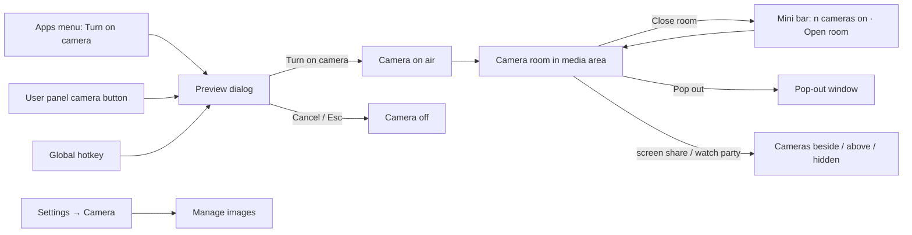
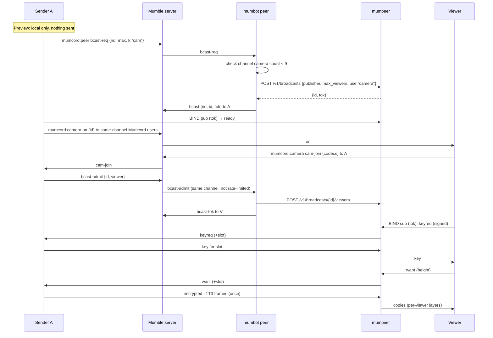
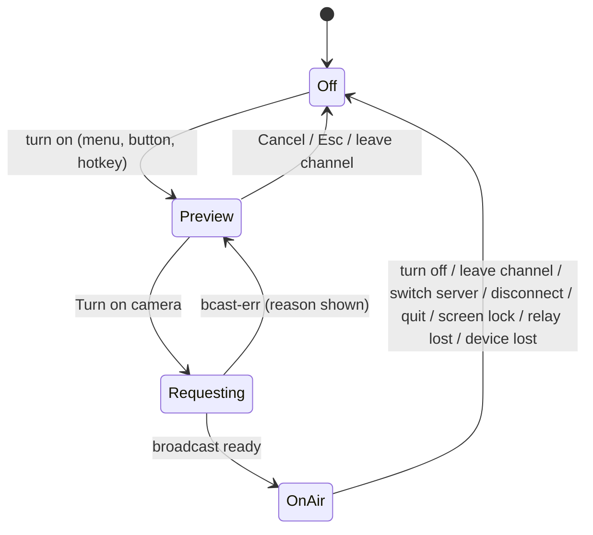
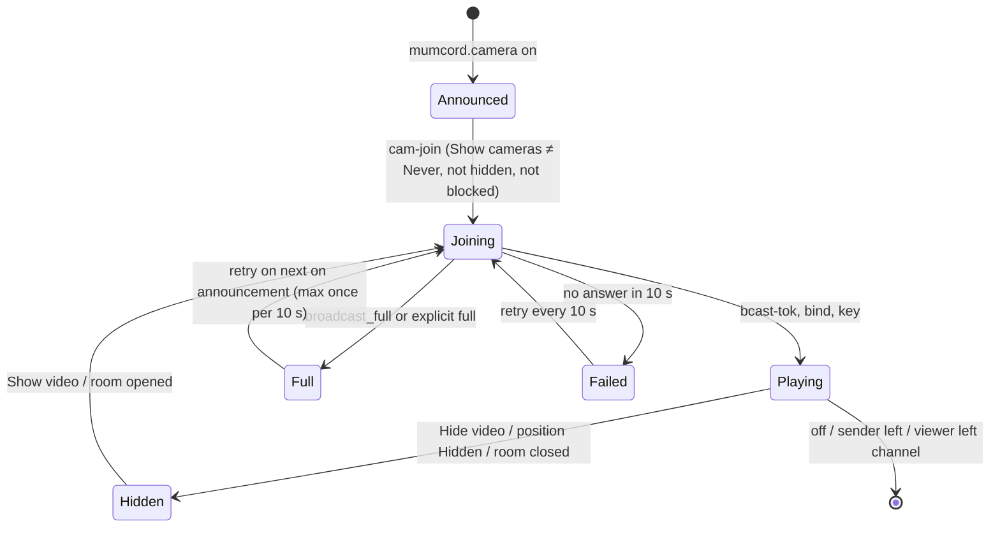

# Epic 4.1 – Camera sharing · Specification

> Status: Final (written directly from the agreed issue, no brainstorming file; the user accepted every recommended answer of #388) · As of: 2026-11-03
> Sources: issue #388 (concept, user rules, technical plan, mumpeer and mumbot changes, task breakdown, open questions with recommended answers), mockups on branch `mockups/camera-41` in `docs/mockups/epic-4.1-camera/` (binding), user decisions of 2026-11-03 (section 12). There is no `specs/roadmap.md`; the issues are the roadmap.
> Builds on: `specs/07-file-sharing-screenshare-specification.md` (relay allowed uses FR-7.1 … FR-7.8, broadcast fan-out FR-7.40 … FR-7.50, end-to-end frame encryption FR-7.43/FR-7.44, encoders and hardware detection FR-7.53 … FR-7.59), `specs/04-mumpeer-relay-specification.md` (relay, mumbot `peer`, `mumcord.peer`, P2P modes FR-4.3, availability FR-4.11), `specs/06-plugin-system-specification.md` (hello feature limit of 16), `specs/02-multi-server-themes-specification.md` (same-channel rule for media, Live marker FR-2.45, announce on channel join FR-2.75), `specs/03-comfort-polish-specification.md` (blocking, Settings window, tray).
> Repositories: `Mumcord/mumcord` (client), `Mumcord/mumpeer` (relay: `camera` use, camera limits, `want` control), `Mumcord/mumbot` (module `peer`: camera broadcasts, per-channel camera limit).
> Numbering: requirements and criteria use the spec file number (`FR-8.n`, `AC-8.n`). The issue's criteria AC-C1 … AC-C19 are mapped in section 11. Where this spec and the issue differ, this spec wins; where this spec and the mockups differ, the mockups win.

## 1. Goal & context

People in a voice channel want to see each other, the way they do in Teams or Meet, without leaving Mumcord or changing their Mumble server. Camera sharing sends each webcam as **one relay broadcast** through the server community's mumpeer relay, end-to-end encrypted, built on the fan-out, encryption and encoders that Epic 4.1 builds for screen sharing (spec 07). All cameras of a voice channel appear together in a **camera room** in the media area above the chat; with a screen share or watch party running, the cameras become a strip beside or above it. **Background blur and background images** run on the user's own PC before encoding, in a quality comparable to Teams or Meet. The Mumble server stays unmodified; mumpeer and mumbot are the community's own optional services.

## 2. Scope

### 2.1 In scope (MVP)

- Camera sharing only through the relay, with the new relay allowed use `camera` (default on), availability reasons in the UI.
- Native camera capture per OS: Media Foundation (Windows), AVFoundation (macOS), xdg-desktop-portal Camera + PipeWire (Linux) with V4L2 fallback; MJPEG decode with `zune-jpeg`; device list with hot-plug; permission errors with links to the system settings.
- Mandatory preview before going live; camera choice, background None / Blur / Image, blur strength, built-in and own background images, effect load display.
- Background segmentation with the MediaPipe Selfie Segmenter (Apache-2.0) via ONNX Runtime (`ort`, CPU execution provider; spike CA0 decided, no `tract` fallback), edge refinement, temporal smoothing, blur and image compositing, two speed-based quality levels picked when the camera starts.
- One relay broadcast per camera (`use: "camera"`), automatic admission of all eligible Mumcord users in the same channel, end-to-end encryption and rekeying as in FR-7.43/FR-7.44, temporal layers L1T3, resolution from the viewers' tile sizes (`want`), max 720p30.
- Camera room: grid for 1 to 9 cameras, Grid / Speaker layout, speaking frame, self-view, people without camera, room bar, pop-out; combined layouts with a screen share or watch party (cameras beside / above / hidden).
- Viewer controls per tile: Pin for me, Show large, Hide video, Quality for me (Auto / Data saver / Best).
- On-air state everywhere (user panel, under the own name, self-view, channel tree, room bar, system camera light, tray, screen reader); stop rules (channel change, server switch, disconnect, quit, screen lock).
- Settings → Camera tab (mockup 11); global hotkey to toggle the camera.
- Limits: 9 cameras per channel (mumbot), 25 viewers per camera, 18 camera broadcasts per relay, 2.5 Mbit/s per camera (mumpeer).
- 18 built-in background images made for Mumcord.
- mumpeer: `camera` use, `use` on broadcasts, camera limits, `want` control, testenv profile `no-camera`. mumbot: `cam` in the announcement, kind on `bcast-req`, broadcasts per session and kind, per-channel limit, camera ends on channel change.
- Test hooks for a simulated camera, a forced segmentation mask, screen lock and effect timing; `bcast-sim` camera publishers.

### 2.2 Out of scope / later

- Direct (non-relay) camera connections and "one copy per viewer" fallback: no relay means no camera sharing.
- More than 9 cameras per channel, 1080p and simulcast (later epic).
- A "Best" matting tier with Robust Video Matting or other GPL/GPU models (#388 Q6; decided after the spike, only with a model whose training data is cleared for commercial use).
- Camera sound (the camera has no audio; voice stays Mumble voice) and lip-sync delay.
- Recording cameras in any form.
- Cameras in private calls, across channels, or for plain Mumble users (no chat line, no link).
- WebView `getUserMedia` capture, `nokhwa`, FFmpeg.
- Virtual-camera output (sending Mumcord's processed picture to other apps).

## 3. Roles & permissions

| Role | Action | Enforced by |
|---|---|---|
| Mumcord user in a voice channel, with a client certificate, P2P mode allows the relay | Turn on own camera; see the cameras of others in the same channel; viewer controls | Bot (same channel, per-channel limit, rate limit), relay (allowed use, limits), client (preview, blocking, stop rules) |
| Mumcord user without a client certificate | Can't turn on a camera or watch cameras: "Camera sharing needs a client certificate" | Bot refuses broadcast requests without a certificate hash |
| Mumcord user with P2P mode `off` or `direct_only` | Can't turn on a camera or watch: "Camera sharing needs the relay. Change it in Privacy & Connections." | Client |
| Mumcord user in another channel | Sees nothing of the camera (no state, no tile, no tree icon); can't bind | Bot (same channel on admit), sender's client (admits only its channel) |
| Blocked user (either direction) | Never sees the blocker's camera; the blocker never sees theirs | Both clients (sender refuses admission, viewer never requests or shows) |
| Official Mumble client | Sees nothing; no chat line | — |
| Relay bot (mumbot `peer`) | Announces `cam`; creates camera broadcasts; enforces 9 cameras per channel; ends a camera broadcast when its sender leaves the channel | Relay API secret |
| Relay operator | Enables or disables `camera`; sets `max_camera_broadcasts`, `camera_max_kbps`, viewers per broadcast | Host access, mumpeer config |
| Mumble server admin | Nothing new | — |

The client only displays availability; the bot and relay decide who may create or join a camera broadcast. Preview, stop rules and blocking are enforced in the clients.

## 4. Functional requirements

### 4.1 Availability and relay use

- **FR-8.1** mumpeer `[uses]` gains the boolean `camera`, default `true`; `GET /v1/status` lists `"camera"` in `uses` when enabled. The bot passes it into the `relay` announcement as `cam` in `u` (FR-7.3); a changed value re-announces to all.
- **FR-8.2** Camera sharing is **available** on a server when all of these hold: the relay is available (FR-4.11); its announcement has `bc` (broadcasts); `u` contains `cam` (unlike FR-7.6, a missing `u` does **not** count as allowed, because a bot without `u` can't handle camera broadcasts); the user's P2P mode is not `off` or `direct_only`; the user has a client certificate.
- **FR-8.3** A relay without broadcasts (`bc` absent) can never carry cameras, whatever `u` says.
- **FR-8.4** When camera sharing is unavailable, the Apps-menu entry **Turn on camera** and the user-panel camera button are disabled, and the reason shows in the menu under the entry and as the button's tooltip (mockup 02). Reasons, first matching wins:
  1. no relay: "This server has no relay, so camera sharing isn't available."
  2. relay without broadcasts: "This server's relay is too old for camera sharing."
  3. relay doesn't allow `cam`: "This server's relay doesn't allow camera sharing."
  4. P2P mode `off` or `direct_only`: "Camera sharing needs the relay. Change it in Privacy & Connections."
  5. no client certificate: "Camera sharing needs a client certificate."
- **FR-8.5** Watching follows the same conditions; a viewer for whom camera sharing is unavailable sees no tiles and gets the room notice "You can't see cameras on this server: {reason}" once per channel visit when someone in the channel has a camera on.
- **FR-8.6** The server info panel's line "Relay allows: …" (FR-7.7) gains "Cameras".
- **FR-8.7** There is no direct-connection fallback for cameras and no "one copy per viewer" mode. If the relay becomes unavailable while a camera is on, the camera turns off with "Camera stopped: the relay isn't reachable" (FR-8.24); no direct connection is attempted.
- **FR-8.8** The camera state of a user (on / off, broadcast id) is announced over plugin data to Mumcord users in the same channel only, with a new data id `mumcord.camera` and new hello feature `camera` (section 6.6), in the same way as screen shares are announced today (FR-2.45, FR-2.75): on change, and to a newcomer entering the channel. Official Mumble clients receive nothing and no chat line is posted.

### 4.2 Turning the camera on: preview

- **FR-8.9** Entry points: the Apps-menu entry **Turn on camera** (subtitle "You see a preview first. Only people in {channel} can see you.", mockup 01), the camera button in the user panel next to mute and deafen, the room bar's camera button, and a configurable global hotkey (FR-8.20). The camera always starts off; nothing turns it on by itself.
- **FR-8.10** Turning the camera on **always** opens the preview dialog first (mockups 03–04); it can't be skipped or disabled. While the dialog is open the local camera runs but **nothing is sent**: no `bcast-req`, no broadcast, no state announcement. The dialog subtitle reads "Preview · nobody sees this yet" and the info line "Only people in {channel} see your camera, and only after you press Turn on camera. Mumcord never records cameras."
- **FR-8.11** Preview contents: the live mirrored (per setting) picture with the chosen effect; **Camera** device picker; **Background** None / Blur / Image; for Blur a **Blur strength** choice of two buttons, **Light** and **Strong** (no slider; Light = strength 50, Strong = 100); for Image the library (six built-in images, the user's own images marked "Yours", and **Add image**); the line "Effects run on this device. Load: {low|medium|high}"; the checkbox **Use this background next time** (saves the choice as the default background, FR-8.75); **Cancel** and **Turn on camera**.
- **FR-8.12** **Cancel**, Escape or closing the dialog turns the camera off and releases the device (camera light off within 1 s).
- **FR-8.13** **Turn on camera** sends `bcast-req` with kind `cam` (section 6.6). The dialog stays open with a busy state until the broadcast exists; then it closes and the camera is on air. Errors keep the dialog open with the reason text (section 5.6) and the button enabled for a retry.
- **FR-8.14** **Add image** opens the system file picker for PNG, JPEG or WebP up to 10 MB. The image is decoded, scaled to at most 1920 px wide, re-encoded (which strips all metadata) and copied into Mumcord's data folder; the original path is not kept. Unsupported or larger files show "This image can't be used. Use a PNG, JPEG or WebP file up to 10 MB." Own images are never uploaded, synced, sent or logged; only the finished composited picture is sent (info line in the dialog, mockup 04).
- **FR-8.15** Own images can be removed in Settings → Camera → **Manage images** (list with thumbnails, Delete per image). Deleting the current default background resets the default to Blur.
- **FR-8.16** Turning the camera on while the user is not in a voice channel is not possible: the entries are disabled with "Join a voice channel to turn on your camera."

### 4.3 On-air state and stop rules

- **FR-8.17** While the camera is on, all of these show (user rule 3): the user-panel camera button turns red and reads "Turn off camera"; "● Camera on" under the own name in the user panel; "● Live" on the self-view tile; a red camera icon next to the own name in the channel tree; the **Camera on** button in the room bar; the system camera light (hardware). Screen readers announce "Your camera is on" / "Your camera is off" on every change.
- **FR-8.18** Other Mumcord users in the same channel see a camera icon next to the sender's name in the channel tree (same place and style as the Live marker of FR-2.45; label "Camera on" for screen readers).
- **FR-8.19** Turning off: the red user-panel button, the room bar's **Camera on** button, the Apps-menu entry (then "Turn off camera"), the tray menu entry and the global hotkey turn the camera off at once, with no confirmation.
- **FR-8.20** Global hotkey (configurable in Settings → Shortcuts like mute; unset by default): when the camera is off it brings the window to the front and opens the preview (FR-8.10); when it is on it turns the camera off.
- **FR-8.21** The camera turns off within 1 s, releases the device, ends the broadcast and announces "off" when the user: leaves or is moved out of the voice channel, switches the voice server, disconnects or loses the connection, quits Mumcord, or locks the screen while "Turn my camera off when my screen locks" is on (default on). It never turns back on by itself afterwards.
- **FR-8.22** Minimised or hidden window: the camera keeps sending. The tray icon gains a red camera badge and the tooltip "Camera on"; the tray menu gains "Turn off camera".
- **FR-8.23** The camera device disappears (unplugged) while on: the camera turns off with "Camera stopped: the camera was disconnected." Another app takes the device exclusively: "Camera stopped: another app is using your camera."
- **FR-8.24** The relay becomes unavailable, the broadcast ends from the relay side (`end` reason `deleted`, `revoked`, `idle`, `closed`) or the bot announces the relay down: the camera turns off with "Camera stopped: the relay isn't reachable" (for `end` with `deleted`/`revoked`: "Camera stopped by the server's relay"). Placement of every "Camera stopped: …" notice (FR-8.23, FR-8.24): it appears in the camera room's bar; if the room is not on screen (closed, or open behind another item), it appears below the mini bar. It stays until the user dismisses it or turns the camera on again.

### 4.4 Camera capture

- **FR-8.25** Capture is native in the engine, in a new module next to screen capture (section 8), never through the WebView:
  - **Windows:** Media Foundation `IMFSourceReader`. If Windows blocks camera access for desktop apps: "Windows blocks camera access for desktop apps" with the button **Open camera settings** (`ms-settings:privacy-webcam`).
  - **macOS:** AVFoundation `AVCaptureSession`. The system permission prompt appears on first use (Info.plist `NSCameraUsageDescription`: "Mumcord uses your camera only when you turn it on, to show you to people in your voice channel."). A refusal shows "macOS blocks camera access for Mumcord" with **Open Privacy settings** (Privacy & Security → Camera).
  - **Linux:** xdg-desktop-portal Camera (`AccessCamera`, then a PipeWire stream). If no portal camera is available (portal missing or reports no cameras), V4L2 directly on `/dev/video*` capture devices. A portal refusal shows "Camera access was denied" with **Try again**.
- **FR-8.26** Formats: request NV12 or YUY2 first, at the highest mode up to 1280×720 at 30 fps (closest aspect 16:9; 4:3 cameras are centre-cropped to 16:9). Use MJPEG only when the camera reaches 720p30 only that way (typical for USB 2 cameras), decoded with `zune-jpeg`. Frames that fail to decode are skipped and counted; more than 30 consecutive failures stop the camera with "Camera stopped: the camera sends unreadable pictures."
- **FR-8.27** Device list with hot-plug: new and removed cameras update the preview and Settings pickers within 2 s. The last used camera is remembered by its stable device id (not by name); if it is missing, the system default camera is used.
- **FR-8.28** Device names and ids are shown only in the UI; they are never logged or sent.
- **FR-8.29** Only one camera can be on per Mumcord instance (one voice server at a time). The Settings tab and the preview share one capture session: opening the preview while the Settings preview runs moves the session to the dialog.
- **FR-8.30** The Settings → Camera preview (mockup 11, "Preview, only on this device. It stops when you leave this page.") runs the same pipeline locally and stops when the page or Settings window closes.
- **FR-8.31** Debug test hook `MUMCORD_TEST_CAMERA` (debug builds only, inert in release; section 10.3) replaces the device list with one virtual camera "Test camera" that produces 1280×720 frames at 30 fps from a bundled fixture: a person (our own image) in front of a known coloured pattern, with slight movement. All later pipeline stages run unchanged.

### 4.5 Background effects

- **FR-8.32** Backgrounds: **None**, **Blur** (strength **Light** = 50 or **Strong** = 100 as two buttons, no slider; two blur radii and a blend in between; a stored value above 50 counts as Strong), **Image** (built-in or own). The effect is applied before encoding; viewers receive only the finished picture.
- **FR-8.33** Segmentation model: MediaPipe **Selfie Segmenter** (Apache-2.0), converted once to ONNX and shipped with the app, run with ONNX Runtime through the `ort` crate on the CPU (spike CA0, section 13: about 4× faster than `tract` with identical masks). Two model shapes are shipped: the **square 256×256** model for the full level ("Best", FR-8.35) and the **landscape 144×256** model for the light level. There is no `tract` fallback and no graphics-card path. If ONNX Runtime is not available on a system (library missing or fails to load), background effects are disabled with a clear reason ("Background effects are not available on this PC: {reason}"); the camera itself still works with Background None. MediaPipe Selfie Multiclass is not used (its file is about 16.5 MB).
- **FR-8.34** Quality pipeline per frame (#388 §2), at the **full** level; the **light** level (FR-8.35) replaces step 2 with a simpler edge cleanup (plain bilinear upsampling of the mask plus a small edge blur) and step 5 with a coarser blur:
  1. run the model on a downscaled frame (256×256 at the full level, 144×256 at the light level);
  2. upsample the mask with a fast guided filter guided by the full-resolution frame (full level), so edges follow hair and shoulders;
  3. temporal smoothing weighted by motion (fast movement trusts the new mask, still areas use the history), so there is no flicker and no ghosting;
  4. composite: shrink the mask slightly against halos, feather 2–3 px, and for images add a light wrap;
  5. blur at quarter resolution (separable Gaussian), upscale and blend with the mask.
- **FR-8.35** **Effect quality** (Settings, mockup 11): **Auto** (default), **Best**, **Light (saves battery)**. There are two quality levels, **full** and **light**, and the level is picked by speed, not by hardware.
  - **Best:** the full level: square Selfie Segmenter (256×256) with the complete pipeline of FR-8.34 at 30 fps, always on the CPU. The label is just "Best" (it replaces the mockup label "Best (graphics card)"; the mockup text is updated accordingly).
  - **Light:** the light level: landscape Selfie Segmenter (144×256) with the model at 15 fps (the smoothed mask is reused in between), simpler edge cleanup, coarser blur, no light wrap.
  - **Auto:** when the camera starts, Mumcord measures how long the full level takes per frame on this PC (a short self-test on live frames, the same approach as the screen-share encoder self-test) and picks the full level if it holds 30 fps with headroom, otherwise the light level. During the call it steps down to the light level when the effect time per frame stays above the frame budget (FR-8.37) for 3 s, or on battery power. It steps back up after 30 s under budget on mains power.
- **FR-8.36** The preview shows the current load: low (< 50 % of the frame budget), medium (50–100 %), high (> 100 %, Auto is stepping down), and which level runs (Best or Light). Effects always run on the CPU.
- **FR-8.37** Frame budget: there is no fixed per-frame time. The budget is the frame interval at the target frame rate (about 33 ms at 30 fps) minus headroom for capture and encoding; the level that fits is chosen at camera start (FR-8.35). Spike CA0 measured about 10–14 ms per 720p frame for the full level on a 2020 reference laptop, so a fixed 8 ms limit is not reachable with full post-processing. If even Light can't hold 30 fps, the camera keeps running at the frame rate the effects can deliver (min 15 fps); below that, the preview shows "Your PC is too busy for this background effect. Try None." and the effect stays on.
- **FR-8.38** Effects run on a dedicated effects thread, never on the audio thread or the UI thread. Background None skips the model entirely.
- **FR-8.39** Built-in background images: 18 images made for Mumcord (our own work), each ≤ 300 KB, shipped with the app, source recorded in the third-party notices.
- **FR-8.40** The background choice can be changed while the camera is on (room bar "Background: {name}" opens the same picker as a popover, without stopping the broadcast).
- **FR-8.41** Debug test hook `MUMCORD_TEST_SEGMENT_MASK` (debug builds only) replaces the model output with the fixture's known person mask, so compositing can be checked pixel-exactly in E2E. A second hook `MUMCORD_TEST_EFFECT_STATS` exposes the median effect time per frame in the debug panel.

### 4.6 Sending: encoding and broadcast

- **FR-8.42** One relay broadcast per camera. **Turn on camera** sends `bcast-req` with `k = "cam"`; the bot creates the broadcast with `POST /v1/broadcasts` `use = "camera"` (section 6.6). A screen share and a camera can run at the same time (two broadcasts, two encoder sessions).
- **FR-8.43** Encoder: the order, hardware probe, self-test and live load monitoring of FR-7.53 … FR-7.57 (AV1 hardware → AV1 software → VP9 hardware → VP9 software), tuned for natural video (no screen-content tools), codec negotiation as FR-7.58 (a VP9-only viewer switches the camera to VP9). The camera uses the screen-sharing encoder cache; the self-test is run for 720p30 natural video once.
- **FR-8.44** Temporal layers **L1T3** (30 → 15 → 7.5 fps), so the relay can drop layers per viewer (FR-7.45).
- **FR-8.45** Send quality (Settings, mockup 11): **Auto** (default, up to 720p · 30 fps), **720p · 15 fps**, **360p · 30 fps**. The setting is the upper bound; within it the sender encodes the **largest tile height any current viewer asks for** through `want` (FR-8.55), rounded to 180 / 360 / 540 / 720, and changes resolution only at keyframes, at most once per 2 s. Without any viewer the encoder pauses (the self-view still runs).
- **FR-8.46** Bitrates (AV1 / VP9): 720p30 ≈ 1.2 / 1.5 Mbit/s · 540p30 ≈ 0.8 / 1.0 · 360p30 ≈ 0.45 / 0.6 · 360p15 ≈ 0.3 / 0.4 · 180p15 ≈ 0.12 / 0.15. Hard cap 2.5 Mbit/s per camera (relay limit `camera_max_kbps`).
- **FR-8.47** Admission is automatic (no Watch button, no prompt): a viewer's client asks to join with `cam-join` over `mumcord.camera` (section 6.6) when it wants to show that camera; the sender's client admits it through the bot (`bcast-admit`) if the viewer is a Mumcord user in the same channel, not blocked by the sender, and the broadcast has room. The bot checks the same channel and certificate as for screen shares (FR-7.42).
- **FR-8.48** End-to-end encryption and key exchange exactly as FR-7.43 (per-broadcast key, AES-128-GCM, SFrame-style, authenticated key exchange pinned to Mumble certificate hashes) and rekeying as FR-7.44 when a viewer leaves, is kicked or unbinds (FR-8.57). Neither relay nor bot can see the video.
- **FR-8.49** A viewer who leaves the channel is removed by the bot (spec 07 lead decision) and by the sender's client (`bcast-kick`), and the key rotates.
- **FR-8.50** The sender leaving the channel ends the camera broadcast (the bot deletes it; the client turns the camera off per FR-8.21). This differs from screen shares, which keep running.
- **FR-8.51** Errors on `bcast-req` (shown in the preview, FR-8.13):
  - `room-full`: "The camera room is full (9 of 9 cameras)." Watching still works.
  - `relay-full`: "Camera couldn't start: this server's relay is full right now."
  - `use-not-allowed`: "This server's relay doesn't allow camera sharing."
  - `not-same-channel`, `denied`: "Camera couldn't start: the server's relay refused it."
  - `relay-down`: "Camera couldn't start: the relay isn't reachable."
  - `rate-limited`: "Camera couldn't start: too many attempts. Try again in a minute."
- **FR-8.52** A viewer limit reached for one camera (25, `broadcast_full`, or the relay says full): the sender's client sends `full` to that viewer (section 6.5), and the viewer's tile shows "Too many people are watching {name}" with no video. The viewer joins again on the next `on` announcement of that camera; the owner re-announces `on` when a viewer slot frees up. At most one retry per 10 s. A viewer whose `cam-join` gets no answer within 10 s shows "Couldn't join {name}'s camera" and retries every 10 s. "Too many people are watching {name}" appears only after an explicit `full`.

### 4.7 Receiving and viewer choices

- **FR-8.53** With "Show cameras: Always" (default) the client sends `cam-join` to every camera in its channel and opens the camera room (FR-8.61) when the first camera in the channel turns on. With "When I open the room" it shows the mini bar "{n} cameras on · Open room" and joins only when the room is opened. With "Never" it never joins any camera, downloads no video, and shows only the tree icons.
- **FR-8.54** Receiving: bind as subscriber, receive the per-broadcast key, decrypt, decode with WebCodecs `av01` / `vp09` where available, otherwise dav1d / libvpx in the engine (FR-7.59), and hand frames to the UI through the existing frame hand-over of screen sharing. The self-view is drawn from local frames (no round trip through the relay).
- **FR-8.55** Each viewer reports, per camera it shows, the tile height it currently draws (device pixels, rounded to 180 / 360 / 540 / 720) with the `want` control message through the relay (at most once per second per camera, only on change).
- **FR-8.56** **Quality for me** per tile (mockup 10): **Auto** (fits the tile; default), **Data saver** (up to 15 fps: `layers` caps the viewer at the 15 fps layer; `want` as Auto), **Best** (up to 720p · 30 fps: `want` reports 720 regardless of tile size). Settings "Data saver: up to 15 fps for everyone" applies Data saver to every camera unless a tile is set to Best.
- **FR-8.57** **Hide {name}'s video** (H) stops downloading entirely: the viewer unbinds from that broadcast, sends `cam-leave`, the sender kicks and rekeys; the tile shows the name and avatar with "Video hidden" and **Show video**. Closing the room, choosing camera position **Hidden** (FR-8.71) or "Show cameras: Never" unbinds all cameras the same way. Showing again sends `cam-join`.
- **FR-8.58** A weak connection is shown on the affected tile only: when the viewer received fewer than 25 fps over the last 3 s, the tile shows a badge "{n} fps" (e.g. "7 fps", mockup 07) with the label "Weak connection"; the other tiles are not affected.
- **FR-8.59** Blocked people: the viewer never sends `cam-join` to and never shows the camera of a person it blocked; the sender never admits a person it blocked. Blocking someone while their camera is shown unbinds at once.
- **FR-8.60** Video latency target: under 300 ms from camera to screen on a LAN relay. No delay is added to voice.

### 4.8 Camera room

- **FR-8.61** The camera room is a new media kind `camera` in the media area above the chat, where the watched screen share and watch party live (mockups 05–07). It shows all cameras of the own voice channel and only those. Leaving the frame (Close room) keeps a mini bar "{n} cameras on · Open room" at the top of the chat, as for the other media kinds. If the resizable media area is available, the room follows its height.
- **FR-8.62** Header: "Camera room", "{n} cameras on · {m} people in {channel}", "{n} of 9 cameras" when the room is full, "Relay · end-to-end encrypted", and the layout switch **Grid / Speaker**.
- **FR-8.63** Grid layouts for 1–9 cameras: 1 → one large tile; 2 → 1 × 2; 3–4 → 2 × 2; 5–6 → 2 × 3; 7–9 → 3 × 3 (mockups 05–07). Tiles keep 16:9 and are letterboxed inside the area. Tile order is stable: the order in which cameras turned on, with the own self-view in its own place; pinned tiles move first. Tiles never reorder because someone speaks.
- **FR-8.64** **Speaker** layout: one large tile with the pinned person, or (no pin) the person who spoke last for at least 1.5 s; the other cameras in a strip below. Hidden tiles stay in the strip.
- **FR-8.65** Tile contents: the video; a name tag with the user name and a muted-microphone icon when muted or deafened (mockup 06); a green frame while the person is talking, in the same talking colour as the channel tree; "● Live" on the self-view; the "{n} fps" badge (FR-8.58); the tile menu button. User names come from the Mumble server and are treated as untrusted text (escaped, never HTML).
- **FR-8.66** Self-view: drawn from local frames, mirrored when "Mirror my self-view" is on (default on; only the own view is mirrored, others see the unmirrored picture). **Hide self-view** in the room bar removes the own tile for oneself only (the camera stays on air).
- **FR-8.67** People in the channel without a camera are listed under the grid: "{names} are here without a camera" (mockups 05, 07, 10), including plain Mumble users.
- **FR-8.68** Room bar (mockups 05–10): **Camera on** (turns off; when off: **Turn on camera**, opening the preview), **Background: {name}** (FR-8.40, only while on), **Hide self-view**, **Pop out** (the room moves into its own window using the existing media pop-out windows; closing that window returns it), **Close room**.
- **FR-8.69** When someone turns a camera on or off, a polite live region announces "{name} turned on their camera" / "{name} turned off their camera"; several changes within 2 s are bundled ("Jonas and Maya turned on their cameras").
- **FR-8.70** The room keeps its dark picture background in both themes, like the existing media frame.

### 4.9 Camera room with a screen share or watch party

- **FR-8.71** When a watched screen share or a joined watch party runs in the media area at the same time, that picture stays the main picture and the cameras become a strip (mockups 08–09). The switch **Cameras beside / Above / Hidden** chooses where: beside = a column to the right of the main picture; above = a row above it; hidden = no camera tiles (cameras unbound per FR-8.57, the header still shows "{n} cameras on").
- **FR-8.72** The header then shows the main feature's title line plus "· {n} cameras on" (e.g. "Window · since 07:44 · 4 cameras on", "Started by Ben · 5 cameras on"). The switch choice is remembered per device (setting `camera_strip_position`, default beside).
- **FR-8.73** In the strip, tiles are small (want 180 or 360 by tile height); the tile menu works as in the room. Show large (F) on a strip tile swaps it with the main picture until Escape.
- **FR-8.74** Ending the screen share or watch party returns the cameras to the room grid without a reload.

### 4.10 Settings → Camera

- **FR-8.75** New tab **Camera** (marked "New" until opened once) between Screen sharing and Chat & Notifications (mockup 11) with: intro "Your camera, background effects and how you see other people's cameras. Camera sharing needs a server with a mumpeer relay."; local preview (FR-8.30); **Camera** device; **Send quality** (FR-8.45); **Mirror my self-view**; **Default background** (None / Blur / Image: Library / own images); **Blur strength** (Light / Strong buttons); **Effect quality** (FR-8.35); own images count and **Manage images**; **Privacy**: "Turn my camera off when my screen locks" (default on) and the privacy text of mockup 11; **Other people's cameras**: **Show cameras** Always / When I open the room / Never, "Data saver: up to 15 fps for everyone", "Reduce motion: no glow or animation on the speaking frame" (follows the system setting by default).
- **FR-8.76** All camera settings persist across restarts and apply to the next preview (default background, blur strength, device).
- **FR-8.77** The privacy text explains honestly that Mumcord never records cameras and viewers' clients never write camera frames to disk, but that Mumcord can't stop someone from taking a screenshot with their operating system.
- **FR-8.78** No recording: there is no record function, and no camera frame (sent or received) is ever written to disk, cache or logs.

### 4.11 mumpeer

- **FR-8.79** `[uses] camera = true` (default) and `/v1/status` `uses` lists `"camera"` (FR-8.1).
- **FR-8.80** `POST /v1/broadcasts` gains `use` = `"screen_share"` | `"camera"`; missing means `"screen_share"` (older bots keep working). A disabled use returns `403 {"code":"use_not_allowed"}`; an unknown value `400`.
- **FR-8.81** `[broadcast] max_camera_broadcasts` (default 18), counted separately from `max_broadcasts` (screen shares, default 4); `camera_max_kbps` (default 2500) caps a camera publisher's upload (units above it are dropped). `/v1/status` `broadcast` gains `max_camera`. `max_viewers_per_broadcast` (default 25) applies to cameras too. Camera bandwidth counts against the relay's total budget; when the budget is reached the relay drops layers for the biggest consumers first.
- **FR-8.82** Data plane unchanged except the new control message **`want`** (subscriber → publisher, carries the u16 slot added by the relay and the wanted tile height as u16), forwarded like `keyreq`, at most 1 per second per subscriber (excess dropped).
- **FR-8.83** Docs (`api.md`, `protocol.md`, `configuration.md`), example config, CHANGELOG, and a testenv profile `no-camera` (`MUMPEER_PROFILE=no-camera`).
- **FR-8.84** `bcast-sim` (mumcord `tools/bcast-sim`) gains camera publishers: N fake Mumble clients with certificates that send hello with `camera`, announce camera on, request `k = cam` broadcasts and publish a synthetic encoded stream, for the 9-camera and full-room checks.

### 4.12 mumbot

- **FR-8.85** Passes `cam` through in the `relay` announcement `u`; a changed value re-announces.
- **FR-8.86** `bcast-req` gains `k` = `"scr"` | `"cam"` (missing = `"scr"`). Broadcasts are tracked per session **and kind** (today one per session), so a screen share and a camera of the same user can run together. `k = "cam"` creates the relay broadcast with `use = "camera"`.
- **FR-8.87** Per-channel camera limit `max_cameras_per_channel` (default 9): a `bcast-req` with `k = cam` when the sender's channel already has that many camera broadcasts gets `bcast-err` `r = "room-full"`.
- **FR-8.88** A camera broadcast ends when its sender leaves the channel or the server (bot deletes it at the relay); screen shares keep their current rule.
- **FR-8.89** Admission and channel checks as for screen shares (MB2); camera admits are counted in their own rate-limit bucket that allows a burst of 24 admits (a sender admits everyone in the channel at once) and 60 per minute per session.
- **FR-8.90** Errors and limits are logged without names, certificate hashes in full or IP addresses (spec 04 logging rules).

### 4.13 Signalling format (Bovnar, #400)

- **FR-8.91** The `mumcord.camera` messages (`on`, `off`, `cam-join`, `cam-leave`) are **Bovnar documents** (user decision 2026-11-03), written and read with a thin Rust wrapper around the upstream Bovnar C library (the published crates.io crate `bovnar`, one version pinned in Cargo.lock; until 12b34052 a git dependency on the fork `Mumcord/bovnar`; spec 09 FR-9.96 and FR-9.99). The channel is new in 0.7.0, so no older client has to read it. The decoder rejects malformed, truncated, wrong-typed or oversized documents without a crash or hang and logs one line without payload content. The other camera-related messages keep their formats: `mumcord.peer` (`relay`, `bcast-req`, `bcast-err`), broadcast control and the allowlist API stay JSON/binary, because 0.6.2 and mumbot read them and one channel never mixes formats.

## 5. UI & UX

### 5.1 Navigation



### 5.2 Preview dialog (mockups 03–04)

```
┌ Turn on your camera ───────────────────────────────┐
│ Preview · nobody sees this yet                     │
│ ┌────────────────────────────┐ Camera [Webcam  ▾]  │
│ │                            │ Background          │
│ │      (live preview)        │ (None)(Blur)(Image) │
│ │                            │ Blur strength       │
│ └────────────────────────────┘ (Light) (Strong)    │
│ Only people in Lobby see your camera, and only     │
│ after you press Turn on camera. Mumcord never      │
│ records cameras.                                   │
│ Effects run on this device. Load: low (CPU)        │
│ [x] Use this background next time                  │
│                         [Cancel] [Turn on camera]  │
└────────────────────────────────────────────────────┘
```

With Image selected, the blur strength buttons are replaced by the image grid (18 built-in, own images marked "Yours", **Add image**) and the line "Your own images stay on this device. Only the finished picture is sent." Focus starts on **Turn on camera**; Escape = Cancel.

### 5.3 Camera room (mockups 05–07, 10)

```
┌ Camera room · 4 cameras on · 6 people in Lobby ── [Grid|Speaker] ┐
│ Relay · end-to-end encrypted                                     │
│ ┌──────────────┐ ┌──────────────┐                                │
│ │ Jonas    ⋯   │ │ ● Live  You  │                                │
│ └──────────────┘ └──────────────┘                                │
│ ┌──────────────┐ ┌──────────────┐                                │
│ │ Maya 🎤̸   ⋯  │ │ Ben  7 fps ⋯ │                                │
│ └──────────────┘ └──────────────┘                                │
│ Zoe, Leo are here without a camera                               │
│ [Camera on] [Background: Blur] [Hide self-view] [Pop out] [Close]│
└──────────────────────────────────────────────────────────────────┘
```

Tile menu (button ⋯, Enter or Shift+F10 on a focused tile; mockup 10): **Pin for me** (P), **Show large** (F), **Hide {name}'s video** (H), **Quality for me**: Auto "fits the tile" / Data saver "up to 15 fps" / Best "up to 720p · 30 fps"; footer "Hidden videos aren't downloaded at all. Only you see these choices." The self-view tile menu has **Hide self-view** and **Background** instead.

### 5.4 Combined layouts (mockups 08–09)

```
┌ Jonas's screen · Window · since 07:44 · 4 cameras on  [Cameras beside|Above|Hidden] ┐
│ ┌────────────────────────────────────────┐ ┌───────┐                               │
│ │                                        │ │ You   │                               │
│ │          screen share (main)           │ │ Maya  │                               │
│ │                                        │ │ Ben   │                               │
│ └────────────────────────────────────────┘ │ Zoe   │                               │
│ [Camera on] [Background: Blur] [Hide self-view] [Pop out] [Close room]             │
└────────────────────────────────────────────────────────────────────────────────────┘
```

"Above" places the strip as a row above the main picture (mockup 09 with a watch party).

### 5.5 Keyboard, tray, hotkeys

- The grid is one tab stop with roving focus; arrow keys move between tiles; Home / End go to the first / last tile.
- On a focused tile: Enter or Shift+F10 opens the tile menu; P pin, F show large, H hide video; Escape closes the menu or leaves Show large.
- Every control has a visible focus ring; the layout switch and position switch are radio groups.
- Global hotkey toggles the camera (FR-8.20). Tray: red camera badge, tooltip "Camera on", menu entry "Turn off camera" (FR-8.22).

### 5.6 Texts (errors and notices)

| Situation | Text |
|---|---|
| Unavailable | FR-8.4 reasons |
| Not in a voice channel | "Join a voice channel to turn on your camera." |
| Room full | "The camera room is full (9 of 9 cameras)." |
| Relay full | "Camera couldn't start: this server's relay is full right now." |
| Relay refused | "Camera couldn't start: the server's relay refused it." |
| Rate limited | "Camera couldn't start: too many attempts. Try again in a minute." |
| Relay lost | "Camera stopped: the relay isn't reachable" |
| Broadcast ended by relay | "Camera stopped by the server's relay" |
| Device gone / busy | "Camera stopped: the camera was disconnected." / "Camera stopped: another app is using your camera." |
| Unreadable frames | "Camera stopped: the camera sends unreadable pictures." |
| Windows privacy | "Windows blocks camera access for desktop apps" + **Open camera settings** |
| macOS privacy | "macOS blocks camera access for Mumcord" + **Open Privacy settings** |
| Linux portal refused | "Camera access was denied" + **Try again** |
| No camera found | "No camera found. Connect a camera and it appears here." (preview and Settings) |
| Image import | "This image can't be used. Use a PNG, JPEG or WebP file up to 10 MB." |
| Effects too heavy | "Your PC is too busy for this background effect. Try None." |
| Viewer can't watch | "You can't see cameras on this server: {reason}" |
| Viewer limit (explicit `full`) | "Too many people are watching {name}" |
| Join timed out (no answer in 10 s) | "Couldn't join {name}'s camera" (retried every 10 s) |
| Hidden tile | "Video hidden" + **Show video** |

All texts in `ui/src/locales/en/camera.json` (and touched namespaces); other locales follow the normal translation step.

### 5.7 Design and accessibility

- Built from the existing design tokens; dark and light theme as in the mockups; the room keeps its dark picture background in both; respects system scaling.
- Screen reader: each tile is a group named "{name}, camera on" plus ", speaking" / ", microphone off" as they apply; the self-view "You, camera on, live"; on-air changes announced (FR-8.17); camera changes in a polite live region (FR-8.69).
- Reduce motion (system setting or the app's switch): the speaking frame is a static green border with no glow or animation, layout changes don't animate, and tiles never reorder because someone speaks.
- Colour is never the only signal: the on-air state has text ("Camera on", "Live"), the speaking frame is backed by the screen-reader name, the fps badge has a label.

## 6. Audio & network

### 6.1 Audio

Not applicable, because the camera has no sound; voice stays Mumble voice and no lip-sync delay is added (FR-8.60).

### 6.2 Codecs and quality

AV1 or VP9 with the encoder selection of FR-7.53 … FR-7.58, natural-video tuning, L1T3, max 720p30, bitrates as FR-8.46, resolution from `want` (FR-8.45). Decoding as FR-7.59. Latency target < 300 ms camera to screen.

Bandwidth examples (#388 §4):

| Situation | Upload per sender | Download per viewer | Relay out |
|---|---|---|---|
| 2 cameras, 6 people | ≤ 1.2 Mbit/s | ≤ 1.2 Mbit/s | ≈ 12 Mbit/s |
| 4 cameras, 10 people (2 × 2 ≈ 540p) | ≤ 0.8 Mbit/s | ≈ 3 Mbit/s | ≈ 29 Mbit/s |
| 9 cameras, 25 people (3 × 3 ≈ 360p) | ≈ 0.45 Mbit/s | ≈ 3.6 Mbit/s | ≈ 97 Mbit/s |
| same, everyone pins someone (720p) | ≤ 1.2 Mbit/s | ≈ 9.6 Mbit/s | ≈ 260 Mbit/s → relay limit applies |

Slow viewers: the relay drops temporal layers for that viewer only (30 → 15 → 7.5 fps, FR-7.45); the tile shows the fps badge.

### 6.3 Camera-on sequence



Stop: A sends `mumcord.camera off`, unbinds; the bot deletes the broadcast (also when A leaves the channel). Hide: V unbinds and sends `cam-leave`; A sends `bcast-kick` and rekeys.

### 6.4 Camera session states (sender)



### 6.5 Protocol additions

**`mumcord.peer` (spec 07 §6.6)**

| `t` | Direction | Change | Rules |
|---|---|---|---|
| `relay` | bot → client | `u` may contain `cam` | Missing `u` = cameras not allowed (FR-8.2) |
| `bcast-req` | sender → bot | + `k` = `scr` \| `cam` (missing = `scr`) | One broadcast per session and kind |
| `bcast-err` | bot → requester | + `r = "room-full"` | Only for `k = cam` |

**`mumcord.camera` (new plugin data id, Mumcord users in the same channel only)**, **Bovnar documents** (FR-8.91), each ≤ 512 bytes, size-checked before decoding; field names as below, types are Bovnar types (unsigned integers, strings):

| `t` | Direction | Fields | Rules |
|---|---|---|---|
| `on` | sender → channel | `v`, `id` (broadcast id, 16 hex) | Sent on air and to newcomers (FR-2.75 pattern, the sender itself answers) |
| `off` | sender → channel | `v` | Also implied when the sender leaves the channel or server |
| `cam-join` | viewer → sender | `v`, `id`, `codecs` (`av1`, `vp9`) | Accepted only from a same-channel session, not blocked; at most 1 per 10 s per viewer |
| `cam-leave` | viewer → sender | `v`, `id` | Sender kicks and rekeys |
| `full` | sender → viewer | `v`, `id` | Sent to a viewer whose `cam-join` was refused because the camera has 25 viewers or the relay said full. The viewer shows "Too many people are watching {name}" and joins again on the next `on` (at most once per 10 s). The owner re-announces `on` when a viewer slot frees up |

New hello feature: `camera` (within the hello limit of 16, spec 06).

**Broadcast control (spec 07 §6.6, mumpeer `protocol.md`)**: new control kind `want` (subscriber → relay → publisher, relay prepends the u16 slot; payload: u16 tile height 180/360/540/720), at most 1 per second per subscriber.

**Allowlist API (spec 07 §6.6)**

| Method & path | Change |
|---|---|
| `GET /v1/status` | `uses` may list `"camera"`; `broadcast` gains `"max_camera": n` |
| `POST /v1/broadcasts` | + `"use": "screen_share" \| "camera"` (missing = screen_share); `403 use_not_allowed`; `503 relay_full` when `max_camera_broadcasts` is reached |

### 6.6 Protocol compatibility

Mumble server ≥ 1.4, unmodified; only PluginDataTransmission and the messages spec 07 already uses. Official clients see nothing. New Mumcord with an older bot (no `k`): the bot treats the request as a screen share; the client detects this because `u` lacks `cam` (old bots never announce `cam`), so camera sharing shows as unavailable ("too old" when `bc` is missing, else "doesn't allow camera sharing"). Older Mumcord clients ignore `mumcord.camera` and never see cameras. An old relay rejects `use = "camera"` with 400; the bot maps it to `use-not-allowed`.

## 7. Data & state model

### 7.1 Client, stored (Settings, migration)

| Entity | Field | Type | Req. | Rules |
|---|---|---|---|---|
| Settings | `camera_device_id` | string | no | stable device id; missing → system default |
| | `camera_send_quality` | enum auto/720p15/360p30 | yes | default auto |
| | `camera_mirror_self` | bool | yes | default true |
| | `camera_default_background` | enum none/blur/builtin:{id}/own:{id} | yes | default blur |
| | `camera_blur_strength` | u8 0–100 (the UI writes 50 = Light or 100 = Strong; any stored value above 50 counts as Strong) | yes | default 50 (Light) |
| | `camera_effect_quality` | enum auto/best/light | yes | default auto |
| | `camera_off_on_lock` | bool | yes | default true |
| | `camera_show` | enum always/on_open/never | yes | default always |
| | `camera_data_saver` | bool | yes | default false |
| | `camera_reduce_motion` | enum system/on/off | yes | default system |
| | `camera_strip_position` | enum beside/above/hidden | yes | default beside |
| | `camera_hotkey` | shortcut | no | unset by default |
| Background image (own) | `id` | uuid | yes | file name in the data folder |
| | `file` | path in `{data}/backgrounds/` | yes | re-encoded, ≤ 1920 px wide, no metadata |
| | `added_at` | timestamp | yes | for list order |

Not stored: camera frames (sent or received), masks, broadcast ids, tokens and keys, per-tile choices (Pin, Hide, Quality for me reset when the room closes).

### 7.2 Viewer tile states



## 8. Technology & architecture

- **Native capture in the engine** (new crate `crates/camera`, next to screen capture): Media Foundation via the `windows` crate, AVFoundation via `objc2` + `objc2-av-foundation`, xdg camera portal via `ashpd` + PipeWire via `pipewire`, V4L2 via the `v4l` crate. Frames, effects, encoders and the relay link all live in the engine, so no frame crosses the WebView twice. Not `getUserMedia` (patchy on WebKitGTK, extra permission plumbing, expensive frame transfer) and not `nokhwa` (second abstraction, no portal support).
- **MJPEG decode with `zune-jpeg`** (pure Rust, MIT/Apache/Zlib), keeping the no-FFmpeg decision.
- **Segmentation:** MediaPipe Selfie Segmenter (square 256×256 for Best, landscape 144×256 for Light) as ONNX, run with ONNX Runtime via `ort` on the CPU (spike CA0: about 4× faster than `tract`, identical masks). No `tract` fallback and no graphics-card path; without ONNX Runtime, background effects are disabled with a reason (FR-8.33).
- **Compositing** (guided filter, blur, blend) in Rust with SIMD on the CPU, on a dedicated effects thread.
- **Encoding and broadcast:** reuse `screen_share` encoders (SVT-AV1, libvpx, direct hardware encoders NVENC / AMF / QSV / VA-API, no FFmpeg) and `screen_share::broadcast` (`FrameSealer` / `FrameOpener`, key exchange, reassembler, publisher / subscriber link) unchanged; a camera session owns its own encoder instance.
- **`mumcord-p2p`:** `RelayUse::Camera` (wire `cam`), `bcast-req` kind, `BroadcastErrorReason::RoomFull`, control kind `want`, hello feature `camera`; version bump.
- **Module layout (client):** engine `camera/` (session state machine, stop rules, `mumcord.camera` signalling, send and receive sides), `crates/camera` (capture backends), `effects/` (segmenter, refinement, compositing, load monitor); store: camera settings and background image store; UI `ui/src/features/camera/` (availability, preview dialog, room, tiles, strip, tile menu), `mediaView` gains kind `camera`, Settings tab. The UI talks to the engine only through Tauri commands and events.
- **Threads:** capture callback thread (copies into a frame pool, no allocation per frame), effects thread, existing encoder thread, decode on the existing receive path. Nothing on the audio thread; nothing blocking on the UI thread.
- **Screen lock detection:** Windows `WTSRegisterSessionNotification`, macOS `com.apple.screenIsLocked` distributed notification, Linux `org.freedesktop.ScreenSaver` / logind `Lock` signal.

## 9. Non-functional requirements

- **Performance:** the quality level is picked by speed when the camera starts (FR-8.35); the full level measured about 10–14 ms median per 720p frame on a 4-core 2020 laptop CPU (spike CA0); camera capture + effects + encode at 720p30 ≤ 1.5 cores in total; nine received 360p tiles decode and draw at 30 fps without dropping voice packets. Camera start (Turn on camera → tile on viewers) ≤ 3 s on a LAN relay; stop ≤ 1 s.
- **Battery:** on battery, Auto effect quality uses Light; Automatic encoder skips software AV1 (FR-7.53).
- **Security:** every frame end-to-end encrypted (FR-8.48); `mumcord.camera` and control messages are untrusted, size-checked and validated; `cam-join` accepted only from same-channel, unblocked sessions; tokens accepted only from the pinned bot.
- **Privacy:** the camera never starts by itself and the preview can't be skipped; no frames, masks, device names, background image paths or file names in logs (only counts, chosen codec, resolution and effect tier at `info`); own images never leave the device; no recording, no frames on disk. The relay operator sees who publishes and who subscribes (certificate hashes), volume and timing, not the picture. PRIVACY.md gets a camera section.
- **Accessibility:** section 5.5 and 5.7.
- **Platforms:** Windows 10+, macOS 12+, Linux (all Mumcord targets; portal path needs xdg-desktop-portal ≥ 1.16 with a camera backend, otherwise V4L2).
- **Logging:** capture backend, format, effect tier changes and encoder fallbacks at `info`, without user data.

## 10. Build, packaging & release

### 10.1 Packaging

- macOS: `NSCameraUsageDescription` in `Info.plist` and the `com.apple.security.device.camera` entitlement for the hardened runtime.
- Linux: the Flatpak build uses only the portal path (no extra device permission); `.deb` and AppImage need no new system packages.
- Bundled assets: the two Selfie Segmenter ONNX files (square 256×256 and landscape 144×256) and 18 background images (≤ 300 KB each); ONNX Runtime's native library (≈ 10–20 MB per platform) ships with the app. MediaPipe Selfie Multiclass (≈ 16.5 MB) is not bundled.
- Licences: third-party notices and the licences window list MediaPipe Selfie Segmenter (Apache-2.0, model card), `ort` + ONNX Runtime (MIT), `zune-jpeg` (MIT/Apache/Zlib), `v4l` (MIT), `objc2-av-foundation` (MIT), and the source of the built-in background images (own work).

### 10.2 Releases

- mumpeer: minor release with `camera` use, camera limits, `want`, `no-camera` profile.
- mumbot: release with kind, per-channel limit and camera end rule (MB2 contracts extended).
- `mumcord-p2p`: version bump; crates.io publish only with the user's approval.

### 10.3 Test hooks and test setup (debug builds only, inert in release)

| Hook | Effect |
|---|---|
| `MUMCORD_TEST_CAMERA=1` | Virtual "Test camera" from a bundled fixture (person on a known pattern), 1280×720 at 30 fps (FR-8.31) |
| `MUMCORD_TEST_CAMERA=absent` / `denied` / `unplug_after=5s` | No camera / permission refused / device disappears after 5 s |
| `MUMCORD_TEST_SEGMENT_MASK=fixture` | Forces the fixture's known mask (FR-8.41) |
| `MUMCORD_TEST_EFFECT_STATS=1` | Effect time per frame in the debug panel |
| `MUMCORD_TEST_SCREEN_LOCK` (debug command `lockScreen`) | Simulates a screen lock event |
| existing `on_battery`, `encoder_probe`, `keep_old_key` (B5) | Reused for battery, encoder and blind-relay checks |

Setup for E2E: mumpeer `testenv/` (`MUMPEER_PROFILE=all | no-camera | old`), mumbot `peer` built from main, Mumcord clients A, B, C (e2e `helpers/relayenv.ts`), `bcast-sim` camera publishers (FR-8.84), network throttling with `netns.sh` (spec 04). E2E reads tile pixels through the debug frame-sample hook of screen sharing to compare person and background regions.

## 11. Acceptance criteria (verifiable in the running client)

Setup for all unless stated otherwise: local mumble-server ≥ 1.4, local mumpeer and mumbot `peer` from `testenv/` (profile `all`), Mumcord clients A, B, C with different identities in channel Lobby, an official Mumble client O in Lobby, debug builds with `MUMCORD_TEST_CAMERA=1` (and `MUMCORD_TEST_SEGMENT_MASK=fixture` where pixels are compared).

**Availability**
1. **AC-8.1** (AC-C1) Server without relay → A's Apps-menu entry and user-panel camera button are disabled with "This server has no relay, so camera sharing isn't available." (menu line and tooltip).
2. **AC-8.2** (AC-C2) Profile `no-camera` → both show "This server's relay doesn't allow camera sharing"; profile `old` → "This server's relay is too old for camera sharing"; profile `all` → enabled; server info shows "Relay allows: … · Cameras". A in P2P mode `direct_only` → "Camera sharing needs the relay. Change it in Privacy & Connections."

**Preview and on-air**
3. **AC-8.3** (AC-C3) A opens the preview → the test camera picture shows; `/v1/status` and the bot show no broadcast and B receives no `mumcord.camera` message (B's packet inspector) until A presses Turn on camera. Cancel → capture stops (debug panel: camera closed).
4. **AC-8.4** (AC-C4) A turns on the camera → within 3 s B and C see A's tile named "A"; their trees show a camera icon at A; A sees the red user-panel button, "● Camera on", "● Live" on the self-view, the red tree icon, "Camera on" in the room bar; the screen reader live region says "Your camera is on". O sees no new chat line.
5. **AC-8.5** (AC-C5) A chooses Blur, then a built-in image → in A's preview and in B's tile, sampled background-region pixels differ from the raw fixture pattern while person-region pixels match within tolerance (mask hook). With the real model (no mask hook) the background region still changes measurably.
6. **AC-8.6** (AC-C6) A adds an own image and uses it → it is stored in A's data folder `backgrounds/` (re-encoded, no EXIF); no `mumcord.peer`, `mumcord.camera` or relay control message (inspector, relay log) contains the image bytes, its name or its path.

**Channel, limits, hiding**
7. **AC-8.7** (AC-C7) C moves to another channel → C's tile of A disappears within 2 s, the relay shows C removed and A's key id changes; a scripted `cam-join` from C is refused and the bot refuses an admit for C (`not-same-channel`). A client in another channel never shows A's camera icon.
8. **AC-8.8** (AC-C8) With 8 `bcast-sim` camera publishers plus A on (9) → the grid shows 3 × 3 and "9 of 9 cameras"; B pressing Turn on camera gets "The camera room is full (9 of 9 cameras)." and still sees all nine. With 2 and 4 cameras the grid matches mockups 05 and 06.
9. **AC-8.9** (AC-C9) B hides A's video → the relay shows B unbound from A's broadcast, B's received bytes for A stay at 0 for 10 s, A rekeys; Show video restores it. B sets Show cameras: Never → B binds to no broadcast and receives no video bytes; tree icons still show.
10. **AC-8.10** (AC-C10) A leaves the channel / disconnects / quits (each once) → A's capture stops within 1 s (debug panel; manual: camera light off), the bot deletes the broadcast, and A's tile disappears for B and C.
11. **AC-8.11** (AC-C11) `testenv` stops mumpeer while A's camera is on → A's camera turns off with "Camera stopped: the relay isn't reachable"; A's inspector and network log show no direct-connection attempt.
12. **AC-8.12** (AC-C12) Blind relay: as AC-7.30, a capture of a subscriber stream contains no decodable AV1/VP9 bitstream; after C leaves, a client with `keep_old_key` can't decrypt new frames.
13. **AC-8.13** (AC-C13) B blocks A → B shows no tile and no camera for A, sends no `cam-join` to A (inspector); A's client never admits B (bot log shows no admit for B).

**Room and layouts**
14. **AC-8.14** (AC-C14) C shares a screen and B watches it while A's and C's cameras are on → the share is the main picture; the switch moves cameras beside, above and hidden; Hidden unbinds B from both camera broadcasts; ending the share returns the grid. The same with a watch party (mockup 09).
15. **AC-8.15** (AC-C15) Keyboard only on B: reach the room, arrow through tiles, Enter opens the tile menu, P pins (Speaker layout with that tile large and `want` = 720 at the sender, debug panel), H hides, Quality → Data saver (relay shows `layers` cap); screen-reader names read "A, camera on, speaking" while A talks; the live region announces "C turned on their camera".
16. **AC-8.16** (AC-C16) Reduce motion on (system, then the app switch) → the speaking frame is a static border (no CSS animation or transition on the tile) and switching layouts doesn't animate.
17. **AC-8.17** (AC-C17, automated part) `netns.sh` throttles B to 1 Mbit/s → B's tiles drop to 15 or 7.5 fps with the fps badge while C keeps 30 fps. Manual checklist part: on a 4-core 2020 laptop, blur at 720p30 runs at 30 fps with the level Auto picked (effect time per frame in the debug panel).
18. **AC-8.18** (AC-C18) "Turn my camera off when my screen locks" on → screen-lock test hook turns A's camera off; with the setting off it stays on.
19. **AC-8.19** (AC-C19) Change every Settings → Camera value, restart → values kept; the next preview starts with the default background and blur strength (Light or Strong).
20. **AC-8.20** A minimises the window while on air → B keeps receiving frames; the tray shows the camera badge and "Camera on"; the tray entry "Turn off camera" stops it.
21. **AC-8.21** The global hotkey with the camera off opens the preview (nothing sent); with the camera on turns it off at once.
22. **AC-8.22** Test camera `unplug_after=5s` while on air → camera off with "Camera stopped: the camera was disconnected."; `denied` → the platform's permission text and button in the preview.
23. **AC-8.23** A runs a screen share and the camera at the same time → two broadcasts exist (`/v1/status`, bot), B sees both.
24. **AC-8.24** Licences window lists the segmentation model(s), the runtime, `zune-jpeg` and the background images' source.

**Manual checklist (real hardware; untested hardware is reported as "not verified")**
- **AC-8.25** Real webcam on Windows (Media Foundation, including the Windows privacy refusal and its settings button), macOS (AVFoundation, first-use permission prompt and refusal), Linux with portal (GNOME or KDE) and without portal (V4L2); one MJPEG-only USB 2 camera reaches 720p30; hot-plug updates the list; the camera light goes off within 1 s on every stop rule.
- **AC-8.26** Effect quality Best shows "Load: … " with the level "Best" and runs on the CPU (no graphics-card text anywhere); on battery Auto switches to Light.
- **AC-8.27** Visual quality: blur and image edges follow hair and shoulders without visible flicker or halo with a real person, compared side by side with a Meet or Teams call (subjective sign-off by the user).
- **AC-8.28** Auto picks its level when the camera starts: on a machine where the full level holds 30 fps it runs Best, on a slower one (or with a forced slow effect via the test hook) it runs Light; on the 2020 reference laptop the full level measures about 10–14 ms per 720p frame (part of AC-C17). With ONNX Runtime made unavailable (test hook or missing library), background effects are disabled with a reason and the camera still starts with Background None.

**Signalling format (Bovnar, #400)**
25. **AC-8.25** A turns the camera on in a channel with B (both 0.7.0): the packet inspector shows `mumcord.camera` `on` and `cam-join` as Bovnar documents with the fields of §6.5; the camera room works as in the other ACs.
26. **AC-8.26** Test CLI sends B a truncated Bovnar document, a document with a wrong field type, a JSON document and an oversized (> 512 bytes) payload on `mumcord.camera` → all are ignored, nothing crashes or hangs, the log has one line each without payload content, and B's camera state is unchanged.
27. **AC-8.27** A 0.6.2 client in the channel sees no camera and no error; chat, history sync and polls between all clients keep working.

## 12. Decision log

| Question | Decision | Note |
|---|---|---|
| #388 concept | Cameras only through the relay, one broadcast per camera, camera room in the media area, same channel only, effects on the PC, E2E encrypted, nothing for plain Mumble users | Accepted by the user with #388 |
| #388 Q1 `camera` default on mumpeer | **Yes** (`true`) | User decision 2026-11-03 |
| #388 Q2 cameras per channel | **9** (3 × 3), enforced by mumbot | User decision 2026-11-03; more needs simulcast, later |
| #388 Q3 preview skippable | **No**, always shown | User decision 2026-11-03 (privacy) |
| #388 Q4 show cameras automatically | **Yes** ("Always" default), plus "When I open the room" and "Never" | User decision 2026-11-03 |
| #388 Q5 chat line for plain Mumble users | **No** | User decision 2026-11-03 |
| #388 Q6 RVM "Best" matting tier | **Not in this epic** | User decision 2026-11-03; revisit only with commercially cleared training data (the CA0 spike did not change this) |
| #388 Q7 max send resolution | **720p30**, 3 temporal layers | User decision 2026-11-03; 1080p with simulcast later |
| #388 Q8 camera while minimised | **Keeps sending**, tray shows "Camera on" | User decision 2026-11-03 |
| #388 Q9 built-in backgrounds | **Six images made for Mumcord** (own work, ElevenLabs paid plan allows commercial use), source in third-party notices | User decision 2026-11-03 |
| #388 Q10 own spec, build order | Spec 08; build **after the Epic 4.1 broadcast work (BC1, MP3, MB2) is merged** | User decision 2026-11-03 |
| Capture | Native per OS (Media Foundation, AVFoundation, xdg camera portal + PipeWire, V4L2 fallback), MJPEG via `zune-jpeg` | #388 §1; no FFmpeg (user decision 2026-11-03, spec 07 task decisions item 7) |
| Segmentation | MediaPipe Selfie Segmenter (Apache-2.0) with ONNX Runtime (`ort`, CPU); no `tract` fallback; effects disabled with a reason if ONNX Runtime is unavailable | #388 §2; user decision after spike CA0, 2026-11-03 |
| Limits | 720p30 max, L1T3, 9 cameras per channel, 25 viewers per camera, 18 camera broadcasts per relay, 2.5 Mbit/s per camera | #388 §4 |
| mumbot changes | `cam` pass-through, `bcast-req` kind, broadcasts per session and kind, per-channel limit (`room-full`), camera ends on channel change, own rate-limit bucket | #388 "mumbot changes" |
| Camera on channel change | Camera ends (unlike screen shares, which keep running) | #388; screen-share rule unchanged |
| Admission | Automatic: viewer sends `cam-join`, sender's client admits without a prompt; hide = unbind + `cam-leave` + rekey | Refines #388 §3 ("nobody has to press Watch") so that hidden viewers and "Never" download nothing and relay viewer tokens don't expire unused |
| Camera state signalling | New plugin data id `mumcord.camera` and hello feature `camera`, announced like screen shares (FR-2.75) | #388 "announced the same way as the screen share state" |
| Effect quality "Best" | Label is "Best" (not "Best (graphics card)"): square 256×256 Selfie Segmenter on the CPU, no GPU path | User decision after spike CA0, 2026-11-03 (supersedes the mockup label) |
| Mockups vs. issue text | Mockups win (Send quality options Auto / 720p · 15 fps / 360p · 30 fps; room bar buttons; tile menu wording) | Same rule as spec 07 (user decision 2026-11-02) |
| Viewer full and failed join (2026-11-05) | Explicit `full` message from the sender shows "Too many people are watching {name}"; no answer to `cam-join` within 10 s shows "Couldn't join {name}'s camera" and retries every 10 s | Product owner decision 2026-11-05; FR-8.52, §5.6, §6.5, §7.2 |
| Pure client | Works against an unmodified Mumble server; mumpeer and mumbot are the user's own projects and are extended | Project rule |
| Camera signalling format (#400) | `mumcord.camera` uses **Bovnar** from the start (thin Rust wrapper around the upstream C library; decided as a pinned git dependency on the fork Mumcord/bovnar, since 12b34052 the published crates.io crate `bovnar`; building needs a C compiler). Existing message channels (`mumcord.peer`, history sync, hello, poll/dice data and the like) stay JSON/binary, so 0.6.2 and mumbot keep working; one channel never mixes formats. | user, 2026-11-03; FR-8.91, §6.5 |
| Blur strength control and "Camera stopped" placement | Blur strength is two buttons, **Light** (50) and **Strong** (100), not a slider; a stored value above 50 counts as Strong. The "Camera stopped: …" notice appears in the camera room's bar, or below the mini bar when the room is not on screen | User decision 2026-11-06, decided during implementation (0.7.0) |

## 13. Open points & risks

Open points (the recommended answer is already written into this spec):

- **Q-CA0** Resolved by spike CA0 (product owner decisions, 2026-11-03): `ort` with ONNX Runtime (CPU) is about 4× faster than `tract` with identical masks, so `tract` is dropped and there is no fallback (FR-8.33). Selfie Multiclass is about 16.5 MB (not about 1 MB as first assumed) and is not used. The full level measured about 10–14 ms per 720p frame on a 2020 reference laptop, so the fixed 8 ms budget is replaced by two speed-based quality levels picked at camera start (FR-8.35, FR-8.37).
- **Q-CA1** Resolved: no graphics-card path; the quality label is just "Best" (FR-8.35).
- **Assumptions** (not in #388, chosen for consistency with spec 07): a client certificate is required (reason text FR-8.4 item 5); the Windows / macOS / Linux error texts and the "No camera found" text; the hide-equals-kick-and-rekey rule; default blur strength 50 and default background Blur; the tab position of Settings → Camera.

Risks:
- **Relay bandwidth:** a full room of 25 people needs ≈ 100 Mbit/s out, worst case 260 Mbit/s; small relays hit their budget and drop layers. Defaults and operator limits mitigate it.
- **CPU load:** capture + effects + encode on older laptops, more with a parallel screen share; mitigated by Auto effect quality, 720p cap, `want`-driven resolution and encoder load monitoring.
- **Segmentation quality** on hair and in poor light is below a GPU matting model; acceptable for the MVP (Q6 stays out of this epic).
- **Linux variety:** camera portal support differs by desktop and distribution; the V4L2 fallback covers the rest but not inside Flatpak without device access.
- **macOS entitlements and signing:** a missing camera entitlement silently blocks capture in signed builds; covered by AC-8.25 on a signed build.
- **Model licence:** the MediaPipe model cards state Apache-2.0; the converted ONNX file keeps the licence notice. RVM stays out because of GPL and non-commercial training data.
- **Honest limits on privacy:** viewers can take OS screenshots; the help text says so.

## 14. Impact on the roadmap

- **Spec 07** is extended, not changed: broadcasts gain a kind and a `use`, a new allowed use `camera`, a control message `want`, and a per-channel camera limit in mumbot. Screen-share behaviour (including "share keeps running on channel change") is unchanged.
- **Build order:** this epic starts only after the Epic 4.1 broadcast work (BC1, MP3, MB2) is merged on main.
- **Mumcord/mumpeer** gets a minor release (`camera` use, camera limits, `want`, `no-camera` profile); **Mumcord/mumbot** a release with the camera rules.
- **Hello features:** `camera` adds one feature toward the limit of 16 (spec 06).
- **Media area:** the media view gains a third kind (`camera`) that can share the area with a screen share or watch party; a later resizable media area applies to the room too.
- **Later epics:** more than 9 cameras and 1080p (simulcast); a GPU matting tier with a cleared model; cameras in private calls; virtual-camera output.

## 15. Implementation split

Task IDs from #388; one fresh agent per task.

| Order | mumpeer | mumbot | mumcord |
|---|---|---|---|
| Step 0 (parallel) | — | — | CA0 spike (done, results in section 13 Q-CA0); CB1 `mumcord-p2p` (`RelayUse::Camera`, kind, `want`, hello `camera`); CB2 settings schema, background-image store, English texts; CU7 six background images |
| Step 1 | CMP1 `camera` use, `use` on broadcasts, camera limits, `want`, `no-camera` profile | CMB1 `cam` pass-through, kind, per-channel limit, end on channel change | CC1 camera capture (all OS, test hook); CU1 camera button and availability |
| Step 2 | — | — | CC2 background effects; CC3 camera send; CU2 preview dialog; CU6 Settings → Camera |
| Step 3 | — | — | CC4 camera receive; CU3 camera room; CU4 combined layouts; CU5 viewer controls |
| Step 4 | Release (with approval) | Release (with approval) | CE1 E2E along AC-8.1 … AC-8.24; manual checklist AC-8.25 … AC-8.28; CD1 docs, help text, CHANGELOG, third-party notices, translations |
