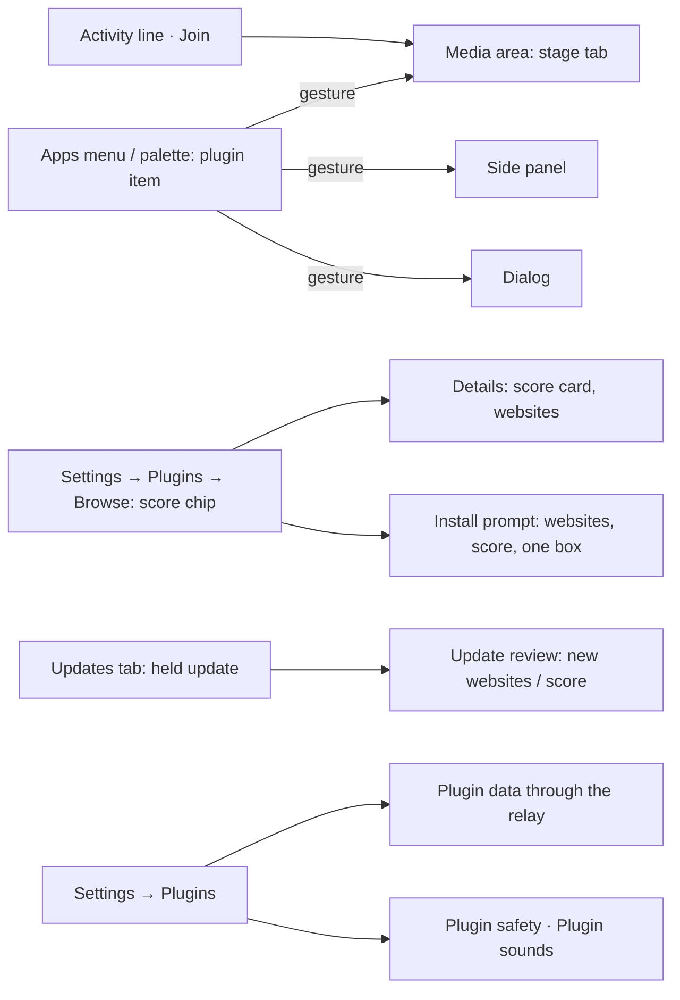
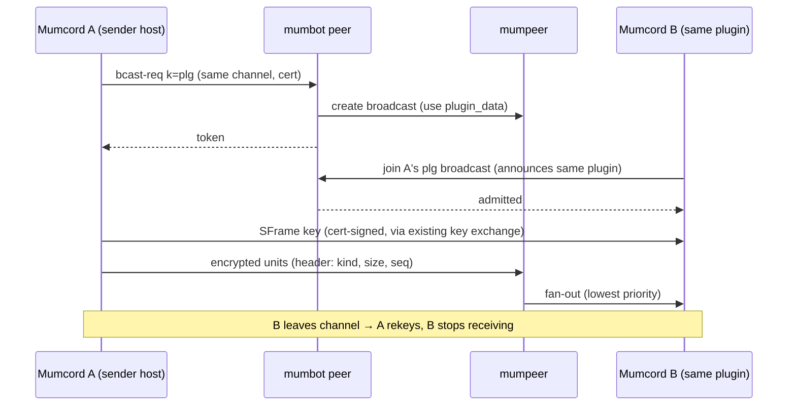
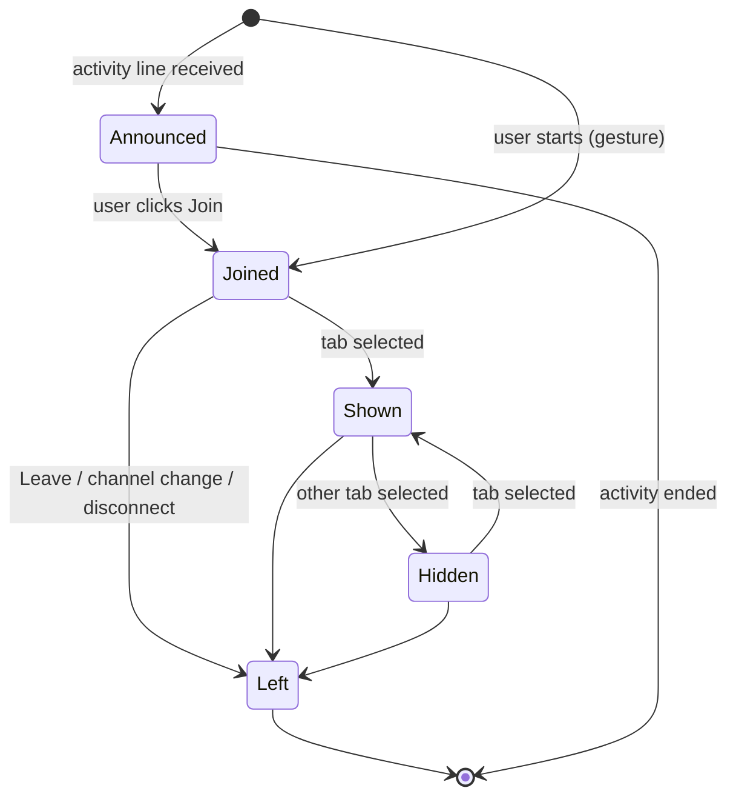

# 0.7.0 – Plugin platform 1.1 · Specification

> Status: Final (written directly from the agreed issues, no brainstorming file; the user accepted every recommended answer of #393, #395 and #396 plus the product-owner decisions in their comments) · As of: 2026-11-03
> Sources: issue #395 (plugin surfaces: media area, own web content, declared websites, Apps menu, relay plugin data, sound effects, WIT 1.1), issue #393 (security score for unofficial plugins), issue #396 (minimum API / Mumcord version per plugin version, backwards compatibility, product-owner decisions of 2026-11-03). Mockups on branch `mockups/plugin-surfaces` in `docs/mockups/0.7.0-plugin-surfaces/` (01–09) and on branch `mockups/plugin-score` in `docs/mockups/0.7.0-plugin-score/` (01–07) are binding. There is no `specs/roadmap.md`; the issues are the roadmap.
> Builds on: `specs/06-plugin-system-specification.md` (plugin system, WIT `mumcord:plugin@1.0.0` frozen, permissions FR-6.27 … FR-6.32, messaging FR-6.33 … FR-6.36, `net.http` FR-6.37, web view FR-6.47/FR-6.48, signing FR-6.50, unofficial labels FR-6.61, updates FR-6.67, repositories FR-6.74), `specs/07-file-sharing-screenshare-specification.md` (relay broadcast and SFrame encryption FR-7.40 … FR-7.45, resizable media area FR-7.61 … FR-7.74), `specs/08-camera-sharing-specification.md` (camera room, camera strip FR-8.71/FR-8.72), `specs/04-mumpeer-relay-specification.md` (relay, pair sessions, P2P modes FR-4.3).
> Repositories: `Mumcord/mumcord` (client, `mumcord-p2p`, SDK, `mumcord-plugin` CLI), `Mumcord/mumpeer` (relay: `plugin_data` use and limits), `Mumcord/mumbot` (module `peer`: `plg` tokens and broadcasts), `Mumcord/plugins` (registry CI: second index, review rules, docs).
> Numbering: requirements and criteria use the spec file number (`FR-9.n`, `AC-9.n`). The issues' criteria are mapped in section 11. Where this spec and an issue differ, this spec wins; where this spec and the mockups differ, the mockups win, except for the permission ids shown in the score mockups (placeholders, see section 12).

## 1. Goal & context

Plugins in 0.6.0 live in small places (panel, chat cards, badges) and only official plugins may show their own web content or reach the internet. Games, whiteboards and other shared activities need a big, clearly framed place, their own web or WebAssembly code, a few known websites and a fast data pipe between players. 0.7.0 turns this into **plugin platform 1.1**: the media area, a side panel and dialogs for own web content, declared external websites, Apps-menu items, relay plugin data and bundled sound effects, all behind a new backwards-compatible WIT minor `mumcord:plugin@1.1.0`. Because unofficial plugins get more power, Mumcord shows a **security score** for every unofficial plugin, computed on the user's own computer. Because plugins can now need a newer Mumcord, every plugin version declares the API it needs, and the registry keeps 0.6.x clients away from versions they can't run. The Mumble server stays unmodified; mumpeer and mumbot are the community's own optional services.

## 2. Scope

### 2.1 In scope (MVP)

- **Security spike S0** (first task, release gate): sandboxed-frame isolation per platform (Windows WebView2, macOS WKWebView, Linux WebKitGTK), including WebRTC, DNS prefetch, `<link rel=prefetch|preconnect|dns-prefetch>` and similar leaks, busy loops, memory, CSP with `'wasm-unsafe-eval'`, Esc/F6 focus, IPC reachability. Every leak S0 finds is closed before 0.7.0 ships.
- **WIT `mumcord:plugin@1.1.0`** linked next to 1.0.0; frozen snapshots of every published minor; SDK feature `1.1`.
- **API versioning and backwards compatibility** (#396): `api` per package and per index version, `min_mumcord` per version, newest-runnable choice, refusal before install, second official index `v1.1/index.json` for 0.7.0+, `v1/index.json` frozen to `api 1.0` versions, deprecation rules, `mumcord-plugin check` rules.
- **New permissions**: `ui.stage`, `ui.side-panel`, `ui.app-menu`, `net.origins`, `peers.relay`, `audio.effects`; `ui.webview` opened to all plugins.
- **Declared external websites** (`net.origins`) for the plugin core (`net.http`) and its web page, with validation, enforcement, counters and an update gate.
- **Web content host v2**: per-plugin frame policy, Permissions-Policy, Mumcord-drawn chrome and "Plugin content" tag, heartbeat, Rust UI watchdog, 3-frame limit, keyboard return; places media area, side panel, dialog and the existing panel popover.
- **Media area for plugins**: stage switcher for all media kinds (screen share, watch party, camera room, plugin activities), plugin activities with join/leave, pop-out, full screen with banner, mini bar.
- **Apps menu and command palette** plugin items.
- **Relay plugin data**: 1:1 pair sessions and per-sender channel broadcasts through mumpeer, end-to-end encrypted, with fallback to Mumble plugin data; Settings card and status chips.
- **Plugin sound**: bundled sound effects (`audio.effects`) and click-started sound from web content.
- **Security score** for unofficial (third-party and developer) plugins: formula v1, breakdown, chips, install and update rules, setting "Don't allow high-risk plugins", hard stops.
- **mumpeer** `plugin_data` use (default off) and limits; **mumbot** `plg` tokens and broadcasts; **mumcord-p2p** `PluginData` use.
- Small **test plugins** and a local HTTPS fixture for Mumcord's platform E2E.
- English texts plus all 24 locales.

### 2.2 Out of scope / later

- **Official plugins built on 1.1**: Skyloom (#394) and Whiteboard (#397) are consumers of this platform. They are specified, built and E2E-tested in the plugins repository, not here.
- Whiteboard's proposed host calls (save file, post image to chat, import picture; #397): a later WIT minor, after their own approval.
- Pointer lock for action games (#395 Q4). Full screen only via Mumcord's button.
- Wildcard websites (`*.example`) (#395 Q5).
- Web content in chat cards, badges, profile cards or menus (#395 D5).
- Microphone, camera, clipboard, screen, location or device access for any plugin (FR-6.28 unchanged).
- `secrets` for unofficial plugins (stays official-only).
- A score for official plugins (#393 Q1); verifying reproducible builds by rebuilding (#393 Q8, later epic).
- A 0.6.x patch release (product-owner decision of 2026-11-03 on #396).
- Any server-side enforcement of the safety setting (client only).
- Removing anything from the 1.x API; that needs a 2.0 major.

## 3. Roles & permissions

| Role | Action | Enforced by |
|---|---|---|
| Mumcord user | Installs plugins, approves permissions and websites, starts and joins plugin activities, uses Apps-menu items, switches relay plugin data and plugin sound on/off, turns on "Don't allow high-risk plugins" | Client (host checks every call, FR-6.31) |
| Mumcord user in the same channel **with** the same plugin (id and source, FR-6.35) | Sees the activity line and joins by click; exchanges plugin data | Starter's and receiver's hosts; bot (same channel for relay broadcasts) |
| Mumcord user in the same channel **without** the plugin | Sees nothing for unofficial plugins; for official plugins sees "<name> is playing <plugin> · Get plugin" | Starter's host (sends the official notice only) |
| Mumcord user in another channel, blocked user (either direction) | Sees nothing; receives nothing (FR-6.19) | Both hosts; bot |
| Official Mumble client | Sees nothing new | — |
| Official plugin | Everything an unofficial plugin can, plus `secrets` and `user-configured` hosts for `net.http`; shown "Official · reviewed", no score | Host; registry review |
| Unofficial plugin (third-party repository) | Everything in the catalogue except `secrets`; websites only as declared; scored | Host; install prompt; score rules |
| Developer plugin (Developer mode) | Like unofficial; may also declare `http://localhost:<port>` origins; scored for information only, never blocked | Host |
| Relay operator | Switches `plugin_data` on (default off), sets `[plugin_data]` limits | mumpeer config |
| Relay bot (mumbot `peer`) | Issues `plg` tokens and broadcasts; per-channel cap of 8 senders; never sees plugin ids | Relay API secret |
| Registry maintainers | Publish `v1/index.json` (api 1.0 only) and `v1.1/index.json` (all) from one source; review websites and "no remote code" for official plugins | Registry CI |
| Mumble server admin | Nothing new | — |

The client only displays relay availability; the relay and bot decide who may create or join a `plg` session. Websites, permissions, gestures, frame policy and score rules are enforced in the client.

## 4. Functional requirements

### 4.1 Spike S0: frame isolation per platform (release gate)

- **FR-9.1** Before any web-host work (V1) starts, spike S0 measures on Windows (WebView2), macOS (WKWebView) and Linux (WebKitGTK) with a sandboxed frame (opaque origin, `sandbox` without `allow-same-origin`): (a) a busy loop and a memory-hungry page: does Mumcord's UI and the Rust watchdog keep working; (b) WebRTC (`RTCPeerConnection` with STUN/TURN to an undeclared host), DNS prefetch, `<link rel=prefetch|preconnect|dns-prefetch|preload>`, CSS `@import`/`url()` to an undeclared host, `navigator.sendBeacon`, `EventSource`, `WebSocket`, `<a ping>`, meta refresh, `window.open`, form submission, downloads, `alert`/`confirm`/`prompt`; (c) CSP from a response header including `'wasm-unsafe-eval'`; (d) Esc/F6 focus return; (e) reachability of Tauri IPC, `parent` DOM, storage, cookies.
- **FR-9.2** S0 writes its result into this spec (section 13, "S0 result") as a table per platform: each probe, observed result, the closing measure (webview setting, browser argument, configuration or bootstrap script) and a verdict **go** or **fallback**. Closing measures are part of V1 (e.g. WebKitGTK `enable-webrtc=false`, WebView2 browser arguments, WKWebView configuration).
- **FR-9.3** **Fallback**: a platform that can't contain a busy or hungry frame in the shared webview uses a separate child webview in its own process for plugin content. There, menus can't overlap the plugin content, so Mumcord hides the plugin content while one of its menus or dialogs overlaps it (#395 Q7).
- **FR-9.4** **Release gate**: 0.7.0 is not released while any probe of FR-9.1 (b) or (e) leaks on any platform. The manual checklist (AC-9.40) repeats the probes on signed builds of all three platforms.

### 4.2 API versions and backwards compatibility (#396)

- **FR-9.5** Mumcord knows the API minors it supports: 0.7.0 supports `1.0` and `1.1`. Every later 1.x client supports all earlier 1.x minors unchanged.
- **FR-9.6** The manifest field `api` (caret range, FR-6.11) states the minor a package is built against through its lower bound: `"^1.1"` means API 1.1. `"^1.0"` means 1.0; `"^1"` is invalid because `^MAJOR.MINOR` is required. `mumcord-plugin build` and the SDK fill `api` from the SDK feature used; the author never types it.
- **FR-9.7** **Minors only add.** A minor may add interfaces, functions, events, error cases, manifest fields and permissions. It never changes or removes existing ones. The frozen WIT of every published minor lives in the repo as a snapshot (`wit-1.0.0.snapshot`, `wit-1.1.0.snapshot`); a test fails if a published snapshot changes.
- **FR-9.8** The host links each plugin against exactly the WIT minor it declares. A 1.0 plugin never sees 1.1 imports, never receives 1.1 events, and behaves as on 0.6.x; the host converts trees and events for it.
- **FR-9.9** A new capability is off for old plugins: a 1.0 plugin can never hold a 1.1 permission; a plugin gains one only through a new version and the user's approval (FR-9.83).
- **FR-9.10** Manifest, index and permissions: new fields are optional with safe defaults; unknown fields are ignored; old permission names keep working; a renamed permission keeps its old name as an alias for the whole major version.
- **FR-9.11** **Deprecation**: something is removed only in a new API major (2.0). It is announced at least one Mumcord minor release ahead, with a warning in Developer mode (Diagnostics entry on load) and in `mumcord-plugin check`. After a major bump the previous major stays supported for two Mumcord releases (FR-6.13); Browse shows "Built for an older Mumcord – may not work" only for majors that are no longer supported.
- **FR-9.12** **Data between plugin versions**: the messaging envelope already carries the API major (FR-6.34); the relay-data envelope carries `api` major.minor (FR-9.62). The SDK documents that plugins must put their own version into their messages and accept unknown fields; the test plugins and SDK examples show it.
- **FR-9.13** Version comparison for `api` and `min_mumcord` uses **major.minor only**; patch versions are ignored (`min_mumcord: "0.7.3"` is satisfied by 0.7.0).

### 4.3 Registry indexes and version choice (#396)

- **FR-9.14** The official registry publishes two indexes from the same sources, both signed with the official repository key and covered by the same kill switch:
  - `https://mumcord.github.io/plugins/v1/index.json` (format 1, read by 0.6.x): lists **only versions with `api 1.0`**. A plugin whose newest version needs 1.1 keeps its last 1.0 version there, or is not listed if it never had one.
  - `https://mumcord.github.io/plugins/v1.1/index.json` (format 2, read by 0.7.0+): lists all versions.
  - `v1/revoked.json` stays the single kill-switch list for both. `v1.1/permissions.json` holds the full 1.1 catalogue texts; `v1/permissions.json` stays unchanged.
- **FR-9.15** Index **format 2** equals format 1 except: version entry `api` is a string `"major.minor"` (`"1.0"`, `"1.1"`); version entry gains optional `min_mumcord` (`"0.7"`; default: the first release supporting that `api`, i.e. `1.0` → `0.6`, `1.1` → `0.7`); version entry gains optional score inputs `origins` (array of origin strings), `modules` (int, WASM modules), `reproducible` (bool, claimed). The plugin-level `min_mumcord` stays as a fallback for all versions. 0.7.0 reads format 1 (`api: 1` counts as `"1.0"`) and format 2.
- **FR-9.16** **Choice**: for every plugin, the client picks the newest version whose `api` it supports (FR-9.5) and whose `min_mumcord` is at most its own version. If none fits, Browse shows **"Needs Mumcord 0.7.0 or newer"** (the lowest fitting version) with Install disabled and a link "Update Mumcord" that opens the existing app update check.
- **FR-9.17** **Local, developer and third-party packages** whose `api` or `min_mumcord` the client doesn't support are refused at install time, before anything is written to disk, with the same text. They never fail later at load time.
- **FR-9.18** **Automatic updates** never move to a version the client can't run: the plugin stays on its version and the Updates tab shows "Update available after updating Mumcord".
- **FR-9.19** **Third-party repositories**: the address the user added is the index URL (FR-6.74). If it ends in `/v1/index.json`, 0.7.0 first fetches the sibling `/v1.1/index.json` (same pinned key, same size, signature and rollback rules, own `sequence`); on HTTP 404 it uses the added URL. Plugin docs tell repository owners to publish 1.1 versions only in the `v1.1` index. A 0.6.x client may still install a too-new package from a third-party repository that ignores this; it fails at load time with the existing error (accepted, decision of 2026-11-03).
- **FR-9.20** **Registry CI** (plugins repo) generates both indexes from one source, rejects a version whose `api` does not match its component's WIT imports, and rejects a `min_mumcord` lower than the first release supporting that `api`. `mumcord-plugin site-data` writes both indexes.
- **FR-9.21** `mumcord-plugin check` fails when `api` doesn't match the WIT the component imports, and warns when the plugin uses a deprecated API (FR-9.11). `mumcord-plugin build` writes `api` automatically.

### 4.4 Permissions and manifest (WIT 1.1)

- **FR-9.22** The permission catalogue (FR-6.27) gains, for API 1.1 plugins only:

| Permission | Prompt text (en) | Risk | Availability | Notes |
|---|---|---|---|---|
| `ui.stage` | Show an activity in the media area | green | all | FR-9.46 |
| `ui.side-panel` | Show its own content in a side panel | green | all | needs `ui.webview`; FR-9.39 |
| `ui.app-menu` | Add items to the Apps menu | green | all | FR-9.53 |
| `net.origins` | Talk to these websites | red | all | FR-9.25 |
| `peers.relay` | Send game data through the server's relay | yellow | all | optional; FR-9.57 |
| `audio.effects` | Play short sounds that come with the plugin | green | all | optional; FR-9.65 |

  `ui.webview` becomes available to all plugins (yellow). Its unofficial prompt text is "Show its own content in a sealed frame" with the sub-text "Runs code made by <repository>. Mumcord has not reviewed it. It can't see Mumcord, your files, microphone, camera or clipboard. Shown only in: <places>." (mockup 01). Official text stays as in spec 06 without "(no internet)" when the plugin declares websites. All texts exist in the 24 locales (FR-6.32).
- **FR-9.23** Manifest additions (1.1): `net.origins: [{ "origin": "https://api.example", "purpose": "origins.api" }]` (`purpose` is a translation key shown next to the origin); `app_menu: [{ "id", "label", "icon" }]`; `stage: { "title", "max_participants" ≤ 16 }`; `webview: { "places": ["stage" | "side-panel" | "dialog" | "panel"] }`; `audio: { "sounds": ["sounds/…"] }`. A field without its permission fails the load with a Diagnostics entry.
- **FR-9.24** WIT `mumcord:plugin@1.1.0` adds, as in #395:
  - `webview`: `place` gains `side-panel` and `stage`; new `set-size-hint(min-width, min-height)` (side panel).
  - new `stage`: `start(title, content) -> result<activity-id, error>`, `join(activity-id)`, `leave()`, `end()`, `set-tree(tree)`; `stage-content = tree | web(entry)`.
  - new `app-menu`: `set-state(item, enabled, reason: option<string>)`.
  - new `relay`: `status() -> relay-status` (`available | not-allowed | no-relay | switched-off`), `send-channel(data, fallback) -> result`, `send-direct(peer, data, fallback) -> result`.
  - new `audio`: `play(sound, gain: option<f32>) -> result`, `stop-all()`.
  - `http`: same functions; unofficial plugins are checked against `net.origins`.
  - `event` gains `stage-activity-started(peer, activity-id)`, `stage-activity-ended(activity-id)`, `stage-joined(peer)`, `stage-left(peer)`, `stage-visibility-changed(bool)`, `app-menu-activated(item)`, `relay-message(peer, data)`, `relay-status-changed(relay-status)`, `surface-closed(place)`.
  - `error` gains `relay-unavailable` and `origin-not-allowed`.

### 4.5 Declared websites (`net.origins`)

- **FR-9.25** **Origin rules**: exact origins only, `https://host[:port]` or `wss://host[:port]`; no path, query, fragment or user info; no wildcards; at most 8; no IP addresses; no `localhost`, private, link-local or `.local` names. Origins are stored and shown in ASCII (punycode) form; an origin containing punycode gets the extra line "Unusual characters". A package breaking a rule is a **hard stop** (FR-9.78): not installable, no score.
- **FR-9.26** **Developer mode exception** (#395 Q6): developer plugins may additionally declare `http://localhost:<port>` origins. A packaged plugin with such an origin is a hard stop.
- **FR-9.27** **One list, both sides**: the declared list applies to the plugin core (`net.http`) and to its web page (frame policy FR-9.33). Anything not listed is blocked; Diagnostics counts blocked attempts per plugin.
- **FR-9.28** **`net.http` for unofficial plugins**: requests only to declared origins, exact host and port; no redirect to anything else; the resolved address must be public (not loopback, private, link-local, CGNAT or multicast; checked after DNS resolution, so DNS rebinding fails); certificate verified for the declared name; other limits as FR-6.37. Failures return `origin-not-allowed`. Official plugins keep `user-configured` hosts and may also declare origins.
- **FR-9.29** **Install prompt** (mockup 01): the "Talk to these websites" row (High risk) lists every origin with its purpose and the line "These websites can see your IP address and anything <plugin> sends them." If the plugin also has `events.presence` or `peers.messages`, the row adds "This can include names of people in your channel."
- **FR-9.30** **Plugin details** (mockup 02): "Websites it talks to" lists the origins with purpose, "You approved them on <date>; an update that adds one waits for your approval.", "Last request <time> · <host>" and "Requests today <n> (blocked: <n>)". Counters are local and reset daily.
- **FR-9.31** Third-party repositories may list plugins with `net.origins` (#395 Q8); the first-install repository warning (FR-6.61) and the High-risk row apply. The official registry reviews every website.

### 4.6 Own web content host v2 (`ui.webview`)

- **FR-9.32** Content comes **only from the plugin package** (`web/`), served by Mumcord's per-plugin protocol, which checks every path. The frame has an opaque origin and no Tauri IPC (the IPC capability is bound to the app origin only), no storage, no cookies, no navigation, no popups, no downloads, no modals (`alert`/`confirm`/`prompt`), no form submission.
- **FR-9.33** **Frame policy**, sent as a response header so the page can't weaken it: `default-src 'none'`; `script-src` own package plus `'wasm-unsafe-eval'`, never `'unsafe-eval'`, never external; `style-src` own package plus inline; `img-src`, `media-src`, `font-src` own package, `blob:`, `data:` and the declared websites; `connect-src` own package plus declared websites (including `wss:`); `frame-src 'none'`; `object-src 'none'`; `base-uri 'none'`; `form-action 'none'`. Websites may serve data, images, fonts and media, never scripts.
- **FR-9.34** **Permissions-Policy** denies everything: camera, microphone, geolocation, clipboard read and write, display capture, USB, serial, HID, Bluetooth, payment, fullscreen, autoplay. Leaks not covered by CSP are closed per FR-9.2.
- **FR-9.35** **Places and sizes**: stage (media area size), side panel (docked right of the chat, 18–32 rem, resizable, one at a time), dialog (up to 46 × 34 rem), panel popover (420 × 560, unchanged). Never in chat cards, badges, profile cards or menus.
- **FR-9.36** **Chrome**: Mumcord draws the chrome around every frame (plugin icon, name, "Unofficial" chip for unofficial plugins, close) plus the tag "Plugin content · <plugin>[ · Unofficial]". The frame never covers Mumcord's own chrome, menus or dialogs. The dialog footer reads "Content inside the frame comes from the plugin. Mumcord never asks for passwords there. Esc closes." (mockup 05).
- **FR-9.37** **Bridge**: only the existing message bridge (FR-6.47: strings ≤ 16 KiB, ≤ 60 per second each way), raised to ≤ 64 KiB per message for the stage.
- **FR-9.38** **Limits**: at most 3 web frames loaded at once (stage, side panel, dialog; the panel popover counts as the dialog slot). Opening a fourth returns `limit`. A hidden stage tab keeps running but receives `visibilitychange` (hidden).
- **FR-9.39** **Side panel** (mockup 04): a docked column right of the chat for `ui.side-panel` plugins, web content only, resizable with a handle (keyboard: arrow keys in 1 rem steps), width remembered per plugin; one side panel at a time (opening another replaces it after the old one gets `surface-closed`). Opened only after a user gesture (FR-9.45).
- **FR-9.40** **Dialog** (mockup 05): a modal Mumcord dialog with web content, for all plugins with `ui.webview` and `dialog` in `webview.places`. Opened only after a user gesture.
- **FR-9.41** **Keyboard**: Tab enters the frame; Esc or F6 always returns focus to Mumcord (bootstrap script injected before page code); focus never gets stuck in a frame. In a dialog, Esc closes it. The frame has an accessible name ("<plugin>, plugin content").
- **FR-9.42** **Watchdog**: the bootstrap script sends a heartbeat each second; no heartbeat for 3 s → Mumcord removes the frame and shows "<plugin> stopped responding" with Reload. If Mumcord's own UI stops answering the Rust side for 5 s while a plugin frame is open, Rust reloads the UI, turns off that plugin's web content until the user turns it on again in Settings → Plugins, and adds a Diagnostics entry. Voice keeps running throughout.
- **FR-9.43** **Sound from web content** (#395 Q1): a frame may play sound only after a click inside it (autoplay stays denied); the chrome then shows a mute button ("Mute <plugin>"); frame sound is muted while the user is deafened. No microphone access ever.

### 4.7 Media area: stage switcher and plugin activities (`ui.stage`)

- **FR-9.44** **Stage switcher** (mockup 03), for all media kinds: when more than one item runs in the media area (screen share, watch party, camera room, plugin activities), a tab row at the top shows one tab per item ("Jonas's screen", "Board Brawl · Plugin"). One main item at a time; cameras keep their strip beside or above any main item (FR-8.71). Switching never stops anything; the row shows "Switching never stops anything · Alt+1 / Alt+2". A new item never takes the stage: it appears as a tab with a dot.
- **FR-9.45** **Gesture rule**: a plugin may open the media area, side panel or dialog only within 8 s after a user gesture for that plugin (Apps-menu item, palette item, panel button, slash command; as FR-6.44). Joining someone else's activity is always the user's click on Join. Without a gesture `stage.start` returns `not-permitted`.
- **FR-9.46** **Activity**: a plugin with `ui.stage` starts one activity in the user's current voice channel with a title and either a building-block tree (new slot `stage`) or its own web content (`web(entry)`, needs `ui.webview` and `stage` in `webview.places`). At most one activity per plugin per channel and 3 plugin activities per channel; more show "Too many activities in this channel". `max_participants` (≤ 16) is enforced; Join on a full activity shows "This activity is full".
- **FR-9.47** **Who sees it** (D2, #395 Q2): the starter's host announces the activity only to channel members who have the same plugin (id and source, FR-6.35), respecting the plugin's visibility setting (FR-6.33) and blocking (FR-6.19). They see the activity line "<name> started <plugin> · Join" in the chat and, after joining, a tab. For **official** plugins only, channel members on Mumcord without the plugin see "<name> is playing <plugin> · Get plugin", which opens the normal install prompt; nothing is shown for unofficial plugins. Activity announcements are host messages and need no `peers.messages`; plugin data between participants needs `peers.messages` or `peers.relay`.
- **FR-9.48** **Stage header** (drawn by Mumcord, outside the plugin content): plugin icon and name, "Plugin" chip, "Unofficial · <repository>" for unofficial plugins, "Started by <name> · <n> in the game", connection chip ("Relay · end-to-end encrypted" or "Mumble connection · slower"), Pop out, Full screen, Leave. Leave is always visible.
- **FR-9.49** Pop-out, full screen, resizable height (FR-7.61 … FR-7.74) and the mini bar work for plugin activities as for the other media kinds. Full screen is only via Mumcord's button; it shows the Mumcord banner "<plugin> is full screen · Esc to exit" for 3 s, and Esc always exits.
- **FR-9.50** **Keyboard and screen reader**: Alt+1 … Alt+9 switch stage tabs; the tabs are a `tablist` with arrow-key navigation; a tab reads "<plugin>, plugin activity, tab <i> of <n>".
- **FR-9.51** Leaving the channel, switching server or disconnecting leaves the activity (`stage-left`); the starter leaving ends it for nobody else unless the plugin calls `end()`; `stage-activity-ended` is delivered when the last participant leaves or `end()` is called.
- **FR-9.52** No relay: the stage shows "Mumble connection · slower" with "No relay for plugin data on this server." and the explanation of mockup 08 ("<server>'s relay doesn't allow plugin data, so <plugin> uses the slower Mumble connection …").

### 4.8 Apps menu and command palette (`ui.app-menu`)

- **FR-9.53** Items are **declared in the manifest** (≤ 2 per plugin, label ≤ 32 characters, translated) and shown under a "Plugins" group below the built-in items, each with the plugin's icon and the sub-line "<plugin> · Unofficial" for unofficial plugins (mockup 06). At most 8 plugin items are shown; more go into "More plugins…". Footer: "Plugin items always show the plugin's name. Manage them in Settings → Plugins."
- **FR-9.54** Refused at load (Diagnostics entry): a label equal to a built-in Apps-menu or palette label in any of the 24 locales (case- and space-insensitive) or starting with "Mumcord". No custom shortcuts.
- **FR-9.55** The plugin can only enable or disable its items with a reason text (`set-state`); a disabled item shows the reason as its sub-line. Choosing an item sends `app-menu-activated` and counts as a user gesture (FR-9.45, `chat.send`).
- **FR-9.56** The command palette lists the same items as "<plugin>: <label>".

### 4.9 Relay plugin data (`peers.relay`)

- **FR-9.57** Used only when all hold: the server's relay announces `plugin_data`; the global switch "Let plugins use a server's relay" is on (default on); the plugin holds `peers.relay` (optional, off unless the manifest marks it `suggested`); the user's P2P mode allows the relay (FR-4.3); the user has a client certificate. `relay.status()` reports `available`, `not-allowed` (relay without `plugin_data` or P2P mode), `no-relay` or `switched-off` (global switch or permission off).
- **FR-9.58** **Reach**: as `peers.messages`: own channel, or one person in the channel for direct; same visibility rules; blocked users excluded.
- **FR-9.59** **Transport** (D13): 1:1 uses a relay pair session (spec 04) with use `plugin_data`; channel sends use one relay broadcast per sending participant (`k = plg`), reusing the Epic 4.1 broadcast admission and SFrame encryption with certificate-signed key exchange and rekey-on-leave (FR-7.40 … FR-7.45). Receivers are admitted only if they announce the same plugin. The relay and bot see only the clear header (kind, size, sequence), never the plugin id or payload.
- **FR-9.60** **Limits per plugin**: message ≤ 64 KiB; 256 kbit/s sustained with a 1 MiB burst upward; relay-side caps FR-9.86. Plugin data has the lowest priority behind voice, screen, camera and files, on the client and on the relay.
- **FR-9.61** **Fallback** (D14): without the relay, a message ≤ 997 bytes with `fallback = true` goes through Mumble plugin data under the FR-6.36 rate rules; larger messages, or `fallback = false`, return `relay-unavailable`. In a channel send, members with the plugin who did not join the broadcast receive fallback-sized messages through Mumble plugin data.
- **FR-9.62** The relay-data envelope inside the encrypted payload carries the plugin API major.minor and a per-sender sequence; the receiving host delivers `relay-message(peer, data)` once, in order per sender.
- **FR-9.63** Turning off the global switch or a plugin's `peers.relay` moves its traffic off the relay at once (open sessions and broadcasts of that plugin end) and sends `relay-status-changed`.
- **FR-9.64** **Settings → Plugins → "Plugin data through the relay"** (mockup 07): the global switch with its explanation; "Your servers" with per-server status ("relay allows plugin data up to <n> kbit/s per plugin", "relay doesn't allow plugin data · Mumble connection only", "no relay · Mumble connection only"); "Plugins allowed to use it" with each plugin's data used this session ("3.4 MB this session") or "doesn't ask for relay data".

### 4.10 Plugin sound effects (`audio.effects`)

- **FR-9.65** Sounds are files **bundled in the package only** (Ogg Vorbis or WAV, each ≤ 10 s and ≤ 1 MiB, ≤ 32 files, counted toward FR-6.10); no streaming, no downloads, no microphone. `play` names a file declared in `audio.sounds`; anything else returns `not-found`.
- **FR-9.66** Played **locally only**, never sent to other participants; mixed in Rust next to Mumcord's own notification sounds, never in the real-time voice path.
- **FR-9.67** **Ducked automatically** (−12 dB) while anyone, including the user, talks; **muted while deafened**; at most 4 plugin sounds play at once across all plugins (the oldest stops).
- **FR-9.68** Settings → Plugins has a global "Plugin sounds" volume and mute (default 70 %, not muted), included in settings search.
- **FR-9.69** The install prompt shows the `audio.effects` row ("Play short sounds that come with the plugin", Low risk).
- **FR-9.70** `audio.effects` scores as a low permission (+1, FR-9.73).

### 4.11 Security score (#393)

- **FR-9.71** **What it is**: a number 0–100 and a band, **Low risk** (0–29), **Medium risk** (30–59), **High risk** (60–100); higher means more risk. Colour, icon (check, exclamation or cross in a shield), word and number are always shown together. It is a heuristic; it doesn't read code, scan for malware or see what websites send back. Shown for **unofficial plugins only** (third-party and developer); official plugins show "Official · reviewed" and no number (#393 Q1).
- **FR-9.72** **Computed locally and deterministically** in the engine (Rust) from the package, its manifest, the signed index and local state only; no remote service, no telemetry. The UI never computes a score. Weights live in the bundled `crates/plugins/score-weights.toml`, documented in `docs/plugin-score.md`; every score shows its formula version ("Formula version 1"). A weight change ships with an app release, bumps the version and gets a changelog line.
- **FR-9.73** **Formula version 1**: `Score = min(100, round(E × F) + H)`, then raised to 30 if the plugin holds `net.http` or `net.origins` and the result is lower.
  - **E** (capability points, cap 100, over every permission the manifest may ask for, optional ones included): high-risk `net.http`, `net.origins`, `secrets` +20 each; web surfaces `ui.stage`, `ui.side-panel`, `ui.webview` +10 for the first, +4 for each further one; `peers.relay` +8; other yellow permissions (`events.voice`, `events.presence`, `events.chat-activity`, `peers.messages`, `chat.send`) +6 each; green permissions (`ui.panel`, `ui.chat-card`, `ui.app-menu`, `audio.effects`, `commands`, `notify`, …) +1 each, at most +6 in total; declared websites from the second one +6 each, at most +18; package size ≤ 2 MiB / ≤ 10 MiB / ≤ 30 MiB / larger: 0 / +2 / +5 / +8; WASM modules 1 / 2–3 / 4+: 0 / +2 / +4.
  - **F** (trust factor, starts at 1.00, clamped to 0.75 … 1.30): source link (https) given −5 % / missing +10 %; licence OSI-approved (bundled SPDX list) −5 % / proprietary +5 % / not declared +10 %; reproducible-build marker in the index (labelled "claimed by the repository") −5 % / none 0; author key known to this device ≥ 180 days −10 % / 30–179 days 0 / < 30 days +10 %; "Expected key" entered and matched (FR-6.74) −5 %; developer plugins fixed at 1.00.
  - **H** (recent changes, cap 25): for each permission added within the last 5 published versions and within 180 days that the oldest of those versions did not have: +4, or +10 for a high-risk permission or a web surface. History comes from the index version list and versions stored on this device; without history H is 0 and the breakdown says "no history available".
- **FR-9.74** **Key age** is counted from the day this device first saw the key in a refreshed index (local first-seen store, new migration appended after the existing ones), never from a date the repository states (#393 Q5).
- **FR-9.75** **Test vectors**: one shared vector file pins the formula, including the five worked examples of #393 (Quiet Notes 2 Low, Soundboard Deluxe 1.2.0 37 Medium, 1.3.0 71 High, Overlay Pals 72 High, Mood Lights 25 → 30 Medium), every row, the caps, the floor, hard stops, official and developer.
- **FR-9.76** **Browse vs. package**: Browse scores from index data (missing format-2 fields count as zero extra points); the install prompt scores the verified package. If the package scores higher, the prompt says "This plugin scores higher than its listing said" and uses the package score.
- **FR-9.77** **Where it appears** (mockups 01–07): Browse cards (chip under the summary; official cards keep "✓ Official · reviewed" in the title row); details page (score card with number, meter with band edges, honesty note, "Why this score" breakdown table with the formula line "Score = <E> points × <F> (<±%>) + <H> = <score>" and version; open by default for Medium and High, collapsed for Low); install prompt (chip, meter, the three biggest reasons, "Show the full breakdown"); update prompt and Updates tab (before and after chips and meters, new permissions with their points); Settings → Plugins → Installed (chip on every unofficial row, including developer plugins, "Developer plugins are scored for information only. Nothing is blocked."); official details show the "Security · Official · reviewed" card (mockup 06). Existing labels ("Unofficial · <repository>", repository warning, red "High risk" permission rows) stay.
- **FR-9.78** **Hard stops** are refused, not scored (mockup 07 "Can't be installed"): invalid signature, hash or manifest mismatch (FR-6.50), revoked plugin, and any origin breaking FR-9.25/FR-9.26 (not `https`/`wss`, bare IP, wildcard, user info, private or local name, more than 8). The prompt shows the reason (e.g. "Cannot be installed: it wants to use a website that is not encrypted.") and no score.
- **FR-9.79** **Honesty text** on the details page, in the install prompt footnote and next to the setting: "This score is an estimate worked out on your computer from what a plugin asks for and who published it. It is not a guarantee."

### 4.12 Install and update gates, safety setting

- **FR-9.80** **One confirmation box**: Install is disabled until the person ticks one box when any of these apply: the plugin is High risk; an unofficial plugin asks for `ui.webview` or `net.origins`; the first-install repository warning (FR-6.61) applies. If several apply, they merge into one box with one tick. Wording: High risk → "I understand the risk and I trust the author of <plugin>" and the button "Install anyway" (score mockup 03); otherwise "I understand" and "Install" (surfaces mockup 01, with "This plugin brings its own code and talks to websites. <repository> is a repository you added. Only install it if you trust them.").
- **FR-9.81** **Setting "Don't allow high-risk plugins"** (Settings → Plugins → Installed, "Plugin safety", off by default, local only, in settings search): High plugins show Install disabled with "Blocked by your safety setting"; updates that would make an installed plugin High are held back. Installed plugins keep running and are never switched off. Official and developer plugins are never affected.
- **FR-9.82** **Automatic updates** (extends FR-6.67) install only if the update asks for no new permissions, no new websites and no new author key, and its score rises by less than 10 points and stays in the same band or goes down (#393 Q4). Otherwise it waits in the Updates tab with the reason ("Not installed automatically: the risk went up from Medium to High. Review it first.", "This update wants to talk to <n> new websites. <plugin> stays on <version> until you decide.").
- **FR-9.83** **Update review**: an update adding websites shows the red warning listing all websites with the new ones marked "New" and "One of them is not on the plugin's own domain." when a new origin's registrable domain differs from all existing ones (surfaces mockup 09); Skip this version keeps the old version working; Allow and update installs it. An update that makes the plugin High needs the tick "I understand the risk went up and I still trust the author" and "Update anyway" (score mockup 04b). Removing websites or permissions needs no approval.

### 4.13 mumpeer (`Mumcord/mumpeer`)

- **FR-9.84** `[uses] plugin_data` (default **false**; unlike FR-7.1 a missing key means off, #395 Q3); `/v1/status` lists `"plugin_data"` when on; `POST /v1/pairs` accepts `use = plugin_data`; broadcasts accept kind `plg`.
- **FR-9.85** Lowest scheduling priority for `plugin_data` traffic.
- **FR-9.86** New `[plugin_data]` limits: `max_kbps_per_sender = 512`, `max_broadcasts = 16`, `max_share_percent = 25`, `max_unit_bytes = 65536`.
- **FR-9.87** `docs/protocol.md`, README, wiki and CHANGELOG updated; testenv profiles `plugin-data` and `no-plugin-data`; profile `all` turns it on.

### 4.14 mumbot (`Mumcord/mumbot`, module `peer`)

- **FR-9.88** Passes `plugin_data` in `u` (pass-through exists since MB1); `token-req use = plg`; `bcast-req k = plg` with a per-channel cap of 8 senders and the existing 60/min rate; same-channel admission and the channel-move rule of MB2; never sees plugin ids.

### 4.15 mumcord-p2p

- **FR-9.89** `RelayUse::PluginData` (wire `plg`), broadcast header kind `data`, test vectors in `crates/p2p/README.md`. A crates.io publish needs the user's OK.

### 4.16 Diagnostics, Developer mode, SDK and docs

- **FR-9.90** Diagnostics entries (no personal data, no payloads, no URLs beyond the origin): blocked website attempts per plugin and origin, watchdog removals and UI reloads, refused Apps-menu labels, manifest field without permission, deprecated API use (Developer mode).
- **FR-9.91** SDK feature `1.1` with typed wrappers for every new interface; `mumcord-plugin new` templates for a stage plugin with tree content and one with web content.
- **FR-9.92** Docs: author guide sections for every new surface and permission, `docs/plugin-score.md`, `docs/plugin-registry-format.md` (format 2, `v1.1` index, sibling lookup), spec 06 references; review-policy rules "no remote code" and website review in `Mumcord/plugins` `policy/REVIEW.md`; CHANGELOG `[Unreleased]` entries.

### 4.17 Plugin peer data format: Bovnar (#400)

- **FR-9.93** Plugin peer data (Mumble plugin data `mumcord.p.<id>` via `peers.messages`, and `peers.relay` messages) carries **Bovnar documents** (user decision 2026-11-03). Bovnar is a self-describing serialization format (https://github.com/sothis/bovnar, MIT): every value carries its type and optionally its unit. It is used here because API 1.1 plugins are new and 0.6.2 cannot run them.
- **FR-9.94** **Host and SDK split.** The host treats a plugin's message as opaque bytes and only enforces size limits (FR-9.60, FR-9.61, 997 bytes for the Mumble fallback) and rates; it never parses, rewrites or logs the payload. The **SDK validates on receive**: its helpers decode the bytes into a typed value and return a clean error for malformed, truncated, wrong-typed, too deep or oversized documents. A plugin built without the helpers can still send raw bytes (plugins on SDK 1.0 and plugins that want another format are not blocked), but only Bovnar is documented, supported and tested.
- **FR-9.95** **SDK helpers** (feature `1.1`, module `bovnar`): `encode` (typed value → bytes, refusing results above the message limit before sending), `decode` (bytes → typed value, with limits for size and nesting depth), `send_document` / `on_document` wrappers for `peers.messages` and `peers.relay`, and an error type with the reasons `malformed`, `too-large`, `wrong-type`. Decode errors are logged by the SDK with the reason and size only, never payload content. The wasm build works (`no_std + alloc`, no `unsafe` in the Bovnar crate).
- **FR-9.96** **Pure-Rust Bovnar implementation** from the fork **Mumcord/bovnar** (branch `rust-implementation`, folder `rust/`): follows the upstream spec 1.2 and the conformance suite (470 cases), with a differential test against the C reference and fuzzing; includes JSON ↔ Bovnar conversion and a format sniff; the UCUM and CF unit profiles are left out until their licences are clear. Mumcord (`crates/plugin-sdk`, `crates/engine`) uses it as a **git dependency pinned to a commit**; licence notices go into the licences window and the SDK.
- **FR-9.97** **Docs for plugin authors** (extends FR-9.92): a "Sending data to other players" guide section with Bovnar examples (send, receive, error handling, size limits, relay vs fallback sizes), and the `mumcord-plugin new` templates for a relay plugin use the helpers.
- **FR-9.98** **Scope of the format.** Only plugin peer data and the new 0.7.0 channels (spec 07 `mumcord.file`, spec 08 `mumcord.camera`) use Bovnar. Existing message channels (`mumcord.peer` including the bcast-* types, history sync, hello, poll/dice data and the like) stay JSON/binary, and existing data packages do not switch in 0.7.0 (#401, 0.8.0 and later); the mumpeer HTTP API, the plugin manifest and the registry indexes stay JSON.
- **FR-9.99** **Git dependency and publishing.** The Bovnar crate is not published on crates.io (`publish = false`). While `mumcord-plugin-sdk` has a git dependency it cannot be released on crates.io; the SDK is distributed as before (git tag, template) until this is resolved. Whether the code goes upstream as a PR (the author publishes) or stays in the fork is being discussed with the Bovnar author; the crates.io question is decided at the next SDK release. `docs/` and CHANGELOG state this plainly.

### 4.18 Local exports in Bovnar (#400)

- **FR-9.100** Settings export/backup and the diagnostic report are written as **Bovnar documents** (only Mumcord reads them). No spec owned these features before, so this requirement lives here.
- **FR-9.101** **Reading is tolerant**: import and the report viewer detect the format with the Bovnar format sniff and read both Bovnar and the older JSON. An export written by 0.7.0 imports again; an export from 0.6.x (JSON) still imports. Written JSON is never produced by 0.7.0.
- **FR-9.102** Import treats the file as untrusted input: malformed or oversized files are refused with a clear message, no crash, no partial import (all or nothing), and the log has no file content. The diagnostic report keeps its privacy rules (no chat contents, audio or personal data).

## 5. UI & UX

### 5.1 Navigation



### 5.2 Install prompt (surfaces mockup 01 + score mockup 03)

```
┌ Install Board Brawl? ─────────────────────────────────────────┐
│ Unofficial · Meeple Works · 2.1.0 · by Ines Okafor            │
│ [! High risk · 72]  ███████████████░░░░  Low | Medium | High  │
│  Can reach the internet +20 · Own web page +10 · Relay +8     │
│  [Show the full breakdown]                                    │
│ ▢ Show its own content in a sealed frame        Medium risk   │
│ ⇄ Talk to these websites                        High risk     │
│    https://api.boardbrawl.example  accounts and match history │
│    wss://play.boardbrawl.example   live match connection      │
│ ▣ Show an activity in the media area            Low risk      │
│ ☰ Add items to the Apps menu                    Low risk      │
│ ⇶ Send game data through the server's relay  [ ] Medium risk  │
│ [ ] I understand the risk and I trust the author of Board Brawl│
│                                   [Cancel] [Install anyway]   │
└───────────────────────────────────────────────────────────────┘
```

Focus lands on the title; the confirmation box is the first focusable control after the reasons.

### 5.3 Media area with a plugin activity (mockups 03, 08)

```
┌ [Jonas's screen] [● Board Brawl · Plugin]   Switching never stops anything · Alt+1 / Alt+2 ┐
│ (B) Board Brawl  Plugin  Unofficial · Meeple Works                                         │
│ Started by Maya · 3 in the game   [Relay · end-to-end encrypted]  [Pop out] [⛶] [Leave]    │
│ ┌───────────────────────────────────────────────────────────────────────────────────────┐ │
│ │                         plugin content (sealed frame or tree)                         │ │
│ └───────────────────────────────────────────── Plugin content · Board Brawl · Unofficial ┘ │
└──────────────────────────────────────────────────────────────────────────────────────────┘
```

### 5.4 Other places

- **Side panel** (mockup 04): docked column right of the chat with plugin chrome, frame, tag "Plugin content · <plugin>" and a status line from the plugin (e.g. "3 drawing · relay · end-to-end encrypted · Esc leaves the board").
- **Dialog** (mockup 05): Mumcord dialog with chrome, frame, footer text (FR-9.36).
- **Apps menu** (mockup 06): built-in items, separator, "Plugins" group, footer hint. A disabled item shows its reason ("Restarting after a problem, try again in a moment").
- **Plugin details** (surfaces mockup 02, score mockups 02/06): rows "Websites it talks to", "Where it shows", "Own code" ("Sealed page web/index.html · 1.8 MB · no access to Mumcord, files, microphone, camera or clipboard"), "Relay data" ("Off · Turn on in permissions"), score card.
- **Updates tab** (surfaces mockup 09, score mockups 04/04b) and **Installed** with "Plugin safety" (score mockup 05; the setting text reads "Disables the Install button for plugins with a score of 60 or more, and stops updates that would push an installed plugin there. Plugins you already installed keep working.").
- **Settings → Plugins → Plugin data through the relay** (mockup 07).

### 5.5 Texts (errors and notices)

| Situation | Text |
|---|---|
| API too new | Needs Mumcord 0.7.0 or newer |
| Update held for API | Update available after updating Mumcord |
| Unsupported old major | Built for an older Mumcord – may not work |
| Activity limit | Too many activities in this channel |
| Activity full | This activity is full |
| Frame watchdog | <plugin> stopped responding · Reload |
| Full screen banner | <plugin> is full screen · Esc to exit |
| No relay data | No relay for plugin data on this server. |
| Hard stop (origin) | Cannot be installed: it wants to use a website that is not encrypted. (and variants per rule) |
| Safety setting | Blocked by your safety setting |
| Package scores higher | This plugin scores higher than its listing said |
| Website privacy | These websites can see your IP address and anything <plugin> sends them. |

### 5.6 Design and accessibility

- All new UI uses existing tokens and components; dark, light and high-contrast themes; system scaling; reduced motion (the score meter doesn't animate).
- Score chip is text first; hidden text "Security score <n> out of 100. <Band>. Higher means more risk."; meter `role="meter"` with `aria-valuenow` and `aria-valuetext` ("72 out of 100, high risk"); breakdown is a real table with `caption`, column and row headers; effects read "plus 20 points, adds risk" / "minus 5 percent, reduces risk"; "Show the full breakdown" has `aria-expanded`. Chip contrast ≥ 4.5:1 with `--color-success`, `--color-warning`, `--color-danger`.
- Stage tabs `tablist`, Alt+1 … Alt+9; side panel and dialog are landmarks with names; every frame has an accessible name; Esc/F6 return focus.
- All texts in 24 locales, English as source.

## 6. Audio & network

### 6.1 Audio

Plugin sound effects and click-started frame sound are local playback only (FR-9.43, FR-9.65 … FR-9.68), mixed outside the real-time voice path and ducked under voice. Voice capture, codecs and latency are unchanged.

### 6.2 Relay plugin data (channel send)



### 6.3 Protocol additions and compatibility

- mumpeer: use `plugin_data`, broadcast kind `plg`, `[plugin_data]` limits (FR-9.84 … FR-9.87). mumbot: `plg` tokens and broadcasts (FR-9.88). mumcord-p2p: `RelayUse::PluginData`, header kind `data` (FR-9.89).
- Mumble: activity announcements and fallback data use existing Mumble plugin data (`mumcord.p.<id>`, FR-6.34) with a host-reserved kind; official "Get plugin" notices use a Mumcord message to peers with the `plugins` hello feature. No new hello feature.
- Works against unmodified murmur ≥ 1.4 and with an older relay image (no `plugin_data` → fallback).
- Plugin payloads are Bovnar documents (FR-9.93); the host only sees bytes, so the relay envelope, headers and fallback framing are unchanged. No new hello feature.

## 7. Data & state model

### 7.1 Stored locally (migrations appended after the existing ones)

| Entity | Field | Type | Rules |
|---|---|---|---|
| `plugin_origin_approval` | plugin_id, origin, purpose_key, approved_at | text, text, text, timestamp | One row per approved origin; replaced on approved update |
| `plugin_origin_counters` | plugin_id, day, requests, blocked, last_request_at, last_host | text, date, int, int, timestamp, text | Local only; rows older than 7 days removed |
| `repo_key_first_seen` | key_id, first_seen_at | text, timestamp | Written once when a refreshed index first shows the key |
| `plugin_version_history` | plugin_id, version, permissions, origins, seen_at | text, text, json, json, timestamp | Feeds H |
| `plugin_high_risk_confirmed` | plugin_id, version, confirmed_at | text, text, timestamp | "High risk: you confirmed this on <date>" |
| Settings | `plugins.relay_data_enabled` (bool, true), `plugins.block_high_risk` (bool, false), `plugins.sound_volume` (0–100, 70), `plugins.sound_muted` (bool, false), `plugins.side_panel_width.<id>` (rem) | | In settings search |
| Index cache | per source and path (`v1`, `v1.1`): last `sequence`, cached copy | | Rollback protection per file |

### 7.2 Plugin activity state (per client)



## 8. Technology & architecture

- **Frame isolation**: keep 0.6.0's sandboxed frame in the shared webview plus a Rust UI watchdog; the child-webview fallback only on platforms where S0 says so. Reason: proven code path; S0 turns the biggest unknown into a measured fact.
- **Frame policy as response header** from the per-plugin protocol handler in Rust, built from the approved `net.origins`. Reason: the page can't weaken a header.
- **`net.http` origin checks in Rust** (`crates/plugins`), including resolved-address check. Reason: the plugin core never touches sockets.
- **WIT 1.1** as a second package linked next to 1.0.0 in the same wasmtime linker; tree and event conversion in the host. Reason: frozen 1.0.0 stays frozen.
- **Score** as a pure function in `crates/plugins` (`score(facts) -> {score, band, factors[], version}`), weights in `score-weights.toml`, exposed through the engine API `plugin_score`. Reason: deterministic, testable, one source of truth.
- **Relay data** in the existing relay engine (`mumcord-p2p` + client relay module) reusing pair sessions, broadcasts and SFrame; no new crypto.
- **Sound effects** decoded off the real-time thread and mixed in the existing notification-sound path.
- Module boundaries stay: protocol, audio, plugins host, UI; the UI never talks to the network.

## 9. Non-functional requirements

- **Security**: release gate FR-9.4; frame policy and Permissions-Policy on every frame; resolved-address check; certificates verified; origins in ASCII; no `'unsafe-eval'`.
- **Privacy**: score and installed-plugin list never leave the device; relay and bot never see plugin ids or payloads; Diagnostics hold no personal data, payloads or full URLs.
- **Performance**: stage switch < 200 ms; watchdog detection ≤ 3 s (frame) and ≤ 5 s (UI); relay-data latency on a local relay < 100 ms for 64 KiB; plugin data never delays voice (lowest priority).
- **Accessibility**: section 5.6; keyboard only for every new control.
- **Platforms**: Windows 10+, macOS 12+, Linux (WebKitGTK 4.1), as today.

## 10. Build, packaging & release

### 10.1 Release

- 0.7.0 ships with WIT snapshots 1.0.0 and 1.1.0, `score-weights.toml`, SPDX OSI list, updated `permissions.json` texts.
- Registry: `v1.1/index.json` and signature live before 0.7.0 is released; `v1/index.json` is checked by CI to contain only `api 1.0` versions.
- mumpeer and mumbot releases (with the user's approval); mumcord-p2p crates.io publish only with the user's OK.

### 10.2 Test plugins and fixtures (Mumcord e2e; platform only)

Mumcord's E2E covers the platform only, with small dedicated test plugins. Official plugins (Skyloom #394, Whiteboard #397, the 0.6.0 official plugins) are tested in the plugins repo against the current and previous Mumcord release.

| Fixture | Purpose |
|---|---|
| `test-surface` (unofficial repo, 1.1) | Web content in stage, side panel, dialog; declared origins on the HTTPS fixture; probes for blocked routes; busy-loop mode; Apps-menu items; sound effect |
| `test-surface` 1.1.1 | Same plus one new origin (update gate) |
| `test-stage` (1.1) | Tree-content activity, gesture checks, Apps-menu start |
| `test-stage-official` | Same, served as official by the local fixture registry with its test key (Get plugin notice) |
| `test-relay` (1.1) | 64 KiB 1:1 and channel sends, `fallback` on/off |
| `test-bovnar` (1.1) | Sends and receives Bovnar documents with the SDK helpers 1:1 and in a channel, with and without the relay; error mode that sends malformed, wrong-typed and oversized bytes |
| `test-api10` (built with SDK 1.0, binary kept) and `test-versions` (versions 1.0.0 api 1.0 and 2.0.0 api 1.1) | Backwards compatibility and version choice |
| `test-score-low` / `-medium` / `-high`, `test-growth` 1.0 → 1.1 (adds `ui.webview`, `peers.relay`) | Score bands and update hold |
| `test-stop-http`, `-ip`, `-wildcard`, `-userinfo`, `-private` | Hard stops |
| `test-badlabel` | Apps-menu label equal to a built-in label |

| Hook (debug builds only, inert in release) | Effect |
|---|---|
| `MUMCORD_TEST_CA=<file>` | Trusts the fixture CA in Rust and the webview |
| `MUMCORD_TEST_PUBLIC_ADDR=<ip>` | Treats the fixture server address as public for the resolved-address check |
| `MUMCORD_TEST_RESOLVE=<name>=<ip>` | Resolves a name to an address in `net.http` (e.g. to 127.0.0.1 for the rebinding check) |
| `MUMCORD_TEST_KEY_AGE=<key>=<days>` | Sets a key's first-seen age |

Setup: local mumble-server ≥ 1.4; mumpeer `testenv/` (`MUMPEER_PROFILE=plugin-data | no-plugin-data | old`); mumbot `peer` from main; Mumcord clients A, B, C (e2e `helpers/relayenv.ts`) with different identities in Lobby; local fixture registry (`mumcord-plugin serve-registry`) with an official and a third-party repository; local HTTPS fixture server with names mapped in the E2E container's hosts file.

## 11. Acceptance criteria (verifiable in the running client)

Setup for all unless stated otherwise: section 10.2. Never a public server.

**Spike and isolation**
1. **AC-9.1** S0 result table for Windows, macOS and Linux is in section 13 with a go/fallback verdict per platform before V1 merges. (manual review)
2. **AC-9.2** (#395 AC 2) A with `test-surface` in the stage: the page's `fetch` to a declared origin succeeds; to an undeclared origin, to `http://`, and via WebRTC, image beacon, `sendBeacon`, prefetch link, navigation and `window.open` it fails; Diagnostics shows the blocked count.
3. **AC-9.3** (#395 AC 4) The page can't call Tauri IPC, read `parent.document`, use storage or cookies, open popups or modals, read the clipboard or request camera/microphone; each attempt is checked by the E2E test.
4. **AC-9.4** (#395 AC 5) `test-surface` in busy-loop mode → the frame is removed within 5 s with "stopped responding"; A's talk indicator keeps working while A talks; Diagnostics shows the entry.
5. **AC-9.5** (#395 AC 6) Tab enters the frame and Esc returns focus to Mumcord in stage, side panel and dialog; F6 does the same; in the dialog Esc closes it.

**Websites (`net.origins`)**
6. **AC-9.6** (#395 AC 1) Installing `test-surface` from the third-party fixture repository shows every website with its purpose, the High-risk row, the own-code row and one confirmation box; Install stays disabled until it is ticked.
7. **AC-9.7** (#395 AC 3) `net.http` to a declared origin succeeds; to an undeclared one returns `origin-not-allowed`; a redirect to an undeclared origin fails; a declared name resolved to 127.0.0.1 (`MUMCORD_TEST_RESOLVE`) fails.
8. **AC-9.8** Plugin details show the websites, approval date, last request and today's count (blocked count included) after AC-9.7.
9. **AC-9.9** (#393 AC 5) Each hard-stop fixture can't be installed; the prompt shows the reason and no score.
10. **AC-9.10** A developer plugin declaring `http://localhost:<port>` loads in Developer mode and reaches it; the same origin in a packaged plugin is a hard stop.

**Media area**
11. **AC-9.11** (#395 AC 7) A watches B's screen share; A starts `test-stage` from the Apps menu → a tab with a dot appears, the screen share stays shown; A selects the tab → the plugin shows; switching back stops neither; Alt+1/Alt+2 switch; B (with plugin) sees "A started Test Stage · Join"; C (without plugin) sees nothing.
12. **AC-9.12** With `test-stage-official` from the official fixture registry, C (without it) sees "A is playing … · Get plugin", which opens the install prompt.
13. **AC-9.13** (#395 AC 8) A plugin calling `stage.start` without a gesture gets `not-permitted`; within 8 s after an Apps-menu click it succeeds.
14. **AC-9.14** Starting a second activity of the same plugin, or a fourth plugin activity in the channel, shows the limit text; joining beyond `max_participants` shows "This activity is full".
15. **AC-9.15** Pop out, full screen (banner for 3 s, Esc exits), resize and mini bar work for the activity; A moving to another channel leaves it and the plugin gets `stage-left`.
16. **AC-9.16** Side panel and dialog of `test-surface` open after a gesture, show chrome and "Plugin content" tag; a fourth frame returns `limit`; the side panel resizes by keyboard and keeps its width after a restart.

**Apps menu**
17. **AC-9.17** (#395 AC 9) Plugin items appear under "Plugins" with icon and name and in the command palette as "<plugin>: <label>"; choosing one delivers `app-menu-activated`; `set-state` disables an item and shows the reason; `test-badlabel` fails to load with a Diagnostics entry.

**Relay plugin data**
18. **AC-9.18** (#395 AC 11) Profile `plugin-data`: A and B exchange 64 KiB `test-relay` messages 1:1 and to the channel; the stage chip shows "Relay · end-to-end encrypted"; relay log and `/v1/status` show no plain payload and no plugin id; B leaving the channel stops receiving after rekey.
19. **AC-9.19** (#395 AC 12) Profile `no-plugin-data` and profile `old`: small messages arrive through Mumble plugin data, 64 KiB ones return `relay-unavailable`; the stage shows "Mumble connection · slower"; the settings card shows "relay doesn't allow plugin data".
20. **AC-9.20** (#395 AC 13) Turning off the global switch, or the plugin's `peers.relay`, moves traffic off the relay at once (`relay.status()` = `switched-off`, relay shows the session ended).
21. **AC-9.21** Settings card lists per-server status and per-plugin data used this session; a plugin without `peers.relay` reads "doesn't ask for relay data".
22. **AC-9.22** (manual) A channel stream of plugin data at its cap while A talks and shares a screen: voice has no audible gaps and the screen share keeps its frame rate.

**Sound**
23. **AC-9.23** `test-surface` plays a bundled sound (debug audio meter shows output on A only, nothing reaches B); while B talks it is ducked; while A is deafened it is silent; the global plugin-sound mute silences it; playing an undeclared file returns `not-found`.
24. **AC-9.24** Frame audio starts only after a click inside the frame; the chrome mute button silences it.

**API versions and compatibility (#396)**
25. **AC-9.25** `test-api10` (built with SDK 1.0 for 0.6.x) installs and works unchanged on 0.7.0 (E2E in CI).
26. **AC-9.26** Fixture registry with `test-versions`: 0.7.0 installs 2.0.0 (api 1.1) from `v1.1/index.json`; the generated `v1/index.json` lists only 1.0.0. (manual: a 0.6.x release build pointed at the fixture registry installs 1.0.0 and doesn't see 2.0.0.)
27. **AC-9.27** A version with `min_mumcord: "0.8"` shows "Needs Mumcord 0.8.0 or newer", Install disabled; a local package with `api: "^1.2"` is refused at install with that text and nothing is written to the plugins folder.
28. **AC-9.28** An installed plugin whose only newer version needs a newer Mumcord stays on its version with "Update available after updating Mumcord", even with automatic updates on.
29. **AC-9.29** `mumcord-plugin build` writes `api`; `check` fails when `api` and WIT imports differ and warns on a deprecated API; changing a published WIT snapshot fails CI.
30. **AC-9.30** A third-party repository added as `…/v1/index.json` with a sibling `…/v1.1/index.json` shows the 1.1 versions; without the sibling it uses the added file.

**Security score (#393)**
31. **AC-9.31** (#393 AC 1) Browse shows a chip with the expected score and band on every unofficial card and "✓ Official · reviewed" without a number on official ones.
32. **AC-9.32** (#393 AC 2, 3) The details page lists every factor; the numbers add up with the printed formula line and version; the same package scores the same after a restart and on a second client; changing only the licence or the source link changes the score exactly as the table says.
33. **AC-9.33** (#393 AC 4) A plugin with `net.origins` and every trust credit scores 30.
34. **AC-9.34** (#393 AC 6) A High plugin can't be installed until the box is ticked; with the first-install repository warning there is one box.
35. **AC-9.35** (#393 AC 7) With "Don't allow high-risk plugins" on, a High plugin shows Install disabled with "Blocked by your safety setting"; an installed High plugin keeps running; developer and official plugins are unaffected.
36. **AC-9.36** (#393 AC 8, #395 AC 10) `test-growth` 1.1 (Medium → High) and `test-surface` 1.1.1 (new website) are not installed automatically; Updates shows before/after or the red website warning with "New"; Skip keeps the old version working; the tick plus Update anyway / Allow and update installs; a same-permission update installs automatically.
37. **AC-9.37** (#393 AC 9) A package scoring higher than its listing shows "This plugin scores higher than its listing said" with the package score.
38. **AC-9.38** (#393 AC 11) While browsing and installing, the packet capture of the E2E container shows no request carrying scores or installed-plugin ids (only index, signature and package downloads).

**Accessibility**
39. **AC-9.39** (#395 AC 15, #393 AC 10) Keyboard only: stage tabs, side panel, dialog, Apps-menu items, install prompt, breakdown and settings are reachable and operable in dark, light and high-contrast themes; a screen reader reads the chip as "High risk, score 72 out of 100, higher means more risk", the breakdown as a table and a stage tab as "…, plugin activity, tab 2 of 2" (manual screen-reader pass on one platform).

**Release gate**
40. **AC-9.40** (manual) On signed builds for Windows, macOS and Linux, the S0 probes (FR-9.1 b, e) run from `test-surface` all fail to leak, and a busy frame doesn't freeze Mumcord.

**Bovnar data (#400)**
41. **AC-9.41** `test-bovnar` on clients A and B sends a typed document (strings, integers, a value with a unit, nested list) through `peers.messages` (Mumble plugin data, ≤ 997 bytes) and through `peers.relay` with the relay (`plugin-data` profile): B's plugin receives equal values both ways; the packet inspector shows Bovnar bytes; without the relay (`no-plugin-data` profile) the small document arrives via the fallback and a document above the fallback size returns `relay-unavailable`.
42. **AC-9.42** `test-bovnar` error mode: A sends malformed, truncated, wrong-typed, too deeply nested and above-limit bytes → B's SDK reports `malformed`, `wrong-type` or `too-large`, the plugin keeps running, nothing crashes or hangs, the host passes the valid message sent right after, and logs contain reasons and sizes only, never payload content. Over-limit sends are refused on the sender before leaving the machine.
43. **AC-9.43** The host does not parse plugin data: `test-api10` (SDK 1.0, raw bytes) still exchanges its messages unchanged between two 0.7.0 clients.
44. **AC-9.44** 0.6.2 and 0.7.0 clients in one channel: chat, history sync, polls, dice and p2p keep working (E2E with the old build); no Bovnar document appears on any existing channel.
45. **AC-9.45** Settings export written by 0.7.0 contains a Bovnar document and imports again with equal settings; an export file from 0.6.x (JSON) imports; a truncated or oversized file is refused with a message and changes nothing; the diagnostic report is written as Bovnar and contains no chat contents or personal data.
46. **AC-9.46** (docs/release check) The plugin author guide has the Bovnar section with a working example; the build uses the pinned Bovnar commit; the licences window lists Bovnar; the SDK documentation states the crates.io limitation.

Mapping: #395 AC 1–13, 15 → AC-9.6, 9.2, 9.7, 9.3, 9.4, 9.5, 9.11, 9.13, 9.17, 9.36, 9.18, 9.19, 9.20, 9.39; #395 AC 14 → replaced by AC-9.25 (section 12); #393 AC 1–11 → AC-9.31, 9.32, 9.32, 9.33, 9.9, 9.34, 9.35, 9.36, 9.37, 9.39, 9.38; #396 AC → AC-9.25 … AC-9.30.

## 12. Decision log

| Question | Decision | Note |
|---|---|---|
| **Change to spec 06** | Spec 06 kept web views and network access for official plugins only (§2.2, FR-6.27, FR-6.47, Q1.5, Q2.3). This spec **deliberately extends and partly reverses** that: `ui.webview` and declared websites (`net.origins`) are open to unofficial plugins under the stricter, visible rules of §4.5/§4.6; `user-configured` `net.http` and `secrets` stay official-only | #395; approved by the user on 2026-11-03 |
| #395 D1 | Stage switcher, one main item, never auto-switch | |
| #395 D2 / Q2 | Activities visible only to people with the same plugin; for official plugins non-holders see "Get plugin" | Q2 recommendation accepted |
| #395 D3 | Media area, side panel and dialog only after a user gesture (8 s, as FR-6.44) | |
| #395 D4/D5 | Stage: tree or web; web content in stage, side panel, dialog, panel popover; never small places | Side panel is web content only |
| #395 D6 / Q7 | Sandboxed frame + Rust watchdog; S0 first; child webview fallback per platform | Q7 recommendation accepted |
| #395 D7/D8 | One `net.origins` list for core and page; exact https/wss origins, ≤ 8, no IP/private names, ASCII shown, no scripts | |
| #395 D9 | Updates adding websites never auto-install; removals need no approval | |
| #395 D10 | Manifest-declared Apps-menu items, ≤ 2 per plugin, ≤ 8 shown, built-in labels refused | |
| #395 D11 / Q3 | mumpeer `plugin_data` default **off** | |
| #395 D12 | Optional `peers.relay` + global switch (default on) | |
| #395 D13/D14 | Pair session 1:1, per-sender broadcast for channel; fallback ≤ 997 bytes | |
| #395 D15 | WIT `mumcord:plugin@1.1.0` next to 1.0.0 | |
| #395 Q1 | Frame sound only after a click in the frame, chrome mute, muted while deafened, never microphone | |
| #395 Q4 | No pointer lock in 0.7.0 | |
| #395 Q5 | No wildcard websites | |
| #395 Q6 | Developer plugins may declare `http://localhost:<port>`; never packaged | `ws://localhost` not included (section 13) |
| #395 Q8 | Third-party repositories may use `net.origins`, with repository warning and High-risk row | |
| #395 AC 14 | Replaced by test plugins built against API 1.0 (AC-9.25) | Testing rule: official plugins are tested in the plugins repo |
| #393 concept | Local, deterministic, open formula v1; capability first, trust scales −25 % … +30 %; network floor 30; hard stops refused | |
| #393 Q1 | No score for official plugins | |
| #393 Q2 | Higher = more risk | |
| #393 Q3 | Only the opt-in setting blocks; High needs a tick | |
| #393 Q4 | Hold auto-update at +10 points or worse band | |
| #393 Q5 | Key age from device first-seen | |
| #393 Q6 | Ship weights v1; change only with a version bump and changelog line | |
| #393 Q7 | Final permission ids of #395; the score mockups' placeholder ids (`ui.surface.media`, `relay.data`) are not used | PNGs stay as they are |
| #393 Q8 | Reproducible marker −5 %, "claimed by the repository" | |
| Score mockup 05 vs 07 | Safety setting **disables** Install with the reason (mockup 07, #393 AC 7) instead of hiding it (mockup 05 text) | Setting text adjusted in §5.4 |
| Two confirmation boxes | Score tick, own-code/websites tick and repository warning merge into one box | #393 "one box, not two" applied to all |
| #396 Q1 | **No 0.6.x patch release**; `v1/index.json` lists only api 1.0 versions, `v1.1/index.json` for 0.7.0+ | Product-owner decision 2026-11-03 |
| #396 Q2 | Compare major.minor only | Product-owner decision 2026-11-03 |
| #396 index path | `https://mumcord.github.io/plugins/v1.1/index.json`, format 2 | Decided in this spec |
| #396 backwards compatibility | Minors only add; frozen snapshots; exact-minor linking; aliases for renames; removal only in 2.0; previous major supported for two releases (FR-6.13, stricter than "at least one") | User comment 2026-11-03 |
| Testing rule | Mumcord e2e covers the platform only with dedicated test plugins; Skyloom (#394), Whiteboard (#397) and other official plugins have their own E2E in the plugins repo | Lead instruction for this spec |
| Bovnar for plugin data and exports (#400) | Plugin peer data (Mumble plugin data and `peers.relay`) carries Bovnar documents with SDK helpers; the SDK validates on receive, the host enforces only size limits; settings export/backup and the diagnostic report are written as Bovnar and read as Bovnar or JSON. Existing message channels (`mumcord.peer`, history sync, hello, poll/dice data and the like) stay JSON/binary, so 0.6.2 and mumbot keep working; one channel never mixes formats. Existing data packages do not switch in 0.7.0 (#401) and the dropped 0.7.0 "foundation" (hello capability, dual read) is not part of this release. | user, 2026-11-03; FR-9.93 … FR-9.102, AC-9.41 … AC-9.46 |
| Bovnar git dependency (#400) | Pinned git dependency on the fork Mumcord/bovnar (`publish = false`); `mumcord-plugin-sdk` can't go to crates.io while it has it | user, 2026-11-03; FR-9.99; decide at the next SDK release |

## 13. Open points & risks

- **S0 result** (to be filled by the S0 task before V1 starts): per platform, probe → result → closing measure → go/fallback. Owner: S0 agent, then user.
- **Assumptions made in this spec** (confirm or correct): third-party sibling lookup `/v1.1/index.json` (FR-9.19); index format 2 field shapes (FR-9.15); side panel is web content only (FR-9.39); sound effect file limits and −12 dB ducking (FR-9.65, FR-9.67); 4 concurrent plugin sounds; key first-seen and history stores (§7.1).
- **`ws://localhost` for developer plugins**: not included by #395 Q6; add later if game authors need it.
- **WebView TLS for the fixture CA**: each platform needs its own way to trust a test CA in the webview; E2E runs on Linux, Windows/macOS rely on the manual checklist.
- **`'wasm-unsafe-eval'`**: WebAssembly bytes fetched from a declared website could be compiled; accepted because it stays in the same sandbox; official review rule "no remote code".
- **Score limits** stated plainly in `docs/plugin-score.md`: claims are claims (about 15 %), splitting plugins, harmless-looking abuse, websites are black boxes, waiting out key age, score is not a review.
- **Existing official-plugin E2E specs in the Mumcord repo** (dice, poll, echolings, music) stay until moved; moving them is not part of this spec.
- **Relay cost**: operators pay for plugin traffic; default off and caps mitigate.
- **Bovnar upstream (#400):** upstream PR vs. our own fork is open with the Bovnar author; until then the pinned fork commit is the source of truth and the SDK stays off crates.io (FR-9.99).

## 14. Impact on the roadmap

- **Spec 06 is partly reversed** for unofficial plugins (web content, declared websites); its frozen 1.0.0 API, permissions and behaviour for 1.0 plugins stay unchanged. Spec 06 §4.4/§4.8/§4.11/§4.12/§5.3 get a pointer to this spec.
- **Registry**: `Mumcord/plugins` publishes two indexes from now on; `v1/index.json` is frozen to api 1.0 versions for 0.6.x clients forever.
- **Official plugins** Skyloom (#394) and Whiteboard (#397) can start once W1 (WIT 1.1 + SDK) is merged; their E2E lives in the plugins repo and runs against the current and previous Mumcord release.
- **Spec 07/08**: the media area gains the stage switcher for all kinds; camera strip rules unchanged.
- **Mumcord/mumpeer** minor release (`plugin_data`, limits, profiles); **Mumcord/mumbot** release (`plg`); **mumcord-p2p** version bump (crates.io only with the user's OK).
- **Later**: Whiteboard host calls (save file, post image, import picture) as WIT 1.2; pointer lock; verified reproducible builds; `ws://localhost` for developers.

## 15. Implementation split

Task IDs from #395 plus score (SC) and versioning (VV) tasks; one fresh agent per task.

| Order | mumcord | mumpeer / mumbot / plugins |
|---|---|---|
| Step 0 | **S0 security spike** (first task; result into §13); R0 `mumcord-p2p` `PluginData` | — |
| Step 1 | W1 WIT 1.1.0, host linking, conversion, snapshot test, SDK feature; M1 stage switcher; SC1 score function, weights, vectors | R1 mumpeer `plugin_data` |
| Step 2 | W2 manifest fields, origin validation, permissions, texts; VV1 `api`/`min_mumcord` choice, refusal, format 2, sibling lookup; SC2 score inputs (SPDX list, first-seen store, history) | R2 mumbot `plg`; VV2 registry CI two indexes |
| Step 3 | V1 web host v2 (frame policy, Permissions-Policy, S0 measures, chrome, heartbeat, watchdog, limits); N1 `net.http` origins; A1 Apps menu + palette; A2 `audio.effects` and frame sound; R3 relay-data engine; F1 test plugins and fixtures | — |
| Step 4 | V2 side panel; V3 dialog; M2 stage activities; W3 install prompt, details, update gates; SC3 score UI and safety setting; R4 relay-data UI | — |
| Step 5 | E1 E2E along AC-9.2 … AC-9.39; manual checklist AC-9.1, 9.22, 9.26 (0.6.x part), 9.39 (screen reader), 9.40; L1 translations (24 locales); D1 docs, CHANGELOG | D1 REVIEW.md rules; releases with approval |
