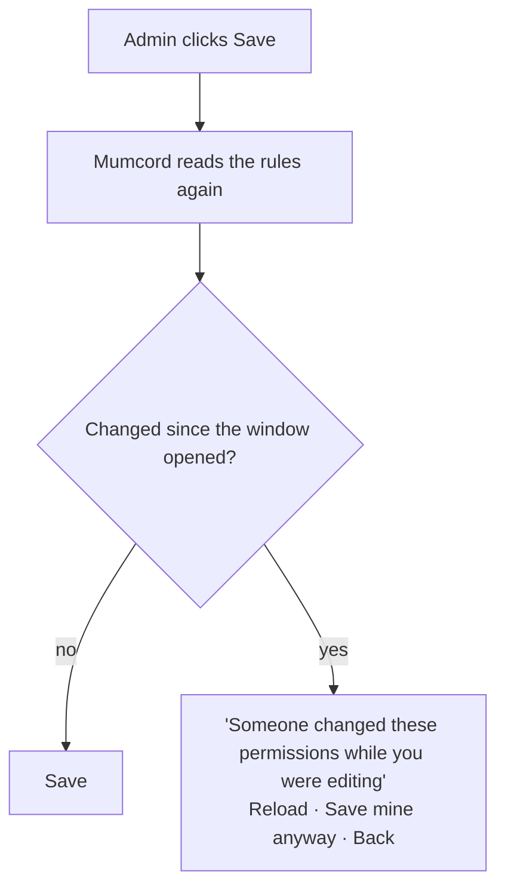
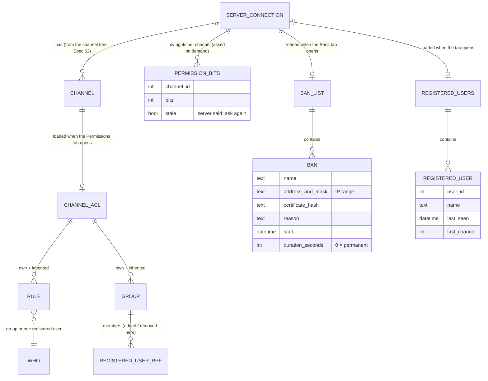
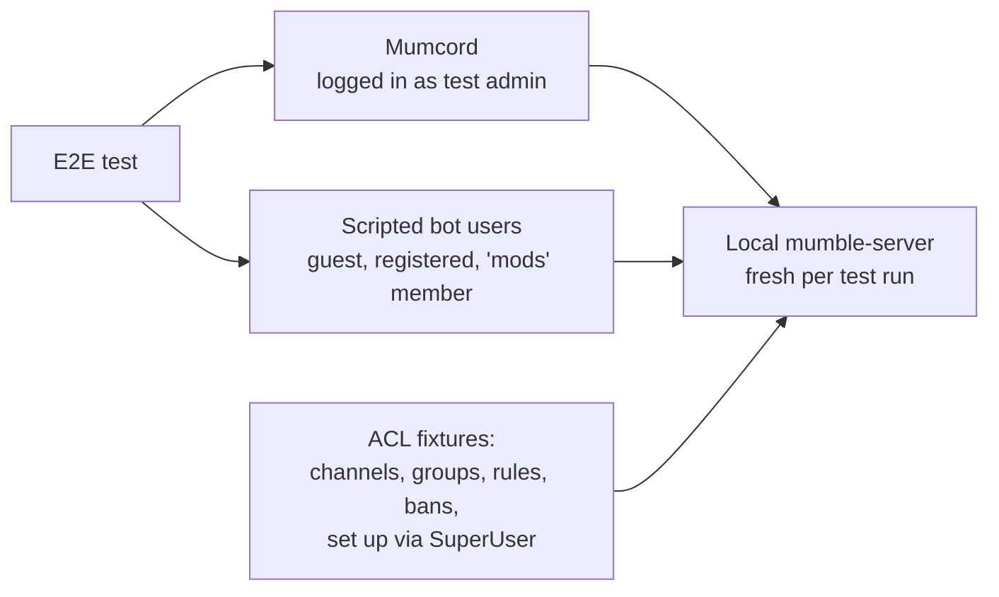

# Epic 4 – Admin & moderation · Brainstorming

> Basis: Spec 01 → roadmap Epic 4 "Admin features" (ACL/permission editing, bans, channel management; completes the "full replacement" goal, Q1.3 / Q1.11). The file number is 10 because `04` is already taken by the mumpeer relay spec.
> Issues: overview #247 · #248 permission-aware UI · #249 admin menu items · #250 channel management · #251 channel passwords · #252 ACL & groups editor · #253 kick & ban · #254 ban list · #255 moving people · #256 registered users · #257 server mute/deafen, priority speaker, resets · #258 server info for admins · #259 local admin log · #378 admin slash commands (mockups on branch `mockups/admin-commands`) · #300 ACL query replies (`Handle::query_acl` and `Event::Acl` already exist in `crates/protocol`).
> Process: We work in several rounds. Each round contains questions; you answer directly in this file.
> Once all questions are answered, `specs/10-admin-moderation-specification.md` is created from it.
> Already settled (not asked again):
> - Tech stack, platforms, design system, 24 locales, accessibility rules → Spec 01.
> - **Mumcord enforces nothing itself; the server's ACLs decide** and the client only reflects them → Spec 01 section 3.
> - Pure client: everything uses standard Mumble messages against an unmodified server → CLAUDE.md, Spec 01.
> - Several servers connected at once, voice on one, read-along on the others → Spec 02.
> - Dragging people between channels (with Move permission) and the channel/person right-click menus → #172 / Spec 03.
> - Blocking people locally (hide their messages and voice for yourself) → Spec 03 (#140).
> - Channel lock icon and joining with passwords as access tokens → Spec 02 (FR-2.78), #146.
> - Plugin slash commands in the chat box → Spec 06 (FR-6.43).

## How to answer

- **Single choice** (`◉`): Exactly **one** box has an `[x]`. To change your choice, just move the `x`.
- **Multiple choice** (`☑`): Tick as many boxes as you like.
- ⭐ marks my **recommendation**. It is already preselected. If you agree, you don't need to change anything.
- Below each question there is `✍️ Note:`. Add anything there, e.g. questions back, edge cases or "not sure, explain this to me".
- I explain technical terms briefly. For purely technical questions (protocol, ACL internals) it's perfectly fine to follow my recommendation.

## Planned rounds

1. Functionality & scope
2. UI & UX: menus, dialogs, ban list, registered users, slash commands (ASCII wireframes)
3. Permissions & ACL editor details: groups, inheritance, "who can do what", lock-out protection, channel passwords
4. Data & state, admin log, security & privacy, testing against the local test server
5. Review & remaining open points

(The plan may change depending on the answers.)

---

## Round 1 – Functionality & scope

Epic 4 turns Mumcord into a full replacement for the official client's admin tools. A quick reminder of how Mumble admin works, because it shapes every answer below:

- **The server decides everything.** Each channel has rules (the "ACL", access control list) that say which groups or people may do what: enter, speak, write, move people, kick, ban and so on. Rules are **inherited** from the parent channel unless switched off. Mumcord can read and change these rules only if the server lets the user do so.
- **Groups** are named lists of people per channel (e.g. `admin`, `mods`). Built-in groups exist too: `all` (everyone), `auth` (registered users), `in` / `out` (people inside / outside the channel), `#password` (everyone who entered a channel password).
- **Registered users** have a fixed account on the server, tied to their certificate. Only registered users can be named individually in rules and groups; guests can only be covered by groups like `all`.
- **SuperUser** is the server's built-in master account. It can do everything regardless of rules.

What the protocol cannot do (server-only, so not offered in this epic):

| Wish | Why not | Client-only alternative |
|---|---|---|
| Change the welcome text, server name, user limit, bandwidth or other server settings | No client message exists for them; they live in the server's config file or its admin interface | Show them read-only (#258); edit the root channel's description as a "server notice" |
| Delete or edit chat messages other people already sent | Mumble delivers messages directly and keeps no history to edit | Kick, ban, or forbid writing via a channel rule (Q1.7) |
| See what other admins did (server audit log) | The protocol has no audit log | Local log of your own actions (#259, Q1.11) |
| Know who else is an admin | The server never tells one client the permissions of another | Group membership is visible in the ACL editor to people allowed to edit it |

### A · What admins can do

#### Q1.1 Which actions on **people** belong in the MVP? `☑`
All of these go into the person's right-click menu (and the matching slash commands where they exist). Each one appears only when the server grants the needed permission.

- [x] ⭐ **Kick** with an optional reason (#253). The person can reconnect.
- [x] ⭐ **Ban** with reason, duration and "by certificate and/or IP address" (#253, see Q1.4).
- [x] ⭐ **Server mute / server deafen** and **un-suppress** (#257). Different from the person's own mute: they cannot undo it themselves.
- [x] ⭐ **Move**: "Move to my channel", "Move to…" with a channel picker (keyboard alternative to dragging), and "Move everyone in this channel to…" (#255).
- [x] ⭐ **Priority speaker** (#257): their voice is heard clearly over everyone else in the channel. Useful for raid leads or presenters.
- [x] ⭐ **Reset comment / reset avatar** (#257) for offensive profile texts or pictures.
- [x] ⭐ **Register a guest** on the server with their current name (#256).
- [ ] Select several people (Ctrl/Shift-click) and drag them together. Later; "Move everyone in this channel" covers the common case.

✍️ Note:

#### Q1.2 Which actions on **channels** belong in the MVP? `☑`

- [x] ⭐ **Create sub-channel** with name, description, position and user limit (#250).
- [x] ⭐ **Temporary channels**: a channel that the server deletes automatically when the last person leaves (needs the "make temporary channel" permission, which servers often give to everyone).
- [x] ⭐ **Edit channel**: name, description, user limit, position (#250).
- [x] ⭐ **Move a channel under another parent** (with its sub-channels) via the edit dialog.
- [x] ⭐ **Delete channel** with a clear confirmation of what disappears and who gets moved (#250).
- [x] ⭐ **Link / unlink channels**: linked channels hear each other (#250).
- [x] ⭐ **Channel password** (#251): set or remove a password in one field; Mumcord writes the matching rules for you.
- [ ] Re-order or re-parent channels by dragging them in the tree. Later; easy to do by accident, the edit dialog does the same.

✍️ Note:

#### Q1.3 Which **server-wide** admin views belong in the MVP? `☑`

- [x] ⭐ **Ban list** (#254): see, search, edit and remove bans, and add bans for people who are not online (by certificate fingerprint or IP address).
- [x] ⭐ **Registered users** (#256): list with name and last seen; rename and unregister.
- [x] ⭐ **Admin section in the server info** (#258): your effective rights, server limits read-only, the welcome text read-only with a one-line explanation why it cannot be changed, and editing the root channel's description as a "server notice".
- [ ] Bulk clean-up of inactive registered users (e.g. "unregister everyone not seen for 180 days"). Later; risky and rarely needed.

✍️ Note:

#### Q1.4 How should **banning** work? `◉`
Mumble offers two standard ways. The quick way ("ban this person") always uses the server's default length, usually permanent, and cannot choose certificate vs. IP. The precise way edits the server's ban list directly, which allows a chosen length and choice of certificate/IP, exactly like the official client's ban list.

- [x] ⭐ **Precise way with a duration** (1 hour, 1 day, 7 days, 30 days, permanent, custom date), falling back to the quick way if the ban list cannot be read. Admins expect temporary bans.
- [ ] Quick way only: always the server's default length. Simplest, but no temporary bans.
- [ ] Let the admin choose between both in the dialog. More flexible, but confusing.

✍️ Note:

#### Q1.5 How far should the **ACL & groups editor** go? `◉`
This is the biggest piece of the epic. Without it, admins still need the official client for permissions.

- [x] ⭐ **Full editor** (#252): a readable "Who can do what" overview as the default view, plus the detailed rules and groups for editing, inherited rules shown read-only, and a guard that warns before you lock yourself out. Completes the "full replacement" goal.
- [ ] Read-only: show "Who can do what" but no editing. Much smaller, but admins still need the official client.
- [ ] Full rules editor, groups read-only. Middle ground; group membership changes still need the official client.
- [ ] No ACL editor in this epic. Later.

✍️ Note:

#### Q1.6 Should the editor explain **why** someone can or cannot do something? `◉`
Example: "Why can Freya not speak in Raid?" → "Rule 3 in Raid: group `out` is denied Speak." Mumcord can work this out from the rules it already reads.

- [ ] Yes, in the MVP: click a cell in "Who can do what" to see the deciding rule.
- [x] ⭐ **Later.** The readable overview already answers most questions; the explanation is a good follow-up once the editor is in use.
- [ ] Never.

✍️ Note:

#### Q1.7 What should **text-chat moderation** look like? `◉`
Mumble cannot delete messages after they were sent (see table above). What admins can do is stop someone from writing.

- [x] ⭐ **No separate feature.** Admins use kick/ban, and the ACL editor to deny "Text message" for a person or group in a channel. Everyone can still block people locally (Spec 03).
- [ ] A "Forbid writing in this channel" item in the person menu that adds the rule for you. Convenient, but only works for **registered** people (guests cannot be named in rules) and adds a second way to edit rules.
- [ ] Later.

✍️ Note:

#### Q1.8 Spec 03 handed "report a person" (#140) to this epic. What should it be? `◉`
The client cannot know who the server's admins are, so a report cannot be delivered "to the admins" automatically without something on the server.

- [x] ⭐ **Not in this epic.** Without server support a report has no reliable recipient; people can already private-message someone they trust.
- [ ] "Report…" in the person menu opens a private message to a person the reporter picks, prefilled with the name and a reason. Little more than a shortcut.
- [ ] Later, revisit together with community features.

✍️ Note:

### B · Slash commands (#378)

#### Q1.9 Which **admin slash commands** belong in the MVP? `◉`
#378 already describes and mocks up commands like `/kick Bjørn spamming` in the chat box, listed next to plugin commands and marked "Built-in".

- [x] ⭐ **Exactly #378:** `/kick`, `/ban`, `/mute`, `/unmute`, `/deaf`, `/undeaf`, `/move`. Only permitted commands are listed; names and channels autocomplete; kick and ban still open the confirmation dialog prefilled; plugins cannot take these names.
- [ ] #378 plus more (`/unban`, `/priority`, `/register`, `/moveall`). Later candidates; menus cover them.
- [ ] No slash commands in this epic; menus only. Later.

✍️ Note:

#### Q1.10 What happens when someone **without the permission** types an admin command, e.g. `/kick`? `◉`
The command is not listed for them, but people may type it from habit or after reading a guide.

- [x] ⭐ **Short inline hint** above the message box ("You don't have permission to kick on this server"); nothing is sent to the chat.
- [ ] Send it as a normal chat message. Leaks "/kick Bjørn" into the channel, which is embarrassing.
- [ ] Silently ignore. Confusing.

✍️ Note:

### C · Admin log (#259)

#### Q1.11 Should there be a **local admin log**? `◉`
A private list on this device of the admin actions *you* performed through Mumcord, per server: time, action, who, reason, result (done or denied). Other admins' actions are not visible (the protocol has no audit log), so it is a personal memory aid ("who did I ban last week and why?").

- [x] ⭐ **Yes, as in #259:** per server, only on this device, kept 90 days by default, can be cleared. Details (search, export, privacy) in round 4.
- [ ] Later. Useful but not essential for the first admin release.
- [ ] No.

✍️ Note:

### D · Safety: confirmations and undo

#### Q1.12 Which actions **ask for confirmation** first? `◉`

- [x] ⭐ **Only the destructive or hard-to-reverse ones:** kick, ban, unban, delete channel, move a channel to a new parent, move everyone in a channel, reset comment/avatar, unregister, and saving rules on the root channel. Quick toggles (mute, deafen, priority speaker, moving one person) act immediately.
- [ ] Every admin action confirms. Safest, but slows admins down in a busy raid.
- [ ] Nothing confirms. Fast, but one slip can kick or ban the wrong person.

✍️ Note:

#### Q1.13 Should there be an **"Undo"** button after an action? `◉`
Some actions cannot be undone at all: a kicked person is gone, a deleted channel loses its rules and sub-channels. Others are easy to reverse by doing the opposite (unmute, move back, unban in the ban list).

- [x] ⭐ **No undo button.** Toggles are reversed by toggling again, bans by unbanning; the confirmations from Q1.12 protect the irreversible ones. Keeps the epic small.
- [ ] A short "Undo" notice (about 10 seconds) after reversible actions: mute, deafen, priority speaker, moving people, channel edits.
- [ ] Later.

✍️ Note:

### E · Permission-aware UI (#248)

#### Q1.14 When the user lacks a permission, should admin items be **hidden or disabled**? `◉`
Example: a moderator who may move people but not ban them.

- [x] ⭐ **Hidden.** Each person sees exactly what they may do; the same rule the channel menu already follows (#172). Matches #248.
- [ ] Disabled (greyed out) with a tooltip naming the missing permission. Teaches what exists, but clutters menus for everyone.
- [ ] Mixed: hidden for people with no admin rights at all, disabled for people with some admin rights.

✍️ Note:

#### Q1.15 What does a user with **no admin rights at all** on a server see? `◉`

- [x] ⭐ **Nothing admin-related:** no "Admin" group in menus, no admin slash commands, no admin section in server info, no ban list or registered users. The admin log only appears if it already has entries for that server.
- [ ] An "Administration" entry that explains "You have no admin rights on this server". Clear, but noise for most users.

✍️ Note:

#### Q1.16 What if the server **refuses** an action anyway? `◉`
This can happen if rights changed a moment ago. The server answers with a reason, e.g. "permission denied", "channel full", "name not allowed".

- [x] ⭐ **Show the server's reason in plain language** right where the action was started (dialog or a short notice), refresh the rights, and log it as "denied" in the admin log.
- [ ] Only a generic "Action failed" message. Simpler, but leaves the admin guessing.

✍️ Note:

#### Q1.17 How do people **log in as SuperUser**? `◉`
SuperUser logs in with the name `SuperUser` and the server's SuperUser password. Server owners use it to set up the first admins.

- [x] ⭐ **No special feature.** Use the normal server dialog with the name `SuperUser` and the password field; Mumcord shows whatever the server then grants. Most admins work through their registered account and an `admin` group anyway.
- [ ] A dedicated "Log in as SuperUser" switch in the server dialog. Convenient for server owners, but invites people to share the master password.
- [ ] Later.

✍️ Note:

### F · Several servers at once

#### Q1.18 On which connected servers can the user act as an admin? `◉`
Spec 02 lets you stay connected to several servers, talking on one and reading along on the others.

- [x] ⭐ **On every connected server**, each with its own rights. A read-along server is a full connection, so a moderator can kick a spammer there without switching voice.
- [ ] Only on the server where the user is in voice. Simpler to explain, but forces a switch.

✍️ Note:

#### Q1.19 Should any admin action work **across servers**? `◉`
Example: "ban this certificate on all servers where I am an admin".

- [x] ⭐ **No, strictly per server.** Every server has its own bans, rules and users; mixing them invites mistakes.
- [ ] Later: "Ban on all my servers" for admins who run a network of servers.

✍️ Note:

---

## Answers to round 1 (given in chat, 2026-11-03)

The user answered round 1 in chat instead of in this file. The answers below override the preselections above.

| Question | Answer |
|---|---|
| Q1.1 People actions | All 7 recommended (kick, ban, server mute/deafen, move, priority speaker, reset comment/avatar, register a guest). Multi-select dragging comes later. |
| Q1.2 Channel actions | All 7 recommended. Re-ordering channels by dragging comes later. |
| Q1.3 Server-wide views | All 3 recommended (ban list, registered users, admin section in server info). Bulk clean-up comes later. |
| Q1.4 Banning | Precise ban with a duration, falling back to the server's default. |
| Q1.5 ACL editor | Full editor. |
| Q1.6 "Why" explanation | **Yes, in the MVP** (overrides the recommendation). |
| Q1.7 Text moderation | No separate feature. |
| Q1.8 Report (#140) | Not in this epic. |
| Q1.9 Slash commands | **#378 plus more:** `/unban`, `/priority`, `/register` and `/moveall`. |
| Q1.10 Command without permission | **Silently ignore** (overrides the recommendation). |
| Q1.11 Local admin log (#259) | **No** (overrides the recommendation). |
| Q1.12 Confirmations | Only destructive actions confirm. |
| Q1.13 Undo | No undo button. |
| Q1.14 Missing permission | Admin items are hidden. |
| Q1.15 No admin rights at all | Nothing admin-related is shown. |
| Q1.16 Server refuses an action | Show the server's reason in plain words. |
| Q1.17 SuperUser | No special feature. |
| Q1.18 Where to act as admin | On every connected server. |
| Q1.19 Across servers | No, strictly per server. |

---

## Round 2 – UI & UX

This round decides where the admin tools live and what they look like. The mockups for #378 (branch `mockups/admin-commands`, `docs/mockups/epic-4-commands/`) are binding for the slash commands: the command list with a "Built-in" group, name autocomplete, the ban dialog prefilled from `/ban`, the error hints for an unknown or ambiguous name, and the private result line ("Only you see this line"). Everything below either builds on them or covers what they do not show.

### Follow-ups for round 1

**On Q1.10 (silently ignore) and Q1.9 (only permitted commands are listed):** The two answers fit together, but one mockup now contradicts them: `04a-error-no-permission` shows a hint "You can't ban people on this server". With "silently ignore" that hint goes away. The other two error hints (unknown name, ambiguous name) stay, because they only appear for people who do have the permission.

#### Q2.1 What exactly does someone see when typing an admin command they are not allowed to use? `◉`

- [x] ⭐ **Nothing at all, exactly like a command that does not exist.** The command is not in the list and is not autocompleted. Pressing Enter sends nothing; the text simply stays in the message box so nothing leaks into the chat. Mockup `04a` is dropped.
- [ ] Same, but Enter clears the message box. Looks a bit like "something happened", which could confuse.
- [ ] Same, but Enter sends the text as a normal chat message. Leaks "/kick Bjørn" into the channel.

✍️ Note:

#### Q2.2 How should commands behave when a permission depends on the **channel**? `◉`
Kick, ban, unban and register are server-wide rights. Mute, deafen, priority speaker and move are given per channel, so a moderator may be allowed to mute in "Raid" but not in "Lobby".

- [x] ⭐ **List the command if you have the right in at least one channel; autocomplete only offers people you may act on.** If the server still refuses (rights changed a moment ago), the refusal is shown as decided in Q1.16.
- [ ] List the command only if you have the right in every channel. Stricter, but hides commands from moderators who look after a few channels.
- [ ] List it whenever you have it anywhere and offer everyone in autocomplete. Simpler, but invites refusals.

✍️ Note:

**On Q1.11 (no admin log):** #259 describes the local admin log in detail. It needs a clear status so nobody builds it by accident.

#### Q2.3 What happens to issue **#259** (local admin log)? `◉`

- [x] ⭐ **Close it as "not planned"** with a link to this decision. It can be reopened if admins ask for it. The mentions of the log in Q1.15 and Q1.16 fall away with it.
- [ ] Keep it open and label it "later" in the backlog, outside Epic 4.

✍️ Note:

**On Q1.6 (the "why" explanation is now in the MVP):** Mumcord works out the answer from the rules it reads, the same way the server does: it walks from the root channel down to the channel in question and the last rule that matches wins. One limit to know: Mumcord cannot see who entered a channel password (`#password` groups) or other secret "access tokens", so for those it can only say "depends on whether they entered the password".

```text
┌─ Why? ─────────────────────────────────────────┐
│ Freya cannot Speak in Raid                     │
│                                                │
│ Deciding rule:  Rule 3 in Raid                 │
│   group "out"  ✗ Speak  (denied)               │
│ Freya matches "out" because they are not in    │
│ Raid right now.                                │
│                                                │
│ Overrides:  Rule 1 in Root (inherited)         │
│   group "all"  ✓ Speak  (allowed)              │
│                                                │
│ [ Go to rule 3 ]                               │
└────────────────────────────────────────────────┘
```

#### Q2.4 Where should the "why" explanation appear? `◉`

- [x] ⭐ **In a side panel of the ACL editor.** Click any cell in "Who can do what" (or press Enter on it) and the panel shows the explanation. A "Check a person…" field at the top lets the admin pick a specific person, registered or online guest, and see their row.
- [ ] As a pop-over directly on the cell. Faster to glance at, but cramped for longer explanations and harder for screen readers.
- [ ] Also from the person's right-click menu ("Why can Freya not…?"). Later; the editor covers it first.

✍️ Note:

#### Q2.5 How **deep** should the explanation go? `◉`

- [x] ⭐ **The deciding rule plus its context:** which rule decided, in which channel (here or inherited), which group made the person match, and the rule it overrode (as in the box above). Answers "why" without a lecture.
- [ ] Only the deciding rule. Shortest, but leaves "why does this group apply to them?" open.
- [ ] A full trace of every rule checked, in order. Complete, but long and hard to read for non-experts. Could be a "Show all steps" link later.

✍️ Note:

**On Q1.9 (extra commands):** The four extra commands follow the style of #378: same list, "Built-in" label, name and channel autocomplete. Per Q1.12, `/unban` and `/moveall` confirm first; `/priority` and `/register` act immediately.

| Command | Syntax | What it does | Confirms? |
|---|---|---|---|
| `/unban` | `/unban <name or IP>` | Finds the entry in the ban list; autocomplete offers banned names. Opens a small confirmation showing the ban (name, reason, ends on). | Yes |
| `/priority` | `/priority <name>` | Switches priority speaker on or off for that person. The result line says which. | No |
| `/register` | `/register <name>` | Registers an online guest under their current name. | No |
| `/moveall` | `/moveall <to channel>` | Moves everyone in **your** current channel to the target channel. Confirmation names the count ("Move 6 people from General to AFK?"). | Yes |

#### Q2.6 Is this syntax right? `◉`

- [x] ⭐ **Yes, as in the table.** Short and matches the existing commands.
- [ ] Like the table, but `/moveall <from channel> <to channel>` so admins can empty any channel, not just their own. One more thing to type.
- [ ] Like the table, but priority as a pair `/priority` and `/unpriority`, mirroring `/mute` and `/unmute`. Clearer, but one more command.

✍️ Note:

### A · Menus

The right-click menus already exist (#172). Admin items are added below the normal ones and only appear when the server allows them (Q1.14). Dangerous items sit last and are shown in red.

```text
Person menu (admin sees everything)        Channel menu (admin sees everything)
┌──────────────────────────────┐           ┌──────────────────────────────┐
│ Send private message         │           │ Join channel                 │
│ Local volume…                │           │ Copy link                    │
│ Block                        │           │ ─── Admin ────────────────── │
│ ─── Admin ────────────────── │           │ Create sub-channel…          │
│ Move to my channel           │           │ Create temporary channel…    │
│ Move to…                     │           │ Edit channel…                │
│ ☐ Server mute                │           │ Permissions…                 │
│ ☐ Server deafen              │           │ Link with… / Unlink          │
│ ☐ Priority speaker           │           │ Move everyone to…            │
│ Register on server           │           │ ──────────────────────────── │
│ Reset comment                │           │ Delete channel…        (red) │
│ Reset avatar                 │           └──────────────────────────────┘
│ ──────────────────────────── │
│ Kick…                  (red) │
│ Ban…                   (red) │
└──────────────────────────────┘
```

#### Q2.7 How should the admin items be arranged in the menus? `◉`

- [x] ⭐ **One "Admin" section at the end of the menu, as in the wireframe.** Toggles show a tick when on; kick, ban and delete come last in red. One click away, nothing hidden in sub-menus.
- [ ] An "Admin ▸" sub-menu. Keeps menus short for admins too, but every action takes an extra step.
- [ ] Mockups first: I'll produce screen mockups of both variants before deciding.

✍️ Note:

### B · Dialogs

The ban dialog is settled by mockup `03-ban-dialog`: title "Ban Mallory?", reason, duration chips (1 hour, 1 day, 7 days, 30 days, permanent, custom date), "Ends on …", "Ban by certificate", "Ban by IP address", "Remove from server now", and the buttons "Kick only instead", "Cancel", "Ban".

```text
┌─ Kick Mallory? ──────────────────────────┐
│ Mallory · in General                     │
│ They can reconnect right away.           │
│                                          │
│ Reason (optional, shown to them)         │
│ [ spam links                          ]  │
│                                          │
│                     [ Cancel ] [ Kick ]  │
└──────────────────────────────────────────┘
```

#### Q2.8 How should the kick dialog and offline bans look? `◉`

- [x] ⭐ **Kick as in the wireframe above, in the same style as the ban dialog; offline bans (from the ban list) reuse the ban dialog** with a "Who" field for name, certificate fingerprint or IP address instead of the person line. One look for all removal actions.
- [ ] Kick without a dialog when started from the menu (only a reason prompt from `/kick`). Faster, but against Q1.12.
- [ ] Mockups first.

✍️ Note:

```text
┌─ Create sub-channel in Gaming ───────────────────────┐
│ Name          [ Raid night                        ]  │
│ Description   [ B  I  🔗 ]                           │
│               [ Tuesdays 20:00, bring flasks.     ]  │
│               [                                   ]  │
│ Parent        [ Gaming                         ▾ ]   │  (edit only)
│ Position      [ 0   ]   lower numbers go first       │
│ User limit    [ 0   ]   0 = no limit                 │
│ Password      [ ••••••    ] 👁   empty = no password │
│ ☐ Temporary: delete when the last person leaves      │  (create only)
│                                                      │
│ Edit permissions…                [ Cancel ] [Create] │
└──────────────────────────────────────────────────────┘
```

#### Q2.9 How should the channel create/edit dialog work? `◉`
Channel descriptions in Mumble are small web pages (HTML). Other clients show them, so Mumcord must write something they understand and must clean up whatever it reads (untrusted input).

- [x] ⭐ **One dialog as in the wireframe** for create and edit. The description has simple formatting (bold, italic, links) and is saved as clean HTML; anything else in an existing description is shown as plain text. "Edit permissions…" opens the ACL editor; linking stays in the channel menu.
- [ ] Tabs like the official client (General / Permissions / Links) in one big dialog. Everything in one place, but heavy for a quick rename.
- [ ] Mockups first.

✍️ Note:

### C · ACL editor

The editor has three views of the same channel's rules. Details such as which permissions appear as columns and the lock-out guard follow in round 3; this question is only about the layout.

```text
┌─ Permissions · Raid ─────────────────────────────────────────────────────┐
│ [ Who can do what ] [ Rules ] [ Groups ]          Check a person… [   ]  │
├──────────────────────────────────────────────────┬───────────────────────┤
│              Enter  Speak  Write  Move  Kick …   │ Why?                  │
│ everyone       ✓      ✓      ✓     ✗     ✗       │ group "out" cannot    │
│ registered     ✓      ✓      ✓     ✗     ✗       │ Speak in Raid:        │
│ out            ✓     [✗]     ✓     ✗     ✗       │ Rule 3 in Raid …      │
│ mods           ✓      ✓      ✓     ✓     ✓       │                       │
│ Freya          ✓      ✓      ✓     ✗     ✗       │ [ Go to rule 3 ]      │
│  ↳ inherited from Root shown in grey             │                       │
├──────────────────────────────────────────────────┴───────────────────────┤
│ ☑ Inherit rules from parent         Unsaved changes   [ Cancel ] [ Save ]│
└──────────────────────────────────────────────────────────────────────────┘
```

#### Q2.10 What layout should the ACL editor use? `◉`

- [x] ⭐ **Its own window with three tabs** ("Who can do what" as the default, "Rules", "Groups") and the "Why?" panel on the right, as in the wireframe. Admins can keep it open next to the channel tree; one Save for all changes.
- [ ] A large dialog over the main window. Simpler, but blocks the client while open.
- [ ] A panel inside the main window instead of the chat. Integrated, but too cramped for the grid.
- [ ] Mockups first.

✍️ Note:

### D · Server-wide views

```text
┌─ Server administration · Mumcord Lounge ──────────────────────────────┐
│ [ Bans (12) ] [ Registered users (48) ]           Search… [        ]  │
├───────────────────────────────────────────────────────────────────────┤
│ Name       Certificate / IP    Reason        Banned      Ends         │
│ Mallory    cert a3f9…          spam links    3 Nov 2026  10 Nov 2026  │
│ (unknown)  203.0.113.7         flooding      1 Oct 2026  permanent    │
│ …                                                                     │
├───────────────────────────────────────────────────────────────────────┤
│ [ Add ban… ]                                 [ Edit… ] [ Remove… ]    │
└───────────────────────────────────────────────────────────────────────┘
```

#### Q2.11 Where do the **ban list** and **registered users** live? `◉`

- [x] ⭐ **One "Server administration" window with two tabs**, as in the wireframe. Opened from the admin section in server info and from the server's right-click menu. Each tab appears only with the matching right; the window only with at least one of them.
- [ ] As sections inside server info. Fewer windows, but long lists make server info crowded.
- [ ] In settings. Settings are about this device, not about a server, so it would be confusing.
- [ ] Mockups first.

✍️ Note:

```text
Server info · Mumcord Lounge
  …existing info (address, version, ping, users)…
  ─── Admin ──────────────────────────────────────
  Your rights here    Kick · Ban · Move · Mute · Edit permissions (Root)
  Server limits       Max users 50 · Bandwidth 72 kbit/s · Message 5000 chars
  Welcome text        "Welcome to the Lounge!"  ⓘ can only be changed in
                      the server's settings file, not from any client
  Server notice       Shown as the Root channel description  [ Edit… ]
  [ Ban list & registered users… ]
```

#### Q2.12 How should the **admin section in server info** look? `◉`

- [x] ⭐ **A section at the end of the existing server info, as in the wireframe**, shown only to people with at least one admin right (Q1.15). "Your rights here" lists rights at the root; channel-specific rights show in the ACL editor.
- [ ] Its own "Admin" tab in server info. Tidier if server info grows, one more click.
- [ ] Mockups first.

✍️ Note:

### E · Confirmations and feedback

#### Q2.13 How should **confirmations** be worded and styled? `◉`

- [x] ⭐ **A small dialog whose title is the question** ("Delete channel Raid?"), one line naming the consequence ("3 sub-channels are deleted too. 5 people are moved to Gaming."), and buttons named after the action ("Delete", never "OK"). The dangerous button is red; Enter confirms, Esc cancels. Same style as the ban mockup.
- [ ] Same, but deleting a channel with sub-channels also asks to type its name. Extra safety for the one action that loses rules for good.
- [ ] A generic "Are you sure?" dialog with OK/Cancel. Familiar, but people click through it.

✍️ Note:

#### Q2.14 How are **results and refusals** shown? `◉`
The mockup `05-result-line` shows a private line in the chat after a slash command: "You muted Mallory on the server · Only you see this line".

- [x] ⭐ **Slash commands: private result line, as in the mockup, for success and refusal. Menu and dialog actions: success is visible in the tree (icons, people moving), so no extra line; a refusal appears inside the open dialog, or as a private line in the chat if no dialog is open.** The server's reason is put into plain words (Q1.16).
- [ ] Private result lines for every admin action, menu or command. Consistent, but noisy for a busy moderator.
- [ ] A small pop-up notification in the corner for refusals. Easy to miss and disappears.

✍️ Note:

### F · Accessibility and themes

#### Q2.15 What must work with **keyboard and screen reader**? `☑`
The basics (Tab order, visible focus, labels) are settled in Spec 01. These are the points specific to this epic.

- [x] ⭐ All admin menu items reachable via the menu key or Shift+F10 on a selected person or channel in the tree.
- [x] ⭐ The "Who can do what" grid is moved through with the arrow keys; each cell is read out in full, e.g. "Group out, Speak: denied, set in this channel". Enter opens "Why?".
- [x] ⭐ Dialogs keep focus inside, start on the first field, and return focus to the person or channel afterwards.
- [x] ⭐ Private result lines and refusals are announced by the screen reader when they appear.
- [ ] Own keyboard shortcuts for kick, ban or mute. Later; risky to trigger by accident.

✍️ Note:

#### Q2.16 How should admin screens handle **dark and light themes**? `◉`

- [x] ⭐ **Use the existing design tokens only:** red only for dangerous actions and "denied", green for "allowed", grey for inherited. Never color alone: ✓ / ✗ icons and text carry the meaning too. Every new screen is checked in both themes (as the #378 mockups already are).
- [ ] An extra admin accent color so admin items stand out from normal ones. More visible, but adds a color that means something new.

✍️ Note:

---

## Answers to round 2 (given in chat, 2026-11-03)

The answers below override the preselections above.

| Question | Answer |
|---|---|
| Q2.1 A command you aren't allowed to use | Nothing happens, as with an unknown command: it isn't listed or autocompleted, Enter sends nothing, and the text stays in the box. |
| Q2.2 Channel-dependent permissions | The command is listed if you have the right in at least one channel. Autocomplete only offers people you may act on. |
| Q2.3 #259 | Close as "not planned". |
| Q2.4 Where "why" appears | A side panel in the ACL editor, with a "Check a person…" field. |
| Q2.5 How deep "why" goes | The deciding rule plus its context. |
| Q2.6 Syntax | As in the table. |
| Q2.7 Menu layout | **An "Admin ▸" sub-menu** (overrides the recommendation). |
| Q2.8 Kick dialog and offline bans | A kick dialog in the ban-dialog style. Offline bans reuse the ban dialog with a "Who" field. |
| Q2.9 Channel dialog | **Tabs like the official client: General / Permissions / Links** (overrides the recommendation). |
| Q2.10 ACL editor | Its own window with 3 tabs and a Why panel. |
| Q2.11 Ban list and registered users | A "Server administration" window with two tabs. |
| Q2.12 Server-info admin section | A section at the end. |
| Q2.13 Confirmations | The title is the question, one line names the consequence, and buttons are named after the action. |
| Q2.14 Results and refusals | Slash commands get a private result line. Menu actions show success in the tree, and refusals appear inside the dialog or as a notice. |
| Q2.15 Keyboard and screen reader | All 4 recommended. No dedicated shortcuts. |
| Q2.16 Themes | Existing design tokens only. Color is never the only signal. |

---

## Round 3 – Permissions & ACL editor in detail

This round fills in the editor itself: how Mumcord writes passwords, protects you from locking yourself out, shows inherited rules and groups, which permissions the "Who can do what" grid shows, where the "why" engine reaches its limits, and what happens when something changes while you edit. It opens with follow-ups to round 2.

A short reminder of how a Mumble rule looks, because several questions refer to it:

```text
Rule 3 in Raid
  Who:        group "out"   (or one registered person, e.g. Freya)
  Applies to: ☑ this channel   ☑ sub-channels
  Allow:      Enter
  Deny:       Speak
```

The server checks the rules from the root channel down to the channel in question; for each permission, the **last** matching rule wins.

### Follow-ups for round 2

**On Q2.7 (an "Admin ▸" sub-menu):** The #378 mockups only show the chat box and dialogs, not menus, so nothing there needs to change. Issue #249, however, describes a flat "Admin" group with a heading, and it also covers the server's ⋯ menu (ban list, registered users). Two details are open.

#### Q3.1 How should the "Admin ▸" sub-menu behave in detail? `◉`

- [x] ⭐ **The same "Admin ▸" sub-menu in the person menu, the channel menu and the server ⋯ menu**, always a sub-menu even if it holds only one item, so admin actions are always in the same place. Inside it, toggles show a tick and kick, ban and delete sit last in red. #249 gets updated to match.
- [ ] Same, but if only one admin item is allowed (e.g. a moderator who may only move people), show that item directly instead of a sub-menu with one entry. Saves a click, but the item moves around depending on your rights.
- [ ] Sub-menu only in the person and channel menus; the server ⋯ menu lists "Ban list…" and "Registered users…" directly. That menu is short anyway.

✍️ Note:

#### Q3.2 #249 also plans two keyboard shortcuts: **F2** edits the selected channel and **Delete** opens the "Delete channel?" confirmation. In Q2.15 you chose "no dedicated shortcuts". Keep these two? `◉`
Q2.15 was about shortcuts for kick, ban and mute on people. F2 and Delete are the usual keys for "rename" and "delete" in file managers, and both only open a dialog; nothing happens without a second confirmation.

- [x] ⭐ **Keep F2 and Delete on a selected channel** (only shown/working with the right). They act like the menu items, and Delete always asks first.
- [ ] Keep F2 only. Delete is too close to everyday typing.
- [ ] Drop both. Menus and the menu key only.

✍️ Note:

**On Q2.9 and Q2.10 (channel dialog with tabs General / Permissions / Links, and the ACL editor in its own window):** Both answers together would give two places to edit the same rules: the Permissions tab of the channel dialog and the separate editor window. Two editors for the same thing confuse people ("which one did I save?") and double the work.

```text
┌─ Channel · Raid ─────────────────────────────────────────────────────────┐
│ [ General ] [ Permissions ] [ Links ]                                    │
├──────────────────────────────────────────────────────────────────────────┤
│  Permissions tab = the full editor:                                      │
│  ( Who can do what ) ( Rules ) ( Groups )     Check a person… [      ]   │
│  …grid…                                       │ Why? …                   │
├──────────────────────────────────────────────────────────────────────────┤
│ Unsaved changes                                       [ Cancel ] [ Save ]│
└──────────────────────────────────────────────────────────────────────────┘
```

#### Q3.3 How should the channel dialog and the ACL editor fit together? `◉`

- [x] ⭐ **Merge them into one "Channel" window** with the tabs General / Permissions / Links, as in the wireframe. The Permissions tab *is* the full editor (its three views and the Why panel). The window does not block the client, so it can stay open next to the tree (as wanted in Q2.10). "Edit channel…" opens it on General, "Permissions…" opens it on Permissions. One Save for all three tabs.
- [ ] Keep both: the Permissions tab shows a read-only "Who can do what" summary plus a button "Open permissions editor…" that opens the separate window. No duplicate editing, but two windows for one channel.
- [ ] Keep both as full editors. Most flexible, but the same rules can be edited in two places at once.

✍️ Note:

#### Q3.4 Which tabs appear when **creating** a channel? `◉`
The rules and links of a channel can only be written once the server has created it.

- [x] ⭐ **Only General** (name, description, position, user limit, password, temporary). After "Create" the window closes; Permissions and Links are edited afterwards via "Edit channel…" / "Permissions…".
- [ ] All three tabs; Permissions and Links are greyed out with "Available after the channel is created". Shows what exists, but nothing to do there.
- [ ] Only General, but after "Create" the window stays open as the new channel's edit window, so the admin can go straight to Permissions.

✍️ Note:

### A · Links

Linked channels hear each other. To link two channels, you need the "Link channels" right in **both** of them.

```text
┌─ Channel · Raid ───────────────────────────────┐
│ [ General ] [ Permissions ] [ Links ]          │
│ Linked with (they hear each other):            │
│   ☑ Raid 2                                     │
│   ☑ Officers                                   │
│   ☐ Lobby                                      │
│   ☐ AFK          (you can't link this one)     │
└────────────────────────────────────────────────┘
```

#### Q3.5 How should the **Links** tab and the menu items work together? `◉`

- [x] ⭐ **Links tab: a tick list of all channels**, as in the wireframe; channels where you lack the right are shown greyed with a short reason. The channel menu keeps the quick items "Link with my channel" and "Unlink all". Changes on the tab are saved with the window's Save.
- [ ] Links tab only; drop "Link with… / Unlink" from the menu. One place, but the common "link with my channel" takes more clicks.
- [ ] Same as recommended, but channels you can't link are hidden. Shorter list, but admins wonder where a channel went.

✍️ Note:

### B · Channel passwords

**How passwords work in Mumble:** there is no real "password" setting. The official client writes two rules on the channel: "everyone: deny Enter" and "group `#secret123`: allow Enter". Anyone who typed `secret123` (as a password or access token) belongs to that group and may enter. Mumcord already joins such channels this way (Spec 02). Important: the password is stored in plain text inside the rules, so everyone who may edit the channel's permissions can read it.

#### Q3.6 How should Mumcord write and read channel passwords? `◉`

- [x] ⭐ **Exactly like the official client**, so other clients show the same password. When reading, Mumcord recognises this pattern and fills the password field. If a channel's rules are more complex (e.g. several password groups or extra rules on Enter), the password field shows "Custom access rules – see Permissions" instead of guessing. Changing or removing the password only touches those two rules. The field notes "Visible to everyone who can edit this channel's permissions".
- [ ] Same, but always replace all Enter rules with the two password rules. Simpler, but can silently delete an admin's custom rules.
- [ ] No password field; admins add the rules by hand in the Rules tab. Fewer surprises, but Q1.2 promised one simple field.

✍️ Note:

### C · Rules, inheritance and groups

#### Q3.7 How should Mumcord **protect admins from locking themselves out**? `◉`
Example: an admin removes the rule that gives the `admin` group "Edit permissions". After saving, they can no longer open this editor. The standard server partly protects registered users here (it quietly gives them back "Edit permissions" on that one channel), but not guests, not sub-channels, and not rights like Kick or Ban.

- [x] ⭐ **Warn before saving.** Mumcord works out your own rights after the change. If you would lose "Edit permissions" here or any right you have now, a confirmation lists them ("After saving, you can no longer: Edit permissions, Ban") with "Save anyway" and "Back to editing". SuperUser gets no warning (it can always do everything).
- [ ] Block the save completely. Safest, but stops admins who deliberately hand over a channel.
- [ ] No guard; rely on the server. Simplest, but guests and sub-channels are not covered.

✍️ Note:

```text
Rules tab · Raid
  ┌───┬──────────────────────┬────────────┬──────────────┬─────────────┐
  │ # │ Who                  │ Applies to │ Allow        │ Deny        │
  ├───┼──────────────────────┼────────────┼──────────────┼─────────────┤
  │ 1 │ everyone       Root ↗│ here, subs │ Enter, Speak │             │  (grey, inherited)
  │ 2 │ admin          Root ↗│ here, subs │ all          │             │  (grey, inherited)
  │ 3 │ out                  │ here       │              │ Speak       │
  │ 4 │ Freya                │ here, subs │ Move people  │             │
  └───┴──────────────────────┴────────────┴──────────────┴─────────────┘
  [ + Add rule ]  [ ↑ ] [ ↓ ]  [ Remove ]       ☑ Inherit rules from parent
```

#### Q3.8 How should **inherited rules** be shown and edited? `◉`

- [x] ⭐ **Shown in grey above the channel's own rules, read-only, with the channel they come from** ("Root ↗", which opens that channel's Permissions). To change one for this channel only, the admin adds a new rule here, which overrides it (last rule wins). "Inherit rules from parent" switches all of them off at once. "Applies to" is two plain checkboxes: "this channel" and "sub-channels".
- [ ] Same, plus a "Copy here" button on each inherited rule that creates an editable copy in this channel. Faster, but easy to end up with confusing duplicates.
- [ ] Hide inherited rules in the Rules tab; they only show in "Who can do what". Cleaner, but admins can't see the full order.

✍️ Note:

**About groups:** A group belongs to a channel and is inherited by sub-channels, which can add or remove members locally. Only **registered** users can be members, because the server stores them by account number; guests can only be covered by built-in groups such as `all`. The built-in groups (`all`, `auth`, `in`, `out`, `sub`, `~…`, `#…`, `$…`) are worked out by the server and have no member list.

```text
Groups tab · Raid
  Groups              │ Members of "mods"
  ▸ admin    (Root ↗) │   Freya        added here
  ▸ mods              │   Bjørn        inherited from Gaming    [ Remove here ]
                      │   Mallory      inherited, removed here  [ Restore ]
  Built-in (info):    │ [ + Add registered user… ]
    all, auth, in, …  │ ☑ Inherit members from parent
                      │ ☑ Sub-channels may inherit this group
```

#### Q3.9 How should the **Groups** tab work? `◉`

- [x] ⭐ **As in the wireframe:** the channel's groups on the left (inherited ones marked with their channel), members on the right with "added here / inherited / removed here". "Add registered user…" searches online registered people and, if you may see it, the registered users list. Built-in groups are listed read-only with a one-line explanation each ("auth: everyone with a registered account"). New groups can be created and deleted here.
- [ ] Same, but without "removed here" (only add members, never remove inherited ones locally). Simpler, but some setups can't be expressed.
- [ ] Groups read-only, editing members only. Smaller, but Q1.5 asked for a full editor.

✍️ Note:

#### Q3.10 What happens when an admin tries to add a **guest** (unregistered person) to a group or a rule? `◉`

- [x] ⭐ **Online guests are listed but greyed with "Guests can't be added. Register them first."** and, if you have the Register right, a "Register…" button right there. After registering, they can be added.
- [ ] Hide guests completely from the picker. Cleaner, but admins wonder why the person they see in the tree is missing.
- [ ] Offer a rule by certificate (`$hash` group) for guests. Works without registering, but is hard to understand and easy to get wrong.

✍️ Note:

### D · "Who can do what" grid

**Rows:** "everyone" first, then every group and person that appears in a rule for this channel (own or inherited), then the person picked in "Check a person…". **Cells:** ✓ allowed / ✗ denied, plus "set here" or "inherited from …" in grey.

**Columns:** Mumble's own permission names are technical (and one of them, "Write", means "edit permissions", not "write chat", which confused the round-2 wireframe). Proposed plain names:

| Group | Column (plain name) | Mumble name | What it allows |
|---|---|---|---|
| Basics | Join | Enter | Enter the channel |
| | Pass through | Traverse | Reach the channels below it |
| | Speak | Speak | Talk in the channel |
| | Whisper | Whisper | Whisper to the channel or people in it |
| | Write messages | TextMessage | Send chat messages |
| | Listen in | Listen | Add a "listener" to hear it without joining |
| Moderation | Mute others | MuteDeafen | Server mute, deafen, priority speaker |
| | Move people | Move | Move people in and out |
| Channel admin | Edit permissions | Write | Change name, description, rules and groups |
| | Create channels | MakeChannel | Create permanent sub-channels |
| | Create temp channels | MakeTempChannel | Create temporary sub-channels |
| | Link channels | LinkChannel | Link and unlink |
| Server (Root only) | Kick | Kick | Kick people |
| | Ban | Ban | Ban people and edit the ban list |
| | Register others | Register | Register guests, edit registered users |
| | Register self | SelfRegister | Register your own account |
| | Reset profiles | ResetUserContent | Reset comments and avatars |

#### Q3.11 Which **columns** should the grid show? `◉`

- [x] ⭐ **All of them, in the four groups of the table, with the plain names.** The "Server" columns only appear on the Root channel, because the server only checks them there. The Mumble name is shown in the column's tooltip and read out by the screen reader, so admins who know the official client find their way.
- [ ] Only the most common columns (Join, Speak, Write messages, Mute others, Move people, Edit permissions) plus "Show all permissions". Less crowded, but the rest is one click away.
- [ ] All columns with the original Mumble names. Familiar for experienced admins, confusing for everyone else.

✍️ Note:

#### Q3.12 Where the **"why" engine** reaches its limits, what should it show? `◉`
Mumcord computes everything on this device from the rules the server sends, exactly like the server does. A few things it cannot know for sure:
- **Passwords and access tokens** (`#…` groups): it can't see who entered which password.
- **Groups the server fills itself**: some servers get group members from an external login system; those are invisible to clients.
- **"In / out of the channel"** for people who are offline: depends on where they will be.
- **SuperUser** can do everything, whatever the rules say.

- [x] ⭐ **Show "Depends" (a ? instead of ✓/✗) and explain the condition in the Why panel**, e.g. "Allowed if they entered the channel password" or "Allowed only while they are in Raid". For SuperUser, every cell shows ✓ with "SuperUser ignores all rules". A one-line note in the panel says "Worked out by Mumcord from the rules; the server has the final say."
- [ ] Assume the most likely case (e.g. "no password entered") and show ✓/✗. Cleaner grid, but sometimes wrong without saying so.
- [ ] Leave such cells empty. Honest, but gives no hint why.

✍️ Note:

### E · Temporary channels

The standard server moves you into a temporary channel right after creating it (otherwise it would be empty and vanish at once) and usually gives the creator edit rights on it. Temporary channels can't have permanent sub-channels.

#### Q3.13 How should **"Create temporary channel…"** work? `◉`

- [x] ⭐ **The same create window (General tab) with "Temporary" already ticked**; name required, password optional. After creating, you are in the new channel (the server does this) and can edit its permissions like any channel you have rights on.
- [ ] One click: create "Temp – <your name>" without a window and move you in. Fastest, but no name or password.
- [ ] Only the "Temporary" tick box in the normal create window; no separate menu item. One item less, but people with only the temp-channel right don't find it.

✍️ Note:

### F · Errors and conflicts

Mumble has no "locking" for rules: saving sends the channel's **complete** rule and group set and replaces whatever is on the server. If another admin saved in the meantime, their change is lost without warning. Your own rights can also change while the window is open.



#### Q3.14 What should happen when the rules **can't be read** or **change while editing**? `☑`

- [x] ⭐ **Check before saving**, as in the diagram: if the rules changed in the meantime, ask "Reload" (your changes are dropped), "Save mine anyway" (theirs are replaced) or "Back".
- [x] ⭐ **Reading fails** (no right, or no answer within a few seconds): the Permissions tab shows the reason in plain words and a "Try again" button; General and Links still work.
- [x] ⭐ **Your rights drop while the window is open** (e.g. someone removed you from `admin`): the editor switches to read-only with a banner "You can no longer edit these permissions"; unsaved changes stay visible but can't be saved.
- [x] ⭐ **The channel is deleted while the window is open**: the window says so and offers only "Close".
- [ ] Merge both changes automatically. Sounds nice, but with rule order mattering it can produce rules nobody intended. Later, if ever.

✍️ Note:

---

## Answers to round 3 (given in chat, 2026-11-03)

All of the user's answers match the recommendations:

- **Q3.1:** the same Admin ▸ sub-menu everywhere.
- **Q3.2:** keep F2 and Delete.
- **Q3.3:** one "Channel" window, whose Permissions tab is the full editor.
- **Q3.4:** only the General tab when creating a channel.
- **Q3.5:** the Links tab is a tick list, and the quick menu items stay.
- **Q3.6:** passwords work exactly like the official client.
- **Q3.7:** warn before saving a lock-out.
- **Q3.8:** inherited rules are grey, read-only, and show their source.
- **Q3.9:** the Groups tab as in the wireframe.
- **Q3.10:** guests are greyed out, with a "Register…" button.
- **Q3.11:** the grid shows every column with plain names.
- **Q3.12:** "Depends" (?) plus an explanation.
- **Q3.13:** the create window with "Temporary" ticked.
- **Q3.14:** all four conflict cases, and no auto-merge.

---

## Round 4 – Data, security, privacy, protocol & testing

This round covers what happens behind the screens: what Mumcord keeps in memory, what the Mumble protocol really allows, how admins are protected from mistakes on the wrong server, what stays private, how the epic is tested, and how it copes with very large servers. The local admin log is gone (Q1.11, Q2.3), so nothing about admin actions is stored on this device.

### Follow-ups for round 3 and earlier

**On Q2.14 (refusals "inside the dialog or as a notice"):** My recommendation was a private line in the chat when no dialog is open; your answer says "a notice". "Notice" could mean that chat line or a small pop-up in the corner, and the two behave differently: the chat line stays readable, the pop-up disappears after a few seconds. One case needs it in particular: a quick toggle from the menu (e.g. server mute) that the server refuses.

#### Q4.1 What is the "notice" for a refused menu action (no dialog open)? `◉`

- [x] ⭐ **A private line in the chat of that server** ("The server refused: you can't mute people in Raid · Only you see this line"), the same style as the slash-command result line. It stays readable, and the screen reader announces it (Q2.15).
- [ ] A small pop-up in the corner of the window that disappears after a few seconds. Visible at once, but easy to miss and gone afterwards.
- [ ] Both: a pop-up plus the private chat line. Hard to miss, but doubles the noise in a busy raid.

✍️ Note:

### A · What Mumcord keeps (data & state)

The admin data comes from the server on request and is only needed while a window is open. Storing it on the device would bring privacy questions (IP addresses, certificates of other people) and a risk of showing stale data.



Everything in this diagram lives **only in memory** and is dropped when the connection ends. "Why?" answers are not stored at all; they are worked out from `CHANNEL_ACL` each time.

#### Q4.2 What should Mumcord keep, and when does it fetch fresh data? `◉`

- [x] ⭐ **Nothing on disk; a short in-memory copy per connection.** Your own rights per channel are asked from the server when a menu or command needs them and kept until the server says they changed (the server sends a "rights changed, ask again" signal). Rules, groups, ban list and registered users are fetched fresh every time their window or tab opens, kept while it is open, and thrown away when it closes or the connection ends. A "Refresh" button reloads them on demand.
- [ ] Same, but keep ban list and registered users for a few minutes after the window closes, so reopening is instant. Faster, but can show bans that another admin already removed.
- [ ] Store ban list and registered users on disk for offline viewing. Convenient, but stores other people's IP addresses and certificates on this device.

✍️ Note:

**The ban list works like the rules (Q3.14):** Mumble has no "add one ban" or "remove one ban" message. Mumcord reads the whole list, changes it, and sends the **whole list back**, which replaces what is on the server. Two admins editing bans at the same time can silently undo each other. This also applies to the precise ban from a person's menu (Q1.4), because it adds one entry to the list.

#### Q4.3 How should Mumcord protect ban-list changes from overwriting another admin's work? `◉`

- [x] ⭐ **Re-read the list right before every save** and apply only *your* change (the added, edited or removed entry) to that fresh copy, then send it. If the very entry you edit was changed or removed by someone else meanwhile, ask "Reload" / "Save mine anyway" / "Back", like Q3.14. For bans this is safe, because the order of bans does not matter (unlike rules).
- [ ] Use the exact Q3.14 behaviour: any change by anyone → ask. Consistent, but on busy servers admins get asked often for unrelated bans.
- [ ] No check; send what was loaded when the window opened. Simplest, but can bring back bans someone just removed.

✍️ Note:

### B · Can the standard protocol do all of this?

I checked every chosen action against the standard Mumble protocol (server version 1.4 and newer, as supported in Spec 01 FR-1.12). Everything is possible client-only, with two limits noted below.

| Action | How it works in the protocol | Needed right | Possible? |
|---|---|---|---|
| Kick | "Remove user" message with a reason | Kick (Root) | ✓ |
| Quick ban | "Remove user" with "ban" flag; server default length, bans IP **and** certificate | Ban (Root) | ✓ |
| Precise ban, ban list view/edit/remove | Ask for the ban list, send the whole list back (Q4.3) | Ban (Root) | ✓ |
| Server mute, deafen, un-suppress, priority speaker | Change the person's state | Mute others (in their channel) | ✓ |
| Move a person / everyone | Change each person's channel, **one message per person** (Q4.9) | Move people (both channels) | ✓ |
| Reset comment / avatar | Set the person's comment or picture to empty | Reset profiles (Root) | ✓ |
| Register a guest | Ask the server to register that connected person | Register others (Root) | ✓, only while they are online |
| Registered users: list, rename, unregister | Ask for the user list (name, last seen, last channel); send changed names or "remove" back | Register others (Root) | ✓ |
| Create / edit / delete / re-parent channel, temporary channel | Channel messages with the "temporary" flag where needed | Create (temp) channels / Edit permissions | ✓ |
| Link / unlink | Add or remove links on the channel | Link channels (both channels) | ✓ |
| Read / save rules and groups | Ask for the channel's rules, send the whole set back (Q3.14) | Edit permissions | ✓ |
| Your own rights per channel | Ask the server per channel; it answers with your rights | none | ✓ |
| Server limits, welcome text | Sent by the server on connect | none | ✓ read-only (as planned) |

**Limit 1 – "Ban by certificate only" or "by IP only":** a ban-list entry always has an IP range. To ban only a certificate, the official client leaves an IP range in place that matches nobody. This is standard behaviour, but I want to confirm it on our test server before promising it.

**Limit 2 – "Who else is an admin" and other people's rights:** the server only ever tells you *your own* rights. That is why the "why" engine works things out from the rules (Q1.6, Q3.12).

#### Q4.4 If the test server shows that a certificate-only or IP-only ban does not work as expected, what then? `◉`

- [x] ⭐ **Verify first in a short spike at the start of the build.** If it works, the two ticks in the ban dialog behave as in the mockup. If one variant does not work, that tick is fixed on (always ticked, greyed, with a one-line reason) instead of pretending. The spec records the result.
- [ ] Always ban both certificate and IP, and drop the two ticks from the dialog. Simplest, but differs from the mockup and from the official client.

✍️ Note:

#### Q4.5 What about servers **older than 1.4** that lack some admin features (e.g. "reset profile" or "last seen")? `◉`

- [x] ⭐ **Same rule as Spec 01 FR-1.12:** connect normally, hide what the server can't do, and show a one-line hint where an admin would look for it ("This server is too old to reset profiles"). No extra effort to emulate missing features.
- [ ] Hide silently, no hint. Cleaner, but admins wonder where the item went.
- [ ] No admin features at all on servers older than 1.4. Simplest, but some communities still run 1.3.

✍️ Note:

### C · Security: acting on the right server

With several servers connected (Q1.18), an admin might ban someone on server A while looking at server B. A person called "Alex" can exist on both.

```text
┌─ Ban Mallory? · Mumcord Lounge ──────────────┐
│ ◉ Mumcord Lounge  (voice.example.org)        │
│ Mallory · in General                         │
│ …                                            │
│                      [ Cancel ] [ Ban ]      │
└──────────────────────────────────────────────┘
```

#### Q4.6 How should every admin dialog and window show which server it acts on? `◉`

- [x] ⭐ **Server name in the title of every admin dialog, confirmation and window** (as in the wireframe, with the server's icon/color from Spec 02), and the private result line goes to that server's chat. Each window is bound to the server it was opened for; if that connection ends, it switches to read-only with "Disconnected from Mumcord Lounge" and offers "Close". Slash commands only ever act on the server whose chat you typed in.
- [ ] Same, plus an extra warning line ("You are acting on a different server than the one you're talking on") when the target server isn't your voice server. Extra safety, but noisy for people who moderate a read-along server on purpose (Q1.18).
- [ ] Server name only in windows, not in small confirmations. Shorter dialogs, but the main risk is in exactly those.

✍️ Note:

#### Q4.7 How strong should confirmations be for **actions that hit many people or for good**? `◉`
Q2.13 settled the style (title is the question, consequence line, action-named button). Open is whether a few actions need more than one click.

- [x] ⭐ **One click is enough everywhere, but the consequence line always gives numbers and names** ("Move 23 people from General to AFK?", "Unregister Freya? They lose their account, groups and rules that name them"). No typing of names. Matches Q2.13, which turned down the "type the name" option.
- [ ] Same, but actions that affect more than 10 people or remove an account need a second "I understand" tick. Slower for the rare big action.

✍️ Note:

### D · Privacy

Ban entries contain **IP addresses** and **certificate fingerprints** of other people. Under GDPR both count as personal data. Admins need them to manage bans, but nobody else should see them, and they must never land in files.

#### Q4.8 How should IP addresses and certificate fingerprints be **shown to admins**? `◉`

- [x] ⭐ **Only in the ban list and ban dialogs, only to people with the Ban right.** Fingerprints are shortened (`a3f9…c21e`) with a "Copy" button; IP addresses are shown in full because admins need them to judge a range. Mumcord never shows other people's IP addresses anywhere else (e.g. not in the person menu or server info).
- [ ] Mask IP addresses too (`203.0.113.*`) with a "Show" click. More private on shared screens or streams, but one more click for every check.
- [ ] Show everything in full. Simplest, but long fingerprints clutter the list.

✍️ Note:

#### Q4.9 What may go into **logs and diagnostics** (bug reports, the "export diagnostics" from earlier specs)? `◉`

- [x] ⭐ **Only the kind of action and the outcome, never personal data:** e.g. "ban list saved: 1 added, ok" or "rules save refused: permission denied, channel 12". No names, IP addresses, fingerprints, reasons, channel names, descriptions, passwords or rule contents. Tests check that these never appear in logs.
- [ ] Also log names and reasons at the "debug" level for troubleshooting. Easier support, but breaks the "no personal data in logs" rule in CLAUDE.md.

✍️ Note:

### E · Flood protection

Moving people is one message per person. Newer servers limit how many messages one client may send per second; messages beyond the limit are **dropped**, so `/moveall` with 30 people could silently leave some behind. Also, a mistyped or repeated command must not spam the server.

#### Q4.10 How should Mumcord send many admin actions at once (e.g. "Move everyone", `/moveall`)? `◉`

- [x] ⭐ **Send them at a gentle pace (a few per second) and check the result.** The confirmation says how many will move; afterwards Mumcord compares who actually arrived and reports "Moved 28 of 30 people; 2 were refused" in the private result line. Re-running the command while one is still in progress is ignored, with "Already moving people…".
- [ ] Send all at once, as fast as possible. Fast on small groups, but on rate-limited servers some people silently stay behind.
- [ ] Cap mass moves at a fixed number (e.g. 50). Protects the server, but blocks legitimate big moves (raids, events).

✍️ Note:

### F · Large servers

Big community servers can have 500 channels, 1,000+ registered users and several thousand bans. The protocol always sends the ban list and user list **complete**, in one go; there is no paging on the server side.

#### Q4.11 How should the admin views cope with **large servers**? `☑`

- [x] ⭐ **Ban list and registered users:** only the visible rows are drawn (smooth scrolling with thousands of entries), instant search by name, IP, fingerprint or reason, and sorting by column. No page buttons.
- [x] ⭐ **Channel pickers** ("Move to…", "Parent", Links tab): a search field on top and the tree shape kept, so 500 channels stay usable.
- [x] ⭐ **"Who can do what" and "Why?"** are worked out for the open channel only, not for the whole server, so they stay instant.
- [x] ⭐ **Your own rights** are asked from the server only for channels you look at or act on, not for all 500 at connect.
- [ ] Page buttons (50 per page) instead of smooth scrolling. Familiar, but searching across pages is clumsier.

✍️ Note:

### G · Testing

The project rule is that every epic is verified in the running client against a local test server. For admin features that needs several accounts with different rights.



#### Q4.12 How should the epic be tested? `☑`

- [x] ⭐ **End-to-end tests against a local mumble-server**, freshly started per run, with a fixed setup created as SuperUser: channels, groups, rules, a few bans and registered users ("ACL fixtures"). Mumcord logs in as a test admin, a test moderator and a normal user, and the tests check that each sees exactly the admin items they should (Q1.14, Q1.15).
- [x] ⭐ **Scripted bot users** (the existing test-bot tooling) that join, talk and get kicked, banned, muted and moved, so each action is checked from both sides: the admin's tree and what the server actually did.
- [x] ⭐ **Conflict and refusal cases** from Q3.14 and Q4.3: a second admin bot changes rules or bans mid-edit, rights are removed while the window is open, the channel is deleted.
- [x] ⭐ **Accessibility checks** for the new windows: automated checks for labels and focus, plus keyboard-only runs through the menu, dialogs and the grid (Q2.15), in light and dark theme.
- [ ] Also run the same tests against an older 1.3 server. Covers Q4.5, but adds a second server version to maintain. Later.

✍️ Note:

**Testing the "why" engine:** The engine predicts rights from the rules. The server knows the true answer, but only tells each user their *own* rights. That is enough for a strong test: log in as several test users and compare.

#### Q4.13 How should the "why" engine be tested? `◉`

- [x] ⭐ **Compare against the real server.** Many generated rule setups (random groups, rules, inheritance on and off, deny and allow mixed) are written to the test server; for each, several test users ask the server for their rights in every channel, and the engine's prediction must match exactly. Plus hand-written cases for every "Depends" situation (passwords, in/out, SuperUser) from Q3.12. Any mismatch becomes a fixed regression test.
- [ ] Only hand-written example cases. Faster to write, but misses unusual rule combinations, and a wrong "why" answer misleads admins.

✍️ Note:

### H · Translations

#### Q4.14 How should admin texts be translated into the **24 locales**? `◉`
The new texts are the menus, dialogs, the plain permission names (Q3.11), the "why" explanations and the server's refusal reasons in plain words.

- [x] ⭐ **All new texts in all 24 locales, as for every epic**, with the original Mumble permission names kept in English in tooltips and screen-reader text (so admins can match them with guides and the official client). "Why?" sentences are built from translated pieces with proper plural forms ("1 person" / "5 people"). Built-in group names (`all`, `auth`, `in`, `out`) stay as they are, followed by a translated explanation. Slash command names stay English everywhere.
- [ ] Same, but translate the slash command names too (e.g. German `/kicken`). Feels native, but guides, plugins and muscle memory all use the English names.

✍️ Note:

---

## Answers to round 4 (given in chat, 2026-11-03)

These match the recommendations except where marked:

- **Q4.1:** a private line in that server's chat.
- **Q4.2:** nothing on disk; data is kept in memory only.
- **Q4.3:** re-read the list before saving and apply only your own change.
- **Q4.4:** verify certificate-only and IP-only bans in a spike first.
- **Q4.5:** on old servers, hide what's missing and show a one-line hint.
- **Q4.6:** the server name appears in every admin title.
- **Q4.7:** one click to confirm, with numbers and names in the consequence line.
- **Q4.8:** **mask IP addresses too** (`203.0.113.*` with a "Show" click) in the ban views, only for people with the Ban right. Fingerprints are shortened and have Copy. *This overrides the recommendation.*
- **Q4.9:** logs record only the kind of action and its outcome.
- **Q4.10:** a gentle pace, then check the result.
- **Q4.11:** all four large-server measures, with smooth scrolling.
- **Q4.12:** all four test types; no 1.3 server for now.
- **Q4.13:** test the "why" engine against the real server.
- **Q4.14:** all 24 locales, with the Mumble permission names and slash commands kept in English.

---

## Closing

2026-11-03: The user skipped round 5 (review & remaining open points) and asked for the specification now. `specs/10-admin-moderation-specification.md` was created from this brainstorming. The answers to rounds 1–4 were given in chat and are recorded in the "Answers to round N (given in chat)" sections; they override the preselected checkboxes, and later rounds override earlier ones. Points that round 5 would have reviewed are listed as assumptions in the specification's section 13.

---

## Addendum A – Moving people (issue #255)

> Added 2026-11-08. Issue #255 ("moving people: move to me, move a whole channel") is already
> specified in `specs/10-admin-moderation-specification.md` (FR-10.7, FR-10.8, FR-10.16,
> FR-10.17, FR-10.18, FR-10.62 and the menu wireframe in section 5.3). The first build of #255
> went a different way in five points. This addendum settles, point by point, whether the
> **specification** or the **build** changes. Everything else stays as written.
>
> Settled and not asked again: moves never span servers (FR-10.4, Q1.19); the server's ACLs decide
> and Mumcord only reflects them (Spec 01 section 3); no server-side anything.

### A1 · Where the move items live

#### Q5.1 The move items in the person and channel menus `◉`
The specification (FR-10.7, FR-10.8) and the menu wireframe (section 5.3) put "Move to my channel", "Move to…" and "Move everyone to…" into the **Admin ▸** sub-menu, together with kick, ban, mute and the rest. The build shows them in the main menus, right under "Join …", the way issue #255 words it.

- [x] ⭐ **Keep them in Admin ▸** as specified: one place for everything an admin does, the same in all three menus, and nothing changes for #249/#253.
- [ ] **Main menu** (as built): one click less for a frequent action, but then the moved items sit in two different places in the same menu.

✍️ Note:

### A2 · Is the admin moved too?

#### Q5.2 "Move everyone here to…" and the own user `◉`
FR-10.17 says the admin is moved too when they are in that channel. The build leaves the own user out, following #172's rule that joining is how one moves oneself.

- [x] ⭐ **Leave the own user out** and correct FR-10.17: an admin move can put you into a channel you may not enter or cannot write in, and it pulls you out of a conversation for no reason. Joining is one click in the tree.
- [ ] **Move the own user too** as written: "everyone here" then really means everyone, and the result line counts one more person.

✍️ Note:

### A3 · Saying what actually happened

#### Q5.3 The result line after a mass move `◉`
FR-10.17 and FR-10.18 ask for a private result line after comparing who arrived ("Moved 28 of 30 people; 2 were refused", 5-second grace), and FR-10.59 uses the same line for refusals. The build shows the server's refusal as one notice (once for the whole group) plus a local error line, and no counts.

- [x] ⭐ **Add the result line** as specified: moving 30 people is only trustworthy when the client says who arrived, and a full channel then reads as "2 were refused" instead of two separate notices.
- [ ] **Keep the notices only** and change FR-10.17/10.18 to describe them: less to build, but nobody learns whether everyone arrived.

✍️ Note:

### A4 · Pacing a mass move

#### Q5.4 Spike S2 and the flood limit `◉`
FR-10.18 wants spike S2 to measure the standard server's flood limit and set the pace from it. The protocol layer already paces every `UserState` (4 at once, then one per 1.2 s, deliberately slower than the server's 5 per second), so a mass move is paced today without any extra code.

- [x] ⭐ **Use the existing pacer and drop spike S2** from FR-10.18: one place paces, every feature benefits, and there is nothing left to measure.
- [ ] **Run spike S2 anyway** and give mass moves their own values: more control, one more mechanism next to the pacer.

✍️ Note:

### A5 · Moving a few people, not all of them

#### Q5.5 Picking several people in the tree `☑`
Issue #255 asks for Ctrl-click/Shift-click on people and dragging them together; the specification has no tree selection (it only knows "Move everyone to…"). The build has it: picked rows are ringed, one drag moves them all, and "Move to…" in a picked person's menu takes the group along (the keyboard way).

- [x] ⭐ **Keep it and write it into the spec** (new FR in section 4.3): it is built, tested and works in all 24 locales; without it, moving 3 of 5 people takes three round trips.
- [ ] **Drop it again**: "Move everyone to…" plus the single-person moves are enough, and the tree keeps no selection state.

✍️ Note:

### A6 · The shape of the channel picker

#### Q5.6 Where the picker shows user limits `◉`
FR-10.62 makes every channel picker a small channel tree with a search field, with channels the action is not allowed for greyed out and explained. The move picker is built as a flat searchable list that names each channel's user limit ("Squad A (2/5)", "Music Room (6/6)").

- [x] ⭐ **Keep the flat list with user limits** for moves, and say so in FR-10.62: when moving people, "how full is it" decides, and a flat list answers that at a glance; the tree stays for parent, links and `/move`.
- [ ] **Tree picker for moves too**: one picker everywhere, but the limits need a second line per row.

✍️ Note:

---

## Answers to Addendum A (given in chat, 2026-11-08)

"The recommendations are ok" – all six questions keep the recommended answer:

- **Q5.1:** the move items stay in **Admin ▸** (person menu and channel menu), as FR-10.7, FR-10.8 and the wireframe in section 5.3 say. The build was changed to match.
- **Q5.2:** "Move everyone to…" leaves the **own user** where they are; FR-10.17 now says so and assumption A7 is withdrawn.
- **Q5.3:** **one result for the whole group** after the arrival check ("Moved 28 of 30 people to AFK. The rest were refused."). Until #378 brings the chat's result line, it appears as a notice (A8).
- **Q5.4:** the **existing client pacer** is enough; spike S2 is dropped (FR-10.18, FR-10.69).
- **Q5.5:** picking several people in the tree **stays in the MVP** and is written down as FR-10.70 / FR-10.71 with AC-10.45.
- **Q5.6:** the move picker stays a **flat list with user limits**; FR-10.62 names it as the exception to the tree-shaped pickers.

The specification was updated the same day (FR-10.17, FR-10.18, FR-10.62, FR-10.69, FR-10.70, FR-10.71, AC-10.11–AC-10.13, AC-10.45, AC-10.46, decision log, section 13).
