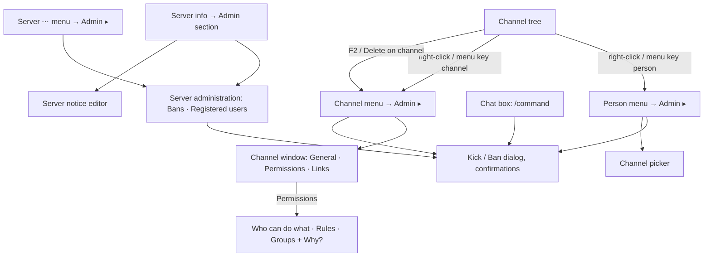
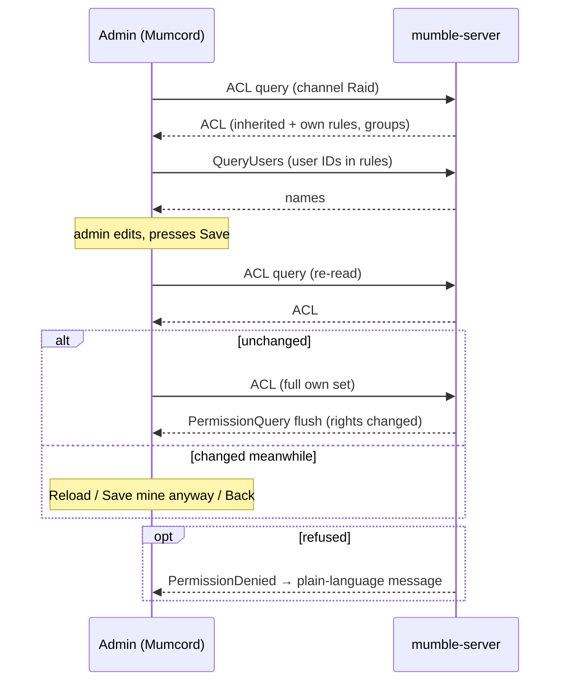
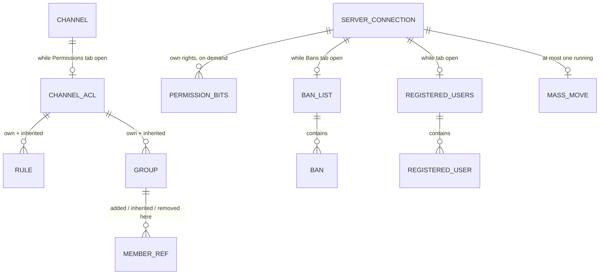
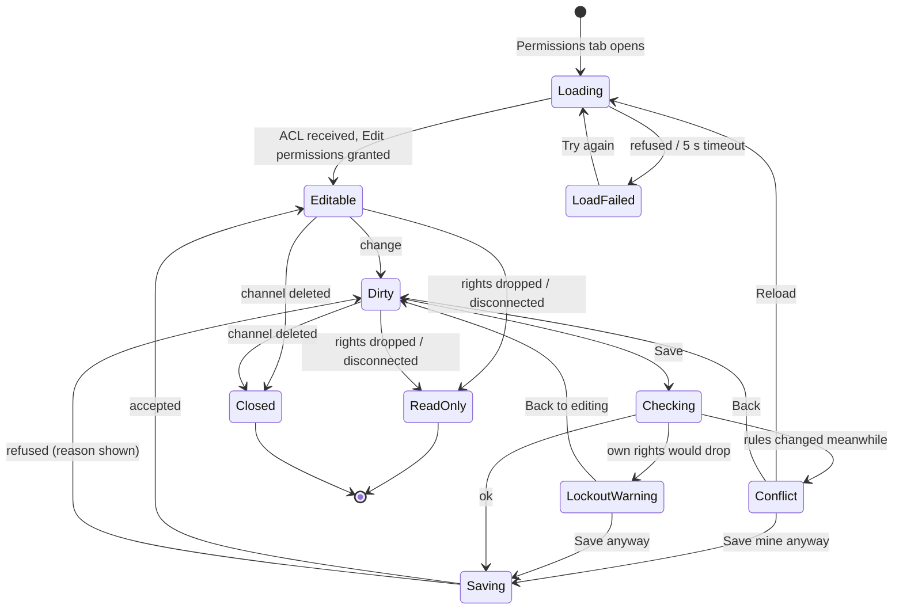

# Epic 4 – Admin & moderation · Specification

> Status: Final (brainstorming completed, round 5 skipped at the user's request) · As of: 2026-11-03
> Sources: `specs/roadmap.md` (Epic 4 "Admin features"), `specs/10-admin-moderation-brainstorming.md` (rounds 1–4; the answers given in chat are final), issues #247 (overview), #248–#258, #378 with its mockups on branch `mockups/admin-commands` (`docs/mockups/epic-4-commands/`), #300 (ACL query replies)
> Builds on: `specs/01-foundation-specification.md` (stack, platforms, design system, 24 locales, accessibility, FR-1.12 old servers, FR-1.40 diagnostics), `specs/02-multi-server-themes-specification.md` (several servers at once, server colors/icons, FR-2.78 channel passwords), `specs/03-comfort-polish-specification.md` (redesigned tree and right-click menus #172, local blocking #140, server info #147), `specs/06-plugin-system-specification.md` (FR-6.43 plugin slash commands), `specs/09-plugin-platform-1-1-specification.md` (mumbot test tooling). All decisions there stay valid unless this spec names a change.
> Numbering: the file number is 10 because `04` is taken by the mumpeer relay spec; requirement IDs use the epic number 10 (`FR-10.x`, `AC-10.x`) to stay unique across specs.

## 1. Goal & context

Today admins and moderators still need the official Mumble client to kick, ban, move people, manage channels or change permissions. Epic 4 brings all of this into Mumcord and so completes the "full replacement" goal from Spec 01 (Q1.3 / Q1.11). Everything works through standard Mumble protocol messages against an unmodified server: **the server's ACLs decide, Mumcord only reflects them** (Spec 01 section 3). Afterwards an admin can run a community from Mumcord alone, including a readable permission editor that explains *why* someone can or cannot do something, which the official client cannot.

## 2. Scope

### 2.1 In scope (MVP)

- **Permission-aware UI** (#248): admin items appear only when the server grants the right; nothing admin-related for people without admin rights.
- **Actions on people** (#253, #255, #256, #257): kick, ban (precise ban with duration, quick-ban fallback), server mute / deafen / un-suppress, priority speaker, move (to my channel, to…, everyone in a channel), reset comment, reset avatar, register a guest.
- **Actions on channels** (#250, #251): create (permanent and temporary), edit, re-parent, delete, link/unlink, channel password.
- **ACL & groups editor** (#252) with "Who can do what", Rules, Groups, the "Why?" panel, lock-out guard and conflict handling.
- **Server administration window** (#254, #256): ban list (view, search, add offline bans, edit, remove) and registered users (list, rename, unregister).
- **Admin section in server info** (#258): own rights at Root, server limits and welcome text read-only, "server notice" (Root channel description) editable.
- **Admin slash commands** (#378 plus four): `/kick`, `/ban`, `/mute`, `/unmute`, `/deaf`, `/undeaf`, `/move`, `/unban`, `/priority`, `/register`, `/moveall`.
- **Admin ▸ sub-menu** in the person, channel and server ⋯ menus (#249, updated to the sub-menu decision), plus F2 / Delete on a selected channel.
- Works on **every connected server** (Spec 02), strictly per server.
- All new texts in the 24 locales; keyboard and screen-reader support; light and dark theme.
- **Spikes:** S1 ban variants (certificate-only / IP-only), S2 flood-limit pacing for mass moves.

### 2.2 Out of scope / later

- **Local admin log** (#259): not built (Q1.11). #259 is closed as "not planned" with a link to this decision (Q2.3).
- **Report a person** (#140, handed over by Spec 03): not in this epic; without server support a report has no reliable recipient (Q1.8).
- **Undo** button after admin actions (Q1.13).
- **Separate text-chat moderation feature** (e.g. "Forbid writing" item); admins use kick/ban and the ACL editor (Q1.7).
- **Dedicated SuperUser login switch** (Q1.17); SuperUser logs in via the normal server dialog.
- **Cross-server actions** such as "ban on all my servers" (Q1.19).
- **Later candidates:** multi-select dragging of people (Q1.1), re-ordering/re-parenting channels by dragging (Q1.2), bulk clean-up of inactive registered users (Q1.3), a "Why can X not…?" item in the person menu (Q2.4), a full "Show all steps" trace in the Why panel (Q2.5), dedicated shortcuts for kick/ban/mute (Q2.15), automatic merging of concurrent rule edits (Q3.14).
- **Tests against 1.3 servers** (Q4.12). Old servers are handled by the FR-1.12 rule but not covered by automated tests.
- **Server-only features** (no client message exists; would need server access): changing the welcome text, server name, user limit, bandwidth or other server settings; deleting or editing chat messages others already sent; a server audit log of other admins' actions; seeing other people's effective rights or "who else is an admin". Mumcord never installs, configures or requires anything on the server.

## 3. Roles & permissions

The server enforces every right; Mumcord asks the server for the user's own rights (permission query) and only shows what is granted. Mumcord never learns other people's rights from the server; the ACL editor *predicts* them from the rules (FR-10.45 ff.). Plain names are used in the UI (Q3.11), the Mumble names in tooltips and screen-reader text.

| Plain name (Mumble name) | Checked in | Unlocks in Mumcord |
|---|---|---|
| Join (Enter) | target channel | — (join, Spec 02) |
| Pass through (Traverse) | each channel on the path | — |
| Speak, Whisper, Write messages (TextMessage), Listen in (Listen) | channel | — (shown in the grid only) |
| Mute others (MuteDeafen) | the person's current channel | Server mute / deafen / un-suppress, Priority speaker, `/mute`, `/unmute`, `/deaf`, `/undeaf`, `/priority` |
| Move people (Move) | the person's current channel; target must allow it (Move there, or the person may Join it) | Move to my channel, Move to…, Move everyone to…, `/move`, `/moveall` |
| Edit permissions (Write) | channel | Edit channel (General), Permissions tab, Delete channel, server notice (on Root) |
| Create channels (MakeChannel) | parent channel | Create sub-channel…; also needed on the new parent when re-parenting |
| Create temp channels (MakeTempChannel) | parent channel | Create temporary channel… |
| Link channels (LinkChannel) | both channels | Link with my channel, Unlink all, Links tab |
| Kick (Kick) | Root | Kick…, `/kick` |
| Ban (Ban) | Root | Ban…, `/ban`, `/unban`, Bans tab, IP/fingerprint display |
| Register others (Register) | Root | Register on server, `/register`, Registered users tab |
| Register self (SelfRegister) | Root | — (grid only) |
| Reset profiles (ResetUserContent) | Root | Reset comment, Reset avatar |

| Role (typical setup) | Sees |
|---|---|
| Normal user / guest (no admin rights) | Nothing admin-related (Q1.15). A temporary-channel right alone shows only "Create temporary channel…" in the Admin ▸ sub-menu. |
| Channel moderator (e.g. Mute others + Move people in some channels) | Admin ▸ items for the channels where the right exists; the matching slash commands (Q2.2). |
| Server admin (all rights at Root via an `admin` group) | Everything in this spec. |
| SuperUser | Everything; the server ignores all rules for SuperUser. No lock-out warning (Q3.7). |

## 4. Functional requirements

### 4.1 Permission awareness (#248)

- **FR-10.1** Mumcord asks the server for the user's own rights per channel only when a menu, command, window or picker needs them (Q4.11), keeps the answer in memory per connection, and asks again after the server's "rights changed, ask again" signal (permission query with flush) or a refusal.
- **FR-10.2** Admin items whose right is missing are **hidden**, never disabled (Q1.14). Exception: the Links tab and pickers show channels the user cannot act on greyed with a short reason (Q3.5, Q3.10).
- **FR-10.3** A user with no admin right on a server sees no Admin ▸ sub-menu, no admin slash commands, no admin section in server info and no Server administration window (Q1.15).
- **FR-10.4** Admin features work on every connected server, each with its own rights (Q1.18), and strictly per server: no action spans servers (Q1.19).
- **FR-10.5** Servers older than 1.4 (Spec 01 FR-1.12): features the server cannot do (e.g. reset profiles, "last seen") are hidden, and a one-line hint appears where an admin would look for them, e.g. "This server is too old to reset profiles" (Q4.5).

### 4.2 Menus and shortcuts (#249)

- **FR-10.6** The person menu, the channel menu and the server ⋯ menu each get the same **"Admin ▸" sub-menu** after the normal items, always as a sub-menu even with one item (Q2.7, Q3.1). Toggles show a tick when on; kick, ban and delete sit last, in red, separated by a divider. #249 is updated to match.
- **FR-10.7** Person menu Admin ▸ items: Move to my channel, Move to…, Server mute, Server deafen, Un-suppress (only when the person is suppressed), Priority speaker, Register on server (only for guests), Reset comment (only if they have one), Reset avatar (only if they have one), Kick…, Ban….
- **FR-10.8** Channel menu Admin ▸ items: Create sub-channel…, Create temporary channel…, Edit channel…, Permissions…, Link with my channel, Unlink all (only if linked), Move everyone to…, Delete channel….
- **FR-10.9** Server ⋯ menu Admin ▸ items: Ban list…, Registered users… (each with its right), Server info (admin section).
- **FR-10.10** On a selected channel in the tree, **F2** opens "Edit channel…" and **Delete** opens the "Delete channel?" confirmation, only when the user has the right (Q3.2). No other admin shortcuts (Q2.15).

### 4.3 Actions on people (#253, #255, #257, #256)

- **FR-10.11** **Kick**: a kick dialog (FR-10.57) with an optional reason that is shown to the person; the server removes them and they can reconnect (Q1.1, Q2.8).
- **FR-10.12** **Precise ban** (Q1.4): the ban dialog (mockup `03-ban-dialog`) with reason, duration chips (1 hour, 1 day, 7 days, 30 days, Permanent, Custom date…), "Ends on …" in local time, "Ban by certificate", "Ban by IP address (mask /32)", "Remove from server now", and the buttons "Kick only instead", "Cancel", "Ban". Saving adds one entry to the server's ban list using the safe save of FR-10.66; with "Remove from server now" the person is then kicked with the same reason.
- **FR-10.13** **Quick-ban fallback**: if the ban list cannot be read (no answer within 5 seconds or refused), the dialog shows a one-line notice "This server only allows its default ban length", the duration is fixed to "Server default" and both ticks are fixed on; "Ban" then uses the standard "remove user with ban" message (server default length, certificate and IP).
- **FR-10.14** The two ban ticks follow the result of spike S1 (section 4.11): a variant that does not work on a standard server is fixed on, greyed, with a one-line reason. At least one tick must stay on; "Ban" is disabled while both are off.
- **FR-10.15** **Server mute / Server deafen / Un-suppress / Priority speaker** act immediately and toggle (Q1.12). Server deafen implies server mute (as in Mumble). Success is visible in the tree icons; no extra line (Q2.14).
- **FR-10.16** **Move to my channel** acts immediately; **Move to…** opens the channel picker (FR-10.62) and acts on selection (Q1.1).
- **FR-10.17** **Move everyone to…** (channel menu) and `/moveall` confirm with the count ("Move 6 people from General to AFK?"), then send one move per person at a paced rate (FR-10.18) and report "Moved 28 of 30 people; 2 were refused" as a private result line (Q4.10). The admin is moved too if they are in that channel.
- **FR-10.18** **Pacing**: mass moves stay under the standard server's default flood limit (initial value: a burst of 5, then 1 per second; final values from spike S2). After the last move Mumcord compares who actually arrived (with a 5-second grace period) and reports the count. Starting another mass move on the same server while one runs is ignored with the private line "Already moving people…".
- **FR-10.19** **Reset comment / Reset avatar** confirm first ("Reset Mallory's comment? They can set a new one.") and then clear it on the server.
- **FR-10.20** **Register on server** registers an online guest under their current name, immediately (no confirmation). Only offered while the guest is online.

### 4.4 Actions on channels (#250, #251)

- **FR-10.21** **Create sub-channel…** opens the Channel window with only the General tab (Q3.4): name (required), description, position, user limit, password, "Temporary" tick. After "Create" the window closes; the new channel appears in the tree.
- **FR-10.22** **Create temporary channel…** opens the same window with "Temporary" ticked; name required, password optional (Q3.13). The server moves the creator into the new channel. Temporary channels cannot get permanent sub-channels; Mumcord hides "Create sub-channel…" on them.
- **FR-10.23** **Edit channel…** opens the Channel window on General; **Permissions…** opens it on Permissions (Q3.3). One Save writes all changed tabs.
- **FR-10.24** **Re-parent**: the General tab's "Parent" picker (edit only) moves the channel with all its sub-channels under another parent. Saving a changed parent asks first ("Move Raid under Gaming? 2 sub-channels move with it.") (Q1.12). Parents that would create a loop (the channel itself or its descendants) are not offered.
- **FR-10.25** **Delete channel…** confirms with numbers and names: "Delete channel Raid?" / "3 sub-channels are deleted too. 5 people are moved to Gaming." (Q2.13, Q4.7). One click, no typing the name.
- **FR-10.26** **Description**: simple formatting (bold, italic, links), saved as clean HTML that other clients render. An existing description is sanitized on reading (untrusted input); markup the editor does not support is shown as plain text and only replaced if the admin edits the description.
- **FR-10.27** **Links** (Q3.5): the Links tab is a tick list of all channels (with search, FR-10.62); channels without the Link right are shown greyed with "You can't link this one". Changes are saved with the window's Save. The channel menu keeps the quick items "Link with my channel" and "Unlink all", which act immediately.
- **FR-10.28** **Channel password** (Q3.6): one password field on the General tab (with show/hide), written exactly like the official client: a rule "everyone (`all`): deny Join" and a rule "group `#<password>`: allow Join". When reading, Mumcord recognises exactly this pattern and fills the field. If the Join rules are more complex (several password groups, extra rules on Join), the field shows "Custom access rules – see Permissions" and is read-only. Changing or clearing the password only touches those two rules. The field notes "Visible to everyone who can edit this channel's permissions". Joining with passwords stays as in Spec 02 FR-2.78.
- **FR-10.29** **Server notice**: the Root channel's description, edited from the server info admin section (FR-10.54) with the same description editor and Save rules.

### 4.5 Slash commands (#378)

- **FR-10.30** Built-in admin commands, listed in the command list under "Admin commands · built-in" with the label "Built-in", next to plugin commands (Spec 06 FR-6.43; built-in names win, plugins cannot take them). Syntax and behaviour:

  | Command | Syntax | Action | Confirms? |
  |---|---|---|---|
  | `/kick` | `/kick <name> [reason]` | Opens the kick dialog prefilled | Dialog |
  | `/ban` | `/ban <name> [duration] [reason]` | Opens the ban dialog prefilled (mockup 03) | Dialog |
  | `/mute`, `/unmute` | `/mute <name>` | Server mute on / off | No |
  | `/deaf`, `/undeaf` | `/deaf <name>` | Server deafen on / off | No |
  | `/move` | `/move <name> <channel>` | Moves one person | No |
  | `/unban` | `/unban <name or IP>` | Finds the ban-list entry; confirmation shows name, reason, ends on | Yes |
  | `/priority` | `/priority <name>` | Toggles priority speaker; result line says on or off | No |
  | `/register` | `/register <name>` | Registers an online guest under their current name | No |
  | `/moveall` | `/moveall <to channel>` | Moves everyone in **your** current channel (FR-10.17) | Yes |

- **FR-10.31** `[duration]` in `/ban` accepts `<n>h`, `<n>d` and `perm` (e.g. `7d`) and preselects the matching chip; without it the dialog opens with "Permanent" selected.
- **FR-10.32** A command is listed and autocompleted only if the user has its right in at least one channel; name autocomplete offers only people the user may act on (Q2.2). Names match people online on that server (mockup `02-name-autocomplete`); `/unban` autocompletes banned names; channel arguments autocomplete channels.
- **FR-10.33** An admin command the user may not use behaves exactly like a command that does not exist: not listed, not autocompleted, Enter sends nothing and the text stays in the message box (Q1.10, Q2.1). Mockup `04a-error-no-permission` is dropped.
- **FR-10.34** Unknown name → hint as in mockup `04b-error-unknown-user` ("No one named "Malory" is on this server right now. Did you mean Mallory?"); ambiguous name → picker as in mockup `04c-error-ambiguous`. Nothing is sent in either case.
- **FR-10.35** Every slash command ends with a **private result line** in that server's chat (mockup `05-result-line`, "Only you see this line"), for success and refusal (Q2.14). Command names stay English in every locale (Q4.14). Commands only ever act on the server whose chat they were typed in (Q4.6).

### 4.6 ACL & groups editor (#252)

- **FR-10.36** The Permissions tab of the Channel window is the full editor with three views: "Who can do what" (default), "Rules", "Groups", plus the "Why?" side panel and a "Check a person…" field (Q2.10, Q3.3). The rules are read when the tab opens (ACL query, #300).
- **FR-10.37** **Rules view** (Q3.8): inherited rules first, in grey, read-only, each with its source channel ("Root ↗" opens that channel's Permissions); then the channel's own rules, editable: Who (group or one registered user), "Applies to" as two checkboxes ("this channel", "sub-channels"), Allow and Deny per permission. Actions: Add rule, move up/down, Remove. "Inherit rules from parent" switches all inherited rules off at once.
- **FR-10.38** **Groups view** (Q3.9): the channel's groups on the left (inherited ones marked with their channel), members on the right with "added here", "inherited from …" and "inherited, removed here" (with "Remove here" / "Restore"). "Add registered user…" searches online registered people and, with the Register right, the registered users list. Toggles "Inherit members from parent" and "Sub-channels may inherit this group". Groups can be created and deleted. Built-in groups (`all`, `auth`, `in`, `out`, `sub`, `~…`, `#…`, `$…`) are listed read-only with a one-line translated explanation each.
- **FR-10.39** **Guests** in the group and rule pickers are listed greyed with "Guests can't be added. Register them first." and, with the Register right, a "Register…" button; after registering they can be added (Q3.10).
- **FR-10.40** **"Who can do what" grid** (Q3.11): rows are "everyone", then every group and person named in an own or inherited rule, then the person chosen in "Check a person…". Columns are all permissions in four groups with plain names: Basics (Join, Pass through, Speak, Whisper, Write messages, Listen in), Moderation (Mute others, Move people), Channel admin (Edit permissions, Create channels, Create temp channels, Link channels), Server (Kick, Ban, Register others, Register self, Reset profiles; **Root only**). Cells show ✓ allowed, ✗ denied or ? depends, plus "set here" or "inherited from …" in grey. Editing happens in the Rules and Groups views; the grid updates live from unsaved changes.
- **FR-10.41** **Lock-out guard** (Q3.7): before saving, Mumcord predicts the user's own rights after the change (including the standard server's automatic "Edit permissions" re-grant for registered users on that channel). If the user would lose "Edit permissions" here or any right they hold now (here or in sub-channels), a confirmation lists them ("After saving, you can no longer: Edit permissions, Ban") with "Save anyway" and "Back to editing". No warning for SuperUser.
- **FR-10.42** Saving rules on the **Root channel** always asks first ("Save permissions for the whole server?") (Q1.12).
- **FR-10.43** **Conflicts and failures** (Q3.14):
  - Before saving, Mumcord reads the rules again; if they changed since the tab opened, it asks "Someone changed these permissions while you were editing" with "Reload" (own changes dropped), "Save mine anyway" (theirs replaced), "Back". No automatic merge.
  - Reading fails (refused, or no answer within 5 seconds): the Permissions tab shows the reason in plain words and "Try again"; General and Links still work.
  - The user's rights drop while the window is open: the Permissions tab turns read-only with the banner "You can no longer edit these permissions"; unsaved changes stay visible but cannot be saved.
  - The channel is deleted while the window is open: the window says so and offers only "Close".
- **FR-10.44** A "Refresh" button reloads the rules on demand (Q4.2).

### 4.7 "Why?" engine (Q1.6, Q2.4, Q2.5, Q3.12)

- **FR-10.45** Mumcord computes effective rights for any row and permission from the rules and groups it reads, the same way the standard server does: walk from Root down to the channel, apply inherited and own rules in order, the last matching rule wins; support the standard group syntax (`!`, `~`, `sub,a,b,c`, `in`, `out`, `all`, `auth`, `#token`, `$hash`). It runs in the core, not in the UI, and only for the open channel (Q4.11).
- **FR-10.46** Clicking a grid cell or pressing Enter on it opens the **Why?** panel with: the deciding rule (number, channel, "here" or "inherited"), the group that made the person match and why ("Freya matches "out" because they are not in Raid right now"), and the rule it overrode, plus "Go to rule N" (Q2.5). No full trace.
- **FR-10.47** Where Mumcord cannot know for sure, the cell shows **?** ("Depends") and the panel explains the condition: password/access-token groups ("Allowed if they entered the channel password"), groups the server fills itself ("Depends on a group the server manages"), `in`/`out` for people who are offline or elsewhere ("Allowed only while they are in Raid"). SuperUser rows show ✓ everywhere with "SuperUser ignores all rules".
- **FR-10.48** The panel always ends with "Worked out by Mumcord from the rules; the server has the final say."
- **FR-10.49** "Check a person…" accepts registered users (online, or from the registered users list with the Register right) and online guests, and adds their row to the grid.

### 4.8 Server administration window (#254, #256)

- **FR-10.50** One "Server administration · <server name>" window with two tabs, **Bans (count)** and **Registered users (count)**, opened from the server info admin section and the server ⋯ Admin ▸ menu. Each tab appears only with its right (Ban / Register others); the window only with at least one (Q2.11).
- **FR-10.51** **Bans tab**: columns Name, Certificate, IP address, Reason, Banned, Ends ("permanent" for duration 0). Fingerprints are shortened (`a3f9…c21e`) with a Copy button. IP addresses are **masked** (`203.0.113.*`; IPv6: the first four groups then `:*`) with a per-row "Show"; revealed addresses are masked again when the window closes (Q4.8). Actions: "Add ban…" (ban dialog with a "Who" field for name, certificate fingerprint or IP address/range, Q2.8), "Edit…" (same dialog, prefilled), "Remove…" (confirms "Unban Mallory?" with reason and end date).
- **FR-10.52** **Registered users tab**: columns Name, Last seen, Last channel (hidden with an FR-10.5 hint if the server does not send them). Actions: "Rename…" (no confirmation; the server's refusal, e.g. name taken, is shown in the dialog) and "Unregister…" (confirms "Unregister Freya? They lose their account, groups and rules that name them.") (Q4.7).
- **FR-10.53** Both tabs: only visible rows are drawn (smooth scrolling for thousands of entries), instant search (bans: name, IP, fingerprint, reason; users: name), sorting by column, no paging (Q4.11). A "Refresh" button reloads (Q4.2).

### 4.9 Server info admin section (#258)

- **FR-10.54** An "Admin" section at the end of the existing server info (Spec 03, #147), only for users with at least one admin right (Q2.12, Q1.15). Content: "Your rights here" (rights at Root, plain names), "Server limits" (max users, bandwidth, message length, image message length; read-only), "Welcome text" (read-only, sanitized, with "ⓘ can only be changed in the server's settings file, not from any client"), "Server notice" (Root description) with "Edit…" (only with Edit permissions on Root), and "Ban list & registered users…" (only with Ban or Register others).

### 4.10 Confirmations, results and refusals

- **FR-10.55** Confirmations (Q1.12, Q2.13, Q4.7) for: kick, ban, unban, delete channel, re-parent a channel, move everyone / `/moveall`, reset comment, reset avatar, unregister, saving rules on Root, lock-out (FR-10.41), conflict (FR-10.43). Quick toggles, moving one person, registering, renaming and linking act immediately. No undo (Q1.13).
- **FR-10.56** Confirmation style: title is the question ("Delete channel Raid?"), one consequence line with numbers and names, action-named buttons (never "OK"), the dangerous button red; Enter confirms, Esc cancels; one click is enough (Q2.13, Q4.7).
- **FR-10.57** Kick dialog: "Kick Mallory? · <server name>", the person line ("Mallory · in General"), "They can reconnect right away.", optional reason ("shown to them"), "Cancel" / "Kick"; same style as the ban dialog (Q2.8).
- **FR-10.58** Every admin dialog, confirmation and window shows the **server name** in its title, with the server's icon/color from Spec 02 (Q4.6). Each window is bound to its server; if that connection ends, it turns read-only with "Disconnected from <server>" and offers only "Close".
- **FR-10.59** Results and refusals (Q2.14, Q4.1, Q1.16): slash commands → private result line. Menu and dialog actions → success is visible in the tree, no extra line; a refusal appears inside the open dialog, or, with no dialog open, as a private line in that server's chat ("The server refused: you can't mute people in Raid · Only you see this line"). After any refusal Mumcord asks for the user's rights again.
- **FR-10.60** The server's refusal reasons are mapped to plain translated sentences (at least: permission denied with the permission's plain name and channel, channel full, invalid or taken channel name, invalid or taken user name, temporary channel rules, nesting/channel count limit, missing certificate, text too long). Unknown reasons show the server's own text, sanitized.
- **FR-10.61** Private result lines and refusals are never sent to the server; they live only in this session's chat view (no history entry).
- **FR-10.62** **Channel pickers** (Move to…, Parent, Links, `/move` target) show the tree shape with a search field on top; channels the action is not allowed for are greyed with a reason (Q4.11).

### 4.11 Data handling, safety and spikes

- **FR-10.63** Nothing from this epic is written to disk: own rights, rules, groups, ban list and registered users live in memory per connection (Q4.2). Rules, groups, ban list and registered users are fetched fresh whenever their window or tab opens and dropped when it closes or the connection ends. "Why?" answers are never stored.
- **FR-10.64** Logs and diagnostic files (Spec 01 FR-1.40) contain only the kind of action and its outcome, e.g. "ban list saved: 1 added, ok" or "rules save refused: permission denied, channel 12". Never names, IP addresses, fingerprints, reasons, channel names, descriptions, passwords or rule contents (Q4.9).
- **FR-10.65** IP addresses and certificate fingerprints of other people are shown only in the ban list and ban dialogs, only to users with the Ban right (Q4.8). They never appear in person menus, server info or anywhere else.
- **FR-10.66** **Safe ban-list save** (Q4.3): right before every save Mumcord re-reads the ban list, applies only the user's own change (added, edited or removed entry) to the fresh copy and sends the full list back. If the very entry being edited or removed was changed or removed meanwhile, it asks "Reload" / "Save mine anyway" / "Back".
- **FR-10.67** All text from the server (names, reasons, descriptions, welcome text, group names) is treated as untrusted and sanitized before rendering (CLAUDE.md).
- **FR-10.68** **Spike S1 – ban variants (Q4.4)**, first task of the build, against the local test server: does a ban-list entry with a certificate hash and an IP range that matches nobody ban only the certificate? Does an entry without a certificate hash ban only the IP? Is a `/32` (IPv4) / `/128` (IPv6) mask honoured? Does the quick ban's default length match the server setting? The result is recorded in this spec (section 13) and decides FR-10.14.
- **FR-10.69** **Spike S2 – flood-limit pacing**: measure on the local test server (default settings) how fast moves of other people can be sent without drops, and set the FR-10.18 pacing values from it.

## 5. UI & UX

### 5.1 Navigation



### 5.2 Binding mockups (#378, branch `mockups/admin-commands`, `docs/mockups/epic-4-commands/`)

| Mockup | Status |
|---|---|
| `01-command-list` (light/dark) | Binding; the list additionally contains `/unban`, `/priority`, `/register`, `/moveall` in the same style. |
| `02-name-autocomplete` | Binding. |
| `03-ban-dialog` | Binding; the title additionally carries the server name (FR-10.58); ticks per spike S1. |
| `04a-error-no-permission` | **Dropped** (FR-10.33). |
| `04b-error-unknown-user`, `04c-error-ambiguous` | Binding. |
| `05-result-line` | Binding; also used for refusals of menu actions (FR-10.59). |

### 5.3 Menus (Admin ▸ sub-menu)

```text
Person menu                         Admin ▸ (admin sees everything)
┌──────────────────────────┐        ┌──────────────────────────────┐
│ Send private message     │        │ Move to my channel           │
│ Local volume…            │        │ Move to…                     │
│ Block                    │        │ ✓ Server mute                │
│ ──────────────────────── │        │   Server deafen              │
│ Admin                  ▸ │──────▶ │   Priority speaker           │
└──────────────────────────┘        │ Register on server           │
                                    │ Reset comment…               │
                                    │ Reset avatar…                │
                                    │ ──────────────────────────── │
                                    │ Kick…                  (red) │
                                    │ Ban…                   (red) │
                                    └──────────────────────────────┘
Channel menu → Admin ▸: Create sub-channel… · Create temporary channel… · Edit channel… (F2)
  · Permissions… · Link with my channel · Unlink all · Move everyone to… · ── · Delete channel… (Del, red)
Server ⋯ menu → Admin ▸: Ban list… · Registered users… · Server info
```

### 5.4 Kick and ban dialogs

```text
┌─ Kick Mallory? · ◉ Mumcord Lounge ───────┐
│ Mallory · in General                     │
│ They can reconnect right away.           │
│ Reason (optional, shown to them)         │
│ [ spam links                          ]  │
│                     [ Cancel ] [ Kick ]  │
└──────────────────────────────────────────┘
```

Ban dialog: mockup `03-ban-dialog` plus the server name in the title. Offline ban / edit from the ban list: the same dialog with a "Who" field (name, certificate fingerprint, IP address or range) instead of the person line, and without "Remove from server now" and "Kick only instead".

### 5.5 Channel window (non-blocking, one Save)

```text
┌─ Channel · Raid · ◉ Mumcord Lounge ──────────────────────┐
│ [ General ] [ Permissions ] [ Links ]                    │
├──────────────────────────────────────────────────────────┤
│ Name          [ Raid night                        ]      │
│ Description   [ B  I  🔗 ]                               │
│               [ Tuesdays 20:00, bring flasks.     ]      │
│ Parent        [ Gaming                         ▾ ]  edit │
│ Position      [ 0   ]   lower numbers go first           │
│ User limit    [ 0   ]   0 = no limit                     │
│ Password      [ ••••••    ] 👁   empty = no password      │
│               Visible to everyone who can edit this      │
│               channel's permissions                      │
│ ☐ Temporary: delete when the last person leaves  create  │
├──────────────────────────────────────────────────────────┤
│ Unsaved changes                     [ Cancel ] [ Save ]  │
└──────────────────────────────────────────────────────────┘
```

Create mode: title "Create sub-channel in Gaming · <server>", only the General tab, button "Create" (Q3.4).

Links tab:

```text
│ Search… [        ]                             │
│ Linked with (they hear each other):            │
│   ☑ Raid 2                                     │
│   ☑ Officers                                   │
│   ☐ Lobby                                      │
│   ☐ AFK          (you can't link this one)     │
```

### 5.6 Permissions tab

```text
┌─ Channel · Raid · ◉ Mumcord Lounge ─────────────────────────────────────────┐
│ [ General ] [ Permissions ] [ Links ]                                       │
│ ( Who can do what ) ( Rules ) ( Groups )  Check a person… [     ] [Refresh] │
├────────────────────────────────────────────────────┬────────────────────────┤
│           Basics                   Moderation  …   │ Why?                   │
│           Join Pass Speak Whisp Write Listen Mute… │ Freya cannot Speak in  │
│ everyone   ✓    ✓    ✓     ✓     ✓     ✓      ✗    │ Raid                   │
│ out        ✓    ✓   [✗]    ✓     ✓     ✓      ✗    │ Deciding rule: Rule 3  │
│ mods       ✓    ✓    ✓     ✓     ✓     ✓      ✓    │ in Raid: group "out" ✗ │
│ #secret    ?    ✓    ✓     ✓     ✓     ✓      ✗    │ Speak. Freya matches   │
│ Freya      ✓    ✓    ✗     ✓     ✓     ✓      ✗    │ "out" because …        │
│  grey = inherited from …                           │ Overrides: Rule 1 in   │
│                                                    │ Root (inherited) …     │
│                                                    │ [ Go to rule 3 ]       │
│                                                    │ Worked out by Mumcord… │
├────────────────────────────────────────────────────┴────────────────────────┤
│ ☑ Inherit rules from parent           Unsaved changes   [ Cancel ] [ Save ] │
└─────────────────────────────────────────────────────────────────────────────┘
```

Rules view (inherited rules grey and read-only) and Groups view as in the brainstorming wireframes for Q3.8 and Q3.9:

```text
  │ # │ Who                  │ Applies to │ Allow        │ Deny        │
  │ 1 │ everyone       Root ↗│ here, subs │ Join, Speak  │             │  (grey)
  │ 2 │ admin          Root ↗│ here, subs │ all          │             │  (grey)
  │ 3 │ out                  │ here       │              │ Speak       │
  │ 4 │ Freya                │ here, subs │ Move people  │             │
  [ + Add rule ]  [ ↑ ] [ ↓ ]  [ Remove ]       ☑ Inherit rules from parent

  Groups              │ Members of "mods"
  ▸ admin    (Root ↗) │   Freya        added here
  ▸ mods              │   Bjørn        inherited from Gaming    [ Remove here ]
                      │   Mallory      inherited, removed here  [ Restore ]
  Built-in (info):    │ [ + Add registered user… ]
    all, auth, in, …  │ ☑ Inherit members from parent
                      │ ☑ Sub-channels may inherit this group
```

### 5.7 Server administration and server info

```text
┌─ Server administration · ◉ Mumcord Lounge ─────────────────────────────────┐
│ [ Bans (12) ] [ Registered users (48) ]        Search… [        ] [Refresh]│
├────────────────────────────────────────────────────────────────────────────┤
│ Name       Certificate        IP              Reason      Banned      Ends │
│ Mallory    a3f9…c21e [Copy]   203.0.113.* Show spam links 3 Nov 2026  10 Nov│
│ (unknown)  —                  198.51.100.* Show flooding  1 Oct 2026  perm.│
├────────────────────────────────────────────────────────────────────────────┤
│ [ Add ban… ]                                    [ Edit… ] [ Remove… ]      │
└────────────────────────────────────────────────────────────────────────────┘

Server info · Mumcord Lounge
  …existing info…
  ─── Admin ──────────────────────────────────────
  Your rights here    Kick · Ban · Move people · Mute others · Edit permissions
  Server limits       Max users 50 · Bandwidth 72 kbit/s · Message 5000 chars
  Welcome text        "Welcome to the Lounge!"  ⓘ can only be changed in the
                      server's settings file, not from any client
  Server notice       Shown as the Root channel description  [ Edit… ]
  [ Ban list & registered users… ]
```

### 5.8 Keyboard, screen reader, themes (Q2.15, Q2.16)

- All Admin ▸ items reachable with the menu key or Shift+F10 on a selected person or channel; F2 / Delete per FR-10.10.
- The grid is navigated with arrow keys; each cell is read in full ("Group out, Speak: denied, set in this channel"; the Mumble name is part of the accessible description); Enter opens Why?.
- Dialogs trap focus, start on the first field, and return focus to the person or channel afterwards.
- Private result lines and refusals are announced (live region).
- Existing design tokens only: red for dangerous actions and "denied", green for "allowed", grey for inherited; ✓ / ✗ / ? icons and text always carry the meaning too. Every new screen is checked in light and dark theme.
- Empty states: "No bans on this server", "No registered users yet", "This channel has no own rules – it uses its parent's rules".

## 6. Audio & network

No change to audio. All actions use standard Mumble messages; minimum fully supported server version stays 1.4 (Spec 01 FR-1.12, older servers per FR-10.5).

| Action | Protocol message (functional) | Right (server checks) |
|---|---|---|
| Own rights per channel | `PermissionQuery` (answer; flush = "ask again"); Root rights also in `ServerSync` | — |
| Kick | `UserRemove` (session, reason) | Kick (Root) |
| Quick ban (fallback) | `UserRemove` with `ban = true` | Ban (Root) |
| Ban list read / precise ban / edit / unban / offline ban | `BanList` query, then full `BanList` sent back (FR-10.66) | Ban (Root) |
| Server mute / deafen / un-suppress / priority speaker | `UserState` (mute, deaf, suppress, priority_speaker) for that session | Mute others (person's channel) |
| Move one / many | `UserState` (channel_id), one per person, paced (FR-10.18) | Move people (see section 3) |
| Reset comment / avatar | `UserState` with empty comment / texture for that session | Reset profiles (Root) |
| Register a guest | `UserState` with user_id = 0 for that session | Register others (Root) |
| Registered users list / rename / unregister | `UserList` query; send entries with new name, or without name to remove | Register others (Root) |
| Resolve user IDs in rules and groups to names | `QueryUsers` | — |
| Create / temporary / edit / re-parent channel, description | `ChannelState` (parent, name, description, position, max_users, temporary) | Create (temp) channels on parent; Edit permissions; Create channels on new parent |
| Link / unlink | `ChannelState` (links_add / links_remove) | Link channels (both) |
| Delete channel | `ChannelRemove` | Edit permissions |
| Read / save rules and groups, channel password | `ACL` query; full `ACL` (inherit flag, own groups, own rules) sent back | Edit permissions |
| Refusals | `PermissionDenied` (type, permission, channel, reason) | — |
| Server limits, welcome text | `ServerConfig`, `ServerSync` (read-only) | — |



## 7. Data & state model

Nothing is persisted (FR-10.63). In-memory, per server connection:



| Entity | Field · type · rules |
|---|---|
| PERMISSION_BITS | channel_id · int; bits · permission set; stale · bool (set by flush or refusal) |
| CHANNEL_ACL | channel_id; inherit_rules · bool; loaded_snapshot (for the change check, FR-10.43); unsaved edits; read_only reason (rights dropped, disconnected, deleted) |
| RULE | position · int; source_channel (own or inherited); who: group name **or** user_id; applies_here · bool; applies_subs · bool; allow · permission set; deny · permission set |
| GROUP | name; source_channel; inherit_members · bool; inheritable · bool; added · user_id list; removed · user_id list; inherited_members · user_id list (read-only) |
| BAN | name; ip_address + mask bits; certificate_hash (may be empty); reason; start · datetime; duration_seconds (0 = permanent) |
| REGISTERED_USER | user_id; name; last_seen (optional); last_channel (optional) |
| MASS_MOVE | target channel; list of sessions; sent / arrived / refused counts |



## 8. Technology & architecture

- No new frameworks or libraries; stack as in Spec 01.
- **Protocol layer** (`crates/protocol`): adds the request/answer handling for the messages in section 6; ACL query support exists already (`Handle::query_acl`, `Event::Acl`, #300). The UI never talks to the network directly (CLAUDE.md).
- **Admin core module** (separate from UI): permission cache, ACL model with diff/save, password-pattern recognition, ban-list safe save, mass-move pacer, refusal-reason mapping, and the **"Why?" engine** as a pure function from (rules, groups, person facts) to (result, deciding rule, explanation). Pure logic so it can be unit-tested and compared against the server.
- **UI**: small components; the Channel window and Server administration are non-blocking windows bound to one server connection; virtualised lists for bans and users.
- **Slash commands** extend the existing command registry from Spec 06 with a "built-in" source that has priority.
- Translations through the existing i18n setup with plural forms; Mumble permission names and command names stay English.

## 9. Non-functional requirements

- **Performance:** ban list and registered users stay smooth with 5,000 entries; search results update while typing (under 100 ms for 5,000 entries); "Who can do what" and "Why?" compute in under 50 ms for a channel 10 levels deep with 50 rules; no permission queries for channels the user does not look at or act on.
- **Security:** TLS and certificate checks unchanged (Spec 01). The server name in every admin title (FR-10.58). Untrusted server text sanitized (FR-10.67). Channel passwords are visible only in the General tab of users with Edit permissions; they are never logged.
- **Privacy / GDPR:** no admin data on disk (FR-10.63); IPs masked by default and fingerprints shortened, only for the Ban right (FR-10.65); logs and diagnostics without personal data (FR-10.64), enforced by tests.
- **Accessibility:** section 5.8 on top of Spec 01.
- **Platforms:** all Spec 01 platforms; no platform-specific code expected.
- **Compatibility:** only standard Mumble messages; works against unmodified mumble-server 1.4+; no private extensions.

## 10. Build, packaging & release

No new packaging or release steps. The E2E harness gains:

- A **local mumble-server** started fresh per run with a generated SuperUser password (created at run time, never stored in the repo).
- **ACL fixtures** applied as SuperUser: channels Root › Lobby, Gaming › Raid, Raid 2, Officers, AFK; groups `admin` (Root, all rights) and `mods` (Gaming subtree: Mute others, Move people); a password channel (`#secret`); a few bans; registered accounts `admin`, `mod`, `user`, `freya`.
- **Scripted bots** (existing mumbot tooling, Spec 09): guest `Mallory`, registered `Freya`, and a second admin bot `Admin2` for conflict cases.

## 11. Acceptance criteria (verifiable in the running client)

Test setup for all: local mumble-server with the fixtures of section 10; Mumcord logged in as `admin`, `mod` or `user` as stated; bots as stated.

**Permission awareness**
- **AC-10.1** As `user` → right-click a person, a channel and the server ⋯ → no Admin ▸ entry; type `/` → no admin commands listed; server info has no Admin section.
- **AC-10.2** As `mod` → person menu in Raid shows Admin ▸ with Move to my channel, Move to…, Server mute, Server deafen, Priority speaker, but no Kick, Ban, Register, Reset; in Lobby the person menu has no Admin ▸. The command list shows `/mute`, `/unmute`, `/deaf`, `/undeaf`, `/move`, `/priority`, `/moveall` and no `/kick`, `/ban`, `/unban`, `/register`; `/mute` autocomplete offers only people in the Gaming subtree.
- **AC-10.3** As `mod`, type `/kick Mallory spam` and press Enter → nothing is sent, no hint appears, the text stays in the box; Mallory's client receives no message.
- **AC-10.4** As `admin` with `mod` connected to a second local server instance → admin items follow each server's own rights; banning on server 2 does not touch server 1's ban list.
- **AC-10.5** As SuperUser (normal server dialog, name `SuperUser`, password) → all admin items are shown.

**People**
- **AC-10.6** As `admin`, Admin ▸ Kick… on Mallory → "Kick Mallory? · <server>" → reason "spam" → Kick → Mallory's bot reports kick with reason "spam" and disappears from the tree; the bot can reconnect.
- **AC-10.7** As `admin`, `/ban Mallory 7d spam links` → ban dialog prefilled (7 days chip, reason, "Ends on" in local time) → Ban with "Remove from server now" → Mallory is removed; the Bans tab lists Mallory with a 7-day end; Mallory's bot cannot reconnect.
- **AC-10.8** Spike S1 result applied: certificate-only and IP-only bans behave as recorded in section 13 (Mallory reconnecting from the same IP with a new certificate, and with the same certificate, gives the recorded result); a variant that does not work shows its tick fixed on with a reason.
- **AC-10.9** Quick-ban fallback: with the ban list answer suppressed in a test hook → ban dialog shows "This server only allows its default ban length", duration "Server default", ticks fixed → Ban → Mallory is banned with the server default.
- **AC-10.10** As `admin`, toggle Server mute, Server deafen and Priority speaker on Freya → the tree icons change at once, the bot sees the state; toggling again reverts. `/mute Freya` → private result line "You muted Freya on the server · Only you see this line"; the bot receives no chat message.
- **AC-10.11** As `admin`, Move to my channel and Move to… (channel picker with search) on Freya → Freya moves; `/move Freya AFK` → Freya is in AFK with a private result line.
- **AC-10.12** With 30 bots in General, as `admin` `/moveall AFK` → confirmation "Move 30 people from General to AFK?" → Move → all 30 arrive (none dropped by the server's flood limit) and the result line reports "Moved 30 of 30 people"; running `/moveall` again while it runs → "Already moving people…".
- **AC-10.13** Mass move with refusals: Officers denies Join for `out` and the admin lacks Move there → "Move everyone to… Officers" → result line "Moved 0 of N people; N were refused".
- **AC-10.14** As `admin`, Reset comment on a bot with a comment → confirmation → the comment is gone in the bot's state; Reset avatar likewise.
- **AC-10.15** As `admin`, Register on server on guest Mallory → Mallory becomes registered (appears in Registered users); `/register` on an already registered person is not offered by autocomplete.
- **AC-10.16** `/kick Malory` → hint as mockup 04b with "Did you mean Mallory?"; `/mute mar` with Marlo and Marta online → picker as mockup 04c.

**Channels**
- **AC-10.17** As `admin`, Create sub-channel… on Gaming → only the General tab → name "Raid night", description with bold text and a link, position 1, limit 5 → Create → the channel appears; an official Mumble client shows the same description and limit.
- **AC-10.18** As `user` (servers grant temp channels to everyone in the fixture) → Admin ▸ shows only Create temporary channel… → window with Temporary ticked → Create → the user is moved into the new channel; after the user leaves it disappears.
- **AC-10.19** As `admin`, Edit channel… (and F2) on Raid → rename and change the limit → Save → tree updates; change Parent to Lobby → confirmation names "2 sub-channels move with it" → Raid is under Lobby with its sub-channels.
- **AC-10.20** As `admin`, Delete (key) on a channel with sub-channels and people → "Delete channel X?" with sub-channel and people counts → Delete → the channel is gone, people are in the parent.
- **AC-10.21** As `admin`, set password "secret" on General tab of Raid → Save → an official client sees the `all` deny Join / `#secret` allow Join rules; a bot without the token cannot join, with token can; reopen → the field shows the password; clear it → the two rules are gone and other Join rules stay. On a channel with extra Join rules → "Custom access rules – see Permissions".
- **AC-10.22** As `admin`, Links tab of Raid → tick Raid 2 → Save → a bot in Raid 2 hears a bot in Raid; "Unlink all" in the menu → links gone; a channel without the Link right shows greyed with a reason.
- **AC-10.23** As `admin`, edit the server notice in server info → the Root description changes, visible in an official client.

**ACL editor and Why?**
- **AC-10.24** As `admin`, Permissions… on Raid → "Who can do what" shows rows everyone, `out`, `mods`, Freya with plain-name columns in four groups; no Server columns on Raid, Server columns on Root; inherited cells grey with their source.
- **AC-10.25** Click (or Enter on) the cell `out` × Speak → Why? names "Rule 3 in Raid", the matching reason and the overridden "Rule 1 in Root", "Go to rule 3" selects it in Rules; the panel ends with "Worked out by Mumcord…".
- **AC-10.26** Rules view: inherited rules grey with "Root ↗"; add a rule "Freya: deny Speak, this channel" → Save → Freya's bot cannot speak in Raid (server confirms via its own permission query); untick "Inherit rules from parent" → inherited rules disappear after Save.
- **AC-10.27** Groups view: add registered `freya` to `mods` in Raid, remove inherited member `mod` here → Save → `mod`'s client loses Mute others in Raid; Restore → regained. Guest Mallory appears greyed with "Register…".
- **AC-10.28** "Depends": a `#secret` rule shows ? with "Allowed if they entered the channel password"; "Check a person…" SuperUser → ✓ everywhere with "SuperUser ignores all rules".
- **AC-10.29** Why-engine conformance: the generated-setup test (Q4.13) writes at least 200 random rule/group setups as SuperUser; for each, the test accounts' server-reported rights in every channel equal the engine's prediction; all hand-written "Depends" cases pass.
- **AC-10.30** Lock-out guard: as `admin` (not SuperUser), remove the rule granting `admin` Edit permissions on Gaming → Save → warning "After saving, you can no longer: Edit permissions, …" → Back to editing keeps the edit; as SuperUser the same save shows no warning.
- **AC-10.31** Saving rules on Root asks "Save permissions for the whole server?".
- **AC-10.32** Conflict: open Raid's Permissions, `Admin2` bot changes Raid's rules, then Save → conflict dialog; Reload shows Admin2's rules; repeat and "Save mine anyway" → own rules on the server.
- **AC-10.33** Rights drop: `Admin2` removes `admin` from the `admin` group while the window is open → banner "You can no longer edit these permissions", Save disabled. Channel deleted by `Admin2` → window shows it and offers only Close. Disconnecting the server → "Disconnected from <server>", Close only.
- **AC-10.34** Read failure (test hook drops the ACL answer) → after 5 s the Permissions tab shows the reason and "Try again"; General and Links still save.

**Server administration and info**
- **AC-10.35** As `admin`, Server administration → Bans tab lists fixture bans with masked IPs (`203.0.113.*`), shortened fingerprints with Copy; "Show" reveals one IP; reopening the window masks it again. As `mod` the window is not reachable.
- **AC-10.36** Add ban… with Who = an IP range → saved; meanwhile `Admin2` adds another ban → after save both bans exist. Edit an entry that `Admin2` removed meanwhile → Reload / Save mine anyway / Back. Remove… → "Unban Mallory?" → Mallory can reconnect. `/unban Mallory` → confirmation → same result.
- **AC-10.37** Registered users tab: rename `freya` to `freya2` → listed; rename to an existing name → the server's refusal in plain words inside the dialog; Unregister… → confirmation names the loss of account, groups and rules → user gone.
- **AC-10.38** With 5,000 fixture bans and 2,000 registered users → scrolling stays smooth, search by IP and by name filters while typing, sorting by "Ends" works.
- **AC-10.39** Server info Admin section as `admin`: rights at Root, server limits matching the server config, welcome text read-only with the explanation; as `user` no Admin section.

**Refusals, safety, quality**
- **AC-10.40** As `mod`, Server mute Freya in Raid while `Admin2` removes `mods`' Mute right a moment before (test hook delays the permission refresh) → private line "The server refused: you can't mute people in Raid · Only you see this line"; the Admin ▸ item disappears afterwards.
- **AC-10.41** Every admin dialog, confirmation and window shows the server name and color; with two servers connected, `/kick` typed in server B's chat acts on server B only.
- **AC-10.42** Logs and a saved diagnostic file after running AC-10.6–AC-10.37 contain no names, IPs, fingerprints, reasons, channel names, descriptions, passwords or rule contents (automated check); the app data folder contains no ban list, user list or ACL data.
- **AC-10.43** Keyboard only: open Admin ▸ via Shift+F10 on a person and a channel, run kick and ban dialogs, move through the grid with arrows and open Why? with Enter; focus returns to the person/channel; the screen reader reads cells in full and announces result lines; automated a11y checks pass in light and dark theme.
- **AC-10.44** In German and one RTL locale all new texts are translated, plurals are correct ("1 Person" / "5 Personen"), Mumble permission names appear in English in tooltips, command names stay English.

## 12. Decision log

| Question | Decision | Note |
|---|---|---|
| Q1.1 | Kick, ban, server mute/deafen/un-suppress, move (incl. everyone), priority speaker, reset comment/avatar, register a guest | Multi-select dragging later |
| Q1.2 | Create, temporary, edit, re-parent, delete, link/unlink, channel password | Drag re-ordering later |
| Q1.3 | Ban list, registered users, server info admin section | Bulk clean-up later |
| Q1.4 | Precise ban with duration; quick-ban fallback | FR-10.12, FR-10.13 |
| Q1.5 | Full ACL & groups editor | FR-10.36 ff. |
| Q1.6 | "Why" explanation **in the MVP** | Overrode recommendation |
| Q1.7 | No separate text-moderation feature | |
| Q1.8 | No report feature in this epic | #140 report part dropped |
| Q1.9 | #378 plus `/unban`, `/priority`, `/register`, `/moveall` | Overrode recommendation |
| Q1.10 | Command without permission: silently ignore | Overrode recommendation; detailed by Q2.1 |
| Q1.11 | **No local admin log** | Overrode recommendation |
| Q1.12 | Confirm only destructive actions | FR-10.55 |
| Q1.13 | No undo | |
| Q1.14 | Missing rights → hidden | |
| Q1.15 | No admin rights → nothing admin-related | Admin-log exception dropped with Q1.11 |
| Q1.16 | Server refusal shown in plain words | Log part dropped with Q1.11 |
| Q1.17 | No SuperUser feature | |
| Q1.18 | Admin on every connected server | |
| Q1.19 | Strictly per server | |
| Q2.1 | Not listed, Enter sends nothing, text stays | Mockup 04a dropped |
| Q2.2 | Listed with the right in ≥ 1 channel; autocomplete filtered | |
| Q2.3 | #259 closed as "not planned" | |
| Q2.4 | Why? as side panel with "Check a person…" | |
| Q2.5 | Deciding rule plus context | |
| Q2.6 | Syntax as in the table | FR-10.30 |
| Q2.7 | **"Admin ▸" sub-menu** | Overrode recommendation |
| Q2.8 | Kick dialog in ban style; offline bans reuse ban dialog with "Who" | |
| Q2.9 | **Tabs General / Permissions / Links** | Overrode recommendation; merged with editor by Q3.3 |
| Q2.10 | Own window, three views, Why? panel | Became the Permissions tab (Q3.3) |
| Q2.11 | Server administration window with two tabs | |
| Q2.12 | Admin section at the end of server info | |
| Q2.13 | Question title, consequence line, action-named buttons | |
| Q2.14 | Slash: result line; menu: tree shows success, refusal in dialog or notice | Notice defined by Q4.1 |
| Q2.15 | All four keyboard/screen-reader points; no dedicated shortcuts | F2/Delete kept by Q3.2 |
| Q2.16 | Existing tokens only; never color alone | |
| Q3.1 | Same Admin ▸ sub-menu in person, channel and server ⋯ menus | #249 to be updated |
| Q3.2 | Keep F2 and Delete on channels | |
| Q3.3 | One non-blocking Channel window; Permissions tab is the full editor | |
| Q3.4 | Create shows only General; window closes after Create | |
| Q3.5 | Links tick list; quick menu items stay; no-right channels greyed | |
| Q3.6 | Passwords exactly like the official client; complex rules not guessed | |
| Q3.7 | Warn before a lock-out save; none for SuperUser | |
| Q3.8 | Inherited rules grey, read-only, with source | |
| Q3.9 | Groups view as wireframe incl. "removed here" | |
| Q3.10 | Guests greyed with "Register…" | |
| Q3.11 | All columns, four groups, plain names; Server columns Root only | |
| Q3.12 | "Depends" (?) with explanation; SuperUser ✓ | |
| Q3.13 | Temporary create = create window with Temporary ticked | |
| Q3.14 | Change check, read failure, rights drop, channel deleted; no auto-merge | |
| Q4.1 | Refusal notice = private line in that server's chat | |
| Q4.2 | Nothing on disk; fresh per window/tab; Refresh button | |
| Q4.3 | Re-read ban list before save, apply only own change | |
| Q4.4 | Spike S1 for certificate-only / IP-only bans | FR-10.68 |
| Q4.5 | Old servers: hide missing features with a one-line hint | |
| Q4.6 | Server name in every admin title; windows bound to their server | |
| Q4.7 | One click, numbers and names in the consequence line | |
| Q4.8 | **IPs masked with "Show"**, fingerprints shortened with Copy, Ban right only | Overrode recommendation |
| Q4.9 | Logs: kind of action and outcome only | |
| Q4.10 | Gentle pace, then verify and report counts | Pacing per spike S2 |
| Q4.11 | Virtualised lists, searchable pickers, per-channel computation, on-demand rights | |
| Q4.12 | E2E with fixtures, bots, conflict cases, a11y; no 1.3 server | |
| Q4.13 | Why engine tested against the real server | AC-10.29 |
| Q4.14 | 24 locales; Mumble permission and command names stay English | |
| Round 5 | Skipped by the user | Assumptions in section 13 |

## 13. Open points & risks

**Spike results** (mumble-server 1.5.735, default settings, local testenv; `crates/protocol/tests/live_ban_list.rs`)
- S1 ban variants: a `BanList` message without `query` **replaces** the list, so an empty one clears it. The server stores and answers the subnet length as the client sends it, and the start time as extended ISO (`2026-11-03T20:00:00Z`). **Decision for FR-10.14:** the certificate part of an entry is only compared for a **registered** user; for a guest the server matches the address, and an entry with an empty hash matches any client whose stored certificate it does not know — so Mumcord always sends an address with the entry and keeps "Ban by IP address" fixed on, while "Ban by certificate" only works for registered people. The quick ban (a `UserRemove` with `ban`) uses the server's default length, which for murmur is the whole entry as it builds it (no client-side duration).
- S1 mask length (measured again for #253): the server counts the subnet length on the **16-byte wire address**, so an entry stored as 32 for an IPv4-mapped address covers only its first four bytes and matches every IPv4 client. Mumcord therefore writes a single IPv4 as 128 while the UI shows it as /32 (`crates/protocol/tests/live_ban_list.rs`); a `/128` IPv6 entry is written as it is shown. On this server a "certificate only" entry reaches nobody, which confirms the decision above: the IP address stays fixed on in the dialog (FR-10.14).
- S2 flood-limit pacing: _pending_

**Assumptions made because round 5 was skipped** (confirm or correct during review of the PR)
- A1: `/ban` without a duration opens with "Permanent" selected; duration tokens are `<n>h`, `<n>d`, `perm` (mockup shows `7d`).
- A2: Timeouts for ACL and ban-list reads are 5 seconds; the mass-move arrival check waits 5 seconds.
- A3: IPv6 masking shows the first four groups; a revealed IP is masked again when the window closes.
- A4: The description editor (bold, italic, links, clean HTML) from the Q2.9 recommendation is kept inside the General tab, although the layout part of Q2.9 was overridden by tabs.
- A5: Server deafen implies server mute and Un-suppress appears only for suppressed people (standard Mumble behaviour).
- A6: Renaming a registered user needs no confirmation (it was not in the Q1.12 list).
- A7: The admin who starts "Move everyone to…" from their own channel is moved too.

**Risks**
- The "Why?" engine can diverge from the server in rare rule combinations; mitigated by the conformance test (AC-10.29) and the "server has the final say" line.
- Full-list replacement for ACLs and bans can still lose concurrent edits in the small window between re-read and save.
- Servers that fill groups from external login systems make many cells "Depends".
- Old (pre-1.4) servers are not covered by automated tests.

## 14. Impact on the roadmap

- Epic 4 completes the "full replacement" goal of Spec 01 (Q1.3 / Q1.11).
- **#259 (local admin log)** is closed as "not planned" (Q2.3); it is no longer part of Epic 4.
- **#140 "report a person"** (handed over by Spec 03) is not part of Epic 4 and has no planned home; revisit with community features if wanted.
- **#249** must be updated from a flat "Admin" group to the "Admin ▸" sub-menu (Q3.1).
- **#378**: mockup `04a-error-no-permission` is dropped; the command list grows by four commands.
- **#250 / #252** merge into one Channel window (Q3.3) instead of a separate ACL editor window.
- The E2E harness gains a SuperUser-driven ACL fixture setup and an admin bot; later epics that touch permissions can reuse it.
- No server-side work is introduced; nothing changes for later epics' compatibility rules.
