# FreeBSD support · Specification

> Status: Final (brainstorming completed) · As of: 2026-11-08
> Numbering: file number 13 → requirement IDs `FR-13.x` and `AC-13.x`. 12 is taken by `12-ssd-write-reduction-*`.
> Sources: `specs/roadmap.md` (standalone feature), `specs/13-freebsd-support-brainstorming.md`
> Builds on: `specs/01-foundation-specification.md` (tech stack, platforms), `specs/07-file-sharing-screenshare-specification.md` (screen sharing), `specs/08-camera-sharing-specification.md` (camera, background effects)

## 1. Goal & context

Mumcord runs on Linux, Windows and macOS. FreeBSD users have the choice between the old official Mumble client and nothing modern, although the whole stack Mumcord is built on — Rust, Tauri, GTK 3, WebKitGTK 4.1 — exists and works there. This epic makes FreeBSD 15.x on amd64 an officially supported platform: the same client, the same features, one `.pkg` from our releases.

Four things FreeBSD does not have decide the shape of this epic: there is no desktop portal (`xdg-desktop-portal`), no PipeWire, no ONNX Runtime build, and no Secret Service in a standard installation. The specification states for each of them what the client does instead — visible in the app, never silent. Afterwards FreeBSD users install Mumcord with `pkg add` and are first-class users of the same protocol, servers and features as everyone else.

## 2. Scope

### 2.1 In scope (MVP)

- Building the complete client for `x86_64-unknown-freebsd` (FreeBSD 15.x) from the same sources, without forking the crates.
- The full feature set except the platform gaps in §2.2: connect, voice, chat, file sharing, watch party, Wasm plugins, hotkeys and push-to-talk, tray, notifications, "now playing", positional audio (best effort), screen sharing over X11.
- Sound over OSS in both directions, with per-sound-card device entries and real-time priority for the audio threads.
- Desktop integration: package-provided desktop entry and icons, `mumble://` handler, XDG autostart, single-instance handover.
- The FreeBSD `.pkg`: build script, dependency and soname detection, release asset with checksums, SBOM and third-party notices.
- A visible in-app note listing the platform gaps, and disabled entries for the features that cannot work.
- Rendering on the graphics driver the system has loaded (hardware OpenGL), with the Intel driver
  requirement stated in the package's install message and the release notes.
- CI on real FreeBSD: check, clippy and tests on every pull request; package build and connection smoke test before a release.

### 2.2 Out of scope / later

| Topic | Why not now |
|---|---|
| Camera and camera background effects | No camera backend for FreeBSD and no ONNX Runtime build; the UI shows the entry disabled |
| In-game overlay | The overlay is a Vulkan layer for Linux and Windows; FreeBSD games do not have the hooks |
| Screen-share sound | PipeWire is the only way the share takes an app's sound; FreeBSD has no PipeWire |
| Window/screen picker, per-app share | Needs `xdg-desktop-portal`, which FreeBSD does not provide |
| Wayland-native global hotkeys | Same portal; X11 and XWayland are the supported path |
| DRM-protected video and AV1-only streams | This WebKitGTK has no EME (Widevine/ClearKey) and no AV1 decoder, and neither has a FreeBSD package. Ordinary YouTube videos play: the package depends on the GStreamer decoders WebKitGTK loads at runtime (`gstreamer1-libav`, `-vpx`, `-opus`), and a missing one is named with its `pkg install` command (FR-13.34 – FR-13.37) |
| Self-updater | A package is updated with `pkg upgrade`; the app never replaces itself |
| FreeBSD 14.x, arm64 | A second build and test target; added when there is demand (Q4.1) |
| Signed Mumcord package repository, FreeBSD ports collection | Release asset first, decided in Q1.6 and Q5.2 |
| README and `docs/` pages | The in-app note is the only documentation for this feature (Q1.6) |

## 3. Roles & permissions

No new roles. FreeBSD is a client platform; server-side roles (guest, registered user, channel admin, server admin) and the ACL/permission rules of `specs/10-admin-moderation-specification.md` are unchanged, and everything is enforced by the server as before.

| Area | Enforced by | FreeBSD specifics |
|---|---|---|
| Voice, chat, files, moderation | Mumble server ACLs (unchanged) | none |
| Screen sharing | the sharing client; no server involvement | requires an X11 display; whole screen only |
| Plugins | the plugin grants store in the profile (unchanged) | none |
| Secrets and identity | the encrypted secret file or a Secret Service, as on Linux | see §7 |

## 4. Functional requirements

### 4.1 Build and platform

- **FR-13.1** The workspace builds for FreeBSD 15.x (amd64) from the same sources and the same `Cargo.lock` as the other platforms. No crate is forked; changes for FreeBSD are additions to existing `cfg` lists or new platform modules.
- **FR-13.2** Where a tool the build downloads has no FreeBSD build, the build uses the system tool: `protoc` from the `protobuf` package when `protoc-bin-vendored` has no binary, `libvpx`/`SVT-AV1`/`dav1d` from the system through `pkg-config`, and the system header layout is accepted (SVT-AV1 keeps its headers flat in `include/svt-av1`).
- **FR-13.3** PipeWire is not built on FreeBSD (`cpal`'s `pipewire` feature stays off), because the sound server is OSS and libpipewire is not part of a standard installation.
- **FR-13.4** Behaviour on Linux, Windows and macOS must not change. The existing CI jobs on those platforms are the proof and stay green.
- **FR-13.32** The app renders with the graphics driver the system has loaded; it does not force
  software rendering. `LIBGL_ALWAYS_SOFTWARE=1` in the environment stays the escape hatch for a
  driver that turns out to be unusable.
- **FR-13.33** The package ships an install message (`+MANIFEST` `messages`) that names the working
  Intel driver: `drm-612-kmod`, which the `drm-kmod` metaport selects by default, hangs Comet Lake
  and other Gen9/Gen12 GPUs (`rcs0 preemption time out`, freebsd/drm-kmod issue #509) and takes the
  desktop down; `drm-66-kmod` works. The release notes repeat it in one sentence.

### 4.2 Desktop integration

- **FR-13.5** The package installs `/usr/local/share/applications/app.mumcord.client.desktop` with both URL schemes (`x-scheme-handler/mumble`, `x-scheme-handler/mumcord`) and the icons under `/usr/local/share/icons/hicolor`. `pkg`'s desktop-file and icon triggers update the caches on install.
- **FR-13.6** When a system-wide entry exists, the app removes its own user entry in `~/.config/.../applications`; a hand-unpacked build without a package entry writes its own, so both install kinds appear in the menu and handle links.
- **FR-13.7** Autostart uses the XDG file `~/.config/autostart/app.mumcord.client.desktop`, including the "start minimized" behaviour, unchanged from Linux.
- **FR-13.8** The tray icon is a StatusNotifierItem over the session D-Bus. When no host answers, the setting stays usable and the existing hint line explains why the icon is missing.
- **FR-13.9** Global hotkeys and keyboard push-to-talk use the global-shortcut plugin (X11), mouse side-button push-to-talk uses XInput2 raw button events on the root window. On a Wayland session Settings → Hotkeys shows one hint line: "Global hotkeys need an X11 session on FreeBSD".
- **FR-13.10** Notifications use the freedesktop notification service on the session D-Bus, with the same quiet hint in Settings → Notifications when no service answers.
- **FR-13.11** "Now playing" reads MPRIS players from the session D-Bus, as on Linux.
- **FR-13.12** **Single instance (to build).** A second launch — including a `mumble://` link clicked while Mumcord runs — hands its arguments to the running instance through a Unix socket in `$XDG_RUNTIME_DIR` and exits, identical in effect to the other platforms.
- **FR-13.13** A `mumble://` URL that the OS passes as the only start argument is parsed and handled (connect, join the named channel, or show the server) exactly like a link the app receives while running.

### 4.3 Audio

- **FR-13.14** Capture and playback go through ALSA, which FreeBSD implements over OSS (`/dev/dsp`). The package depends on `alsa-lib` and the OSS plugin.
- **FR-13.15** The device list contains the OSS device and **one entry per `/dev/dsp` unit**, so a machine with two sound cards can be switched inside Mumcord. The package ships the ALSA configuration that defines these entries (to build, Q3.1).
- **FR-13.16** When the selected device disappears, playback and capture fall back to the system default, the call continues, and the existing "device changed" notice is shown (Q3.2).
- **FR-13.17** The capture and playback threads are raised to real-time priority with FreeBSD's `rtprio`, using the same values the Linux path asks rtkit for (to build, Q3.3).
- **FR-13.18** Noise suppression, echo cancellation, AGC, volume handling, voice activation and all DSP defaults are the shared implementation and stay unchanged.
- **FR-13.19** A screen share carries no sound on FreeBSD; the start dialog says so in one line (Q1.2).

### 4.4 Screen sharing

- **FR-13.20** Screen sharing captures the whole screen of the X server named by `DISPLAY` through the core `GetImage` request, encodes with the existing VP9/AV1 encoders and shares it like on Linux.
- **FR-13.21** On a Wayland session the capture falls back to X11 (XWayland); if no X server is reachable, starting a share fails with the existing error path and no crash.
- **FR-13.22** The share reports "whole screen" as its kind; there is no window picker, no per-app selection and no share sound.

### 4.5 Positions, plugins and other features

- **FR-13.23** Positional audio plugins work: the running programs are listed from the kernel (`KERN_PROC_ALL` plus `KERN_PROC_ARGS`, falling back to `ki_comm` when another user's command line is not readable) and `MumbleLink.<uid>` is a POSIX shared-memory segment. The card states that a game has to publish the data (Q1.4).
- **FR-13.24** Wasm plugins run in the same wasmtime host: install, enable, permissions, chat cards, plugin web content and the plugin registry.
- **FR-13.25** File sharing (send, receive, previews, link previews) and watch party work unchanged.
- **FR-13.26** Direct Mumcord-to-Mumcord connections (QUIC, UPnP, NAT-PMP) stay enabled and are verified once against a second client; if they cannot be made to work, the option is hidden on FreeBSD and the gap is added to the About note (Q3.5).

### 4.6 Gaps, updates and diagnostics

- **FR-13.27** Camera and camera background effects are unavailable: the camera entry is visible but disabled with one short line "not available on FreeBSD yet", and no effects UI promises them (Q1.3).
- **FR-13.28** Settings → About shows, directly under the version line, the platform line and the gap note of §5.1 (Q2.1, Q2.2).
- **FR-13.29** The app never downloads or installs an update on FreeBSD. Settings → About/Care reports "package; update with `pkg upgrade mumcord`" as the install kind, and the one-time "Check for new versions?" question is not asked (Q8 of the development decision, see §12).
- **FR-13.30** Crash reports are written as on the other platforms, best effort: native stack and system information, with coarser symbol names because `/proc` is missing. Settings → Diagnostics says so in one line (Q4.5).
- **FR-13.31** Diagnostics show the FreeBSD version, the architecture, the sound device in use and whether an X11 or Wayland session is active — no personal data.
- **FR-13.34** A media element that fails because the WebView lacks a decoder names the package that fixes it, the way the Linux hint does (FR-2.41a): H.264/AAC → `gstreamer1-libav`, VP8/VP9 → `gstreamer1-plugins-vpx`, Opus → `gstreamer1-plugins-opus`. The command is shown as `sudo pkg install <package>` and can be copied.
- **FR-13.35** The hint appears only when the player really failed *and* the WebView really lacks that decoder. The app probes once per run with `MediaSource.isTypeSupported` and `HTMLMediaElement.canPlayType`; a generic failure never gets an install command. A failure YouTube does not report counts too: when the party plays and the picture stays at zero for ten seconds while a decoder is missing, the hint appears under the frame (the frame stays). Measured on 2026-11-09: with `gstreamer1-libav` missing, YouTube draws its own "cannot be played" panel and never calls `onError`, so an error report is not a signal one can rely on.
- **FR-13.36** Where no package exists, the hint says so and offers the browser instead: AV1-only streams (no AV1 decoder in the GStreamer stack of this WebKitGTK) and DRM-protected video (no EME in this WebKitGTK build). Neither is presented as fixable by a command.
- **FR-13.37** Settings → Diagnostics carries a "media packages" line naming what is missing, with the same command, so a source build or a removed package can be repaired without hitting a broken video first. It stays absent when everything decodes; nothing about the user is sent anywhere.
- **FR-13.38** Settings → About names the permanent playback limit in its gap note: protected (DRM) video cannot play in the app and opens in the browser instead.

## 5. UI & UX

### 5.1 The FreeBSD note

Settings → About, under the version line, always visible, short lines (Q2.1, Q2.2):

```text
Settings → About
┌───────────────────────────────────────────────────────────────────────┐
│ Mumcord 0.8.0                                                         │
│ FreeBSD 15.1 · amd64 · package                                        │
│                                                                       │
│ Not available on FreeBSD: camera and AI backgrounds (no camera        │
│ backend, no ONNX Runtime), in-game overlay, screen-share sound        │
│ (no PipeWire), window picker (no desktop portal).                     │
│ Screen sharing captures the whole X11 screen.                         │
│ Updates come with "pkg upgrade mumcord".                              │
│ Protected (DRM) video cannot play in the app; it opens in the         │
│ browser instead.                                                      │
│ Intel graphics: use drm-66-kmod ("pkg install drm-66-kmod");          │
│ drm-612-kmod hangs these GPUs (freebsd/drm-kmod #509).                │
└───────────────────────────────────────────────────────────────────────┘
```

### 5.2 Disabled entries and hints

| Place | Shown on FreeBSD |
|---|---|
| Camera room / camera settings | entry disabled, one line: "not available on FreeBSD yet" |
| Camera background effects | not offered (part of the disabled camera) |
| Screen-share start dialog | one line: "whole screen, no sound on FreeBSD" |
| Settings → Hotkeys | hint line only in a Wayland session |
| Settings → Tray | existing hint when no StatusNotifier host answers |
| Settings → Notifications | existing hint when no service answers |
| Settings → Diagnostics | note on reduced crash symbols, the platform/session lines, and a "media packages" line when a decoder is missing (FR-13.37) |
| Watch party player, chat embeds | missing decoder → "`sudo pkg install …`"; AV1-only or protected video → "open in the browser" (FR-13.34 – FR-13.36) |

Everything else — main window, channel tree, chat, members, settings, setup wizard, themes and scaling — is identical to Linux, including the ten-step wizard (Q2.7).

### 5.3 Keyboard and accessibility

No new shortcuts. All hotkeys, push-to-talk, keyboard navigation, screen-reader labels and light/dark themes behave as on Linux; the only platform difference is the hint line in a Wayland session (FR-13.9).

## 6. Audio & network

### 6.1 Audio path

```mermaid
flowchart LR
    mic[Microphone] --> oss["/dev/dsp (OSS)"]
    oss --> alsa["alsa-lib + OSS plugin"]
    alsa --> cpal["cpal host"]
    cpal --> dsp["Mumcord audio pipeline<br/>(NS, AEC, AGC, Opus)"]
    dsp --> net["UDP to the server"]
    net --> dsp2["Decode + jitter buffer"]
    dsp2 --> cpal2["cpal host"]
    cpal2 --> alsa2["alsa-lib + OSS plugin"]
    alsa2 --> spk["/dev/dsp / Speakers/Headset"]
```



- Sample rate, buffer sizes and the low-latency path are the shared defaults; no FreeBSD-specific tuning is promised in the first version.
- Real-time priority (`rtprio`) for the capture and playback threads (FR-13.17) is the only platform addition.
- "One entry per `/dev/dsp` unit" is provided by an ALSA configuration file the package installs; without it the list has the single OSS entry (FR-13.15).

### 6.2 Network

TCP/UDP to the server, TLS with the OS certificate store, the certificate identity and reconnects are shared code and unchanged. Direct Mumcord-to-Mumcord connections use QUIC through a BSD-capable network library and stay enabled pending the verification in FR-13.26.

```mermaid
sequenceDiagram
    participant C as Mumcord (FreeBSD)
    participant S as Mumble server
    C->>S: TLS + Version
    C->>S: Authenticate (certificate identity)
    S-->>C: Channel/User state, ServerSync
    C-)S: Voice over UDP (Opus)
    Note over C,S: identical to Linux; no protocol extension
```

Minimum server version, protocol messages and compatibility are unchanged from `specs/01-foundation-specification.md`; no server-side component is required.

## 7. Data & state model

No schema change and no migration (Q5.6). The profile uses the existing format; the only FreeBSD-specific files are the encrypted secret files, and only when no Secret Service answers.

| File | Location | Purpose | Rules |
|---|---|---|---|
| `mumcord.sqlite3` | `$XDG_DATA_HOME/app.mumcord.client/` | the whole profile (unchanged) | shared schema |
| `secrets.vault` | same | identity certificates and server passwords, AES-256-GCM | created 0600; only when no Secret Service answers |
| `secrets.key` | same | the 32-byte vault key | created 0600; never copied into backups by Mumcord |
| logs, cache | `$XDG_DATA_HOME/app.mumcord.client/logs`, `$XDG_CACHE_HOME/app.mumcord.client` | unchanged | no secrets, no chat contents |

The OS Secret Service is always preferred; the vault is the fallback and its limits are stated plainly (§9).

## 8. Technology & architecture

| Decision | Rationale |
|---|---|
| Tauri 2 with GTK 3 + WebKitGTK 4.1, same UI code (Q4.2) | The stack already carries FreeBSD code paths; no second UI |
| FreeBSD joins the existing Linux `cfg` lists where the code is portable instead of a fork | One code path for all desktops, Linux behaviour stays untouched (FR-13.4) |
| Linux-only infrastructure stays out: `xdg-desktop-portal`, PipeWire, the Vulkan overlay layer | They do not exist on FreeBSD |
| WebKitGTK's decoders come from GStreamer plugin packages the `.pkg` depends on (`gstreamer1-libav`, `gstreamer1-plugins-vpx`, `-opus`) | The WebView loads them at runtime, so `ldd` never sees them; without them video and audio of a YouTube stream do not decode (measured: `h264_mse`, `aac_mse`, `vp9_mse` false until installed) |
| Platform modules where the OS differs: process list (`sysctl`), secrets (encrypted file), updater (stub), start-link parsing, resource folder | Small, self-contained, testable |
| `updater_freebsd.rs` with the same command surface as the updater, reporting `InstallKind::Pkg` | The UI and its bindings stay identical; no update is ever installed |
| Resource folder resolved by the app (`../lib/mumcord`, then `/usr/local/lib/mumcord`) | Tauri only resolves one on Linux, macOS and Windows |
| Encrypted secret file (AES-256-GCM, key file next to it, 0600) | Works in a jail and on a minimal desktop without gnome-keyring; the alternative was no identities at all |
| Package built by `pkg create` from a staging tree, dependencies from `ldd` + `pkg which` | The manifest lists what the build really links, without a hand-kept list |
| Real-time priority through `rtprio` in the audio crate, FreeBSD only | No rtkit on FreeBSD; a few lines instead of a D-Bus service |
| CI in a FreeBSD VM on a Linux runner (`vmactions/freebsd-vm`) | Real FreeBSD without a self-hosted machine to maintain |

## 9. Non-functional requirements

- **Latency and stability**: same buffers and defaults as Linux; real-time audio threads (FR-13.17). CPU usage of the DSP chain is unchanged.
- **Security**: TLS and certificate verification unchanged (rustls with the OS certificate store); the identity is the user's certificate. The encrypted secret file protects secrets against other users and against a leaked copy of one of the two files, **not** against someone who can read the whole profile directory — stated in the specification and in the code comment.
- **Privacy**: no telemetry; no chat contents or audio in logs; the FreeBSD note and diagnostics hold no personal data.
- **Accessibility**: unchanged from Linux (keyboard operable, screen-reader labels, system theme and scaling).
- **Platforms**: FreeBSD 15.x on amd64. X11 is the supported session; Wayland works through XWayland with the stated limits.
- **Rendering**: hardware OpenGL through the loaded DRM module (Mesa). No GPU hang is accepted in
  the acceptance checks; `glxinfo -B` must name the Intel renderer on a machine with `drm-66-kmod`.
- **Footprint**: the package adds one binary (~90 MB installed), 18 background images and a desktop entry; dependencies come from the package collection.

## 10. Build, packaging & release

- **Build**: `npm run build` then `cargo build --release -p mumcord` on FreeBSD (both proven; `CARGO_BUILD_JOBS=2` is the stable setting on a 4-vCPU machine).
- **Package**: `scripts/build-freebsd-pkg.sh` stages the release binary, the camera backgrounds, the desktop entry, the icons, the licence and the third-party notices under `/usr/local`, then creates `mumcord-<version>.pkg`. The manifest's dependencies and `shlibs_required` are derived from `ldd` and `pkg which`; `flatsize`, `abi` and `arch` are set.
- **Dependencies** (hard): `webkit2-gtk_41`, `gtk3`, `alsa-lib`, `alsa-plugins`, `libayatana-appindicator`, `libvpx`, `svt-av1`, `dav1d` — plus everything those pull in. Installing Mumcord must be enough to use it (Q4.2).
- **Media dependencies** (hard, not linked): `gstreamer1-libav`, `gstreamer1-plugins-vpx`, `gstreamer1-plugins-opus`. WebKitGTK loads its decoders at runtime, so `ldd` cannot see them and the build script names them explicitly; without them video and audio in the watch party and in chat embeds stay black (measured, see §2.2 and FR-13.34).
- **Install message**: `pkg` prints `packaging/freebsd/pkg-message` after the install — the Intel
  driver requirement and the software-rendering escape hatch (FR-13.33).
- **Install/remove**: `pkg add ./mumcord-0.8.0.pkg`, `pkg delete mumcord`. The package's triggers refresh the icon and MIME caches on install and removal.
- **Distribution**: release asset only (Q5.2). The release lists it in `SHA256SUMS`, the SBOM and the third-party notices (Q5.1), and the release page names the supported version and the limits (Q5.3).
- **Updates**: none in the app; the About note names `pkg upgrade mumcord` (FR-13.29).
- **CI**: on every pull request `cargo check`, `cargo clippy` and `cargo test --workspace` inside a FreeBSD VM; before a release the package build and the connection smoke test against a local `mumble-server` from the FreeBSD package collection (Q5.4, Q5.5, Q3.6).
- **Test server**: the native `mumble-server` package with a test ini (port, database in a temporary folder, no registration), started and stopped by the test script.

## 11. Acceptance criteria

Verified on a fresh FreeBSD 15.x amd64 (VM is fine), with `mumble-server` running locally on `127.0.0.1:64738`.

- **AC-13.1** `pkg add ./mumcord-0.8.0.pkg` succeeds on a clean system; `pkg info -l mumcord` lists the binary, 18 backgrounds, the desktop entry, four icons and the licence; the desktop-file and icon triggers run.
- **AC-13.2** `mumcord` starts from the menu entry and from a terminal (`DISPLAY` set), shows the setup wizard on a fresh profile, and finishes it.
- **AC-13.3** After the wizard, `mumcord "mumble://127.0.0.1:64738/"` connects: the window shows the server, the channel tree and the user; the log contains `session: connected` and no error.
- **AC-13.4** Voice works in both directions on hardware with a sound device: the level meters move, the other client (mumble or a second Mumcord) hears the user and the user hears it; the log shows capture and playback streams without fallback.
- **AC-13.5** With two sound cards, the device picker lists one entry per `/dev/dsp` unit and switching between them works within the running session.
- **AC-13.6** Unplugging the selected USB sound card during a call falls back to the system default, keeps the connection and shows the "device changed" notice.
- **AC-13.7** Text chat, file sharing and watch party work with a second client on the same server.
- **AC-13.8** A Wasm plugin from the registry installs, runs and its chat card renders.
- **AC-13.9** A push-to-talk key and a mouse side button trigger transmission; Settings → Hotkeys shows no hint in an X11 session.
- **AC-13.10** With a StatusNotifier host (KDE) the tray icon appears and its menu works; without one, the Settings → Tray hint is shown.
- **AC-13.11** A direct Mumcord-to-Mumcord connection to a second client on the same network is established, or — if it cannot be — the option is hidden and the About note lists it.
- **AC-13.12** Starting a screen share captures the whole X11 screen, a viewer on another client sees live pictures, and the start dialog states that there is no share sound.
- **AC-13.13** The camera entry is visible, disabled and shows "not available on FreeBSD yet"; no background effects are offered.
- **AC-13.14** Settings → About shows the platform line, the three-line gap note and the Intel driver line.
- **AC-13.15** Clicking a `mumble://` link while Mumcord runs hands it to the running window (no second window, no second connection); a second `mumcord` from a terminal behaves the same way.
- **AC-13.16** Settings → Updates reports the package install kind and offers no download; no request to the release server is made.
- **AC-13.17** `pkg delete mumcord` removes every installed file and the menu entry; a user-level profile and the encrypted secret file stay where they are.
- **AC-13.18** `cargo test --workspace` is green on FreeBSD 15.x amd64; the Linux, Windows and macOS CI jobs are unchanged and green.
- **AC-13.19** On a machine with `drm-66-kmod`, `glxinfo -B` names `Mesa Intel(R) …` (hardware), and a
  ten-minute session (window, voice, one screen share) produces no `GPU HANG` line in `dmesg`.
- **AC-13.20** `pkg add` prints the install message naming `drm-66-kmod`; `pkg info -D mumcord`
  shows it again.
- **AC-13.21** With `gstreamer1-libav` removed, a YouTube video in the watch party fails and names `sudo pkg install gstreamer1-libav`; after installing it the same video plays without restarting the party.
- **AC-13.22** A video that only exists as AV1 or is DRM-protected shows "open in the browser" and no install command; clicking it opens the system browser.
- **AC-13.23** With every decoder present, no hint appears anywhere — player, Diagnostics and About stay clean apart from the permanent DRM line.

## 12. Decision log

| Question | Decision | Note |
|---|---|---|
| Q1.1 | Full client except the documented platform gaps | Everything the prototype does is supported |
| Q1.2 | Ship screen sharing: whole X11 screen, no share sound, said in the start dialog | No portal, no PipeWire |
| Q1.3 | Camera entry visible, disabled, one short line | No camera backend, no ONNX Runtime |
| Q1.4 | Positional audio "best effort", the UI says a game must publish the data | No known FreeBSD game writes the Mumble Link data |
| Q1.5 | Wasm plugins, watch party and file sharing included | Same code as Linux |
| Q1.6 | Release package only; no README or `docs/` changes; ports collection later or never | The in-app note is the only documentation |
| Q1.7 | FreeBSD note in About/Settings, plus the disabled entries | Refined by Q2.1 and Q2.2 |
| Q2.1 | Note lives in Settings → About, directly under the version line | Always visible |
| Q2.2 | Three short lines, one per missing area | Honest but not noisy |
| Q2.3 | Tray: keep the setting, show the existing hint when no host answers | Same as Linux |
| Q2.4 | Hotkeys allowed; one hint line in a Wayland session | X11 and XWayland supported |
| Q2.5 | Notifications: existing quiet hint, no extra dialog | Same as Linux |
| Q2.6 | Package provides the entry; hand-unpacked builds write their own; links work in both | No new UI |
| Q2.7 | Wizard and GTK-driven appearance unchanged | No FreeBSD-specific screens |
| Q3.1 | One device entry per `/dev/dsp` unit through a package-shipped ALSA config | Picker works inside Mumcord |
| Q3.2 | Device loss falls back to the system default with the existing notice | Same as Linux |
| Q3.3 | Real-time priority for the audio threads through `rtprio` | No rtkit on FreeBSD |
| Q3.4 | DSP settings and defaults unchanged | Shared Rust code |
| Q3.5 | Direct connections stay enabled and are verified once; hidden and noted if they fail | Optional feature |
| Q3.6 | Native `mumble-server` package as the local test server | Same server version as the Linux tests |
| Q4.1 | FreeBSD 15.x, amd64 only | 14.x when there is demand |
| Q4.2 | All linked libraries as hard dependencies | Installing must be enough |
| Q4.3 | Package only, no tarball | One distribution path |
| Q4.4 | Add a FreeBSD single-instance lock with argument handover | Fixes the second window and link handling |
| Q4.5 | Crash reports best effort, with a note in Diagnostics | No `/proc` |
| Q4.6 | XDG paths unchanged | Same profile layout as Linux |
| Q5.1 | `.pkg` is a normal release asset with checksums, SBOM and notices | One integrity story |
| Q5.2 | Release asset only; no signed repository for now | Simpler first release |
| Q5.3 | Changelog entry plus a release-page note naming version and limits | Users learn what they get |
| Q5.4 | PRs: check, clippy, tests in a FreeBSD VM; release: package build and smoke test | Slow parts stay out of PRs |
| Q5.5 | FreeBSD VM on a GitHub runner for the release build too | Nothing depends on a private machine |
| Q5.6 | No schema change and no migration | Shared profile format |
| Dev. 1 | No in-app updater on FreeBSD: `pkg upgrade` only | Product decision before the brainstorming; recorded as FR-13.29 |
| Dev. 2 | Secrets fall back to an encrypted file when no Secret Service answers | Product decision before the brainstorming; §7 |
| Q6.1 | Render with the loaded driver (hardware GL); state the `drm-66-kmod` requirement in the package message, About note and release notes | Driver bug freebsd/drm-kmod #509, not a Mumcord bug; measured on the test machine |
| Q6.2 | A missing media decoder names its package in the player and in Diagnostics (`pkg install …`), instead of a silent black frame | Measured on the test machine: without `gstreamer1-libav` YouTube answers with its own "cannot be played in your browser" error (HTML5 error 5), which the Linux hint already explains with a command |
| Q6.3 | No command is offered where none exists: AV1-only streams and DRM-protected video get "open in the browser" | This WebKitGTK has no AV1 decoder (`av1_mse: false`) and no EME (`requestMediaKeySystemAccess` undefined); a fake install hint would waste the user's time |

## 13. Open points & risks

| Item | Risk | Handling |
|---|---|---|
| No real FreeBSD desktop has been tested yet (audio hardware, KDE tray, Wayland session) | Features look fine in a VM but fail on real machines | The acceptance criteria are checked on real hardware before the release; the manual checklist is part of this spec, not of `docs/` |
| Screen-share performance over `GetImage` | Full-screen reads are slower than PipeWire/DMA-BUF; CPU use grows with resolution | Measure 1080p at 30 fps on real hardware; if it is unusable, the known limit goes into the About note |
| Wayland-only sessions | Hotkeys and screen capture depend on XWayland | Hint lines (FR-13.9, FR-13.21); no promise |
| Secrets in a file rather than in a keyring | Weaker than an OS keyring when the profile directory leaks as a whole | Documented in §9; a Secret Service is always preferred when present |
| `pkg`'s dependency list is derived at build time | A package rename upstream breaks the manifest silently | The release smoke test installs the built package on a clean system (AC-13.1) |
| Reduced crash symbols | Harder to debug user reports | Diagnostics says so; the raw stack is still captured |
| Media decoders arrive with GStreamer packages | A source build or a `pkg delete` of a decoder leaves video black, and the cause is invisible | The player and Diagnostics name the package (FR-13.34 – FR-13.37) and the package depends on all three (AC-13.21 – AC-13.23) |
| Build memory | `cargo build --release` crashed rustc once with 4 parallel jobs on 8 GB | Keep `CARGO_BUILD_JOBS=2` in the FreeBSD build script and CI |
| Intel graphics driver | `drm-612-kmod` hangs Gen9/Gen12 GPUs (freebsd/drm-kmod #509, open) | Install message + release notes point at `drm-66-kmod`; the driver requirement is checked in AC-13.19; revisit when upstream fixes it |
| FreeBSD port submission and repository | Distribution stays manual (`pkg add`) | Deliberate for the first version (Q1.6, Q5.2) |

## 14. Impact on the roadmap

- A new row in `specs/roadmap.md` and the README roadmap table ("FreeBSD support", `13-freebsd-support-*`, target 0.8.0) — the roadmap edit is left to the maintainer, because Q1.6 keeps documentation changes out of this epic.
- `CHANGELOG.md` gets one "Added" entry naming FreeBSD 15.x (amd64) and the release page a matching note (FR-13.29, Q5.3).
- Later epics: a signed Mumcord package repository and the FreeBSD ports collection are the obvious next steps, and 14.x/arm64 packages if demand appears.
