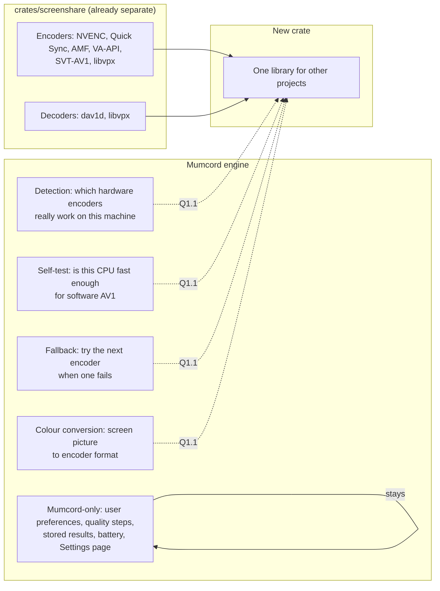

# hwcodec crate · Brainstorming

> Basis: Standalone feature, not part of the roadmap (`specs/roadmap.md`); issue #449 "Publish the hardware and software AV1/VP9 encoder code as an open-source crate". Spec number 14: 13 is the highest number in use.
> Process: We work in several rounds. Each round contains questions; you answer directly in this file.
> Once all questions are answered, `specs/14-hwcodec-crate-specification.md` is created from it.
> Already settled (not asked again):
> - **Codecs and encoders** – AV1 and VP9; hardware through NVIDIA NVENC, Intel Quick Sync (oneVPL), AMD AMF and Linux VA-API; software through SVT-AV1 and libvpx; decoding through dav1d and libvpx; no FFmpeg, no GPL parts, no H.264 (Spec 07).
> - **How the native libraries are built for Mumcord** – pinned versions, built by `scripts/build-*.sh`, cached in CI (Spec 07, section 10).
> - **Mumcord's own behaviour does not change** – which encoder a user gets, the quality steps, the Settings page and the stored detection results stay exactly as they are today. This work only moves code and makes it usable by others.
> - **Mumcord stays AGPL-3.0** – only the new crate gets a different licence (the licence itself is decided in round 2).
> - **Publishing on crates.io** – only with your explicit OK (issue #449, step 4).
> - **Precondition** – "0.7.0 has shipped and the code has run on real machines for a while" is met: 0.8.0 is released.
> - **Client only** – nothing here touches a server.

## How to answer

- **Single choice** (`◉`): Exactly **one** box has an `[x]`. To change your choice, just move the `x`.
- **Multiple choice** (`☑`): Tick as many boxes as you like.
- ⭐ marks my **recommendation**. It is already preselected. If you agree, you don't need to change anything.
- Below each question there is `✍️ Note:`. Add anything there, e.g. questions back, edge cases or "not sure, explain this to me".
- I explain technical terms briefly. For purely technical questions it's perfectly fine to follow my recommendation.

## Planned rounds

1. Functionality & scope: what the crate contains, what it promises, what stays in Mumcord
2. Technology & licence: how other projects get and build it, vendor headers, native libraries, the licence change
3. Repository, quality & release: own repository, CI, documentation, name and versions, how Mumcord switches over, acceptance criteria and open points

(The plan may change depending on the answers. There is no UI round and no audio/network round: this feature has no screens and changes nothing on the wire.)

---

## Round 1 – Functionality & scope

Where things are today. The good news first: the encoders and decoders already sit in their own crate (`crates/screenshare`, about 9,700 lines) that uses nothing else from Mumcord. The parts the issue also wants in the crate (detection, self-test, fallback) currently live in Mumcord's engine, mixed with Mumcord-only things such as the Settings page and the stored results.

### A · What goes into the crate

#### Q1.1 Which parts move into the crate, on top of the encoders and decoders? `☑`
Each ticked part has to be pulled out of Mumcord's engine and cleaned of Mumcord-only details. More parts mean more work now, but a crate that is far more useful to others: without detection, another project would have to write the hardest part again itself.

- [x] ⭐ **Detection.** Finds out which hardware encoders really work on this machine by encoding a tiny test picture with each one. This is the main reason someone would pick this crate.
- [x] ⭐ **Fallback.** "Give me the best encoder that works": tries them in order and moves on to the next one when one fails, ending with software.
- [x] ⭐ **Speed self-test for software AV1.** A short measurement that says whether this CPU is fast enough for software AV1 in real time.
- [x] ⭐ **Colour conversion.** Turns a normal screen or camera picture (BGRA) into the format the encoders need (I420). Almost every user needs it, and without it the examples would be awkward.
- [ ] Mumcord's preference rules (which codec the user chose, quality settings, battery saving). Not recommended: these are product decisions of Mumcord, and the issue lists them as "not included".

✍️ Note:

#### Q1.2 Who decides the order in which encoders are tried? `◉`
Mumcord has a fixed order per operating system today (for example on Windows: NVIDIA, then AMD, then Intel, then software).

- [x] ⭐ **The crate ships Mumcord's order as the default, and a project may pass its own order.** Works out of the box, but nobody is locked in. Mumcord keeps today's behaviour.
- [ ] Fixed order, not changeable. Simplest, but other projects with different needs cannot use the fallback.
- [ ] No default; every project must give an order. Most flexible, but harder to get started with.

✍️ Note:

#### Q1.3 Should detection explain why an encoder is not available? `◉`
Today Mumcord mostly learns "works" or "does not work". The issue's goal is to get testing on hardware we do not own; for that, outside users need to be able to tell us what went wrong.

- [x] ⭐ **Yes: a short reason per encoder, plus a small command-line example that prints the report.** For example "NVENC: driver too old", "VA-API: no AV1 support on this GPU". People can paste the output into a bug report. No personal data in it (GPU and driver names only).
- [ ] Reason per encoder, but no command-line example. Less work, but bug reports from outside get harder.
- [ ] Keep "works / does not work". No extra work.

✍️ Note:

#### Q1.4 Hardware decoding? `◉`
Today only encoding uses the graphics card. Decoding (playing a received video) runs on the CPU with dav1d and libvpx, which is fast enough for Mumcord.

- [x] ⭐ **Not in the first version.** The crate decodes in software only and says so. Hardware decoding is a large separate piece of work with no benefit for Mumcord right now.
- [ ] Later, written down as a planned extension in the README.
- [ ] In the first version. Would roughly double the work.

✍️ Note:

#### Q1.5 Other codecs (H.264, H.265)? `◉`
The hardware encoders could technically also produce H.264 and H.265. Those need patent licences in many situations; AV1 and VP9 are royalty-free. Spec 07 decided "no H.264" for Mumcord.

- [x] ⭐ **No. AV1 and VP9 only, stated as a deliberate limit in the README.** Keeps the crate free of patent questions and matches what Mumcord tests.
- [ ] Not now, but the README invites contributions for it. Risk: we would have to maintain code that Mumcord never uses.

✍️ Note:

### B · Mumcord's limits inside the code

#### Q1.6 What happens to the limits that were built in for Mumcord? `◉`
The code has a few fixed values chosen for Mumcord's screen share: at most 60 pictures per second, a fixed number of quality layers (used to send a lower frame rate to slow viewers), fixed CPU thread counts and a maximum picture size.

- [x] ⭐ **Make them settings, with today's values as defaults.** Mumcord behaves exactly as before; other projects can change them. Each setting only allows values we can actually test.
- [ ] Keep them fixed and document them. Least work, but for example a project that wants 120 pictures per second cannot use the crate.
- [ ] Only lift the 60-per-second limit and the picture size; leave the rest fixed.

✍️ Note:

#### Q1.7 What is the crate tuned for? `◉`
All encoders are set up for live video with very low delay (screen share, camera, video calls). That is different from making a video file as small and pretty as possible, where the encoder may take its time.

- [x] ⭐ **Live video only, said clearly in the description.** That is what we use and test every day. People looking for a file converter know right away it is not for them.
- [ ] Live video now, with a "file quality" mode as a later extension.
- [ ] Both in the first version. Much more to test, and nothing in Mumcord would use it.

✍️ Note:

### C · Platforms and promises

#### Q1.8 Which platforms does the crate officially support? `◉`
Mumcord runs it on Linux, Windows and macOS today. macOS has only the software encoders. FreeBSD support for Mumcord is specified in Spec 13.

- [x] ⭐ **Linux, Windows and macOS are tested automatically; FreeBSD is "best effort".** FreeBSD keeps working as far as Mumcord needs it, but we promise nothing to others because we cannot test it automatically.
- [ ] Linux, Windows and macOS only; FreeBSD not mentioned.
- [ ] All four officially supported. Needs automatic FreeBSD tests that do not exist yet.

✍️ Note:

#### Q1.9 Hardware encoding on macOS (Apple's built-in encoder)? `◉`
Apple devices have their own hardware encoder (VideoToolbox). It offers no VP9 encoding, and AV1 encoding only on the newest chips.

- [x] ⭐ **Not in the first version.** macOS stays software only, as in Mumcord today.
- [ ] Later, written down as a planned extension in the README.

✍️ Note:

#### Q1.10 What do we promise other projects about stability? `◉`
A version below 1.0 (for example 0.1.0) tells everyone "this works, but the interface may still change". A 1.0 says "we will not break you".

- [x] ⭐ **Start below 1.0.** Honest for a first release: feedback from other projects will very likely lead to changes. Breaking changes are listed in a changelog.
- [ ] Start with 1.0. Looks more mature, but every later change to the interface becomes painful.

✍️ Note:

#### Q1.11 How much support do we promise to outside users? `◉`
Publishing invites questions and bug reports, also for graphics cards we do not own.

- [x] ⭐ **Best effort, stated in the README.** We fix what affects Mumcord and what we can reproduce; for other hardware we rely on reports and contributions. A list shows which hardware was actually tested.
- [ ] No promise and no tested-hardware list. Less upkeep, but less trust.
- [ ] Active support for all reported hardware. Not realistic without the devices.

✍️ Note:

---

## Round 1 – Answers given in chat (2026-11-14)

The user asked for the questions to be put in chat instead of answering in this file. The preselected boxes above are therefore not the answers; these are:

| Question | Answer |
| --- | --- |
| Q1.1 Parts that move into the crate | Detection, fallback, speed self-test for software AV1, colour conversion (all four recommended parts). Mumcord's preference rules stay in Mumcord. |
| Q1.2 Order in which encoders are tried | The crate ships Mumcord's order as the default, and a project may pass its own order (recommended). |
| Q1.3 Reasons from detection | A short reason per encoder plus a small command-line example that prints the report (recommended). |
| Q1.4 Hardware decoding | **In the first version** (differs from the recommendation). Follow-up asked in chat: **Mumcord uses it too** when watching a screen share or camera. |
| Q1.5 Other codecs (H.264, H.265) | **Not now, but the README invites contributions** (differs from the recommendation). |
| Q1.6 Mumcord's built-in limits | Settings, with today's values as defaults (recommended). |
| Q1.7 What the crate is tuned for | **Live video and file quality, both in the first version** (differs from the recommendation). |
| Q1.8 Platforms | Linux, Windows and macOS tested automatically; FreeBSD best effort (recommended). |
| Q1.9 Hardware encoding on macOS | **Later, written down as a planned extension in the README** (differs from the recommendation). |
| Q1.10 Stability promise | Start below 1.0 (recommended). |
| Q1.11 Support promise | Best effort, with a list of tested hardware in the README (recommended). |

Consequence for the header of this file: "Mumcord's own behaviour does not change" no longer holds in full. Hardware decoding changes how Mumcord plays received video; the details are asked in round 2.

---

## Round 2 – Technology & licence (asked and answered in chat, 2026-11-14)

### Follow-ups & explanations for round 1

#### Q2.1 The "file quality" mode in the first version: what does it include? `◉`
Follow-up to Q1.7.

- [x] ⭐ **A quality preset only.** A slower "best picture per bit" setting for every encoder. The crate still only turns pictures into video data; writing a playable file (.webm, .mp4) stays the job of the project that uses it.
- [ ] Preset plus writing playable .webm files. A whole extra area to build and maintain.
- [ ] Move to later after all.

✍️ Note: Answered in chat: quality preset only.

#### Q2.2 How does Mumcord turn hardware decoding on? `◉`
Follow-up to Q1.4. A faulty graphics driver can show a broken picture without reporting an error.

- [x] ⭐ **Opt-in switch first.** A new switch in Settings, off by default and marked experimental for the first release; software decoding stays the default. It becomes the default once it has proven itself.
- [ ] On by default with an automatic test, fallback to software, and a switch to turn it off.
- [ ] On, without a switch.

✍️ Note: Answered in chat: opt-in switch first.

#### Q2.3 Which machines get hardware decoding in the first version? `◉`

- [x] ⭐ **The same as for encoding.** NVIDIA, Intel and AMD on Windows and Linux, plus Linux VA-API. macOS stays software.
- [ ] Also macOS (Apple VideoToolbox).

✍️ Note: Answered in chat: the same as for encoding.

### A · Licence

#### Q2.4 Which licence does the crate get? `◉`

- [x] ⭐ **MIT OR Apache-2.0.** The usual choice for Rust crates, as proposed in the issue.
- [ ] Apache-2.0 only.
- [ ] MPL-2.0.

✍️ Note: Answered in chat: MIT OR Apache-2.0.

#### Q2.5 One contributor besides the maintainer (Peter Heise, one fix of 11 lines) changed this code under AGPL. How is his part cleared for the new licence? `◉`

- [ ] ⭐ Ask for a written OK on issue #449.
- [ ] Rewrite those lines.
- [ ] Ask, and rewrite if there is no answer.

✍️ Note: Answered in chat with a free-text answer: "its fine for him, he is a team member". No clearing step is needed; the relicensing is agreed within the team.

#### Q2.6 How are future outside contributions licensed? `◉`

- [x] ⭐ **Under the same licence, stated in the README.** Standard Rust practice, no paperwork.
- [ ] A sign-off line per commit.
- [ ] A contributor agreement (CLA).

✍️ Note: Answered in chat: same licence, README note.

### B · Getting and building the crate

#### Q2.7 How does a project get the vendor definition files (NVIDIA, AMD, Intel, libva; all MIT)? `◉`

- [x] ⭐ **Bundled in the crate.** Hardware support works right after adding the crate; no download during the build.
- [ ] Downloaded during the build.
- [ ] The project provides them.

✍️ Note: Answered in chat: bundled in the crate.

#### Q2.8 How does a project get the software codecs (libvpx, SVT-AV1, dav1d)? `◉`

- [ ] ⭐ Installed versions by default, with an optional automatic build from source.
- [ ] Installed versions only.
- [x] **Always built automatically from source.** Works the same everywhere, but every first build takes many minutes and needs extra build tools installed.

✍️ Note: Answered in chat: always auto-build (differs from the recommendation).

---

## Round 3 – Repository, quality & release (asked and answered in chat, 2026-11-14)

#### Q3.1 Final name of the crate? `◉`
Both names were free on crates.io on 2026-11-14.

- [x] ⭐ **`hwcodec`.** As proposed on the issue; covers encoding and decoding.
- [ ] `videnc`.

✍️ Note: Answered in chat: `hwcodec`.

#### Q3.2 Where does the code live? `◉`

- [x] ⭐ **Its own public repository** (`Mumcord/hwcodec`) with its own issues, CI and releases.
- [ ] Its own repository, private at first.
- [ ] It stays in the Mumcord repository.

✍️ Note: Answered in chat: own public repository.

#### Q3.3 How is the work cut into deliveries? `◉`

- [x] ⭐ **Two phases.** Phase 1: clean up, move to the own repository, Mumcord runs on it with the same behaviour as today. Phase 2: hardware decoding, quality preset, Mumcord's new switch.
- [ ] Three phases.
- [ ] One delivery.

✍️ Note: Answered in chat: two phases.

#### Q3.4 When is the crate first published on crates.io (always only after the maintainer's explicit OK)? `◉`

- [ ] ⭐ After a Mumcord release has run on it.
- [x] **As soon as the repository is ready.** Earliest outside feedback.
- [ ] Only when everything is done.

✍️ Note: Answered in chat: as soon as the repository is ready (differs from the recommendation).

#### Q3.5 Which Mumcord milestone? `◉`

- [ ] ⭐ Phase 1 in 0.9.0, phase 2 in the milestone after.
- [x] **Both phases in 0.9.0.**
- [ ] Both after 0.9.0.

✍️ Note: Answered in chat: both in 0.9.0 (differs from the recommendation; may delay the 0.9.0 release).

#### Q3.6 On which hardware can the team test by hand? `☑`

- [ ] NVIDIA
- [ ] Intel
- [x] AMD
- [ ] Mac

✍️ Note: Answered in chat: AMD only.

#### Q3.7 How much documentation does the first release get? `◉`

- [x] ⭐ **README, API documentation and examples.** README with quick start, limits and the tested-hardware list; every public item documented; runnable examples for encoding, decoding and the detection report.
- [ ] Minimal.
- [ ] Plus a guide website.

✍️ Note: Answered in chat: README, API documentation and examples.

#### Q3.8 What happens when a build tool for the automatic codec builds is missing? `◉`

- [x] ⭐ **A clear message and an escape hatch.** The build stops and names the missing tool and how to install it. An advanced setting lets a project point at its own prebuilt libraries; Mumcord uses that to keep its pinned, cached builds.
- [ ] A clear message only.

✍️ Note: Answered in chat: clear message and escape hatch.

---

## Closing

2026-11-14: All rounds answered (in chat, recorded above). The specification has been created: `specs/14-hwcodec-crate-specification.md`.

## Round 4 – Follow-up after the closing note (asked and answered in chat, 2026-11-14)

The closing note above was written too early. While preparing the specification, a look at the code showed that Q1.4 and Q2.2 rested on an incomplete picture: Mumcord already plays received video through the web view's built-in decoder (WebCodecs), which uses the graphics card where the system supports it. Mumcord's own software decoders (dav1d, libvpx) are only the backup where WebCodecs cannot play the video, mostly on Linux. This needed one more question.

#### Q4.1 Where is the new hardware decoding used in Mumcord? `◉`

- [ ] ⭐ Only in the backup path, where Mumcord falls back to its own software decoder today.
- [ ] In the crate only, not in Mumcord.
- [x] **It replaces the built-in decoder.** Mumcord decodes received video through hwcodec.

✍️ Note: Answered in chat: replace the built-in decoder (differs from the recommendation). Read together with Q2.2 (opt-in switch, off by default, experimental): while the switch is off, Mumcord plays video exactly as today; when it is on, all received video is decoded through hwcodec and WebCodecs is not used. Making it the default is a later decision.

---

## Closing (final)

2026-11-14: All rounds including the follow-up are answered. The specification has been created: `specs/14-hwcodec-crate-specification.md`.
