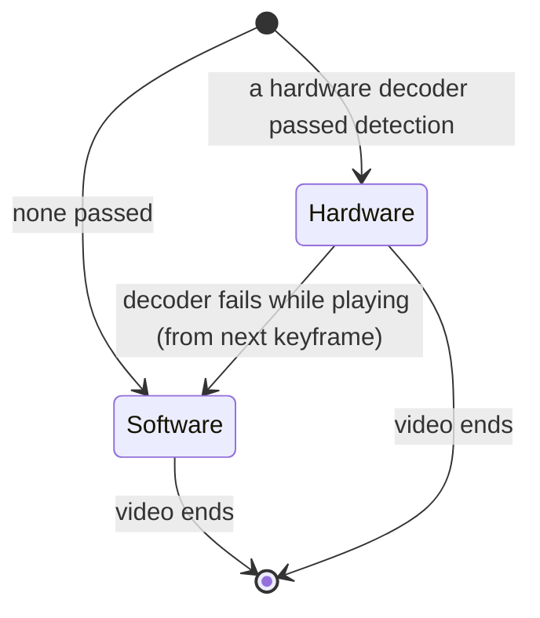

# hwcodec crate · Specification

> Status: Final (brainstorming completed) · As of: 2026-11-14
> Sources: issue #449, `specs/14-hwcodec-crate-brainstorming.md` (standalone feature, not a roadmap epic)
> Builds on: `specs/07-file-sharing-screenshare-specification.md` (encoders, detection, self-test, native libraries), `specs/08-camera-sharing-specification.md` (camera video), `specs/03-comfort-polish-specification.md` (FR-3.152, rules for published crates), `specs/13-freebsd-support-specification.md` (FreeBSD)
> Milestone and base branch: 0.9.0, `milestone/0.9.0`

## 1. Goal & context

Mumcord drives the hardware video encoders of all major vendors directly, without FFmpeg, and adds software AV1 and VP9. The Rust ecosystem has little that covers this in one place. This feature turns that code into **hwcodec**, a standalone open-source crate in its own repository, so other projects can use it and so the code gets tested on hardware the team does not own.

The crate also grows beyond what Mumcord has today: hardware decoding and a "best quality" encoder preset. Mumcord becomes the first user of the crate and gets an experimental switch that decodes received video through it.

## 2. Scope

The work is delivered in two phases, both in milestone 0.9.0. Each phase is testable and shippable on its own.

### 2.1 In scope (MVP)

**Phase 1 – extract and publish**
- One encoder and decoder interface for AV1 and VP9, hardware (NVIDIA NVENC, Intel Quick Sync via oneVPL, AMD AMF, Linux VA-API) and software (SVT-AV1, libvpx; decoding with dav1d and libvpx).
- Detection of working hardware encoders with a reason per encoder, the speed self-test for software AV1, fallback with a default order that a project can replace, and colour conversion from BGRA to I420. These move from Mumcord's engine into the crate.
- Mumcord's fixed limits become settings with today's values as defaults.
- Own public repository `Mumcord/hwcodec`, licence MIT OR Apache-2.0, CI on Linux, Windows and macOS, README, API documentation and examples.
- Vendor definition files bundled; software codec libraries built automatically from source, with an escape hatch for prebuilt libraries.
- Mumcord depends on the crate and behaves exactly as before.
- First publication on crates.io as soon as the repository is ready, after the maintainer's explicit OK.

**Phase 2 – new capabilities**
- Hardware decoding for AV1 and VP9 on the same vendor paths as encoding, with detection and fallback to software.
- A quality preset next to the live preset for every encoder.
- Mumcord: an experimental, opt-in switch that decodes all received video through hwcodec instead of the web view's built-in decoder.

### 2.2 Out of scope / later

- H.264 and H.265. The README states that the crate ships AV1 and VP9 only and invites contributions; nothing is built for them now.
- Hardware encoding and decoding on macOS (Apple VideoToolbox). Listed as a planned extension in the README; macOS stays software only.
- Writing or reading video files (.webm, .mp4). The crate turns pictures into video data and back; containers are the using project's job.
- Passing pictures to or from the encoders and decoders as graphics-card surfaces. Pictures are exchanged in normal memory.
- Mumcord-specific behaviour: the user's codec choice, quality steps, battery saving, load monitoring, relay and fan-out, storing detection results, the Settings page. These stay in Mumcord's engine.
- Making hwcodec decoding the default in Mumcord. That is a later decision once the switch has proven itself.
- Officially supported FreeBSD. It keeps working as far as Mumcord needs it (Spec 13) but is "best effort" for other users.
- A documentation website.
- A 1.0 version.

## 3. Roles & permissions

Not applicable, because the feature adds no server interaction and no permission-dependent behaviour. The new Mumcord switch is a local setting available to every user.

## 4. Functional requirements

### 4.1 Encoding (phase 1)

- **FR-14.1** The crate offers one encoder interface for AV1 and VP9 that works the same for every hardware and software encoder: configure, feed pictures, receive encoded frames with keyframe flag, layer number and timestamp, request a keyframe, change the bitrate while running.
- **FR-14.2** Hardware encoders: NVIDIA NVENC, Intel Quick Sync (oneVPL) and AMD AMF on Windows and Linux; VA-API on Linux. Software encoders: SVT-AV1 and libvpx on all platforms. Graphics drivers are loaded at run time; a machine without a matching driver reports the encoder as unavailable and never fails to start.
- **FR-14.3** The values that are fixed for Mumcord today become encoder settings: frame rate (default limit 60, accepted up to 120), number of temporal layers (the lower-frame-rate layers used for slow viewers; default as today, a single layer allowed), CPU thread count (default automatic as today) and the maximum picture size. Defaults are exactly today's values. A value an encoder cannot honour is rejected with a clear error when the encoder is opened, not silently changed.
- **FR-14.4** Colour conversion from BGRA (the usual screen and camera picture) to I420 (the encoder input) and from I420 to RGBA (for display) is part of the crate.

### 4.2 Detection, self-test and fallback (phase 1)

- **FR-14.5** Detection: for a given codec the crate tests each hardware encoder by encoding a small test picture and reports per encoder "works" or "does not work".
- **FR-14.6** Each "does not work" carries a short reason from a fixed list (not available on this operating system, driver not found, driver too old, device does not support this codec, opening failed, test encode failed) plus the driver's own error text. The report names the graphics device and driver version where the driver provides them, and contains nothing else about the machine or user.
- **FR-14.7** Speed self-test: the crate measures for a given resolution and frame rate whether software AV1 runs in real time on this CPU and returns the measured share of the time budget. The pass threshold of Spec 07 (FR-7.56, under 50 %) is the default and can be changed.
- **FR-14.8** Fallback: "open the best working encoder" tries the encoders in order and moves on when one fails, ending with software. The crate ships Mumcord's order per operating system (FR-7.53) as the default; a project may pass its own order.
- **FR-14.9** The crate stores nothing. Remembering detection and self-test results between runs is the using project's job (Mumcord keeps doing this in its own store).
- **FR-14.10** A command-line example prints the full detection report for both codecs so that users can paste it into a bug report.

### 4.3 Decoding (phase 1: software, phase 2: hardware)

- **FR-14.11** Software decoding of AV1 (dav1d) and VP9 (libvpx) behind one decoder interface, as today.
- **FR-14.12** Hardware decoding of AV1 and VP9 through NVIDIA, Intel Quick Sync and AMD on Windows and Linux and through VA-API on Linux. Decoded pictures come out in the same form as from the software decoders.
- **FR-14.13** Decoder detection: each hardware decoder is tested by decoding a short built-in test stream and comparing the result with the expected picture, so that a driver that returns a broken picture without an error counts as "does not work". Reasons are reported as in FR-14.6.
- **FR-14.14** Decoder fallback: "open the best working decoder" follows the same rules as FR-14.8 and ends with software. If a hardware decoder fails while running, the crate reports the failure; the caller can continue with a software decoder from the next keyframe.

### 4.4 Quality preset (phase 2)

- **FR-14.15** Every encoder accepts a preset: **live** (default; today's low-delay behaviour, unchanged) or **quality** (best picture for the given bitrate; the encoder may be slower than real time and may return frames with a delay). Ending the stream returns all frames still held back.
- **FR-14.16** The quality preset only changes encoder tuning. Its output is ordinary AV1 or VP9 data that every decoder of the crate plays.

### 4.5 Mumcord (phase 1: move, phase 2: switch)

- **FR-14.17** Mumcord's engine uses hwcodec for all encoding, decoding, detection, self-test, fallback and colour conversion. `crates/screenshare` and the moved engine code are removed from the Mumcord repository; no copy stays behind.
- **FR-14.18** After phase 1 Mumcord behaves exactly as before: same encoder choice (FR-7.53 to FR-7.58), same quality, same Settings page, same stored results, same test hooks, and the same data on the wire.
- **FR-14.19** Phase 2 adds the setting **Hardware video decoding (experimental)**, off by default. Off: received video plays exactly as today (web view decoder, software backup). On: every received screen share and camera video is decoded in the engine through hwcodec, by a hardware decoder if one passed detection and by the crate's software decoder otherwise; the web view decoder is not used.
- **FR-14.20** With the switch on, Settings shows which decoder is in use per codec ("AV1: AMD (hardware)", "VP9: software") and, for decoders that did not pass, the reason from FR-14.13. "Check again" re-runs the detection, as for encoders.
- **FR-14.21** If the hardware decoder fails during playback, Mumcord continues with the software decoder from the next keyframe (requesting one from the sharer), shows no error dialog, and logs the reason. The video never stays frozen or black because of a decoder failure.
- **FR-14.22** Changing the switch applies to video that starts afterwards; a running video keeps its decoder until it is restarted.

## 5. UI & UX

Only phase 2 changes the UI: one switch and one status block in the Settings section that already holds the screen share encoder choice and encoder status (Spec 07).

```text
┌ Settings · Screen share ─────────────────────────────────────┐
│ Encoder            [ Automatic            ▾ ]                │
│ Encoder status     AV1: AMD (hardware) · VP9: software       │
│                                                              │
│ Hardware video decoding (experimental)              [ off ]  │
│   Decodes received video with the graphics card instead of   │
│   the built-in player. Turn it off if the picture looks      │
│   wrong.                                                     │
│   ── shown only when on ──────────────────────────────────   │
│   AV1: AMD (hardware)                                        │
│   VP9: software (AMD: device does not support this codec)    │
│                                              [ Check again ] │
└──────────────────────────────────────────────────────────────┘
```

- The switch is keyboard operable and has a screen-reader label including "experimental"; the status lines are announced as text.
- No new dialogs, hotkeys or tray entries. While detection runs, the status block shows "Checking…".
- Dark and light screenshots of the changed section are committed and embedded in the pull request, as for every UI change.

## 6. Audio & network

Not applicable, because nothing changes on the wire: codecs, packet format, codec negotiation and relay behaviour stay as specified in Spec 07 and Spec 08, and audio is not touched.

## 7. Data & state model

- **hwcodec** stores nothing (FR-14.9).
- **Mumcord** gains two entries in its existing settings and cache storage:

| Entry | Type | Required | Rules |
| --- | --- | --- | --- |
| Hardware video decoding | on/off | yes | Default off. |
| Decoder detection results | per codec and decoder: works / reason | no | Cached like the encoder results; re-run after a Mumcord update or "Check again". |

Decoder choice per received video (phase 2, switch on):



## 8. Technology & architecture

- **Name and place:** crate `hwcodec` in the public repository `Mumcord/hwcodec`. The repository starts with a fresh history whose first commit names the Mumcord commit it was taken from, so that no AGPL-marked history is published under the new licence.
- **Licence:** MIT OR Apache-2.0. The relicensing of the existing code is agreed within the team (both authors of the code are team members). The README states that contributions are accepted under the same licence. Mumcord stays AGPL-3.0.
- **Rust:** edition 2024, minimum Rust version 1.90, the lint and documentation rules of FR-3.152 (`missing_docs`, documented `unsafe`, `#[non_exhaustive]` on public enums and settings so that additions do not break users).
- **Version:** starts at 0.1.0. Interface changes are allowed below 1.0 and are listed in the crate's CHANGELOG. Phase 2 is released as 0.2.0.
- **Vendor definition files** (NVIDIA, AMD, Intel, libva; all MIT) are bundled in the crate, so hardware support builds without extra steps and without downloads.
- **Software codec libraries** (libvpx, SVT-AV1, dav1d) and the Intel dispatcher library are always built from bundled, pinned sources during the build. No network access during a build. If a build tool is missing, the build stops with a message that names the tool and how to install it.
- **Escape hatch:** a project can point the build at its own prebuilt libraries instead. Mumcord uses this to keep its pinned, CI-cached builds (`scripts/build-*.sh`, Spec 07 section 10), so Mumcord's build times do not grow.
- **Optional parts:** each hardware vendor and each software codec can be switched off at build time, so a project only builds what it uses. Everything is on by default.
- **Diagnostics:** the crate reports through return values and the standard Rust logging interface; it never prints on its own and never logs picture content.
- **Mumcord module split:** the engine keeps everything listed as Mumcord-specific in section 2.2 and calls the crate for the rest. The engine's debug-only test hooks (forced detection results, artificial delay) stay in the engine and wrap the crate's results.
- **Mumcord playback path with the switch on:** the engine decodes and hands finished pictures to the UI through the path that the software backup already uses today (Spec 07, AC-7.41).

## 9. Non-functional requirements

- **Real-time safety:** the live preset keeps today's encode times; the move must not make any encoder slower.
- **Robustness:** a missing, old or faulty graphics driver must never crash the using program; it leads to "does not work" with a reason and to fallback.
- **Privacy:** detection reports and logs contain graphics device and driver names only. No user data, no picture content.
- **Platforms:** Linux, Windows and macOS are tested automatically. FreeBSD is best effort. macOS is software only.
- **Support promise (README):** best effort. The README carries a table of hardware that was actually tested, with operating system, driver version and date; everything else is marked "untested, reports welcome".
- **Playback performance in Mumcord (switch on):** a 1080p, 30 pictures per second share must play smoothly on the team's AMD test machine; CPU use and dropped pictures are measured against the built-in decoder and recorded in the pull request.

## 10. Build, packaging & release

- **hwcodec CI** on Linux, Windows and macOS for every pull request: formatting, lints, tests (software round trips and the mocked-driver tests; no real graphics card needed), documentation build, examples build, licence check of dependencies, and a packaging dry run.
- **hwcodec release:** version tag in the hwcodec repository, CHANGELOG entry, publication on crates.io. Every publication, including the first, happens only after the maintainer's explicit OK. The crates.io token exists only as a CI secret.
- **First publication:** as soon as the repository is ready (phase 1 complete in the hwcodec repository and its CI green). Mumcord then switches to the published version.
- **One-time setup:** create the public repository `Mumcord/hwcodec` (needs the maintainer's OK when it happens), CI secret for crates.io.
- **Mumcord:** `CHANGELOG.md` entries for both phases; third-party notices list hwcodec with its licence and keep the entries of the native libraries; installers do not grow in phase 1. E2E tests stay green without changes in phase 1.
- **Test server:** the Mumcord acceptance criteria run against the local test server as usual.

## 11. Acceptance criteria (verifiable in the running client)

**Phase 1 – crate**
- **AC-14.1** On a fresh Linux, Windows and macOS CI machine with only the documented build tools, a new empty project that adds hwcodec builds and its software encode/decode example produces and replays AV1 and VP9 without any manual download or script.
- **AC-14.2** With one build tool removed, the build stops with a message naming that tool and how to install it.
- **AC-14.3** The detection example, run on the AMD test machine, lists AMD (and VA-API on Linux) as working for the codecs the card supports and gives a reason from FR-14.6 for every other encoder. Run in CI without a graphics card, it lists every hardware encoder as not working with a reason and exits without error.
- **AC-14.4** "Open the best working encoder" returns the AMD hardware encoder on the AMD test machine and a software encoder on a CI machine; with a custom order that puts software first it returns software on both.
- **AC-14.5** An encoder opened with a frame rate of 120 and a single layer produces a stream the crate's decoder plays; a value outside the allowed range is rejected with a clear error.
- **AC-14.6** The hwcodec repository is public, shows MIT OR Apache-2.0, has a README with quick start, limits, planned extensions (macOS hardware), the note on H.264/H.265 contributions, the contribution licence sentence and the tested-hardware table; the API documentation builds without missing-documentation warnings.

**Phase 1 – Mumcord**
- **AC-14.7** `crates/screenshare` no longer exists in the Mumcord repository and the engine uses hwcodec; build, tests, lints and E2E are green.
- **AC-14.8** Two clients on the local test server, sharer on the AMD test machine: starting a screen share with "Automatic" uses the same encoder as before the change (shown in Settings' encoder status and the viewer header) and the viewer sees the picture. The same with the codec set to VP9.
- **AC-14.9** With the debug hook that forces all hardware encoders to fail, the share starts with a software encoder and Settings shows the same status text as before the change.
- **AC-14.10** A camera share between the two clients works as before.
- **AC-14.11** Settings' "Check again" re-runs detection and the software AV1 self-test and shows results as before.

**Phase 2 – crate**
- **AC-14.12** On the AMD test machine the decode example plays an AV1 and a VP9 stream with the hardware decoder and reports which decoder was used; in CI it falls back to software and plays the same streams.
- **AC-14.13** A mocked driver that returns a wrong picture for the test stream is reported as "does not work".
- **AC-14.14** A clip encoded with the quality preset is smaller or better in measured picture quality at the same bitrate than the same clip with the live preset, for software AV1 and for the AMD encoder, and decodes correctly. The numbers are recorded in the pull request.

**Phase 2 – Mumcord**
- **AC-14.15** With the switch off, a received screen share plays through the built-in decoder exactly as before.
- **AC-14.16** With the switch on, on the AMD test machine, a 1080p share from a second client on the local test server plays smoothly; Settings shows "AMD (hardware)" for the codec in use.
- **AC-14.17** With the switch on and the debug hook that forces hardware decoders to fail, the share plays with the software decoder and Settings shows the reason.
- **AC-14.18** With the switch on and a hardware decoder failure injected during playback, the picture continues within a few seconds without an error dialog.
- **AC-14.19** The switch is reachable and operable by keyboard, is read out with "experimental", and looks correct in dark and light theme (screenshots in the pull request).

## 12. Decision log

| Question | Decision | Note |
|---|---|---|
| Q1.1 | Detection, fallback, AV1 speed self-test and colour conversion move into the crate | Mumcord's preference rules stay in Mumcord |
| Q1.2 | Default order from Mumcord, replaceable by the project | |
| Q1.3 | Reason per encoder plus a command-line example | |
| Q1.4 | Hardware decoding in the first version | Against the recommendation; delivered in phase 2 |
| Q1.5 | AV1 and VP9 only; README invites H.264/H.265 contributions | Nothing built now |
| Q1.6 | Limits become settings with today's defaults | |
| Q1.7 | Live and quality tuning in the first version | Against the recommendation; narrowed by Q2.1 |
| Q1.8 | Linux, Windows, macOS tested; FreeBSD best effort | |
| Q1.9 | macOS hardware later, noted in the README | |
| Q1.10 | Start below 1.0 | |
| Q1.11 | Best effort with a tested-hardware table | |
| Q2.1 | Quality preset only, no file writing | |
| Q2.2 | Mumcord: opt-in switch, off by default, experimental | |
| Q2.3 | Hardware decoding on the same vendor paths as encoding | macOS software |
| Q2.4 | MIT OR Apache-2.0 | |
| Q2.5 | No clearing step | The second author is a team member and agrees |
| Q2.6 | Contributions under the same licence, README note | |
| Q2.7 | Vendor definition files bundled | |
| Q2.8 | Software codec libraries always built automatically | Against the recommendation |
| Q3.1 | Name `hwcodec` | Free on crates.io on 2026-11-14 |
| Q3.2 | Own public repository | |
| Q3.3 | Two phases | |
| Q3.4 | First publication as soon as the repository is ready | Against the recommendation; still needs the maintainer's OK |
| Q3.5 | Both phases in 0.9.0 | Against the recommendation |
| Q3.6 | Manual test hardware: AMD only | |
| Q3.7 | README, API documentation, examples | |
| Q3.8 | Clear message plus escape hatch for prebuilt libraries | Mumcord uses the escape hatch |
| Q4.1 | hwcodec decoding replaces the built-in decoder when the switch is on | Against the recommendation; read together with Q2.2 |

## 13. Open points & risks

- **Only AMD can be tested by hand.** NVIDIA and Intel encoding and all NVIDIA and Intel decoding are covered by mocked-driver tests only and are listed as "untested" in the README until outside reports arrive. Hardware decoding for those vendors may not work on first release. Owner: maintainer, to decide whether test hardware is borrowed or bought.
- **Operating system of the AMD test machine** is not recorded. The acceptance criteria that name it run on that system; the other system (Windows or Linux) stays untested for AMD. Owner: maintainer.
- **Replacing the built-in decoder may be slower.** The built-in decoder shows pictures without copying them through the engine; the hwcodec path copies every picture. This is why the switch is off by default and why section 9 requires a measurement. If the measurement is poor, the switch stays experimental.
- **Package size on crates.io.** crates.io limits a package to 10 MB, and the bundled codec sources may exceed that. If so, the sources go into companion crates published alongside hwcodec; their names are chosen and reserved during implementation.
- **Automatic builds on Windows** need several build tools on the user's machine. First builds take many minutes on every platform. The README must say so prominently.
- **Early publication.** 0.1.0 goes out before a Mumcord release has run on the moved code, so quick follow-up versions are likely.
- **0.9.0 schedule.** Hardware decoding for four vendors and the quality preset are large; putting both phases into 0.9.0 can delay that release.
- **Creating the public repository and publishing** are outward-facing, hard-to-undo steps and each need the maintainer's OK at the time.

## 14. Impact on the roadmap

- `specs/roadmap.md` needs a row for this spec in its spec index (not changed here).
- Milestone 0.9.0 grows by both phases of this work.
- Mumcord gains an external dependency that the team maintains in a second repository; fixes to encoders and decoders from now on are made there and reach Mumcord through a version bump.
