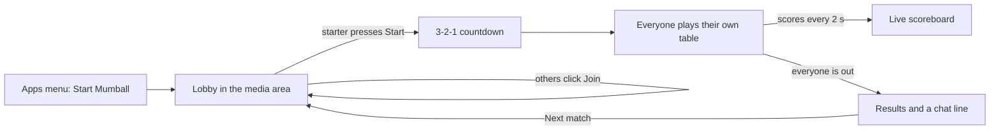
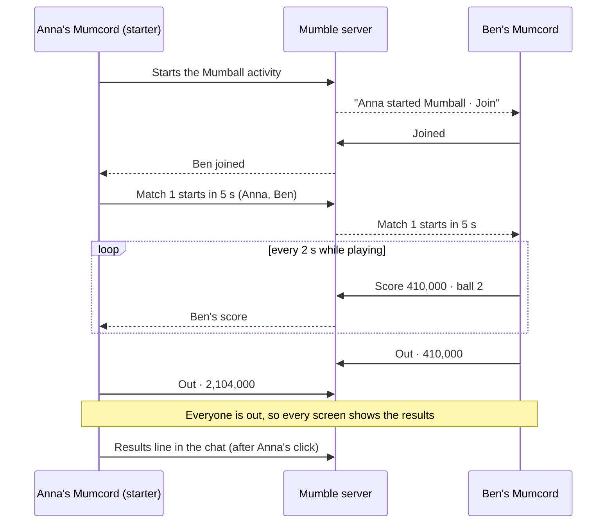
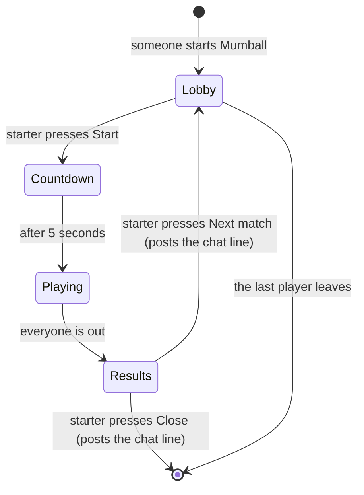
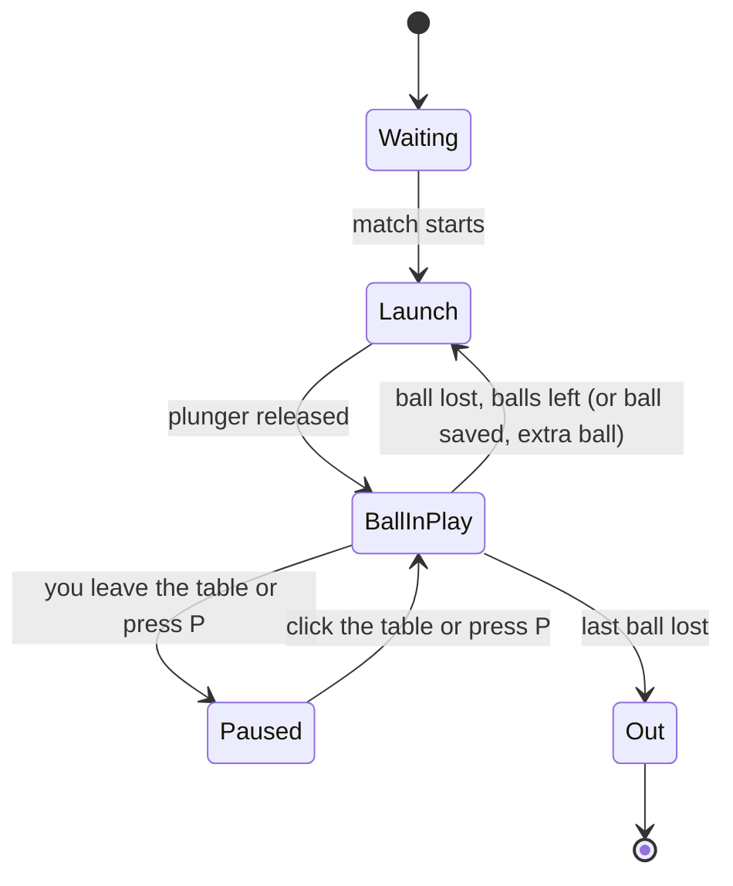

# 14 – Pinball plugin (working title) · Brainstorming

> Basis: Standalone feature, not part of the roadmap. A new game plugin for Mumcord, in the spirit of the official game Skyloom (#394).
> Process: We work in several rounds. Each round contains questions; you answer directly in this file.
> Once all questions are answered, `specs/14-pinball-plugin-specification.md` is created from it.
> Already settled (not asked again):
> - Plugin platform and its limits → Spec 06 (plugin system, sandbox, message limits), Spec 09 (API 1.1: activities in the media area, own web pages, relay data, sound effects, the gesture rule), Spec 13 (API 1.2: theme tokens and UI kit for plugin pages)
> - Client only: works against an unmodified standard Mumble server, nothing is installed or changed on the server → `CLAUDE.md`
> - No content from the old Windows game (3D Pinball for Windows – Space Cadet) → decided in chat on 2026-11-09, see A below

## How to answer

- **Single choice** (`◉`): Exactly **one** box has an `[x]`. To change your choice, just move the `x`.
- **Multiple choice** (`☑`): Tick as many boxes as you like.
- ⭐ marks my **recommendation**. It is already preselected. If you agree, you don't need to change anything.
- Below each question there is `✍️ Note:`. Add anything there, e.g. questions back, edge cases or "not sure, explain this to me".
- I explain technical terms briefly. For purely technical questions it's perfectly fine to follow my recommendation.

## Planned rounds

1. Game & scope: theme, name, how you play together, rules, highscores, where it lives
2. Table, look & screens: layout in the media area, lobby, scoreboard, results, controls, dark and light, with wireframes
3. Sound, voice & multiplayer data: sound effects under voice, push-to-talk keys, how scores travel, chat lines for standard Mumble users
4. Technology & quality: plugin API version, physics, frame rate, package size, languages, accessibility, tests
5. Game state model & open points

(The plan may change depending on the answers.)

---

## Round 1 – Game & scope

The wish was "the old Windows pinball as a plugin". That game can't be used (see A). This round decides what our own pinball game is: its theme and name, how friends in a voice channel play it together, what's on the table and what counts as a highscore.

### A · Our own game, not a copy

Decided in chat on 2026-11-09: the old Windows game (3D Pinball for Windows – Space Cadet) can't be used. Its table, art, sounds and code belong to Microsoft, the plugin review requires an open-source licence, and a plugin can't load the original game files from the user's computer. So this is a **new, original pinball game**: the same kind of fun (flippers, bumpers, ramps, missions), but its own name, table, art and sounds. To keep a clear distance there is no space or sci-fi theme and no name that echoes the original ("Space", "Cadet", "Full Tilt").

#### Q1.1 Which theme should the table have? `◉`
The theme decides the look, the sounds and the names of the missions.

- [x] ⭐ **Radio station "On Air".** Microphones as bumpers, a frequency dial as spinner, a glowing ON AIR lamp, missions like "Tune in", "Request hour" and "Go live". It fits a voice chat app and is clearly its own thing.
- [ ] Deep sea. A submarine, sonar pings, sunken treasure. Calm colours, works well in dark mode.
- [ ] Night carnival. Ferris wheel, ring toss, fireworks. Bright and loud, needs more visual effects.
- [ ] Haunted manor. A classic pinball theme; fun, but many existing tables use it already.

✍️ Note:

#### Q1.2 What should the game be called? `◉`

- [x] ⭐ **"Mumball" as the working name.** Short, sounds like part of the Mumcord family and fits any theme. A quick name check (trademarks, app stores) happens before the release.
- [ ] A name taken from the theme (e.g. "On Air" for the radio table), decided in round 2 together with the look.

✍️ Note:

### B · Playing together in the voice channel

A pinball game in Mumcord runs as an **activity** in the media area of your voice channel. Others in the channel who have the plugin see "Anna started Mumball · Join" and join with one click; nobody is pulled in automatically.

#### Q1.3 How do friends play together? `◉`

```text
┌ Media area ───────────────────────────────────────────┐
│            ┌───────────────┐    Match · ball 2 of 3   │
│            │   your own    │    1. Anna    1,204,000  │
│            │    table      │    2. You       880,500  │
│            │       ●       │    3. Ben       410,000  │
│            │   ╲       ╱   │       (Ben: last ball)   │
│            └───────────────┘                          │
└───────────────────────────────────────────────────────┘
```



- [x] ⭐ **Match: everyone plays at the same time, each on their own table.** A live scoreboard shows everyone's score, and the ranking appears at the end. Only scores are sent between players, so it works on every Mumble server without any extra service.
- [ ] Taking turns, like an arcade machine: one player plays, the others watch live. Watching live needs the optional relay, and with many players the waits get long. Later.
- [ ] Solo only: everyone plays alone, no matches. Simplest, but there is little reason to play it in a voice channel.

✍️ Note:

#### Q1.4 How long is a match? `◉`

- [x] ⭐ **Classic: 3 balls each.** Everyone knows it; a match takes about 3–8 minutes. Whoever is out early watches the scoreboard and cheers the others on.
- [ ] Sprint: 3 minutes with unlimited balls; every lost ball costs points. Everyone finishes at the same moment.
- [ ] Both, chosen in the lobby. More rules to build and test. Later.

✍️ Note:

#### Q1.5 How many players can be in one match? `◉`

- [x] ⭐ **Up to 8.** The scoreboard stays readable, and the data is far below Mumble's limits.
- [ ] Up to 16, the most the plugin platform allows for one activity.
- [ ] Up to 4, like a classic pinball machine.

✍️ Note:

#### Q1.6 What happens when someone joins while a match is running? `◉`

- [x] ⭐ **They join the next match.** Until then they watch the live scoreboard.
- [ ] They start their own game right away. Their score counts on the "Tonight" board (Q1.9), not in the running match.

✍️ Note:

#### Q1.7 Can you play alone? `◉`

- [x] ⭐ **Yes, as a match with just you.** Same flow; anyone in the channel can still join the lobby before you press Start. Your personal best counts.
- [ ] Also a private practice mode that tells nobody in the channel. Later.

✍️ Note:

### C · Table & rules

#### Q1.8 What should be on the first table? `☑`
Pinball terms in short: *bumpers* are round posts that kick the ball away, *slingshots* are the rubber triangles above the flippers, *drop targets* are small plates that fall down when hit, *rollover lanes* light a letter when the ball rolls through, an *orbit* is a loop around the top of the table, *ball save* gives the ball back if it drains right after launch, *nudge* is bumping the table, and *tilt* ends the ball when you bump too often.

- [x] ⭐ Two flippers and a plunger with a skill shot (a bonus for launching with just the right strength)
- [x] ⭐ Bumpers and slingshots
- [x] ⭐ Drop targets and rollover lanes that spell a word (e.g. O-N-A-I-R)
- [x] ⭐ One ramp and one orbit
- [x] ⭐ 3–4 missions that light up one after another, each with a big bonus
- [x] ⭐ Ball save, bonus multiplier and extra ball
- [x] ⭐ Nudge and tilt
- [ ] Multiball (2–3 balls at once). Later.
- [ ] A third, small flipper at the top. Later.
- [ ] Several tables to choose from. Later.

✍️ Note:

#### Q1.9 Which highscores should there be? `☑`
An all-time highscore list for the whole server isn't possible: it would need something stored on the server, and Mumcord never requires anything there.

- [x] ⭐ Personal best on your own computer (your top 10)
- [x] ⭐ "Tonight" board: the best scores in this channel while the activity is running
- [x] ⭐ A results line in the chat after each match, so it stays in the chat history and standard Mumble users see it too
- [ ] None, only the ranking of the current match

✍️ Note:

#### Q1.10 Should scores be checked against cheating? `◉`
Each player's Mumcord reports its own score. Cheating would need a modified Mumcord or plugin.

- [x] ⭐ **Trust the scores.** It's a friendly game among people who talk to each other; nothing is won.
- [ ] Verified scores: every Mumcord replays the others' games from their recorded button presses and checks the score. A lot more work and data. Later.

✍️ Note:

### D · Where the plugin lives

#### Q1.11 Official plugin or community plugin? `◉`

- [x] ⭐ **Official plugin in `Mumcord/plugins`**, like Skyloom and Whiteboard. It is reviewed and shown as "Official · reviewed"; it needs all 24 languages, tests in a real Mumcord, and a maintainer's yes (best asked early with an issue like #394). The package may be up to 64 MiB, plenty for art and sounds.
- [ ] Community plugin in its own repository. Faster to publish and English only, but shown as "Unofficial" with a security score, and the package may be at most 5 MiB.

✍️ Note:

---

## Round 2 – Table, look & screens

Round 1 was answered in chat on 2026-11-09: all recommendations taken (the preselected boxes stand). So: radio-station table "On Air", working name Mumball, matches where everyone plays their own table at the same time, 3 balls, up to 8 players, official plugin.

This round decides what you see and how you play: where the game appears, how the screens are laid out, the visual style in dark and light, and the keys.

Mumcord itself always draws a header above the game: the plugin's icon and name, "Started by Anna · 3 in the game", the connection chip, and the buttons Pop out, Full screen and Leave. The game only fills the area below it.

### A · Where you play

#### Q2.1 Where can the game be shown? `◉`
A pinball table is tall and narrow. The media area is wide, can be resized, popped out into its own window and switched to full screen. The side panel next to the chat is only 18–32 rem wide (about 290–510 pixels), which makes a table small.

- [x] ⭐ **Media area only.** Plenty of room, and Pop out and Full screen come for free.
- [ ] Media area, plus the side panel for playing while the chat stays visible. The table gets small. Later.

✍️ Note:

### B · Screens

#### Q2.2 How is the play screen laid out? `◉`

Layout A: table and scoreboard side by side.

```text
┌ Mumball · Started by Anna · 3 in the game     Pop out  Full screen  Leave ┐  ← Mumcord
│   ┌────────────────────────┐   ┌────────────────────────────────┐        │
│   │ [ON AIR]  ticker:      │   │ MATCH · 3 balls                │        │
│   │ "Mission: Tune in"     │   │ 1. Anna   1,204,000   ball 3   │        │
│   │                        │   │ 2. You      880,500   ball 2   │        │
│   │    (o)   (o)   (o)     │   │ 3. Ben      410,000   out      │        │
│   │       bumpers          │   ├────────────────────────────────┤        │
│   │  ╲ ramp        orbit ╱ │   │ Ball 2 · bonus ×3              │        │
│   │           ●            │   │ Your best 1,950,000            │        │
│   │   ▷              ◁     │   └────────────────────────────────┘        │
│   │     ╲__        __╱     │                                             │
│   └────────────────────────┘                                             │
└──────────────────────────────────────────────────────────────────────────┘
```

Layout B: a score strip above the table, for a narrow media area.

```text
┌ Mumball · …                     Leave ┐
│ Anna 1.2M · You 880k · Ben 410k · B2  │
│ ┌───────────────────────────────────┐ │
│ │            (table)                │ │
│ │                                   │ │
│ └───────────────────────────────────┘ │
└───────────────────────────────────────┘
```

- [x] ⭐ **Layout A, switching to Layout B on its own when the media area is narrow.** The table always keeps its shape and is scaled to fit.
- [ ] Layout A only. In a narrow area the table just gets smaller.
- [ ] Layout B only. Simple, but the scoreboard is cramped with 8 players.

✍️ Note:

#### Q2.3 What is in the lobby? `☑`

```text
┌ Mumball · Started by Anna · 3 in the game                          Leave ┐
│   MUMBALL · ON AIR                                                       │
│   Players (3 of 8)                 Tonight in #Lounge                    │
│    • Anna (starter)                 1. Ben    2,310,000                  │
│    • You                            2. Anna   1,980,000                  │
│    • Ben                           Your best: 1,950,000                  │
│                                                                          │
│   Keys: Left Shift / ← left flipper · Right Shift / → right flipper ·    │
│         hold Space = plunger · ↑ nudge · P pause                         │
│                                                                          │
│                [ Start match ]          ← only Anna sees this            │
│         Waiting for Anna to start…      ← everyone else sees this        │
└──────────────────────────────────────────────────────────────────────────┘
```

- [x] ⭐ The list of players who joined
- [x] ⭐ A Start button for the starter only; everyone else sees "Waiting for Anna to start…"
- [x] ⭐ A short card with the keys
- [x] ⭐ The "Tonight" board and your personal best
- [ ] A "Ready" check: the match starts only when everyone pressed Ready. Later.
- [ ] A demo of the table playing itself in the background ("attract mode"). Later.

✍️ Note:

#### Q2.4 What do you see when your last ball is gone but others still play? `◉`

- [x] ⭐ **Your final score and the scoreboard, shown bigger**, with each player's ball and whether they are still playing. You can talk and cheer while you wait.
- [ ] Watch another player's table live. Needs the optional relay to look smooth. Later.

✍️ Note:

#### Q2.5 What is on the results screen? `☑`

```text
│   RESULTS · Match 2                                        │
│    1. Anna   2,104,000                                     │
│    2. You    1,990,000   ★ New personal best               │
│    3. Ben      410,000                                     │
│          [ Next match ]  ← starter        [ Leave ]        │
```

- [x] ⭐ The ranking with every score
- [x] ⭐ "New personal best" when you beat your own best
- [x] ⭐ "Next match" for the starter, which takes everyone back to the lobby
- [ ] Small honours, e.g. "Longest ball" or "Most missions". Later.

✍️ Note:

### C · Look

#### Q2.6 Which visual style? `◉`

- [x] ⭐ **Flat 2D, seen from straight above, illustrated** like a poster of a 1970s radio studio: wood panels, chrome knobs, glowing lamps. It stays sharp at any size, dark and light versions are easy, and the package stays small.
- [ ] 2.5D, slightly tilted and shaded like 1990s PC pinball. Closest to the old feel, but much more art work, a bigger package, and it must still look clearly different from the old Windows game.
- [ ] Pixel art. Charming and small, but it looks blurry or blocky at many window sizes.

✍️ Note:

#### Q2.7 How does the table follow dark and light mode? `◉`

- [x] ⭐ **Two palettes that follow Mumcord's theme.** Dark: "late-night studio" (deep navy, warm amber lamps, a red ON AIR glow). Light: "daytime studio" (cream, teal and the colours of an old radio). Scoreboard, lobby and buttons use Mumcord's own look.
- [ ] The table always stays dark (pinball tables glow best in the dark); only scoreboard, lobby and buttons follow the theme.

✍️ Note:

#### Q2.8 Which effects should the table have? `☑`
One rule applies anyway and is not up for choice: nothing flashes more than 3 times per second, so the game is safe for people with photosensitive epilepsy.

- [x] ⭐ Lamps that light up and blink in patterns
- [x] ⭐ Points that pop up where the ball hits
- [x] ⭐ An LED ticker at the top of the table, like a radio display ("NOW PLAYING: Mission Tune in", "BALL SAVED")
- [x] ⭐ A short shake of the table on big hits and when you nudge; switched off when "reduce motion" is on in the system
- [ ] Animated scenes on the ticker between missions. Later.

✍️ Note:

### D · Controls

#### Q2.9 How do you control the game? `☑`

- [x] ⭐ Keyboard
- [ ] Mouse buttons for the flippers. Mumcord also lets people use mouse buttons for push-to-talk, so this clashes (round 3). Later.
- [ ] Game controller. Later.

✍️ Note:

#### Q2.10 Which keys? `◉`

| Action | Keys |
|---|---|
| Left flipper | Left Shift or ← |
| Right flipper | Right Shift or → |
| Plunger | hold Space or ↓, release to launch |
| Nudge | ↑ |
| Pause | P |

- [x] ⭐ **As in the table.** Both sets work at the same time, so everyone finds a comfortable grip.
- [ ] Letter keys instead: Z and M for the flippers, Space for the plunger, X to nudge.

✍️ Note:

#### Q2.11 What happens when you leave the table with the keyboard or mouse? `◉`
Mumcord always takes the keyboard back with Esc or F6, and you may click into the chat at any time. The game only gets key presses while it has the focus.

- [x] ⭐ **Your game pauses on its own** and shows "Paused · click the table or press P to go on". In a match only your own table pauses; the others play on.
- [ ] The ball keeps rolling. Pinball-honest, but one click into the chat can cost you a ball.

✍️ Note:

---

## Round 3 – Sound, voice & multiplayer data

Round 2 was answered in chat on 2026-11-09: all recommendations taken (the preselected boxes stand). So: media area only, Layout A with automatic switch to B, flat 2D radio-studio look with dark and light palettes, keyboard with Shift/arrow keys, automatic pause when you leave the table.

This round covers what you hear, how the game gets along with talking, and what travels between the players' Mumcords.

### A · Sound

Platform rules that apply anyway: game sounds play only on your own computer and are never sent to anyone; they are muted while you are deafened; each sound is at most 10 seconds long.

#### Q3.1 Which sounds should the game have? `☑`

- [x] ⭐ Table sounds: flipper clack, bumper pops, targets, ramp, launch, and the ball draining
- [x] ⭐ Short jingles (at most 2 seconds) for mission complete, extra ball and ball saved, in a radio-jingle style
- [ ] Background music. It would compete with people talking. Later, as an option that is off by default.
- [ ] Spoken announcements ("Mission complete!"). They compete with real voices and need recordings in 24 languages. Not planned.

✍️ Note:

#### Q3.2 How loud is the game next to people talking? `◉`

- [x] ⭐ **Quieter while anyone talks, plus its own volume and mute.** Game sounds drop clearly while someone speaks, so voices always win. The game has its own volume slider (default 40 %) and a mute button in the lobby and on the scoreboard.
- [ ] Game sounds go completely silent while anyone talks. Voices are perfectly clear, but the game feels dead in a chatty channel.
- [ ] Always the same volume. Pinball at full blast, voices get harder to hear.

✍️ Note:

### B · Talking while playing

#### Q3.3 What if a game key is also someone's push-to-talk key? `◉`
Mumcord's push-to-talk works everywhere, also while you play. If someone uses, say, Space for push-to-talk, every launch would also open their microphone.

- [x] ⭐ **Both key sets (Shift and arrows) cover it, plus a hint in the lobby:** "If one of these keys is your push-to-talk key, use the other one." Changing the game's keys yourself comes later.
- [ ] Changing the game's keys yourself, right from the start. More screens and settings to build and translate.

✍️ Note:

#### Q3.4 Should the scoreboard show who is talking? `◉`

- [x] ⭐ **Yes, a small speaker glow next to the name of whoever is talking.** You see who is cheering or groaning without looking away from the table. Needs the optional "voice activity" permission; without it the glow simply isn't there.
- [ ] No. One permission fewer, but the game knows nothing about the voice chat it lives in.

✍️ Note:

### C · What travels between the players

Every player's Mumcord runs its own table. Only small messages travel through the Mumble server: who joined, "match starts in 5 seconds", "my score and ball", "I'm out" and the final score. No picture or ball position is sent. Mumble allows each plugin about one message every 2 seconds, with a short faster burst once per minute.



#### Q3.5 How often does the scoreboard update? `◉`

- [x] ⭐ **Every 2 seconds, on every server.** Scores count up smoothly between updates, so it still feels live. Nothing extra is needed.
- [ ] Every 2 seconds, and live (several times per second) when the channel has the optional relay. Feels snappier for some groups, but adds a permission and a second path to test. Later.

✍️ Note:

#### Q3.6 Which chat lines should standard Mumble users see? `☑`
People on the normal Mumble app don't see the game. A plain text line in the chat tells them what's going on. Mumcord only sends such a line after a click, so the starter's click on "Next match" (or on "Close" after the last match) posts it.

- [x] ⭐ A results line after each match: "[Mumball] Match 2 · 1. Anna 2,104,000 · 2. Ben 1,990,000 · 3. Cleo 410,000"
- [ ] A line when a match starts: "[Mumball] Anna started a pinball match". More chat noise. Later.
- [ ] A line for every new personal best. Too chatty. Not planned.

✍️ Note:

#### Q3.7 How do Mumcord users with the plugin see the results in the chat? `◉`

- [x] ⭐ **As a small results card instead of the text line**: ranking, scores and "Play again". The plain text line is hidden for them, so nothing appears twice.
- [ ] As the same plain text line everyone else gets.

✍️ Note:

#### Q3.8 Should Mumcord send a notification when someone starts a match? `◉`
The chat already shows "Anna started Mumball · Join" to everyone in the channel who has the plugin.

- [x] ⭐ **No notification by default.** Players can switch it on in the plugin's settings ("Tell me when someone in my channel starts a match").
- [ ] A notification by default. Easy to miss nothing, but quickly annoying.

✍️ Note:

---

## Round 4 – Technology & quality

Round 3 was answered in chat on 2026-11-09: all recommendations taken (the preselected boxes stand). So: table sounds and short jingles, quieter while anyone talks with its own volume and mute, both key sets plus a lobby hint, a talking glow on the scoreboard, score updates every 2 seconds on every server, a results line for standard Mumble users and a results card for Mumcord users, no notification by default.

This round is mostly technical. Following the recommendations is perfectly fine. What is settled by the rules anyway and not asked: tests for physics, scoring and the match flow, mock-host scenarios and an end-to-end test in a real Mumcord against a local Mumble server (`CLAUDE.md` and the `Mumcord/plugins` review rules); all 24 languages, because it is an official plugin (Q1.11).

### A · Building blocks

#### Q4.1 Which plugin API should Mumball use? `◉`
The plugin API is the set of things Mumcord offers a plugin. API 1.1 is in the released Mumcord 0.7. API 1.2 comes with Mumcord 0.8.0 (in progress) and adds Mumcord's colours, fonts and controls for plugin pages, which is exactly what lobby, scoreboard and results need to "use Mumcord's own look" (Q2.7).

- [x] ⭐ **API 1.2.** Lobby, scoreboard and buttons look like Mumcord in every theme and keep up with its design. Mumball can only be released once Mumcord 0.8.0 is out.
- [ ] API 1.1. Works with today's Mumcord 0.7, but Mumcord's look has to be copied by hand and drifts with every design change.

✍️ Note:

#### Q4.2 Where does the game itself run? `◉`
The plugin has two parts: a small "core" that talks to Mumcord (matches, scores, messages, chat lines, saved highscores) and a web page that shows the game. The ball has to move hundreds of times per second and react to keys instantly, so the table must run inside the page; the link between page and core is far too slow for that.

- [x] ⭐ **Physics and drawing in the web page, written in TypeScript; everything else in the core, written in Rust** (like Skyloom). One place decides how the game feels, and the page only tells the core "score, ball, out".
- [ ] Physics written in Rust as well, compiled to run inside the page. Same language as the core and easier to reuse for "verified scores" later (Q1.10), but a more complicated build.

✍️ Note:

#### Q4.3 How is the ball physics made? `◉`

- [x] ⭐ **Our own small pinball physics:** a ball bouncing off lines and curves, calculated in many tiny fixed steps (about 500 per second). A fast ball can never slip through a flipper, and the game plays the same on every computer, whatever its screen speed.
- [ ] A general physics library. Quicker to start, but such libraries are made for crates and boxes, not for a small ball at pinball speed: it can pass through flippers and walls.

✍️ Note:

#### Q4.4 How is the table drawn? `◉`

- [x] ⭐ **Simple 2D drawing (Canvas 2D)** with the vector art prepared once at the right size. Sharp at any size, light on the computer, enough for the flat 2D style (Q2.6).
- [ ] 3D graphics hardware (WebGL) for glow and light effects. Prettier lamps, but more work and more ways to fail on older computers. Later.

✍️ Note:

#### Q4.5 How smooth must it run? `◉`
People play during a voice call, often next to a screen share or cameras.

- [x] ⭐ **A steady 60 frames per second on a five-year-old laptop with built-in graphics during a voice call;** faster screens (120 Hz and more) are used when the computer manages. A flipper reacts within one frame.
- [ ] 30 frames per second as the minimum. Easier to reach, but the ball looks jerky.

✍️ Note:

### B · Art, sound & licence

#### Q4.6 Where do art and sounds come from? `◉`
Everything in an official plugin must be ours to share under its licence.

- [x] ⭐ **Made for Mumball:** the table drawn as vector art, the sounds created from scratch with a synthesizer, and the source files kept in the repository (like Skyloom's `sounds-src`). The display font is a free font that may be bundled (SIL Open Font License).
- [ ] Free sound and art collections that allow any use (CC0). Faster, but every file needs a licence check, and the look gets patchy.
- [ ] A paid artist. Best quality, but costs money and needs a contract that allows open-source sharing.

✍️ Note:

#### Q4.7 Which licence does the plugin get? `◉`

- [x] ⭐ **AGPL-3.0, like Mumcord and Skyloom.** Anyone may use and change it; changed versions must stay open too.
- [ ] MIT. Anyone may also use it in closed products.

✍️ Note:

#### Q4.8 How big may the plugin download be? `◉`
Official plugins may be up to 64 MiB, but every player downloads it before the first match.

- [x] ⭐ **At most 5 MiB.** Vector art and short sounds fit easily; it installs in seconds.
- [ ] Up to 20 MiB, for more detailed art and longer sounds.

✍️ Note:

### C · Languages & accessibility

#### Q4.9 Is the lettering painted on the table translated? `◉`
Everything you read in lobby, scoreboard, ticker and results is translated into all 24 languages anyway. The question is about lettering that is part of the table art, like the ON AIR lamp and the lane letters O-N-A-I-R.

- [x] ⭐ **The painted lettering stays as it is, as part of the art;** everything else is translated. "On air" is understood widely, and one table design is enough.
- [ ] Translate the painted lettering too. 24 versions of the table art to make and check.

✍️ Note:

#### Q4.10 What does Mumball do for accessibility? `☑`
Honestly: pinball is a fast game of seeing and reacting, so it can't be played by ear with a screen reader. Everything around the table can be.

- [x] ⭐ Everything works with the keyboard alone, including lobby, start, results and leaving
- [x] ⭐ Screen readers can read lobby, scoreboard and results, and announce match start, your ball number, "you're out" and the final ranking
- [x] ⭐ Nothing depends on colour alone: places are numbered, your own row is marked with "You"
- [x] ⭐ "Reduce motion" turns off the table shake and calms the lamp patterns
- [ ] A "relaxed" setting with a slower ball for people who need more time to react. Later.

✍️ Note:

---

## Round 5 – Game states & open points

Round 4 was answered in chat on 2026-11-09: all recommendations taken (the preselected boxes stand). So: plugin API 1.2 (release after Mumcord 0.8.0), table physics and drawing in the web page in TypeScript, the rest in a Rust core, own small physics in fixed steps, Canvas 2D, a steady 60 frames per second, art and sounds made for Mumball, AGPL-3.0, at most 5 MiB, painted lettering stays as art, the four accessibility points.

This last round checks the flow of a match as a whole and settles what happens when things go wrong: people leaving, pausing for long, ties, and what is saved.

### A · The flow at a glance

The activity, as everyone in it sees it:



Your own table during a match:



What is kept where:

| Data | Where | How long |
|---|---|---|
| Your top 10 (score and date) | your computer, in the plugin's own storage | until you reset or remove the plugin |
| Your settings (volume, mute, notification) | your computer | until you reset or remove the plugin |
| The "Tonight" board (names and scores) | memory only | while the activity runs |
| Live scores, ball numbers, final scores | sent to the players in the match | not kept by anyone |

### B · When things go wrong

#### Q5.1 What happens when the starter leaves? `◉`
The starter has the Start, Next match and Close buttons, and their click posts the chat line.

- [x] ⭐ **The player who has been in the activity longest takes over** and gets the buttons. Everyone sees "Ben now starts the matches".
- [ ] The activity ends for everyone. Simple, but one dropped connection ends the fun.

✍️ Note:

#### Q5.2 What happens when someone leaves during a match? `◉`

- [x] ⭐ **They stay in the results with their last known score, marked "left".** Nobody's effort disappears, and the match doesn't wait for them.
- [ ] They disappear from the match and the results.

✍️ Note:

#### Q5.3 What if one player's game stays paused while everyone else is out? `◉`
Results appear when everyone is out, so a forgotten pause (Q2.11) would keep everyone waiting.

- [x] ⭐ **After 60 seconds of waiting only for paused players, the match ends.** Their current score counts and they are marked "paused". Everyone sees a countdown before it happens.
- [ ] The starter gets an "End match" button for this case. Fair, but someone has to notice and click.
- [ ] Wait forever.

✍️ Note:

#### Q5.4 What if two players have the same score? `◉`

- [x] ⭐ **They share the place** ("1. Anna, 1. Ben, 3. Cleo").
- [ ] Whoever reached the score first is ahead. Needs exact timing between computers, which isn't reliable.

✍️ Note:

### C · Saved data & privacy

#### Q5.5 What does Mumball save on your computer? `☑`
Nothing ever leaves your computer except what the match needs (see the table above).

- [x] ⭐ Your own top 10 (score and date only, no names of other people)
- [x] ⭐ Your settings: volume, mute, notification
- [ ] Keep the "Tonight" board after Mumcord restarts. It would store other people's names and scores on your computer. Later.

✍️ Note:

### D · After the specification

#### Q5.6 What happens once the specification is done? `◉`
An official plugin needs a "yes" from the Mumcord maintainers (Q1.11).

- [x] ⭐ **I draft an issue for `Mumcord/mumcord` from the specification, like Skyloom's #394, and show it to you before anything is posted.** Building starts once the maintainers agree.
- [ ] Start building right away and ask the maintainers with the finished pull request. Faster, but the work may need changes or be refused.

✍️ Note:

---

Round 5 was answered in chat on 2026-11-09: all recommendations taken (the preselected boxes stand).

## Closing

2026-11-09: All rounds answered. The specification has been created: `specs/14-pinball-plugin-specification.md`.

## Addendum A – Community plugin instead of official (2026-11-10)

Decided in chat on 2026-11-10: Mumball starts as a **community plugin in its own repository**, not as an official plugin in `Mumcord/plugins`. This replaces the answer to Q1.11. If the Mumcord maintainers want to take it over later, it can still become official then.

What this changes, checked against specs 06 and 09:

- Every permission Mumball uses is open to community plugins (the web page in the media area since API 1.1), so the game itself stays exactly as specified.
- Mumball is shown as "Unofficial · <repository>" with a security score. Mumcord users without the plugin see nothing (the "<name> is playing … · Get plugin" line is only for official plugins).
- The package limit is 5 MiB, which the plan already meets (Q4.8).
- No maintainer agreement and no issue are needed (Q5.6 falls away).
- Players add the repository's address once in Settings → Plugins → Repositories, then install Mumball like any plugin.

Two questions follow from it.

#### QA.1 Where does Mumball live? `◉`

- [x] ⭐ **A new public repository `avkruedener/mumball`** with the plugin's code, its own signed plugin index and the packages, published with GitHub Pages and GitHub releases. Players add `https://avkruedener.github.io/mumball/v1/index.json` in Mumcord. The signing key stays on your computer (never in the repository).
- [ ] Inside the Mumphone repository. Keeps everything in one place, but Mumphone is private, and a plugin index has to be public for Mumcord to read it.

✍️ Note:

#### QA.2 Which languages at the start? `◉`
Community plugins only need English. Every extra language means checking all texts in it.

- [x] ⭐ **English and German.** German for you and your friends; more languages later, or all 24 if it becomes official.
- [ ] English only. Least work.
- [ ] All 24 Mumcord languages, as planned for the official plugin.

✍️ Note:

---

Addendum A was answered in chat on 2026-11-10: recommendations taken for QA.1 and QA.2. The specification has been updated.
