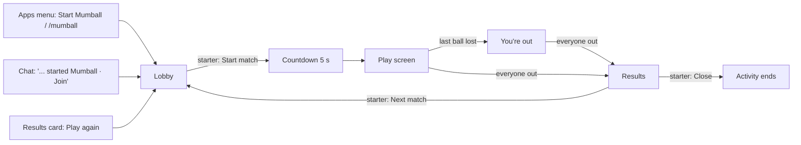
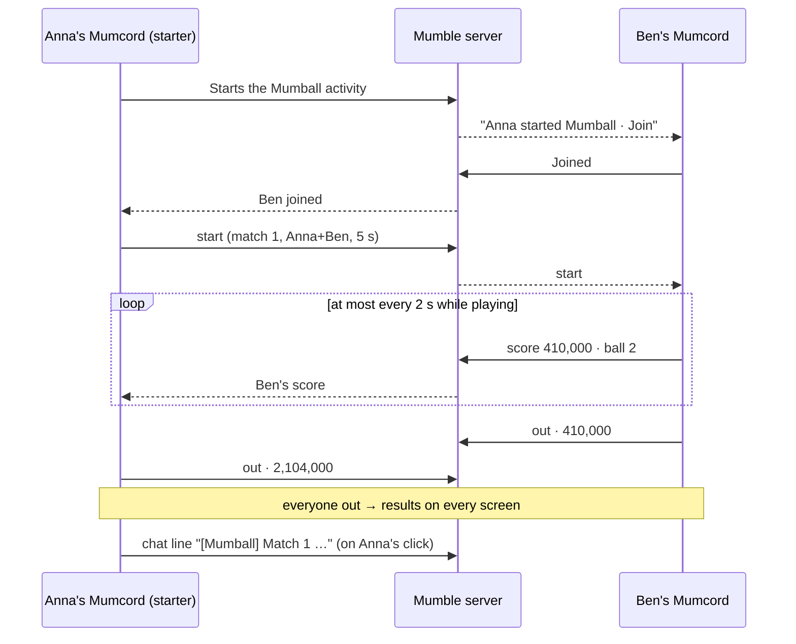
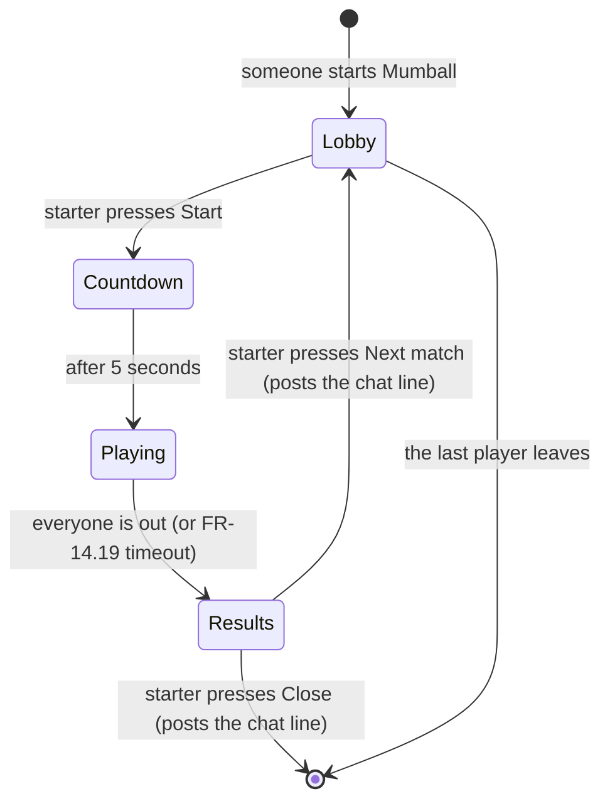
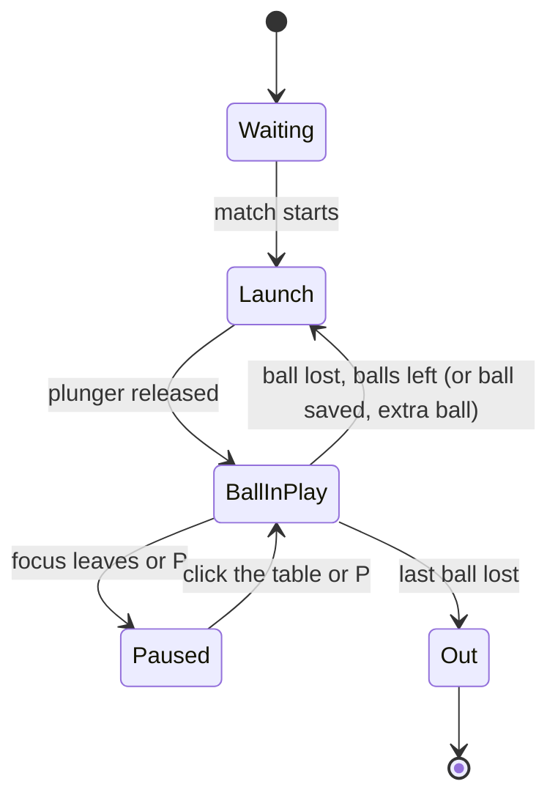

# 14 – Pinball plugin "Mumball" (working title) · Specification

> Status: Final (brainstorming completed) · As of: 2026-11-09
> Sources: `specs/14-pinball-plugin-brainstorming.md` (rounds 1–5, all recommendations taken)
> Builds on: `specs/06-plugin-system-specification.md` (plugin system, permissions, message limits FR-6.36, old servers FR-6.38, package limits FR-6.10), `specs/09-plugin-platform-1-1-specification.md` (activities in the media area FR-9.46 … FR-9.48, web content host FR-9.32 … FR-9.45, sound effects, gesture rule), `specs/13-plugin-platform-1-2-specification.md` (theme tokens and UI kit for plugin pages)
> Repositories: the plugin is built in `Mumcord/plugins` (folder `mumball/`); this specification lives in `Mumcord/mumcord` next to the platform specs. Nothing in the Mumcord client changes.
> Numbering: requirements and criteria use the spec file number (`FR-14.n`, `AC-14.n`).

## 1. Goal & context

Friends in a voice channel want something light to play together while they talk. The wish was to bring the old Windows pinball game into Mumcord; that game (3D Pinball for Windows – Space Cadet) can't be used, because its table, art, sounds and code belong to Microsoft, the plugin review requires an open-source licence and a plugin can't load the original files. **Mumball** is therefore a new, original pinball game as an official Mumcord plugin: everyone in the channel plays their own table at the same time, a live scoreboard shows who is ahead, and the results land in the chat. It uses only the existing plugin platform (API 1.2) and works against any unmodified Mumble server.

## 2. Scope

### 2.1 In scope (MVP)

- One original table with the theme radio station "On Air" (Q1.1), working name "Mumball" (Q1.2).
- Matches: everyone plays their own table at the same time, 3 balls each, up to 8 players, live scoreboard, results (Q1.3 … Q1.5); a match with one player for playing alone (Q1.7); late joiners play the next match (Q1.6).
- Table elements: two flippers, plunger with skill shot, bumpers, slingshots, drop targets, rollover lanes O-N-A-I-R, one ramp, one orbit, 3–4 missions, ball save, bonus multiplier, extra ball, nudge and tilt (Q1.8).
- Highscores: personal top 10 on the device, a "Tonight" board per activity, a results line and a results card in the chat (Q1.9, Q3.6, Q3.7).
- Screens in the media area: lobby, play screen (layout A, automatically B when narrow), "you're out" view, results (Q2.1 … Q2.5).
- Flat 2D illustrated look with a dark and a light palette (Q2.6, Q2.7); lamps, score pop-ups, LED ticker, table shake (Q2.8).
- Keyboard controls with two key sets, automatic pause (Q2.9 … Q2.11).
- Table sounds and short jingles, ducked under voice, own volume and mute (Q3.1, Q3.2); talking glow on the scoreboard (Q3.4).
- Score sync over Mumble plugin data every 2 seconds (Q3.5); optional notification, off by default (Q3.8).
- Edge cases: starter hand-over, players leaving, long pauses, ties (Q5.1 … Q5.4).
- All 24 Mumcord languages, AGPL-3.0, package ≤ 5 MiB, tests in the mock host and end to end in Mumcord (Q1.11, Q4.7, Q4.8).

### 2.2 Out of scope / later

- Turn-based play and watching another player's table live (Q1.3, Q2.4); live score updates over the relay (Q3.5).
- Sprint mode or a mode choice in the lobby (Q1.4).
- Private practice mode (Q1.7).
- Multiball, a third flipper, more tables (Q1.8).
- Verified (replay-checked) scores (Q1.10).
- An all-time highscore list for a server: impossible without storing something on the server.
- Side panel and dialog as places to play (Q2.1).
- Ready check, attract mode, honours, animated ticker scenes (Q2.3, Q2.5, Q2.8).
- Mouse and game controller input; changing the keys (Q2.9, Q3.3).
- Background music (later, off by default); spoken announcements (not planned) (Q3.1).
- Chat lines at match start and for personal bests (Q3.6).
- WebGL effects (Q4.4); translated table lettering (Q4.9); a "relaxed" slower ball (Q4.10).
- Keeping the "Tonight" board across restarts (Q5.5).
- Mumphone (iOS) has no plugin support; not affected.

## 3. Roles & permissions

Mumball needs no Mumble ACLs beyond being in a voice channel and being allowed to send plugin data and text messages there. Roles exist only inside the game:

| Action | Starter | Player | Channel member with the plugin, not joined | Mumcord user without the plugin | Standard Mumble user |
|---|---|---|---|---|---|
| Start the activity (Apps menu, `/mumball`) | yes | yes (when none runs in the channel) | yes | – | – |
| Join the lobby (Join) | – | – | yes | gets "Get plugin" (FR-9.47) | – |
| Start match, Next match, Close | yes | – | – | – | – |
| Play, pause, leave | yes | yes | – | – | – |
| See scoreboard and results | yes | yes | results card in the chat | – | results text line |

The starter is the person who started the activity; when they leave, the player who has been in the activity longest becomes the starter (FR-14.17). Mumble enforces only whether plugin data and text messages may be sent; everything else is decided by the plugin on each client.

Plugin permissions (manifest):

| Permission | Kind | Purpose |
|---|---|---|
| `ui.stage`, `ui.webview` (place `stage`) | required | The game in the media area |
| `ui.app-menu` | required | "Start Mumball" in the Apps menu |
| `peers.messages` | required | Lobby, match start, scores, results between players |
| `storage` (quota ≤ 64 KiB) | required | Personal top 10 and settings |
| `audio.effects` | optional, suggested | Table sounds and jingles |
| `events.voice` | optional, suggested | Talking glow on the scoreboard |
| `chat.send`, `chat.supersedes` | optional, suggested | Results line for standard Mumble users, hidden for Mumball users |
| `ui.chat-card` | optional, suggested | Results card in the chat |
| `commands` | optional | `/mumball` |
| `notify` | optional, off by default | "Someone in your channel started a match" |

No `net.*`, `secrets`, `peers.relay`, `files.*` or `chat.post-image`.

## 4. Functional requirements

### 4.1 Activity and lobby

- **FR-14.1** "Start Mumball" in the Apps menu (label translated, plugin icon) and `/mumball` start an activity in the user's current voice channel (FR-9.46) with `max_participants` 8. The starter's Mumcord shows the lobby; others in the channel with the plugin see "<name> started Mumball · Join".
- **FR-14.2** At most one Mumball activity per channel (platform rule). Starting while one runs opens the existing one.
- **FR-14.3** The lobby shows: the players who joined (starter marked), "Players (n of 8)", the "Tonight" board of this activity, the user's personal best, a keys card with the push-to-talk hint (FR-14.27), the volume control and mute. The starter sees "Start match"; everyone else sees "Waiting for <starter> to start…".
- **FR-14.4** A ninth person pressing Join gets the platform's "This activity is full".
- **FR-14.5** Joining while a match runs puts the person in the lobby state "Next match", showing the live scoreboard of the running match; they play from the next match on.

### 4.2 Match flow

- **FR-14.6** "Start match" announces the match to all players with the player list and a 5-second countdown. Every player's table starts when its own countdown ends; the start time may differ by the network delay between players.
- **FR-14.7** Each player plays 3 balls on their own table. Extra balls add balls for that player only.
- **FR-14.8** A player is "out" when their last ball is lost. Their screen switches to their final score and a larger scoreboard (FR-14.22).
- **FR-14.9** When every player is out, every screen shows the results. Before that, a player's final score must have arrived; if a final score is missing 10 seconds after the player was announced out, their last known score is used and marked "?".
- **FR-14.10** Results: ranking by score with shared places for equal scores ("1. Anna, 1. Ben, 3. Cleo"), "New personal best" for the user when it applies, the starter's buttons "Next match" and "Close", and "Leave" for everyone.
- **FR-14.11** "Next match" (starter) takes everyone in the activity back to the lobby; late joiners now take part. "Close" ends the activity for everyone. Both clicks post the chat results (FR-14.30) of the match that just ended.
- **FR-14.12** A match with only the starter is allowed; it is a normal match (solo play).

### 4.3 Table and rules

- **FR-14.13** The table contains: left and right flipper, plunger lane with plunger and skill shot (a bonus when the ball stops in a marked zone at the top of the launch), three bumpers, two slingshots, a bank of drop targets, five rollover lanes spelling O-N-A-I-R, one ramp, one orbit, inlanes and outlanes, and an ON AIR lamp. Art and names follow the radio-station theme.
- **FR-14.14** Rules:
  - **Scoring:** every element scores points; the exact values are tuned in play tests and documented in the plugin README.
  - **Lanes:** completing O-N-A-I-R raises the bonus multiplier (up to ×5) and resets the lanes; lane lights shift with the flipper buttons.
  - **Missions:** 3–4 missions (e.g. "Tune in", "Request hour", "Go live") light one after another; each has a short goal (hits on a named element within a time) and a large bonus; completing all lights "extra ball".
  - **Ball save:** a lost ball within the first 10 seconds after launch is returned once per ball ("BALL SAVED").
  - **End-of-ball bonus:** collected bonus × multiplier is added when a ball is lost.
  - **Extra ball:** lit by finishing all missions; collected at the ramp.
  - **Nudge and tilt:** a nudge pushes the ball slightly and shakes the table; more than 3 nudges within 6 seconds is a tilt warning, the next one is a tilt: flippers die, the ball is lost without end-of-ball bonus.
- **FR-14.15** The LED ticker at the top of the table shows the current mission, events ("BALL SAVED", "EXTRA BALL", "TILT") and the score; all ticker texts are translated. Painted table lettering (ON AIR, O-N-A-I-R) stays as art in every language (Q4.9).

### 4.4 Pause and focus

- **FR-14.16** The table only receives keys while the game frame has focus. When focus leaves (Esc, F6, a click elsewhere, switching windows) or the user presses P, the user's own table pauses and shows "Paused · click the table or press P to go on". Other players keep playing. If the frame doesn't have focus when the match starts, the countdown shows "Click the table to play" and the table waits paused.

### 4.5 Edge cases

- **FR-14.17** Starter leaves: the player who has been in the activity longest becomes the starter and gets the starter's buttons; everyone sees "<name> now starts the matches".
- **FR-14.18** A player leaves during a match (Leave, leaving the channel, disconnect): they stay in this match's results with their last known score, marked "left"; the match doesn't wait for them.
- **FR-14.19** Only paused players are still in: when all other players are out and only paused players remain, a visible 60-second countdown starts ("Match ends in 60 s · waiting for Ben (paused)"). Unpausing stops it. At 0 the match ends; paused players' current scores count, marked "paused".
- **FR-14.20** The last player leaving ends the activity (platform).
- **FR-14.21** Servers without plugin data support (FR-6.38): the lobby shows "This server doesn't support shared plugin features"; the user can still play a match alone; no scores are shared.

### 4.6 Scoreboard and highscores

- **FR-14.22** The scoreboard lists every player of the match with place, name, score, current ball or "out"/"left"/"paused", and the user's own row marked "You". Scores count up smoothly between updates.
- **FR-14.23** Talking glow: with `events.voice` granted, a speaker glow appears next to the name of whoever is talking; without it, no glow.
- **FR-14.24** Personal top 10: score and date of the user's 10 best matches, stored on the device; shown in the lobby as "Your best"; a new entry at place 1 shows "New personal best" in the results.
- **FR-14.25** "Tonight" board: the 10 best scores (name and score) of all matches in this activity, kept in memory only and gone when the activity ends.

### 4.7 Sound and voice

- **FR-14.26** Sounds: flipper, bumper, slingshot, target, lane, ramp, orbit, launch, drain, tilt; jingles (≤ 2 s) for mission complete, extra ball, ball saved, new personal best. No music, no spoken announcements. Without `audio.effects` the game is silent and the volume control is hidden.
- **FR-14.27** The game has its own volume (default 40 %) and mute in the lobby and on the scoreboard. Game sounds are lowered while anyone talks (platform ducking for `audio.effects`). The keys card reads "If one of these keys is your push-to-talk key, use the other one."

### 4.8 Chat and notifications

- **FR-14.28** Mumball posts a chat line only on a click of the starter (FR-14.11), within the gesture rule.
- **FR-14.29** The results line: "[Mumball] Match <n> · 1. <name> <score> · 2. <name> <score> · …", at most 500 characters (further players cut with "+<k> more"), scores with thousands separators in the starter's language.
- **FR-14.30** Mumcord users with Mumball (and `chat.supersedes`) see a results card instead of the line: match number, ranking and "Play again", which opens the activity's lobby (or starts a new activity if it has ended). Without `ui.chat-card` they see the text line.
- **FR-14.31** Notification (permission `notify`, setting off by default): "<name> started a pinball match" when someone in the user's channel starts a Mumball activity.

### 4.9 Settings

- **FR-14.32** The plugin's settings (Settings → Plugins → Mumball) hold: volume, mute, "Tell me when someone in my channel starts a match" (off). They are also changed by the in-game controls.

## 5. UI & UX

### 5.1 Navigation



Mumcord draws the header above every screen: plugin icon and name, "Started by <name> · <n> in the game", connection chip, Pop out, Full screen, Leave (FR-9.48). The game fills only the area below.

### 5.2 Lobby

```text
┌ Mumball · Started by Anna · 3 in the game                          Leave ┐
│   MUMBALL · ON AIR                                       🔊 ━━━○──  Mute │
│   Players (3 of 8)                 Tonight in #Lounge                    │
│    • Anna (starter)                 1. Ben    2,310,000                  │
│    • You                            2. Anna   1,980,000                  │
│    • Ben                           Your best: 1,950,000                  │
│                                                                          │
│   Keys: Left Shift / ← left flipper · Right Shift / → right flipper ·    │
│         hold Space or ↓ = plunger · ↑ nudge · P pause                    │
│   If one of these keys is your push-to-talk key, use the other one.      │
│                                                                          │
│                [ Start match ]          ← starter only                   │
│         Waiting for Anna to start…      ← everyone else                  │
└──────────────────────────────────────────────────────────────────────────┘
```

### 5.3 Play screen

Layout A (default); layout B when the area is narrower than the table plus a 16 rem scoreboard. The table keeps its aspect ratio and is scaled to the available height.

```text
┌ Mumball · Started by Anna · 3 in the game     Pop out  Full screen  Leave ┐
│   ┌────────────────────────┐   ┌────────────────────────────────┐        │
│   │ [ON AIR]  ticker:      │   │ MATCH 2 · 3 balls              │        │
│   │ "Mission: Tune in"     │   │ 1. Anna 🔊 1,204,000   ball 3  │        │
│   │    (o)   (o)   (o)     │   │ 2. You      880,500   ball 2   │        │
│   │  ╲ ramp        orbit ╱ │   │ 3. Ben      410,000   out      │        │
│   │           ●            │   ├────────────────────────────────┤        │
│   │   ▷              ◁     │   │ Ball 2 · bonus ×3   🔊  Mute   │        │
│   │     ╲__        __╱     │   │ Your best 1,950,000            │        │
│   └────────────────────────┘   └────────────────────────────────┘        │
└──────────────────────────────────────────────────────────────────────────┘

Layout B:
┌ Mumball · …                     Leave ┐
│ 1. Anna 1.2M · 2. You 880k · B2  🔊   │
│ ┌───────────────────────────────────┐ │
│ │            (table)                │ │
│ └───────────────────────────────────┘ │
└───────────────────────────────────────┘
```

### 5.4 You're out and results

- **You're out:** final score large, the scoreboard enlarged with each player's ball or state, "Waiting for 2 players…"; the 60-second countdown of FR-14.19 when it applies.
- **Results:**

```text
│   RESULTS · Match 2                                        │
│    1. Anna   2,104,000                                     │
│    2. You    1,990,000   ★ New personal best               │
│    3. Ben      410,000   left                              │
│          [ Next match ]  [ Close ]  ← starter     [ Leave ] │
```

### 5.5 Keys

| Action | Keys |
|---|---|
| Left flipper | Left Shift or ← |
| Right flipper | Right Shift or → |
| Plunger | hold Space or ↓, release to launch (strength = hold time, max 1 s) |
| Nudge | ↑ |
| Pause / resume | P |
| Lobby and results | Tab / Shift+Tab, Enter, Space |
| Back to Mumcord | Esc or F6 (platform; pauses the table) |

### 5.6 Messages and empty states

- No other players yet: "Nobody else here yet. Start a match to play alone, or wait for others to join."
- Old server: "This server doesn't support shared plugin features. You can still play alone."
- Full: platform "This activity is full".
- Starter change: "<name> now starts the matches".
- Waiting for a missing final score: "Waiting for <name>'s score…".

### 5.7 Design notes

- **Style:** flat 2D from straight above, illustrated like a poster of a 1970s radio studio (wood panels, chrome knobs, glowing lamps), vector art.
- **Palettes:** dark "late-night studio" (deep navy, warm amber lamps, red ON AIR glow); light "daytime studio" (cream, teal, old-radio colours). The table follows Mumcord's mode via the theme tokens; lobby, scoreboard, results and buttons use the Mumcord UI kit (API 1.2) and change live with the theme. High-contrast mode uses the dark palette with stronger outlines on the ball, flippers and walls.
- **Effects:** lamp patterns, score pop-ups at the hit point, LED ticker, short table shake on big hits and nudges. Nothing flashes more than 3 times per second. With "reduce motion": no shake, lamp patterns calm to steady on/off.
- **Display font:** a font under the SIL Open Font License for ticker and scores; UI text in Mumcord's fonts.

## 6. Audio & network

- **Audio:** only bundled sound effects via `audio.effects` (Ogg Vorbis, each ≤ 2 s for jingles, ≤ 1 s for table sounds), played locally, never transmitted, muted while deafened, lowered while anyone talks (platform). Volume default 40 %. The platform plays at most four effects at once across all plugins; Mumball drops a new table sound when four are playing rather than queueing it. Mumball doesn't touch the microphone, voice transmission or codecs.
- **Network:** Mumble plugin data only (`peers.messages`, visibility "players of this activity"), small messages (≤ 128 bytes), encoded as Bovnar documents (spec 09). No relay, no internet.
- **Messages** (functional level): `lobby` (player list, starter), `start` (match number, player list, countdown), `score` (score, ball, state; at most one per 2 s per player, only when changed), `out` (final score), `pause-state`, `results-ack`. The final `out` message uses the game burst if the normal budget is exhausted, and is repeated once after 2 s.
- **Rate limits:** each player sends at most 1 message per 2 s while playing (FR-6.36); incoming messages from non-players are ignored.
- **Flow:**



- **Compatibility:** standard `PluginDataTransmission` (server ≥ 1.4) and text messages. Standard Mumble clients ignore the plugin data and see only the results line. Older servers: FR-14.21.
- **Reconnect:** a player whose connection drops counts as "left" (FR-14.18); after reconnecting they can join the next match.

## 7. Data & state model

### 7.1 Stored on the device (plugin storage, ≤ 64 KiB)

| Entity | Field | Type | Required | Rules |
|---|---|---|---|---|
| PersonalBest (≤ 10) | score | integer ≥ 0 | yes | sorted descending |
| | date | date (YYYY-MM-DD) | yes | local date of the match |
| Settings | volume | integer 0–100 | yes | default 40 |
| | muted | boolean | yes | default false |
| | notify_on_start | boolean | yes | default false |

No names of other people are stored. "Reset data" and removing the plugin with "Also delete its data" delete everything (platform).

### 7.2 In memory only (per activity)

| Entity | Fields | Lifetime |
|---|---|---|
| Activity | channel, starter, players with join order, match number | while the activity runs |
| Match | number, players, per player: score, ball, state (playing, paused, out, left), final score | until the next match |
| Tonight board | top 10 (name, score) | while the activity runs |

### 7.3 States





## 8. Technology & architecture

- **Plugin API 1.2** (`mumcord:plugin@1.2.0`, manifest `api: "^1.2"`, `min_mumcord` 0.8): Mumcord's theme tokens and UI kit make lobby and scoreboard look like Mumcord without copying its design (Q4.1).
- **Two parts** (Q4.2):
  - **Core** (Rust, `mumcord-plugin-sdk` with feature `1.2`, `wasm32-unknown-unknown`): activity and match state, starter hand-over, plugin messages (Bovnar), chat line and card, storage, sounds, Apps menu, command, notification, i18n.
  - **Web page** (`web/`, TypeScript compiled to plain JavaScript, no framework, no runtime dependencies): physics, rules, drawing, input, HUD. It talks to the core only through the message bridge: "score/ball/state" every 2 s at most, "play sound <name>", and receiving lobby/scoreboard data.
- **Physics** (Q4.3): own small engine; a circle against line segments and arcs, fixed time step of 1/480 s, sub-stepped per frame, so a ball at top speed can't pass through a flipper and the game behaves the same at any frame rate. Flippers are rotating segments with angular velocity transferred to the ball.
- **Drawing** (Q4.4): Canvas 2D; the vector art (SVG in the source) is rasterised once per size change into layers (static table, lamps, moving parts).
- **Assets** (Q4.6): vector art drawn for Mumball, sounds synthesised for Mumball with sources in `sounds-src/`, an OFL display font; all under the plugin licence or OFL, listed in the README.
- **Licence** AGPL-3.0 (Q4.7), reproducible build with a pinned Rust toolchain (review rules).

## 9. Non-functional requirements

- **Performance:** a steady 60 frames per second on a five-year-old laptop with integrated graphics during a voice call; higher refresh rates used when possible. Flipper response within one frame. When the frame is hidden (another stage tab), drawing stops and the table pauses (FR-14.16).
- **Package:** ≤ 5 MiB packed; within FR-6.10 file rules.
- **Memory:** core ≤ 16 MiB (`limits.memory_mib`).
- **Security:** no network access, no remote code, all web content in the package (review rules). Names from the server are rendered as text only.
- **Privacy:** only score, ball and state are sent, and only to players of the activity. Stored data per §7.1. No logging of names or scores; logs contain only errors and counts.
- **Accessibility** (Q4.10): everything around the table works with the keyboard alone; screen readers read lobby, scoreboard and results and announce match start, ball number, "You're out" and the final ranking through a live region; places are numbered and the own row says "You", nothing depends on colour alone; "reduce motion" per §5.7; nothing flashes more than 3 times per second. Pinball itself can't be played by ear; that is stated in the README.
- **Languages:** all 24 Mumcord languages for every text (`i18n/<tag>.json`).
- **Platforms:** wherever Mumcord 0.8.0 runs (Windows, macOS, Linux).

## 10. Build, packaging & release

- Folder `mumball/` in `Mumcord/plugins` with `manifest.json`, `Cargo.toml`, `rust-toolchain.toml`, `LICENSE`, `README.md`, `i18n/`, `web/` (built output plus TypeScript sources), `sounds/`, `sounds-src/`, `assets/` (icon), `scenarios/`, `e2e/`.
- `mumcord-plugin build --reproducible`; registry entry `plugins/mumball/`; published in the `v1.1` index only, `min_mumcord` 0.8.
- E2E needs Mumcord 0.8.0: `mumball/e2e/min-mumcord` names `v0.8.0` until the pinned tag reaches it.
- Before building: an issue in `Mumcord/mumcord` (like #394) for the maintainers' agreement, drafted from this specification and shown to the product owner before posting (Q5.6).
- Release after Mumcord 0.8.0 is out; the "Mumball" name is checked (trademarks, app stores) before publishing.

## 11. Acceptance criteria (verifiable in the running client)

Setup unless stated otherwise: local Mumble test server (1.5), three Mumcord 0.8.0 clients A, B, C with Mumball installed, one standard Mumble client D, all in channel "Lounge".

- **AC-14.1** A chooses "Start Mumball" in the Apps menu → the lobby opens in A's media area; B and C see "A started Mumball · Join"; D sees nothing.
- **AC-14.2** B and C press Join → all three lobbies list A (starter), B, C and "Players (3 of 8)"; only A sees "Start match".
- **AC-14.3** A presses Start match → all three see a 5-second countdown, then their own table; each launches a ball with Space.
- **AC-14.4** During play the scoreboards of A, B and C show all three scores, updated at least every 2 s; the plugin-data inspector shows at most one Mumball message per 2 s per player outside the final `out`.
- **AC-14.5** C loses all 3 balls → C sees the final score and the enlarged scoreboard; A and B see C as "out".
- **AC-14.6** When all are out → all three show identical rankings; equal scores share a place (forced with a test build).
- **AC-14.7** A presses Next match → D receives one "[Mumball] Match 1 · …" line; A, B and C see a results card instead of the line; everyone is back in the lobby.
- **AC-14.8** A ninth client pressing Join (test with `max_participants` overridden to 3 in a developer build) sees "This activity is full".
- **AC-14.9** A fourth Mumcord client E joins during a match → E sees the live scoreboard and "Next match"; E plays in the next match.
- **AC-14.10** A leaves the activity in the lobby → B (longest present) gets Start match; everyone sees "B now starts the matches".
- **AC-14.11** B disconnects during a match → B appears in the results with the last score, marked "left"; the match ends when A and C are out.
- **AC-14.12** C presses P while A and B are out → a 60-second countdown appears for A and B; after 60 s the results show C's score marked "paused". Repeating with C unpausing stops the countdown.
- **AC-14.13** Clicking into the chat during play → the user's table pauses with the pause message; other tables continue.
- **AC-14.14** A alone presses Start match → a solo match runs; a score above the previous best shows "New personal best" and appears in the lobby's "Your best" after restarting Mumcord.
- **AC-14.15** Keys: Left/Right Shift and ←/→ move the flippers, Space and ↓ launch, ↑ nudges, four quick nudges cause a tilt; a ball lost within 10 s after launch is returned once with "BALL SAVED".
- **AC-14.16** Physics: a scripted test fires the ball at maximum speed at both flippers 1,000 times; it never passes through.
- **AC-14.17** Sounds: table sounds play; they get quieter while B talks; mute silences them; with `audio.effects` turned off the game is silent and the volume control is hidden.
- **AC-14.18** Talking glow: B talks → a glow appears next to B's name for A and C; with `events.voice` off for A, A sees no glow.
- **AC-14.19** Dark and light theme in Mumcord → table palette and lobby/scoreboard change live without reloading; dark and light screenshots match the specification's design notes.
- **AC-14.20** Reduce motion on in the OS → no table shake, steady lamps.
- **AC-14.21** Screen reader (VoiceOver on macOS, NVDA on Windows) → lobby, scoreboard and results are read; match start, ball number, "You're out" and the ranking are announced.
- **AC-14.22** Keyboard only: join, start, play, read results, Next match and Leave without a mouse; Esc returns focus to Mumcord.
- **AC-14.23** Server with plugin data blocked → the lobby shows "This server doesn't support shared plugin features. You can still play alone."; a solo match works.
- **AC-14.24** Performance: on the reference laptop during a voice call, the frame-time overlay of a test build shows ≥ 58 frames per second over 3 minutes of play.
- **AC-14.25** Package: `mumcord-plugin check --official` passes; size ≤ 5 MiB; 24 language files with the keys of `en.json`; CI of `Mumcord/plugins` green (reproducible rebuild, licence scan, mock-host scenarios).

## 12. Decision log

| Question | Decision | Note |
|---|---|---|
| (chat 2026-11-09) | No content from 3D Pinball for Windows – Space Cadet | Microsoft owns it; no OSI licence; plugins can't load the original files |
| Q1.1 | Theme radio station "On Air" | No space or sci-fi theme |
| Q1.2 | Working name "Mumball" | Name check before release |
| Q1.3 | Simultaneous match, own table each | Turns later |
| Q1.4 | 3 balls | Sprint later |
| Q1.5 | Up to 8 players | |
| Q1.6 | Late joiners play the next match | |
| Q1.7 | Solo = match with one player | Practice mode later |
| Q1.8 | Table elements of FR-14.13 | Multiball, third flipper, more tables later |
| Q1.9 | Personal top 10, Tonight board, results line | No server-wide list (would need the server) |
| Q1.10 | Trust scores | Verified scores later |
| Q1.11 | Official plugin in `Mumcord/plugins` | Needs maintainer yes |
| Q2.1 | Media area only | Side panel later |
| Q2.2 | Layout A, auto B when narrow | |
| Q2.3 | Lobby: players, starter's Start, keys, Tonight, personal best | Ready check, attract mode later |
| Q2.4 | Out: final score + enlarged scoreboard | Watching live later |
| Q2.5 | Results: ranking, personal best, Next match | Honours later |
| Q2.6 | Flat 2D illustrated | |
| Q2.7 | Two palettes following the theme | |
| Q2.8 | Lamps, pop-ups, LED ticker, shake | ≤ 3 flashes per second |
| Q2.9 | Keyboard | Mouse, controller later |
| Q2.10 | Shift + arrows, Space/↓, ↑, P | |
| Q2.11 | Auto-pause on focus loss | |
| Q3.1 | Table sounds and jingles | No music, no voice-overs |
| Q3.2 | Ducked under voice, own volume (40 %) and mute | |
| Q3.3 | Two key sets + lobby hint | Key changes later |
| Q3.4 | Talking glow (optional permission) | |
| Q3.5 | Score updates every 2 s, no relay | Relay later |
| Q3.6 | Results line only | |
| Q3.7 | Results card for Mumcord users | |
| Q3.8 | Notification off by default | |
| Q4.1 | API 1.2 | Release after Mumcord 0.8.0 |
| Q4.2 | Table in TypeScript in the page, core in Rust | |
| Q4.3 | Own fixed-step physics | |
| Q4.4 | Canvas 2D | WebGL later |
| Q4.5 | 60 fps on a five-year-old laptop | |
| Q4.6 | Own art and sounds, OFL font | |
| Q4.7 | AGPL-3.0 | |
| Q4.8 | ≤ 5 MiB | |
| Q4.9 | Painted lettering stays as art | |
| Q4.10 | Keyboard, screen reader around the table, not colour-only, reduce motion | Relaxed mode later |
| Q5.1 | Longest present player takes over | |
| Q5.2 | Leavers stay in results, marked "left" | |
| Q5.3 | 60 s countdown when only paused players remain | |
| Q5.4 | Shared places | |
| Q5.5 | Save personal top 10 and settings only | |
| Q5.6 | Issue for maintainers before building | Shown to the product owner first |

## 13. Open points & risks

- **Maintainer agreement** (owner: product owner): an official plugin needs the Mumcord maintainers' yes; until then nothing is built.
- **Name** (owner: product owner): "Mumball" is a working name; trademark and store check before release.
- **Dependency on Mumcord 0.8.0:** API 1.2 ships with 0.8.0; if 0.8.0 slips, Mumball slips.
- **Game feel:** point values, mission goals, flipper strength and ball speed need play tests; the README documents the final values.
- **Four-sound limit:** the platform plays at most four effects at once across all plugins; busy bumper sequences may drop sounds. Accepted for the MVP.
- **Fairness:** scores are trusted; a modified client can fake them (Q1.10).
- **Start offset:** tables start up to the network delay apart (usually well under a second); accepted.
- **Push-to-talk on a game key:** only the hint helps until key changes come.

## 14. Impact on the roadmap

None for the Mumcord client. A new official plugin in `Mumcord/plugins` that can only be released after Mumcord 0.8.0 (plugin API 1.2). The roadmap's spec index can list `14-pinball-plugin-specification.md` when the spec lands.
