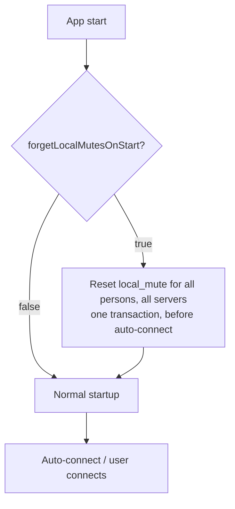

# Mumcord · Feature 15 – Forget local mutes on startup · Specification

> Status: Final (brainstorming completed) · As of: 2026-11-17
> Sources: issue #872 ("Option to clear local mutes when Mumcord starts"), `specs/15-clear-local-mutes-brainstorming.md`
> Builds on: `specs/01-foundation-specification.md` (stack, settings storage, 24 locales, accessibility), `specs/02-multi-server-themes-specification.md` (per-server person settings), `specs/03-comfort-polish-specification.md` (settings conventions), `specs/11-activity-log-specification.md` (activity feed — deliberately not used here). All decisions there stay valid.
> Numbering: file number 15 → requirement IDs `FR-15.x` and `AC-15.x`. Standalone feature, not a roadmap epic.

## 1. Goal & context

A local mute silences one person only for yourself; the server and other people never see it. Mumcord remembers local mutes per server and per person forever, across app restarts. Users who mute people ad hoc (e.g. someone with a noisy microphone for one evening) end up with stale mutes they forgot about. The official Mumble client (1.6 RC) added an option to forget local mutes when the client starts. This feature adds the same option to Mumcord: one global toggle, off by default, that clears all stored local mutes once at app start.

## 2. Scope

### 2.1 In scope (MVP)

- A new global setting "Forget local mutes when Mumcord starts" (default **off**).
- When enabled: at app start, before any auto-connect, reset the `local_mute` flag of every stored per-person setting on **all** servers to `false`.
- Settings UI group on the Chat & Notifications page, next to Blocked users; findable via settings search.
- Translations for all 24 locales through the normal process.

### 2.2 Out of scope / later

- A manual "Forget all local mutes now" button (possible follow-up, Q1.5).
- Clearing on server connect/reconnect, or a configurable clearing moment (Q1.1).
- Per-server overrides of the toggle (Q1.3).
- An activity-log entry or any other notification about the clearing (Q1.4 — silent, like the official client).
- Any change to per-person volume, share volume, blocked users or friends — these are never touched.

## 3. Roles & permissions

Local mutes are a purely client-side comfort feature; no Mumble ACLs or server roles are involved.

| Role | Action | Enforced by |
|---|---|---|
| Any user | Mute/unmute a person locally | Client only; server never learns about it |
| Any user | Toggle "Forget local mutes when Mumcord starts" | Client only |

The server sees no protocol change whatsoever.

## 4. Functional requirements

- **FR-15.1** A new boolean app setting `forgetLocalMutesOnStart` exists, defaults to `false`, and persists like other app settings.
- **FR-15.2** When the setting is `true`, Mumcord resets `local_mute` to `false` for **all** stored per-person settings of **all** servers exactly once per app start, before the first (auto-)connect. `volume`, `share_volume`, blocks and friends are not modified.
- **FR-15.3** When the setting is `false`, behaviour is exactly as today: local mutes survive restarts and reconnects.
- **FR-15.4** Reconnects and server switches while the app keeps running never clear mutes, regardless of the setting. Only an app start clears.
- **FR-15.5** Changing the setting takes effect from the next app start; toggling it on never clears anything immediately.
- **FR-15.6** The clearing is silent: no dialog, toast, sound or activity-log entry.
- **FR-15.7** After the clearing, connected sessions and the UI show the affected people as not locally muted (no mute icon, audio audible). Because the clearing happens before any connect, sessions simply start from the cleared state.
- **FR-15.8** The clearing is a normal store write and follows the existing durability rules (Spec 12); a crash during the sweep must not corrupt the database (single transaction).

## 5. UI & UX

- Location: **Settings → Chat & Notifications**, a new group "Local mutes" directly above the Blocked users group (per-person behaviour stays together, Q2.1).
- Contents: one switch with label and helper text (Q2.2):

```text
┌──────────────────────────────────────────────────────────────┐
│ Local mutes                                                  │
│                                                              │
│  [ ] Forget local mutes when Mumcord starts                  │
│      People you muted only for yourself become audible       │
│      again after a restart. Volumes and blocked users        │
│      are kept.                                               │
└──────────────────────────────────────────────────────────────┘
```

- Settings search: the group is found via keywords "mute", "local mute", "forget", "startup", "start" (and their locale equivalents where the index supports them).
- No hotkeys, tray or overlay changes. No confirmation dialog — the switch is reversible and non-destructive to anything except mutes.
- Empty/error states: none special; the switch renders and behaves like every other settings switch. Store errors surface through the existing settings error handling.
- Design: existing switch component, light and dark theme, system scaling, keyboard operable, screen-reader label = the switch label, helper text linked via `aria-describedby`. Screenshots (dark + light) go to `docs/images/screenshots/` with the PR.
- All new strings are translated into the 24 locales through the normal process (human pass tracked in #291).

## 6. Audio & network

- No change to the audio pipeline, codecs, latency or transmit modes. A cleared local mute simply means the person's voice is mixed in again, exactly as if the user had unmuted manually.
- No protocol messages added or changed. The feature works against any unmodified standard Mumble server; minimum server version unchanged.
- The sweep happens locally before the first connect, so no session state needs to be re-synchronised with a server.

## 7. Data & state model

| Entity | Field | Type | Required | Rules/notes |
|---|---|---|---|---|
| App settings | `forgetLocalMutesOnStart` | boolean | yes | Default `false`; stored like other app settings |
| Per-person setting (existing, per server + certificate hash) | `local_mute` | boolean | yes | Reset to `false` for all rows at app start when the flag is on; one transaction |
| Per-person setting (existing) | `volume`, `share_volume` | integer | yes | Never touched by this feature |

Startup flow:



No new tables, no schema migration beyond the settings key; blocked users and friends live in separate stores and are untouched.

## 8. Technology & architecture

- Rust workspace, existing crates only: `store` gets the sweep (one SQL `UPDATE person_setting SET local_mute = 0` in a transaction) and the settings key; `engine` calls it once during startup before auto-connect; `src-tauri` exposes nothing new beyond the settings binding; UI is one new settings group component in React + TypeScript, bindings via tauri-specta as usual.
- Rationale: the whole feature is one settings flag plus one guarded store write at startup — no new modules, threads or IPC surface.
- The sweep runs on the startup path, not on the audio thread; it is a single small transaction and does not block real-time audio (no audio is running yet at that point).
- No secrets, no new permissions, no platform-specific code.

## 9. Non-functional requirements

- Startup impact: one SQLite transaction over a small table; imperceptible (< a few ms even with hundreds of stored persons).
- Privacy: local mutes never leave the device, before or after this change. No personal data in logs; the sweep logs at most a debug-level count, never names or certificate hashes.
- Accessibility and theming as in section 5; follows system theme and scaling.
- Platforms: all supported desktop platforms (Linux, Windows, macOS, FreeBSD) — no platform-specific behaviour.
- Security: unchanged; TLS and certificate handling untouched.

## 10. Build, packaging & release

Not applicable — no new dependencies, packages, CI steps or signing changes. Ships as a normal feature in the next milestone release; changelog entry under "Added".

## 11. Acceptance criteria (verifiable in the running client)

All flows against a local test server with a second client where a person is needed.

- **AC-15.1** Settings → Chat & Notifications shows the "Local mutes" group with the switch, off by default; settings search for "mute" and "forget" finds it.
- **AC-15.2** Option off: locally mute the second client's user, quit and restart Mumcord, reconnect → the user is still locally muted (icon shown, voice silent).
- **AC-15.3** Option on: locally mute the user, quit and restart Mumcord, reconnect → the user is audible and no mute icon is shown.
- **AC-15.4** Option on: set a per-person volume ≠ 100 and a share volume ≠ 100, block another user, add a friend, mute a person, restart → volumes, block and friend unchanged; only the mute is gone.
- **AC-15.5** Option on: mute a person on server A, restart Mumcord and connect only to server B → server A's stored mute is cleared as well (verify by connecting to A afterwards).
- **AC-15.6** Option on: while the app keeps running, mute a person, force a reconnect (e.g. short server restart) → the mute set in this session survives the reconnect.
- **AC-15.7** Turn the option on while mutes exist → nothing changes immediately; mutes are still active until the next app start.
- **AC-15.8** Dark and light screenshots of the new group are committed to `docs/images/screenshots/`.

## 12. Decision log

| Question | Decision | Note |
|---|---|---|
| Q1.1 | Clear only at app start | Matches official Mumble 1.6 RC; reconnects keep mutes |
| Q1.2 | All servers at once | One sweep, nothing stale left anywhere |
| Q1.3 | One global toggle | No per-server override in MVP |
| Q1.4 | Silent clearing | No activity-log entry; user opted in explicitly |
| Q1.5 | No manual "clear now" button | Later follow-up if wanted |
| Q2.1 | Chat & Notifications page, next to Blocked users | Per-person behaviour in one place |
| Q2.2 | Issue wording + plain-language helper text | Explains consequence and what is kept |
| Q2.3 | Acceptance criteria as listed | Expanded to AC-15.1…8 |
| — | Default off; volumes/blocks/friends untouched | Fixed by issue #872 |

## 13. Open points & risks

- Minimal risk overall. Only watch-out: the sweep must run before auto-connect so no session starts from stale mute state (covered by FR-15.2 and AC-15.3).
- Translations depend on the normal locale process; human quality pass is tracked globally in #291.

## 14. Impact on the roadmap

None. Standalone comfort feature; no effect on epics or releases beyond a changelog entry.